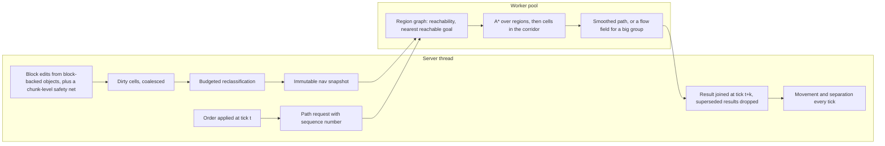
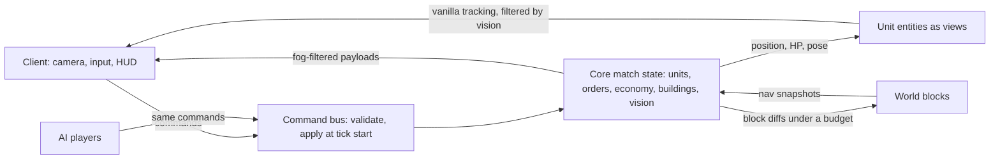
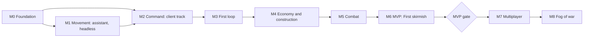

# 01 — Feasibility and complexity

Assessed on 2026-10-21 against the owner decisions of 2026-10-20 ([research/README.md](research/README.md) §1).
The evidence is the research digest and the reports it indexes; the toolchain is settled in
[02-tooling.md](02-tooling.md). Every Minecraft and NeoForge name below was checked in the
decompiled 1.21.1 + NeoForge 21.1.262 sources. [ROADMAP.md](ROADMAP.md) decides milestones and
features; this document says what is realistic, what it costs and what can sink it. Sections 1.1,
4 and 6 follow the reviewed roadmap and the spikes S1–S12 of
[04-architecture.md](04-architecture.md) §19.2; the whole document is re-estimated after M0 (§8).

**Assumptions**
- *Part-time* means about 12–15 hours a week of the owner's time, or 150–200 hours a quarter.
  The assistant writes the code and runs every task that ends on its own. The owner decides,
  reviews, play-tests and starts interactive clients ([03-design-process.md](03-design-process.md)).
- Every per-unit cost here is an unmeasured extrapolation until M0 measures it.
- Tiers T0–T3 are those of [research/mechanics.md](research/mechanics.md) §4.3. The MVP in §6 is
  the T0 slice of mechanics §4.1, which already includes a scripted AI, adapted to the owner
  decisions. T1 is the next stage.

**At a glance**

| Question | Answer |
|---|---|
| Is it realistic? | Yes for 0 A.D./AoE's core loop and a few of its signature systems at Minecraft scale. No for parity with 0 A.D. |
| MVP: a skirmish against a scripted AI | 35–49 weeks of part-time work (8–11 months); 6–8 months at 20 h/week |
| Population | 150 per player by default, 100 if M0 measurements say so |
| Units per match | 2 × 150 in the MVP; 4 × 150 in the multiplayer stage |
| Arena | 384 × 384 blocks (576 chunks), pregenerated and force-loaded |
| Server budget at 600 units (M4 Pro) | core ≤ 5 ms p50 and ≤ 10 ms p99; whole tick ≤ 23 ms p95 |
| Client budget | 60 fps with 200 units on screen; our own drawing ≤ 3 ms per frame |
| Network | ≤ 100 KB/s per client with 600 visible moving units |
| Hardest problems | pathfinding in a voxel world, unit scale, the AI opponent, camera and streaming, fog in a world made of blocks |

---

## 1. Verdict

**Strategos is realistic as a focused RTS with 0 A.D./AoE's core loop and a handful of its
signature systems, at Minecraft scale. Parity with 0 A.D. is not.** The engine allows it,
prior art has solved the hardest Minecraft-specific pieces one at a time, and 0 A.D.'s design
can be borrowed. Code volume will not be the limit. Iteration will be: the feel of movement
and controls, the AI opponent, balance and art all consume the owner's play-testing hours, and
a faster coder does not shorten those.

**Why it is realistic**
- NeoForge 21.1 has a first-party hook for nearly every system:
  - a plain `LivingEntity` view per unit that the core drives each tick, outside vanilla `Mob` AI
    and the `navigatingMobs` loop that block changes run over (ADR-0011);
  - `TicketController#forceChunk` to keep the arena ticking with nobody near;
  - `Entity#broadcastToPlayer(ServerPlayer)` for fog of war;
  - `RegisterGuiLayersEvent` and `RenderLevelStageEvent` for the HUD and overlays;
  - `PayloadRegistrar` for commands, `SavedData` for match state, GameTests for in-world tests.
- Prior art covers the hard Minecraft parts separately. Reign of Nether (RoN; Forge 1.20.1,
  ~141k lines) ships an RTS camera, block-by-block buildings, gathering from real blocks,
  server-side fog and 150 population per player. i113w's Camera Lib (MIT, NeoForge 1.21.1)
  solves the projection, the free cursor and mouse picking.
- 0 A.D.'s architecture is documented well enough to borrow as design: inheritable templates,
  one modifier pipeline, a hierarchical unit state machine with an order queue, and fixed tick
  phases.
- A Minecraft-free `core` runs and tests the game rules in milliseconds. That is most of the
  code, and it is where an AI assistant is strongest.

**Why parity is not** (details in §1.2)
- Content: 15 civilisations, hundreds of templates and a 19,200-line AI.
- Scale: one server thread and one rendered entity per unit cap a match at a few hundred
  units, not 0 A.D.'s 8 × 300.
- Art: 0 A.D.'s art set cannot be copied, and the assistant cannot draw.

**What the AI assistant changes**
- **Cheap now:** rules in `core`, the data pipeline, path algorithms (A*, region graphs, flow
  fields, an ORCA port), codecs and payloads, tests at every level, refactors, and checking API
  names against the decompiled sources.
- **Not cheaper:** how movement and controls feel, stuck-unit hunts in odd terrain, AI
  behaviour, balance, art and product decisions. Each needs the owner in a running client.
- **Blind spot:** the assistant cannot see the game until the client scenario harness (spike
  S3) works, and on the owner's Mac a client window can steal keyboard focus. Until then, every
  client feature is checked by the owner.
- **Risks it adds:**
  - fast code drifts from the architecture unless build rules enforce it (ArchUnit, ADRs);
  - GPL code seen in training can leak back, hence the clean-room rule;
  - plausible but wrong Minecraft API use, mitigated by checking the decompiled sources.
- **The owner's bar** (automated tests for every intermediate result) is affordable for core
  and server code, at roughly a third of the effort. For the camera and HUD, tests check
  structure and pixels, not quality, so milestone play-tests stay part of Done.

### 1.1 What is realistic when

Milestone names and estimates are those of §6.5.

| After | Owner hours | Realistic state | Not there yet |
|---|---|---|---|
| **3 months** | 150–200 | **A steerable tech demo.** M0 and M1 are done or nearly done, and M2's client track has run beside M1 since M0: the S9 camera prototype, the RTS camera, input and HUD. The build, the test levels and the performance harness run. S1 and S2 (and S4, with the owner's consent) have replaced guessed budgets with measured ones, and the population cap is set from them; S7, S8, S10 and S12 have checked the path service, the surface grid, kinematic movement and the content pipeline. On the 384² proving ground, 200 units take group move orders and cross ramps, steps, a bridge and a ford with no stuck units in GameTests, and a 600-unit soak holds the budgets. Units survive save and reload | The battle sandbox and first person (the end of M2); economy, buildings, an opponent. Nothing to play yet |
| **6 months** | 300–400 | **The first full loop.** M2 and M3 are done. From the RTS camera the player has commanded M2's battle sandbox, 30 against 30 spearmen with box select, attack-move and control groups, and walked among them in first person. In M3's crude match the player gathers wood from real trees and food from berry bushes and fields with manual reseed, raises a house and a barracks block by block, sends new units straight to work by rally point, finds idle workers with one key, spots the bot on a basic minimap, hears its attacks announced and burns its civic centre with torches. M4 (stone and iron, livestock, damage stages and repair, protection, save and resume) is under way | Four resources with sinks, save and resume, a counter triangle, garrison and the town bell, phases, siege, a real AI; balance |
| **12 months** | 600–800 | **MVP done; multiplayer begun.** The MVP of §6 (M6) lands around months 8–11: a solo skirmish from the title screen against a scripted AI with rush, boom and balanced openings and three difficulty levels; four resources with livestock and fields; a counter triangle with high ground; garrison and the town bell; Village→Town with visible equipment tiers, a defence tower and a ram; solo fog of war (D-24 (c)); conquest, save and resume, placeholder art. Month 12 starts the next stage, M7: 2–4 players on a dedicated server with a lobby, teams and reconnects, with the civilisation art pass beside it; team fog of war follows in M8 | Territory, capture, the full garrison, formations, catapults and walls, a second civilisation, an adaptive AI, fair fog for teams |

At 20 h/week each horizon moves about one milestone earlier; at 8 h/week it stretches by about
half. Unattended assistant runs shorten the code-heavy milestones (M1, M4) but not M2, M3, M5 or
M6, whose acceptance includes the owner's play-tests and verdicts. M2's client track uses the
owner's hours while the assistant builds M1 headless.

### 1.2 What full parity with 0 A.D. would mean

| Dimension | 0 A.D. Release 28 | Realistic ceiling for Strategos |
|---|---|---|
| Civilisations | 15 | 2–4, from shared templates plus a few unique units each |
| Systems | All of T0–T2: naval, trade and barter, walls and gates, heroes and auras, capture, formations, six victory conditions | T0–T1 in about two years; T2 items chosen one by one after that |
| Unit behaviour | `UnitAI.js`: 6,582 lines, 27 order types | The same state-machine pattern, about 8 order types in T0 |
| AI | Petra: ~19,200 lines of JS, six difficulty levels, four behaviour profiles | Scripted build orders on top of managers; 2–3 difficulty levels |
| Scale | 300 population per player, up to 8 players; a Normal map is 1,024 m (4,096 chunks) | 150 per player, 2–4 players, 384–512-block arenas. RoN keeps fog and its navmesh to world borders ≤ 1,280 blocks |
| Maps | Random map scripts, skirmish maps, scenarios | Authored arenas; generated arenas in T2 |
| Multiplayer | Deterministic lockstep, lobby, replays, observers | Server-authoritative, 2–4 players; replays in T3 |
| Art | A complete 3D art set (CC BY-SA 3.0; we copy none of it) | Vanilla models with armour, held items and skins; Blockbench models only where needed |

Mechanics parity at Minecraft scale is a 3–5-year part-time project. Content parity is out of
reach for one person. Scale parity is ruled out by the engine (§5). 0 A.D. itself shipped its
first release without the "Alpha" label in February 2026, after more than two decades of
volunteer team work. Strategos should define success as *plays like 0 A.D./AoE*, not
*contains 0 A.D.*

---

## 2. Complexity by subsystem

| Rating | Meaning | Typical part-time cost |
|---|---|---|
| 1 | Routine | days |
| 2 | Straightforward: clear design, few unknowns | 1–2 weeks |
| 3 | Substantial: known design, real integration work | 2–6 weeks |
| 4 | Hard: known design, Minecraft-specific unknowns, heavy iteration | 1–3 months, then ongoing tuning |
| 5 | Research-grade: no proven solution at our scale in Minecraft | open-ended |

"Design only" marks GPL or all-rights-reserved prior art: we use behavioural notes, never code.

| Subsystem (tier) | Complexity | Main difficulty | Known solution or prior art | Depends on |
|---|---|---|---|---|
| Simulation core: match object, tick phases, command bus, seeded RNG, templates and modifiers (T0) | 3 | Splitting authority with entities; a fixed phase order; deterministic delivery of async results; cached stats invalidated correctly | 0 A.D. components, templates, modifier pipeline and turn phases (design only); MineColonies' data-versus-entity split (design only) | — |
| Unit entities and the order system (T0) | 4 | A cheap generic entity per unit with a synced template id; a hierarchical state machine with an order queue (0 A.D.'s UnitAI is 6,582 lines and its hardest code); creating entity views without duplicates | 0 A.D. UnitAI states and queue operations (design only); kinematic `LivingEntity` views (ADR-0011), informed by the stripped-unit recipe of [engine.md](research/engine.md) §1.4 | Core, pathfinding, content pipeline |
| Pathfinding and group movement (T0) | 5 | Irregular 3D terrain; gathering and construction edit the world under moving units; 0.1–0.5 ms per vanilla search times group orders; stuck units; async results versus determinism | RoN's 2026 pipeline: cached grid, snapshots, worker pool, backpressure (design only); 0 A.D. hierarchical regions; HPA*; flow fields (Supreme Commander 2); RVO2 (Apache-2.0, portable) | Core, arena |
| Economy and gathering in the hybrid world (T0) | 4 | Turning real trees and stone outcrops into resource nodes; work slots on irregular shapes; removing blocks without floating leaves or pits; deposits and fields; dropsite return and retargeting | 0 A.D. gather rates, carry capacity, dropsites and field diminishing returns; RoN's per-chunk resource index (design only) | Units, pathfinding, content; shares block-backed objects with construction |
| Construction: block by block, abstract HP (T0) | 4 | Ordered placement under a global budget; foundations on uneven ground; units standing in footprints; blocks that fall away and return deterministically at HP thresholds; protection from players, explosions and fire | RoN's NBT templates and the AoE2 builder formula (design only); 0 A.D. damage variants at 85/65/35 %; MineColonies' phased placement (design only); `.nbt` parsed into our own blueprint | Economy, units, pathfinding, content |
| Production and population (T0) | 2 | Free spawn points around buildings; the batch-time formula; rally points that issue orders | 0 A.D. production queue, n^0.8 batches, population reserved at start | Construction, economy, units |
| Techs and phases (T0 two phases; T1 ~30 techs) | 2 | Requirements and supersede chains; invalidating cached stats; the tech UI | 0 A.D. tech format and modifiers | Core, production, HUD |
| Combat and counters (T0) | 3 | Target acquisition at scale; attack timing; analytic projectiles over voxel terrain; melee reach on slopes; invulnerability frames that swallow focus fire; damage to and from first-person players and buildings | 0 A.D. hack/pierce/crush with 0.9^level resistance; AoE bonus damage; i-frames reset in `LivingIncomingDamageEvent` | Units, core spatial index, content |
| Formations (T1, move only) | 3 | Slot layouts on uneven terrain and blocked cells; matching speeds; re-forming after chokepoints | AoE2 line, box and staggered; 0 A.D.'s walk-only formations; greedy or Hungarian slot assignment | Pathfinding, units |
| Territory (T1) | 3 | The influence grid and build restrictions are easy; drawing borders in a voxel world under Sodium is not; decay (T2) | 0 A.D. territory influence; static decals through `AddSectionGeometryEvent` | Construction, arena, HUD |
| Fog of war (T1) | 4; 5 with terrain secrecy | Forcing re-evaluation of entity visibility; blocks (and so buildings), sounds and particles leak past an entity filter; fog rendering without custom shaders; explored state | `broadcastToPlayer` override; RoN 1.4's vision grid every 10 ticks, chunk gating, biome-tint fog and match-start snapshot (design only) | Multiplayer sync, diplomacy, camera |
| Diplomacy (T1 allies; T2 neutral, tribute) | 2 | One faction model used consistently by targeting, friendly fire, shared vision and victory | Our own faction matrix with `isAlliedTo` and `getTeamColor` overrides; never scoreboard teams, which leak through fog | Core |
| Trade (T2) | 2 | Long trader routes; gain by distance; raiding and escort dynamics | 0 A.D. market and trader formulas | Pathfinding, construction, diplomacy |
| Victory conditions (T0 conquest; T2 others) | 2 | A robust "defeated" test (units in transit, buildings under construction); match end and reset | 0 A.D. end-game manager (design only) | Combat, construction, arena |
| AI opponent (T0 scripted; T2 adaptive) | 5; 3 for the scripted MVP AI | Managing an economy, placing buildings on voxel terrain, controlling and defending with an army, using only the human command API; tuning needs many automated matches | Petra's structure (design only); no Minecraft mod has an economic RTS AI | All gameplay systems; the command API |
| RTS camera and selection (T0) | 4 | Chunks and entity tracking follow the server-side body, not the camera; dedicated-server movement checks; the cursor versus screens; picking on Retina; canopies hiding units; switching to first person; feel | Camera Lib, Freecam and Better Mine Team (MIT, readable); RoN camera notes (design only); Minecraft Legends UX lessons | Multiplayer sync, arena |
| HUD, command card, minimap (T0 core; T1 full) | 3 | A large UI surface with no library; hotkeys while the cursor is free; minimap textures and overlays; tooltips; GUI scale | Vanilla `GuiGraphics` and `RegisterGuiLayersEvent`; our own small widget kit; 0 A.D. hotkey defaults | Camera, content, all gameplay systems |
| Data-driven content pipeline (T0) | 3 | Inheritance and merge operations with clear errors; client sync; generic entity types with a synced template id; hot reload for balancing | 0 A.D. template design; a reload listener with an `OnDatapackSyncEvent` payload | Core |
| Persistence (T0) | 3 | Match state in `SavedData` through versioned codecs; units and buildings never duplicated or lost; migrations | MineColonies' data-first records (design only); [engine.md](research/engine.md) §7 | Core, units, arena |
| Multiplayer sync and security (authoritative from T0; players in the next stage) | 4 | Validating every command (ownership by UUID, bounds, rates); interest management with fog; bandwidth; reconnection | Vanilla tracking tuned per entity type; a batched minimap channel; NeoForge payloads | Core, units, fog, camera |
| Arena and match lifecycle (T0) | 3 | Authoring, shipping and resetting arenas; keeping them ticking without players; several matches per server later; GameTest structures cap at 48 blocks per axis | RoN ships maps as worlds; `TicketController` with `ticking=false` | Persistence, content |
| First-person mode (T0, minimal) | 3 | Switching modes; placing the body; routing vanilla combat into core damage; death and respawn; preventing block edits | RoN's mixed commanders and first-person players (design only) | Camera, combat, multiplayer sync |
| Art: models, animations, icons, sounds (T0 placeholders) | 4 (capacity) | A readable silhouette for every unit; 40–60 icons for the MVP; a blueprint per building; the assistant cannot produce good art | Vanilla `HumanoidModel` with armour and held-item layers; NeoForge JSON keyframe animations exported from Blockbench; vanilla sounds and item icons as placeholders | Content |
| Balancing (continuous) | 4 | Every number re-derived at Minecraft scale (a player walks ~4.3 blocks/s; 0 A.D. infantry 9–9.5 m/s); counters, timings and AI difficulty interact; a slow manual loop | 0 A.D. and AoE ratios as starting points; formula tests; headless AI-versus-AI runs; tuning with `/reload` | Content, AI, all gameplay systems |
| Compatibility with other mods (continuous) | 3 | Sodium and Iris paths for overlays and outlines; Entity Culling freezes client ticks of off-screen entities; Lithium and Moonrise change tracker loops; other mods' mobs in the arena | The `-Pcompat` dev profile; vanilla `RenderType`s only; a perspective camera first | Camera, units, arena |
| Test and performance infrastructure (M0) | 3 | No client test framework on 1.21.1; window focus on macOS; GameTest pitfalls (an empty test set exits 0, retry attributes are swapped, tests share one world) | The L0–L7 levels of [testing.md](research/testing.md); our own GameTest generator and JUnit XML; the scenario harness | Build wiring (S5) |

Reading the table:
- The 4s and 5s sit in movement, the unit layer, the AI, the camera and fog. 0 A.D. (stuck
  units, late-game lag) and RoN (pathfinding and fog rewritten in 2026) spent their effort in
  the same places. Front-load them.
- Once templates and modifiers exist, most content systems (production, techs, diplomacy,
  trade, victory) are 2s. This is where the assistant is fastest.
- Art and balance are capacity problems, not technical ones. They grow with content and do
  not shrink with better code.
- The game-system dependency graph is in [mechanics.md §4.2](research/mechanics.md#42-dependency-graph).

---

## 3. The hardest problems, ranked

Ranked by difficulty × importance to the MVP × uncertainty. The approaches below predate the
architecture; where [04-architecture.md](04-architecture.md) and its ADRs decided otherwise (for
example ADR-0015's layered grid with A* first, or ADR-0017's spectator body and `RtsScreen`),
those decide.

### 3.1 Pathfinding and group movement in a voxel world that changes (5)

**Why it is hard**
- The terrain is irregular 3D: steps, slabs, stairs, water, doors, fences, leaves. 0 A.D.
  plans on a flat 1 m navcell grid; Minecraft has no such thing.
- The world changes under the units. Gathering removes trees and stone, construction adds
  buildings block by block, and vanilla loops over every loaded mob on each such change
  (`ServerLevel#sendBlockUpdated` over `navigatingMobs`).
- Group orders arrive in bursts. A vanilla search costs 0.1–0.5 ms, so a synchronous
  100-unit order costs 10–50 ms, most or all of the 50 ms tick. Pathfinding was RoN's worst
  performance problem, and stuck units are a known 0 A.D. weakness.
- World data may only be read on the server thread, so workers need snapshots, and async
  results threaten deterministic tests.

**Approach most likely to work**
1. **Make the terrain easy first.** Authored, bounded arenas with gentle relief, few cliffs of
   two or more blocks, no exposed caves, flat build zones and fords. This is the cheapest
   mitigation available, and the owner's arena-first decision allows it.
2. **One passability model for every layer**, owned by `core`; 0 A.D. traced its stuck units
   to mismatched layers. Per column, store the standable surfaces with floor height and cell
   class (walkable, step, water, door, blocked). The nav spike (gap G8) decides between a
   layered 2.5D grid and a 3D band from a terrain census.
3. **Build the grid on the server thread under a budget.** Prewarm the whole arena at match
   start; the arena is bounded, so caches are sized from its real bounds. After that, only
   dirty boxes are reclassified, and units keep using the stale but walkable snapshot
   meanwhile, as RoN does.
4. **Hierarchy.** Connected regions per chunk and a region graph give O(1) reachability and
   "nearest reachable cell" for unreachable goals. Search A* over regions, then A* over cells
   inside the corridor, then smooth the path. No jump point search: costs are not uniform.
5. **Asynchrony with a fixed delivery tick.** Workers read immutable snapshots. Requests
   carry sequence numbers, results join at tick t+k (k ≈ 2, waiting if late) so seeded runs
   replay identically, and a "busy" answer is distinct from "no path". The main-thread share
   stays ≤ 2 ms per tick.
6. **Groups move as groups.** One long path per group, destinations spread in a slot layout
   around the target, and a flow field over the corridor once roughly 20 or more units share
   a goal. Local separation runs over our own spatial hash: boids-style first, an ORCA port
   from RVO2 if that is not enough. Vanilla pushing is off.
7. **A stuck-unit ladder**, MineColonies-style: no progress for N ticks → re-path → side-step →
   move to the nearest reachable cell. In GameTests every rung above the first counts as a
   failure.
8. **Observability and tests from day one:** a path and nav overlay; queue depth and latency
   counters; one GameTest per terrain feature (stairs, slabs, water, doors, a bridge, a
   one-block gap, construction during a move); a cross-arena move of 150 units with zero
   stuck. Arena-scale tests generate their terrain in code, because saved test structures
   cap at 48 blocks per axis.

### 3.2 Hundreds of units with one source of truth (4)

**Why it is hard**
- Each unit must be a Minecraft entity to render, be tracked and interact with players, and
  entities are expensive. A vanilla-AI mob costs an estimated 20–30 µs per tick; the target for
  a stripped unit is about 10 µs. Both figures are unverified. On top come NeoForge's
  per-entity event posts, despawn checks, O(n²) pushing in clumps, step vibrations, and
  invulnerability frames that silently drop focused damage.
- Position, HP and orders can be owned by `core` records or by entity fields. The reports
  disagree ([contradictions.md](research/contradictions.md)). The choice fixes tick order,
  persistence, replication, determinism and how much can be tested without Minecraft.
- Nobody has measured client frame time for hundreds of humanoid models on Apple silicon.

**Approach most likely to work**
- **`core` owns the truth.** It keeps a record per unit: stable id, owner, template, HP, stats
  through the modifier pipeline, order queue, state, position. Entities are views keyed by
  the unit id; the arena is force-loaded, so the views always exist during a match. This is
  MineColonies' data-first split, and it keeps an open world possible later: off-screen units
  stay records that move abstractly.
- **A few generic entity types**, one per body class (humanoid, mounted, large), because an
  `EntityType` and its renderer are fixed at startup. The template id travels in the spawn
  data.
- **A body seam with two implementations**, measured by S1:
  - a *kinematic* body that follows floor heights from the nav grid, the expected default. It
    is deterministic, cheap, arrives exactly, and allows skipping most of the vanilla tick;
  - a *physics* body: vanilla `travel` driven by the core's intents, with the pose fed back as
    a journaled input — the fallback if spike S10 rejects kinematic visuals;
  - the few effects a kinematic body lacks (knockback from first-person players, falling after
    terrain edits) become small core impulses.
- **Keep vanilla out** (decided in ADR-0011): the unit is a `LivingEntity`, not a `Mob`, so
  goals, brains, despawn checks and the `navigatingMobs` loop never apply; `noSave()` so bodies
  never persist or duplicate; pushing off and `getMovementEmission()` returning `NONE`; no loot
  pickup; velocity updates off through `EntityType.Builder#setShouldReceiveVelocityUpdates(false)`;
  unit-on-unit damage resolved in the core without ever calling `hurt`, so invulnerability frames
  cannot drop focused fire; no multipart units.
- **Level of detail and staggering:** movement every tick; decisions every 2–10 ticks
  depending on tier; idle or garrisoned units sleep and wake on events.
- **Measure from week one** and gate the build on tick-time regressions.

### 3.3 An AI opponent worth playing (5; 3 for the scripted MVP AI)

**Why it is hard**
- No Minecraft mod has an economic RTS AI; RoN's bots are tutorial placeholders. Petra is
  about 19,200 lines of JS, and its own comments say its per-queue resource accounts make it
  overshoot its resource targets before it phases up.
- The voxel world adds problems 0 A.D. does not have: finding building sites on uneven
  ground, routing armies over relief, and reacting as real trees and outcrops run out.
- It must obey the same rules as the player (commands only), be fun (telegraphed and varied),
  stay inside the tick budget, and be testable.

**Approach most likely to work**
- **The AI is a player.** It sends the same validated commands as the client and never writes
  state directly. The command API is built first (M1), and a scripted bot drives tests from
  the first full loop (M3) on.
- **Three layers:**
  1. A *strategy script* as data: build-order steps with conditions, army targets, an attack
     schedule. Two or three openings (boom, rush, balanced) give variety.
  2. *Managers*:
     - economy: workers allocated to target ratios from one central budget, not Petra's
       per-queue accounts;
     - construction: sites from a per-arena site map computed at match start (flat footprints
       near resources and dropsites);
     - production: keep the queues full;
     - military: muster at a rally point, attack in waves telegraphed by a sound, a minimap
       ping and a countdown, defend when threatened.
  3. *Difficulty* through the modifier pipeline (gather and build-time handicaps, as Petra
     does), plus reaction delays.
- **Think slowly:** every 20–40 ticks with a per-player offset; heavy searches off-thread on
  snapshots.
- **Test headless:** seeded AI-versus-AI matches on the GameTest server, with bounds on
  workers at minutes 5 and 10, time to Town phase, idle share, banked resources and wave
  timing, plus a watchdog for stalled AIs.

### 3.4 Commander camera, streaming and first person on a dedicated server (4)

**Why it is hard**
- The server streams chunks and tracks entities around the player's body, measured
  horizontally from it, not from the camera.
- With a client-side camera entity, `LocalPlayer#isControlledCamera()` is false and
  `sendPosition` sends no movement packets. Streaming stays at the parked body, and the
  per-packet visibility re-check (`ChunkMap#move`) stops.
- If the body moves instead, `ServerGamePacketListenerImpl#handleMovePlayer` snaps back any
  move of more than about 10 blocks per packet, except for the singleplayer owner. These bugs
  therefore hide in singleplayer and appear on a dedicated server.
- A vanilla spectator body has side effects: scrolling changes flight speed, attacking an
  entity spectates it, and the hotbar becomes the spectator menu.
- The cursor: vanilla re-grabs the mouse on the next click and whenever a screen closes. With
  a screen open, keybinds stop working.
- Picking must normalise by the window's screen size, because the Retina framebuffer is 2×.
- Leaves and roofs hide units. An orthographic projection needs a projection mixin and a
  bypass of `Frustum#offsetToFullyIncludeCameraCube`, which otherwise loops forever.
- The owner also wants first person: switching modes, placing the body, separate inputs.

**Approach most likely to work**
- **The server body follows the camera focus** in a commander state of our own (flying,
  invisible, invulnerable), not vanilla spectator. Panning stays under the movement check.
  Jumps (minimap clicks, hotkeys) go through a serverbound request that the server answers
  with a teleport.
- **Fallback for bounded arenas:** park the body at the arena centre with a view distance of
  about 18 and a unit tracking range to match, which covers a 384² arena, and use a
  client-only camera entity. Visibility is re-checked by our own pass, which fog needs anyway.
  Not usable in an open world.
- **A perspective camera at 50–60° pitch first:** no projection mixin and no frustum bypass.
  Orthographic is an optional later mode.
- **Cursor:** release the mouse and cancel `InputEvent.MouseButton.Pre` while in RTS mode,
  release it again after any screen closes, and map input through our own action layer, which
  the 26.x port needs anyway.
- **Picking:** unproject with the matrices captured in `RenderLevelStageEvent`.
- **Units under canopies:** client-side outlines (`isCurrentlyGlowing` and `getTeamColor`
  overrides) show units through leaves and roofs. Verify under Sodium and Entity Culling.
- **First person:** the body walks in adventure mode, so it cannot break or place blocks, and
  every world edit goes through RTS systems. Switching to first person drops the body at the
  camera focus; switching back lifts it.
- **Test on a dedicated server with two clients** from the camera spike (gap G2) on, not only
  in singleplayer.

### 3.5 Fog of war in a world made of blocks (4; 5 with terrain secrecy)

**Why it is hard**
- Hiding entities is cheap through `broadcastToPlayer`, but vanilla re-evaluates it only when
  an entity changes section, when the viewer sends a movement packet, and at spawn. A forced
  pass is needed. It must never cancel `TrackedEntity#updatePlayer`, which also unpairs: RoN's
  version leaves units paired while fogged.
- **Buildings are blocks.** Chunk data and block updates go to every player who tracks the
  chunk, so enemy construction is visible whatever the entity filter says. Sounds, particles
  and block-break progress leak the same way.
- Fog and explored state must render without custom shaders, which Iris ignores.
- Scoreboard teams broadcast membership to every client and would leak units.

**Approach most likely to work**
- A vision grid per faction at a coarse resolution (for example 4 × 4-block cells), updated
  every 5–10 ticks from the units that moved; RoN uses 10 ticks. An explored bitset per
  faction.
- **Entity fog:** an O(1) `broadcastToPlayer` override, plus a re-evaluation pass for the
  entities whose visibility flipped. The pass uses an access transformer on `ChunkMap.entityMap`
  and `TrackedEntity#updatePlayer`, or `ServerChunkCache#move(ServerPlayer)` per player at the
  vision cadence.
- **Interest management from the first payload:** a single visibility-aware sender. In the
  MVP every visibility query answers "visible", so fog later fills in a seam instead of being
  bolted on.
- **Buildings and terrain, staged:**
  - Solo against the AI: client-side fog is acceptable. Unexplored is black and fogged is
    darkened (RoN's biome-tint technique survives shader packs). Only the AI could be "cheated".
  - Among friends on a server: entity fog plus client-side terrain fog.
  - Public or competitive servers: the server gates block updates in fogged cells per player
    and serves a match-start snapshot to joining players, as RoN 1.4 does. That is the
    complexity-5 part; schedule it only if public servers become a goal.
- A fog-leak audit with mock players before the multiplayer stage: assert that no pairing,
  block update, sound or particle from a fogged cell reaches the client.

### 3.6 Live-world edits: construction, damage and gathering (4)

**Why it is hard**
- Every placed block costs lighting, neighbour updates, a client packet, nav invalidation and
  vanilla's loop over loaded mobs, so placements need a budget.
- Foundations sit on uneven ground and need fill, clearing and grading; units stand inside
  footprints; torches, doors and beds need support or come in pairs; block entities need data.
- Abstract HP must map to visible blocks deterministically, removed at thresholds and restored
  exactly on repair, including after save and reload.
- Protection: player edits, explosions, pistons, mob griefing, fluids, and fire, which removes
  blocks without firing any event.
- Real trees and stone: deriving a node from blocks, picking where workers stand, and removing
  blocks without floating leaves or pits that trap units.
- Random ticks (leaf decay, crop growth, fire spread) run only within 128 blocks of a
  non-spectator player or in force-ticked chunks, so they would follow the commander around.

**Approach most likely to work**
- **One mechanism for every block-backed object.** The object's visible blocks follow one
  abstract number through a precomputed, deterministic order:
  - construction progress: blocks appear bottom-up;
  - HP: blocks fall away at thresholds and return on repair;
  - wood left in a tree: logs go top-down, leaves with the last log;
  - stone left in an outcrop: top-down, never below the surrounding floor.

  One placement budget, one diff applier and one test suite serve them all.
- Parse blueprints from `.nbt` into our own immutable `Blueprint`; vanilla `StructureTemplate`
  keeps its palettes private. Place with `Block.UPDATE_CLIENTS | Block.UPDATE_KNOWN_SHAPE` and
  finish with a shape pass along the boundary.
- Committing a foundation pushes units out of its footprint, as 0 A.D.'s obstruction does.
- Block-backed objects report changed cells to the nav grid directly. A mixin on
  `LevelChunk#setBlockState` is only the safety net for edits we did not make.
- Match worlds set `randomTickSpeed` 0 and `doMobSpawning`, `doFireTick`, `mobGriefing`,
  `doDaylightCycle` and `doWeatherCycle` off. Every world change is then explicit, and the
  light stays readable.
- Protection through `BlockEvent.BreakEvent`, `ExplosionEvent.Detonate` (prune
  `getAffectedBlocks()`, convert removed blocks to damage) and the piston, griefing and fluid
  events; non-flammable building blocks; first-person bodies in adventure mode.
- GameTests: every threshold transition, save and reload mid-construction, an explosion next to
  a building, felling a tree whose leaves touch another tree.

### 3.7 Checking client-side work automatically (4, as a process risk)

**Why it is hard**
- Neither loader has client tests on 1.21.1, and macOS has no headless GL for this stack.
- A client window can take focus and swallow the owner's keystrokes, which has already
  happened on this machine with another app.
- Camera feel, picking accuracy and HUD layout are where client regressions hide.

**Approach most likely to work**
- Keep the client thin. Input maps to actions, the HUD draws view-models, and picking and
  layout maths are pure functions, tested in L1.
- The scenario harness writes PNGs and JSON. If S3 shows that native runs disturb the owner,
  run it in a Linux container under Xvfb with Mesa, with Linux goldens shared with CI.
- A short scripted play-test by the owner is part of every milestone's Done.

### 3.8 Content, art and balance for one person (4)

**Why it is hard**
- Every unit needs a model or skin, animations, an icon, sounds, a template and text; every
  building a blueprint and an icon; every tech an icon and text. The MVP needs 40–60 assets;
  T1 needs hundreds.
- Every number must be re-derived at Minecraft scale, and timings, counters and AI handicaps
  interact. 0 A.D. itself rebalanced melee and ranged damage by tens of percent in Alpha 27.

**Approach most likely to work**
- Vanilla `HumanoidModel` with armour and held-item layers and per-faction skins; cavalry as
  one entity drawing a vanilla horse and rider; NeoForge JSON keyframes from Blockbench only
  for special units; vanilla item icons and sounds as placeholders; blueprints built in
  creative mode and exported.
- Readability before beauty: distinct held items, banners and faction colours per unit role.
- Balance lives in templates and reloads with `/reload`. Formula tests pin the maths;
  scripted fights such as "10 spearmen against 10 cavalry" become balance regression tests.
  A written scale profile converts 0 A.D. and AoE ratios (distances 1 m = 1 block, speeds
  about 0.45×).

---

## 4. Risk register

L = likelihood, I = impact (L/M/H; C = critical).

| # | Risk | L | I | Mitigation | Earliest retirement |
|---|---|---|---|---|---|
| R1 | Server cost per unit is too high, so population drops below 100 per player | M | H | Kinematic or stripped body, level of detail, staggered decisions, no vanilla AI or pushing; tick-time gates in the build | S1 |
| R2 | The client cannot draw the target unit count at 60 fps (humanoids with armour layers) on the M4 Pro | M | H | Drop layers at distance, bake armour into skins, cap units on screen. A batched renderer is a last resort: Flywheel switches off under shader packs, and macOS stops at OpenGL 4.1 | S4 |
| R3 | Pathfinding: stuck units, jams, slow rebuilds while construction and gathering edit the world | H | H | §3.1: easy arenas, one passability model, hierarchy, async with fixed delivery, stuck ladder, terrain GameTests | S8 and S7 (M1), then M1's GameTests and soak |
| R4 | Camera and streaming break on dedicated servers: snap-backs, slow chunk fill after jumps, late fog re-checks | M | H | §3.4: body follows the camera with server-side jumps, or the parked-body fallback; dedicated-server tests from M2 | S9 (CAM-01), right after M0 |
| R5 | Client checks on macOS disturb the owner or are not repeatable | M | M | Linux container harness and CI goldens; thin client logic tested in L1 | S3 |
| R6 | The AI opponent is not credible, or costs too much | H | H | §3.3: command API first, a scripted bot from M3, telegraphed waves, headless AI-versus-AI suite | M3 bot; fully at M6 |
| R7 | Scope creep and the pull towards parity | H | C | Tiers, the MVP gate, at most one system in progress per track, roadmap changes only at milestone boundaries | None: roadmap discipline |
| R8 | The owner's time or motivation runs out | M | C | Something to play at every milestone from M2, with M2's client track beside the headless M1; shed scope, not quality | None |
| R9 | Fast AI-written code erodes the architecture | M | H | ArchUnit (no Minecraft types in `core`), ErrorProne and NullAway, ADRs, small changes, about 10 % of each milestone for refactoring | S5 (gates in the build from day one) |
| R10 | Clean-room contamination from GPL or ARR code | L | H | Never open those sources; behavioural notes only; a provenance note per subsystem; our own structure and names | None: process rule from day one |
| R11 | Fog leaks through blocks, sounds and particles make multiplayer fog meaningless | H | M (solo L) | §3.5: entity fog plus client-side terrain fog first; block gating only for public servers | FOW-05's leak audit (M8); solo fog gating in M6 (D-24 (c)) |
| R12 | Construction storms (placements × units, lighting, nav rebuilds) spike tick time | M | M | Global placement budget, flags 2\|16, direct nav updates from block-backed objects, units with no vanilla navigation | S1's build storm (M0), then PERF-06 and PERF-07 (M3, M4) |
| R13 | Sodium or Iris breaks overlays, outlines or the camera | M | M | Vanilla `RenderType`s only, perspective camera, `-Pcompat` runs in every client milestone | S4 and S9, both under `-Pcompat` |
| R14 | Units or buildings duplicated or lost across save, reload or chunk unload; broken save migrations | M | H | `core` records are the truth; entities are views keyed by unit id; versioned codecs; old-save fixtures | CORE-07 and CORE-12 (M0), then save and resume, MATCH-04 (M4) |
| R15 | Determinism is lost (async paths, vanilla physics), so tests turn flaky | M | M | Delivery at a fixed tick, seeded RNG, kinematic body; a flaky test is a bug | S6 (M0); S7 and CORE-11 (M1) |
| R16 | The content pipeline choice (datapack registries or a reload listener) is wrong | L | M | ADR-0012 chose a reload listener; S12 checks it with about 20 templates | S12 (M1) |
| R17 | Balance never converges because the tuning loop is slow | H | M | `/reload` tuning, formula tests, scripted fights, headless matches | S12 (measures the `/reload` cycle, M1); DATA-04 and QA-11 from M3 |
| R18 | Art bottleneck: units are hard to tell apart, which hurts play | H | M | Silhouettes from held items, armour, banners and colours; vanilla icons; outside help later | ART-01 (M3); ART-03 after the MVP verdict |
| R19 | A force-loaded arena costs too much with no players, or autosave pauses hurt | L | M | Arena size from measurements, `ticking=false` tickets, one `SavedData` blob per match serialised within 100 ms (budget G, ADR-0018) | S2 |
| R20 | The ecosystem moves to 26.x before the MVP ships (NeoForge 21.1 security-only; Sodium or Iris drop 1.21.1) | M | M | Minecraft-free `core`, isolated client code, the 26.x decision gate | QA-14's port spike, at the MVP gate or in 2027-Q2, whichever comes first ([02-tooling.md](02-tooling.md)) |
| R21 | Other mods intrude: mob spawns in the arena, client tick culling freezes animations, camera mods conflict | M | L | Match gamerules, culling whitelists, the `-Pcompat` profile | MAP-07's world rules (M1) and BLD-07's protection (M4); `-Pcompat` runs from S4 on |

**Spikes referenced**

The spikes of [04-architecture.md §19.2](04-architecture.md), scheduled by
[ROADMAP.md](ROADMAP.md). Names in quotes are the pre-architecture spikes they replace; §3, §5
and §8 still use some of them.

| Spike | Question | Status |
|---|---|---|
| S1 | Server µs per body: a kinematic `LivingEntity` view, a stripped `PathfinderMob` and a physics `LivingEntity`; 200/500/1,000 bodies; idle, moving, fighting; with and without Lithium; also a build storm at 64 placements per tick (the "build-storm spike") | Planned for M0 (PERF-02) |
| S2 | Cost of a force-loaded arena of 256, 576 and 1,024 chunks with no players: tick time, heap, autosave; the 384² import time moves to MAP-01 (M1) | Planned for M0 (PERF-03) |
| S3 | Client scenario harness on macOS: focus, unfocused rendering, Retina size, PNG repeatability, the Linux container route | Planned for M0 (QA-06); needs the owner's consent |
| S4 | Client frame time with 200/500/1,000 humanoid units, layers on and off, with and without Sodium | Planned for M0 (PERF-04), else with CAM-01; needs the owner's consent |
| S5 | Build wiring, quality gates, GameTest report and empty-set guard, server smoke marker, configuration cache | Planned for M0 (QA-01), first |
| S6 | Determinism canary: the same match twice per run with identical hashes at every checkpoint; 0, 1 and 4 path threads from M1 | Planned for M0 (CORE-05); Linux once CI exists (D-23) |
| S7 | Path service under load: 200 simultaneous requests on 384², delivery at t+k for k = 1–4, 0–4 worker threads, `STRICT` against `ADAPTIVE` (the delivery half of the "nav spike", gap G8) | M1 slice 1B (PATH-16) |
| S8 | Terrain census and encoding for the layered 2.5D surface grid that ADR-0015 chose: surfaces per column, bytes and build time per page, A* against HPA* expansions (the census half of the "nav spike") | M1 slice 1A (PATH-01) |
| S9 | Commander camera on a dedicated server with two clients and about 1,000 tracked dummies: the body following the camera against a camera entity and a parked body; snap-backs, chunk fill after jumps, `ChunkMap#move` cost, picking, Sodium and Iris (the "camera spike", gap G2) | Right after M0, on the client track (CAM-01); needs consent for client windows |
| S10 | Kinematic fidelity on slabs, stairs, snow, paths, farmland, shallow water and drops; player hits reach the core | M1 slice 1A (UNIT-09); screenshots need consent |
| S11 | Bandwidth: 4 mock players (and 2 real clients with consent), 600 units moving and fighting, a commander pan, a fog-edge skirmish, a construction storm | M7 start (NET-04) |
| S12 | Content cycle: about 20 templates with two levels of inheritance through the reload listener that ADR-0012 chose; `/reload` time, clarity of errors (the "content spike", gap G6) | M1 content track (DATA-03) |
| Fog-leak audit | Mock players assert that nothing from fogged cells reaches the client, one test per outbound channel | M8 (FOW-05); M6's solo fog (D-24 (c)) already checks that an enemy outside vision is never paired |

---

## 5. Performance budget

All budgets are for the owner's M4 Pro until other hardware is measured, and all are
hypotheses until M0. The testing report assumes hosts about twice as slow, which is why the
whole tick is held to under half of the 50 ms.

### 5.1 Unit counts

| Scenario | Players | Population cap | Units per match | Buildings | Purpose |
|---|---|---|---|---|---|
| MVP | 1 human + 1 AI | 150 each (100 if M0 says so) | ≤ 300, plus ~30 neutral | ~60 | first playable |
| Multiplayer stage | 2–4, humans or AIs | 150 each | ≤ 600 | ~120 | the next stage |
| Stretch | 4 | 200 each | 800 | ~150 | only if S1 and S4 show 2× headroom |
| Performance tests | — | — | 2 × the current target | — | the build fails above 50 ms p95 |

Why these numbers:
- RoN defaults to 150 per player. 0 A.D.'s default 300 times up to 8 players is 2,400 units,
  far past the engine.
- At the 10 µs target, 600 stripped units cost 6 ms of entity ticks. At the 20–30 µs of a
  vanilla-AI mob they would cost 12–18 ms, most of the budget, so stripping is mandatory.
- A synchronous vanilla search costs 0.1–0.5 ms. Group orders therefore have to share one
  path per group and run off the server thread (§3.1).
- Client cost is the big unknown; S4 decides whether 150 per player holds.
- Arena size follows crossing time, not metres. Crossing 384 blocks at about 4 blocks/s takes
  about 95 s, between a 0 A.D. Tiny map (512 m, ~57 s at 9 m/s) and a Normal map (1,024 m,
  ~114 s). That suits a 1v1. 512² arenas (1,024 chunks) wait for S2.

### 5.2 Server tick at 600 units, p95

| Bucket | Budget | Basis |
|---|---|---|
| Vanilla baseline: arena chunks, block entities, players | ≤ 4 ms | S2 measures it |
| Vanilla code run by our unit entities | ≤ 6 ms | about 10 µs per unit ([engine.md](research/engine.md) §1.2, unverified) |
| `core`: orders, state machines, movement, combat, economy, production | ≤ 4 ms | about 7 µs per unit, with staggered decisions |
| `core`: vision and territory, amortised | ≤ 0.5 ms | vision updated incrementally every tick, territory on change ([04-architecture.md](04-architecture.md) §4.4) |
| `core`: all AI players, amortised | ≤ 1 ms | AIs think every 20–40 ticks, heavy searches off-thread |
| Pathfinding, server-thread share | ≤ 2 ms | [testing.md](research/testing.md) §9 |
| Block-backed objects: placements, removals, nav dirtying | ≤ 1.5 ms | build-storm spike |
| Replication of our entities, payload encoding | ≤ 2 ms | entities × viewers |
| Headroom for GC and spikes | ~2 ms | |
| **Whole tick** | **≤ 23 ms p95** | a host twice as slow still holds 20 TPS |

The two budgets the reports disagree about
([contradictions.md](research/contradictions.md) §8) measure different things:
- **Core budget:** everything inside `core`, ≤ 5 ms p50 and ≤ 10 ms p99 at 600 units. This is
  the testing report's figure, read as core-only.
- **Strategos-attributable budget:** core, plus our entities' vanilla ticks, our server-thread
  path work and our replication, ≤ 17 ms p95. That is about 28 µs per unit all-in, and it
  matches the engine report's "about 20 ms of the tick for units".

At the MVP scale of 300 units, the unit-driven buckets halve and the whole tick is about 15 ms
p95. Hot loops do no per-tick allocation; JFR measures the allocation rate in M0.

### 5.3 Network, per client

| Traffic | Budget | Basis |
|---|---|---|
| Unit movement through vanilla tracking (velocity off, interval 3) | ≤ 90 KB/s at 600 visible moving units | ~22 B per update at 6.7 Hz, a computed upper bound; fog usually halves it |
| Coarse minimap and army channel, 1–2 Hz | ≤ 5 KB/s | ~4 B per unit |
| Orders, queues, resources (event-driven) | ≤ 2 KB/s | |
| **Total** | **≤ 100 KB/s**; a 4-player host uploads ≤ 3.2 Mbit/s | above that, build the batched delta channel (~6 B per unit, about 4× smaller) |
| Order latency | ≤ RTT + 2 ticks to visible movement | commands apply at the next tick boundary |
| Serverbound | bounded commands (at most 300 units each, 0 A.D.'s selection limit), rate-limited per player | |

### 5.4 Client frame, Retina M4 Pro, 60 fps target

| Item | Budget |
|---|---|
| Frame time with 200 units on screen, render distance 16, Sodium on and off | p50 ≤ 16.7 ms, p99 ≤ 25 ms |
| Our own drawing: selection, overlays, HUD, minimap | ≤ 3 ms |
| Drawing our unit entities with 200 on screen | ≤ 6 ms; above that, level of detail (§5.6) |
| Client tick work for units (interpolation, animation state) | ≤ 1 ms |

In singleplayer the integrated server shares the machine, so the path worker pool is sized to
leave cores for the client: about a third of the cores, at most 4 threads.

### 5.5 Memory and latency

- Nav grid for a 512² arena: ≤ 32 MB. A 64-block band at one byte per cell is 16 MB; a layered
  2.5D grid is much smaller.
- Path latency: a 100-unit cross-arena order gets its path results within 5 ticks at p95 with
  200 requests queued; provisional steering moves the units at once (budget D).
- Autosave runs every 6,000 ticks; our `SavedData` serialisation must stay under 100 ms per
  autosave.

### 5.6 What M0 must measure, and what each result decides

1. **S1, server cost per unit.** Three bodies at 200/500/1,000 units, idle, moving and
   fighting, with NeoForge's per-entity event posts included, with and without Lithium. *If
   the best body costs more than 15 µs per unit at 500 moving units, the default cap drops to
   100 per player.*
2. **S2, idle arena.** Tick time, heap and autosave pause for 256, 576 and 1,024 force-loaded
   chunks (256², 384² and 512² blocks) with nobody online. *The MVP arena is the largest whose
   baseline stays ≤ 4 ms with an autosave pause ≤ 100 ms.*
3. **S4, client frame time** (needs consent). 200/500/1,000 humanoids, armoured with held items
   against bare models, Sodium on and off, render distance 16 and 24, entity share against
   chunk share of the frame. *If 200 armoured humanoids cost more than 6 ms with Sodium, distant
   units lose their layers and the on-screen target becomes what fits.*
4. **Bandwidth.** Encoded bytes per client per second with 300 and 600 moving units under
   vanilla tracking, counted in a channel handler or from JFR. *Above 100 KB/s at 600, the
   delta channel moves into the multiplayer stage.*
5. **Nav spike.** Bytes per cell, classification time per chunk, snapshot cost, query times,
   and order-to-path-result latency at k = 1–4. *Above 5 ticks p95, or rebuilds above 2 ms per
   tick: change the representation or tighten the arena rules.*
6. **Camera spike.** `ChunkMap#move` cost per panning tick with 1,000 tracked entities; chunk
   fill time after a 300-block jump; snap-back warnings. *Snap-backs, or more than 3 s to fill:
   use the parked-body fallback for arenas.*
7. **Build-storm spike.** Tick time at the planned placement budget with 600 units present.
   *Over 1.5 ms: lower the budget or take units out of vanilla navigation.*
8. **Test suite.** Wall time of the full GameTest run (target ≤ 3 minutes) and determinism:
   the same seed and commands must give the same state hash.

S3 and S4 need the owner's consent. Without S4, the population cap stays provisional.

In the final plan, items 4–7 are not M0 work: bandwidth is counted headless from M1 (QA-19) and
by S11 at the start of M7; the nav spike became S8 and S7 at the start of M1; the camera spike is
S9, right after M0 on the client track; the build storm is part of S1 (§4).

---

## 6. Recommended MVP: one skirmish against a scripted AI

### 6.1 The loop

A 20–35-minute match, none over 45 (D-11), on one authored arena, started from the title screen.
Both sides start with a civic centre, 5 workers, a few domestic animals and a cavalry scout. The
player explores under fog (D-24 (c)), gathers four resources, builds a town block by block,
trains an army, advances from Village to Town, and wins by conquest, destroying the AI's town
while the AI tries the same. Commands come from the RTS camera; at any time the player can drop
into first person and walk among their own units.

Why this set is the smallest that still feels like 0 A.D./AoE: take away any one of these and
it stops feeling like either game:
- a multi-resource economy with trade-offs;
- housing pressure;
- a counter triangle (spears beat cavalry, cavalry beats archers, archers beat spears);
- a phase-up decision (boom or rush);
- an opponent that attacks in waves you can see coming.

The roadmap adds three that the arena makes acute ([ROADMAP.md](ROADMAP.md), D-25): food that
lasts a match (fields), an answer to raids (garrison and the town bell) and exploration (solo
fog, D-24).

### 6.2 Content of the slice

Rows that depend on an owner decision name it ([ROADMAP.md](ROADMAP.md), "Decisions needed
from the owner"). The owner took every decision needed by M6 as recommended on 2026-10-21, so
these MVP values are decided; only the civilisation theme (D-03) stays open until M7.

| Area | MVP content |
|---|---|
| Arena | 384 × 384 blocks (D-17), pregenerated and hand-finished, force-loaded: two mirrored start positions, gentle relief with a hill over the contested middle, a river with two fords, a forest line with gaps, outcrops and a contested iron deposit (MAP-02). Shipped as a map package and imported into a fresh slot of the arena world ([04-architecture.md](04-architecture.md) §3). Gamerules as in §3.6 (D-13) |
| Civilisation | One generic civilisation; the two sides differ only in colour. Its theme (D-03) and art pass (ART-03) follow the MVP verdict |
| Worker model | AoE-style workers (soldiers do not gather; D-02). Abilities are template components, so 0 A.D.-style citizen-soldiers stay a data change for later |
| Resources | Food, wood, stone, iron (D-10): a per-player treasury, not items; stone and iron each pay for at least two things |
| Nodes | Real blocks: trees (wood), whose canopies thin naturally, and stone outcrops (stone). Deposits with a remaining amount: iron mines, stone quarries, berry bushes. Livestock at the start: sheep, pigs and chickens. Fields: finite, as the owner decided, reseeded by hand from M3 and automatically for wood at the farmstead from M4 (D-14); 5 work slots with diminishing returns |
| Population | 150 per player by default (D-01), final after S1 and S4 |
| Units (5) | Worker (gathers, builds, repairs); spearman (bonus damage against cavalry); archer (ranged, analytic projectiles); cavalry (fast, raids, scouts); ram (Town phase, from the arsenal; breaks buildings, never attacks units) |
| Buildings (8) | Civic centre (all dropsites, trains workers, +20 population, shoots arrows, one more per garrisoned unit; garrison and the town bell); house; storehouse; farmstead; field; barracks (trains all three soldiers); defence tower and arsenal (Town phase) |
| Construction | Ghost preview and validation, foundations on uneven ground, block-by-block building with a builder formula, abstract HP with blocks falling away at 85/65/35 % and returning on repair (D-15), cancel and demolish, protection |
| Production | Queues of 5, batch training, rally points (on a resource: auto-gather), population cap from houses |
| Phases and techs | Village → Town (D-05; cost plus Village buildings), unlocking the tower and the arsenal; one technology per gathering line, carry capacity, and two military technologies shown as equipment tiers on the units |
| Combat | Hack, pierce and crush with 0.9^level resistance; bonus against cavalry; wind-up and repeat times; stances (aggressive, defensive, stand ground, passive, violent; workers flee); auto-attack, chase and leash; focus fire; high ground; death; torches against buildings, wood burning faster than stone, and the ram (D-12) |
| Orders | Move, attack, attack-move, gather, build, repair, garrison, stop, Shift-queue, rally; the town bell and "all clear" |
| Controls | RTS camera (pan, edge-pan, zoom, rotate; perspective, D-09), click, box and double-click selection, control groups 0–9, idle-worker key, previews of where units will go; first-person toggle (D-08); pause and game speed in singleplayer (D-18) |
| HUD | Resource and population bar, selection panel, command card (train, build, research, stance), health bars, minimap (terrain, units, camera frame, orders and pings; D-16), alerts and a notification feed, a raid bar before AI waves, build ghost, first-match hints |
| Exploration | With D-24 (c): fog per faction, explored state and a shroud, enemies outside vision never sent to the client, an AI that reads only its own vision; a revealed map stays a setup option. Otherwise a revealed map |
| AI | Scripted: rush, boom and balanced openings, waves sized by difficulty and announced by a raid bar and a horn, base defence that rings the bell, rebuilding; Easy, Normal and Hard through timings, reaction delays and open handicaps, with no bonus below a labelled top level (D-19) |
| Victory | Conquest; an end screen with basic statistics; restart |
| Setup | A skirmish from the title screen: map, civilisation, AI difficulty, starting resources, population cap and visibility |
| Networking | Every action is a validated serverbound command, also in singleplayer; the mod runs on a dedicated server with one client |
| Persistence | Save and resume mid-match (from M4); fixture saves in tests |
| Art | Vanilla humanoids with armour, held items and faction skins; cavalry as vanilla horse plus rider; blueprints built in creative mode; vanilla icons and sounds (D-04) |

### 6.3 Done criteria

M6's Done gate and Acceptance in [ROADMAP.md](ROADMAP.md) are authoritative, and the cumulative
rule re-runs every earlier milestone's automated gates. In short:
- **Automated:** `verify`, `verifyClient` (owner-approved goldens, with consent or on CI) and
  `verifyPerf` green; the production jar starts on a dedicated server and on a client. QA-13 keeps
  these checks, at the levels their cards name, as the MVP regression suite:
  - a worker gathers X wood in T seconds;
  - k builders finish a house in the expected time;
  - a batch of 5 reaches its rally point;
  - each counter (spearmen against cavalry, cavalry against archers, archers against spearmen)
    wins at equal cost in at least 170 of 200 seeded L1 fights;
  - 200 units cross the proving ground with zero stuck;
  - damage to 30 % removes the expected blocks, and repair restores them;
  - the town bell brings every worker within 64 blocks inside within 10 s;
  - save and reload mid-construction, and a match resumed at minute 10 equals an uninterrupted
    run at minute 15;
  - conquest ends the match; with D-24 (c), an enemy outside vision is never paired while a
    visible control unit is.
- **AI (QA-12):** on 200 fixed seeds per pairing, every AI-versus-AI match ends by conquest within
  45 minutes, with a median of 20–35, and no AI stalls; each opening wins 60–140 of 200 against
  each other opening; each difficulty level beats the one below in at least 124 of 200; neither
  start wins 121 or more.
- **Budgets (PERF-09):** §5 holds at 2 × 150 units and 60 buildings over 30 game minutes, with
  the whole tick within 23 ms divided by the fastest game speed; the stress pass at twice that
  scale asserts only C p95 ≤ 50 ms.
- **Owner:** one match per difficulty on the M4 Pro, one of them against a dedicated server, won
  at least on Easy and with no questionnaire score of 2 or less; a "would I play another match?"
  verdict with its reason recorded in STATE.md; two friends play at least one match each; no P0
  or P1 bug open.

### 6.4 Explicitly out of scope for the MVP

- Team fog of war, fog ghosts (mirages), the leak audit and AI scouting (M8). With D-24 (c) the
  MVP has solo fog (§6.2), with a revealed map as a setup option; without it, the MVP plays on a
  revealed map, an AoE setup option. The visibility seam exists from M1.
- Territory and build restrictions beyond "within reach of your own civic centre".
- Capture and the full garrison (healing inside, ejection), healing, promotion and experience,
  loot, treasures. Garrison in the civic centre and the town bell are in the MVP.
- Formations beyond spread destinations.
- Walls, gates, palisades; siege engines beyond the ram; naval units, fishing, corrals, hunting.
- Trade, barter, markets, tribute; diplomacy beyond two hostile factions.
- Heroes and auras; a second civilisation; civilisation bonuses.
- Random maps; the full setup screen; more than one skirmish map.
- Matches for 2–4 human players, a lobby, spectators: the next stage.
- An open-world mode; replays; campaigns; a tutorial beyond first-match hints.
- Real art, music, localisation beyond English, controller support.
- An orthographic camera, the 26.x port, a public add-on API.

### 6.5 Milestone order

[ROADMAP.md](ROADMAP.md) is authoritative for milestones, cards and their content; this section
adds the calendar estimate. The plan reaches a crude full loop (M3) before deepening each system,
so the "is it fun?" question gets an answer around month 5–6 rather than at the MVP, and M2's
battle sandbox brings the first fight a milestone earlier. After M0 the work runs on two tracks:
the assistant builds M1 headless while M2's owner-facing cards start beside it; M2 is Done only
after M1.

| Milestone | Content | Exit: Done gate · Acceptance | Cards / card-days | Weeks at 12–15 h |
|---|---|---|---|---|
| **M0 Foundation** | Build and quality gates, every test harness, the deterministic kernel with persistence, fault containment and save quarantine, the walking skeleton (a debug move order through the core to kinematic bodies, seen by two clients of a dedicated server, saved and replayed); spikes S1, S2, S5 and S6, with S3 and S4 if the owner consents; QA-09's playtest protocol and Done ADR | `verify` green from a clean clone; skeleton replays to the same hash; fault injection and quarantine pass; tripwire met · the owner watches the skeleton and approves the budgets | 26 / 66 | 4–6 |
| **M1 Movement** | Templates, modifiers and content loading (S12); the arena world, the block writer, map packages and the proving ground; the surface grid (S8), path service and following, kinematic fidelity (S10), the binary journal; payloads and the network test kit; UnitAI, move orders and group slots, avoidance, the worker pool (S7), the stuck ladder, shared group paths, the movement overlay; the 600-unit perf gate | 600-unit soak holds A–E and G; identical hashes with 0, 1 and 4 path threads; ADR-0015 accepted · the owner watches | 26 / 83 | 6–8 |
| **M2 Command** | On the client track from right after M0: spike S9, the RTS camera, the commander body and jumps, input actions, cursor and picking, selection, control groups, order previews, the HUD framework and unit renderer, tier-2 replication, goldens, first person and back with first-person orders; a battle sandbox: the damage model, melee, attack and attack-move, health bars, sounds; the client frame gate | No snap-backs (L3 proxy); 2 × 100 melee soak; ADR-0017 confirmed · "commanding a fight" ≥ 3 of 5 (gate 2) | 20 / 66 | 4–6 after M1's Done |
| **M3 First loop** | Wood from real trees, berries and fields with manual reseed, with cracks, particles and sounds; a house and a barracks built block by block; workers and spearmen, housing, queues and rally points; selection panel, command card, resource bar, idle-worker key, a basic minimap and the under-attack alert; torches against buildings and a first victory; pause and game speed; a scripted bot with announced waves and the headless match runner | Ten L1 bot matches end with a winner within 30 minutes and no food stall · "would I play another?" (gate 3) | 27 / 81 | 5–7 |
| **M4 Economy and construction** | Stone from real rock, iron mines and quarries, livestock at the start, field auto-reseed; level of detail by activity; foundations on uneven ground, damage stages, repair, protection, cancel and demolish, the starting building set with resource sinks; batches, the complete command card and build menu; save and resume; the AI economy and base building | Deposits exact; every protection source fails; a reload equals an uninterrupted run · playtest | 18 / 51 | 6–8 |
| **M5 Combat** | Archers with analytic projectiles, stances, focus fire, high ground; mounted units and the counter roster; civic-centre arrows, garrison and the town bell, one arrow more per garrisoned unit; first-person combat deferred (D-08 chose the observer avatar); AI battle tactics | Counters ≥ 170 of 200 (L1); the bell clears workers within 10 s · the owner wins and loses once | 14 / 41 | 4–6 |
| **M6 MVP: First skirmish** | Research, Village → Town, technologies shown as equipment tiers; the ram and the arsenal, the defence tower; the skirmish from the title screen, conquest and statistics, the first skirmish map; AI openings, raid-bar waves, defence, phases and three difficulty levels; minimap orders, the notification feed, research UI, first-match hints; solo fog (five cards, D-24 (c)); the AI soak, the MVP perf gate and the release-candidate gate | Matches 20–35 minutes, none over 45; each opening wins 60–140 of 200; MVP completeness · the owner's matches and two friends' (MVP gate, §6.3) | 23 / 69 | 6–8 |
| **MVP (M0–M6)** | | | **154 / 457** (solo fog included) | **35–49 (8–11 months)** |
| M7 Multiplayer (next stage) | 2–4 players: lobby, teams and shared control, reconnects, hardening against modified clients, bandwidth (S11); the civilisation art pass (ART-03) beside it | Hostile packets refused; ≤ 100 KB/s per client · a two-client session | 13 / 51 | — |
| M8 Fog of war | Team vision, targeted re-tracking, mirages, the leak audit, a scouting AI | Reveal within 6 ticks, hide within 15; one leak test per channel · a session | 5 / 20 | — |

Card-days add each card's upper bound (S = 1, M = 3, L = 10) to compare milestones; they are not a
calendar (ROADMAP.md, legend). The weeks are this document's estimate, unchanged from before the
roadmap's review. The reviewed MVP comes to 457 card-days against the draft's 437 (+5 %): it adds
architecture work, the battle sandbox, first-match feedback, garrison and the bell, livestock,
high ground and solo fog, and moves the art pass after the MVP verdict
([design/roadmap-changes.md](design/roadmap-changes.md) §1). M2 grows most, from 38 to 66
card-days, but its cards start right after M0 on the client track beside the headless M1, while
M1, M3 and M6 shrink. That does not contradict the estimate, so the MVP stays at 35–49 weeks, with
M2's weeks counted from M1's Done. The whole table is re-estimated after M0 from measured
throughput (§8). M9–M15 follow in ROADMAP.md; the whole roadmap is 243 cards and 928 card-days,

**Re-estimate after M0 (2026-10-22).** M0's Done gate took two working days of unattended
assistant runs (2026-10-21 and 2026-10-22) against the 4–6 weeks above, and next to none of the
owner's hours: approvals, the CI setup and the permission list. Its Acceptance (the playtest,
the budget approval, the client consent batch) is the part that waits for the owner. So:
- the code-heavy, headless work (M1, most of M4, the AI and simulation cards of M5 and M6) runs
  at the assistant's pace, days to a few weeks a milestone, and stops being the calendar's limit;
- the calendar is set by what needs the owner in a running client: M2's camera and feel, M3's
  "would I play another?", the balance and AI verdicts of M5 and M6, and every milestone's
  playtest. At 12–15 owner hours a week those keep roughly the weeks of the table for M2, M3, M5
  and M6;
- the MVP estimate moves from 35–49 weeks to about 20–30, bounded by the owner's playtests,
  approvals and consent batches rather than by code. The next re-estimate follows M1, the first
  milestone with real pathfinding.
plus two reserve cards.

---

## 7. Anti-patterns to avoid from day one

**Observed in prior art.** Each of these caused real bugs or lag in the projects studied.

| Anti-pattern | Seen in | Do instead |
|---|---|---|
| One vanilla mob subclass per unit type | RoN: 54 unit classes, each repeating about 100 lines of state | A few generic unit entity types plus templates |
| Identifying players by name | RoN, including in its command validation | UUIDs for players; stable match-scoped ids for units and buildings; never session entity ids in saves |
| One giant action enum | RoN: `UnitAction` has 138 values | Order types as sealed records with one handler each; abilities as data |
| One class per tech, with checks scattered through gameplay code | RoN: 52 research classes | Techs as data that apply modifiers by value path and class tokens |
| Static global state | RoN: research and cheats carried over between worlds | State scoped to a match object; parallel GameTests prove it |
| Broadcasting first and bolting fog on later | RoN: 135 `PacketDistributor.ALL` call sites | One visibility-aware sender from the first payload |
| Cancelling `TrackedEntity#updatePlayer` to hide entities | RoN: fogged units stay paired | Override `broadcastToPlayer` and force re-evaluation |
| Per-tick world scans and Java streams in hot paths | RoN PR #348 | Spatial indices, event-driven updates, fastutil collections |
| A single path thread, or vanilla synchronous pathing for armies; per-search cost recomputation | MineColonies' single worker; RoN PR #445: 95 % of A* time | Worker pool; costs precomputed per chunk; budgets and backpressure |
| Reading live chunks off-thread | MineColonies | Immutable snapshots built on the server thread |
| Item logistics standing in for resource counters | MineColonies | A treasury per player |
| Command only from third person; command range tied to the avatar; group-only orders | Minecraft Legends reviews | Map-wide command from the overview; individual, type and group selection |
| Identical AI bases; attacks without warning | Minecraft Legends | Varied openings and layouts; telegraphed waves |
| Lag compensation that adds AI work when the server is slow | MineColonies | Fixed budgets that degrade gracefully |
| Shipping without automated tests | RoN: one test class; MineColonies 1.21: no `src/test` | The L0–L7 levels and Definition of Done |

**Engine-specific**

| Anti-pattern | Why it bites | Do instead |
|---|---|---|
| Scoreboard teams as factions | Membership goes to every client and leaks units through fog; 16 colours; projectiles ignore teams | Our own faction model |
| Leaving vanilla mob systems on | Despawn checks every tick, O(n²) pushing, cramming damage at 24 neighbours, step vibrations, i-frames swallowing damage | The stripping recipe in §3.2 |
| Synced entity data that changes every tick | Each dirty value forces a full position update that tick | Rare synced values; fast-changing state through our own payloads |
| Real block destruction as damage | Navigation rebuild storms, griefing; rejected by the owner decision | Abstract HP with block-backed visuals |
| Trusting the client | Unit ids without ownership checks, unbounded lists, unvalidated positions | Server-side validation, bounded codecs, rate limits |
| Testing multiplayer only in singleplayer or Open to LAN | Movement checks and logical-side bugs only show on a dedicated server | Server smoke test from M0; a dedicated server from M2 |
| Wall-clock time, `Math.random` or hash-order iteration in game logic | Unreproducible tests and replays | Match RNG, tick counts, iteration in stable id order |
| Custom shaders or raw GL | Iris ignores them; they churn through every 26.x rendering rework | Vanilla `RenderType`s in NeoForge events |
| Mixins as the first resort, especially into `ChunkMap` loops | They collide with Moonrise and other mods | Events, then access transformers, then narrow mixins with a compat test |
| Relying on random ticks in match worlds | They run only near non-spectator players, so they follow the commander | `randomTickSpeed` 0; explicit world changes |

**Process and AI-assisted work**

| Anti-pattern | Why it bites | Do instead |
|---|---|---|
| Promoting spike code to production | Untested shortcuts become the foundation | Spikes report numbers; production code is rewritten with tests |
| Generality before need: an engine, a plug-in API, an ECS framework | "Universal" turns into a framework with no game | Generalise the data, keep code paths concrete; the public API is T3 |
| Balance numbers in Java, or copied from 0 A.D. files | Slow tuning; licence problems | Templates; every number re-derived at Minecraft scale |
| Opening GPL or ARR sources "just to check" | Code leaks back through the assistant | Behavioural notes only |
| Raising thresholds or marking tests flaky to get a green build | Budgets stop meaning anything | Threshold changes need an ADR and the owner's approval; a flaky test is a bug |
| Changes too large to review | Architecture drift goes unnoticed | Small vertical changes, each with its tests |

---

## 8. What could make the project fail

| Failure mode | Early warning signs | Response |
|---|---|---|
| Scope runs away towards parity | T1 or T2 work starts before the MVP; a milestone slips by more than 50 %; more than one system in progress at once | Freeze scope to §6; one feature in, one out |
| A performance wall found late | S1 above 15 µs per unit, or S4 above 6 ms for 200 units; performance tests skipped or thresholds raised; tick p95 rising every milestone | Lower the cap, add level of detail, revisit the body; no new features until back within budget |
| A pathfinding quagmire | Stuck-unit bugs dominate for more than 3 weeks; fixes are special cases per map; movement GameTests flaky | Simplify the arena rules, revisit the representation, strengthen the stuck ladder; time-box it |
| Controls never feel right | The owner prefers debug commands to the camera; mis-picks; the same complaint in two play-tests running | A UX-only iteration; copy AoE's proven defaults; consider the orthographic option |
| The AI is not fun | The owner wins every match with one strategy; the AI idles; AI-versus-AI matches stall or never end | More scripted variety before a smarter AI; telegraphing; tune difficulty through modifiers |
| The loop is not fun in Minecraft | Play-tests show waiting (slow gathering or building), units hard to read, matches over 60 minutes | Tune pacing (rates, speeds, arena size) and readability (colours, outlines, banners) before adding content |
| The owner's time or motivation runs out | More than 3 weeks without a playable build; sessions spent only on tooling | Smaller milestones; play something every two weeks |
| Tooling eats the project | After M0, more than 25 % of the hours go into harnesses and infrastructure | Freeze tooling; accept a manual check where automation costs more than it saves |
| The architecture erodes | ArchUnit exceptions; Minecraft types in `core`; regressions in old features; classes over 800 lines; the assistant re-solving solved problems | A refactoring milestone; update the ADRs and the knowledge base |
| A clean-room breach | Code that mirrors the structure or names of RoN, MineColonies or 0 A.D.; a session opened GPL sources | Delete and re-implement from notes; check provenance |
| The ecosystem moves on before the MVP | No NeoForge 21.1 build for a quarter; Sodium or Iris drop 1.21.1 | Pull the 26.x decision gate forward |
| Client work goes unverified | UI bugs found only by the owner; screenshots compared by eye; S3 failed with no Linux fallback | Container harness; more view-model tests |

**Decision gates**
1. **After M0:** measured per-unit cost, frame time and arena cost against §5.6. These set the
   population cap, the unit body and the arena size. The camera spike S9, run right after M0 on the client track (CAM-01), sets
   the camera approach.
2. **After M2:** the owner's verdict on the controls. If it is negative, iterate on UX before
   gameplay.
3. **After M3:** "is this fun?" after one full crude match. If not, fix pacing and readability
   before M4 adds content.
4. **MVP gate:** §6.3, then the 26.x decision gate of [02-tooling.md](02-tooling.md), then the
   multiplayer stage.

Re-estimate this document after M0, with measured budgets, and at every milestone close.
Record planned against actual weeks in [STATE.md](STATE.md); a ratio that stays above 1.5 is
itself an early warning.
