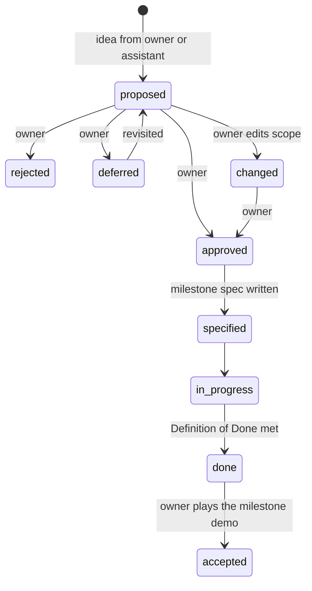

# 03 — How we design and build

This is the working agreement between the owner and the AI assistant (Claude Code) for
Strategos: who decides what, where every artifact lives, and how a feature goes from an idea
to something playable and tested.

## Roles

| | Owner | Assistant |
|---|---|---|
| Product | Decides product questions; approves, rejects or changes roadmap features; accepts milestone demos | Proposes features, options and recommendations |
| Design | Approves decisions that change the product or add runtime dependencies | Writes specs, ADRs and the architecture; runs spikes and reports numbers |
| Code | Merges into `main` after a maintainer's validation; reviews when they want to | Developers implement, test and document on their branches; a maintainer session validates |
| Tests | Approves new golden images and performance baselines; plays milestone demos and multiplayer sessions | Runs every automated level that ends on its own (L0–L3, L5, L6), and client windows (L4) under AGENTS.md "Client windows" unless a standing restriction forbids them (owner, 2026-10-25) |
| Runs | Starts interactive `runClient` / `runServer` sessions themselves, to watch the logs | Never starts interactive or long-running sessions |
| Git | Decides on tags, releases, merges into `main` and anything public; the repository stays private unless the owner decides otherwise | Developers commit and push their own `dev/*` branches without asking, in English, with no traces of the agent; only the maintainer writes `main` |

## Where things live

| Artifact | Purpose | Updated |
|---|---|---|
| [STATE.md](STATE.md) | **Where things stand now**: the owner's queue ("For the owner"), the current milestone and next task ("Now"), blockers | After every task |
| [worklog.md](worklog.md) | Append-only session log, newest first: what was done, results with numbers, problems, next | After every task |
| `tools/roadmap.py` | `check`: ROADMAP.md and the card files agree and statuses are valid; `summary`: progress per milestone and open decisions | Run after every status change |
| `.claude/skills/strategos-dev/` | The assistant's work procedure for autonomous sessions | When the procedure changes |
| [ROADMAP.md](ROADMAP.md) | Milestones and feature cards with a status the owner edits | When features are proposed, approved, changed or finished |
| [01-feasibility.md](01-feasibility.md) | Complexity, realism, risks | When estimates change materially |
| [02-tooling.md](02-tooling.md) | Platform, versions, libraries, dependency policy | On every version bump or new dependency |
| 03-design-process.md | This document | When the way we work changes |
| [04-architecture.md](04-architecture.md) | The architecture of the mod | With every ADR that changes it |
| [05-testing.md](05-testing.md) | Test levels, commands, Definition of Done | When a test level or gate changes |
| [adr/](adr/) | One file per lasting decision: context, decision, consequences, alternatives. Accepted ADRs are not rewritten; a new ADR supersedes them | When a decision is made |
| `milestones/` | Implementation spec of each milestone, written before its code | Before a milestone starts; ticked off while it runs |
| `spikes/` | Experiment reports with measured numbers | After each spike |
| [research/](research/) | Evidence behind the decisions | Rarely; new research gets its own file |
| `design/` | Records of the design process: competing proposals, judgements, roadmap reviews | When a design round runs |
| `CLAUDE.md` (repo root) | Instructions for the assistant: commands, conventions, rules | When conventions change |

## Feature lifecycle

- Every idea, from either side, enters [ROADMAP.md](ROADMAP.md) as a `proposed` card with
  testable acceptance criteria.
- Only `approved` cards enter a milestone spec. Changing an approved card sets it to
  `changed` until the owner approves it again.
- M0 "Foundation" is infrastructure the owner asked to start, so its cards were pre-approved
  (`approved-foundation`); they are `specified` since its implementation spec was written.

## Milestone cycle

1. **Spec.** Turn the milestone's approved cards into `milestones/Mx-<name>.md`: ordered
   tasks, files, classes, tests per level, risks with fallbacks. Unknowns become spikes that
   run first.
2. **Build.** Task by task. Every task ends green on its own verification command. L0 and
   L1 run continuously; every gameplay change gets a GameTest (L3).
3. **Verify.** The full `verify` run; performance against the baseline (L6); client
   scenarios (L4), batched (AGENTS.md "Client windows").
4. **Demo.** The owner starts a dedicated server and two clients with QA-09's one launch
   command, follows the demo script from the milestone spec, and their feedback becomes roadmap
   changes.
5. **Close.** Update STATE.md, the roadmap statuses, the knowledge base (new pitfalls and
   recipes) and the docs. The assistant commits and pushes; the owner decides on tags and releases.

## Design rules

1. **Decisions with lasting consequences get an ADR**, with the alternatives that were
   rejected and why.
2. **Measure before optimising.** Performance claims come from spikes with numbers in
   `spikes/`, not from estimates.
3. **Rules in `core`, Minecraft in `mod`.** Game rules and state transitions are written in
   the Minecraft-free core and tested there first.
4. **Content is data.** Units, buildings, techs and civilisations are templates, not classes.
   A new unit should normally need no Java code.
5. **Server-authoritative.** The client sends intents; the server validates and decides.
   Hidden information never leaves the server.
6. **Keep the seams.** Rendering is "extract state, then draw"; the UI draws view-models;
   input goes through our own action layer; persistence and networking go through codecs.
   This keeps the future 26.x port and the open-world mode affordable.
7. **Clean-room.** No GPL or all-rights-reserved code or assets, ever (see
   [research/README.md §8](research/README.md)). MIT/Apache code may be adapted with its
   notice kept in `NOTICE`.
8. **Small vertical slices.** Each milestone ends with something the owner can play and the
   tests that prove it; there is no big-bang integration at the end.

## Definition of Done

A change is done when:
- its behaviour is tested at the lowest level that can express it, and every test level the
  change type requires passes (table in
  [ADR-0006](adr/0006-test-levels-and-definition-of-done.md), amended by
  [ADR-0022](adr/0022-definition-of-done-amendments.md); summary in
  [05-testing.md](05-testing.md#definition-of-done));
- the build has no new ErrorProne warnings and NullAway is clean;
- golden images and performance baselines changed only with the owner's approval;
- the docs it affects are updated (STATE.md, ROADMAP.md statuses, the architecture or a new
  ADR when a decision changed);
- any new pitfall is written to the knowledge base in the same session.

## Autonomous development

Development runs in agent sessions that are rarely watched. The roles are the owner, the
maintainer and developers ([AGENTS.md](../AGENTS.md) "Roles"); every developer is external, the
owner's own agent sessions included (owner, 2026-10-25), so every change reaches `main` the same
way: claimed, built on its own branch, reviewed by another session, merged on the owner's word.
The procedures are the `strategos-dev` skill (a developer) and the `strategos-maintain` skill
(the maintainer); this section fixes the conventions they follow.

**Starting work.** A developer opens their agent in the repository (Claude Code in
`minecraft/strategos`, so that the project settings load; Codex reads AGENTS.md) and says
«продолжай» / "continue". Unattended sessions run without prompts under the project allowlist
(`.claude/settings.json`, activated by the owner on 2026-10-21), which denies force pushes and
discarding the working tree; nobody edits it but the owner. A session works through ready tasks
until a stop condition: nothing is ready, a task failed three times, a budget is red, a hard
rule would be broken, or usage is running low. Sessions can end at any moment, so every finished
step is committed and pushed to the developer's branch.

**Claims and gates.** Implementing a milestone's tasks needs the milestone in STATE.md "Open for
claims", written on the owner's word; planning work (the next milestone's spec) needs none.
Developers claim work themselves, before developing it, by a pull request that adds their branch
file ([branches/](branches/README.md)) — the claim itself, there is no shared registry; a maintainer merges
it after `tools/claims.py check`, so the same work is never held twice, and assigned work changes
hands only with its holder's explicit approval. The owner's reservations are branch files with
`Status: reserved`. One session per working copy (a lock,
`.session.lock`, which git ignores).

**Statuses and evidence.** ROADMAP.md is the source of truth; card files mirror it, and
`tools/roadmap.py check` must pass after every change.

| Status | Set by | When |
|---|---|---|
| `approved` | owner | The owner approved the card |
| `specified` | assistant | Its milestone spec is written |
| `in_progress` | assistant | The first task implementing it starts |
| `done` | assistant | Every acceptance criterion passes at its level; the card gets `- **Done:** <date> — <evidence>` (test names, reports, spec task) |
| `accepted` | assistant, on the owner's word | The owner played the milestone demo, or accepted the milestone without it (M0, 2026-10-22) |
| `changed` | assistant or owner | The scope must change; it waits for the owner |

Milestone specs keep a "Progress" checklist (`[x] T3 (date)`); commits are named
`Mx Tn: 
`, so `git log --grep "Mx Tn"` finds every task's work.

**Refinements.** When an acceptance criterion cannot be tested as written, the assistant may make a
scope-neutral refinement — another test level, a measuring method, clearer wording — and records it
in [design/roadmap-changes.md](design/roadmap-changes.md) "Refinements". Anything that changes what
a card delivers sets it to `changed` and waits for the owner.

**Green `main`.** Nothing reaches `main` without `verify` once it exists (M0 T3); before that, the
gate is `verifyFast` plus the task's own verification command, and documentation-only commits
need `python3 tools/roadmap.py check`. Once CI exists (M0 T18), every push
is checked on GitHub Actions as well, and a red build is the first thing the next session fixes.
Sessions read those runs through the GitHub MCP server's `actions` tools or a logged-in `gh`, a
one-time owner setup; a pull request's checks are readable without either.

**The owner's queue.** Everything that needs the owner — decisions, consent batches for client
windows, demos to play, baselines and goldens to approve, proposals that add scope — is a
numbered item in STATE.md "For the owner", with options and a recommendation. Work that does
not depend on it continues; the assistant never waits idle on one item while other work is ready.

**Client windows and decisions (owner, 2026-10-25).** Runs that open a game window are allowed by
default and batched (AGENTS.md "Client windows"); choices with a recommended option are taken and
listed in STATE.md "Decisions taken" for the owner to veto (AGENTS.md "Autonomy by default"). While
STATE.md "Standing restrictions" forbids windows, they are queued as a consent batch instead: when
the owner says «запускай консент-батч», the assistant runs the whole batch in one go while the
owner is away from the keyboard, and records the results.

**Delegation (2026-10-25).** The main session orchestrates on the strongest model and hands
routine work to smaller ones ([agents.md](agents.md), a demo roster for now); the rules bind
every tool and every developer.

**Review and merge.** A finished claim is handed in as a pull request. A maintainer session that
did not build it validates it (the full gate, a reviewer, the records), fixes it on the owner's
«с правками» or returns it, and merges it `--no-ff` on the owner's «влей»; the merge folds the
branch file into STATE.md and worklog.md.

**When the owner visits** (five minutes):
1. Read STATE.md: "For the owner", "Since your last visit" and "Now".
2. Skim worklog.md since the last visit; optionally run `python3 tools/roadmap.py summary` or
   look at the commits and CI on GitHub.
3. Answer the queue: decisions, consent, approvals; play the demo when a milestone is Done.
4. Optionally: `python3 tools/claims.py owner` for the developers' questions, open pull requests
   for review («провалидируй <branch>»), «влей <branch>».
5. Say «продолжай» to a developer session.

## Versions and git

- The mod follows semantic versioning, `0.x` until the MVP. The version lives in
  `gradle.properties`.
- `main` is written only by the maintainer: merges of reviewed developer branches (`--no-ff`) and
  `Docs:` record or process commits on the owner's word. All other work is on
  `dev/<developer>/<work>` branches (from 2026-10-25; the `wip/*` branches are older).
- Commit messages are English, imperative, with no traces of the agent or its tool. Developers
  commit and push their own branches without asking.

## Communication

- Chat is in Russian; everything in the repository is in English.
- Every report states what was done, the test results with numbers, and what needs the
  owner: approvals, decisions, consent for a client run.
