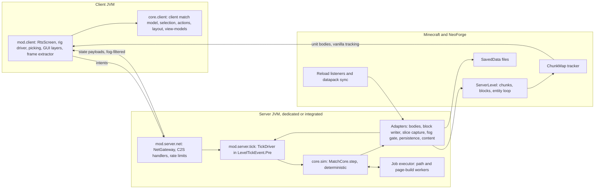
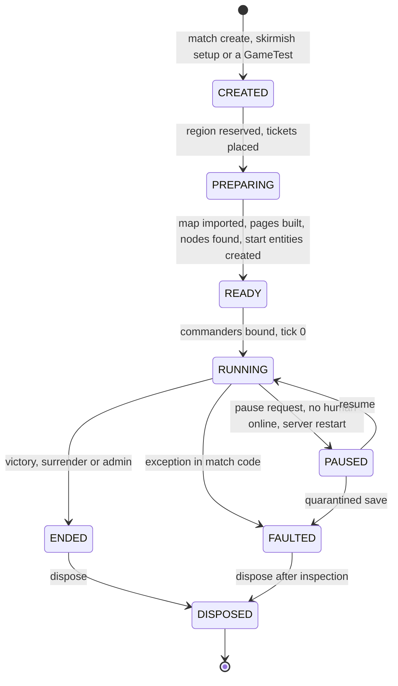
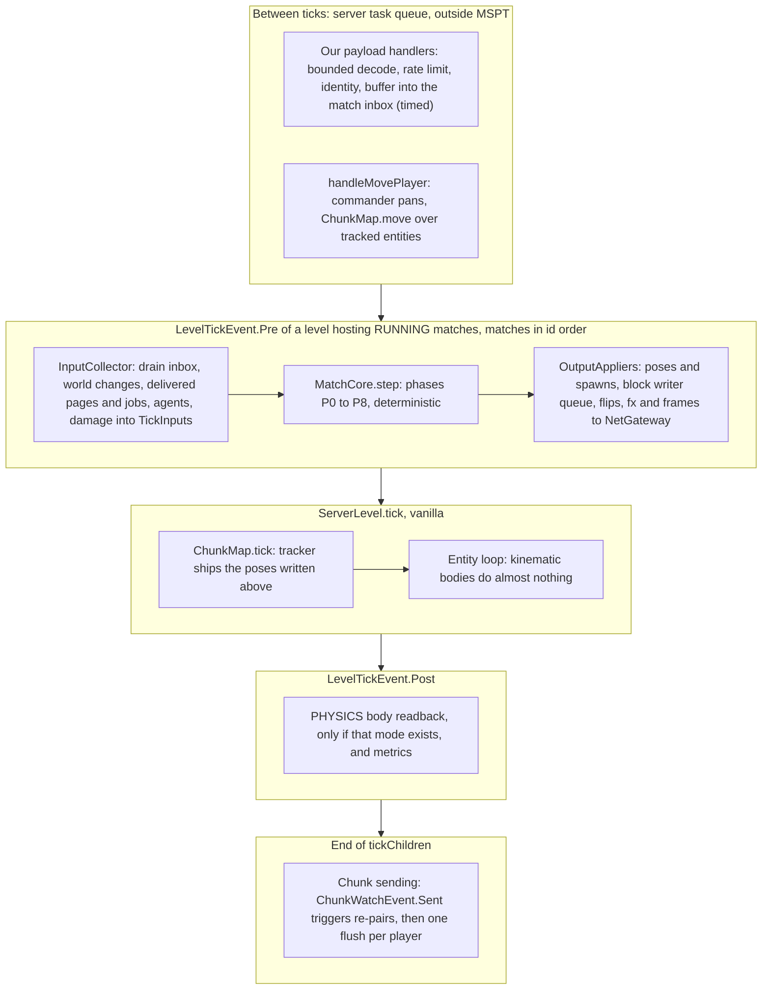
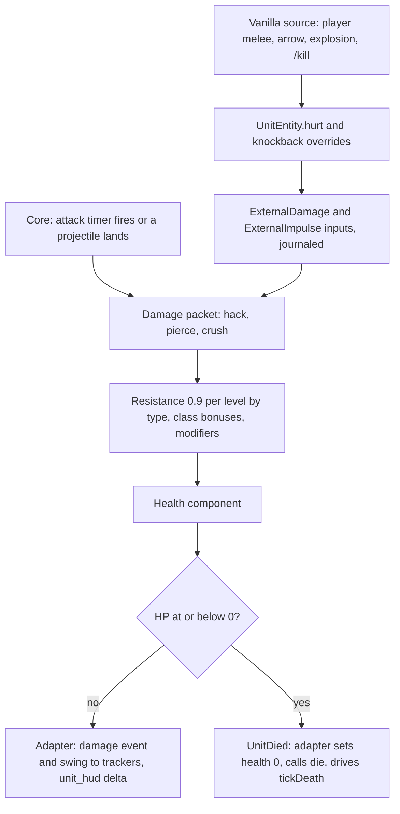
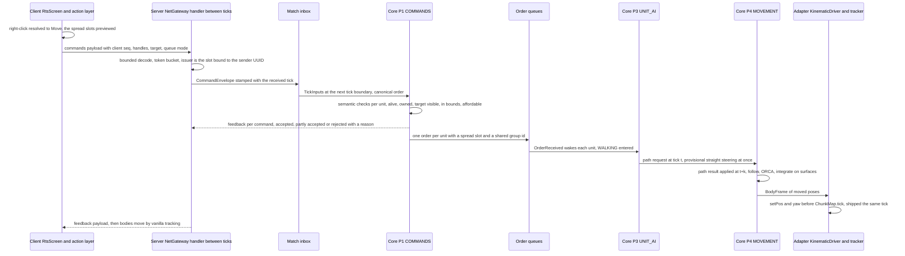
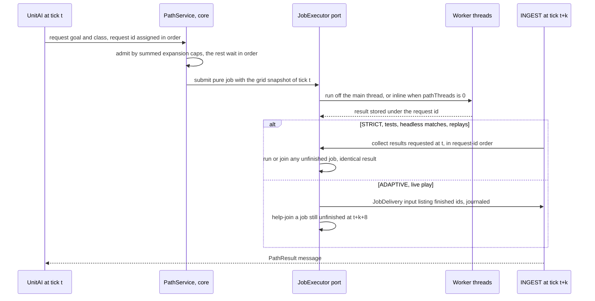
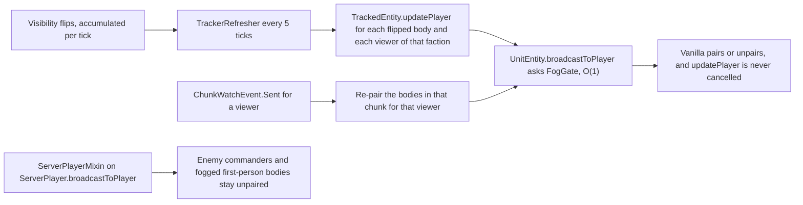
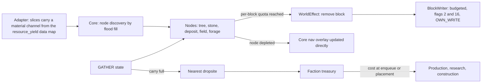
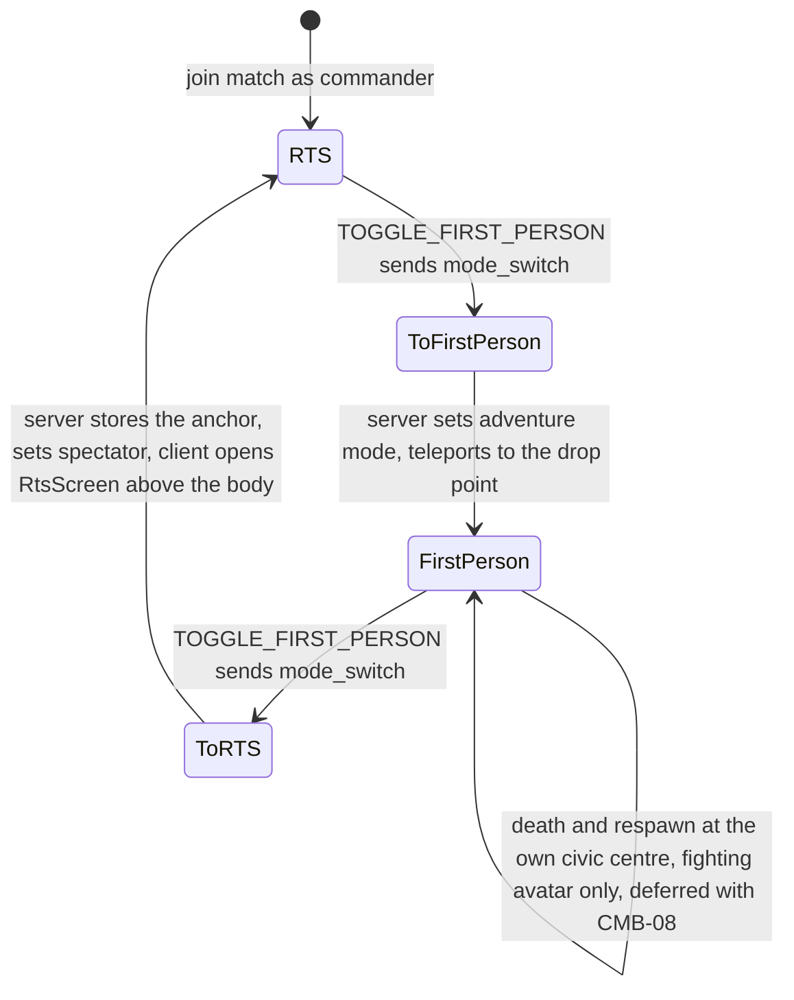

# 04 — Architecture

*Revision 2026-10-21: aligned with [ROADMAP.md](ROADMAP.md) and its cards in [roadmap/](roadmap/)
(follow-ups 1–4 of [design/roadmap-changes.md](design/roadmap-changes.md) §6). Perf gates assert
the budgets at the milestone's target scale, and the 2× stress pass asserts only C p95 ≤ 50 ms
(§16.1, §17.1, §17.3). Map-scale GameTests place and release their own tickets, with a batch-end
check (§3.4). Headless bandwidth is QA-19's encoder count; JFR `PacketSent` covers real
connections only (§12.5, §17.2). The schedule follows the roadmap (§1.5, §12.2, §17.1, §19 and
the milestone tags elsewhere): the battle sandbox with `fx`, `unit_hud`, `ui_query` and
`unit_detail` in M2; pause, the basic minimap and the under-attack alert in M3; save and resume
with the production journal ring in M4; garrison, the first bodiless units, in M5; solo fog and
`vision_delta` in M6, team fog in M8; S9 right after M0 (CAM-01); M1 gated at 600 units.
Card, spike and decision references follow the final cards, including D-08's observer rules
(§9.5, §10.2, §13.7). Budget D counts path results, not motion start, as the revised ADR-0019
does (§9.8, §17.2, §19.2). After the owner approved the roadmap the same day, the D-24 and D-08
conditionals are collapsed: solo fog lands in M6 under D-24 (c) and team fog stays in M8 (§1.5,
§4.5, §10, §12.2, §13.6, §14); the first-person avatar is the observer, and first-person combat
(CMB-08) with its damage types is deferred (§1.5, §2.5, §6.7, §6.8, §9.5, §10.2, §13.7, §19.1,
§20). Rule B2 also admits the `@CoreApi` types of `core.diag`, as the M0 spec does (§2.4). The
engine-surface inventory check runs in L2 (§16.1, ADR-0022). Gates below 600 units also check
the cost per unit (§17.3). ADR-0023 records this alignment in the ADRs.*

*Final architecture of Strategos, decided 2026-10-21. It was synthesised from three competing
proposals: [A, core-first](design/proposal-a-core-first.md), the backbone;
[B, engine-native](design/proposal-b-engine-native.md); and
[C, scale-first](design/proposal-c-scale-first.md). Three independent judgements scored them for
[maintainability](design/judgement-maintainability.md), [performance](design/judgement-performance.md)
and [delivery](design/judgement-delivery.md). Lasting decisions are recorded as ADRs in
[adr/](adr/README.md). Where an ADR and this document disagree, the ADR wins until this document
is updated.*

*Conventions. `File.java:n` points into the decompiled Minecraft 1.21.1 + NeoForge 21.1.262
tree. Every Minecraft and NeoForge class, method, field and event named here was checked there
on 2026-10-21 (index in Appendix A). "Fact n" refers to the engine facts in
[research/README.md §3](research/README.md). Figures marked *(estimate)* are hypotheses, and a
named spike replaces each one. Milestone and card IDs (M0, PATH-03, D-14, …) come from
[ROADMAP.md](ROADMAP.md) and its cards in [roadmap/](roadmap/), which govern the schedule
(ADR-0023).
Clean-room: this design uses only the behavioural notes in [research/](research/); no GPL or
all-rights-reserved source was opened.*

---

## 1. Overview

### 1.1 The architecture on one page

1. **The core is the game.** A Minecraft-free `MatchCore` (pure Java 21) advances one
   deterministic step per server tick: `step(TickInputs) → TickOutputs`. It owns every unit,
   building, resource node, faction, order and stat.
2. **The step only sees inputs.** Everything Minecraft tells it arrives as ordered, journaled
   input records: commands, block changes, terrain slices, vanilla damage, first-person players
   and job results. Everything it wants done leaves as output records that thin adapters apply:
   body poses, block placements, effects, replication frames and visibility flips.
3. **Minecraft is the world and the picture.**
   - Units are `noSave()` `LivingEntity` views, not `Mob`s, and their server tick is almost empty.
   - Buildings, trees and stone are real blocks. One budgeted block writer changes them.
   - Terrain belongs to the world. The core keeps a derived surface grid.
4. **A match is a region of a level**, with match-local coordinates and state of its own.
   Fifty GameTests in one level are therefore fifty independent matches. Production matches run
   in the overworld of a world created with the `strategos:arena` world preset.
5. **Determinism is a testing tool.**
   - Whole matches, the AI included, run in plain JUnit against fakes and give the same state hash
     every time.
   - A journal recorded in a GameTest or in the game replays in JUnit to the same hash.
   - Async jobs read immutable snapshots, and their results are delivered at a fixed tick.
6. **The server is authoritative from day one.** Clients send intents, and the core validates
   them at the tick boundary. A single fog-aware sender with declared audiences is the only way
   out, so hidden information never leaves the server.
7. **Content is data.** Templates with 0 A.D.-style inheritance load through a reload listener
   and hot-reload with `/reload`. The core modifier pipeline is the only source of every stat.
8. **Navigation is ours.**
   - A layered 2.5D surface grid in 16×16 pages.
   - A* first; HPA* and flow fields once a measurement asks for them.
   - ORCA local avoidance.
9. **The client.** The commander's own spectator body sits at the camera eye. A non-pausing
   `RtsScreen` owns the cursor, and the projection is perspective. View-models and layout are
   pure code in `core.client`. First person is a game-mode switch away.
10. **It is built incrementally.** M0 builds the kernel, the harnesses and a walking skeleton.
    Each later system arrives with the milestone that needs it. Scale machinery waits behind
    seams until a spike asks for it (§1.5).

### 1.2 Context



### 1.3 Decisions at a glance

| # | Question | Decision | § | ADR |
|---|---|---|---|---|
| 1 | Platform | Minecraft 1.21.1, NeoForge ≥ 21.1.264 as the only loader, Java 21 | – | [0001](adr/0001-loader-and-version.md) |
| 2 | Names | `dev.strategos.core` for core, `dev.strategos.mod` for the mod, mod id and namespace `strategos` | 2 | [0002](adr/0002-package-naming.md) |
| 3 | Layout | `build-logic`, `core` (+ `testFixtures`, `jmh`), `mod` (+ `test`, `gametest`, `devtools`, `archTest`); core merged into the mod module | 2 | [0003](adr/0003-module-layout-and-core-merge.md) |
| 4 | Dependencies | Nothing at runtime besides NeoForge | 2 | [0004](adr/0004-zero-runtime-dependencies.md) |
| 5 | Clean-room | Behavioural notes only; RVO2 (Apache-2.0) is the only adapted code | – | [0005](adr/0005-clean-room-and-licensing.md) |
| 6 | Tests | L0–L7; one scenario, two runners; cross-level replay; Definition of Done per change type | 16 | [0006](adr/0006-test-levels-and-definition-of-done.md), [0007](adr/0007-gametest-wiring.md), [0022](adr/0022-definition-of-done-amendments.md) |
| 7 | Authority | The core owns all match state; entities are views; one owner per datum | 5 | [0008](adr/0008-authority-and-state-model.md) |
| 8 | Tick | The core steps in `LevelTickEvent.Pre`, before the tracker; nine fixed phases; every cap counts work; fault containment per match | 4 | [0009](adr/0009-tick-pipeline-determinism-and-fault-containment.md) |
| 9 | Match | A region of a `ServerLevel` in match-local coordinates; arena world preset; map packages; `TicketController` with `ticking=false` | 3 | [0010](adr/0010-match-model-and-lifecycle.md) |
| 10 | Unit entity | `UnitEntity extends LivingEntity`, `noSave`, `MobCategory.MISC`, three types by size; kinematic body; unit-versus-unit damage in core | 6 | [0011](adr/0011-unit-entity-and-body-seam.md) |
| 11 | Content | Reload listener with core-side inheritance; NeoForge data maps for block properties; registries only for engine-fixed things | 8 | [0012](adr/0012-template-and-content-pipeline.md) |
| 12 | Stats | The core modifier pipeline is the single source; vanilla attributes are at most write-only mirrors | 8 | [0013](adr/0013-modifier-pipeline.md) |
| 13 | Orders | Typed command records in a core registry; validation in the core at the tick boundary; 0 A.D. queue modes; hierarchical UnitAI | 7 | [0014](adr/0014-orders-commands-and-unitai.md) |
| 14 | Navigation | Layered 2.5D surface grid; A* staged to HPA* and flow fields; ORCA; pure jobs delivered at tick `t+k` | 9 | [0015](adr/0015-pathfinding-approach.md) |
| 15 | Network and fog | One `NetGateway` with declared audiences; vanilla tracking for bodies behind a `broadcastToPlayer` gate; targeted re-tracking; HP on our own channel | 10, 12 | [0016](adr/0016-networking-and-fog-of-war.md) |
| 16 | Client | Player-follows-camera spectator body; `RtsScreen` owns the cursor; perspective | 13 | [0017](adr/0017-camera-and-input.md) |
| 17 | Persistence | One `SavedData` blob per match plus a registry; codecs in core; `"v"` and migrations; quarantine; the nav grid is rebuilt and checked | 5 | [0018](adr/0018-persistence-and-versioning.md) |
| 18 | Budgets | Budgets A–G defined and kept apart; whole tick ≤ 23 ms p95 at 600 units; spikes S1, S2 and S4 replace the estimates | 17 | [0019](adr/0019-performance-budgets.md) |
| 19 | Engine surface | One inventory of mixins, access transformers, types, payloads and data registrations, checked by a test | 2 | [0020](adr/0020-engine-surface-inventory.md) |
| 20 | Economy | Real trees and stone as core nodes; deposits and fields finite; abstract building HP; one budgeted block writer | 11 | [0021](adr/0021-economy-and-construction-model.md) |

### 1.4 Contradictions and gaps settled here

The ten contradictions of [research/README.md §6](research/README.md):

| # | Question | Decision | Where |
|---|---|---|---|
| 1 | Authority | The core owns unit position, HP, orders and stats. In the default `KINEMATIC` body the entity only mirrors the pose. This fixes the tick order: core in `LevelTickEvent.Pre`, then the tracker ships the poses, then the entity loop. Persistence is per-match `SavedData`; bodies are `noSave()` and can never duplicate. Replication is vanilla tracking of bodies plus summaries built from core state. It works in a force-loaded arena, where every unit has a body, and in a later open world, where a unit simply has no body while its chunk is not entity-ticking | §5, §6, ADR-0008 |
| 2 | Stats | The core modifier pipeline is the only source of truth. Vanilla attributes are never a source. A `PHYSICS` body, if one is ever built, gets `MOVEMENT_SPEED` and `STEP_HEIGHT` as write-only mirrors. Clients get displayed stats from our payloads, never from synced attributes | §8.1–8.2, ADR-0013 |
| 3 | Content | One reload listener with core-side inheritance loads templates, techs, civs, abilities, AI scripts, maps and blueprints. NeoForge data maps carry block properties. Registries hold only engine-fixed things: entity types, damage types and payload types | §8, ADR-0012 |
| 4 | Determinism | Yes. Jobs are pure functions of immutable snapshots, and results requested at tick `t` are applied at `t+k` in request order. In `STRICT` mode the main thread finishes any late job, so results never depend on thread timing. Live play may use `ADAPTIVE` delivery, which records the actual delivery tick in the journal, so replays stay exact. Determinism stops at the port: player and vanilla block edits, vanilla damage, first-person positions and `PHYSICS` poses enter as journaled inputs | §4, §5.3–5.5, §9.6, ADR-0009, ADR-0015 |
| 5 | Navigation | A layered 2.5D grid: up to four standable surfaces per column, floor heights in 1/16 block, 16×16 pages, plus core overlays for buildings and gates. Search is A* over surfaces with string pulling, then HPA* over page portals when spike S8 or the 384² crossings ask for it. JPS is rejected because step, drop, water and door costs are non-uniform | §9, ADR-0015 |
| 6 | Fog refresh | Vision updates incrementally every tick. Every 5 ticks, a pass calls `TrackedEntity#updatePlayer` for exactly the flipped (unit, viewer) pairs, through two access-transformer lines; it never cancels `updatePlayer`. Bodies in a chunk that has just been sent are re-paired. Enemy players are hidden by a `ServerPlayer#broadcastToPlayer` mixin. Sounds, particles and projectile visuals leave only through the fog-aware sender. Block changes stay visible until terrain secrecy (FOW-06) | §10, ADR-0016 |
| 7 | Camera and input | Player follows the camera: the spectator body is the camera, so streaming, tracking and vanilla's movement-packet re-check keep working. A non-pausing `RtsScreen` owns the cursor, so every vanilla binding is inert by construction. Projection is perspective, which needs no mixin. Spike S9 decides, and the fallbacks are fixed in advance | §13, ADR-0017 |
| 8 | Budgets | The two figures measure different things and both are kept, at 600 units. Budget A, core work, is ≤ 5 ms p50 and ≤ 10 ms p99. Budget B, all Strategos-attributable server time, is ≤ 17 ms p95 and is the "≈ 20 ms for units". Budget C, the whole tick including between-tick task time, is ≤ 23 ms p95 | §17, ADR-0019 |
| 9 | GameTest wiring | A `gametest` source set inside the `strategos` mod group, registered by our generator through `RegisterGameTestsEvent`, with our JUnit XML reporter and a non-empty-report guard. No second mod. Spike S5 verified it ([report](spikes/S5-build-wiring.md)), so the fallback, a separate test mod, is not needed | §16, ADR-0007 |
| 10 | Licensing | Clean-room only. RVO2 (Apache-2.0) is the only adapted code, with its notice in `NOTICE`. The GPL route is not taken | ADR-0005 |

The design gaps of [research/gaps.md](research/gaps.md). G3 was answered by the owner; G5 is
spike S4.

| Gap | Decision | Where |
|---|---|---|
| G1 Unit authority, movement, count | The core owns state. A kinematic `LivingEntity` view is the default body behind a seam, and a `PHYSICS` body is the fallback if spike S10 rejects kinematic visuals. The design scales are 2 × 150 for the MVP and 4 × 150 for multiplayer; spike S1 measures the cost per body | §5, §6, §17 |
| G2 Camera, cursor, projection, streaming | As contradiction 7. In addition, the server hardens the vanilla spectator against hostile clients before the multiplayer stage (§12.6) | §13, §12.6 |
| G4 Unattended client screenshots | Client logic is written so that L1 can test it: rig maths, layout, picking, selection and view-models are pure code in `core.client`. L4 only confirms the drawing. Until spike S3 proves that runs don't steal focus, L4 runs only with the owner's consent or in a Linux container or CI under Xvfb | §16, ADR-0006 |
| G6 Where definitions live | As contradiction 3 | §8 |
| G7 What a match is | A region of a level with its own state, many per level. Production matches run in arena slots of a `strategos:arena` preset world, and GameTests use the test bounds. Maps are imported packages. The lifecycle is in §3.5; spike S2 prices force-loading | §3 |
| G8 Navigation and deterministic delivery | As contradictions 4 and 5. Spike S8 runs the terrain census and encoding tests, spike S7 the delivery latency | §9 |

The other items of [research/contradictions.md](research/contradictions.md):

| Item | Resolution |
|---|---|
| Force-loading flag | `ticking=false`; `true` would add random ticks and natural spawning (fact 9) |
| Keeping the arena alive | The whole arena is force-loaded; authority does not depend on loading (§3.4) |
| Per-chunk state | No chunk attachments for authoritative data; everything is in the per-match blob (§5.6) |
| Building HP | Abstract HP with deterministic damage stages (owner decision; §11.8) |
| jqwik | Not used; seeded `@ParameterizedTest` runs instead |
| `EphemeralTestServerProvider` | L2 only, for registry-backed decoding; worlds are GameTests |
| 200-unit cross-map test against 48-block arenas | L1 on synthetic terrain; in L3, the map importer places the proving ground in a solo batch (§16.5) |
| junit-bom pin | 5.14.4 ([02-tooling.md](02-tooling.md)) |
| GPL as an escape hatch | Not taken; the FSF reading of plug-ins in a proprietary host makes it moot (ADR-0005) |

### 1.5 Build plan: what comes when

**M0 Foundation builds:**
- **The build.** The Gradle layout, the quality gates and every ArchUnit rule of §2.4. The
  engine-surface inventory test, starting with M0's entity type, `SavedData` names and command,
  and no mixin or access transformer (QA-17).
- **The test harnesses.** L1 (`SimHarness`, fakes, seeded runs), L2 (codec and size helpers),
  L3 (our GameTest generator, JUnit XML, empty-set guard, filter), L5 (server smoke) and L6 (JMH
  and the perf batch). L4 and spike S3 come with the owner's consent.
- **The kernel.** `MatchCore` with the sealed input and output events, the phase pipeline and
  scheduler, the match bus, the entity store with generation handles, the counter-based RNG, the
  state hash, the in-memory journal and `ReplayRunner`, the command registry with `Move` and
  `Stop`, validation at the tick boundary, and the IDLE and WALKING states.
- **Persistence and containment.** The persistence kernel (codecs, `"v"`, migrations,
  quarantine) and fault containment.
- **The adapters.** The `Strategos` entry point, `StrategosServer`, `MatchRegistry` with matches
  bound to GameTest bounds and to a region of the current level (`/strategos match create`), the
  `TickDriver`, the humanoid `UnitEntity` with a kinematic body on flat ground, `BodyRegistry`,
  the registry and match `SavedData`, phase timers, and `/strategos debug spawn|move`.
- **The spikes.** S1, S2, S5 and S6; S3 and S4 with the owner's consent.
- **The walking skeleton (ORD-01).** One debug command moves units through the core on a
  dedicated server, seen by two clients, saved, reloaded and replayed to the same hash.

**Built with the feature that needs it:**

| Milestone | Architecture that arrives |
|---|---|
| M1 Movement | Templates, the modifier pipeline and content sync (§8). Spatial index (§10.1). `NetGateway`, the wire codecs and the payload layer (§12). Order queue, group slots and the HFSM framework (§7). The layered nav grid, `LevelChunkMixin`, page capture and build jobs, the path service with deterministic delivery, components, A*, string pulling, ORCA and the stuck ladder (§9). The block writer and its budget (§11.7). The binary journal in dev and test runs and the cross-level replay check (§5.5). Map packages, the importer, the arena world preset and the ticket controller (§3). The movement debug overlay. Spikes S7, S8, S10 and S12 |
| M2 Command | Camera spike S9, right after M0 on the client track (CAM-01); the camera rig, `RtsScreen` and the action layer; jumps through the server; picking; selection; control groups; order previews; the first-person switch; the HUD framework; the chunk-sent re-pair; tier-2 replication with `unit_summary`, `ui_query`, `unit_detail` and `unit_hud`; the battle sandbox: the damage model, melee, attack and attack-move, health bars, and hit and death sounds as `fx` (§13, §10.4, §12.2–12.4, §6.7) |
| M3 First loop | Resources and treasury, the node index (trees, berries), gathering, finite fields with manual reseed, population, blueprints, placement, progressive construction, production and rally points, torch attacks on buildings, the AI player and scripted bot, match rules and victory, pause and game speed, the command card and resource bar, the basic minimap and the under-attack alert, the headless match runner (§11, §13.5, §14) |
| M4 Economy and construction | Stone, deposits, the field reseed rule of D-14, livestock as Gaia fauna units with a fauna model archetype (ECO-16, whose ADR amends ADR-0011), LOD tiers by activity, foundations on uneven ground, abstract HP stages, repair, protection, batches, save and resume for players with the production journal ring (§5.5, §5.6, §6.5, §11) |
| M5 Combat | Ranged attacks and analytic projectiles, stances, mobility classes and footprints, the `unit_mount` type, garrison and the town bell with the first bodiless units (§6.3, §9). First-person combat and the Strategos damage types stay deferred with CMB-08, because D-08 chose the observer avatar (§6.7) |
| M6 MVP | Phases and research, the `unit_large` type and siege, the full minimap and the notification feed, AI openings and difficulty; solo fog (D-24 (c)): the vision grid with hysteresis, explored state and the shroud, `vision_delta`, the real `FogGate` without the access transformer, and an AI that reads only its own vision (§10, §14) |
| M7 Multiplayer | Lobby, team-aware interest, per-channel byte budgets, reconnects, commander hardening (`ServerPlayerMixin`, `ServerGamePacketListenerImplMixin`), modified-client tests, spike S11 (§12) |
| M8 Fog of war | Team vision, the access transformer and targeted re-tracking, mirages, the leak audit (§10), on top of M6's solo fog |
| M9–M13 | Territory, the rest of the garrison (healing, ejection, capture regeneration), gates as nav overlays; formations; the adaptive AI; random maps; the open-world policy with abstract travel and paged grids (§18.2) |

**Deliberately deferred, each with the trigger that brings it in:**

| Mechanism | Trigger | Seam it plugs into |
|---|---|---|
| `PHYSICS` body mode | Spike S10 rejects kinematic visuals for a class of templates | `BodyMode` (§6.3) |
| View-driven materialisation (interest bubbles) | Open-world mode (M13), or spike S1 or S4 caps the body count | `Materialiser` policy (§6.4) |
| Streamed unit types and our own motion channel (tier 4) | Spike S11 measures tier 1 above the bandwidth budget | Replication tiers (§12.4) |
| Timer wheel for attack, gather and production events | Polling timers show up in profiles | `Scheduler` (§4.5) |
| HPA* over page portals | Spike S8 or the 384² and 512² crossings (PATH-03, PERF-05) show flat A* misses budget D | `PathService` (§9.3) |
| Flow fields for large groups | PATH-09 shows the shared group path is not enough | `PathService` (§9.4) |
| Per-recipient delta frames for summaries | Bandwidth at the multiplayer stage | `ReplicationService` (§12.4) |
| A presentation-only runtime governor | Overload measured on slow hosts in M7 | Presentation phases (§17.4) |
| Reset journal for reusing a slot | Same-slot rematches matter (M6 or M12) | `MatchRegistry` (§3.5) |
| Client-side `StatService` prediction | The command card needs predicted values | `core.client` (§8.1) |
| Orthographic projection | Owner choice after M2 (D-09, CAM-06) | Camera adapter (§13.1) |
| First-person combat and the Strategos damage types (CMB-08) | The owner revisits CMB-08 after the M2 playtest and chooses the fighting avatar | `DamageBridge` and the first-person rule in `MatchRules` (§6.7, §13.7) |
| Model LOD by distance | Spike S4 | Unit renderer (§13.6) |
| Terrain secrecy | Public or competitive servers (FOW-06) | Leak policy (§10.5) |

**Tripwire.** If the walking skeleton is not end to end after two weeks of M0 work, the
front-loaded infrastructure is simplified before anything else is built (risk R11).

### 1.6 Synthesis record

**Backbone: proposal A.** It placed first for maintainability and second for performance and
delivery, the best combined standing. Its core-owned authority, hexagon, journal, kinematic
views and quarantine are kept.

**Grafted from B:**
- an explicit first slice, with the algorithms staged behind a stable API;
- the engine-surface inventory as a reviewed artifact checked by a test;
- the `ServerPlayer#broadcastToPlayer` mixin that hides enemy commanders and fogged first-person
  bodies;
- data maps for block properties, `TemplateLint` for unknown keys, and a SHA-256 of the
  canonical JSON as the template-set version;
- damage stages that never open the two lowest layers of a footprint's outer ring;
- a catch-all restore of protected blocks;
- aggregates kept as counters;
- `STRICT` delivery for tests, plus a live delivery mode that never stalls.

**Grafted from C:**
- the cross-level replay check;
- `pathThreads = 0` and the 0/1/4-thread hash test;
- the counter-based stateless RNG;
- core-owned block edits never fed back into navigation;
- HP kept out of `SynchedEntityData`, and `onGround` held constant;
- `MatchRules` kept apart from world-wide settings;
- interest sets built from `startSeenByPlayer` and `stopSeenByPlayer`;
- per-channel byte budgets;
- the streamed types as the bandwidth reserve, chosen per match at start;
- the `RtsScreen` reasoning;
- separation steering in dense cells;
- LOD by activity, never by observation.

**Fatal flaws fixed:**
1. B's authority in a `PathfinderMob` is not adopted.
2. Fields are finite deposits, as the owner decided, not infinite as in all three proposals
   (§11.2).
3. C's pairing gap after camera jumps is closed by the chunk-sent re-pair (§10.4).
4. B's incomplete invulnerability-frame fix does not arise: unit-versus-unit damage never calls
   `hurt`, and our damage types are tagged `minecraft:bypasses_cooldown` (§6.7).
5. C's override of the final `getDimensions(Pose)` is replaced by `getDefaultDimensions`.

**Other defects fixed:**
- Enemy commanders and first-person bodies leaked through fog (§10.4).
- Vanilla's silent reset of an undecodable save (§5.6).
- A navigation model that was restored without being checked (§5.6).
- HP mirrored into vanilla health (§6.2).
- A paste budget that `placeInWorld` could not enforce (§3.3).
- Arena battles capped by view bubbles (§6.4).
- The fog switch duplicated between a gamerule and the match config (§15.4).
- 256 block placements per tick instead of 64 (§11.7).
- Path admission counted in requests instead of work (§9.6).
- LOD that depended on observation (§6.5).
- Missing fault containment (§4.8).
- Vanilla spectator powers open to hostile clients (§12.6).
- Packet-handler time missing from the budgets (§17.2).

**New in the synthesis:**
- **The `strategos:arena` world preset.** B's datapack dimension would mark every world with
  the mod as experimental: `WorldDimensions#bake` returns an experimental lifecycle when more than
  the three vanilla stems exist (WorldDimensions.java:164–185), and NeoForge shows the backup
  warning once (WorldOpenFlows.java:383).
- **`ADAPTIVE` delivery with journaled delivery ticks.**
- **The chunk-sent re-pair without an access transformer** before M8.
- **Sealed input and output event lists**, which keep the driving port narrow as features grow.
- **The world reconciler on resume** (§5.6).

---

## 2. Module and package layout, boundary enforcement

### 2.1 Gradle projects and source sets

The three-project layout settled in [02-tooling.md](02-tooling.md) and
[research/testing.md §3](research/testing.md) stays. This section fixes what goes where.

| Project | Plugins | Source sets | Contents |
|---|---|---|---|
| `build-logic` | `groovy-gradle-plugin` | `main` | `strategos.java-conventions`: toolchain 21, Spotless with palantir-java-format, ErrorProne + NullAway in JSpecify mode, JUnit Platform, compact test logging. `strategos.core-conventions`: the plugin-free `jmh` source set and its `JavaExec` task |
| `core` | `java-library`, `java-test-fixtures` | `main`, `test` (L1), `testFixtures`, `jmh` (L6) | Simulation, content model, protocol, Minecraft-free client logic. `compileOnly` at exactly the versions Minecraft 1.21.1 ships: fastutil 8.5.12, DataFixerUpper 8.0.16 (codecs, `Dynamic`), Gson 2.10.1 (template trees), slf4j-api 2.0.9, JSpecify 1.0.1. No Guava, JOML or Netty in `main` |
| `mod` | `net.neoforged.moddev` 2.0.148 | `main` (common and client, ships), `test` (L2), `gametest` (L3, L6 perf), `devtools` (L4 scenario harness), `archTest` (L0), generated resources | NeoForge adapters, client, mixins, datagen |

`core/testFixtures` holds `SimHarness`, the fake adapters, voxel and map fixtures, the scenario
DSL, invariant checkers and `ReplayRunner`. It depends only on core's `main` and the same
`compileOnly` libraries, never on JUnit or AssertJ. That lets the fixtures run inside a GameTest
server, so one scenario runs under L1 against fakes and under L3 in a real world (§16.3).

`mod/build.gradle`, core wiring only (spike S5 verifies it, card QA-01):

```groovy
evaluationDependsOn(':core')
def core = project(':core')
neoForge {
    mods {
        strategos {
            sourceSet sourceSets.main
            sourceSet core.sourceSets.main           // core joins the mod module in every run
            sourceSet core.sourceSets.testFixtures   // dev runs only: scenarios for GameTests
            sourceSet sourceSets.gametest            // dev runs only
            sourceSet sourceSets.devtools            // dev runs only
        }
    }
    unitTest { enable(); testedMod = mods.strategos }
}
dependencies {
    implementation core
    gametestImplementation testFixtures(core)
}
tasks.named('jar', Jar) { from core.sourceSets.main.output }   // one jar, one module
```

Fixed points:
- There is no `module-info` in `core`; once merged, it would become the mod's module descriptor.
- Core keeps its own package root, so a later move to jarJar cannot split packages.
- Dev runs see `main + core.main + core.testFixtures + gametest + devtools`. The shipped jar holds
  `main + core.main` only, and a jar check proves it (L0, QA-01 and QA-17).
- `verifyFast`, `verify` (with `verifyHarness`), `verifySlow`, `verifyPerf`, `verifySoak` and
  `verifyClient` aggregate the levels as the roadmap's
  [test aggregates](roadmap/M0-foundation.md#test-aggregates-and-wall-time-budgets) define them,
  refining [research/testing.md §13](research/testing.md).

### 2.2 Core packages (`dev.strategos.core`)

| Package | Key types | Responsibility |
|---|---|---|
| `shared` | `UnitHandle`, `EntityHandle`, `FactionSlot`, `PlayerSlot`, `MatchId`, `TemplateId`, `Vec2d`, `BlockPos3i`, `DetMath`, `Rng`, `Fixed`, `IntIdMap` | Ids, generation handles, deterministic maths (`StrictMath` only), the counter-based RNG, fixed-point helpers, fastutil facades with a defined iteration order |
| `content` | `RawTemplate`, `TemplateCompiler`, `MergeOp`, `TemplateFilter` (`FOUNDATION`, `PREVIEW`, `MIRAGE`), `TemplateSet`, `ClassFilter`, `ValuePath`, `TechDef`, `CivDef`, `AbilityDef`, `ResourceDef`, `StrategyScript`, `MapManifest`, `BlueprintShape`, `TemplateProblem` | Template model, inheritance, validation, derived kinds. Shared by server and client |
| `protocol` | `Command` (sealed), `CommandType`, `CommandRegistry`, `WireWriter`, `WireReader`, `WireCodec`, frame records, `Limits` | The client–server message model and its binary encoding, Minecraft-free and size-tested in L1 |
| `sim` | `MatchCore`, `TickInputs`, `TickOutputs`, `InputEvent`, `OutputEvent`, `MatchConfig`, `MatchRules`, `Phase`, `Scheduler`, `MatchBus`, `EntityStore`, `StateHasher`, `MatchQueries` | The deterministic match: the driving port, the tick pipeline, entity storage |
| `sim.command`, `sim.order`, `sim.unitai`, `sim.ability` | `CommandValidator`, `OrderQueue`, `QueueMode`, `Hfsm`, `StateDef`, `UnitAi`, `Stance`, `AbilitySystem` | From commands to orders to behaviour |
| `sim.stats` | `Modifier`, `ModifierSource`, `StatService`, `StatBlock`, `StatBreakdown` | Modifier pipeline with caching and invalidation |
| `sim.combat`, `sim.economy`, `sim.production`, `sim.construction` | `AttackSystem`, `DamageModel`, `ProjectileSystem`, `Treasury`, `ResourceNode`, `GatherSystem`, `ProductionQueue`, `Population`, `Foundation`, `ConstructionSystem`, `DamageStages`, `PlacementRules` | Game rules |
| `sim.nav`, `sim.move`, `sim.spatial` | `BlockClass`, `VoxelSlice`, `PageBuilder`, `SurfacePage`, `SurfaceGrid`, `Components`, `GridAStar`, `PathService`, `MotionSystem`, `Orca` (RVO2 port), `UnitGrid`, `StaticIndex` | Terrain model, pathfinding, steering, spatial queries |
| `sim.vision`, `sim.territory` (M9) | `VisionGrid`, `VisibilityIndex`, `VisibilityDelta` | Line of sight, explored state, fog queries |
| `sim.ai`, `sim.victory` | `ComputerPlayer`, `AiView`, `AiModule`, `AiBudget`, `VictoryConditions` | Opponents and match end |
| `sim.replication` | `ReplicationService`, `InterestRules` | What each faction may know, framed per recipient |
| `sim.persist`, `sim.journal` | `MatchSnapshotCodec`, `SchemaVersion`, `Migrations`, `JournalFormat`, `ReplayDriver` | Codecs, migrations, journal and replay |
| `client` | `ClientMatchModel`, `SelectionSet`, `ControlGroups`, `BoxSelect`, `PickMath`, `CameraRig`, `ActionMap`, `InputState`, `HudLayout`, view-model records, `CommandCardBuilder`, `GhostPlacement`, `MinimapModel` | Minecraft-free client logic; the server never calls it |
| `port` | `JobExecutor`, `JournalSink`, `MetricsSink`, `Clock` | Driven ports that adapters implement |
| `diag` | `PhaseTimers`, `Histograms`, `Counters`, `BudgetMonitor` | Measurement; reads time only through `Clock` |

### 2.3 Mod packages (`dev.strategos.mod`)

| Package | Key types | Responsibility |
|---|---|---|
| (root) | `Strategos` (`@Mod`), `StrategosServer`, `StrategosConfig` | Entry point. A per-server holder created on `ServerAboutToStartEvent` and dropped on `ServerStoppedEvent` |
| `registry` | `ModEntityTypes`, `ModDamageTypes`, `ModPayloads`, `ModTickets`, `ModDataMaps`, `ModKeyMappings` | Registration only |
| `entity` | `UnitEntity`, `UnitSpawnData` | The common unit entity |
| `server.match` | `MatchRegistry`, `MatchRuntime`, `MatchRegionIndex`, `ArenaWorld`, `ArenaPolicy`, `MapImporter`, `SlotAllocator` | Match lifecycle, region routing, arena world rules, map import |
| `server.tick` | `TickDriver`, `InputCollector`, `OutputAppliers`, `FaultBarrier` | Builds `TickInputs`, calls the core, applies `TickOutputs`, contains faults |
| `server.world` | `BlockClassTable`, `SliceCapture`, `BlockWriter`, `BlockChangeRouter`, `ArenaTickets`, `ProtectedBlockIndex`, `WorldReconciler` | World reads and writes, chunk tickets, reconciliation on resume |
| `server.body` | `BodyRegistry`, `Materialiser`, `KinematicDriver`, `DamageBridge`, `AgentTracker` | Entities as views; first-person players as external agents |
| `server.jobs` | `PooledJobExecutor`, `InlineJobExecutor` | The only place that creates threads |
| `server.fog` | `FogGate`, `TrackerRefresher`, `CommanderGuard` | The `broadcastToPlayer` backend, forced re-tracking, spectator hardening |
| `server.net` | `NetGateway`, `Audience`, `C2sHandlers`, `RateLimiter`, `ByteBufWire`, payload records | The only sender |
| `server.content` | `TemplateReloadListener`, `BlueprintLoader`, `MapPackageLoader`, `TemplateSync` | Data loading and client sync |
| `server.persist` | `RegistryData`, `MatchData`, `NbtBridge`, `Quarantine` | `SavedData` glue over the core codecs |
| `server.protect`, `server.command`, `server.debug` | `ProtectionHandlers`, `StrategosCommands`, `DebugFeed`, `PerfDump`, JFR events | Protection events, `/strategos`, developer feeds |
| `client` (+ `.mode`, `.camera`, `.input`, `.pick`, `.render`, `.hud`, `.minimap`, `.net`, `.debug`, `.compat`) | `StrategosClient`, `RtsScreen`, `RigDriver`, `Picker`, `UnitRenderer`, `FrameExtractor`, `RtsFrameRenderer`, `HudLayers`, `MinimapTextures`, `IrisCompat` | Client adapters |
| `mixin` | `LevelChunkMixin`, `ServerPlayerMixin` (M7), `ServerGamePacketListenerImplMixin` (M7) | Mixins that only route calls (§2.5) |
| `platform` | `Ids`, `NbtOpsBridge` | Wrappers around APIs that later versions rename (`ResourceLocation` creation, NBT access) |

Test source sets use `dev.strategos.gametest`, `dev.strategos.devtools` and `dev.strategos.arch`.

### 2.4 Boundaries and how they are enforced

| # | Boundary | Rule | Enforced by |
|---|---|---|---|
| B1 | Core is Minecraft-free | `core` compiles against the JDK and the five `compileOnly` libraries only | Compile classpath; ArchUnit as a backstop |
| B2 | Hexagon | `dev.strategos.mod..` may use only the `@CoreApi`-annotated types of `core.sim..` and `core.diag..`, plus `core.shared`, `core.content`, `core.protocol` and `core.port`. Client adapters may also use `core.client`. Adapters never reach system internals | ArchUnit, `:mod:archTest` |
| B3 | Simulation and client logic stay apart | `core.sim..` and `core.client..` never depend on each other; both may use `shared`, `content` and `protocol` | ArchUnit, `:core:test` |
| B4 | Determinism | In `core.sim`, `core.content` and `core.protocol`, these are banned: wall clocks (`System.currentTimeMillis`, `nanoTime`, `java.time`); `Math.random`, `java.util.Random`, `ThreadLocalRandom`, `SplittableRandom`; the transcendental methods of `java.lang.Math` (`DetMath` wraps `StrictMath`); hash-ordered iteration (`HashMap`, `HashSet`, `IdentityHashMap`, `Set.of`, `Map.of`, `Map.ofEntries`, `Collectors.toSet`, `toMap`, `groupingBy`, and fastutil object- and reference-keyed hash collections); `Thread`, executors and parallel streams. Allowed: primitive-keyed fastutil collections, `EnumMap`, `LinkedHashMap`, sorted maps and arrays. In `mod`, threads and executors are created only in `server.jobs` | ArchUnit; the determinism canary (S6) |
| B5 | Client isolation | Outside `dev.strategos.mod.client..`, nothing references `net.minecraft.client..`, `com.mojang.blaze3d..` or `net.neoforged.neoforge.client..` | ArchUnit; L5 dedicated-server smoke |
| B6 | One sender | Only `server.net.NetGateway` calls `PacketDistributor` or sends packets on a connection | ArchUnit |
| B7 | One block writer | Only `server.world.BlockWriter` calls `Level#setBlock`, `removeBlock` or `destroyBlock` (Level.java:228, 311, 317) | ArchUnit |
| B8 | No static mutable state | No non-final static fields and no static mutable collections, except the two holders `StrategosServer` and `StrategosClient`, which are cleared on stop and logout (RoN's carry-over bugs, [prior-art §3.11](research/prior-art.md)) | ArchUnit |
| B9 | Hot paths | Classes annotated `@HotPath` use no `java.util.stream` and no boxed collections | ArchUnit |
| B10 | Mixins only route | Classes in `mod.mixin` call only `BlockChangeRouter`, `FogGate` and `CommanderGuard` and contain no game logic | ArchUnit |
| B11 | Dev code never ships | `main` never depends on `gametest`, `devtools` or `testFixtures` | Gradle; ArchUnit; jar check |
| B12 | Engine surface | Mixin config entries, access-transformer lines, entity types, payload types and data registrations equal the inventory in §2.5 | L2 test |
| B13 | Null safety | `@NullMarked` in every `package-info.java`; NullAway in JSpecify mode at error level on main sources | Compiler |

### 2.5 Engine-surface inventory

Every hook into Minecraft is listed here, and a test (B12) keeps the code and this table equal.
Mixins come last in the order of preference: events first, then access transformers, then a
narrow mixin with a compatibility test ([01-feasibility.md §7](01-feasibility.md)).

| Kind | Item | Purpose | Lands in |
|---|---|---|---|
| Mixin | `LevelChunkMixin` (config `strategos.mixins.json`): RETURN of `LevelChunk#setBlockState(BlockPos, BlockState, boolean)` (LevelChunk.java:239), routed to `BlockChangeRouter` | Sees every block change, direct chunk writes included (fact 12): nav invalidation for external edits, node shrinkage, protection backstop | M1 |
| Mixin | `ServerPlayerMixin`: HEAD of `ServerPlayer#broadcastToPlayer(ServerPlayer)` (ServerPlayer.java:957) and HEAD of `ServerPlayer#attack(Entity)` (1767) | Hides enemy commanders always and enemy first-person bodies in fog (spectators see spectators, 957–962); a commander can never spectate a unit by attacking it (1767–1769) | M7 |
| Mixin | `ServerGamePacketListenerImplMixin`: HEAD of `handleTeleportToEntityPacket` (ServerGamePacketListenerImpl.java:1204) | Drops spectator teleports to any entity for match members; no NeoForge event covers this path | M7 |
| Access transformer | `public net.minecraft.server.level.ChunkMap entityMap` (ChunkMap.java:150) and `public net.minecraft.server.level.ChunkMap$TrackedEntity` (1278) | Targeted `TrackedEntity#updatePlayer` (1327) for flipped pairs and chunk-sent re-pairs | M8 |
| Entity types | `strategos:unit_humanoid` (M0), `strategos:unit_mount` (M5), `strategos:unit_large` (M6); reserve: `*_streamed` variants | Unit bodies (§6.1) | M0–M6 |
| Damage types (data) | `strategos:unit_hack`, `unit_pierce`, `unit_crush`, tagged `minecraft:bypasses_cooldown` | Units hitting players and vanilla mobs (§6.7) | Deferred with CMB-08 (D-08 chose the observer avatar) |
| Data maps on `minecraft:block` | `strategos:nav_class`, `strategos:resource_yield` | Navigation overrides; resource yield, including other mods' blocks | M1, M3 |
| World generation data | World preset `strategos:arena` in `#minecraft:normal`; biome `strategos:arena` | The arena world (§3.2) | M1 |
| Ticket controller | `strategos:match`, with a `LoadingValidationCallback` | Force-loading arenas (§3.4) | M1 |
| `SavedData` | `strategos_registry` (overworld), `strategos_match_<id>` (hosting level) | Persistence (§5.6) | M0 |
| Reload listener | `TemplateReloadListener`, named `strategos:templates` | Templates, maps, blueprints, AI scripts (§8.4) | M1 |
| Payloads | `strategos:commands`, `strategos:match_join`, `strategos:match_state`, `strategos:feedback`, `strategos:template_set`, `strategos:template_ack`, `strategos:camera_jump`, `strategos:mode_switch`, `strategos:unit_summary`, `strategos:unit_hud`, `strategos:ui_query`, `strategos:unit_detail` and `strategos:fx` (M2), and the optional dev payloads `strategos:debug_subscribe` and `strategos:debug_feed` (M1); the whole catalogue in §12.2 | Networking | M1 onward |
| Key mappings, GUI layers | The movement overlay's key `key.strategos.overlay` (F8) and panel `strategos:debug_panel` (M1); the RTS keys `key.strategos.camera_pan_forward`, `key.strategos.camera_pan_back`, `key.strategos.camera_pan_left`, `key.strategos.camera_pan_right`, `key.strategos.camera_rotate_left`, `key.strategos.camera_rotate_right`, `key.strategos.camera_zoom_in`, `key.strategos.camera_zoom_out`, `key.strategos.camera_centre_on_selection`, `key.strategos.attack_move`, `key.strategos.stop`, `key.strategos.toggle_first_person`, `key.strategos.toggle_rts` (M2, UI-01), `key.strategos.order_here` (M2, CAM-05); the HUD's layers `strategos:rts_selection`, `strategos:rts_groups`, `strategos:rts_tooltip` (M2, UI-02); resource bar, selection panel, command card, minimap, notices | Client (§13) | M1–M6 |
| Commands | `/strategos` (server), `/strategos-client` (client) | Tooling (§15.3) | M0, M1 |
| Config | `strategos-server.toml`, `strategos-client.toml` (`ModConfigSpec`) | Technical tunables (§15.4) | M1 |
| Gamerules | None registered | Per-match settings are `MatchRules`; world policy is config | – |

Main events used: `LevelTickEvent.Pre/Post`, `ServerAboutToStartEvent`, `ServerStartedEvent`,
`ServerStoppingEvent`, `ServerStoppedEvent`, `LevelEvent.Load`, `RegisterCommandsEvent`,
`RegisterPayloadHandlersEvent`, `RegisterTicketControllersEvent`, `RegisterDataMapTypesEvent`,
`EntityAttributeCreationEvent`, `AddReloadListenerEvent`, `OnDatapackSyncEvent`,
`EntityLeaveLevelEvent`, `PlayerEvent.PlayerLoggedInEvent/PlayerLoggedOutEvent`,
`ChunkWatchEvent.Sent` (M2), `PlayerTickEvent.Post` (M7), `AttackEntityEvent` (M2),
`LivingIncomingDamageEvent` and `PlayerInteractEvent.RightClickBlock`, `LeftClickBlock` and `EntityInteract`
(M2, the first-person observer), the protection events of §11.9 (M4),
`PlayLevelSoundEvent.AtEntity` as a backstop (M8) and `RegisterGameTestsEvent` (gametest source
set).

Client events used: `ClientTickEvent.Pre/Post`, `PlayerTickEvent.Pre`,
`ViewportEvent.ComputeCameraAngles` and `ComputeFov`, `RenderLevelStageEvent`,
`RenderFrameEvent`, `RegisterGuiLayersEvent`, `RenderGuiLayerEvent.Pre`,
`RegisterKeyMappingsEvent`, `ScreenEvent.Closing`, `EntityRenderersEvent.RegisterRenderers`,
`ClientPlayerChangeGameTypeEvent`, `RegisterClientCommandsEvent`, and `AddSectionGeometryEvent`
(M9, territory borders).

---

## 3. Match model and lifecycle

### 3.1 What a match is in world terms

- **Region.** A match occupies a `MatchSpace(levelKey, origin, sizeX, sizeZ, minY, maxY)`: an
  axis-aligned box in one `ServerLevel`. The vanilla world border is not used: only the
  overworld's border is saved, and every other level follows it (fact 10).
- **Coordinates.**
  - The core works in match-local `double` X and Z in `[0, size)`, with absolute Y.
  - Block positions are match-local integers, packed into an `int` for sizes up to 2,048 and a Y
    band up to 512.
  - World position = origin + local.
  - GameTests run at random origins up to ±15 M blocks, where a `float` has a one-block ULP
    (fact 26). Match-local coordinates never meet that problem.
- **Several matches per level.**
  - `MatchRegionIndex` maps each chunk to the few matches whose boxes touch it, and rejects
    boxes that overlap within a 2-block margin. Block changes and entity lookups route through it
    in O(1).
  - Bodies of one match return `broadcastToPlayer = false` for members of any other match, so
    isolation never relies on distance (B's rule).
  - No per-level cap couples two matches: caps are per match.
- **GameTests.** Each test binds a match to `GameTestHelper#getBounds()` (GameTestHelper.java:916),
  which returns an `AABB` that is not chunk-aligned; neighbouring tests may share a chunk.
  Fifty tests of one batch are therefore fifty independent matches in one level (fact 27).
- **Production level.** The overworld of a world created with the `strategos:arena` world preset
  (§3.2).
  - Matches take arena slots 2,048 blocks apart along X, which is beyond any tracking reach
    (32 chunks of view distance).
  - In v1 each new match takes a fresh slot; reusing a slot needs the reset journal, which is
    deferred (§1.5).
- **Development.** `/strategos match create` can bind a match to a region of the current level,
  in any world (the `generated` map source, §3.3).

| Alternative | Why not |
|---|---|
| A datapack dimension `strategos:arena` with slots (B) | It marks every world with the mod as experimental: `WorldDimensions#bake` returns `Lifecycle.experimental()` when the level stems are not exactly the three vanilla ones (WorldDimensions.java:164–185). The player then sees the experimental-settings confirmation on world creation and the backup warning on first load (WorldOpenFlows.java:228–245, 383) |
| One match per world save, bounded by the vanilla border (RoN) | No parallel GameTests, no multi-match servers, and the border is shared by every level (fact 10) |
| A shipped world save copied per match (C) | It cannot be placed inside a GameTest, and each match needs a world copy. It stays an optional source for very large authored maps (`world`, deferred) |
| A dimension created at runtime | NeoForge 21.1 has no API for it, and the libraries that do it are runtime dependencies (ADR-0004) |

### 3.2 The arena world and `ArenaPolicy`

- **World preset.** `data/strategos/worldgen/world_preset/arena.json` defines a flat overworld
  with no layers (void), `"features": false`, `"lakes": false` and biome `strategos:arena`, plus
  the vanilla nether and end. The flat settings codec carries these fields
  (FlatLevelGeneratorSettings.java:42–45). The preset joins `#minecraft:normal`
  (`data/minecraft/tags/worldgen/world_preset/normal.json`, `WorldPresetTags.NORMAL`), so it shows
  up in Create World's type list. Dedicated servers select it with
  `level-type=strategos:arena`. The world keeps exactly the three vanilla level stems, and the
  overworld keeps dimension type `minecraft:overworld`, which `WorldDimensions#isStableOverworld`
  requires (WorldDimensions.java:135–147). Its lifecycle therefore stays stable, as a vanilla
  superflat world's does. A custom dimension type with `fixed_time` would make the world
  experimental, which is why daylight is fixed by a gamerule below.
- **Biome.** `strategos:arena` has no spawners, no precipitation and no features. Vanilla's
  `minecraft:the_void` would add its `void_start_platform` feature (the_void.json).
- **World rules at first load.** Gamerules belong to the whole world, so they are changed only
  in a world that exists for Strategos. `ArenaWorld` recognises the preset on
  `ServerStartedEvent`: the overworld's `FlatLevelSource#settings()` has biome `strategos:arena`
  (FlatLevelSource.java:55, FlatLevelGeneratorSettings.java:184). It then applies the
  controlled-arena rules of D-13 once, and records that in `strategos_registry`, so later changes
  by the owner stick:
  - `doMobSpawning`, `doFireTick`, `mobGriefing`, `doDaylightCycle` (time fixed at noon) and
    `doWeatherCycle` false;
  - `randomTickSpeed` 0;
  - `spectatorsGenerateChunks` false (GameRules.java:35–101);
  - a lobby pad at the world spawn.
- **Any other world.** `ArenaPolicy` never changes world gamerules. It relies on the protection
  events and the block-change backstop (§11.9). An `OpenWorldPolicy` replaces it in M13.
- **`ArenaPolicy`** holds every arena-only assumption:
  - force-load every chunk and prewarm every nav page;
  - every unit has a body;
  - adventure mode in first person;
  - protection of the whole region;
  - the camera clamped to the box.

### 3.3 Map sources

| Source | Content | Use | Lands in |
|---|---|---|---|
| `package` | A `MapManifest` at `data/<ns>/strategos/maps/<id>.json` plus tiles in the vanilla structure format at `data/<ns>/structure/strategos/maps/<id>/x<i>_z<j>.nbt` (32 × H × 32 each). `/strategos map export` writes tiles with `StructureTemplate#fillFromWorld` (StructureTemplate.java:83); the 48-per-axis cap belongs to the structure block (StructureBlockEntity.java:37), not to templates. `MapPackageLoader` parses tiles itself, because template palettes are private (StructureTemplate.java:66) | Proving ground, skirmish maps, map-scale GameTests | M1 (MAP-01) |
| `generated` | A region of an existing world, taken as it is; nodes are discovered from real trees and outcrops | Development, quick tests; open-world mode later | M0 (dev); M13 |
| `world` | A shipped world save that carries the manifest | Very large authored maps | Deferred; no card yet |

- **The manifest** holds the size, the Y band, start slots with their starting entities,
  deposits (positions, footprints, amounts), resource-rule overrides, default `MatchRules`, the map
  version and a terrain hash.
- **`MapImporter` places tiles with our own budget**, never with `StructureTemplate#placeInWorld`,
  which places a whole template per call (StructureTemplate.java:226).
  - It uses flags `UPDATE_CLIENTS | UPDATE_KNOWN_SHAPE` (Block.java:78, 81), skips air and fills
    each column below its lowest stored block with the manifest's base block.
  - Its budget is 8,192 blocks per tick while no match in that level is `RUNNING`. Otherwise it
    shares the block writer's budget at the lowest priority, so it never spikes a running match.
  - After the last tile it waits until `LevelLightEngine#hasLightWork()` is false
    (LevelLightEngine.java:38).
  - Two imports of one package give equal terrain hashes (MAP-01).

### 3.4 Keeping the arena alive

- At prepare, every arena chunk gets
  `TicketController#forceChunk(level, matchUuid, x, z, true, false)` (TicketController.java:67).
  - `ticking=false` already makes the chunk entity-ticking; `true` would add random ticks and
    natural spawning (fact 9).
  - The tickets keep a player-less level ticking: `ServerLevel#tick` treats a level with forced
    chunks as occupied (ServerLevel.java:390, `ForcedChunkManager.hasForcedChunks`).
  - The controller's `LoadingValidationCallback#validateTickets` drops tickets of matches that no
    longer exist after a restart.
- A GameTest match inside its test structure places no tickets: the runner force-loads the
  structure's chunks (StructureUtils.java:126, 167–168). Map-scale GameTests import maps beyond
  the structure, so they place their own tickets over the map and release them at teardown. At
  batch end the runner releases only vanilla forced chunks (GameTestRunner.java:102–103), and a
  leaked ticket would keep its chunks loaded into later batches, perf baselines included. A
  batch-end check fails if any Strategos ticket, match, body or writer job remains (QA-04).
- **Arena sizes.** 256² for small tests, 384² by default (D-17, about 95 s to cross on foot), and
  512² only after spike S2 and the large-map gate PERF-12. The Y band is at most 128.

### 3.5 Lifecycle



| Step | What happens | Where it runs |
|---|---|---|
| Create | Allocate a `MatchId` and a slot; write a `MatchRecord` (level, space, map and version, seed, rules hash, template-set hash, state) to `strategos_registry` | Main thread, one tick |
| Prepare | 1. Place the tickets. 2. Import the map package under budget. 3. Capture terrain slices for every page; workers classify them and build pages; the core publishes the surface grid. 4. Discover resource nodes. 5. Create start buildings and units from the manifest. A progress bar is shown | Budgeted over many ticks; classification and page building on workers |
| Start | Bind human commanders by UUID and AI slots to factions; tick 0 | One tick |
| Save | The match blob serialises a core snapshot at autosave (every 6,000 ticks) and on `ServerStoppingEvent` (fact 24) | Main thread; NeoForge writes the file on an IO worker (SavedData.java:36–55) |
| Resume | The registry loads; tickets are revalidated; the blob is decoded under the quarantine rules; terrain is re-sliced and compared with stored page hashes; `WorldReconciler` converges differences (§5.6); bodies are re-materialised. Singleplayer matches resume `PAUSED` | Budgeted |
| End | Victory freezes the simulation, sends results and keeps the world for inspection | One tick |
| Dispose | Remove tickets, bodies, the region index entry and the match blob; mark the slot retired | One tick |
| Play again | A new match from the same package in the next free slot. Retired slots stay on disk until `/strategos arena prune` (deferred) deletes their region files at server start | – |

---

## 4. Tick pipeline, scheduling and budgets

### 4.1 Where the core runs, verified

- `MinecraftServer#tickChildren` posts `LevelTickEvent.Pre`, runs `ServerLevel#tick`, then posts
  `LevelTickEvent.Post` for each level (MinecraftServer.java:1049–1058). Connections tick after
  all levels (1066), and chunks are sent and flushing resumed at the very end (1082–1083).
- Inside `ServerLevel#tick`, the chunk source ticks at line 382, and `ServerChunkCache#tick` runs
  `ChunkMap#tick`, the entity tracker (ServerChunkCache.java:325). This happens before the entity
  loop at ServerLevel.java:403. Body poses written in `LevelTickEvent.Pre` therefore ship in the
  same tick.
- Neither the event post nor the level tick is guarded.
  - An exception in our `Pre` handler propagates out of `tickChildren` and stops the server.
  - An exception in an entity tick crashes the server unless NeoForge's `removeErroringEntities`
    (default false) is set, and then the entity is silently discarded (Level.java:607–619).
  - Fault containment is therefore ours (§4.8).
- The core steps only while `level.tickRateManager().runsNormally()` (TickRateManager.java:32), so
  `/tick freeze` and `/tick step` freeze and step a match. The integrated server's pause skips the
  whole server tick, so the match stops with it.

### 4.2 Pipeline



### 4.3 The driving port

All of these are `@CoreApi`, the only core types adapters may touch (B2):

```java
public interface MatchCore {
    TickOutputs step(TickInputs in);              // advances exactly one tick
    MatchQueries queries();                       // read-only: fog gate, lookups, UI and debug views
    MatchSnapshot snapshot();                     // codec-encodable state for persistence and journals
    long stateHash();
    static MatchCore create(MatchConfig config, TemplateSet templates, CorePorts ports) { … }
    static MatchCore restore(MatchSnapshot snapshot, TemplateSet templates, CorePorts ports) { … }
}
public record CorePorts(JobExecutor jobs, JournalSink journal, MetricsSink metrics, Clock clock) { }
public record TickInputs(long tick, List<InputEvent> events) { }       // canonical order, journaled
public record TickOutputs(BodyFrame bodies, List<OutputEvent> events) { }

public sealed interface InputEvent permits CommandEnvelope, WorldChange, TerrainPage, AgentUpdate,
        LeaderUpdate, ExternalDamage, ExternalImpulse, SessionEvent, JobDelivery, ContentSwap, RuleChange { }
public sealed interface OutputEvent permits WorldEffect, PageRequest, VisibilityFlip, FxEvent,
        HurtAgent, Notice, ReplicationFrame, MatchEvent { }
```

- Each input type has exactly one `INGEST` handler, and each output type exactly one adapter
  applier. L1 and L2 tests check both tables.
- A feature adds a record type, never a field to a shared record. That keeps the port narrow as
  features grow, which answers the maintainability judge's concern about A's wide records.
- `BodyFrame` is a packed array of poses for the bodies that moved (handle, x, y, z, yaw, pose
  byte). It is not a list of objects.
- Inputs within a tick are in a canonical order, which the journal stores and replays use:
  - commands by (received tick, player slot, client sequence);
  - world changes in the order the router recorded them;
  - everything else by kind, then id.

### 4.4 Phases inside `MatchCore.step`

The order is fixed, and each phase finishes before the next starts. Cross-system messages go
through a typed, synchronous `MatchBus` with handlers in registration order. NeoForge's global
event bus is never used inside a match. A message published while dispatching is queued and
delivered after the current handler returns, so dispatch never recurses (CORE-04).

| # | Phase | Systems | Cadence | Deterministic work cap | p95 target at 600 units *(estimate)* |
|---|---|---|---|---|---|
| P0 | `INGEST` | Append inputs to the journal; apply world changes (dirty pages, node shrinkage, building integrity); publish terrain pages; agents; external damage and impulses; deliver jobs due now (§9.6) | Every tick | ≤ 4 page publications per tick | 0.4 ms |
| P1 | `COMMANDS` | Validate and apply human commands from this tick's inputs and AI commands from the previous tick | Every tick | ≤ 256 commands per match per tick; the rest wait, first in first out | 0.2 ms |
| P2 | `AI` | Computer players think | Every 20 ticks per AI, offset by slot | ≤ 5,000 evaluation units per think | 0.3 ms amortised |
| P3 | `UNIT_AI` | HFSM thinks, target acquisition, stance checks | Per unit by activity tier (§6.5); wake messages act at once | ≤ 400 thinks per tick, the rest in handle order next tick | 1.0 ms |
| P4 | `MOVEMENT` | Group and unit paths, path following, ORCA, kinematic integration on the surface grid, spatial grid rebuild | Every tick; ORCA by tier | k ≤ 10 neighbours per agent | 1.8 ms |
| P5 | `COMBAT` | Attack timers, hits, projectile landings, damage, deaths | Every tick | – | 0.5 ms |
| P6 | `ECONOMY` | Gathering, drop-off, production, construction, repair, population | Every tick | – | 0.4 ms |
| P7 | `WORLD` | Vision (incremental), auras (T2), territory (M9), victory | Vision every tick for cell changes; victory every 20 ticks | ≤ 150,000 vision cell updates per tick | 0.5 ms |
| P8 | `FINAL` | Flush destroyed entities, submit new jobs, emit outputs, refresh the replication read model; state hash in tests | Every tick | – | 0.3 ms |
| – | Adapter apply | Poses and materialisation, block writer, fx and network dispatch | Every tick | ≤ 64 spawns and ≤ 64 block placements per tick (global) | 1.2 ms |

M0 builds `INGEST`, `COMMANDS`, `UNIT_AI` (IDLE, WALKING), `MOVEMENT` (straight-line kinematic
motion on flat ground) and `FINAL`. Every other phase arrives with its first feature, as an empty
slot in the fixed order.

### 4.5 Scheduling slow systems

Each system declares a `Cadence(period, offset)` or a per-entity stagger
`(tick + handle) % period`. The scheduler rejects two heavy systems on the same offset.

| System | Period | Offset or partition |
|---|---|---|
| Computer player *i* | 20 ticks | `(5 × i) mod 20` |
| UnitAI thinks | per tier: 2, 4, 10, 20 ticks | handle stagger |
| Auras (T2) | 10 ticks | 5 |
| Victory check | 20 ticks | 7 |
| Unit summaries (replication) | 10 ticks (2 Hz) | 3, then spread per recipient |
| Fog re-tracking pass (adapter; M6, targeted from M8) | 5 ticks | 1 |
| Nav page rebuild | every tick | after a 4-tick quiet period, ≤ 40 ticks after the first change, ≤ 4 pages per tick |
| Territory (M9) | on change | ≤ 1 recompute per 20 ticks |

Timers (attack repeat, gather tick, production done) are polled by their owning phase at the
unit's cadence. A hashed timer wheel replaces the polling only if profiles show it matters (§1.5).

### 4.6 Budgets count work, never time

- Every cap above counts deterministic work: thinks, nodes, cells, commands, placements.
  Milliseconds are measured per phase (§15.1) and compared with targets, but never change
  behaviour inside a match. A slow host therefore changes frame pacing, never outcomes.
- An operator lowers caps in `MatchRules` at creation, or mid-match through
  `/strategos match config`, which is a journaled `RuleChange` input.
- The core has no overload policy. A presentation-only governor is reserved for the multiplayer
  stage (§17.4).

### 4.7 Work between ticks

- Payload handlers run on the main thread between ticks as scheduled tasks. They decode with hard
  caps, rate-limit, resolve the issuer from the connection and buffer intents in the match inbox.
  They never touch match state.
- Every accepted movement packet of a panning commander calls `ChunkMap#move`, which runs
  `updatePlayer` on every tracked entity in the level (ServerGamePacketListenerImpl.java:970;
  ChunkMap.java:1024–1031). `MinecraftServer#getTickTimesNanos` covers `tickServer` only, so this
  time is invisible to MSPT.
- We time our own handlers. Spike S9 measures `ChunkMap#move` per panning commander with JFR.
  Budget C adds between-tick task time to the tick (§17.2).

### 4.8 Fault containment

- **What is wrapped.** `FaultBarrier` wraps every piece of match code that Minecraft calls:
  - the per-match work in `LevelTickEvent.Pre` and `Post`;
  - the output appliers;
  - payload handlers routed to a match;
  - `UnitEntity`'s server-side overrides (`tick`, `hurt`, `knockback`, `broadcastToPlayer`);
  - protection handlers.
- **What happens on an exception.** The match moves to `FAULTED`.
  - It is not stepped again, and its bodies freeze.
  - Its players get a notice.
  - The snapshot, the journal and a fault report are written to `strategos/faults/<match>-<tick>/`
    and logged once.
  - The server keeps running.
- **Dev and GameTest runs** rethrow after recording (config `faults.rethrow`), so failures stay
  loud in tests.
- **`FogGate` fails closed:** on any error it hides.
- **Test.** An L3 fault-injection test in M0 throws from inside a step during a two-match run and
  asserts that the other match continues and the faulted one is recorded.

---

## 5. State, authority and persistence

### 5.1 Who owns what

| Datum | Owner | Minecraft side |
|---|---|---|
| Unit position, heading, velocity | Core `Motion` | `KINEMATIC`: the body mirrors it each tick. `PHYSICS` (reserve): vanilla moves the body, and its pose returns as a journaled input |
| HP, max HP, damage taken | Core `Health` | Not mirrored. Vanilla health stays at full until death, when it is set to 0 and `die()` runs. HUD values travel in `unit_hud` (§12.2), so hits never dirty `SynchedEntityData` |
| Orders, queue, UnitAI state, stance, cooldowns | Core | None |
| Stats | Core modifier pipeline | None (`PHYSICS` mirrors only) |
| Faction, template, rank of a unit | Core | Spawn data (`IEntityWithComplexSpawn`) |
| Carried resource, action pose | Core | Two synced bytes, changed only on transitions |
| Buildings: footprint, progress, HP, damage stage, queue, rally | Core | Blocks are the picture; there is no building entity |
| Resource nodes | Core | Trees and stone are real blocks; deposits and fields are placed blocks with abstract amounts |
| Treasury, population, techs, diplomacy | Core | Payloads only |
| Vision and explored state | Core | Read by `FogGate` |
| Terrain | The world | The core keeps a derived surface grid, rebuilt from slices |
| First-person players | Vanilla | Mirrored into the core as external agents each tick |
| Commander mode, first-person anchor | Core (per player slot, keyed by UUID) | Game mode and position applied by the adapter |
| Selection, control groups, camera | Client | – |

One writer per datum. Players are keyed by UUID, never by name. Vanilla entity ids differ per
session and are never stored.

### 5.2 Core state layout

- **`EntityStore`.** Dense `int` handles: a 20-bit index and a 12-bit generation. Freed slots are
  reused in handle order. Components live in struct-of-arrays stores of fastutil primitive arrays,
  one store per kind: `Identity`, `Motion`, `Health`, `Attack`, `OrderQueue`, `UnitAiState`,
  `Gatherer`, `Builder`, `Vision`, `Footprint`, `ProductionQueue`, `ResourceSupply`, `Dropsite`,
  `Garrison` (M5). Units, buildings, resource nodes, formations and projectiles are all core
  entities.
- **Cold data stays as records**: templates, production queues, AI plans, formation groups.
  `UnitView` is a handle-bound flyweight with readable getters for cold code, logs and
  `/strategos inspect`.
- **`MatchState`** holds the tick, factions (treasury, population, techs, diplomacy),
  `EntityStore`, `SurfaceGrid`, vision grids, command queues, outstanding job records and the
  journal cursor. It holds no reference to a Minecraft object, so a snapshot is plain data.
- **Aggregates are counters** updated on events, never scans: population, housing, per-template
  counts, dropsite lists.

### 5.3 Time, numbers, randomness and order

- **Time.** The match counts ticks, 20 per simulated second. Template durations are seconds,
  rounded to ticks once when templates compile. There is no wall clock in `core.sim`. `/tick rate`
  and the singleplayer game speed of D-18 change real time per tick, never simulated time.
- **Numbers.**
  - Positions and velocities are `double` in match-local space.
  - Java 17+ floating point is strict IEEE 754, so the same bytecode gives the same bits on the
    M4 Pro and on Linux CI. `Math.sqrt` is correctly rounded; transcendental functions go through
    `StrictMath`.
  - Accumulators (gather progress, build progress, resources in thousandths) are fixed-point
    `int`/`long`.
- **Randomness.** `Rng.u64(matchSeed, stream, tick, key, salt)` is a stateless SplitMix64
  finaliser over the packed inputs, with one stream id per purpose. No draw can shift another, the
  order of iteration doesn't matter, and there is no RNG state to save.
- **Order.** Entities iterate by handle. Maps follow rule B4.

### 5.4 The scope of determinism

| Part | Deterministic? | How |
|---|---|---|
| Core state transitions | Bit for bit | A pure step over journaled inputs |
| Path, page-build and AI-search jobs | Yes | Pure functions of immutable snapshots. `STRICT`: delivered at a fixed tick. `ADAPTIVE`: delivery ticks are journaled (§9.6) |
| AI commands | Yes | The AI runs inside the step |
| Human commands, player and vanilla block edits, vanilla damage, first-person positions, `PHYSICS` poses, `/reload` content swaps | No | They enter as journaled inputs, and replays are exact given the journal |
| Vanilla entity ids, chunk-load timing, network timing, client visuals | No | Never read by the core |

### 5.5 Journal and replay

- **Format.**
  - A header with the core version, the compiled `TemplateSet` (or its hash plus a dump), the
    `MatchConfig` and `MatchRules`, and the initial snapshot including the initial terrain pages.
    For a 384² arena that is about 1–3 MB compressed *(estimate)*.
  - Then per tick, the `InputEvent` list, encoded with the core wire codecs.
  - Segments every 1,200 ticks, each starting with a snapshot.
- **Recording.**
  - Always in L1 harness runs and GameTests (M0 in memory, M1 binary).
  - By default in dev runs.
  - In production, a ring buffer of the last 10 minutes (config), from M4 (MATCH-04).
- **Use.**
  - `/strategos journal save <file>` writes a replay file.
  - `ReplayRunner` (core test fixtures) replays it in plain JUnit and reports the first tick whose
    state hash differs, so a bug seen in the game becomes a JUnit reproduction that runs in
    milliseconds.
  - **Cross-level check (M1):** every behaviour GameTest exports its journal, and an L1 test
    replays it to the same hash. It catches nondeterminism leaking through the adapters.
  - **Golden journals** under `core/src/test/resources/journals/` carry expected hashes at
    checkpoints. A hash change fails until it is re-baselined with a reason.

### 5.6 Persistence

**`SavedData` files** (1.21.1 API: `new SavedData.Factory<>(ctor, load, null)` and
`level.getDataStorage().computeIfAbsent(factory, name)`; SavedData.java:57,
DimensionDataStorage.java:43):

| File (`data/<name>.dat`) | Level | Content | Dirty when |
|---|---|---|---|
| `strategos_registry` | Overworld | Schema version, save epoch, arena-world flags, slot table, `MatchRecord`s (id, level, space, slot, map and version, seed, lifecycle, rules hash, template-set hash, last epoch) | Lifecycle changes |
| `strategos_match_<id>` | Hosting level | Schema version, save epoch, the core snapshot (entities and components, factions, queues, explored bitsets, outstanding job results, tick), journal cursor, page content hashes | Every tick while running (a cheap flag; the file is written only at autosave and stop) |

- **One self-contained blob per match.** It cannot mix two saves. The registry carries only the
  index and lifecycle, and if its epoch disagrees with the blob, the blob wins and the mismatch is
  logged. There are no chunk attachments for authoritative data.
- **Codecs.**
  - Every persisted record has a DFU `Codec` defined in core. The mod converts with `NbtOps`, and
    L1 round-trips through `JsonOps`.
  - Templates are saved by string id, never by network index.
  - On 1.21.5+ the same codecs plug into `SavedDataType` and `ValueInput`/`ValueOutput` (§18.1).
- **Versions and migrations.** Each blob carries `"v"`. On load, `Migrations` walks `v → v+1`
  steps on a DFU `Dynamic<?>` before decoding, so the same migration code runs on NBT and JSON. It
  is tested in L1 with JSON fixtures and in L2 with NBT fixture files of every released schema
  (`mod/src/test/resources/fixtures/`). A template that the snapshot references but the current
  set lacks fails the load with a named error, unless the operator allows a lossy upgrade.
- **Quarantine: a bad save must never reset a match.** Vanilla logs any read exception and
  returns null; `computeIfAbsent` then creates an empty object that overwrites the file at the next
  save (DimensionDataStorage.java:43–76). Two guards:
  1. **Our deserializer never throws.** On a decode error it returns a quarantined `MatchData`
     that keeps the raw tag, writes it back unchanged and marks the match `FAULTED` with the error.
  2. **An unreadable file never reaches our deserializer.** The loader calls `get(factory, name)`
     first. If that returns null while the file exists
     (`DimensionType.getStorageFolder(levelKey, worldRoot)` + `data/<name>.dat`;
     DimensionType.java:152, `MinecraftServer#getWorldPath`), the file is copied to
     `<name>.dat.corrupt-<epoch>`, the match is `FAULTED`, and no object is ever registered under
     that name.

  L3 tests cover both cases with corrupted fixtures.
- **At save,** `PathService.quiesce()` finishes outstanding jobs and stores their results, so a
  match continues bit-identically after a reload. Serialisation stays within budget G (≤ 100 ms).
- **The nav grid is not saved.** On resume it is rebuilt from the world, and the stored page hashes
  flag every page that differs, for example after a crash between the chunk save and the data save,
  or an offline edit. `WorldReconciler` then converges each difference:
  - **Blocks the core owns** (building footprints, the blocks of nodes it has depleted) are written
    back to the core's state by the block writer: the core is authoritative and the blocks are its
    picture.
  - **Every other difference** enters the first tick as a `WorldChange(EXTERNAL)` input, like any
    block edit.
- **Bodies are never saved** (§6.4), so a chunk reload or a restart cannot duplicate a unit.

### 5.7 Staying open to an open world

- Authority never depends on chunk loading. A unit without a body keeps its record, orders and
  path, and moves along the coarse graph at its template speed (abstract travel, MineColonies' idea
  in [prior-art §4](research/prior-art.md)).
- `MatchSpace` generalises to a `SpaceShape`: a box for arenas, a chunk set for an open world.
  Every grid (surface, vision, territory, spatial) is paged by 16×16 columns: dense for arenas,
  sparse for the open world.
- Persistence is already per match; an open world is one long-lived match.
- Force-loading everything becomes capped follow-tickets per active army, plus one
  `TicketController` ticket that keeps a player-less level ticking (fact 8).
- Every arena-only assumption sits in `ArenaPolicy` (§3.2).

---

## 6. Units: entity, body seam, LOD, combat hooks

### 6.1 Entity class and types

One class carries every ground unit: `UnitEntity extends LivingEntity implements
IEntityWithComplexSpawn`. An `EntityType`, with its tracking range, update interval and renderer,
is fixed at startup (fact 23), so units map onto three types by body size.

| `EntityType` | Default size | `clientTrackingRange` | `updateInterval` | Used by | Lands in |
|---|---|---|---|---|---|
| `strategos:unit_humanoid` | 0.6 × 1.8 | 10 chunks | 3 | workers, infantry, archers | M0 |
| `strategos:unit_mount` | 1.4 × 2.0 | 10 chunks | 3 | cavalry (horse and rider in one entity) | M5 |
| `strategos:unit_large` | 2.0 × 2.0 | 12 chunks | 3 | rams, siege | M6 |

- **The builder.** Every type is built with `EntityType.Builder.of(…, MobCategory.MISC)`,
  `noSave()`, `noSummon()`, `fireImmune()` and `setShouldReceiveVelocityUpdates(false)`
  (EntityType.java:1273–1384). Attributes come from `LivingEntity.createLivingAttributes()`
  (LivingEntity.java:321), registered in `EntityAttributeCreationEvent`.
- **`MobCategory.MISC`** keeps bodies out of `NaturalSpawner.createState`'s per-entity chunk and
  biome lookups and out of the mob caps (NaturalSpawner.java:74).
- **Sizes.** Per-template sizes inside a type override `getDefaultDimensions(Pose)`
  (LivingEntity.java:3427) and call `refreshDimensions()`. `getDimensions(Pose)` is final
  (3423).
- **Spike S1 confirms the base class** (ADR-0011).

| Concern | `LivingEntity` (chosen) | stripped `PathfinderMob` |
|---|---|---|
| Construction cost | Not in `navigatingMobs`: the add is guarded by `instanceof Mob` (ServerLevel.java:1773–1781), so `sendBlockUpdated`'s per-change loop (1093) never visits units (fact 6) | Every unit visited on every collision-shape change |
| Despawn | `Entity#checkDespawn` is empty (Entity.java:3555) | Needs overrides; vanilla posts the despawn event every tick |
| Vanilla AI | None to strip | `serverAiStep` is final and always runs sensing, selectors, navigation and controls (Mob.java:773) |
| Humanoid model, armour, held items | `LivingEntityRenderer`, `HumanoidModel`, `HumanoidArmorLayer` and `ItemInHandLayer` all accept `T extends LivingEntity` (LivingEntityRenderer.java:31, HumanoidModel.java:22, HumanoidArmorLayer.java:32, ItemInHandLayer.java:18) | Same, but `HumanoidMobRenderer` requires a `Mob` (HumanoidMobRenderer.java:12) |
| Lost | Spawn eggs, leads, mob-only hooks of other mods | – |

### 6.2 What each side runs

**Server.**
- **The tick.** In `KINEMATIC` mode, `tick()` skips `super.tick()`. That removes `baseTick`
  (fluids, fire, portals), `aiStep`, `travel`, collisions and equipment detection. While dying it
  runs `tickDeath()` (LivingEntity.java:565). What remains per body: the `EntityTickEvent`
  posts and `setOldPosAndRot` around `tick()` (ServerLevel.java:769–779), section bookkeeping on
  `setPos`, and the tracker.
- **Always off:**
  - `isPushable()` false and `pushEntities()` a no-op (fact 3);
  - `getMovementEmission()` returns `NONE`, so no `GameEvent.STEP`;
  - `shouldDropLoot()` false;
  - riding refused; `canUsePortal` and `canChangeDimensions` false (Entity.java:2781, 2785).
- **`onGround` stays true** except during scripted falls, because every flip forces a teleport
  packet (ServerEntity.java:150).
- **`SynchedEntityData`** carries only two bytes (carried resource, action pose), changed only on
  transitions: every dirty value forces a full position update that tick (ServerEntity.java:121).
- **`hurt` and `knockback` are routed to the core** (§6.7). `broadcastToPlayer` asks `FogGate`
  (§10.4).

**Client.** The vanilla tick stays.
- `lerpTo` interpolation, plus the walk animation computed from position deltas by
  `calculateEntityAnimation` at the end of `LivingEntity#travel` (LivingEntity.java:2346). That
  runs for remote entities too.
- `pushEntities()` is a no-op on the client as well; vanilla would query nearby players every
  tick (LivingEntity.java:2891).
- **Overrides:**
  - `isCurrentlyGlowing()` and `getTeamColor()` outline the local selection in faction colour
    (Entity.java:2407, 281); no scoreboard teams;
  - `shouldRenderAtSqrDistance` uses a fixed 192 blocks (Entity.java:1692);
  - large units widen `getBoundingBoxForCulling` (3030).
- **Equipment** (armour, held items) comes from the client's template copy and the rank in the
  spawn data. The abstract equipment methods are backed by small arrays (LivingEntity.java:2074–2078,
  3127), so no equipment packets are needed.

### 6.3 The body seam

```java
public enum BodyMode { KINEMATIC, PHYSICS, NONE }
public record BodyPose(int handle, double x, double y, double z, float yaw, byte pose) { }   // core → adapter
public record DriveIntent(int handle, double wantX, double wantZ, double speed, float yaw) { } // PHYSICS only
public record BodyReport(int handle, Kind kind, double x, double y, double z, LostReason reason) { } // adapter → core, journaled
```

| | `KINEMATIC` (default, M0) | `PHYSICS` (reserve) | `NONE` |
|---|---|---|---|
| Who moves the unit | The core, on the surface grid | Vanilla `travel`/`move` with `STEP_HEIGHT` 1.0 (fact 5), driven by `DriveIntent`; the pose returns as a journaled `BodyReport` | The core, on the coarse graph |
| Server cost | Near zero beyond the tracker | Collision and travel every tick | None |
| Free from vanilla | – | Step-up, fluids, knockback, pistons, falling | – |
| The core must model | Floor heights, slopes, water depth, falls, knockback impulses, hazards | Little | – |
| Used for | Every T0 unit | Templates that S10 rejects as kinematic; later boats and animals | Garrisoned units (M5), open-world travel (M13) |

Nothing outside `server.body` knows which mode a unit runs. `PHYSICS` is built only if spike S10
fails for a class of templates.

### 6.4 Materialisation

- **`BodyRegistry` is the only creator of bodies.** After each step the `Materialiser` spawns bodies
  for units that want one and stand in an entity-ticking position
  (`ServerLevel#isPositionEntityTicking`, ServerLevel.java:1710), at most 64 per tick. Spawn data
  carries the handle, the template network index, the faction slot, the rank and the body mode.
- **Bodies are never saved.** `noSave()` makes `Entity#getEncodeId()` return null, so bodies are
  never written to chunk storage (EntityType.java:1339; Entity.java:1914). They cannot be restored
  from region files, so they cannot duplicate. On server start, every body is recreated from core
  state.
- **When a body leaves the level** (`EntityLeaveLevelEvent`), `Entity#getRemovalReason()`
  (Entity.java:3642) decides the reaction:
  - unloaded to chunk: the unit continues without a body;
  - discarded by another mod (a lag clearer, say): re-materialise next tick and log it.
- **`/kill`** never takes that path: `LivingEntity#kill` calls `hurt(genericKill, Float.MAX_VALUE)`
  (LivingEntity.java:302), which our override turns into lethal core damage.
- **Policy.** Under `ArenaPolicy` every unit has a body, because the arena is force-loaded. Battles
  are never capped by view bubbles. View-driven materialisation is the open-world reserve: a unit
  gets a body only inside a connected player's interest radius, and only if that player's faction
  sees it (§1.5).

### 6.5 Level of detail by activity

The simulation tier depends on what a unit is doing, never on who watches it. A battle plays out
the same whether or not anyone looks, and an AI-versus-AI run measures what a real match costs.

| Tier | Units | Think period | Movement and avoidance | Target scan |
|---|---|---|---|---|
| ACTIVE | Fighting, or ordered within the last 40 ticks | 2 ticks | Every tick; ORCA every tick | 4 ticks |
| MOVING | Following a path, no enemy near | 4 ticks | Every tick; ORCA every 2 ticks | 8 ticks |
| WORKING | Gathering, building or repairing in place | 10 ticks; timers drive the work | None while settled | 20 ticks |
| IDLE | No order | 20 ticks | None | 10 ticks |
| ABSTRACT | No body (`NONE`) | 20 ticks | Coarse graph | None |

Wake messages move a unit to ACTIVE at once: attacked, order received, target gone, node
exhausted, a block change under it, a stat change. M0 and M1 run one tier, with generous caps; the
tiers arrive with UNIT-05 (M4), once spike S1 has priced a body.

### 6.6 Kinematic movement

- **Integration.** Each tick the motion system advances a unit along its steering velocity over
  connected surfaces: up-steps of at most 1.0 (humanoid) and drops of at most 3 blocks per
  mobility class. Y is the floor height of the current surface, and up-steps are smoothed over
  2 ticks so units don't pop. The turn rate is limited per template.
- **Water.** Shallow water slows; deep water is impassable for non-swimmers in T0.
- **Falls and impulses.** If the surface under a unit disappears, the core drops it to the next
  surface below and applies fall damage by height. A knockback from a vanilla source arrives as an
  impulse and becomes a short deterministic displacement along walkable cells.
- **Hazards.** Lava, fire, magma, cactus, berry bushes and powder snow are hazard classes: units
  never path into them, and a world change that puts one under a unit applies hazard damage.
- **Client smoothness.** With update interval 3 and vanilla's three-step `lerpTo`, interpolation
  is continuous. Spike S10 checks it visually on slabs, stairs, snow, carpets and paths.

### 6.7 Combat hooks and the damage pipeline



- **Unit against unit or building** is resolved entirely in the core: wind-up and repeat in
  ticks, resistance as 0.9^level per damage type, class multipliers, modifiers
  ([mechanics §1.8](research/mechanics.md)).
  - `LivingEntity#hurt` is never called, so the invulnerability-frame branch
    (`invulnerableTime > 10`, LivingEntity.java:1190) cannot drop focused fire (fact 4).
  - Feedback is visual only and reaches trackers only, which respects fog:
    `ServerLevel#broadcastDamageEvent` (ServerLevel.java:1146) for the red flash, and
    `LivingEntity#swing` (LivingEntity.java:1857) for the arm.
- **Vanilla sources hitting units.** `UnitEntity#hurt` (overriding LivingEntity.java:1142) turns
  the source into a core damage packet: melee to hack, projectiles to pierce, explosions to crush,
  generic kill to lethal. It enqueues the packet as `ExternalDamage`, calls `broadcastDamageEvent`
  and returns true without calling `super.hurt`. `knockback` (1529) becomes an `ExternalImpulse`.
  Vanilla armour, shields and totems never apply to units.
- **Units hitting players and vanilla mobs** (CMB-08, deferred: D-08 chose the observer avatar,
  which units never target). These use the target's own pipeline:
  `target.hurt(level.damageSources().source(UNIT_HACK, attackerBody), amount)`
  (DamageSources.java:77).
  - Our damage types are tagged `minecraft:bypasses_cooldown` (DamageTypeTags.java:12), so the
    target's frames never swallow massed hits.
  - A `LivingIncomingDamageEvent` handler sets
    `getContainer().setPostAttackInvulnerabilityTicks(0)` for them (DamageContainer.java:130).
    That event fires before the frame branch (LivingEntity.java:1153).
  - Player armour applies as usual.
- **Projectiles are analytic.** The core computes the flight time, aims at the predicted
  position, adds a Gaussian spread drawn from the stateless RNG, and resolves the hit at landing
  ([mechanics §1.9](research/mechanics.md)). Clients get a batched `fx` launch event, never an
  `AbstractArrow` per shot.
- **Death.**
  - The adapter sets vanilla health to 0 and calls `die(source)` (LivingEntity.java:1408). That
    posts the death event and broadcasts entity event 3 to trackers, and the client runs its death
    pose and animation from it (1902–1910). The death sound comes from our `fx` event: a
    client-side `Entity#playSound` with no player plays nothing (ClientLevel.java:521–539).
  - The adapter then drives `tickDeath()` from the kinematic tick until removal.
  - No vanilla loot drops; loot and experience are core rule data.
- **As built (M2, CMB-01).** A unit keeps the damage it has taken, 0 until hurt, so states without
  combat hash and save as before. Packets queue during the tick and `CombatSystem` applies them in
  COMBAT; the dead leave at the phase's end, each a `UnitDied` and a `UNIT_LOST` notice to the
  faction, the core's first removal of a unit.
- **As built (M2, CMB-02).** COMBAT holds approaching, attacking and chasing; finding a new target
  is a step, not a state. An attack the unit takes up itself goes before its orders (ENGAGE), so
  it resumes them afterwards. Attackers take places on rings round their target, read from the
  attackers' orders; a hit lands on the tick its wind-up or period ends, as a `Damage` packet for
  the same tick's COMBAT phase and a `UnitStruck` that swings the body's arm.
- **Units are silent on the server.** A server-side `Entity#playSound` broadcasts to everyone in
  range regardless of fog (Entity.java:1138; ServerLevel.java:989–1035). Units never reach it: they
  never call `super.hurt` and never `move`, and their bodies are silent (`isSilent`). Unit sounds
  are `fx` events played client-side with `ClientLevel#playLocalSound` (ClientLevel.java:560).
- **As built (M2, AUD-01).** A hit or death sounds once per unit per tick, to its trackers, as an
  `fx` event; order acknowledgements come from `feedback` on the client. From the RTS camera a sound's
  volume is raised so it carries 2.5 times the distance to the ground in view.

### 6.8 Vanilla interactions

| Interaction | Status |
|---|---|
| Player melee and player arrows on units | Kept; routed into the core. D-08's observer avatar cannot attack (§13.7); a fighting avatar waits for CMB-08, which is deferred |
| Explosions | Damage routed; blocks protected separately (§11.9) |
| Vanilla mobs attacking units (open world) | Damage routed |
| Knockback | A core impulse |
| Fire, lava, drowning, suffocation | `KINEMATIC`: hazard classes in the nav grid; `PHYSICS`: vanilla, routed |
| Pushing and cramming | Off |
| Vibrations, step sounds | Off on the server; client step sounds may come from the walk animation |
| Riding, leads, portals, `/summon` | Refused (`noSummon`); mounts and garrisons are core states |
| Pistons | Ignored by kinematic units (re-snapped next tick); arena pistons are cancelled (§11.9) |
| `/kill`, `/tp` on unit bodies | `/kill` kills the core unit; `/tp` is overwritten by the next pose |
| Name tags, scoreboard teams | Not used: team membership is broadcast to every client and would leak units through fog (fact 16) |

---

## 7. Orders, commands and UnitAI

A **command** is the intent of a player or an AI. An **order** is one entry in one unit's queue.
One command usually fans out into many orders.

### 7.1 Commands and their registry

```java
public sealed interface Command permits Move, AttackMove, Attack, Stop, Gather, Build, Repair,
        PlaceFoundation, Train, CancelTrain, Research, SetRally, SetStance, UseAbility, Delete /* … */ { }
public record Move(UnitSet units, Vec2d target, QueueMode mode, int formation) implements Command { }
public record UseAbility(UnitSet units, AbilityId ability, Target target, QueueMode mode) implements Command { }
public record CommandType<C extends Command>(short wireId, Class<C> type, WireCodec<C> codec,
                                             Validator<C> validator, Handler<C> handler) { }
public record CommandEnvelope(PlayerSlot issuer, int clientSeq, long receivedTick, Command command)
        implements InputEvent { }
```

- **Registration.** `CommandRegistry.register(CommandType)` runs when a match core is built. A new
  command is a record plus one registration, never an enum value or a branch in a central switch
  (the opposite of RoN's 138-value action enum, [prior-art §3.3](research/prior-art.md)).
- **Abilities** never add command types: `UseAbility` carries a data-defined ability id.
- **`UnitSet`** is an immutable sorted `int[]` of unit handles, at most 300 (0 A.D.'s selection
  limit). Handles are the only unit ids clients see.
- **The AI** issues the same records through the same registry and validators (§14). Server
  commands (`/strategos order`) and GameTests do too.

### 7.2 From click to motion



### 7.3 Validation in two stages

1. **Gateway, between ticks.**
   - Bounded decoding: at most 32 commands and 4 KiB per batch, at most 300 handles per command.
   - Token buckets per player: 40 commands per second with bursts of 80, and 3,000 handles per
     second.
   - The issuer is the match slot bound to the sender's UUID, never a name or a payload field.
   - A malformed or oversized payload is dropped and counted; more than 100 violations a minute
     disconnects with a reason.
2. **Core, at the tick boundary,** where the state is consistent.
   - Every handle must exist, be alive and belong to the issuer's faction, or to an ally that
     granted control.
   - Attack targets must be visible to the issuer's faction.
   - Positions must lie in the match space and in explored area.
   - Costs are checked when spent, not when sent.
   - Invalid parts are dropped, valid parts apply, and the issuer gets one feedback record per
     command.
   - A hidden unit and a missing one get the same reason, `UNKNOWN_TARGET`, so commands cannot
     probe the fog.

### 7.4 Order-queue semantics

Each unit has an `OrderQueue` of at most 16 orders ([mechanics §2.4](research/mechanics.md)).

| Mode | Trigger | Effect |
|---|---|---|
| `REPLACE` | Default right-click | The current order finishes now (its leave hooks run), the queue is cleared, the new order starts |
| `QUEUE` | Shift held | Appended; starts when the queue drains to it, or at once if idle |
| `PUSH_FRONT` | Internal interrupts (flee, return cargo before a new gather, auto-repair) and forced commands | Inserted before the current order, which resumes afterwards if still valid |
| `finishOrder()` | Called by UnitAI when an order completes or fails | Pop; start the next order or go IDLE; post `OrderFinished` for rally chains |

- **Group commands.** A group command becomes one order per unit, with a per-unit destination
  from the spread layout (ORD-03) and a shared `groupId`. Units with one group id share path work
  (§9.4).
- **Rally points.** A building's rally point is a list of queued orders given to each new unit;
  a resource node as the rally target means gather.

### 7.5 UnitAI: a hierarchical state machine

- **Framework** (`sim.unitai.Hfsm`).
  - States form a tree. Each `StateDef` has `enter`, `leave`, `onTick` and typed message handlers,
    and unhandled messages bubble to the parent.
  - Transitions requested in a handler run after it returns, never re-entrantly.
  - The current state is a state id plus a small per-state data record, so it saves as plain data.
  - Each state declares its think period (MineColonies' per-transition tick rates,
    [prior-art §4](research/prior-art.md)).
- **States.**

  ```text
  INDIVIDUAL
    IDLE                              M0
    WALKING                           M0
    WALKING_AND_FIGHTING              M2 (attack-move)
    COMBAT   { APPROACHING, ATTACKING, CHASING, FINDING_NEW_TARGET }      M2
    GATHER   { APPROACHING, GATHERING, RETURNING, FINDING_NEW_TARGET }    M3
    BUILD    { APPROACHING, BUILDING }                                    M3
    REPAIR   { APPROACHING, REPAIRING }                                   M4
    FLEEING                                                               M5
    GARRISONED                                                            M5
  FORMATION_MEMBER                    M10 (formation controllers are core entities)
  ```
- **Messages:** `Attacked`, `OrderReceived`, `TargetLost`, `PathResult`, `PathInvalidated`,
  `Arrived`, `NodeExhausted`, `CarryFull`, `ConstructionFinished`, `StatsChanged`, `Stuck`.
- **Stances are data:** aggressive (default), defensive (leash at attack range plus half vision),
  stand ground, passive (civilians flee 12 blocks), violent ([mechanics §1.10](research/mechanics.md)).
- **Worker model.** Gathering and building are class-token abilities in templates, so D-02's answer
  (AoE-style villagers, decided 2026-10-21) is data, and 0 A.D. citizen-soldiers can arrive later as a
  civilisation trait without code changes.
- **Testing.** The HFSM is the most-tested code in the project: every transition has an L1 test.
  A static check proves every state has an exit path (UNIT-02).

### 7.6 Abilities

`AbilityDef` lives in templates:
- targeting (none, point, unit, area), range, cooldown, cost, an autocast flag;
- a list of effect primitives from a small core registry: `Damage`, `Heal`, `ApplyModifiers` for
  N ticks, `Spawn`, `CaptureStrength`, `Teleport`.

Effects run through the same damage and modifier pipelines. The command card lists abilities from
the template, and the core validates range, cooldown and cost at the tick boundary.

---

## 8. Stats, modifiers and the content pipeline

### 8.1 The modifier pipeline

The single source of truth for every number a unit, building or faction uses
([mechanics §2.3](research/mechanics.md)).

- **Value paths** are strings such as `Attack/Melee/Damage/Hack`, `UnitMotion/WalkSpeed`,
  `ResourceGatherer/Rates/wood.tree` or `Cost/Resources/food`. They are interned to `int` ids when
  templates compile, so data-defined resources get paths with no code.
- **A modifier** is `Modifier(path, op, value, filter, stage, priority, sourceId)` with
  `op ∈ {REPLACE, MUL, ADD, TOKENS}`. `TOKENS` edits token lists such as a building's
  `Production/Units` with `+a -b`, so a technology unlocks a unit the same way it changes a number.
- **Evaluation.** For each stage in ascending order (default stage 0):
  `v = replace ?? v; v = v × Π mul; v = v + Σ add`, clamped to the path's declared range.
  - Floating-point arithmetic is not associative, so products and sums are taken in canonical
    source-id order, and the result never depends on insertion order.
  - Ties between replacements go to the higher priority, then the lower source id.
  - Explicit stages cover the rare "add, then multiply" case.
- **Class filters.** Templates carry class tokens (`Infantry Melee Spearman Organic`), interned to
  bit indices. In filter syntax, space-separated clauses are OR-ed, `+` joins tokens with AND and
  `!` negates (`"Infantry+Melee !Champion"`). Each clause compiles to a must-have and a must-not
  bitset, so a test is a few `long` operations.

| Source | Scope | Changes |
|---|---|---|
| Technologies, civ bonuses, phase bonuses, AI difficulty handicap, map modifiers | Faction | On research, phase-up, match start |
| Rank (M10) | Unit | On promotion |
| Status effects, ability buffs | Unit | Timed |
| Auras (T2) | Unit, spatial | Re-evaluated every 10 ticks |
| Territory (M9), garrison (M5) | Unit | On tile or garrison change |

- **Caching.**
  - Level one is a `StatBlock` (a `double[]` over the paths a template uses) per (template,
    faction), tagged with the faction's modifier-set version.
  - Level two is a per-unit overlay, only for units with personal sources.
  - A read is an array index plus a version compare; a stale block is recomputed lazily.
- **Invalidation** bumps versions and posts `StatsChanged(scope, paths)` on the match bus.
  Dependants refresh: max HP keeps the HP ratio, vision re-stamps, attack timers rescale.
- **`StatBreakdown`** returns the base value, each modifier with its source and stage, and the
  result. It backs tooltips and `/strategos stats`.
- **Clients.** M2–M5 send effective stats in `unit_detail`. When the command card needs predicted
  values, the same `StatService` code runs on the client against its template copy and its own
  faction's research.

### 8.2 Vanilla attributes

- Vanilla attributes are never a source of game stats, and no vanilla attribute modifier is ever
  read as one.
- A `PHYSICS` body, if built, gets `MOVEMENT_SPEED` and `STEP_HEIGHT` (Attributes.java:114, 136)
  as write-only base values that the adapter sets when the core reports a change.
- The only vanilla number the core reads is a first-person player's attack damage, at the
  boundary, to size an `ExternalDamage`.
- Syncable custom attributes (B) are not used: they would bypass the fog-aware sender, and clients
  get every displayed stat through our payloads.

### 8.3 Templates

**Format and folders.**
- JSON under `data/<ns>/strategos/templates/**.json`; the path is the `TemplateId`.
- `strategos/techs`, `civs`, `auras`, `resources`, `abilities`, `ai` (strategy scripts) and `maps`.
- Building geometry in `.nbt` structures under `data/<ns>/structure/strategos/buildings/`.

```json
{
  "parent": "strategos:template/unit_infantry_melee",
  "mixins": ["strategos:mixin/builder", "strategos:mixin/gatherer"],
  "Identity": { "name": "strategos.unit.spearman", "classes": "+Spearman" },
  "Cost": { "food": 50, "wood": 50, "population": 1, "trainTime": 10 },
  "Health": { "max": { "$op": "mul", "value": 1.1 } },
  "Attack": { "Melee": { "damage": { "hack": 4.5, "pierce": 4.0 },
                         "bonuses": [ { "against": "Cavalry", "multiplier": 2.5 } ] } },
  "Body": { "entityType": "strategos:unit_humanoid", "model": "humanoid", "skin": "strategos:units/spearman" }
}
```

Numbers are placeholders, re-derived at Minecraft scale (clean-room rule).

**Inheritance.** `TemplateCompiler` resolves `parent` chains, with a cycle check that names the
full chain. It then applies mixins left to right, then the template's own body
([mechanics §2.1](research/mechanics.md)).

| Construct | Meaning |
|---|---|
| Nested objects | Deep merge; the child wins per field |
| Scalars, arrays | Replaced |
| `{"$op": "add" \| "mul" \| "replace", "value": x}` | Applied to the inherited value at compile time |
| `{"$disable": true}` | Removes an inherited component |
| `{"$append": [..]}`, `{"$remove": [..]}` | Edit an inherited array |
| `"classes": "+Cavalry -Organic"` | Add or remove class tokens |
| `"abstract": true` | The template cannot be instantiated |

**Derived kinds.** Code-defined filters in `content.TemplateFilter`, tested in L1, derive related
kinds from one definition:
- `FOUNDATION`: identity, footprint, cost and obstruction; health driven by progress; no attack or
  vision;
- `PREVIEW`: footprint and visuals for the placement ghost;
- `MIRAGE`: last-seen fields for fog ghosts (M8).

### 8.4 Loading: a reload listener, not datapack registries

- **Registration.** `TemplateReloadListener extends SimplePreparableReloadListener`
  (SimplePreparableReloadListener.java:7) is registered in `AddReloadListenerEvent#addListener`
  (AddReloadListenerEvent.java:44). The event also supplies `getConditionContext()` and
  `getRegistryAccess()`.
- **`prepare`** (off-thread) reads every JSON file, the blueprint `.nbt` files and the map
  manifests.
- **`apply`** (main thread) does the rest:
  1. It runs the core `TemplateCompiler` under NeoForge's conditional ops (`makeConditionalOps()`,
     ContextAwareReloadListener.java:54).
  2. It decodes with core codecs.
  3. It runs `TemplateLint`. Codecs silently ignore unknown keys, so typos would otherwise vanish;
     the lint also catches unknown class tokens and value paths, missing blueprints and models,
     item and block ids that the event's registry access does not know, and dangling production
     references.
  4. It builds an immutable `TemplateSet` whose version is the SHA-256 of the canonical JSON.
  5. It hands the set to `StrategosServer`, which swaps it into running matches at the next tick
     boundary as a journaled `ContentSwap` input.
- **Why not datapack registries.** They load only at world load, ignore `/reload` and decode each
  file alone, so they cannot resolve parents (fact 22). Registries hold only engine-fixed things:
  entity types, damage types, payload types. No planned feature needs a `Holder` or tag that points
  at a template, because class tokens replace tags.
- **The cost.** Ids are plain strings, and client sync is our own payload.

### 8.5 Data maps for block properties

NeoForge data maps on `minecraft:block`, registered in `RegisterDataMapTypesEvent`
(`DataMapType.builder`, DataMapType.java:85), reloaded and synced by NeoForge:
- `strategos:nav_class` overrides the derived navigation class for blocks whose collision shape
  misleads, including other mods' blocks (M1).
- `strategos:resource_yield` maps a block or a tag (`#minecraft:logs`) to a resource and an amount
  per block (M3).

`DataMapsUpdatedEvent` triggers a re-classification and node re-scan of idle matches.

### 8.6 Validation and error reporting

- Each problem is a `TemplateProblem(file, JSON pointer, severity, message)`, for example
  `spearman.json: /Attack/Melee/damage/hack: expected number`.
- The compiler collects every problem, never only the first.
- A reload with errors keeps the previous `TemplateSet` and reports to the log, to operators in
  chat and through `/strategos templates errors`.
- A match that needs a template that failed refuses to start, naming it.
- An L2 test loads all shipped data through the real listener and requires zero problems.

### 8.7 Client sync and hot reload

- **Sync.** On `OnDatapackSyncEvent` the server sends `template_set`: the client view of the
  compiled set plus its hash. The event fires at login before the player is added to the level,
  hence before any entity pairs (PlayerList.java:208, before `addNewPlayer` at 234), and for every
  player on `/reload` (920).
- **Network indices.** Ids map to compact indices in an append-only `TemplateIdTable` that survives
  reloads within a session, so spawn data naming index 17 stays valid after a reload.
- **Hash check.** The client checks the hash and asks for a resend on a mismatch.
- **Size.** The MVP content's payload stays under 256 KB (DATA-03, L2).
- **Hot reload** is the balance loop: edit JSON, `/reload`, run a scenario. Units keep their
  template id and pick up new numbers at once. A reload that removes a template a running match
  uses is refused with a named error.

### 8.8 Data-defined units on a fixed set of entity types

- A template's `Body` block picks one of the three entity types, a model archetype (`humanoid`,
  `horse_rider`, `ram`), a skin, equipment for the armour and held-item layers, and per-template
  dimensions.
- A datapack can add a unit that combines shipped archetypes with any texture a resource pack
  provides. A new archetype needs Java (fact 23). An unknown model falls back to a placeholder with
  a client warning.

---

## 9. Pathfinding and movement

Pathfinding was RoN's main performance problem and is this project's highest-rated technical risk
([01-feasibility §3.1](01-feasibility.md)). M1 builds it headless, where the assistant can test it
without a game window.

### 9.1 Representation: a layered 2.5D surface grid

Each column keeps a short list of standable surfaces, at most 4. Each surface has a floor height in
1/16 block, head clearance and a surface class. Pages of 16×16 columns are immutable once published
and replaced copy-on-write. Pages align with the match origin, which in production arenas is
chunk-aligned.

| Option | Verdict |
|---|---|
| Single-layer 2.5D heightmap | Rejected: no bridges, wall walkways, tower floors, overhangs or caves; FrostedHeart's flow fields fail on exactly these ([prior-art §9](research/prior-art.md)) |
| 3D cell band (RoN's ±24) | Rejected: about 49 cells per column to classify, store and search, while a ground unit only ever stands on one or two surfaces |
| **Layered surfaces** | **Chosen:** the standability graph of a 3D band, compressed to the surfaces that matter. About 2–3 KB per page, about 1.5 MB for a 384² arena *(estimate)*; spike S8 measures it |

The bit layout of a surface is decided by S8 (PATH-01). The candidate is one `int` per surface:
floor Y and a 1/16 fraction (carpets are 1/16 high), headroom, class, a precomputed cost code
including wall proximity (RoN's lesson: computing it per search was about 95 % of A* time,
[prior-art §3.5](research/prior-art.md)) and 8-neighbour connectivity. Columns with more surfaces
than the first go to a small overflow map.

### 9.2 Pipeline

1. **Classification table (adapter, at startup and after tag reloads).** `BlockClassTable` maps
   every `BlockState` id (`Block.BLOCK_STATE_REGISTRY`, Block.java:68) to a 16-bit `BlockClass`:
   - collision top height in 1/16, taken from `getCollisionShape(EmptyBlockGetter.INSTANCE,
     BlockPos.ZERO)` (BlockBehaviour.java:729); fences and walls count as 1.5;
   - sturdy floor, passable, water or lava, climbable, door or gate, hazard, leaves, slow;
   - overrides from the `strategos:nav_class` data map.

   The table is immutable, so workers read it freely. States whose shape depends on position are
   flagged and classified on the main thread.
2. **Capture (main thread).** `LevelChunkSection#getStates().copy()` (LevelChunkSection.java:140,
   PalettedContainer.java:290) of the sections that overlap a page's Y band. Vanilla copies sections
   the same way for off-thread meshing. Live chunks are never read off the main thread (fact 11).
3. **Slice and build (worker).** A pure job classifies the copy into a core `VoxelSlice`
   (`short` per voxel) and runs `PageBuilder`, also pure.
   - It scans each column top-down and emits a surface wherever a floor has enough clearance above
     it: 2 blocks for humanoids, 3 for large units.
   - It records the class and precomputes the page's edge connectivity.
   - It masks out building footprints from the core's overlay, so our own building blocks never
     become terrain.

   The slice and its page reach the core as one `TerrainPage` input. The journal keeps the slice,
   and replays rebuild the page from it.
4. **Connectivity.** Neighbouring surfaces connect if the rise is within the mobility class's step
   (1.0 for humanoids), the drop within its limit (3), and clearance holds across the edge.
   Diagonals need both orthogonal neighbours.
5. **Overlays come from the core, not from blocks:** building footprints (obstruction, plus
   walkable roofs and wall tops declared in templates), gates (passable for allies only, M9) and
   committed foundations.

At prepare, every page of the arena is built; prewarming 512² must finish within 30 s (PATH-15).

### 9.3 Search, staged behind one API

`PathService` keeps one API while its insides grow. The first slice is B's, and each later stage is
added only when a measurement asks for it.

| Stage | Contents | Lands in |
|---|---|---|
| 1 | **Components:** union-find over surfaces per mobility class, maintained per page, give O(1) reachability. `makeGoalReachable` moves an unreachable goal to the nearest surface in the unit's component (0 A.D.'s hierarchical layer, [mechanics §2.8](research/mechanics.md)). **Short moves:** with line of walk over surfaces and at most 24 blocks, no search runs; the move is decided the same tick. **A\*** over surfaces: 8 neighbours, costs 1 and √2, water ×4, own doors and gates ×1.5, +0.5 per up-step, hazards impassable; octile heuristic with weight 1.0; at most 20,000 expansions, then a partial path to the best node flagged `PARTIAL`. **String pulling** over walkable surfaces produces waypoints | M1 (PATH-03, PATH-04, PATH-05) |
| 2 | **HPA\*:** portals on page edges per mobility class and surface layer, with intra-page portal costs by Dijkstra at page build; A* over portals (at most 4,000 expansions) gives a corridor of pages; low-level A* runs inside the corridor; corridors are cached per (from page, to page, class, grid version) | When S8 or the 384² and 512² crossings (PATH-03, PERF-05) show flat A* misses budget D (reserve card PATH-08) |
| 3 | A second hierarchy level (4×4 pages) | 1,024² areas and the open world |

JPS is rejected: it assumes uniform costs and 2D moves. Step-ups, drops, water and door costs break
that, and every block edit would invalidate JPS+ preprocessing ([engine §2.2](research/engine.md)).

### 9.4 Group movement

- **Spread destinations (M1, ORD-03).** A group order assigns each unit a slot around the target,
  spaced by body radii, snapped to standable surfaces in the target's component, and sorted to
  minimise crossing paths ([mechanics §1.11](research/mechanics.md)). The client previews exactly
  these slots before the order is confirmed (UI-05).
- **Shared group path (M1, PATH-09).**
  - One search runs per group, from the group's centroid to the goal.
  - Each unit gets a short join path (local A*, at most 2,000 expansions) to the nearest point of
    the group path. It then follows the group path, offset by its slot, and switches to its own
    slot near the goal.
  - An order to 150 units issues at most 10 % of the requests that individual planning would.
- **Flow fields (reserve).** If PATH-09 shows the shared path is not enough, groups of eight or
  more share a flow field over the corridor pages: Dijkstra from the goal with deterministic tie
  breaking, a direction per surface, cached per (goal cell, class, grid version) with eviction by
  simulation tick.
- **Formations (M10).** A `FormationController` is a core entity, not a Minecraft entity. It
  follows one path at its slowest member's speed and assigns slots greedily by sorted projection.
  Formations only walk, as in 0 A.D. They never take away individual control: a click selects a
  member, not the formation; a member given its own order leaves the formation, and the rest
  re-slot (ORD-06, pillar P3).

### 9.5 Local avoidance, arrival and stuck handling

- **ORCA**, a Java port of RVO2 (Apache-2.0; licence and NOTICE kept, changes marked), on the XZ
  plane per surface layer.
  - Neighbours come from the spatial grid: at most 10 within 3 blocks. The time horizon is 1 s.
  - Blocked surface edges near the agent act as static half-planes.
  - First-person players and vanilla mobs in the region arrive as `AgentUpdate` inputs and count
    as non-reactive agents, so units walk around them. D-08's observer avatar is excluded, so
    units pass through it (PATH-06); a fighting avatar (CMB-08, deferred) would count.
  - The observer's position does reach the core, as a `LeaderUpdate` each tick (M2, CAM-07), for
    the units that follow it; that input holds for its tick only, like the agents.
  - The cadence follows the activity tier (§6.5).
  - In cells with more than six units, ORCA gives way to cheap separation steering, which bounds
    the cost inside blobs (C).
- **Arrival.** Units settle within 1.5 blocks in groups and 0.5 alone, with an arrival latch so
  stopped groups don't jitter ([prior-art §3.5](research/prior-art.md)).
- **Stuck ladder** (MineColonies' idea). No progress for:
  - 40 ticks: repath;
  - 100 ticks: step to the nearest free surface;
  - 200 ticks: a partial path that ignores units;
  - 400 ticks: a deterministic nudge of at most 4 blocks along the path to a free surface;
  - 600 ticks: fail the order with a notice.

  Every step is logged and counted in the overlay. No step depends on whether anyone watches, and
  no step leaves the match bounds or enters a footprint. In the crowd soak, last-resort nudges stay
  under 1 per 1,000 orders (PATH-07).

### 9.6 Threading with deterministic delivery



- **Pure jobs.** A job reads only the immutable `SurfaceGrid` snapshot captured at request time,
  plus its own scratch arrays. It never touches `Level`, `ServerChunkCache` or vanilla caches such
  as the per-level `PathTypeCache` (fact 11).
- **Delivery.**
  - `STRICT`: results requested at tick `t` are applied at `t+k` in request-id order. If a job is
    unfinished, the main thread claims and runs it, or waits for the worker that holds it. The
    result is identical either way; only timing varies. 0 A.D. does the same with its turn-start
    delivery ([mechanics §2.6](research/mechanics.md)).
  - `ADAPTIVE`: from `t+k` on, results are applied once they are finished. The delivered ids
    enter the journal as a `JobDelivery` input, so a replay reproduces the timing exactly. A job
    still unfinished at `t+k+8` is help-joined, which bounds latency.
  - `k` = 2 by default, a match rule. Page builds use the same mechanism with `k` = 4.
  - Spike S7 decides the live default: if `STRICT` keeps its help-join p99 ≤ 0.5 ms on the
    slow-host proxy, it is used everywhere.
- **Admission counts work, not requests.** Each tick admits requests in id order while the sum of
  their expansion caps stays within W, a match rule; the starting value of 200,000 expansions is an
  estimate. Later requests wait first in, first out. Beyond 2,048 outstanding, the answer is
  `BUSY`: deterministic, and distinct from `NO_PATH`. The unit keeps its old path and retries after
  10 ticks (RoN's backpressure lesson).
- **Pool.** `strategos-path-N` daemon threads, created only in `mod.server.jobs` (rule B4).
  - Integrated server: `clamp(cores / 3, 1, 4)`, leaving cores for the client.
  - Dedicated server: `clamp(cores / 2 − 1, 1, 4)`.
  - `pathThreads = 0` runs every job inline at its due tick with identical results.
  - An L1 test asserts identical hashes for 0, 1 and 4 threads.
- **Provisional steering.** A unit starts toward its goal on the tick its order applies, along the
  line of walk, and the path refines its motion at `t+k`. Players therefore see a response within
  one tick, although results arrive 100 ms later.
- **At save,** `quiesce()` finishes outstanding jobs and stores their results (§5.6).

### 9.7 Invalidation on block change

- **The core's own edits are never observed back.** When the core reserves a footprint, commits a
  foundation, places construction stages, removes damage stages or depletes a node, it updates its
  own overlay and surface data at once. Writes by the block writer carry a thread-confined
  `OWN_WRITE` flag, and navigation ignores them. Construction and damage therefore cost no
  reclassification at all (C).
- **External edits.** `LevelChunkMixin` hooks the return of `LevelChunk#setBlockState(BlockPos,
  BlockState, boolean)` (LevelChunk.java:239). That sees every state change, direct chunk writes
  included. NeoForge's block events cover only player and entity actions, and
  `ServerLevel#onBlockStateChange` misses direct writes (fact 12). `BlockChangeRouter`:
  - ignores client-side calls and queues off-thread ones to the main thread;
  - looks the position up in `MatchRegionIndex` (one primitive-map lookup per block change in the
    whole server, because this path is hot);
  - records a `WorldChange(pos, oldClass, newClass, cause)` only when the `BlockClass` changed.
- **Rebuilds.** Dirty pages are coalesced and rebuilt after 4 quiet ticks, at most 40 ticks after
  the first change and at most 4 pages per tick. Units keep using the stale but walkable page
  meanwhile, so nobody is stranded ([prior-art §3.5](research/prior-art.md)). Paths across a
  republished page get `PathInvalidated`, and a unit repaths at most once per 20 ticks.
- **No vanilla storm.** Units are not `Mob`s, so `sendBlockUpdated` never loops over them (§6.1).

### 9.8 Budgets

| Item | Cap | Target at 600 units *(estimate; S7)* |
|---|---|---|
| Main-thread path work: admission, delivery, joins | W expansions per tick | ≤ 2 ms p99 (budget D) |
| Page capture and publication | 4 pages per tick | ≤ 0.4 ms p95 |
| Worker search | 20,000 expansions per job | p95 job ≤ 2 ms |
| Delivery latency | `k` = 2 | 100 ms; a 100-unit order's path results within 5 ticks p95 with 200 requests queued |
| Movement and avoidance (core) | k ≤ 10 neighbours | ≤ 1.8 ms p95 |
| 200 units across the proving ground | – | All arrive within 1.5× the ideal time with no ladder rung above repath (M1 Done gate) |

---

## 10. Spatial index, vision and fog of war

### 10.1 Spatial index and range queries

- **`UnitGrid`** is a uniform grid of 8-block cells, rebuilt at the end of `MOVEMENT` every tick by
  a counting sort of (cell, handle) into compressed arrays. Rebuilding 600 units costs
  microseconds, keeps handle order inside each cell, and needs no incremental bookkeeping. Each
  cell keeps a faction bitmask, so enemy queries skip cells without enemies. It is dense for
  arenas (48 × 48 cells at 384²), paged and sparse for the open world.
- **`StaticIndex`** holds buildings, resource nodes and dropsites per 16×16 page, updated
  incrementally. Footprints are indexed per page for placement and block-change routing.
- **Queries** are allocation-free callbacks: `forEachInRadius(x, z, r, filter, consumer)`,
  `nearest`, `nearestNode(resource, x, z)`, `nearestDropsite(faction, resource, x, z)`. A filter
  is a faction mask plus a class bitset. Results come in handle order and equal brute force over
  1,000 random seeds (CORE-08).
- Auto-targeting runs at the unit's think period, not every tick (0 A.D.'s range-manager idea,
  [mechanics §2.2](research/mechanics.md)).

### 10.2 Vision grid

- **Grid.** Per faction, 4-block cells ([mechanics §1.18](research/mechanics.md)): a `short[]`
  count of the vision sources covering each cell, and a bitset of explored cells. A 384² arena has
  9,216 cells, that is 18 KB of counts and 1.2 KB of explored bits per faction.
- **Sources.** Units (their vision stat) and buildings. D-08's observer avatar adds no vision of
  its own and sees what its faction sees (FOW-01); a fighting avatar (CMB-08, deferred) would be a
  source as an external agent.
- **Incremental updates.** When a source changes cell or radius, spawns or dies, its disc is
  unstamped and restamped from precomputed offset tables in the same tick. A unit at walking speed
  changes cell about once a second, so 600 moving units cost tens of thousands of cell writes per
  second *(estimate)*.
- **Scope.** Radius vision without occlusion, as in 0 A.D.; an occlusion stamp could be added
  behind the same interface.
- **The MVP has solo fog (D-24 (c)); team fog waits for M8**
  ([01-feasibility §6.4](01-feasibility.md)). The gate and the audiences exist from M1, answering
  "visible" for every participant of the same match; the vision grid arrives in M6 (FOW-01), and
  team vision in M8 (FOW-02). Fog therefore fills a seam instead of being bolted on. From M6 the
  rule `revealMap` marks every cell visible, as a setup option (MATCH-07).

### 10.3 Visibility index and hysteresis

- `VisibilityIndex` keeps a bitset over unit handles per faction. A unit is visible if it is the
  faction's own, belongs to an ally sharing vision, or stands in a cell with a count above zero.
- After each tick it recomputes the bit for units that moved cell or stand in changed cells, and
  accumulates `VisibilityDelta` flips.
- **Hysteresis.** A unit is revealed at once but hidden only after 10 ticks unseen. Pairing a body
  sends a spawn bundle, so units skirmishing along a vision edge would otherwise pair and unpair at
  every refresh (performance judgement §6.4). This is a documented, bounded leak: up to half a
  second of visibility after a unit leaves vision.
- The published view is immutable until the next tick, and `FogGate` reads it in O(1) with no
  allocation.

### 10.4 Server-side enforcement



- **The gate.** `UnitEntity#broadcastToPlayer(ServerPlayer)` (Entity.java:3021) returns
  `FogGate.canSee(viewer, body)` in O(1):
  - a member of another match: false;
  - an observer: true;
  - the same faction, or an ally sharing vision: true;
  - an enemy: the visibility bit;
  - a non-participant: the match rule (default false).

  It fails closed on errors. Vanilla pairs an entity with a player only if it is in range,
  `broadcastToPlayer` is true and the chunk is tracked, and unpairs it when that fails
  (`TrackedEntity#updatePlayer`, ChunkMap.java:1327–1345).
- **Why vanilla is not enough.** `updatePlayer` runs when an entity changes section, on add, and
  when the viewer's movement packet is processed (`ChunkMap#move`, ChunkMap.java:1024). A still
  commander sends a position reminder only every 20 ticks (LocalPlayer.java:283–284), so a reveal
  would be up to a second late.
- **Forced re-tracking (M8).** Every 5 ticks, `TrackerRefresher` takes the accumulated flips and
  calls `TrackedEntity#updatePlayer(viewer)` for each flipped body and each online player of the
  affected faction, and of allies that share vision. It reaches them through the two
  access-transformer lines of §2.5: `entityMap` is private (ChunkMap.java:150), `TrackedEntity` is
  package-private (1278), and `updatePlayer` and `ServerChunkCache#chunkMap`
  (ServerChunkCache.java:55) are public.
  - The cost is flips × viewers, typically under 200 calls per pass.
  - The pass never cancels `updatePlayer`, because cancelling also blocks unpairing (fact 16).
  - Reveal latency is at most 6 ticks.
- **Re-pairing after a chunk arrives (M2).** Pairing needs `isChunkTracked`, which is false while
  a chunk waits to be sent (ChunkMap.java:245–248). Sending a chunk does not re-pair its entities,
  so after a camera jump, units in late chunks would wait for the next movement packet.
  `PlayerChunkSender` removes a chunk from the pending set before it posts `ChunkWatchEvent.Sent`
  (PlayerChunkSender.java:105–107, 82; EventHooks.java:796), so a handler can pair at once:
  - before M8: mark the viewer and call the public `ServerChunkCache#move(viewer)`
    (ServerChunkCache.java:464) once at the next tick. That is O(tracked entities), only while that
    viewer's chunks stream in;
  - from M8: targeted `updatePlayer` for the bodies in that chunk.
- **Players (M7).** Vanilla shows a spectator to every other spectator whose camera is itself
  (ServerPlayer.java:957–962), so enemy commanders would see each other's camera. `ServerPlayerMixin`
  hides enemy commanders always and enemy first-person bodies standing in cells the viewer's
  faction doesn't see.
- **Fallback.** If the targeted pass misbehaves, for example with Moonrise, which calls
  `updatePlayer` every tick for nearby players, the zero-AT fallback is
  `ServerChunkCache#move(viewer)` per affected viewer per pass, at O(tracked entities). M6's solo
  fog refreshes this way every 5 ticks until M8 (FOW-07), which one human viewer keeps cheap.

### 10.5 Leak policy

| Channel | Status | Mechanism |
|---|---|---|
| Unit bodies | Hidden (M6) | The gate, refreshed through `ServerChunkCache#move(viewer)` in M6 and by forced re-tracking from M8 |
| Entity-attached events: swing, damage flash, death | Hidden | Sent to trackers only (`broadcastAndSend`, ServerLevel.java:1141–1147) |
| Enemy players: commanders, first-person bodies | Hidden (M7) | `ServerPlayerMixin` |
| Our payloads: summaries, details, buildings, faction state | Hidden | Interest rules in the core and audiences in `NetGateway` (§12.3) |
| Our sounds and particles | Hidden | `fx` audiences: trackers of the unit, or players whose faction sees the cell; per-player `ServerLevel#sendParticles(ServerPlayer, …)` (ServerLevel.java:1276) |
| Vanilla positional sounds of our entities | Never produced | Units never call `super.hurt` or `move` (§6.7), and `UnitEntity#isSilent` stops every path through `Entity#playSound`, which posts `PlayLevelSoundEvent.AtPosition`, not `AtEntity` (Entity.java:1138–1141, ServerLevel.java:989–1000); `combattests.no_server_sounds` listens to both |
| Projectile visuals | Hidden unless either end is visible | Audience `SeesCell` for launch or impact |
| Our block writes | Silent | Flags 2 and 16 play no break effects; `destroyBlock` is never called |
| Block changes: felled trees, rising buildings, damage stages | **Visible** | Chunk updates go to every player tracking the chunk. Documented; terrain secrecy is FOW-06 |
| Rejection reasons | Uniform | Hidden and missing targets get the same reason (§7.3) |
| Entity-id side channel | Accepted | Gaps between the vanilla ids of visible spawns count entities created meanwhile (Entity.java:135–154). Documented; no fix needed for 2–4 friendly players |
| Scoreboard teams | Not used | Membership reaches every client (fact 16) |
| Templates | Public | They are rules, not secrets |

### 10.6 Where territory plugs in (M9)

`sim.territory` runs in the `WORLD` phase on 8×8-block tiles: influence floods from sources with
falloff, connectivity to roots, recompute on change under a per-tick budget
([mechanics §1.17](research/mechanics.md)). Its outputs feed `PlacementRules` (one more validator
in the chain), the modifier pipeline (territory sources), capture decay and the AI. Clients draw
borders as static section geometry through `AddSectionGeometryEvent#addRenderer`
(AddSectionGeometryEvent.java:72); its renderers run on chunk-build threads, so they get immutable
copies, and changes re-mesh through `LevelRenderer#setSectionDirty` (LevelRenderer.java:2543). No
other system changes when territory arrives.

---

## 11. Economy, production and construction

### 11.1 Resource data flow



Resource types are data (`strategos/resources/*.json`): food (fruit, grain, meat), wood, stone and
a fourth military resource named iron by the owner's decision D-10 (2026-10-21), each with
subtypes for rate keys ([mechanics §1.1](research/mechanics.md)). The treasury holds fixed-point
amounts per resource and keeps income, spending and refund counters. Conservation is an invariant
of every harness run: starting + gathered + refunded = stock + spent.

### 11.2 Node types

| Node | World | Core model | Depletion |
|---|---|---|---|
| Tree | Real log and leaf blocks | `TreeNode`: log positions top-down, amount per log (data map), remaining | Each per-log quota removes the top log; leaves are removed (budgeted) when the tree is exhausted, because forced chunks without random ticks never decay them |
| Stone outcrop | Real stone and ore blocks above ground | `StoneNode`: blocks ordered top-down and outside-in | The same; the order lowers hills instead of digging pits that trap units, and never goes below the surrounding floor |
| Deposit (mine, quarry) | Blocks placed by the map | `DepositNode`: amount (for example 1,000 or 5,000), gatherer slots, visual stages at 75, 50, 25 and 0 % | A stage change swaps that stage's blocks |
| **Field** | A building | `FieldNode`: **a finite amount** (data), 5 gatherer slots, diminishing returns of 0.9 per extra gatherer ([mechanics §1.2](research/mechanics.md)), and a reseed rule: manual, automatic at a cost, or free regrowth (D-14, decided 2026-10-21: manual reseed in M3, automatic reseed for wood toggled at the farmstead from M4) | When the amount runs out, the field follows its reseed rule; the crop age shows progress |
| Forage | Real sweet berry bushes | `ForageNode`: amount, regrowth rule | Shown by the block state's age |

The owner decided that mines and fields are deposit objects with a remaining amount
([research/README.md §1](research/README.md)). All three proposals had infinite fields; this table
follows the decision (fatal flaw 2 of the judgements).

### 11.3 Discovery

During prepare, terrain slices carry a material channel derived from the `strategos:resource_yield`
data map, whose default entries name `#minecraft:logs`, `#minecraft:leaves`,
`#minecraft:base_stone_overworld` and `#c:ores` (tags present in the 1.21.1 data). The core
flood-fills clusters into nodes with `ResourceNodeRules` from data (resource, amount per block,
cluster limits). It is deterministic and testable on synthetic slices. A map manifest can override
or add nodes.

### 11.4 Gathering and dropsites

- `GATHER` approaches a free work point next to the node (trunk base, outcrop edge, deposit work
  markers), claims a slot, and gathers at `ResourceGatherer/Rates/<type.subtype>` per second
  through a fixed-point accumulator.
- At carry capacity (a stat), the unit returns to its faction's nearest dropsite that accepts the
  type, adds the load to the treasury and goes back.
- When a node is exhausted, the unit takes the nearest node of the same subtype within 24 blocks,
  or goes idle with a notice (the idle-worker key).
- External edits, such as a first-person player breaking logs where the rules allow it, shrink a
  node through `WorldChange` and credit nothing unless a rule says so.

### 11.5 Production and population

- **Queues.** Each building has a `ProductionQueue` of at most 5 entries: a unit batch (template ×
  n) or a technology.
- **Cost and population.** The cost is paid when an entry is queued and refunded on cancel.
  Population is reserved when the entry starts ([mechanics §1.5](research/mechanics.md)).
- **Batch time** is `t × n^m`, with `m` from the template (0.8 for most military buildings),
  counted in ticks.
- **Spawning.** On completion, units appear at the blueprint's `spawn` marker on a free surface,
  the materialiser spawns their bodies, and they receive the building's rally orders through the
  command path.
- **Population.** `used` (unit costs plus reservations) is compared with
  `cap = min(Σ housing of finished buildings + civ base, match maximum)`. The default per-player
  cap is the owner's decision D-01: 150 per player by default, 50–200 in setup (2026-10-21). A queue whose next batch doesn't fit waits
  and shows "housing needed".

### 11.6 Placement

- **Client ghost.** The template's `PREVIEW` kind follows the cursor, snapped to the block grid and
  rotated in 90° steps. It is coloured by a client-side run of the same `PlacementRules` code
  against a terrain view sampled from the client's loaded chunks with the same `BlockClassTable`.
  This is prediction only.
- **Server.** `PlaceFoundation` runs `PlacementRules` against the authoritative surface grid and
  overlays:
  - inside the match space;
  - every footprint column on land;
  - a floor-height spread of at most 2 blocks, levelled by the foundation;
  - no overlap with footprints, nodes or reserved cells;
  - explored by the faction;
  - distance rules, for example civic centres at least 64 blocks apart;
  - territory, from M9.

  On success the cost is deducted, an uncommitted `Foundation` entity is created, and the builders
  get `BUILD` orders.

### 11.7 Blueprints, progressive construction and the block writer

- **Blueprints.** `BlueprintLoader` parses each `.nbt` file (`size`, `palette`,
  `blocks[{pos, state, nbt}]`) itself, because `StructureTemplate`'s palettes are private
  (StructureTemplate.java:66; fact 25). It produces an adapter palette (block states and
  block-entity NBT) and a core `BlueprintShape`: size, footprint mask, ordered block indices, damage
  ranks and marker points. Markers are data-mode structure blocks that read `spawn`, `door`,
  `rally` or `work`; they are not placed. Blueprints reload with the templates.
- **Order.** Y ascending; supports before attached blocks; doors, beds and tall plants as pairs;
  block entities last. It is computed once per blueprint, in core.
- **Commit.** When the first builder arrives, the footprint becomes an obstruction in the core's
  overlay. Units inside move to the nearest free surface, and the writer clears the footprint and
  fills columns down to the ground (BLD-04 grades uneven ground in M4).
- **Progress.** Builders add `rate × n^0.7` in total (2 builders 1.62×, 5 builders 3.09×,
  [mechanics §1.6](research/mechanics.md)) to a fixed-point progress `p`. The AoE II formula is an
  alternative ruleset. The core asks for `floor(p × blockCount)` blocks to exist, and HP rises with
  progress.
- **The block writer.**
  - It places blocks with `UPDATE_CLIENTS | UPDATE_KNOWN_SHAPE` (Block.java:78, 81): the blueprint
    already holds the final connected states, so neighbours don't cascade. A boundary shape-update
    pass runs on completion.
  - It has one global budget of **64 placements per tick** across matches.
  - It serves sites round-robin, and each site flushes its due placements in a burst at most every
    4 ticks. A render section is then re-meshed 4–5 times a second rather than 20, and each
    placement costs about 4 bytes per tracking client.
  - Priority: node removals, construction, damage stages, cosmetics (leaf clearing, rubble).
- **Decoupling.** Progress, HP and obstruction are core state, and the blocks are the picture. If
  the writer lags, only the picture is late.

### 11.8 Abstract HP, damage stages and repair

- **HP lives in the core.** `DamageStages` thresholds come from the template, by default 85, 65
  and 35 % ([01-feasibility §6.2](01-feasibility.md)).
- **Damage ranks.** Each removable block has a deterministic rank: a hash of the blueprint id and
  the block index, constrained by the build-order support graph, so a block is never removed while
  something it holds up stays.
- **Thresholds.** Falling below a threshold removes the blocks ranked below that stage's fraction.
  Repairing 2 % above it (hysteresis) puts them back.
- **No passages.** The two lowest layers of a footprint's outer ring are never in the damage order
  (B). A damaged building therefore never opens a passage for first-person players; units are held
  back by the core's obstruction overlay anyway.
- **Destruction.** At 0 HP the remaining blocks are removed under the budget, and the core clears
  the obstruction and updates its pages itself.
- **Repair** is a rule: free at half the build speed is the recommendation of D-15, and a cost is a
  template value. It uses the same builder rule and restores stages as HP rises.
- **Other block removal** never changes HP, except through the protection conversions below.

### 11.9 Protection of building and node blocks

`ProtectedBlockIndex` (adapter) maps positions to building or node ids per chunk section. The block
writer and node discovery fill it.

| Threat | Handler | Action |
|---|---|---|
| A player breaking a block | `BlockEvent.BreakEvent` | Cancel; optionally convert into building damage (match rule) |
| A player or entity placing a block | `BlockEvent.EntityPlaceEvent` | Cancel inside footprints |
| Explosions | `ExplosionEvent.Detonate` | Remove protected positions from `getAffectedBlocks()` (ExplosionEvent.java:74); convert them to crush damage by distance |
| Mobs breaking blocks | `LivingDestroyBlockEvent`, `EntityMobGriefingEvent` | Deny inside match regions |
| Pistons | `PistonEvent.Pre` | Cancel inside match regions |
| Fluids | `BlockEvent.FluidPlaceBlockEvent` | Cancel on protected targets |
| Crop growth near first-person players | `CropGrowEvent.Pre` (`setResult`) | Deny inside fields; the core drives crop age |
| Natural spawns | `MobSpawnEvent.PositionCheck` | Deny inside match regions; the arena world and `ticking=false` tickets already avoid them |
| Fire | No event exists: fire removes blocks silently (fact 25) | Arena world: `doFireTick` false; blueprints avoid flammable blocks |
| Anything else: other mods, direct chunk writes | `LevelChunkMixin` sees a protected position changed without the writer's flag | Restore it at the end of the tick, optionally count it as damage, log once per source |

First-person players in an arena are in adventure mode, so vanilla already refuses breaking and
placing; the events are the second line of defence.

---

## 12. Networking and security

### 12.1 Registration and codecs

- **Registration.** Payloads are registered through `RegisterPayloadHandlersEvent#registrar("1")`
  (RegisterPayloadHandlersEvent.java:40) with `playToServer` and `playToClient`
  (PayloadRegistrar.java:44, 52). Handlers run on the main thread, the default. Dev-only payloads
  are `.optional()` (158).
- **Codecs.** Each payload's `StreamCodec` delegates to the core `WireCodec` of the same record,
  through `ByteBufWire`, which adapts `WireWriter` and `WireReader` to the buffer. The byte layout
  is defined, and size-tested, in L1.
- **Singleplayer is no shortcut.** The in-memory connection still runs `PacketEncoder` and
  `PacketDecoder` (Connection.java:549–557), so every codec runs in every mode.

### 12.2 Payload catalogue

**Client to server (intents only):**

| Payload | Content | Caps | Lands in |
|---|---|---|---|
| `strategos:commands` | Client sequence number; up to 32 commands | ≤ 4 KiB; ≤ 300 handles per command; 40 commands/s with bursts of 80; 3,000 handles/s | M1 |
| `strategos:camera_jump` | Target X and Z (match-local), zoom | 4/s; inside the match space + 32 blocks; commanders only | M2 |
| `strategos:mode_switch` | RTS or first person, with a drop point | 1/s; match rules | M2 |
| `strategos:ui_query` | Detail subscription: selected own units, one visible entity, an own building | ≤ 32 handles; 4/s | M2 |
| `strategos:match_control` | Ready, pause and resume (singleplayer), surrender | 1/s | M3 |
| `strategos:ping` | Minimap ping | 1 per 2 s | M7 |
| `strategos:debug_subscribe` | Overlay layers and area | Operators only, dev builds; optional | M1 |

**Server to client (state):**

| Payload | Content | Audience | Cadence | Lands in |
|---|---|---|---|---|
| `strategos:template_set` | Compiled client view, id table, hash | Player | Login, `/reload` | M1 |
| `strategos:match_join` | Match id, space, factions, colours, your slot, rules, minimap base | Player | Join, rejoin | M1 |
| `strategos:match_state` | Lifecycle, clock sync every 5 s, results | Match | On change | M1 |
| `strategos:feedback` | Command results and notices | Player or faction | Event | M1 |
| `strategos:unit_summary` | Handle, template index, faction, X and Z quantised to 1/8 block, state; about 6 B per unit | Each player: own units and visible enemies | 2 Hz | M2 |
| `strategos:unit_hud` | HP fraction (1 B) and state bits for tracked own and visible units | Per player | Changes only, ≤ 5 Hz | M2 |
| `strategos:unit_detail` | Orders, carried load, cooldowns, effective stats | Subscriber | On change, ≤ 10 Hz | M2 |
| `strategos:faction_state` | Treasury, population, phase, techs, queue summaries, idle counts | Own faction | On change, ≤ 4 Hz | M3 |
| `strategos:building_state` | Footprint, progress, HP, stage; queue and rally for the owner | Own faction in full; others last-seen once explored | On change, coalesced | M3 |
| `strategos:fx` | Swings, projectile launches and impacts, gather, build and death sounds, particles | Spatial audiences (§10.5) | Per tick, batched | M2 |
| `strategos:match_event` | Alerts, end of match | Match or faction | Event | M3 |
| `strategos:vision_delta` | Visible and explored cells, run-length encoded | Own faction and vision-sharing allies | 2 Hz | M6; allies from M8 |
| `strategos:motion` | Reserve tier 4: quantised motion deltas for streamed types | Per player | 10 Hz near the focus, 5 Hz beyond 64 blocks | Reserve |
| `strategos:debug_feed` | Overlay data | Subscribed operators | 2–10 Hz | M1 |

Vanilla channels carry the bodies: tracking and movement with velocity updates off, spawn data
through `IEntityWithComplexSpawn`, and two synced bytes that change only on transitions. HP never
travels as vanilla health (§5.1).

### 12.3 The fog-aware single sender

- **`NetGateway.send(Audience, Payload)`.** `Audience` is one of `Player(uuid)`,
  `Faction(match, slot)`, `TrackersOf(handle)`, `SeesCell(match, cell)` and `Match(match)`.
  `TrackersOf` uses `PacketDistributor.sendToPlayersTrackingEntity` (PacketDistributor.java:89),
  which inherits fog from pairing.
- **Declared audiences.** Every payload type declares the audience kinds it may use; the gateway
  refuses others, and an L2 test checks every declaration. Broadcast-first networking, RoN's 135
  `PacketDistributor.ALL` call sites ([prior-art §3.8](research/prior-art.md)), cannot be written.
- **Coalescing.** Per player per tick, the gateway sends everything in one call,
  `PacketDistributor.sendToPlayer(player, first, rest…)` (PacketDistributor.java:50).
- **Counters.** Bytes are counted per payload type and per player. From M7, each channel has a
  byte budget per tick, and low-priority items (summaries, far fx) are deferred by a tick when it
  is exceeded. Deltas are cumulative, so deferring never loses state.
- **Interest sets** per player are maintained from `Entity#startSeenByPlayer` and
  `stopSeenByPlayer` (Entity.java:3085, 3091), which pairing calls with no event-bus work of ours.
- Rule B6 makes `NetGateway` the only sender.

### 12.4 Interest management and replication tiers

- **`ReplicationService`** runs in core, outside the hashed state. It reads the state after each
  step and builds per-faction interest sets:
  - own units and buildings in full;
  - allies per diplomacy and shared vision;
  - enemy units only while visible;
  - enemy buildings as last-seen records once explored;
  - observers everything.
- Because it is plain Java over plain state, L1 asserts fog properties directly: "no frame
  addressed to faction B contains handle 41 while 41 is hidden from B".

| Tier | What | Mechanism | Rate |
|---|---|---|---|
| 1 | Bodies within tracking range of the commander's body | Vanilla tracker behind the gate; velocity updates off; interval 3; `onGround` constant | 6.7 Hz |
| 2 | Every unit the faction knows, map-wide | `unit_summary`. Full frames in the MVP; deltas against the last frame sent per recipient when bandwidth requires (TCP is ordered and reliable, so acknowledgements are not needed) | 2 Hz |
| 3 | Details on demand | `unit_detail`, `building_state`, `faction_state`, `unit_hud` | Event |
| 4 (reserve) | Movement replacing tier 1 | `*_streamed` entity types with `updateInterval(Integer.MAX_VALUE)`, as vanilla's lightning bolt has (EntityType.java:474). `ServerEntity#sendChanges` then moves them only on dirty data or an impulse (ServerEntity.java:121), and `strategos:motion` carries about 5 B per update, applied with `lerpTo`. No mixin is needed. Chosen per match at start, because the interval is fixed per type and switching would respawn every body | If S11 fails |

Units known from tier 2 but not tracked in tier 1 are drawn as markers by our overlay, so zooming
out never makes an army vanish.

### 12.5 Bandwidth budget

Per client at 600 units, 300 of them visible and moving:

| Traffic | Estimate | Basis |
|---|---|---|
| Tier 1 | ≈ 44 KB/s | 300 × 22 B × 6.7 Hz, a computed upper bound (fact 15) |
| Tier 2 | ≈ 7 KB/s | 600 × 6 B × 2 Hz |
| `unit_hud` in fights | ≈ 3 KB/s | 300 × 2 B × 5 Hz |
| `fx`, details, faction, buildings | ≈ 5 KB/s | Event-driven |
| Block-change packets at 64 placements per tick | ≈ 5 KB/s at saturation | About 4 B per placement per tracking client |
| **Total** | **≈ 64 KB/s; budget ≤ 100 KB/s** | A four-player host uploads ≤ 3.2 Mbit/s |
| Terrain streaming while panning | Not in this budget | Measured separately in S9 and S11 |

It is measured at four levels:
- L1: encoded sizes of core frames for synthetic states;
- L2: `StreamCodec` sizes against caps;
- L3 and L6: QA-19's encoder count. Mock players have no `PacketEncoder`, the only place JFR's
  packet event fires (GameTestHelper.java:291–307, PacketEncoder.java:35), so their captured
  clientbound packets, vanilla's included, are encoded once more and counted per player and
  packet type;
- L4 and L7: JFR `minecraft.PacketSent` events with bytes per packet type and
  `minecraft.NetworkSummary` per connection (PacketSentEvent.java:9, NetworkSummaryEvent.java:15),
  which include vanilla packets, on real connections only. QA-19's count is checked against them
  once.

### 12.6 Security

- **Bounded decoding.** Lists go through `ByteBufCodecs.list(maxSize)` (ByteBufCodecs.java:388),
  and `WireReader` bounds every field.
  - Vanilla's 32,767-byte serverbound cap applies only to unknown payloads
    (ServerboundCustomPayloadPacket.java:16), so our own caps are what protect the server.
  - NeoForge reassembles split payloads up to `splitPacketMaxSizeLimitMb`, 128 MB by default
    (NeoForgeConfig.java:90–93). No Strategos payload exceeds 1 MB, so the operator guide
    recommends a lower limit on dedicated servers.
- **Rate limits.** Token buckets per player and payload type; violations are dropped and counted;
  more than 100 per minute disconnects with a reason.
- **Identity** comes from the connection, never from a payload field, and slots bind to UUIDs.
- **Intents only.** Clients never send positions, HP or results.
- **Hidden information has no path out.** AI plans, enemy queues and hidden units are never
  encoded for a recipient that may not know them, and rejection reasons are uniform (§7.3).
- **Commander hardening (M7, before any multiplayer play).** All three proposals made the
  commander a vanilla spectator and handled its powers only on the client. A modified client could
  use them (performance judgement §6.1):
  1. **Teleport to any entity.** `handleTeleportToEntityPacket` moves a spectator to any entity
     UUID in any level (ServerGamePacketListenerImpl.java:1204–1214), with no event to cancel.
     `ServerGamePacketListenerImplMixin` drops it for match members.
  2. **Spectate by attacking.** `ServerPlayer#attack` calls `setCamera(target)` for spectators
     (ServerPlayer.java:1767–1769). `ServerPlayerMixin` makes it a no-op for commanders.
  3. **Spectators see spectators**, and every commander sees first-person players in range.
     `ServerPlayerMixin` on `broadcastToPlayer` (§10.4).
  4. **No server-side bounds.** Spectator movement is accepted anywhere at up to 10 blocks per
     packet (ServerGamePacketListenerImpl.java:918–919). `CommanderGuard` clamps the commander body
     to the match space plus a margin after every accepted move (`PlayerTickEvent.Post`, teleport
     back), and the arena world sets `spectatorsGenerateChunks` false.

  L3 tests use mock players that send each of these packets and assert that nothing hidden
  reaches them.
- **Platform.** NeoForge ≥ 21.1.264: 21.1.262 fixed three network advisories, and 21.1.264 makes
  attachment initial sync respect the per-player filter (fact 17). Strategos does not rely on
  attachment sync for fogged data.

---

## 13. Client: camera, input, selection, view-models, rendering, first person

### 13.1 The RTS camera: three decisions and the code paths behind them

| Axis | Choice | Rejected | Why, from the 1.21.1 client and server code |
|---|---|---|---|
| Body | **The player follows the camera.** The commander's own `LocalPlayer` stays the camera entity, in spectator mode, positioned at the camera eye each tick | A client camera entity (Camera Lib, Freecam); a server anchor through `ServerPlayer#setCamera` | `LocalPlayer#sendPosition` sends movement only while `isControlledCamera()` (LocalPlayer.java:277, 700). With a camera entity, `handleMovePlayer` and `ChunkMap#move` stop, and streaming and tracking stay at the parked body (fact 18). A server anchor drags the player onto it every tick and resets when Shift is held (`wantsToStopRiding`, ServerPlayer.java:524–534), and Shift is the queue key |
| Cursor | **A non-pausing full-window `RtsScreen`** that owns all input | Releasing the mouse and cancelling `InputEvent.MouseButton.Pre` with no screen open | With a screen open, `Minecraft#tick` skips `handleKeybinds` (Minecraft.java:1847–1849), and clicks go to the screen without grabbing the mouse. Vanilla attack, use, hotbar, inventory, drop, the spectator menu and scroll-to-fly-speed (MouseHandler.java:182–185), which all collide with RTS input, are inert by construction. Without a screen, every `setScreen(null)` re-grabs the mouse (Minecraft.java:1067) and every vanilla binding stays live |
| Projection | **Perspective**, FOV from `ViewportEvent.ComputeFov` | Orthographic | Orthographic needs a mixin on `GameRenderer#getProjectionMatrix` and a bypass of `Frustum#offsetToFullyIncludeCameraCube`, which otherwise can loop forever (fact 20), and it is untested under Sodium culling and Iris shadows. D-09 chose perspective (2026-10-21); the optional CAM-06 keeps orthographic open for later |

**Why a spectator body.**
- `Player#tick` sets `noPhysics = isSpectator()` (Player.java:258), so the body passes through
  hills, trees and buildings.
- The server skips its "moved wrongly" check for spectators (ServerGamePacketListenerImpl.java:946–958).
- A non-spectator commander would rubber-band, because the server replays every movement through
  `player.move` with collisions and teleports the player back on a new collision.
- The spectator side effects need input that `RtsScreen` swallows. Hostile clients are handled on
  the server (§12.6).

**What these choices cost.**
- The avatar is not in the world while commanding.
- `KeyMapping`s don't update with the screen open, so the action layer reads keys itself and
  forwards F1, F2, F3 and F11.
- Other mods' key bindings are inactive in RTS mode.
- Perspective distorts distances near the screen edges, which box selection handles by projecting
  unit positions instead of testing a ground rectangle.

**Fallbacks, decided in advance and chosen by spike S9:**
1. A client camera entity with the server body teleported to the camera focus at most 5 times a
   second (C). The chunk-sent re-pair of §10.4 covers its pairing gap after jumps.
2. A body parked at the arena centre, with a view distance of about 18 and a unit tracking range
   to match. This covers arenas up to 384², but not the open world.

### 13.2 The rig, the server limits and jumps

- **`core.client.CameraRig`** is pure maths, tested in L1. It holds the focus point, yaw, pitch
  (35–70°, default 55°), height above the focus ground (8–64 blocks, default 24) and FOV (55°).
  Edge pan, keyboard pan, drag-rotate and scroll-zoom targets are smoothed per tick, and the view is
  clamped to the match space plus a margin. The same input gives the same pose at 30, 60 and
  144 fps (CAM-02).
- **The adapter applies the rig in two places:**
  - **Position, per tick,** in `PlayerTickEvent.Pre` for the local player (Player.java:257). That
    runs after `ClientLevel#tickNonPassenger` has called `setOldPosAndRot()`
    (ClientLevel.java:296–297), so vanilla's per-frame interpolation from `xo` to `x` in
    `Camera#setup` (Camera.java:58–62) stays smooth, and `LocalPlayer#tick` sends the position in
    the same tick.
  - **Angles, per frame,** in `ViewportEvent.ComputeCameraAngles`, posted inside `Camera#setup`
    (Camera.java:53).

  No camera mixin is needed.
- **Server limits.**
  - Pans are capped at 5 blocks per tick, inside the dedicated server's "moved too quickly" limit
    of `10 × √k` blocks from the tick's first good position for `k` packets in one server tick
    (ServerGamePacketListenerImpl.java:910–919), even when a slow client sends four in one (spike
    S9; the cap was 8 before it).
  - Jumps teleport at the start of the next server tick (`ServerTickEvent.Pre`), before the
    connections tick: a teleport after it is answered between ticks and measured against the old
    first good position (262), a "moved too quickly" each time (S9).
  - The singleplayer host is exempt from that check, which would hide the problem in development.
    So jumps go through the server in every mode: minimap clicks, control-group and idle-unit jumps
    all send `camera_jump`. The server validates it and answers with
    `ServerGamePacketListenerImpl#teleport` (1037).
  - After a jump, chunks fill at 9 to 64 per tick (PlayerChunkSender.java:26–27).
    `LocalPlayer#tick` does nothing until the body's chunk is loaded (LocalPlayer.java:236), so the
    rig waits for it.
- **Streaming reach.**
  - The server streams `clamp(client view distance, 2, server view distance)` chunks around the
    body (ChunkMap.java:840) and tracks units up to `min(range, view distance × 16)`
    (ChunkMap.java:1331–1334).
  - With a 55° pitch, a 55° FOV and a 16:9 window, the farthest visible ground lies about 2.6 ×
    the camera height from the body *(computed)*. At 48 blocks that is about 125 blocks, inside a
    10-chunk unit range and the default view distance of 10.
  - Higher zoom levels see past the tracking range, and there units appear as markers from tier-2
    summaries. S9 sets the final limits.

### 13.3 Input action layer

- **Pure and L1-tested** (`core.client`):
  - `Action` ids: `CAMERA_PAN_*`, `CAMERA_ROTATE`, `ZOOM`, `SELECT`, `BOX_SELECT`,
    `ORDER_CONTEXT`, `QUEUE_MODIFIER`, `FORCE_ATTACK`, `CONTROL_GROUP_SET_n`,
    `CONTROL_GROUP_SELECT_n`, `COMMAND_SLOT_k`, `IDLE_WORKER`, `TOGGLE_FIRST_PERSON`, and more;
  - `Binding`: a key or mouse button plus modifiers;
  - an `ActionMap` per context: `RTS`, `PLACEMENT`, `TARGETING`, `FIRST_PERSON`;
  - `InputState`, which turns raw events into action events per frame and per tick, with gestures
    (a double click within 300 ms, a drag of at least 4 GUI pixels).
- **The adapter.** `RtsScreen#keyPressed`, `keyReleased`, `mouseClicked`, `mouseDragged` and
  `mouseScrolled` (GuiEventListener.java:38–96) feed raw events. Held keys are polled with
  `InputConstants.isKeyDown` (InputConstants.java:185). Key codes are converted once into our own
  `KeyCode`, which is where the 1.21.9 input-object change and 26.3's SDL scancodes will land.
- **Rebinding.** Bindings are still registered as `KeyMapping`s in `RegisterKeyMappingsEvent` with
  an `IKeyConflictContext` that is active only in RTS mode, so players rebind them in vanilla's
  Controls screen. The screen matches them with `KeyMapping#matches(keysym, scancode)`
  (KeyMapping.java:182).
- **Chat, pause and Escape.** The screen opens chat on the chat binding and turns Escape into
  "cancel targeting or placement, else pause". When chat or the pause menu closes
  (`ScreenEvent.Closing`), RTS mode reopens its screen on the next client tick.
- **macOS.** Vanilla turns Ctrl + left click into a right click (MouseHandler.java:59–68), so the
  default bindings never use Ctrl + click; select-all-of-type is a double click.

### 13.4 Selection and picking

- **Matrices.** Every frame, `RenderLevelStageEvent` provides the projection and model-view
  matrices and the camera (`getProjectionMatrix`, `getModelViewMatrix`, `getCamera`,
  RenderLevelStageEvent.java:85–113). The model-view matrix is rotation-only, so the camera
  position is added.
- **Retina.** The cursor (`MouseHandler#xpos()` and `ypos()`) is in window points, so it is
  normalised by `Window#getScreenWidth()` and `getScreenHeight()`, never by `getWidth()` and
  `getHeight()`, which are framebuffer pixels and twice as large on the dev Mac
  (Window.java:425–449; fact 19). NDC = (2x/w − 1, 1 − 2y/h).
- **Rays.**
  - Blocks: `level.clip(new ClipContext(from, to, Block.OUTLINE, Fluid.NONE, …))`
    (BlockGetter.java:69).
  - Units: ray against the AABBs of our bodies from the client unit index, which join and leave
    events keep; there are no per-frame entity scans.
  - Buildings: the block hit is looked up in the client's footprint index from `building_state`.
- **Box select** projects own units' feet and heads with the same matrices and tests them against
  the rectangle: pure maths in `core.client.BoxSelect`, tested with synthetic matrices at GUI
  scales 1–4 and framebuffer scales 1× and 2×.
- **The selection model.**
  - Click, box, double click (the same template on screen), Shift adds, control groups 0–9
    (Ctrl+n sets, n selects, Shift+n adds, a double tap centres the camera), at most 300 units.
  - Enemies can be inspected but never mixed into a selection.
  - Selection lives on the client; the server checks ownership on every command.
  - Hovering shows the context command, and holding the right button previews where each unit
    will stand (Minecraft Legends' lesson, [prior-art §8](research/prior-art.md)).

### 13.5 View-models for HUD, command card and minimap

- **`ClientMatchModel`** (`core.client`) mirrors replicated state: own faction, unit summaries and
  details, HUD values, buildings, vision and explored cells. Payload handlers update it on the
  client thread.
- **View-models** are immutable records, rebuilt at most once per client tick when their inputs
  change: `ResourceBarVM`, `SelectionPanelVM`, `CommandCardVM` (a grid of `CommandButtonVM` with
  action, icon, hotkey, enabled flag, reason, cost and tooltip), `ProductionQueueVM`, `MinimapVM`,
  `NoticeVM`. The command card intersects the selected templates' command lists and checks costs,
  requirements and population with the shared template and stat code.
- **`HudLayout.compute(screenW, screenH, guiScale)`** returns rectangles. It is pure and tested at
  1280 × 720, 1920 × 1080, 2560 × 1440 and 3456 × 2234 with GUI scales 1–4 (UI-02). Drawing and
  hit-testing use the same rectangles. Since M2: the resource bar and notices at the top, the
  minimap, selection panel and command card at the bottom with the control-group bar above the
  panel; M2 draws the selection summary, the group bar and the hover tooltip (`mod.client.hud.RtsHud`),
  the rest wait for their cards.
- **Drawing.**
  - GUI layers registered with `RegisterGuiLayersEvent` draw view-models only. The GUI renders
    before the screen is drawn (GameRenderer.java:1078–1094), so our layers show under
    `RtsScreen`.
  - In RTS mode, the vanilla hotbar, crosshair, health, food, armour, air, experience and spectator
    layers are cancelled through `RenderGuiLayerEvent.Pre` (RenderGuiLayerEvent.java:70; ids in
    `VanillaGuiLayers`).
  - `RtsScreen` draws nothing itself. Its `renderBackground` is a no-op that skips the blur, and
    `isPauseScreen()` returns false (Screen.java:377, 421).
- **Minimap.** A `NativeImage` tile per chunk from `BlockState#getMapColor` with height shading,
  uploaded to a `DynamicTexture` and refreshed at most once a second per changed chunk. Unit dots,
  fog and the camera frustum are drawn on top each frame.

### 13.6 Rendering

- **Extract, then draw.**
  - Each frame, `FrameExtractor` builds an immutable `RtsFrame` from the client model and the
    bodies: selection rings, health bars, rally lines, order markers, the placement ghost,
    projectile visuals, the fog overlay and far-unit markers.
  - `RtsFrameRenderer` draws only from it, with vanilla `RenderType`s (`lines()`, `debugQuads()`,
    `translucent()`; RenderType.java:1063, 1079, 774) through one buffer source, in
    `RenderLevelStageEvent` at `AFTER_TRANSLUCENT_BLOCKS`, with overlays at `AFTER_PARTICLES`.
  - This mirrors the render-state and submission models of 1.21.2 and 1.21.9
    ([platforms §6.4](research/platforms.md)).
- **Units.** `UnitRenderer extends LivingEntityRenderer<UnitEntity, HumanoidModel<UnitEntity>>`,
  with armour and held-item layers, a skin per template, and a horse-and-rider model for mounts.
  It is registered with `EntityRenderersEvent.RegisterRenderers`. Sodium's fast path applies to
  vanilla models ([libraries §3.1](research/libraries.md)).
- **Selection.** Client-side glow outlines in faction colour, plus rings in our overlay. Under an
  Iris shader pack the rings carry the selection alone.
- **Under canopies.** No chunk-mesh mixins. Selected units show through their outline, and a
  "units through obstacles" option draws markers at unit positions.
- **Fog (M6).** Translucent darkening quads over cells that are not
  visible, batched in one pass with a vanilla render type that shader packs keep. RoN's biome-tint
  technique is an option for later.
- **Sodium and Iris.** No custom shaders, no raw GL, no render-state tricks. A class-presence check
  for the Iris API skips our overlays during the shadow pass. Every client feature runs once under
  `-Pcompat`.
- **Model LOD** by distance (full model near, no armour layer farther, body only beyond) is held
  in reserve until spike S4 reports.

### 13.7 Switching to first person and back



- **To first person.**
  - The server checks the match rule, a 5 s cooldown, and that the drop point is inside the space,
    explored and standable.
  - It sets adventure mode through `ServerPlayer#setGameMode` (ServerPlayer.java:1589), which also
    resets the camera, and teleports the body.
  - The client closes `RtsScreen`, which grabs the mouse, and restores the vanilla HUD with a
    compact match HUD.
- **Back to RTS.** The server stores the anchor and sets spectator mode. The client opens
  `RtsScreen` with the rig focused on the body. `ClientPlayerChangeGameTypeEvent` switches the
  client mode.
- **In first person** the player is an external agent of the core, and the match rule of D-08
  decides what that agent is.
  - D-08 chose the observer avatar, which walks but cannot be hurt and cannot attack: units never
    target it, and `AttackEntityEvent` (posted from `Player#attack`, Player.java:1223) is
    cancelled for match bodies. It adds no vision of its own, units pass through it, and it
    stands only in explored cells, so it can never scout or block a gate (CAM-05). It is a member
    of its faction, not a match observer, so `FogGate` answers for it as for its faction (§10.4).
  - A fighting avatar (CMB-08) is deferred, to be revisited after the M2 playtest. It would be a
    vision source, an obstacle and a target for enemy units, and would route vanilla damage both
    ways through the core.
- **Continuity.** Selection and control groups survive the round trip, and units keep their
  orders.
- **As built (M2).** V sends the switch with the camera's focus as the drop column, F6 the way back,
  G orders the selection to the block in view. The server finds the drop point by scanning the
  space's height band from the top, applies a switch at the next tick's start, and keeps the
  observer flag in the commander's saved state. The client follows its game mode, polled each tick.

---

## 14. AI opponent

- **A player like any other.** `sim.ai.ComputerPlayer` is a command source inside the core.
  - It reads an `AiView`: a read-only facade over its own faction in full, and over everything else
    through its faction's visibility. Cheating levels must say so explicitly; D-19 (decided 2026-10-21) lets
    only a labelled top level take bonuses.
  - It emits ordinary `Command` records. They enter the next tick's `COMMANDS` phase and pass the
    same validators as a human's.
  - The AI never writes state. Its difficulty handicap is a faction-scoped modifier source, as in
    Petra ([mechanics §1.24](research/mechanics.md)).
  - Before fog arrives in M6, and in matches set to a revealed map (MATCH-07), the AI sees the
    revealed map like the player does.
- **Scheduling.** Every AI thinks every 20 ticks, offset by slot, and events such as an attack or
  a lost building schedule an early think. Work per think is capped in evaluation units, not time.
  Heavy searches, such as scoring building sites over the surface grid or map analysis at start,
  are pure jobs with deterministic delivery. The AI is deterministic.
- **v1: scripted and data-driven (M3–M6).**
  - A `StrategyScript` (JSON, `data/<ns>/strategos/ai/<profile>.json`) holds opening build orders
    with conditions ("population ≥ 10 → barracks"), target worker ratios per resource, army
    composition, and an attack schedule (time, size, telegraph lead time). Two or three openings
    (boom, rush, balanced) give variety, and placement templates per start position keep bases
    from looking identical (Minecraft Legends' complaint).
  - The managers:
    - `EconomyManager` assigns idle workers toward the ratios from one central budget, not Petra's
      per-queue accounts, which overshoot ([mechanics §2.9](research/mechanics.md));
    - `BuildManager` picks sites from a site map computed at match start;
    - `ProductionManager` keeps queues full within the budget;
    - `MilitaryManager` musters at a rally point, attacks in waves telegraphed by a notice, a
      minimap ping and a countdown, defends, and retreats at thresholds;
    - `RebuildManager` rebuilds what was lost.
  - Difficulty levels come from handicap modifiers, reaction delays and commands per think.
- **Growing into a planner (M11).** Every manager implements
  `AiModule.think(AiView, AiBudget, CommandSink)`. Planner modules (headquarters, bases, attack
  plans, defence armies) replace scripted ones one at a time, with no change to the core API.
- **Tests.**
  - L1: decisions on synthetic states ("300 wood, population 9 of 10 → house"), and seeded
    AI-versus-AI matches with fakes, with bounds on workers at minutes 5 and 10, idle share, banked
    resources and wave timing, plus a watchdog (two minutes without a command is a stall).
  - L3: headless AI-versus-AI on the GameTest server in its own batch.
  - The MVP criterion (M6's Done gate, QA-12): on 200 fixed seeds per pairing in L1, every match
    ends by conquest within 45 game minutes, with a median of 20–35.

---

## 15. Observability

### 15.1 Metrics

- **The core.** `core.diag` reads time only through the `Clock` port. Per-phase timers and
  counters feed ring-buffer histograms over the last 600 ticks, with p50, p95, p99 and max. It
  records:
  - phase times and units per activity tier;
  - path requests (ok, partial, no path, busy), nodes expanded and help-join waits;
  - page rebuilds, block writes queued and applied;
  - commands accepted and rejected by reason;
  - vision cell updates and the stat-cache hit rate.
- **The adapter** adds:
  - materialisations and tracker refresh calls;
  - payload bytes per type and per player;
  - timers around our C2S handlers (between-tick time);
  - MSPT from `MinecraftServer#getTickTimesNanos` (MinecraftServer.java:1755).
- **Logs.** Every log line from match code carries the match id and tick (QA-10).
- **JFR.** Our own events (`dev.strategos.Phase`, `dev.strategos.PathJob`) sit beside vanilla's
  `minecraft.PacketSent`, `minecraft.NetworkSummary` and `minecraft.ServerTickTime`. They are read
  with `jfr view hot-methods` and `jfr print`.

### 15.2 Debug overlay

The overlay is client-side, for operators in dev builds or with permission. It has panels for phase
bars, counters, the path-latency histogram and network bytes, and world overlays for:
- surface classes and layers, components and corridors, paths;
- flow-field arrows, once flow fields exist;
- vision per faction, activity tier per unit, spatial cells;
- footprints and damage ranks.

Its data comes from `debug_feed` subscriptions; vanilla's 1.21.1 debug renderers are inert
([engine §10](research/engine.md)). A client that has not subscribed receives no dev payload
(QA-10).

### 15.3 Commands

Server commands are registered in `RegisterCommandsEvent` and need permission level 2.

| Command | Purpose |
|---|---|
| `/strategos match create\|list\|start\|pause\|resume\|end\|dispose\|tp\|config` | Lifecycle and journaled rule changes |
| `/strategos skirmish <map> [ai=<profile>]` | The entry point for playing until the setup screen (MATCH-02) |
| `/strategos map export\|import\|list` | Map packages |
| `/strategos spawn <template> [count] [faction]`, `/strategos order <selector> <order>` | Scenarios by hand; the same command path as players (M0's `debug spawn\|move` grow into these) |
| `/strategos inspect <handle>`, `/strategos stats <unit> [path]` | One unit's state; modifier breakdown |
| `/strategos templates reload\|errors\|dump <id>` | Content work |
| `/strategos nav show\|rebuild\|path\|census` | Pathfinding |
| `/strategos fog show\|reveal <faction>` | Vision |
| `/strategos perf start\|stop\|dump`, `/strategos journal save <file>`, `/strategos hash` | Measurement (CSV the assistant reads), replay, determinism |
| `/strategos ai <slot> pause\|step\|explain` | AI debugging |
| `/strategos-client …` (`RegisterClientCommandsEvent`) | Overlay and camera toggles |

### 15.4 Configuration and rules

Every setting has exactly one home. B duplicated the fog switch between a gamerule and the match
config; that cannot happen here.

| Kind | Home | Examples |
|---|---|---|
| Per-match settings | `MatchRules`: saved with the match, copied in at creation, changed only by journaled `RuleChange` inputs | Population cap, starting resources, victory conditions, `revealMap` or fog, first-person rule (D-08), first-person siege, AI vision, delivery mode, `k`, work caps |
| Technical server tunables | `strategos-server.toml` (`ModConfigSpec`) | Path threads, journal mode and ring size, rate limits, maximum matches, block-writer and import budgets, `faults.rethrow`, debug permissions |
| Client preferences | `strategos-client.toml` | Camera speeds, edge pan, zoom limits, overlay defaults, "units through obstacles" |
| World policy | Vanilla gamerules, set once in arena worlds only (§3.2) | Fire, spawning, weather, daylight, random ticks |

Values that affect determinism always live in `MatchRules`, never only in config.

---

## 16. Testing seams

### 16.1 Levels

The levels and the Definition of Done follow [research/testing.md §2 and §13](research/testing.md)
and ADR-0006, as amended by ADR-0022. This table says what this architecture makes testable where.

| Level | What is tested there | Examples | Task |
|---|---|---|---|
| L0 static | Boundaries and determinism rules | ArchUnit rules B1–B11; Spotless; ErrorProne + NullAway | `spotlessCheck`, `compileJava`, `:core:test` (ArchUnit part), `:mod:archTest` |
| L1 core unit | **All game rules and whole matches, without Minecraft** | HFSM transitions; modifier stages and filters; template merge operations and error paths; page building on synthetic voxel slices (stairs, slabs, bridges, water); A*, components and ORCA; vision and fog properties; frames that never carry hidden handles; wire-codec sizes; client selection, layout, picking, command card and rig maths; AI-versus-AI matches; seeded invariant runs; replays and golden journals; thread-count hash equality | `:core:test`, seconds |
| L1 bench | Hot paths | Spatial grid, A*, ORCA, stat cache, page builder, vision stamping | `:core:jmh`; > 15 % regression fails |
| L2 MC unit | Adapter pieces that need Minecraft classes but no world | NBT round trips and migrations from fixture files; every `StreamCodec` round trip and size cap; all shipped templates through the real reload listener with zero problems; blueprint and map-tile parsing; `BlockClassTable` over every registered block state; entity-type settings (`noSave`, `MISC`, ranges, intervals); payload audience declarations; the engine-surface inventory test (B12), which reads the registered types and payloads (ADR-0022) | `:mod:test` |
| L3 GameTest | The adapters in a real server world | Materialisation and pose sync; kinematic movement over a slab-and-stair arena; block change → page rebuild → repath; construction, damage stages and protection; the fog gate with mock players and their outbound payloads; save → reload → identical state hash; quarantine of corrupted saves; fault injection; 50 parallel matches in one batch without interference; modified-client packets (M7) | `:mod:runGameTestServer` |
| L4 client scenario | RTS mode on screen, with the owner's consent | HUD layout, rings, fog overlay, picking at GUI scale 2 on Retina, rig poses; JSON of camera pose, HUD rectangles and pick results beside each PNG | `:mod:runScenario` |
| L5 server smoke | No client classes on a dedicated server; a headless match | Boot marker; a match on a map package; 600 ticks of AI versus AI; metrics; halt | `:mod:runServerSmoke` |
| L6 performance | The budgets of §17 | The perf batch alone, at the milestone's target scale, plus a stress pass at twice that scale that asserts only C p95 ≤ 50 ms; JMH baselines | perf batch, `:core:jmh` |
| L7 manual | Feel and multiplayer | A dedicated server with two clients; milestone demos | Owner |

### 16.2 The deterministic core harness

```java
var h = SimHarness.builder()
        .terrain(VoxelFixtures.flat(96, 48, 64))   // or VoxelFixtures.ascii(…) for walls, water and steps
        .templates(TestTemplates.mvp())
        .factions(2)
        .seed(42)
        .build();
h.spawn("strategos:unit/spearman", 10, h.faction(0), h.at(20, 20));
h.spawn("strategos:unit/cavalry", 10, h.faction(1), h.at(60, 20));
h.command(h.player(0), new AttackMove(h.unitsOf(0), new Vec2d(60, 20), QueueMode.REPLACE));
h.runUntil(() -> h.unitsOf(1).isEmpty(), 20 * 60);
assertThat(h.unitsOf(0)).hasSizeGreaterThanOrEqualTo(4);
h.assertInvariants();
assertThat(h.stateHash()).isEqualTo(h.replay().stateHash());
```

- **Fakes.**
  - `FakeWorld`: an in-memory voxel grid that applies `WorldEffect`s under a deterministic budget
    and emits `WorldChange`s.
  - `FakeBodies`: records poses.
  - `FakeNet`: collects replication frames per recipient.
  - An inline job executor, and a fixed clock.
- **Invariants checked after every tick:**
  - resource conservation (treasury + carried + spent + node remainders; reseeds counted);
  - population ≤ cap; HP within [0, max];
  - every unit inside the match space and on a surface;
  - no overlapping footprints; order queues ≤ 16;
  - no unit stuck longer than 400 ticks;
  - no hidden handle in any frame.
- **Seeded invariant runs.** A `@ParameterizedTest` over 200 seeds with random command streams.
  Every failure message prints its seed, and `-Dstrategos.seed=<n>` reruns one seed. No
  property-testing library is used (jqwik ≥ 1.10 is banned).

### 16.3 One scenario, two runners

- Scenario definitions live in `core/testFixtures`.
- L1 runs them against the fakes.
- In L3, our generator registers the same definitions as GameTests through
  `RegisterGameTestsEvent` (RegisterGameTestsEvent.java:39, 51), with `strategos:` template names,
  our JUnit XML report (`GlobalTestReporter.replaceWith`, GlobalTestReporter.java:6) and the
  non-empty-report guard. The generator also fixes the swapped `attempts` and `requiredSuccesses`
  of 1.21.1 (GameTestRegistry.java:156–157).
- Each test creates its own match in its bounds, so batches run in parallel safely.

### 16.4 Cross-level checks

- **Replay of GameTest journals (M1).** Every behaviour GameTest exports its journal, and an L1
  test replays it to the same state hash. A difference means nondeterminism leaked through an
  adapter.
- **Thread count.** The same match gives identical hashes with `pathThreads` 0, 1 and 4.
- **The determinism canary (S6, M0).** The same match runs twice per run, on macOS and, once D-23
  allows, on Linux CI, with identical hashes at every checkpoint.

### 16.5 Map-scale tests

- Structure arenas stay at most 48 blocks per axis (fact 26).
- Map-scale scenarios, such as 150 units crossing a 384² arena, run in L1 on synthetic terrain in
  seconds.
- In L3, `MapImporter` places the proving ground near the test origin in a solo batch, because a
  384² import would overlap neighbouring tests. This settles the "200-unit cross-map GameTest"
  question.

### 16.6 Client checks without disturbing the owner (gap G4)

- Client logic is pure and covered by L1: rig, layout, picking, selection, gestures and
  view-models.
- L4 only confirms the drawing, and runs only with the owner's consent until spike S3 shows runs
  that don't steal focus.
- The fallback is a Linux container or CI under Xvfb and Mesa, with goldens per platform.
- Goldens change only with the owner's approval.

---

## 17. Performance budgets

### 17.1 Unit counts

The counts follow [01-feasibility §5.1](01-feasibility.md). The population cap itself is the owner's
decision D-01: 150 per player by default (2026-10-21), dropping to 100 if S1 or the armoured S4 pass misses its threshold.

| Scenario | Players | Population cap | Units per match | Buildings | Purpose |
|---|---|---|---|---|---|
| MVP | 1 human + 1 AI | 150 each (100 if S1 or S4 says so) | ≤ 300, plus about 30 neutral | about 60 | First playable |
| Multiplayer stage | 2–4 | 150 each | ≤ 600 | about 120 | The design scale of every budget below |
| Stretch | 4 | 200 each | 800 | about 150 | Only with 2× headroom measured |
| Stress | – | – | 2 × the current target; C's R1000 (1,000 units, 8 factions) as an informational profile | – | The 2× pass asserts only C p95 ≤ 50 ms (§17.3); R1000 is never a merge gate |

Milestone target scales come from the budget matrix of ROADMAP.md's engineering baseline, in
[M0's card file](roadmap/M0-foundation.md#plan-wide-engineering-baseline): M1 600 moving units;
M2 2 × 100 in melee and one panning commander; M3 2 × 100 units and 20 buildings; M4 300 units
and 60 buildings; M5 300 fighting; M6 2 × 150 and 60 buildings; M7 4 × 150 and 120 buildings.

### 17.2 Budgets, defined

Every budget is for the owner's M4 Pro until other hardware is measured. All are provisional
until spikes S1, S2 and S4 report, and PERF-01 confirms the revised ADR-0019 with those numbers and moves it to Accepted.

| ID | Budget | What it measures | Target at 600 units | Measured by |
|---|---|---|---|---|
| A | Core | `MatchCore.step` plus our adapter appliers, per tick | p50 ≤ 5 ms, p99 ≤ 10 ms; phase targets in §4.4 | `PhaseTimers` |
| B | Strategos-attributable server time | A, plus vanilla work on our bodies (entity loop, tracker, section moves), server-thread job work, replication, and our between-tick handlers | p95 ≤ 17 ms | The same arena with and without the match (C's A/B method), plus timers |
| C | Whole server tick | MSPT from `getTickTimesNanos` plus between-tick task time | p95 ≤ 23 ms, so a host twice as slow still holds 20 TPS | Tick times plus handler timers |
| D | Pathfinding, main-thread share | Admission, delivery, joins | ≤ 2 ms per tick p99; a 100-unit order's path results within 5 ticks p95 with 200 requests queued | Path metrics |
| E | Network per client | Every byte, ours and vanilla's | ≤ 100 KB/s with 600 visible moving units | QA-19's byte counters headless; JFR packet events on real connections (§12.5) |
| F | Client frame | 200 units on screen, render distance 16, with and without Sodium | Frame p50 ≤ 16.7 ms and p99 ≤ 25 ms; our drawing and HUD ≤ 3 ms; drawing units ≤ 6 ms; client tick work ≤ 1 ms | S4, scenario frame times (consent) |
| G | Memory and saves | Core state and nav per match; autosave | Core state ≤ 64 MB per 384² match; nav ≤ 32 MB at 512²; autosave serialisation ≤ 100 ms | JFR heap, save timers |

**Research contradiction 8 is settled by these definitions.** Testing §9's "≤ 5 ms p50 / ≤ 10 ms
p99 of mod work" is budget A, and Engine §1.2's "≈ 20 ms of the tick for units" is budget B. They
measure different scopes, and both hold.

**Per unit, as a guide** *(estimate)*: core ≤ 7 µs on average, a kinematic body ≤ 4 µs beyond the
core. JMH and S1 replace these numbers.

### 17.3 How the budgets are enforced

- **L6 perf batch.** It runs alone, at the milestone's target scale (§17.1), drops the first
  200 ticks (JIT warm-up), and asserts the budgets as percentiles of our own timers, because the
  GameTest server never sleeps. It gates at the budget locally and at 3× on shared CI runners, and
  uploads the numbers as artifacts. A stress pass at twice the target scale asserts only budget C,
  p95 ≤ 50 ms (ADR-0019). Below 600 units the unit-driven buckets are also normalised per unit,
  and a gate fails when p95 per unit grows more than 15 % over the previous milestone's committed
  baseline.
- **The slow-host check.** Once the same bench has run on the M4 Pro and on a CI runner and their
  ratio is measured (C assumed about 2×, unverified), the CI run doubles as the "host twice as
  slow" for budget C.
- **JMH gates.** Core kernels fail on a regression above 15 % against the committed baseline for
  the machine.
- **L2 payload size tests** fail when a payload exceeds its cap.
- **No allocation in hot loops.** JFR allocation profiling starts in M0, and phase timers are
  always on (two `nanoTime` calls per phase per tick).
- **`/strategos perf dump`** writes CSV that the assistant reads.
- **Approval.** Baselines and thresholds change only with the owner's approval and an ADR
  ([01-feasibility §7](01-feasibility.md)).
- Every performance claim in a milestone comes from a report with numbers in `docs/spikes/`.

### 17.4 Degradation without losing determinism

The core never adapts to load: its caps count work (§4.6). If the multiplayer stage measures
overload on slow hosts, a runtime governor may lower presentation rates only: summary and HUD
cadences, and the interval of the reserve motion channel. It never touches the core.

---

## 18. Porting and open-world seams

### 18.1 Minecraft 26.x

`core` survives every port unchanged. It touches neither Minecraft nor NeoForge, compiles to Java
21 bytecode that runs on Java 25, and uses only DFU codecs, which the newer APIs consume directly.
Each known change ([platforms §6.3](research/platforms.md), [engine §5.3](research/engine.md))
lands in one adapter package.

| Change (version) | Seam | Core impact |
|---|---|---|
| Entity render states (1.21.2), feature submission (1.21.9), the `RenderType` shuffle (1.21.11), Vulkan (26.2) | `client.render`: `FrameExtractor` already produces immutable state; renderers are rewritten | None |
| GUI render states (1.21.6), `GuiGraphicsExtractor` (26.1) | `client.hud` draws view-models only | None |
| Input events as objects (1.21.9), SDL instead of GLFW (26.3) | `client.input` key conversion into `KeyCode` | None |
| Camera render state (26.1) | `client.camera`: two event handlers, no mixin | None |
| `SavedDataType` (1.21.5), `ValueInput`/`ValueOutput` (1.21.6), `SavedDataStorage` (26.1) | `server.persist`: the same codecs plug in | None |
| Ticket rework (1.21.5, flags in 1.21.9); `TicketController` still exists in 26.3 | `server.world.ArenaTickets` | None |
| GameTests as registries (1.21.5) | The `gametest` generator backend | None; scenarios unchanged |
| `ResourceLocation` → `Identifier` (1.21.11) | `platform.Ids` | None; core ids are strings |
| `AddServerReloadListenersEvent` (NeoForge 21.4), reloadable datapack registries (26.3) | `server.content` | Optional: templates could move into a reloadable registry; the compiler stays |
| World preset and biome JSON formats | `data/strategos/worldgen` | None |
| Mixins and access transformers | The inventory (§2.5), re-verified per version by the port spike | None |

All of `mod` is expected to be 35–45 % of the Java, and rendering, GUI and input at most 15 %
*(estimate)*. The time-boxed port spike at the 26.x decision gate (QA-14,
[02-tooling.md](02-tooling.md)) measures the real cost.

### 18.2 Open-world mode (M13)

| Seam | Arena (now) | Open world (later) |
|---|---|---|
| Space | `MatchSpace` box | `SpaceShape` chunk set; sparse paged grids |
| Bodies | Always materialised (force-loaded) | Materialised in entity-ticking chunks, or by the view-driven policy; abstract travel (`BodyMode.NONE`) otherwise |
| Terrain knowledge | Every page prewarmed | Pages built on chunk load under a count budget; persisted portal summaries for unloaded pages, so long-range plans need no loading |
| Chunk loading | Every chunk ticketed | Capped follow-tickets per active army; one ticket keeps the level alive (fact 8) |
| Camera | Clamped to the box | Clamped to the faction's command area and to generated chunks |
| First person | Adventure mode | Survival; protection rules from `OpenWorldPolicy` |
| World rules | Arena world gamerules | Untouched; protection through events and the block-change backstop only |
| Persistence | Per match | One long-lived match; journal ring only |
| Fog | Entities hidden | The same; terrain secrecy later |

The honest costs: vanilla terrain with caves and overhangs tests the four-layer cap; long-lived
matches grow state; and the core must never cause chunk generation, which the camera clamp and the
AI target rules guarantee.

---

## 19. Risks and spikes

### 19.1 Risks

| # | Risk | Impact | Retired by | Fallback |
|---|---|---|---|---|
| R1 | Kinematic movement looks wrong on slabs, stairs, snow, paths, farmland and water; knockback feels dead | Units float or sink; first-person combat, if CMB-08 returns, feels off | S10 | `PHYSICS` bodies per template (§6.3) |
| R2 | Per-body server cost is higher than planned (tracker, section moves, event posts) | The population cap drops | S1 | View-driven materialisation; the tier-4 channel; a lower cap (D-01) |
| R3 | Hidden nondeterminism: hash iteration, thread timing, floating point | Replays and golden journals become flaky, and trust in L1 erodes | S6; the cross-level check; ArchUnit B4 | Find it with `ReplayRunner`'s first divergence; tighten the rules |
| R4 | Path work stalls the main thread under order bursts | Tick spikes | S7 | `ADAPTIVE` delivery; a larger `k`; a lower W; more workers |
| R5 | The layered surfaces miss real terrain (more than 4 layers, odd collision shapes) or cost too much | Stuck units, slow rebuilds | S8 | A higher layer cap; Y-band limits per map |
| R6 | The camera misbehaves on a dedicated server: snap-backs, slow fill after jumps, chat and pause restore, F keys, Retina picking | Commander UX | S9 | The camera-entity variant or the parked body (§13.1) |
| R7 | Forced re-tracking is wrong or slow, for example under Moonrise | Fog leaks or reveal lag | FOW-07, FOW-02 and the M8 leak audit (FOW-05) | `ServerChunkCache#move(viewer)` per pass |
| R8 | Client frame time with hundreds of humanoids | Population cap, zoom limits | S4 (consent) | Far units as markers; model LOD |
| R9 | Bandwidth with four clients | Multiplayer stage | S11 | The tier-4 channel |
| R10 | Map import or preparation is slow, or packages are large | Long loading screens, disk use | S2, MAP-01 | A `world` map source copied as files |
| R11 | Double bookkeeping (a core record and a body) slows a solo developer | Velocity | The M0 walking-skeleton tripwire: end to end within two weeks | Generate mirror code from component declarations; simplify the journal format |
| R12 | The template system is too complex (merge operations, filters) | Confusing errors, slow content work | S12 | Fewer operators; datagen helpers |
| R13 | Vanilla spectator powers leak information or let a commander leave the arena | Multiplayer fairness | Commander hardening and modified-client tests (M7) | – |
| R14 | World and core diverge after a crash between chunk and data saves | Wrong buildings or nodes after resume | Page hashes and `WorldReconciler` (§5.6) | Quarantine and a manual reset |
| R15 | Sodium or Iris break overlays, outlines or the camera | Client UX | `-Pcompat` runs in every client milestone | Rings instead of outlines; overlays skipped in the shadow pass |
| R16 | Clean-room contamination | Licensing | Process rule (ADR-0005); provenance notes checked at the MVP gate | Delete and re-implement from notes |
| R17 | Players want to play in their own survival world, not an arena world | Adoption | The open-world policy (M13) | Matches in any level already work for development |
| R18 | The 26.x port costs more than estimated | Platform | The port spike at the decision gate | Stay on 1.21.1 longer |

### 19.2 Spikes

S1–S5 are the spikes planned in [research/README.md §7](research/README.md); S6–S12 are added by
this architecture. Each one reports numbers in `docs/spikes/` and updates its ADR.

| Spike | Question | When (card) | Owner consent | Exit criterion | Decides |
|---|---|---|---|---|---|
| S1 | Server cost per body: a kinematic `LivingEntity` view against a stripped `PathfinderMob` and a physics `LivingEntity`, at 200, 500 and 1,000 bodies, idle, moving and fighting. Also a 300-body melee blob for physics bodies, a build storm at 64 placements per tick, `MISC` against other categories, time inside and outside MSPT, and with and without Lithium | M0 (PERF-02) | No | Kinematic ≤ 4 µs per body beyond the core; the best body ≤ 15 µs at 500 moving, or the cap drops to 100 per player | ADR-0011, D-01, budget B |
| S2 | Force-loaded arena: 256, 576 and 1,024 chunks with no players (MSPT, heap, autosave, `tickChunks` and `NaturalSpawner.createState` time with 600 bodies); importing a 384² package | M0 (PERF-03); the import in M1 (MAP-01) | No | ≤ 4 ms MSPT idle at 576 chunks; autosave ≤ 100 ms; import ≤ 30 s | ADR-0010 sizes, D-17 |
| S3 | Client scenario harness on macOS: focus, rendering while unfocused or covered, Retina framebuffer, PNG repeatability, the Linux container route | M0 (QA-06) | Yes | No focus theft, or a working container route | L4 policy (ADR-0006), through D-22 |
| S4 | Client frame time with 200, 500 and 1,000 humanoids, layers on and off, Sodium on and off | M0 (PERF-04), else with CAM-01 | Yes | ≤ 6 ms for 200 armoured units with Sodium; client tick ≤ 1 ms | ADR-0019 budget F, D-01, model LOD |
| S5 | Build wiring: the core merge in dev and in the jar, the gametest source set, JUnit XML and the empty-set guard, the smoke marker, configuration cache | M0 (QA-01) | No | Every acceptance criterion of QA-01, QA-04 and QA-05 | ADR-0003, ADR-0007 |
| S6 | Determinism canary: the same match twice per run with 0, 1 and 4 threads, on macOS and Linux; one GameTest journal replayed in L1 | M0 (CORE-05; Linux once D-23 allows), extended in M1 | No | Identical hashes at every checkpoint | ADR-0009 |
| S7 | Path service under load: 200 simultaneous requests on 384², `k` = 1–4, pools of 0–4 threads, `STRICT` against `ADAPTIVE`, admission budget W | M1 slice 1B (PATH-16) | No | Main-thread path work ≤ 2 ms p99; a 100-unit order's path results within 5 ticks p95 | ADR-0015: `k`, the live delivery mode, W |
| S8 | Terrain census and encoding: surfaces per column on vanilla 512² samples from several biomes and on hand-built bridges and walls; bytes per page; build time per page; long-crossing A* expansions | M1 slice 1A (PATH-01; page builds from PATH-02, crossings from PATH-03) | No | ≥ 99.9 % of columns ≤ 4 surfaces; page build ≤ 0.5 ms; nav ≤ 32 MB at 512² | ADR-0015 encoding; whether PATH-08 is needed |
| S9 | Commander camera on a dedicated server with two clients and about 1,000 tracked dummies: player-follows-camera against a camera entity with a teleported body and against a parked body; pans at 10–60 blocks/s and 300-block jumps; `ChunkMap#move` cost; fill time; pairing after jumps; both cursor variants; Retina picking; Sodium and Iris. Run on a LAN and with internet-like latency, because a jump's teleport echo can arrive in the same gap between ticks and log one harmless "moved too quickly". The modified-client checks are NET-09's, in M7 | Right after M0, on the client track (CAM-01) | Yes (clients) | Zero snap-backs while panning (at most the known echo warning per jump); fill ≤ 3 s; picks within one block; `ChunkMap#move` ≤ 0.5 ms per panning commander per tick | ADR-0017 |
| S10 | Kinematic fidelity: slabs, stairs, snow, carpets, paths, farmland, shallow water, drops; player melee and arrows reach the core; units avoid players | M1 slice 1A (UNIT-09) | Screenshots: yes; pose traces: no | Floor error ≤ 1/16 block; no visible pops at steps | ADR-0011 |
| S11 | Bandwidth: 4 mock players (and 2 real clients with consent), 600 units moving and fighting, a commander pan at 40 blocks/s, a fog-edge skirmish, a construction storm | M7 start (NET-04) | Real clients: yes | ≤ 100 KB/s per client | The tier-4 reserve |
| S12 | Content cycle: about 20 templates with two levels of inheritance through the real listener; `/reload` time; error messages | M1 (DATA-03) | No | Every error names the file and JSON path; `/reload` ≤ 2 s | Confirms ADR-0012 |

**Order.** S5 first, because the build must be right. Then S1, S2 and S6, which set the unit
count, the arena size and trust in replays. In M1, S8 and S10 run in slice 1A, S7 in slice 1B and
S12 in the content track; S9 runs right after M0 on the client track (CAM-01). S3 and S4 wait for
the owner's consent; until then their ADRs record "pending consent" and the provisional values
stay, and S4 runs with CAM-01 if consent comes after M0. S11 opens M7.

---

## 20. Glossary

| Term | Meaning |
|---|---|
| ADAPTIVE / STRICT | Delivery modes for job results. `STRICT`: exactly at `t+k`, with the main thread finishing late jobs. `ADAPTIVE`: from `t+k` once finished, with the delivery tick journaled (§9.6) |
| Agent | A first-person player or vanilla mob mirrored into the core each tick: a vision source, a target and an obstacle for ORCA, except D-08's observer avatar, which is none of these |
| Arena world | A world created with the `strategos:arena` preset: a void flat overworld with controlled gamerules and slots for matches (§3.2) |
| `ArenaPolicy` | The object that holds every arena-only assumption; `OpenWorldPolicy` replaces it later |
| Audience | Who may receive a payload: a player, a faction, the trackers of a body, the players who see a cell, a match (§12.3) |
| Body | The Minecraft entity that shows a core unit; a view, never saved |
| Body mode | `KINEMATIC` (the core moves the body), `PHYSICS` (vanilla moves it, reserve), `NONE` (no body) |
| Command / order | A command is an intent from a player or an AI; an order is one entry in one unit's queue |
| Commander | A human player in RTS mode: a spectator body at the camera eye |
| Content epoch | The period between two `TemplateSet` swaps; a swap is a journaled input |
| `@CoreApi` | The annotation that marks the only core types adapters may use |
| Deposit / field / node | Resource sources: nodes over real blocks (trees, stone), or abstract objects with a remaining amount (mines, quarries, fields) |
| Derived kind | A template variant computed by code: foundation, preview, mirage |
| Driving port | `MatchCore.step(TickInputs) → TickOutputs`, the only way the game advances |
| `FAULTED` | A match whose code threw. It stops; the server keeps running; snapshot and journal are saved |
| `FogGate` | The O(1) visibility check behind `broadcastToPlayer` and the audiences |
| Footprint | The cells a building occupies, an obstruction in the core's navigation overlay |
| Handle | A 32-bit unit or entity id: a 20-bit index plus a 12-bit generation |
| HFSM | The hierarchical finite-state machine that runs UnitAI |
| Journal | The recorded inputs of a match; replays reproduce it bit for bit |
| Match | A region of a level with its own state, rules, factions and journal |
| `MatchRules` | Per-match settings, saved with the match and changed only by journaled inputs |
| Materialiser | The adapter that creates and removes bodies for core units |
| Mirage | The last-seen record of a building in fog (M8) |
| Modifier | A change to a value path (add, multiply, replace, tokens), filtered by class tokens |
| Observer avatar | D-08's first-person avatar: a faction member that adds no vision, that units pass through and that stands only in explored cells; not a match observer, who sees everything (§13.7) |
| Page | 16×16 columns of the surface grid, immutable once published |
| Quarantine | Keeping an unreadable save untouched and the match `FAULTED`, instead of resetting it |
| Slot | A reserved region of the arena world for one match, 2,048 blocks from the next |
| Surface | A standable floor in a column: height in 1/16 block, clearance, class |
| Template / `TemplateSet` | A data definition with inheritance / the compiled, hashed set of all templates |
| Tick boundary | The point between two core steps, where commands and inputs apply |
| Tier (activity) | ACTIVE, MOVING, WORKING, IDLE, ABSTRACT: how often a unit thinks, by what it does |
| Value path | The address of a stat, such as `Attack/Melee/Damage/Hack` |
| View-model | An immutable record a GUI layer draws from; built in `core.client` |
| Work cap | A per-tick limit counted in work units (nodes, thinks, placements), never in milliseconds |

---

## Appendix A. Verified API index

Every Minecraft and NeoForge name in this document was checked in the decompiled 1.21.1 +
NeoForge 21.1.262 tree on 2026-10-21. Paths are relative to the tree root. Two kinds of name are
not in that tree and come from the research reports instead:
- the APIs of later versions in the porting table of §18.1: `SavedDataType`, `ValueInput`,
  `ValueOutput`, `SavedDataStorage`, `GuiGraphicsExtractor`, `AddServerReloadListenersEvent`,
  `Identifier` ([platforms §6.3](research/platforms.md));
- `EphemeralTestServerProvider` from `net.neoforged:testframework` 21.1.264
  ([testing §5](research/testing.md)).

DFU (`Codec`, `Dynamic`, `JsonOps`, `Lifecycle`) and JDK classes are libraries outside the tree.

| API | Location | Used for |
|---|---|---|
| `MinecraftServer#tickChildren`: `EventHooks.fireLevelTickPre`/`Post` around `ServerLevel#tick`, then connections and chunk sending | `net/minecraft/server/MinecraftServer.java:1033, 1049, 1058, 1066, 1082` | Tick placement (§4.1) |
| `MinecraftServer#tickServer`, `getTickTimesNanos`, scheduled-task sampling only when tick logging is on | MinecraftServer.java:927, 1755, 779–781 | Budgets (§17) |
| `ServerTickRateManager#setTickRate`, `setFrozen`; `TickRateManager#runsNormally` | `net/minecraft/server/ServerTickRateManager.java:110, 27`; `net/minecraft/world/TickRateManager.java:32` | Freeze, step, game speed |
| `ServerLevel#tick`: chunk source tick before the entity loop; forced-chunk keep-alive; `checkDespawn` per entity | `net/minecraft/server/level/ServerLevel.java:336, 382, 390, 403` | Same-tick pose shipping, player-less arenas |
| `ServerLevel#tickNonPassenger` (`setOldPosAndRot`, cancellable `EntityTickEvent.Pre`) | ServerLevel.java:769–779 | Per-body cost |
| `Level#guardEntityTick`; `NeoForgeConfig.removeErroringEntities` (default false) | `net/minecraft/world/level/Level.java:607–619`; `net/neoforged/neoforge/common/NeoForgeConfig.java:39–43` | Fault containment |
| `ServerChunkCache#tick` → `chunkMap.tick()`; public `chunkMap`; `move(ServerPlayer)`; `broadcastAndSend` | `net/minecraft/server/level/ServerChunkCache.java:315, 325, 55, 464, 478` | Tracker, fog fallback, feedback |
| `ServerLevel.navigatingMobs` only for `Mob`s; `sendBlockUpdated` loop | ServerLevel.java:193, 1773–1781, 1080, 1093 | Why units are not mobs |
| `ServerLevel#broadcastEntityEvent`, `broadcastDamageEvent`, `sendParticles(ServerPlayer, …)`, `isPositionEntityTicking`, `getDataStorage` | ServerLevel.java:1141, 1146, 1276, 1710, 1370 | Fog-safe feedback, materialisation, persistence |
| `ServerLevel#playSeededSound` posts `PlayLevelSoundEvent.AtPosition`/`AtEntity`, then broadcasts by distance | ServerLevel.java:989–1035 | Sound leak policy |
| `ChunkMap.entityMap` (private), `move(ServerPlayer)`, `tick()`, `getPlayersWatching` (NeoForge), `TrackedEntity` (package-private), `updatePlayer`, `isChunkTracked`, `getPlayerViewDistance` | `net/minecraft/server/level/ChunkMap.java:150, 1024, 1151, 1242, 1278, 1327–1345, 245, 840` | Fog re-tracking, streaming reach |
| `ServerEntity#sendChanges`: update on interval, impulse or dirty data; teleport packet on `onGround` flips; pairing posts tracking events | `net/minecraft/server/level/ServerEntity.java:121, 150, 233–244` | Replication discipline |
| `PlayerChunkSender`: 9 to 64 chunks per tick; pending set cleared before `sendChunk`; `EventHooks.fireChunkSent` → `ChunkWatchEvent.Sent` | `net/minecraft/server/network/PlayerChunkSender.java:26–27, 82, 105–107`; `net/neoforged/neoforge/event/EventHooks.java:796`; `event/level/ChunkWatchEvent.java:96` | Re-pair after jumps |
| `ServerPlayer#broadcastToPlayer` (spectators see spectators), camera follow and Shift reset, `setCamera`, `attack` (spectate by attack), `setGameMode`, `teleportTo(ServerLevel, …)` | `net/minecraft/server/level/ServerPlayer.java:957–962, 524–534, 1738, 1767–1769, 1589, 1806` | Camera choice, hardening, mode switch |
| `ServerGamePacketListenerImpl#handleMovePlayer` ("moved too quickly", spectator exemption from "moved wrongly", `ChunkMap#move`), `teleport`, `handleTeleportToEntityPacket`, `handleInteract` | `net/minecraft/server/network/ServerGamePacketListenerImpl.java:872, 918–919, 946–958, 970, 1037, 1204–1214, 1582` | Camera limits, jumps, hardening |
| `LocalPlayer#sendPosition` gated on `isControlledCamera`; 20-tick reminder; `tick` waits for its chunk | `net/minecraft/client/player/LocalPlayer.java:266–284, 700, 236` | Camera choice |
| `Player#tick`: `firePlayerTickPre`, `noPhysics = isSpectator()`; `Player#attack` posts `AttackEntityEvent` | `net/minecraft/world/entity/player/Player.java:257–258, 1223` | Rig placement, first-person observer |
| `Camera#setup`: `ComputeCameraAngles` post and `xo → x` lerp; `ViewportEvent.ComputeCameraAngles`, `ComputeFov#setFOV` | `net/minecraft/client/Camera.java:47–62`; `net/neoforged/neoforge/client/event/ViewportEvent.java:254, 327, 350` | Camera without mixins |
| `ClientLevel#tickNonPassenger`, `entitiesForRendering`, `playSeededSound` (local player only), `playLocalSound` | `net/minecraft/client/multiplayer/ClientLevel.java:296–297, 275, 521–539, 560` | Interpolation, sounds |
| `Minecraft#setScreen` release and grab; keybind gate; `setCameraEntity` | `net/minecraft/client/Minecraft.java:1019, 1061, 1067, 1847–1849, 2619` | Cursor choice, fallback camera |
| `MouseHandler#onPress` (macOS fake right click, `onMouseButtonPre`), `onScroll` (spectator speed), `xpos`, `ypos`, `releaseMouse` | `net/minecraft/client/MouseHandler.java:52–87, 146–185, 345, 349, 387` | Cursor, picking |
| `Window#getWidth`/`getHeight` (framebuffer), `getScreenWidth`/`getScreenHeight`, `getGuiScaledWidth` | `com/mojang/blaze3d/platform/Window.java:425–449` | Retina picking |
| `Screen#renderBackground`, `isPauseScreen`; `GuiEventListener` callbacks; `KeyMapping#matches`; `InputConstants.isKeyDown`; `RegisterKeyMappingsEvent#register`; `IKeyConflictContext` | `net/minecraft/client/gui/screens/Screen.java:377, 421`; `components/events/GuiEventListener.java:38–96`; `net/minecraft/client/KeyMapping.java:182`; `com/mojang/blaze3d/platform/InputConstants.java:185`; `net/neoforged/neoforge/client/event/RegisterKeyMappingsEvent.java:35`; `client/settings/IKeyConflictContext.java:18, 24` | `RtsScreen` and action layer |
| GUI layers render before the screen | `net/minecraft/client/renderer/GameRenderer.java:1078–1094` | HUD under `RtsScreen` |
| `GameRenderer#getProjectionMatrix`; `Frustum#offsetToFullyIncludeCameraCube` and its caller | GameRenderer.java:980; `client/renderer/culling/Frustum.java:33`; `client/renderer/LevelRenderer.java:875` | Why not orthographic |
| `LivingEntity#lerpTo`, `lerpHeadTo`; `Entity#refreshDimensions`; `Entity.ENTITY_COUNTER` | `world/entity/LivingEntity.java:2971, 3006`; `world/entity/Entity.java:2963, 135` | Client interpolation, per-template sizes, id side channel |
| `RenderLevelStageEvent` getters and stages; `RegisterGuiLayersEvent`; `RenderGuiLayerEvent.Pre`; `VanillaGuiLayers`; `RenderFrameEvent`; `ScreenEvent.Closing`; `EntityRenderersEvent.RegisterRenderers#registerEntityRenderer`; `InputEvent.MouseButton.Pre`, `MouseScrollingEvent`; `ClientPlayerChangeGameTypeEvent` | `net/neoforged/neoforge/client/event/RenderLevelStageEvent.java:85–197`; `RegisterGuiLayersEvent.java:47–81`; `RenderGuiLayerEvent.java:70`; `client/gui/VanillaGuiLayers.java:19–29`; `RenderFrameEvent.java:41, 52`; `ScreenEvent.java:1026`; `EntityRenderersEvent.java:99`; `InputEvent.java:99, 136` | Client adapters |
| `AddSectionGeometryEvent#addRenderer`; `LevelRenderer#setSectionDirty`; `RenderType.translucent`, `lines`, `debugQuads`; `NativeImage`; `DynamicTexture`; `BlockStateBase#getMapColor`; `BlockGetter#clip` | `client/event/AddSectionGeometryEvent.java:72`; `net/minecraft/client/renderer/LevelRenderer.java:2543`; `RenderType.java:774, 1063, 1079`; `com/mojang/blaze3d/platform/NativeImage.java`; `client/renderer/texture/DynamicTexture.java`; `world/level/block/state/BlockBehaviour.java:633`; `world/level/BlockGetter.java:69` | Rendering, minimap, picking |
| `LivingEntityRenderer<T extends LivingEntity, …>`, `HumanoidModel<T extends LivingEntity>`, `HumanoidArmorLayer`, `ItemInHandLayer`; `HumanoidMobRenderer<T extends Mob, …>` | `client/renderer/entity/LivingEntityRenderer.java:31`; `client/model/HumanoidModel.java:22`; `layers/HumanoidArmorLayer.java:32`; `layers/ItemInHandLayer.java:18`; `HumanoidMobRenderer.java:12` | Rendering `LivingEntity` units |
| `EntityType.Builder#of`, `sized`, `noSummon`, `noSave`, `fireImmune`, `clientTrackingRange`, `updateInterval`, `setShouldReceiveVelocityUpdates`; `LightningBolt` with `Integer.MAX_VALUE` | `net/minecraft/world/entity/EntityType.java:1273, 1281, 1334, 1339, 1344, 1359, 1364, 1384, 474` | Unit types, reserve channel |
| `MobCategory.MISC`; `NaturalSpawner.createState` skips `MISC` | `world/entity/MobCategory.java:15`; `world/level/NaturalSpawner.java:74` | Spawner cost |
| `LivingEntity#kill`, `createLivingAttributes`, `tickDeath`, `shouldDropLoot`, `hurt`, incoming-damage hook, i-frame branch, `die` (entity event 3), `knockback`, `swing`, `handleDamageEvent`, entity event 3 handler, equipment methods, `travel` → `calculateEntityAnimation`, `aiStep`, `pushEntities`, `isPushable`, `getMainArm`, final `getDimensions`, `getDefaultDimensions` | `world/entity/LivingEntity.java:302, 321, 565, 577, 1142, 1153, 1190, 1408–1434, 1529, 1857, 1881, 1902–1910, 2074–2078, 2219–2346, 2721, 2891, 3071, 3127, 3423, 3427` | Unit body |
| `Entity#getTeamColor`, `playSound`, `getMovementEmission`, `shouldRenderAtSqrDistance`, `getEncodeId`, `isCurrentlyGlowing`, `canUsePortal`, `canChangeDimensions`, `broadcastToPlayer`, `getBoundingBoxForCulling`, `startSeenByPlayer`, `stopSeenByPlayer`, `checkDespawn`, `getRemovalReason`; global id counter | `world/entity/Entity.java:281, 1138, 1184, 1692, 1914, 2407, 2781, 2785, 3021, 3030, 3085, 3091, 3555, 3642, 135–154` | Unit body, fog, interest sets |
| `Mob#serverAiStep` (final), `customServerAiStep` | `world/entity/Mob.java:773, 818` | Why not a mob |
| `IEntityWithComplexSpawn#writeSpawnData`, `readSpawnData` | `net/neoforged/neoforge/entity/IEntityWithComplexSpawn.java:21, 29` | Spawn data |
| `Attributes.MAX_HEALTH`, `MOVEMENT_SPEED`, `SCALE`, `STEP_HEIGHT`; `EntityAttributeCreationEvent#put` | `world/entity/ai/attributes/Attributes.java:102, 114, 124, 136`; `event/entity/EntityAttributeCreationEvent.java:30` | Attributes |
| `DamageSources#source(ResourceKey, Entity)`; `DamageTypeTags.BYPASSES_COOLDOWN`; `LivingIncomingDamageEvent#getContainer`; `DamageContainer#setPostAttackInvulnerabilityTicks` | `world/damagesource/DamageSources.java:77`; `tags/DamageTypeTags.java:12`; `event/entity/living/LivingIncomingDamageEvent.java:37`; `common/damagesource/DamageContainer.java:130` | Damage pipeline |
| `EntityJoinLevelEvent`, `EntityLeaveLevelEvent`; `PlayerEvent.StartTracking`, `StopTracking`, `PlayerLoggedInEvent`, `PlayerLoggedOutEvent`; `EntityTickEvent.Pre` (cancellable); `LevelTickEvent`, `PlayerTickEvent`, `ClientTickEvent` | `event/entity/EntityJoinLevelEvent.java`, `EntityLeaveLevelEvent.java`; `event/entity/player/PlayerEvent.java:261, 281, 422, 428`; `event/tick/EntityTickEvent.java:28`; `event/tick/LevelTickEvent.java:51, 62`; `event/tick/PlayerTickEvent.java:39, 52`; `client/event/ClientTickEvent.java:24, 33` | Lifecycle hooks |
| `TicketController` record and `forceChunk(…, UUID, …)`; `RegisterTicketControllersEvent#register`; `LoadingValidationCallback#validateTickets`; `ForcedChunkManager.hasForcedChunks` | `common/world/chunk/TicketController.java:27, 67`; `RegisterTicketControllersEvent.java:29`; `LoadingValidationCallback.java:18`; `ForcedChunkManager.java:68` | Arena loading |
| `LevelChunk#setBlockState(BlockPos, BlockState, boolean)`; `Level#setBlock`, `removeBlock`, `destroyBlock`; `Block.UPDATE_CLIENTS`, `UPDATE_KNOWN_SHAPE`, `BLOCK_STATE_REGISTRY` | `world/level/chunk/LevelChunk.java:239`; `world/level/Level.java:228, 311, 317`; `world/level/block/Block.java:78, 81, 68` | Block hook, single writer |
| `PalettedContainer#copy`; `LevelChunkSection#getStates`; `ChunkAccess#getSections`; `BlockStateBase#getCollisionShape(BlockGetter, BlockPos)`; `EmptyBlockGetter.INSTANCE`; `LevelLightEngine#hasLightWork` | `world/level/chunk/PalettedContainer.java:290`; `LevelChunkSection.java:140`; `ChunkAccess.java:160`; `block/state/BlockBehaviour.java:729`; `world/level/EmptyBlockGetter.java:12`; `lighting/LevelLightEngine.java:38` | Terrain capture, classification, import |
| `StructureTemplate` palettes (private), `fillFromWorld`, `placeInWorld`, `save`; `StructureBlockEntity.MAX_SIZE_PER_AXIS`; `StructureTemplateManager#get` | `levelgen/structure/templatesystem/StructureTemplate.java:66, 83, 226, 609`; `block/entity/StructureBlockEntity.java:37`; `StructureTemplateManager.java:94` | Blueprints, map tiles |
| `GameRules.register` and the rules set in arena worlds | `world/level/GameRules.java:207, 35–101` | Arena world |
| `WorldDimensions#bake` lifecycle and `isStableOverworld`; `WorldOpenFlows` experimental warnings; world preset and tag data; `WorldPresetTags.NORMAL`; flat settings codec; `FlatLevelSource#settings`; `FlatLevelGeneratorSettings#getBiome`; `DimensionType` `fixed_time` (not used: a custom type would be unstable); `Biomes.THE_VOID` and its feature list | `world/level/levelgen/WorldDimensions.java:135–147, 164–185`; `client/gui/screens/worldselection/WorldOpenFlows.java:228–245, 383`; `data/minecraft/worldgen/world_preset/flat.json`; `data/minecraft/tags/worldgen/world_preset/normal.json`; `tags/WorldPresetTags.java:8`; `levelgen/flat/FlatLevelGeneratorSettings.java:42–45, 184`; `levelgen/FlatLevelSource.java:55`; `level/dimension/DimensionType.java:55`; `data/minecraft/worldgen/biome/the_void.json` | Arena world preset; why not a datapack dimension |
| `SavedData#save(File, …)` on the IO worker; `SavedData.Factory`; `DimensionDataStorage#computeIfAbsent`, `get`, null-on-error read; `DimensionType.getStorageFolder`; `MinecraftServer#getWorldPath`; `LevelResource.ROOT` | `world/level/saveddata/SavedData.java:36–57`; `world/level/storage/DimensionDataStorage.java:39–76`; `DimensionType.java:152`; MinecraftServer.java:1954; `storage/LevelResource.java:15` | Persistence, quarantine |
| `AddReloadListenerEvent#addListener`, `getConditionContext`, `getRegistryAccess`; `SimplePreparableReloadListener`; `ContextAwareReloadListener#makeConditionalOps` | `event/AddReloadListenerEvent.java:44, 64, 74`; `server/packs/resources/SimplePreparableReloadListener.java:7`; `resource/ContextAwareReloadListener.java:54` | Templates |
| `RegisterDataMapTypesEvent#register`; `DataMapType.builder`; `DataMapsUpdatedEvent` | `registries/datamaps/RegisterDataMapTypesEvent.java:38`; `DataMapType.java:85`; `DataMapsUpdatedEvent.java` | Block data maps |
| `OnDatapackSyncEvent#getRelevantPlayers`, `getPlayer`; posted at login and on reload | `event/OnDatapackSyncEvent.java:43, 53`; `server/players/PlayerList.java:208, 920` | Template sync |
| `RegisterPayloadHandlersEvent#registrar`; `PayloadRegistrar#playToClient`, `playToServer`, `executesOn`, `versioned`, `optional`; `PacketDistributor#sendToPlayer`, `sendToPlayersTrackingEntity`, `sendToPlayersTrackingEntityAndSelf` | `network/event/RegisterPayloadHandlersEvent.java:40`; `network/registration/PayloadRegistrar.java:44, 52, 129, 145, 158`; `network/PacketDistributor.java:50, 89, 101` | Networking |
| `ByteBufCodecs.list(int)`; `ServerboundCustomPayloadPacket` 32,767-byte cap for unknown payloads; in-memory pipeline still encodes; `splitPacketMaxSizeLimitMb` | `network/codec/ByteBufCodecs.java:388`; `protocol/common/ServerboundCustomPayloadPacket.java:16`; `network/Connection.java:549–557`; NeoForgeConfig.java:90–93 | Bounded decoding |
| JFR `minecraft.PacketSent` (posted only from `PacketEncoder#encode`), `minecraft.NetworkSummary`, `minecraft.ServerTickTime` | `util/profiling/jfr/event/PacketSentEvent.java:9`; `NetworkSummaryEvent.java:15`; `ServerTickTimeEvent.java:13`; `network/PacketEncoder.java:35` | Bandwidth measurement |
| Protection events: `BlockEvent.BreakEvent`, `EntityPlaceEvent`, `FluidPlaceBlockEvent`; `ExplosionEvent.Detonate#getAffectedBlocks`; `PistonEvent.Pre`; `LivingDestroyBlockEvent`; `EntityMobGriefingEvent`; `MobSpawnEvent.PositionCheck`; `CropGrowEvent.Pre#setResult`; `EntityTravelToDimensionEvent` | `event/level/BlockEvent.java:69, 98, 205`; `event/level/ExplosionEvent.java:65, 74`; `event/level/PistonEvent.java:77`; `event/entity/living/LivingDestroyBlockEvent.java:27`; `event/entity/EntityMobGriefingEvent.java:16`; `event/entity/living/MobSpawnEvent.java:236`; `event/level/block/CropGrowEvent.java:30, 42`; `event/entity/EntityTravelToDimensionEvent.java:26` | Protection (§11.9) |
| Lifecycle and command events: `ServerAboutToStartEvent`, `ServerStartedEvent`, `ServerStoppingEvent`, `ServerStoppedEvent`, `LevelEvent.Load`, `RegisterCommandsEvent#getDispatcher`, `RegisterClientCommandsEvent#getDispatcher`, `ModConfigSpec` | `event/server/*.java`; `event/level/LevelEvent.java:54`; `event/RegisterCommandsEvent.java:36`; `client/event/RegisterClientCommandsEvent.java:50`; `common/ModConfigSpec.java` | Tooling |
| GameTest: `RegisterGameTestsEvent#register`; `GameTestHelper#getBounds` (an `AABB`), `makeMockPlayer`, `onEachTick`, `getTick`, the mock server player's connection without an encoder; `TestFunction`; `GlobalTestReporter.replaceWith`; `StructureUtils.testStructuresDir`, forcing the structure's chunks; `GameTestRunner` releasing only vanilla forced chunks at batch end; swapped retry attributes | `event/RegisterGameTestsEvent.java:39, 51`; `gametest/framework/GameTestHelper.java:916, 269, 930, 912, 291–307`; `TestFunction.java:6`; `GlobalTestReporter.java:6`; `StructureUtils.java:38, 126, 167–168`; `GameTestRunner.java:102–103`; `GameTestRegistry.java:156–157` | L3 harness, map-scale tickets (§3.4), headless byte counts (§12.5) |
| Block tags `minecraft:logs`, `minecraft:leaves`, `minecraft:base_stone_overworld`, `c:ores` | `data/minecraft/tags/block/*.json`; `data/c/tags/block/ores.json` | Node discovery defaults |
