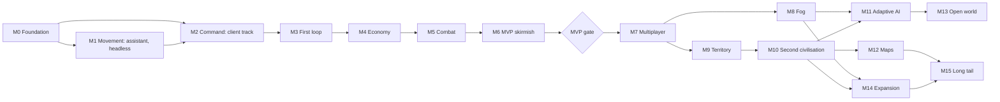

# Strategos roadmap

The owner's page: milestones, the decisions they need, and every feature with its status.
**This page is the source of truth for status.** Each milestone's full cards (value, scope,
numbered acceptance criteria, tests, dependencies, size, tier) are in `roadmap/Mx-*.md`, linked
below, and mirror the statuses here. Revised on 2026-10-21 from the
[draft](design/roadmap-draft.md) and its three reviews; every change request and its outcome is in
[design/roadmap-changes.md](design/roadmap-changes.md).

**Owner approval (2026-10-21).** Every M0–M6 card is approved: M0's 26 cards are already `specified`, because its implementation spec is written, and CMB-08 is deferred, because D-08 chose the observer avatar. Every decision needed by M6 is taken as recommended; D-03, D-06, D-07, D-20 and D-21 stay open until their milestones. M0 started 2026-10-21 on the owner's go-ahead and was accepted on 2026-10-22; M1 started 2026-10-22.

## Legend

| Field | Values |
|---|---|
| Status | `proposed` · `approved` · `rejected` · `deferred` (optionally `deferred (M10)`) · `changed` (the owner edited the scope; it comes back for approval) · `approved-foundation` (M0, infrastructure the owner asked to start). After approval the assistant moves a card through `specified`, `in_progress` and `done`; `accepted` follows when the owner has played the milestone demo ([03-design-process.md](03-design-process.md)) |
| Size | S up to 1 day, M up to 3 days, L up to 2 weeks; nothing larger exists. Totals add upper bounds (S = 1, M = 3, L = 10 card-days) to compare milestones; they are not a calendar ([01-feasibility.md §6.5](01-feasibility.md), re-estimated after M0) |
| Tier | Catalog tiers ([research/mechanics.md §4.3](research/mechanics.md)): T0 core loop, T1 the 0 A.D. feel, T2 expansion, T3 later. "Pulled into the MVP" marks T1 or T2 items the MVP takes early |
| Test levels | L0 static · L1 core unit (rules and whole matches against fakes) · L2 Minecraft-bootstrapped JUnit · L3 GameTest · L4 client scenario (opens a window, so only with consent) · L5 dedicated-server smoke · L6 performance (L6 client: frame time, with consent) · L7 manual, the owner · R a report against a stated exit criterion · D a document check |
| Pillars | P1–P5 below; a card's Value line cites the pillars it serves |

## How to approve

1. **A whole milestone:** set every Status in its table to `approved`, or tell the assistant
   "approve M3" and it edits the table.
2. **One feature:** set its Status to `approved`, `rejected`, `deferred` or `deferred (Mx)`. To
   change scope, set `changed` and add a quoted line under the milestone's table, for example
   `> Owner, CMB-08: no respawn`; the assistant turns it into a card edit for re-approval.
3. **Decisions:** in "Decisions needed from the owner", write the chosen option or "as
   recommended". A card whose decision is open cannot start.
4. When a card is rejected or deferred, the assistant lists what depends on it and proposes
   changes before work continues. IDs are never renumbered or reused; a new card takes the next
   free number in its area.

## Design pillars

- **P1 The land is the economy.** Matches reshape the arena: forests recede, hills are quarried,
  fields are laid out and towns rise block by block, and every edit is seen and heard.
- **P2 Readable from above, real from below.** At the default camera height a player can tell the
  owner, role, task, load, health and upgrade tier of every unit; first person shows the same world
  up close.
- **P3 Classic RTS hands.** AoE and 0 A.D. muscle memory works on day one: box select, control
  groups, Shift queues, the idle-worker key, rally points and order previews. Every unit can always
  be selected and ordered on its own; groups and formations never lock units together (owner,
  2026-10-21).
- **P4 Few decisions, all real.** Boom or rush, counters, high ground, when to ring the bell, when
  to phase up; headless matches verify that each choice can win.
- **P5 An honest opponent.** The AI issues the same commands, announces its attacks and never
  cheats below its labelled top level.

## Rules every card follows

- **Definition of Done:** [ADR-0006](adr/0006-test-levels-and-definition-of-done.md), with the two
  amendments of [ADR-0022](adr/0022-definition-of-done-amendments.md), accepted with this roadmap on 2026-10-21: networking changes need L3 mock players and L5 before merge and L7 at
  the milestone exit; build and tooling changes need L4 only once QA-06 exists, with consent or on
  CI. L0 and L5 run on every change, in `verify`; rules are checked exactly in L1, and L3 keeps
  one integration test per feature.
- **One verdict per criterion.** Every acceptance criterion names exactly one level from the
  legend, and consent is written on it.
- **Terms.** *Stuck*: no progress toward the current waypoint for 40 ticks or more. *Stall*: no AI
  command for 2 game minutes. *Desync*: a mock viewer's received pose or HP differs from core state
  for more than 10 ticks. *Ideal time*: the shortest nav-grid path ÷ the template speed. *Expected*:
  the balance-sheet value. *Winner*: decided by the victory rule. Judgements such as "good" or "a
  challenge" belong to Acceptance.
- **Done and Accepted.** Each milestone has a Done gate (automated, consent items named) and an
  Acceptance (the owner's demo, sessions and verdicts). Done never waits for the owner; pending
  consent blocks Accepted, not Done.
- **The cumulative rule.** A milestone's Done gate re-runs every earlier milestone's automated
  gates: functional suites, golden journals, perf budgets and baselines, soaks.
- **Statistics.** Win-rate and counter gates run in L1 on at least 200 fixed seeds with binomial
  bounds: a start is unfair at 121 of 200 or more, a pairing unbalanced outside 80–120, "beats"
  means at least 124, a counter at least 170. 20-seed L3 runs are smoke tests.
- **Negative tests have controls.** A "receives nothing" or "never paired" test also shows, in the
  same setup, a visible unit paired or an allowed payload received; a test of a guard against a
  vanilla mechanism first enables the mechanism and shows it working outside the match. Every new
  payload gets an L2 round trip, a size cap and declared audiences.
- **Consent.** A client window opens only with the owner's consent, asked once per card or
  milestone batch (D-22); each milestone spec lists its consent batch. Frame budgets always need
  it.
- **Engineering baseline.** Budgets A–G, the budget matrix per milestone, the spikes and the ADR
  behind every engineering decision are in [M0's file](roadmap/M0-foundation.md#plan-wide-engineering-baseline).
  Cards implement or confirm accepted ADRs; none re-decides one.
- **Clean-room.** No GPL or all-rights-reserved code or assets; every number is our own; MIT and
  Apache-2.0 code only with its notice in `NOTICE` ([ADR-0005](adr/0005-clean-room-and-licensing.md)).

## Milestones

| Milestone | Goal | The owner plays at the end | Exit: Done gate · Acceptance | Cards / card-days |
|---|---|---|---|---|
| [M0 Foundation](roadmap/M0-foundation.md) | Build, harnesses, deterministic kernel, walking skeleton; spikes S1, S2, S5, S6 | Nothing yet: units walk through the core on a dedicated server, seen by two clients, saved and replayed | `verify` green from a clean clone; skeleton replays to the same hash; fault injection and quarantine pass; tripwire met · the owner watches the skeleton and approves the budgets | 26 / 66 |
| [M1 Movement](roadmap/M1-movement.md) | Hundreds of units cross real terrain on group orders, headless and in budget | 200 units crossing the proving ground with the path overlay; the S9 camera prototype | 600-unit soak holds A–E and G; identical hashes with 0, 1 and 4 path threads; ADR-0015 accepted · the owner watches | 26 / 83 |
| [M2 Command](roadmap/M2-command.md) | RTS camera, selection, orders, first person and a battle sandbox | 30 v 30 spearmen with box select, attack-move and control groups; a walk among them | No snap-backs (L3 proxy); 2 × 100 melee soak; ADR-0017 confirmed · "commanding a fight" ≥ 3 of 5 (gate 2) | 20 / 66 |
| [M3 First loop](roadmap/M3-first-loop.md) | A crude, complete match against a scripted bot | Gather, build, train and burn the bot's civic centre, with fields, rally points, an idle key, a minimap and announced attacks | Ten L1 bot matches end with a winner within 30 minutes and no food stall · "would I play another?" (gate 3) | 27 / 81 |
| [M4 Economy and construction](roadmap/M4-economy-and-construction.md) | Four resources with sinks, livestock, slopes, damage stages, repair, protection, save and resume | A town economy; buildings crumble and are repaired; save and resume | Deposits exact; every protection source fails; a reload equals an uninterrupted run · playtest | 18 / 51 |
| [M5 Combat](roadmap/M5-combat.md) | Counters, archers, cavalry, stances, high ground, garrison and the town bell | "Battle at the ford"; a raid broken by the bell | Counters ≥ 170 of 200 (L1); the bell clears workers within 10 s · the owner wins and loses once | 14 / 41 (the deferred CMB-08 included) |
| [M6 MVP: First skirmish](roadmap/M6-first-skirmish.md) | Phases and technologies, siege, the skirmish from the title screen, AI levels, solo fog (D-24) | The MVP skirmish from the title screen | Matches 20–35 minutes, none over 45; each opening wins 60–140 of 200; MVP completeness · the owner's matches and two friends' (MVP gate) | 23 / 69 |
| **MVP (M0–M6)** | **A solo skirmish against a scripted AI** | | | **154 / 457** (solo fog included; the deferred CMB-08 counted) |
| [M7 Multiplayer](roadmap/M7-multiplayer.md) | 2–4 players: lobby, teams, shared control, reconnects, hardening, S11; ART-03 beside it | 2 v 2 with a friend and AIs; a reconnect; co-op in one faction | Hostile packets refused; ≤ 100 KB/s per client · a two-client session | 13 / 51 |
| [M8 Fog of war](roadmap/M8-fog-of-war.md) | Team vision, targeted re-tracking, mirages, leak audit, a scouting AI | Fair fog in a 2 v 2 | Reveal within 6 ticks, hide within 15; one leak test per channel · a session | 5 / 20 |
| [M9 Territory, capture and defence](roadmap/M9-territory-capture-and-defence.md) | Territory, capture, the full garrison, towers, palisades | Capturing a barracks; holding a chokepoint | Capture maths; territory never blocks a tick · playtest | 10 / 49 |
| [M10 Second civilisation and depth](roadmap/M10-second-civilisation.md) | A second civilisation, City, the tech tree, abilities, ranks, healing, formations, hunting, the first Minecraft twist | Two civilisations meet; night falls | Civilisation pairings 80–120 of 200 · playtest and art approval | 18 / 78 |
| [M11 Adaptive AI](roadmap/M11-adaptive-ai.md) | Managers with one budget, expansion, attack plans, five levels | Losing to the top level | Each level beats the one below ≥ 124 of 200 · two levels played | 7 / 40 |
| [M12 Maps and game setup](roadmap/M12-maps-and-setup.md) | Random maps, authoring tools, the full setup screen, a tutorial | A generated four-player map; a friend finishes the tutorial | Fairness on every seed; the 512² gate · a friend's tutorial run | 7 / 38 |
| [M13 Open world](roadmap/M13-open-world.md) | Matches in an ordinary survival world | A claimed valley in a survival world | Armies cross unloaded chunks with no duplicates · a session | 6 / 37 |
| [M14 Expansion](roadmap/M14-expansion.md) | Trade, heroes, catapults, walls, naval play, more victories, sacred sites, two more civilisations | Each approved feature | Four-civilisation pairings in bounds · per feature | 15 / 106 |
| [M15 Long tail](roadmap/M15-long-tail.md) | Scenarios, replays, terrain secrecy, a content API, localisation, spectators, music | Each approved feature | Per card · per feature | 8 / 52 |
| **All** | | | | **243 / 928**, plus 2 reserve cards (13) |

### Order and the two tracks

After M0 the work runs on two tracks. The assistant builds M1 headless; beside it, the owner-facing
M2 cards start as soon as their dependencies allow: the camera spike S9 (CAM-01) right after M0,
the camera, input, HUD and renderer cards with it, the battle sandbox once M1's avoidance exists.
"At most one system in progress" (risk F-R7) counts per track. M2 is Done only after M1, because
its battles move M1's armies. After the MVP, M8 and M9 may swap, and M11–M14 may run in any order
the arrows allow; cards from M7 on are coarser and are refined when their milestone opens.

## Decisions needed from the owner

Ordered by the milestone that needs each answer first. Interlocked decisions are presented
together, and each option names its card delta. Full option tables are in the card file of the
milestone that needs them. Write the answer after **Owner:**.

### Before M0 is done

**D-01 · Population cap per player** ([details](roadmap/M0-foundation.md#d-01--population-cap-per-player)).
Options: 100, 150, 200 or 300 per player (data only; above 200 needs its own perf gate).
Recommended: 150 by default, 50–200 in setup; it drops to 100 if S1 shows the best body above
15 µs at 500 moving units or S4 shows 200 armoured humanoids above 6 ms. **Owner:** as recommended (2026-10-21)

**D-22 · Client-run consent policy** ([details](roadmap/M0-foundation.md#d-22--client-run-l4-consent-policy)).
Options: consent per run; batched consent per card or milestone, with an optional standing window;
a Linux container under Xvfb (the owner installs it); CI only. Recommended: batched consent for
frame budgets and feel, CI for goldens once D-23 allows. **Owner:** as recommended (2026-10-21)

**D-23 · CI and the private GitHub repository** ([details](roadmap/M0-foundation.md#d-23--ci-and-the-private-github-repository)).
Options: no CI (QA-08 dropped, −3 days; goldens need consent; no Linux S6); a private repository
with one GitHub Actions Linux job; another host. Recommended: the private repository with one job;
publishing stays D-21. **Owner:** as recommended (2026-10-21)

### Before M1

**D-13 · Which Minecraft systems run, and which become mechanics**, with D-17 arena size
([details](roadmap/M1-movement.md#d-13--which-minecraft-systems-run-and-which-become-mechanics)).
Options: vanilla as is; a controlled arena (no spawning, weather, fire tick or griefing, random
ticks 0, fixed noon); controlled now with "Minecraft twists" as match rules later (day and night,
night raiders, weather). Recommended: controlled now, with day and night as the first twist
(MATCH-16, M10). D-17 recommends 384² arenas, 512² after PERF-12. **Owner:** as recommended (2026-10-21)

### Before M2

**D-08 · First-person avatar**, decided with D-24 exploration in the MVP
([details](roadmap/M2-command.md#d-08--first-person-avatar)). Options: an observer; a fighting
avatar (+CMB-08, M5); a commander hero (with CMB-14, M14); survival rules (open world only).
Recommended: an observer that adds no vision, that units pass through, and that stands only in
explored cells, so it can never scout or block a gate; CMB-08 stays optional. **Owner:** as recommended (2026-10-21)

**D-09 · Camera projection** ([details](roadmap/M2-command.md#d-09--camera-projection)). Options:
perspective; orthographic; perspective with an orthographic option (+CAM-06, M10). Recommended:
perspective; CAM-06 only if the owner wants it after the M2 playtest. **Owner:** as recommended (2026-10-21)

### Before M3

**D-25 · The MVP's identity**, with D-02 and the raid answer
([details](roadmap/M3-first-loop.md#d-25--the-mvps-identity)). Options: (a) an AoE-leaning MVP
with 0 A.D.'s visible signatures from M9; (b) citizen-soldiers through data (≈ +3 days); (c)
territory-lite in M6 (≈ +13 days); (d) capture in M6 (≈ +10 days). Recommended: (a), with garrison
and the bell in M5 and solo fog per D-24. **Owner:** as recommended (2026-10-21)

**D-02 · Worker model** ([details](roadmap/M3-first-loop.md#d-02--worker-model)). Options: AoE-style
villagers; 0 A.D.-style citizen-soldiers; per civilisation. Recommended: villagers in the MVP;
gathering and building are data, so citizen-soldiers can arrive as a civilisation trait (CIV-01).
**Owner:** as recommended (2026-10-21)

**Theme bundle: D-04 art direction, D-10 resources, D-05 phase names, D-03 civilisations**
([details](roadmap/M3-first-loop.md#theme-bundle-d-03-d-04-d-05-d-10)). D-04: vanilla-faithful with
custom models only where needed, recommended; villager-look workers offered. D-10: food, wood,
stone, iron, recommended. D-05 (by M6): Village → Town → City, with material tiers for equipment.
D-03 (by M7): antiquity, Romans and Gauls, if the owner accepts the largest art bill; biome cultures
are the cheapest distinctive choice. **Owner:** D-04, D-10 and D-05 as recommended (2026-10-21); D-03 stays open (needed by M7)

**D-11 · Pacing** ([details](roadmap/M3-first-loop.md#d-11--pacing-and-scale)). Options: 35–45
minutes; median 20–35 with every match within 45; slower. Recommended: median 20–35, within 45 in
M6 and 30 for M3's crude loop; template values are our own numbers in game units. **Owner:** as recommended (2026-10-21)

**D-12 · How buildings fall** ([details](roadmap/M3-first-loop.md#d-12--how-buildings-fall-in-the-mvp)).
Options: tuned soldier damage; torches plus a Town ram (CMB-03, CMB-09); capture in M3 (+CMB-10,
L); a ram only; field-built rams (after UNIT-10); a TNT sapper (+M). Recommended: torches, with
wood burning faster than stone, plus the ram in Town. **Owner:** as recommended (2026-10-21)

**D-16 · Minimap in the MVP** ([details](roadmap/M3-first-loop.md#d-16--minimap-in-the-mvp)).
Options: none; basic in M3 and full in M6 (UI-11, UI-20); full in M6 only. Recommended: basic in M3,
full in M6. **Owner:** as recommended (2026-10-21)

**D-18 · Pause and game speed** ([details](roadmap/M3-first-loop.md#d-18--pause-and-game-speed)).
Options: no pause; pause only; pause and speeds. Recommended: pause plus 0.5×, 1× and 1.5× in
singleplayer; no pause in multiplayer at first. **Owner:** as recommended (2026-10-21)

### Later

| Decision | Needed by | Recommendation | Details | Owner |
|---|---|---|---|---|
| D-14 Field lifecycle | M4 | Auto-reseed for wood, toggled at the farmstead (ECO-17) | [M4](roadmap/M4-economy-and-construction.md#d-14--field-lifecycle) | as recommended (2026-10-21) |
| D-15 Repair cost | M4 | Free at half the build speed | [M4](roadmap/M4-economy-and-construction.md#d-15--repair-cost) | as recommended (2026-10-21) |
| D-05 Phase names | M6 | Village → Town → City (theme bundle) | [M3](roadmap/M3-first-loop.md#theme-bundle-d-03-d-04-d-05-d-10) | as recommended (2026-10-21) |
| D-17 Arena size | M6 | 384² for 1 v 1; 512² after PERF-12 (with D-13) | [M1](roadmap/M1-movement.md#d-17--arena-size) | as recommended (2026-10-21) |
| D-19 AI fairness | M6 | Open penalties at every level; bonuses only at a labelled top level; fog-fair once fog exists | [M6](roadmap/M6-first-skirmish.md#d-19--ai-fairness-and-difficulty) | as recommended (2026-10-21) |
| D-24 Exploration in the MVP | M6 | (c) solo-grade fog: five cards, +9 card-days (with D-08) | [M2](roadmap/M2-command.md#d-24--exploration-in-the-mvp) | as recommended (2026-10-21) |
| D-03 Civilisation themes | M7 (ART-03) | Antiquity if its art bill is accepted, else biome cultures (theme bundle) | [M3](roadmap/M3-first-loop.md#theme-bundle-d-03-d-04-d-05-d-10) | pending |
| D-20 Multiplayer hosting | M7 | Dedicated servers first, Open to LAN supported | [M7](roadmap/M7-multiplayer.md#d-20--multiplayer-hosting) | pending |
| D-07 Licence | first public release | MPL-2.0 for code; assets all rights reserved with modpack permission | [M8](roadmap/M8-fog-of-war.md#d-07--licence) | decided by the owner (2026-10-25): PolyForm Noncommercial 1.0.0 until the full release |
| D-21 Public release and name | first public release | Friends from M6; public alpha after M8; keep "Strategos" after the checks | [M8](roadmap/M8-fog-of-war.md#d-21--public-release-and-name) | pending |
| D-06 Map generation | M12 | Seeded packages now; our own generator in M12 | [M12](roadmap/M12-maps-and-setup.md#d-06--map-generation-approach) | pending |

## Features per milestone

### M0 · Foundation

Cards: [roadmap/M0-foundation.md](roadmap/M0-foundation.md#cards). 26 cards, at most 66 card-days.

| ID | Feature | Size | Depends on | Status |
|---|---|---|---|---|
| QA-01 | Build skeleton, pins, core merge and spike S5 | M | — | accepted |
| QA-02 | Core test kit: SimHarness, fakes and shared scenarios | M | QA-01 | accepted |
| QA-04 | GameTest harness (L3) | M | QA-01 | accepted |
| CORE-01 | Match container, lifecycle and region index | M | QA-02, QA-04 | accepted |
| CORE-02 | Driving port and the nine-phase tick pipeline | M | CORE-01 | accepted |
| CORE-03 | Command pipeline and in-memory journal | M | CORE-02 | accepted |
| CORE-06 | Unit records, handles and the body registry | M | CORE-01 | accepted |
| UNIT-01 | Unit body v0: a kinematic LivingEntity view | M | CORE-06 | done |
| QA-09 | Launch scripts, playtest protocol and the Done ADR | S | QA-01 | accepted |
| ORD-01 | Walking skeleton: a debug move order end to end | S | CORE-03, UNIT-01 | accepted |
| QA-03 | Minecraft-bootstrapped unit tests (L2) | S | QA-01 | accepted |
| QA-05 | Server smoke (L5): boot, a headless match, a restart round trip | M | QA-01, ORD-01, CORE-07 | accepted |
| QA-06 | Client scenario runner and spike S3 (consent) | M | QA-01, D-22 | accepted |
| QA-07 | Performance harness (L6) | M | QA-02, QA-04 | accepted |
| QA-08 | Continuous integration | M | QA-04, QA-05, D-23 | accepted |
| QA-10 | Developer commands and log tagging | S | QA-04 | accepted |
| QA-17 | Static gates, engine-surface inventory and fixture catalogue | M | QA-01 | accepted |
| PERF-01 | Budget matrix and enforcement | S | QA-07 | accepted |
| PERF-02 | Spike S1: server cost per body | M | UNIT-01, QA-07 | accepted |
| PERF-03 | Spike S2: force-loaded arena cost | M | QA-05, QA-07 | accepted |
| PERF-04 | Spike S4: client frame time with many units (consent) | M | QA-06, UNIT-01 | accepted |
| CORE-04 | Match event bus | S | CORE-02 | accepted |
| CORE-05 | Determinism kit and spike S6 | M | CORE-03, CORE-04 | accepted |
| CORE-07 | Persistence kernel: one blob per match | M | CORE-06 | accepted |
| CORE-10 | Fault containment | M | CORE-02, QA-04 | accepted |
| CORE-12 | Save quarantine | M | CORE-07, CORE-10 | accepted |

### M1 · Movement

Cards: [roadmap/M1-movement.md](roadmap/M1-movement.md#cards). 26 cards, at most 83 card-days.

| ID | Feature | Size | Depends on | Status |
|---|---|---|---|---|
| DATA-01 | Template engine | M | QA-02 | done |
| DATA-02 | Modifier pipeline | M | DATA-01, CORE-04 | done |
| DATA-03 | Content loading, client sync and spike S12 | L | DATA-01, NET-01 | done |
| PATH-02 | Surface pages: block classes and the page builder | M | QA-02, QA-03 | done |
| PATH-01 | Spike S8: terrain census and surface encoding | S | PATH-02 | done |
| MAP-07 | Arena world: preset, world rules and tickets | M | CORE-01, D-13 | done |
| BLD-15 | Block writer | M | CORE-02, CORE-10 | done |
| MAP-01 | Map packages, importer and the proving ground | M | BLD-15, MAP-07, PERF-03 | done |
| PATH-15 | Live terrain capture, page rebuilds and the block-change router | M | PATH-02, BLD-15, CORE-01 | done |
| PATH-03 | Path service: A*, string pulling and STRICT delivery | M | PATH-02, CORE-05 | done |
| PATH-05 | Path following: kinematic motion on surfaces | M | PATH-03, UNIT-01 | done |
| UNIT-09 | Spike S10: kinematic fidelity | M | PATH-05, PATH-15 | done |
| CORE-11 | Binary journal and cross-level replay | M | CORE-05, QA-04 | done |
| CORE-08 | Spatial index | M | CORE-02 | done |
| QA-19 | Network test kit: byte counts and acknowledging mock players | M | QA-03, QA-04 | done |
| NET-01 | Payload layer, NetGateway and the fog-gate stub | M | CORE-03, QA-03, QA-19 | done |
| UNIT-02 | UnitAI state machine framework | M | CORE-04, CORE-06 | done |
| ORD-02 | Order queue: move and stop | M | ORD-01, UNIT-02, NET-01 | done |
| PATH-04 | Components and reachability | M | PATH-02, PATH-15 | done |
| ORD-03 | Group destination slots | M | ORD-02, PATH-04 | done |
| PATH-06 | Local avoidance (ORCA) | M | PATH-05, CORE-08 | done |
| PATH-16 | Worker pool, ADAPTIVE delivery and spike S7 | M | PATH-03 | done |
| PATH-07 | Stuck ladder | M | PATH-05, PATH-06 | done |
| PATH-09 | Shared group path | M | PATH-06, ORD-03, PATH-16 | done |
| PATH-10 | Movement debug overlay and dev payloads | M | PATH-03, NET-01, QA-10 | done |
| PERF-05 | Crowd soak and the M1 perf gate | M | PATH-07, PATH-09, MAP-01, QA-07, QA-19 | done |
| PATH-08 | Hierarchical long-range planner (HPA*) (reserve, outside the totals) | L | PATH-03, PATH-04 | done |
| PATH-17 | Flow fields for large groups (reserve, outside the totals) | M | PATH-09 | approved |

### M2 · Command

Cards: [roadmap/M2-command.md](roadmap/M2-command.md#cards). 20 cards, at most 66 card-days.

| ID | Feature | Size | Depends on | Status |
|---|---|---|---|---|
| CAM-01 | Spike S9: commander camera on a dedicated server | L | QA-06, QA-09, UNIT-01, D-22 | done |
| UI-01 | Input action layer and key bindings | M | QA-01 | done |
| CAM-02 | RTS camera rig | L | CAM-01, UI-01, D-09 | done |
| CAM-04 | RtsScreen, cursor and world picking | M | CAM-01, UI-01 | done |
| UI-02 | HUD framework | M | UI-01, QA-06 | done |
| UNIT-03 | Unit renderer for the RTS view | M | UNIT-01 | done |
| QA-18 | Scenario diff, goldens and the CI golden job | M | QA-06, CAM-04, D-22 | done |
| CAM-03 | Commander body, jumps and the chunk-sent re-pair | M | CAM-01, CORE-03, NET-01, QA-19 | done |
| NET-08 | Tier-2 replication: summaries, far markers and details | M | NET-01, UNIT-03 | done |
| UI-03 | Selection | M | CAM-04, UI-02, UNIT-03 | done |
| UI-04 | Control groups | S | UI-03 | done |
| UI-05 | Order feedback and destination preview | M | ORD-03, UI-02, CAM-04 | done |
| CAM-05 | First person and back, with observer rules | M | CAM-03, D-08 | done |
| CAM-07 | First-person orders: follow me, attack what I look at, inspect | M | CAM-05, ORD-04, NET-08 | done |
| CMB-01 | Damage model in the core | M | DATA-02, UNIT-02 | done |
| CMB-02 | Melee combat with a default aggressive behaviour | M | CMB-01, PATH-06 | done |
| ORD-04 | Attack and attack-move | M | ORD-02, CMB-02, UI-05 | done |
| CMB-06 | Health bars, hit flash and death | S | CMB-01, UI-02, NET-08 | done |
| AUD-01 | Order, hit and death sounds | S | ORD-02, CMB-01, NET-01 | done |
| PERF-14 | Client frame gate (consent) | S | UI-02, UNIT-03, QA-06 | done |

### M3 · First loop

Cards: [roadmap/M3-first-loop.md](roadmap/M3-first-loop.md#cards). 27 cards, at most 81 card-days. Implementation spec: [milestones/M3-first-loop.md](milestones/M3-first-loop.md).

| ID | Feature | Size | Depends on | Status |
|---|---|---|---|---|
| DATA-04 | Balance sheet: relationships, provenance and timing targets | M | DATA-02, D-11 | done |
| ECO-01 | Resources and treasury | M | CORE-03, NET-01, D-10 | done |
| ECO-02 | Resource nodes: discovery and index | M | CORE-08, PATH-04, MAP-01 | done |
| ECO-03 | Woodcutting on real trees, with natural canopy thinning | L | ECO-02, BLD-15, PATH-15 | done |
| ECO-05 | Gathering, dropsites and berry bushes | L | ECO-01, ECO-02, UNIT-04, BLD-01 | done |
| UNIT-04 | Starting units and the worker model | S | UNIT-02, DATA-04, D-02 | done |
| BLD-01 | Building records and blueprints | M | CORE-06, DATA-03, PATH-15 | done |
| AUD-04 | World-edit feedback: cracks, particles and sounds | M | ECO-03, BLD-15, NET-01 | done |
| BLD-02 | Placement mode and validators | M | BLD-01, CAM-04 | done |
| BLD-03 | Progressive construction | M | BLD-02, UNIT-04, BLD-15 | done |
| ECO-06 | Population and housing | S | ECO-01, BLD-01, D-01 | done |
| ECO-09 | Fields with manual reseed | M | ECO-05, BLD-01 | done |
| PROD-01 | Production queue | M | BLD-01, ECO-06 | done |
| PROD-03 | Rally points | S | PROD-01, ECO-05 | done |
| UI-06 | Selection panel and command card | M | UI-03, PROD-01, BLD-02 | done |
| UI-07 | Resource bar, population and workers per resource | M | ECO-01, ECO-06, UI-02 | done |
| UI-10 | Idle-worker key and economy notifications | S | UI-07, ECO-05 | done |
| ART-01 | Placeholder look and the style guide | M | UNIT-03, BLD-01, D-04 | done |
| CMB-03 | Attacking buildings with torches | M | CMB-02, BLD-01, D-12 | done |
| MATCH-01 | Scenarios, match rules and a first victory | M | CORE-01, DATA-03, MAP-01 | done |
| UI-11 | Basic minimap | M | UI-02, CAM-03, NET-08, D-16 | done |
| UI-12 | Under-attack alert with jump key | S | UI-10, MATCH-01 | done |
| MATCH-05 | Pause and game speed | S | CORE-01, CORE-03, D-18 | done |
| AI-01 | AI player framework | M | CORE-03 | done |
| AI-17 | Scripted bot with announced waves | M | AI-01, ORD-04, PROD-01, ECO-03, ECO-05, ECO-09, BLD-03 | done |
| QA-11 | Headless match runner | M | AI-17, MATCH-01 | done |
| PERF-06 | First-loop perf gate | S | BLD-03, ECO-05, PERF-05 | done |

### M4 · Economy and construction

Cards: [roadmap/M4-economy-and-construction.md](roadmap/M4-economy-and-construction.md#cards). 18 cards, at most 51 card-days.

| ID | Feature | Size | Depends on | Status |
|---|---|---|---|---|
| ECO-07 | Stone from real rock | M | ECO-05, PATH-15 | done |
| ECO-08 | Mines and quarries | M | ECO-05 | done |
| ECO-16 | Livestock at the start | M | ECO-05, UNIT-03 | done |
| ECO-17 | Field auto-reseed at the farmstead | S | ECO-09, BLD-08, D-14 | done |
| UNIT-05 | Level of detail by activity | M | CORE-02, PERF-02 | done |
| BLD-04 | Foundations on uneven ground | M | BLD-03 | done |
| BLD-05 | Abstract HP and damage stages | M | BLD-03, CMB-03 | done |
| BLD-06 | Repair | S | BLD-05, D-15 | done |
| BLD-07 | Building protection | M | BLD-01, BLD-15 | done |
| BLD-08 | Starting building set, with resource sinks | M | BLD-04, BLD-05, ECO-08, PROD-01 | done |
| BLD-09 | Cancel and demolish | S | BLD-03 | done |
| PROD-02 | Batch training | S | PROD-01 | done |
| UI-08 | Command card complete | M | UI-06, DATA-02 | done |
| UI-09 | Build menu and placement UX | M | UI-08, BLD-04 | done |
| MATCH-04 | Save and resume | M | CORE-07, CORE-11, CORE-12, BLD-05, ECO-08 | done |
| AI-02 | AI economy and base building | L | AI-17, BLD-08, ECO-08, ECO-09, ECO-16 | done |
| ART-02 | Resource and deposit visuals | M | ECO-08, ECO-09, ECO-16, D-04 | done |
| PERF-07 | Economy and construction perf gate | S | BLD-08, UNIT-05, PERF-06 | done |

### M5 · Combat

Cards: [roadmap/M5-combat.md](roadmap/M5-combat.md#cards). 14 cards, at most 41 card-days, the deferred CMB-08 included.

| ID | Feature | Size | Depends on | Status |
|---|---|---|---|---|
| CMB-04 | Ranged combat and analytic projectiles | L | CMB-01, NET-01 | in_progress |
| CMB-05 | Stances, targeting, chase and flee | M | CMB-02, CMB-04, CORE-08 | done |
| CMB-07 | Civic centre arrows | M | CMB-04, BLD-08 | specified |
| CMB-08 | First-person combat (if D-08 chooses it) | M | CAM-05, CMB-01, D-08 | deferred |
| CMB-16 | High ground | S | CMB-04, DATA-02 | in_progress |
| CMB-17 | Combat readability: attack lines and the under-attack flash | S | CMB-06, UI-02 | specified |
| ORD-05 | Focus fire and force attack | M | ORD-04, CMB-05 | specified |
| PATH-11 | Mobility classes and footprints | M | PATH-06, PATH-09 | in_progress |
| UNIT-06 | Mounted units | M | UNIT-03, PATH-11 | specified |
| UNIT-07 | Combat roster and counters | M | CMB-04, CMB-05, UNIT-06, DATA-04 | specified |
| BLD-16 | Garrison and the town bell | M | BLD-08, CORE-06, ORD-02 | specified |
| BLD-11 | Arrows per garrisoned unit | S | BLD-16, CMB-07 | specified |
| AI-03 | AI battle tactics | M | AI-02, UNIT-07, ORD-05 | specified |
| PERF-08 | Battle perf gate | S | UNIT-07, CMB-07, PERF-07 | specified |

> Owner, CMB-08: deferred — D-08 chose the observer avatar; revisit after the M2 playtest.

### M6 · MVP: First skirmish

Cards: [roadmap/M6-first-skirmish.md](roadmap/M6-first-skirmish.md#cards). 23 cards, at most 69 card-days.

| ID | Feature | Size | Depends on | Status |
|---|---|---|---|---|
| TECH-01 | Research system | M | DATA-02, PROD-01 | specified |
| TECH-02 | Phases: Village to Town | M | TECH-01, BLD-08, D-05 | specified |
| TECH-03 | Starting technologies and visible equipment tiers | M | TECH-01, UNIT-07 | specified |
| CMB-09 | Siege ram and the arsenal | M | CMB-03, UNIT-06, PATH-11, TECH-02, D-12 | specified |
| BLD-17 | Defence tower | M | CMB-07, TECH-02 | specified |
| MATCH-14 | Spike: an arena world from the title screen | S | MAP-07 | specified |
| MATCH-02 | Skirmish setup and launch | L | MATCH-14, MAP-01, MATCH-01, UI-02 | specified |
| MATCH-03 | Conquest, defeat and statistics | M | MATCH-01, BLD-08 | specified |
| MAP-02 | First skirmish map | M | MAP-01, ECO-02, ECO-16, D-17 | specified |
| AI-04 | AI openings, waves, raid bar and defence | L | AI-03, MAP-02, BLD-16 | specified |
| AI-05 | AI phases, research and difficulty levels | M | AI-04, TECH-02, D-19 | specified |
| UI-20 | Minimap orders, pings and live construction | M | UI-11, UI-12 | specified |
| UI-21 | Notification feed and alert audio | M | UI-12, TECH-01 | specified |
| UI-13 | Research and phase UI | M | UI-08, TECH-02 | specified |
| UI-14 | First-match hints and controls help | M | UI-21 | specified |
| FOW-01 | Vision grid per faction (solo fog, D-24 (c)) | M | CORE-08 | specified |
| FOW-07 | Explored state, the shroud and solo fog gating (solo fog, D-24 (c)) | M | FOW-01, NET-08 | specified |
| UI-16 | Minimap fog and explored areas (solo fog, D-24 (c)) | S | UI-11, FOW-07 | specified |
| AI-18 | The AI reads only its own vision (solo fog, D-24 (c)) | S | AI-01, FOW-01 | specified |
| MATCH-07 | Visibility options (solo fog, D-24 (c)) | S | FOW-07, MATCH-02 | specified |
| QA-12 | AI-versus-AI soak and opening balance | S | QA-11, AI-05, MATCH-03 | specified |
| QA-13 | MVP release-candidate gate | S | QA-12, QA-09, PERF-09 | specified |
| PERF-09 | MVP perf gate | S | PERF-08, QA-12 | specified |

### M7 · Multiplayer

Cards: [roadmap/M7-multiplayer.md](roadmap/M7-multiplayer.md#cards). 13 cards, at most 51 card-days.

| ID | Feature | Size | Depends on | Status |
|---|---|---|---|---|
| QA-14 | 26.x platform decision gate (floating: 2027-Q2 or the MVP gate) | M | — | proposed |
| NET-02 | Match lobby on a dedicated server | L | MATCH-02, MATCH-06, NET-01, D-20 | proposed |
| NET-03 | Per-player and per-faction state through the gateway | M | NET-08, MATCH-06 | proposed |
| NET-04 | Spike S11: bandwidth and per-channel byte budgets | M | NET-03, QA-19, PERF-01 | proposed |
| NET-05 | Reconnect and rejoin | M | NET-02, CORE-07 | proposed |
| NET-06 | Command validation hardening and fuzzing | M | CORE-03, NET-02 | proposed |
| NET-09 | Commander hardening against modified clients | M | NET-02, QA-15 | proposed |
| MATCH-06 | Teams, diplomacy and shared control | M | MATCH-03, CORE-01 | proposed |
| UI-15 | Multiplayer HUD and pings | M | UI-20, NET-02 | proposed |
| AI-06 | AI in team games | M | AI-05, MATCH-06 | proposed |
| QA-15 | Multiplayer test kit | M | QA-19, NET-02 | proposed |
| PERF-10 | Multiplayer perf and bandwidth gate | S | NET-04, QA-15, PERF-09 | proposed |
| ART-03 | Civilisation 1 art pass (beside M7, after the MVP verdict) | L | QA-13, D-03, D-04 | proposed |

### M8 · Fog of war

Cards: [roadmap/M8-fog-of-war.md](roadmap/M8-fog-of-war.md#cards). 5 cards, at most 20 card-days.

| ID | Feature | Size | Depends on | Status |
|---|---|---|---|---|
| FOW-02 | Team vision and targeted re-tracking | L | FOW-07, NET-03, MATCH-06 | proposed |
| FOW-03 | Mirages and shared explored state | M | FOW-02 | proposed |
| FOW-05 | Leak audit and guards | M | FOW-02, NET-09 | proposed |
| AI-07 | Fog-fair AI scouting and memory | M | AI-18, FOW-03, D-19 | proposed |
| PERF-15 | Fog perf gate | S | FOW-02, PERF-10 | proposed |

### M9 · Territory, capture and defence

Cards: [roadmap/M9-territory-capture-and-defence.md](roadmap/M9-territory-capture-and-defence.md#cards). 10 cards, at most 49 card-days.

| ID | Feature | Size | Depends on | Status |
|---|---|---|---|---|
| TERR-01 | Territory influence grid | L | BLD-08, CORE-02 | proposed |
| TERR-02 | Territory build rules | M | TERR-01, BLD-02, AI-02 | proposed |
| TERR-03 | Borders on terrain and minimap | M | TERR-01, UI-20 | proposed |
| CMB-10 | Capturing buildings | L | CMB-03, TERR-01, MATCH-06 | proposed |
| BLD-10 | Garrison: healing, ejection and capture regeneration | M | BLD-16, CMB-10 | proposed |
| BLD-12 | Sentry tower and tower upgrades | M | BLD-17, BLD-11 | proposed |
| BLD-13 | Palisades and gates | L | BLD-04, PATH-12 | proposed |
| PATH-12 | Gates and doors in navigation | M | PATH-04, MATCH-06 | proposed |
| AI-08 | AI uses territory and capture | M | AI-05, CMB-10, BLD-10, TERR-02 | proposed |
| PERF-16 | Territory and garrison perf gate | S | TERR-01, BLD-10, PERF-10 | proposed |

### M10 · Second civilisation and depth

Cards: [roadmap/M10-second-civilisation.md](roadmap/M10-second-civilisation.md#cards). 18 cards, at most 78 card-days.

| ID | Feature | Size | Depends on | Status |
|---|---|---|---|---|
| CIV-01 | Civilisation framework | M | DATA-03, MATCH-02 | proposed |
| CIV-02 | Civilisation 2: roster, bonuses and abilities | L | CIV-01, UNIT-10, D-03 | proposed |
| ART-04 | Civilisation 2 art set | L | CIV-02, ART-03 | proposed |
| TECH-04 | City phase | M | TECH-02, TERR-01 | proposed |
| TECH-05 | Technology tree and tree screen | L | TECH-04, UI-13, TECH-03 | proposed |
| UNIT-10 | Abilities | M | CORE-03, DATA-02 | proposed |
| CMB-11 | Promotion and ranks | M | CMB-01, DATA-02 | proposed |
| CMB-12 | Healing | M | CMB-05, BLD-10, UNIT-10 | proposed |
| CMB-13 | Loot | S | CMB-01, ECO-01 | proposed |
| ORD-06 | Formations (move only) | L | ORD-03, PATH-09 | proposed |
| ORD-07 | Patrol and guard | M | ORD-04 | proposed |
| ECO-10 | Wild herds and hunting | M | ECO-16, UNIT-06 | proposed |
| UI-17 | Full hotkeys and idle-unit cycling | M | UI-08 | proposed |
| CAM-06 | Orthographic view (optional) | M | CAM-02, D-09 | proposed |
| MATCH-16 | First Minecraft twist: day and night | M | FOW-01, MATCH-01, D-13 | proposed |
| AI-09 | AI uses the new content | M | AI-08, CIV-02, TECH-04 | proposed |
| QA-16 | Balance matrix | M | QA-12, CIV-02 | proposed |
| PERF-17 | Second-civilisation perf gate | S | CIV-02, ORD-06, ECO-10, PERF-16 | proposed |

### M11 · Adaptive AI

Cards: [roadmap/M11-adaptive-ai.md](roadmap/M11-adaptive-ai.md#cards). 7 cards, at most 40 card-days.

| ID | Feature | Size | Depends on | Status |
|---|---|---|---|---|
| AI-10 | AI architecture: managers and one budget | L | AI-09 | proposed |
| AI-11 | Expansion and multi-base economy | L | AI-10, TERR-02 | proposed |
| AI-12 | Attack planning | L | AI-10, AI-07 | proposed |
| AI-13 | Defence manager | M | AI-10, BLD-10 | proposed |
| AI-14 | Personalities and openings | M | AI-11, AI-12 | proposed |
| AI-15 | Difficulty ladder | M | AI-14, QA-16 | proposed |
| PERF-11 | AI CPU budget gate | S | AI-10, QA-07 | proposed |

### M12 · Maps and game setup

Cards: [roadmap/M12-maps-and-setup.md](roadmap/M12-maps-and-setup.md#cards). 7 cards, at most 38 card-days.

| ID | Feature | Size | Depends on | Status |
|---|---|---|---|---|
| MAP-03 | Random map generator framework | L | MAP-01, D-06 | proposed |
| MAP-04 | Map scripts | L | MAP-03 | proposed |
| MAP-05 | Map authoring tools | M | MAP-01 | proposed |
| ECO-11 | Treasures | S | ECO-01, MAP-03 | proposed |
| MATCH-08 | Full setup screen | M | MATCH-02, CIV-01, MATCH-07 | proposed |
| UI-18 | Guided tutorial | L | UI-14, MATCH-02, MAP-05 | proposed |
| PERF-12 | Large-map gate | S | MAP-04, PERF-10 | proposed |

### M13 · Open world

Cards: [roadmap/M13-open-world.md](roadmap/M13-open-world.md#cards). 6 cards, at most 37 card-days.

| ID | Feature | Size | Depends on | Status |
|---|---|---|---|---|
| MAP-06 | Open-world match areas | L | CORE-01, MATCH-01, MAP-07 | proposed |
| CORE-09 | Virtualised units and abstract travel | L | CORE-06, PATH-13 | proposed |
| PATH-13 | On-demand navigation for open worlds | L | PATH-15, PATH-08 | proposed |
| MATCH-09 | Coexistence with survival play | M | MAP-06, BLD-07, D-08 | proposed |
| AI-16 | AI on natural terrain | M | AI-11, MAP-06 | proposed |
| PERF-13 | Open-world perf gate | S | CORE-09, PATH-13 | proposed |

### M14 · Expansion

Cards: [roadmap/M14-expansion.md](roadmap/M14-expansion.md#cards). 15 cards, at most 106 card-days.

| ID | Feature | Size | Depends on | Status |
|---|---|---|---|---|
| ECO-12 | Corrals and domestic animals | M | ECO-16, BLD-08 | proposed |
| ECO-13 | Trade routes and barter | L | ECO-05, MATCH-06, PATH-09 | proposed |
| CMB-14 | Heroes and auras | L | DATA-02, CMB-11, UNIT-10 | proposed |
| CMB-15 | Catapults and splash damage | L | CMB-04, CMB-09 | proposed |
| BLD-14 | Stone walls and gates | L | BLD-13, CMB-15 | proposed |
| TERR-04 | Territory decay | M | TERR-01, CMB-10 | proposed |
| MATCH-10 | Wonder, regicide and relic victories | L | MATCH-03, CMB-14 | proposed |
| MATCH-11 | Neutral diplomacy, tribute and shared vision | M | MATCH-06, FOW-02 | proposed |
| MATCH-15 | Sacred sites as beacons | M | CMB-10, MATCH-10 | proposed |
| ORD-08 | Special formations | M | ORD-06 | proposed |
| PATH-14 | Water navigation | L | PATH-11 | proposed |
| UNIT-08 | Ships, docks and fishing | L | PATH-14, CMB-04, BLD-08 | proposed |
| CIV-03 | Civilisations 3 and 4 | L | CIV-02 | proposed |
| ART-05 | Civilisations 3 and 4 art | L | CIV-03, ART-04 | proposed |
| PERF-18 | Expansion perf gate | S | CMB-15, UNIT-08, ECO-13, PERF-17 | proposed |

### M15 · Long tail

Cards: [roadmap/M15-long-tail.md](roadmap/M15-long-tail.md#cards). 8 cards, at most 52 card-days.

| ID | Feature | Size | Depends on | Status |
|---|---|---|---|---|
| MATCH-12 | Scenarios and campaigns | L | MATCH-03, UI-18 | proposed |
| MATCH-13 | Replays | L | CORE-11, MATCH-04 | proposed |
| FOW-06 | Terrain secrecy | L | FOW-05 | proposed |
| CIV-04 | Civilisation-unique mechanics and mercenaries | L | CIV-03, TECH-05 | proposed |
| DATA-05 | Public content API and authoring guide | M | DATA-03, CIV-01 | proposed |
| UI-19 | Localisation and accessibility | M | UI-17 | proposed |
| NET-07 | Spectators and observers | M | NET-02, FOW-02 | proposed |
| AUD-03 | Original music and sound cues | M | UI-21 | proposed |

## Risks and where they are retired

Feasibility risks are F-R*n* ([01-feasibility.md §4](01-feasibility.md)) and architecture risks
A-R*n* ([04-architecture.md §19.1](04-architecture.md)); a row merges risks that are the same.

| Risk | Retired by | When |
|---|---|---|
| F-R1, A-R2 Server cost per unit or body | PERF-02 (S1), UNIT-05, a perf gate in every milestone | M0, M4 |
| F-R2, A-R8 Client frame time with hundreds of humanoids | PERF-04 (S4, bare humanoids), PERF-14, UNIT-03, NET-08's far markers, ART-01 (the armoured and held-item pass) | M0, M2, M3 |
| F-R3, A-R4, A-R5 Pathfinding: stuck units, tick stalls, terrain the grid misses | PATH-01 (S8), PATH-16 (S7), M1's slices, PERF-05 | M1 |
| A-R1 Kinematic movement looks wrong | UNIT-09 (S10) | M1 |
| F-R4, A-R6 Camera and streaming on a dedicated server | CAM-01 (S9), CAM-02 to CAM-04 | right after M0, M2 |
| F-R5 Client checks disturb the owner | QA-06 (S3), D-22, QA-18 | M0, M2 |
| F-R6 The AI opponent is not credible | AI-01, AI-17, QA-11; AI-02 to AI-05, QA-12 | M3–M6 |
| F-R7 Scope creep | tiers, approval per card, one system in progress per track, QA-13 | always |
| F-R8 The owner's time and motivation | something to play at every milestone from M2 ("The owner plays at the end", above); two tracks after M0 | M2 on |
| F-R9 AI-written code erodes the architecture | QA-01, QA-17 (ArchUnit B1–B13, the inventory test), ADRs | M0 |
| F-R10, A-R16 Clean-room contamination | process rule; provenance notes (DATA-04); QA-13's checks | always |
| F-R11, A-R7 Fog leaks; re-tracking wrong or slow | NET-01's single sender, FOW-07, FOW-02, FOW-05 | M1, M6, M8 |
| F-R12 Construction storms | S1's build storm, BLD-15's budget, PERF-06, PERF-07 | M0–M4 |
| F-R13, A-R15 Sodium or Iris break overlays or the camera | `-Pcompat` runs in every client milestone | M0 on |
| F-R14, A-R14 Units duplicated or lost; world and core diverge after a crash | CORE-06, CORE-07, CORE-12, MATCH-04 (`WorldReconciler`) | M0, M4 |
| F-R15, A-R3 Determinism lost | CORE-05 (S6), CORE-11, QA-17 (B4), PATH-16 | M0, M1 |
| F-R16, A-R12 The content pipeline is wrong or too complex | DATA-03 (S12) | M1 |
| F-R17 Balance never converges | DATA-04, QA-11, QA-12, QA-16 in L1 | M3–M10 |
| F-R18 Art bottleneck | the theme bundle, ART-01, ART-03 after the MVP verdict | M3, M7 |
| F-R19, A-R10 The arena costs too much; import is slow | PERF-03 (S2), MAP-01 | M0, M1 |
| F-R20, A-R18 The ecosystem moves to 26.x; the port costs more | QA-14 | 2027-Q2 or the MVP gate |
| F-R21 Other mods intrude into the arena | MAP-07's world rules, BLD-07, `-Pcompat` | M1, M4 |
| A-R9 Bandwidth with four clients | NET-04 (S11), QA-19 | M7 |
| A-R11 Double bookkeeping slows a solo developer | the M0 tripwire | M0 |
| A-R13 Vanilla spectator powers | NET-09 | M7 |
| A-R17 Players want their own world | M13 | M13 |
