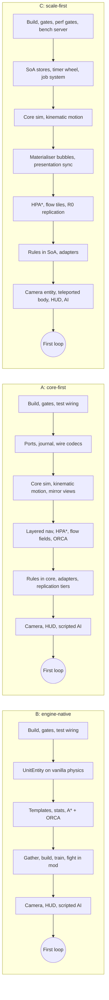

# Judgement: delivery

*Design round of 2026-10-21. One of several independent judgements of the three architecture
proposals. This one applies a single lens: **delivery for a solo developer working with an AI
coding assistant**. Inputs: [proposal A](proposal-a-core-first.md),
[proposal B](proposal-b-engine-native.md) and [proposal C](proposal-c-scale-first.md), each read
in full; the [research digest](../research/README.md); [02-tooling.md](../02-tooling.md);
[01-feasibility.md](../01-feasibility.md) §1.1, §5.1 and §6; the milestone table in
[roadmap-draft.md](roadmap-draft.md) §2. The proposals' Minecraft and NeoForge claims were
spot-checked against the decompiled Minecraft 1.21.1 + NeoForge 21.1.262 sources (§5). "A §7.3"
means section 7.3 of proposal A. Effort figures are judgements and are marked as such.*

---

## Verdict

**Ranking: B, then A, then C.**

| Sub-criterion | A core-first | B engine-native | C scale-first |
|---|---|---|---|
| 1. Time to the first playable slice | 5 | 8 | 3 |
| 2. Incremental value per milestone | 6 | 7 | 4 |
| 3. Cognitive load (10 = lightest) | 4 | 7 | 2 |
| 4. Custom infrastructure (10 = least) | 4 | 8 | 2 |
| 5. Schedule risk (10 = lowest) | 5 | 6 | 3 |
| **Total (of 50)** | **24** | **36** | **14** |

- **B** reaches a playable match first because it builds one thing per unit instead of two. The
  entity *is* the unit, and vanilla supplies physics, health, tracking and persistence (B §3.1,
  §3.3). B is also the only proposal that defines a first playable slice and stages its
  algorithms (B §7.3, §18). Its weak point for delivery is the test loop. Unit behaviour is proven
  only by GameTests, which take 40–120 s per run and assert outcome bounds rather than state hashes
  (B Summary cost 2, §2.5, §14). That gap matters most in M4–M6, the milestones heaviest in
  behaviour.
- **A** proves its results best. The core *is* the game, so whole matches, AI against AI
  included, run in JUnit in seconds, and a bug seen in the game replays in JUnit (A §2.4, §14). It
  pays for this before anything is playable. Ports, a journal, wire codecs, a mirror entity per
  unit, kinematic terrain handling and a full navigation stack all sit on the critical path (A
  "What the mandate costs" 1, 2 and 6; §4.2; §7).
- **C** solves a problem the owner has not asked for yet. Its reference load is 1,000 units of 8
  factions on a 1,024² arena of 4,096 force-loaded chunks. That is more than three times the MVP's
  2 × 150 units, 1.7 times the multiplayer stage's 4 × 150, and seven times the MVP arena's area
  (feasibility §5.1, §6.2). C puts scale infrastructure and merge-blocking budget gates on the path
  to the first loop (C Summary, §15.3). The engineering is careful. The mandate turns "basics
  first" upside down.

**Estimated effort to the first full loop** (M3 in the roadmap draft), taken from the
critical-path inventory in §2: **B needs about 0.75–0.8 of A's effort, and C about 1.25–1.4 of
A's.**

**What this lens asks of the synthesis**
1. Adopt B's delivery discipline whichever authority model wins:
   - an explicit list of what the first slice contains;
   - A*, string pulling, spread destinations and ORCA before HPA* and flow fields, behind an
     unchanged `PathService` API;
   - an inventory of every engine hook, enforced by an L0 test (B §1.4, §7.3, §18).
2. If B's entity authority wins, recover A's fast test loop for behaviour. Write the UnitAI states
   against a narrow agent interface that the core test fixtures can fake (§6, graft G1).
3. If A's core authority wins, ship the delivery-minimal cut of A in §7.1 and keep A's own
   tripwire: a walking skeleton within two weeks, or simplify (A §18 R11).
4. Keep C's mechanisms as reserves behind seams and off the first-slice path: bubble
   materialisation, streamed movement entity types and the timer wheel. Set the performance
   reference load to the owner's stages, as the roadmap draft already does (roadmap-draft §2.4).

---

## 1. Sub-criteria

| # | Sub-criterion | What it measures | What a 10 means |
|---|---|---|---|
| 1 | Time to the first playable slice | The work that must exist before the owner can play one crude match against the AI: gather, build, train, fight, destroy the enemy civic centre (roadmap M3, feasibility §6.5) | Only gameplay and the plumbing nobody can avoid are on the path |
| 2 | Incremental value per milestone | Whether each milestone ends playable *and* proven by fast automated tests, and whether later features plug in without reworking earlier ones | Every milestone is playable, every rule has a test that runs in seconds, and new features use named seams |
| 3 | Cognitive load | The concepts, layers and rules the owner and the assistant must hold to change a feature safely, including how much Minecraft API each feature touches. Plausible but wrong API use is the assistant's known weakness (feasibility §1) | One representation per thing, few rules, idioms the assistant already knows |
| 4 | Custom infrastructure | Subsystems we build and maintain although vanilla or NeoForge already provides them, or although the early stages do not need them | Only what no engine API covers |
| 5 | Schedule risk | Unknowns on the critical path, how early they are measured, and whether failing one costs a fallback or a rewrite | Every large unknown is measured in M0 and has a cheap fallback |

---

## 2. The critical path to the first playable loop

| Must exist before the first loop | A | B | C |
|---|---|---|---|
| Representations per unit | Core record plus a `noSave` view, with explicit mirror code (A §3, cost 1) | One: the entity (B §3.1) | A core struct-of-arrays slot plus a puppet entity, the puppet existing only inside interest bubbles (C §3.4) |
| Movement physics | Ours: floor heights, step smoothing, falls, impulses, hazards (A §4.2–4.5) | Vanilla `travel` and `move` (B §4.4) | Ours, as in A (C §4.4) |
| Navigation in the first slice | Layered grid, HPA*, corridor A*, flow fields and ORCA; no staging stated (A §7) | A*, string pulling, spread destinations and ORCA; HPA* and flow fields come later (B §7.3) | HPA* with lazy refinement, flow-field tiles and ORCA (C §7) |
| Replication | Vanilla tracking for unit bodies, plus delta summaries with a baseline per recipient and acknowledgements (A §10.2–10.4) | Vanilla tracking plus low-rate summaries (B §10.3) | Vanilla tracking for puppets (R0), a planned R1 motion stream, byte budgets per channel (C §10) |
| Persistence | Core snapshot codecs, migrations, quarantine of unreadable saves (A §3.3) | Entity NBT plus match SavedData (B §3.2) | Nine SavedData files per match with column codecs, including the saved navigation model (C §3.3) |
| Determinism tooling | A journal always on in dev and test runs, replay, state hash, ArchUnit bans (A §1.3, §2.4) | Bit-exact in core only; "reproducible in practice" in the world (B §2.5) | Input log, replay, and a cross-level replay check (C §2.6, §14) |
| Map for the first arena | `generated`: a region of the current world, no files to ship (A §2.2) | Slots in a void dimension, plus tile export, paste and a wait for lighting (B §2.1–2.2) | A shipped world template (C §2.3) |
| Camera and cursor | Spectator body at the camera eye, `RtsScreen`, no mixin (A §11) | Spectator body, released mouse with a list of vanilla keys to drain, a mixin that hides enemy spectators (B §11) | Client camera entity, a server body teleported at most 5 times a second, `RtsScreen` (C §11) |
| Performance infrastructure | Phase timers, JMH, perf batch (A §13, §15) | Phase timers, perf GameTests (B §13, §15) | All of that plus a bench server, a CI run used as the slow host, a runtime governor and merge-blocking gates at R1000 (C §15.3) |
| Engine hooks | 1 mixin, 1 small access-transformer file (A §1.1, §8.3) | 2 mixins, no access transformers (B §1.4) | 1 mixin, 2 access-transformer lines (C §16.1) |
| Test loop for unit behaviour | L1, seconds (A §14) | L3, 40–120 s per run (B Summary, §14) | L1, seconds (C §14) |

---

## 3. Scores and rationale

### 3.1 Proposal A: core-first

**1. Time to first playable: 5**
- *What it costs.* A prices its own front-loading: 1–2 extra weeks in M0 for ports, the journal
  and wire codecs (cost 6), and 15–25 % more code in the unit and building slices for the mirror
  (cost 1).
- Before units walk convincingly, the kinematic body must model floor heights, slopes, water
  depth, falls and knockback (§4.2 table) and hazard classes (§4.5).
- Navigation is specified at full scope for T0, with no cut for the first slice: page portals,
  HPA*, corridor A*, flow fields for groups of 8 or more, and ORCA (§7.2–7.5). Replication carries
  delta baselines and acknowledgements (§10.2).
- *In its favour.* There is no bubble materialiser, because every arena unit has a body (§3.4). It
  needs one mixin and no camera mixin (§11.1), and the `generated` map source needs no map
  pipeline (§2.2).

**2. Incremental value per milestone: 6**
- *What it proves.* A gives the best per-milestone proof of the three: one scenario runs in L1
  against fakes and in L3 in a real world (§14); whole AI-versus-AI matches run in JUnit (§12); the
  journal turns a bug seen in the game into a JUnit reproduction that runs in milliseconds (§2.4).
  That is exactly what an assistant that cannot see the game needs.
- Later features have named plug points: the `revealMap` rule lets fog come later (§8.2),
  territory touches no other system (§8.5), and planner modules replace the scripted AI one at a
  time (§12).
- *Against.* Every feature is a thick vertical slice: a core system, a `TickOutputs` record, an
  adapter that applies it, a payload, the client model and a view-model (§2.3, §10.1, §11.4). The
  owner therefore sees each feature later than with B.

**3. Cognitive load: 4**
- *What must be held in mind* to change a feature safely: the hexagon and its `@CoreApi` gate
  (§1.3); nine phases with cadences, offsets and work-unit caps (§2.3); a determinism ban list that
  excludes `HashMap`, `Set.of`, `Collectors.toSet` and `java.lang.Math` transcendental functions
  (§1.3); struct-of-arrays components with generation handles (§3.2); three body modes (§4.2), four
  LOD tiers (§4.1) and four replication tiers (§10.4).
- *Mitigations, which are real.* ArchUnit enforces almost all of it, every datum has one owner
  (§3.1), and Minecraft APIs are used only in thin adapters, so each feature has less API for the
  assistant to verify.

**4. Custom infrastructure: 4**
- *Custom pieces:* its own kinematic physics and hazards (§4.2–4.5); a segmented journal with
  replay (§2.4); a binary protocol layer in core, `WireReader` and `WireWriter` (§1.2, §10.1);
  delta encoding per recipient with acknowledged baselines (§10.2); a materialiser and body
  registry (§3.4); a fog-aware gateway with an audience declared per payload (§10.3); a client-side
  copy of the stat pipeline (§6.1).
- *In its favour.* Its count of engine hooks is the lowest of the three.

**5. Schedule risk: 5**
- *Measured early.* A front-loads its risks and measures them against exit criteria: a timed
  walking skeleton of at most 2 weeks (R11), the determinism canary in M0 (S6), and kinematic
  fidelity with a per-template `PHYSICS` body as the fallback (S10). Nothing I found forces a
  rewrite.
- *What remains.* More unproven infrastructure stands between M0 and the first loop than in B.
  That is the feasibility study's failure mode "tooling eats the project" (feasibility §8). Hidden
  nondeterminism that keeps coming back (R3) would erode the very property that justifies the
  cost.

### 3.2 Proposal B: engine-native

**1. Time to first playable: 8**
- *In its favour.* There is no parallel world model, and arenas need no materialisation layer,
  which B calls "the central simplification" (§3.3). Vanilla supplies physics, step-up, health,
  tracking and entity persistence (§3.1).
- B is the only proposal that lists what the first playable slice contains and what it leaves out
  (§18). It stages navigation: A*, string pulling, spread destinations and ORCA first; HPA* and
  flow fields before 384² maps; the same `PathService` API throughout (§7.3).
- *Deductions.* The first arena needs the void dimension, slot allocation, tile export and paste,
  and a wait for lighting (§2.1–2.2, spike S8). The slice includes entity fog of war although the
  MVP plays on a revealed map (feasibility §6.4). Behaviour is proven only at L3.

**2. Incremental value per milestone: 7**
- *In its favour.* Features become playable as soon as they are written, because there is no
  mirror to update. The AI goes through the same command inbox as humans (§12). Later features
  have seams: territory (§8.5), parking for the open world (§3.4) and flow fields (§7.3).
- *Against.* UnitAI, combat and economy behaviour is proven only in GameTests, at 40–120 s per
  run, asserting bounds over 3–5 seeds (§2.5, §14). There is no bit-exact replay to reproduce a
  bug (Summary cost 1). The MVP's ten seeded AI-versus-AI matches (feasibility §6.3) run on a
  GameTest server, not in JUnit. B's lead therefore narrows in M4–M6.

**3. Cognitive load: 7**
- *In its favour.* One representation per unit and "one writer per field" (§3.1). NeoForge idioms
  throughout, and a core that is only a library of formulas and algorithms (§1.3).
- *Against.* Every vanilla quirk must be known and neutralised (Summary cost 6, §4.2 table). The
  phase pipeline straddles the entity loop, with the tracker shipping the previous tick's state
  (§2.3). More feature code is written against Minecraft types, so each feature has more API
  claims to check.

**4. Custom infrastructure: 8**
- *What it reuses.* Vanilla physics, health, tracking, entity NBT, attachments, data maps and
  synced registries (§1.4, §6.5), and vanilla attributes as carriers of computed results (§6.2).
- *What it builds.* Custom work sits where every proposal needs it: navigation, vision, ORCA,
  analytic projectiles and the block scheduler.
- *Avoidable custom pieces.* The slot dimension with tile paste, and deleting the region files of
  retired slots at the next server start (§2.2).

**5. Schedule risk: 6**
- *In its favour.* The largest unknown, the per-unit cost of vanilla entities, is measured first
  (S1, the spike order in §18), and its fallbacks sit behind the `UnitBody` seam. The MVP's
  2 × 150 units sit far below B's ceiling of 800–1,200 (Summary cost 3). The new spikes are short:
  S6 takes 2 days, S7 3 days, S8 1 day and S9 half a day.
- *Risks that remain.* Vanilla path following combined with ORCA is where stuck and jittering
  units come from (R4), the feasibility study's "pathfinding quagmire". L3 outcomes can be flaky
  (R11). A `LivingEntity` fallback would rewrite `unit/move`, which relies on the Mob-only
  `GroundPathNavigation` and `MoveControl` (§4.5, R1). The larger port to 26.x lands at the
  decision gate, right after the first playable milestone (§16.1, R12; 02-tooling).

### 3.3 Proposal C: scale-first

**1. Time to first playable: 3**
- *On the path to the first loop.* Every budget is set at R1000 (Summary), and the path carries
  struct-of-arrays stores with an order pool and per-tier unit lists (§3.2); a timer wheel (§2.5)
  and a job system (§7.6); a materialiser with bubbles, caps, hysteresis and priorities (§3.4);
  nine SavedData files with column codecs and a saved navigation model (§3.3); a reset journal
  (§2.3); a client camera entity with a teleported body (§11.1); and a bench server, a CI run used
  as the slow host and merge-blocking budget gates (§15.3).
- *In its favour.* Maps are world templates, so there is no paste pipeline (§2.3).

**2. Incremental value per milestone: 4**
- *In its favour.* Its test harness matches A's, and it adds a cross-level check: GameTests export
  their input logs and L1 replays them (§14).
- *Against.* C defines no first slice, measures "budgets from week one" (header), and blocks merges
  on budget regressions at R1000 (§15.3 item 7). Scale work therefore rides on every milestone,
  and each feature is written as columns, timer events and presentation code.

**3. Cognitive load: 2**
- *Costs C lists itself:* two presences per unit and a materialiser to keep them in step;
  struct-of-arrays that is "less readable than objects and needs discipline"; compact channels to
  maintain across ports (Summary costs 2, 3 and 6).
- *On top of those.* Fifteen phases (§2.4), the R0, R1 and R2 replication tiers (§10.3), content
  epochs (§3.4, §6.2) and handle generations (§3.2).

**4. Custom infrastructure: 2**
- *A's custom set, plus:* bubble materialisation (§3.4); the R1 motion stream with streamed entity
  types (§10.3); the timer wheel and job system (§2.5, §7.6); the reset journal (§2.3) and the
  saved navigation model (§3.3); a runtime governor (§15.3); a byte counter in the network
  pipeline (§13) and a bench server.

**5. Schedule risk: 3**
- *Risks on the critical path:* several novel subsystems, and two spikes that need real clients
  and the owner's consent (S7, S9); spike S2 must hold 4,096 force-loaded chunks within 600 MB of
  heap; the slow-host gate rests on an unverified guess that GitHub's runners are half as fast as
  the M4 Pro (§15.3 item 3).
- Fallbacks exist: smaller bubbles, 768² maps, and a camera that moves the player. But gates
  calibrated at R1000 can stall merges of plain feature work.

---

## 4. Fatal flaws and other defects

Here a fatal flaw is anything that forces a rewrite later, contradicts a verified engine fact, or
contradicts an owner decision.

### 4.1 Fatal flaws

| Proposal | Finding | Evidence | Cost to fix |
|---|---|---|---|
| A | None found | Front-loading is a schedule risk with a tripwire (R11), not a cause for a rewrite. Every API claim I checked held (§5) | – |
| B | None found | Entity authority keeps the open world possible: counters instead of scans, UUID references, parking through vanilla NBT (B §3.4). The fallbacks sit behind the `UnitBody` seam. The fog refresh without access transformers works (§5, B3) | – |
| C | The scope turns the owner's staging upside down | The owner's stages are solo against the AI first, then 2–4 players (README §1), with the feasibility MVP at 2 × 150 units on 384² (feasibility §5.1, §6.2), grown "basics first, then feature by feature". C targets R1000, 8 factions and 1,024², with merge-blocking gates from week one | Fatal for delivery as written. Keep the seams and reset the reference load to the owner's stages |
| C | Match isolation contradicts the GameTest layout | C keeps matches at least 192 blocks apart "so bubbles, puppets and tickets never cross", yet runs dozens of matches in the one GameTest level (C §2.1). GameTest structures stand 5–6 blocks apart (StructureGridSpawner.java:12–13; README facts 26–27). The cap of 1,000 puppets per level (C §3.4) couples parallel tests as well | Cheap, but it must come before the L3 suites: cap puppets per match, and make `broadcastToPlayer` return false across matches, as B does (B §2.1) |
| C | It "overrides" a final method | C says "Per-template sizes override `getDimensions(Pose)`" (C §4.1), but that method is final (LivingEntity.java:3423) | Trivial: override `getDefaultDimensions` (LivingEntity.java:3427), as A does (A §4.1) |

### 4.2 Defects that are not fatal

- **A and C: enemy commanders can see each other.** Both put commanders in spectator mode.
  `ServerPlayer#broadcastToPlayer` shows a spectator to every other spectator who is not spectating
  through someone else's view (ServerPlayer.java:957–962). Neither leak table mentions this (A §8.4,
  C §8.4). B's `ServerPlayerMixin` closes the leak (B §8.3), so A and C each need a second mixin.
  It matters only from the 2–4 player stage.
- **A: mirroring HP marks synced data dirty on every hit.** A mirrors HP onto vanilla health
  (A §3.1). Every change is a dirty `SynchedEntityData` value, which forces a position update that
  tick (README fact 14). A's bandwidth table leaves this out (A §10.5); B budgets the same effect
  (B §10.4). Update the mirror in coarse steps.
- **A: no cut for the first slice.** As written, HPA*, flow fields, four replication tiers and the
  client-side stat pipeline are all T0 (A §6.1, §7.2–7.4, §10.4). §7.1 lists what to defer.
- **B: the first arena carries the slot dimension and the tile pipeline.** For M3, A's `generated`
  source (A §2.2) or C's world template (C §2.3) is cheaper; slots can wait for servers that host
  several arenas. Deleting the region files of retired slots at server start (B §2.2) is file
  surgery a solo developer should postpone.
- **B: invulnerability frames from the environment leak into combat.** B keeps vanilla frames for
  fire, lava and cactus (B §4.6 point 5). A burning unit therefore loses unit damage for ten ticks
  at the `invulnerableTime > 10` branch (LivingEntity.java:1190). Tagging the Strategos damage
  types `minecraft:bypasses_cooldown`, as A does (A §4.4), fixes it.
- **All three: the echo after a jump teleport.**
  - After a server teleport, the client answers with an accept packet and a `PosRot` echo
    (ClientPacketListener.java:733–734).
  - The baseline for "moved too quickly" resets only at the connection tick
    (ServerGamePacketListenerImpl.java:262).
  - An echo that arrives in the same gap between ticks can therefore log the warning once and
    trigger one more teleport.

  This is harmless, but the camera spikes (A S9, B S6, C S9) should run on a LAN as well as with
  internet-like latency.

---

## 5. Spot-checks against the decompiled sources

I checked 35 claims in `mc-src-1.21.1` (Minecraft 1.21.1 + NeoForge 21.1.262). Results:
- 32 confirmed;
- 1 wrong (C7);
- 1 that contradicts the engine's GameTest layout (C8);
- 1 incomplete leak analysis (A10).

| # | Claim (proposals) | Checked at | Result |
|---|---|---|---|
| S1 | `LevelTickEvent.Pre` and `.Post` wrap `ServerLevel#tick`; connections and the `GameTestTicker` tick after all levels (A §2.3, B §2.3, C §2.4) | MinecraftServer.java:1049, 1058, 1066, 1070 | Confirmed |
| S2 | The tracker (`ChunkMap#tick`) runs inside the chunk-source tick, before the entity loop | ServerChunkCache.java:325; ServerLevel.java:382, 403 | Confirmed. A and C ship poses written in `Pre` in the same tick; B ships the moves of its entity loop one tick later, as B says |
| S3 | A level with forced chunks keeps ticking entities with no players online | ServerLevel.java:390 | Confirmed |
| S4 | `TicketController#forceChunk(ServerLevel, UUID, int, int, boolean, boolean)` adds tickets at distance 2, which makes the chunk entity-ticking | TicketController.java:67; ForcedChunkManager.java:119 | Confirmed |
| S5 | Pairing requires range, `broadcastToPlayer` and a tracked chunk | ChunkMap.java:1327–1345 | Confirmed |
| S6 | With a screen open, `handleKeybinds` is skipped; `ClientTickEvent.Pre` fires before it | Minecraft.java:1799, 1846–1849 | Confirmed |
| S7 | "Moved too quickly" also applies to spectators (only the singleplayer owner is exempt); "moved wrongly" skips spectators; every accepted movement packet runs `ServerChunkCache#move` | ServerGamePacketListenerImpl.java:919, 946–952, 970 | Confirmed |
| S8 | With a server camera set, `ServerPlayer` follows it every tick and resets on `wantsToStopRiding`; a spectator's attack makes it spectate the target | ServerPlayer.java:524–534, 1767–1769 | Confirmed |
| A1 | `noSave()` makes `getEncodeId()` return null, so the entity is never saved | EntityType.java:1339; Entity.java:1914–1917 | Confirmed |
| A2 | Only `Mob`s join `navigatingMobs`, the list `sendBlockUpdated` loops over | ServerLevel.java:1781, 1080–1093 | Confirmed |
| A3 | `LivingEntity#kill` calls `hurt(genericKill, Float.MAX_VALUE)` | LivingEntity.java:302 | Confirmed |
| A4 | `MAX_HEALTH` ranges from 1 to 1,024 | Attributes.java:102–104 | Confirmed |
| A5 | `getDimensions(Pose)` is final; `getDefaultDimensions` can be overridden | LivingEntity.java:3423, 3427 | Confirmed |
| A6 | A SavedData read error is logged and swallowed, and `computeIfAbsent` then builds an empty object that overwrites the file at the next save | DimensionDataStorage.java:43–75 | Confirmed. A's quarantine is justified |
| A7 | `PlayerTickEvent.Pre` fires at the start of `Player#tick`, before `noPhysics = isSpectator()` | Player.java:257–258 | Confirmed |
| A8 | Key mappings are set and clicked only when no screen is open; with a screen open, clicks go to the screen and never grab the mouse; scrolling changes spectator flying speed only when no screen is open | KeyboardHandler.java:429–481; MouseHandler.java:87–125, 182–189 | Confirmed |
| A9 | Access-transformer targets: `ChunkMap.entityMap` is private, `ChunkMap$TrackedEntity` is package-private, `updatePlayer` and `ServerChunkCache#chunkMap` are public | ChunkMap.java:150, 1278, 1327; ServerChunkCache.java:55 | Confirmed |
| A10 | The leak table covers what reaches other players (A §8.4) | ServerPlayer.java:957–962 | Incomplete: spectator commanders see each other |
| B1 | `Mob#serverAiStep` is final and runs navigation, then `customServerAiStep`, then the move, look and jump controls; the control fields are protected | Mob.java:773–812, 108–112 | Confirmed |
| B2 | `PathNavigation#moveTo(Path, double)`, `followThePath`, `doStuckDetection` and `shouldRecomputePath` exist, and `new Path(List<Node>, BlockPos, boolean)` can be called | PathNavigation.java:203, 264, 310, 424; Path.java:22 | Confirmed |
| B3 | `ServerChunkCache#move(ServerPlayer)` is public and re-runs `updatePlayer` for every tracked entity | ServerChunkCache.java:464; ChunkMap.java:1024–1031 | Confirmed. Fog refresh needs no access transformer, at O(tracked entities) per call |
| B4 | Spectators see other spectators | ServerPlayer.java:957–962 | Confirmed. This justifies `ServerPlayerMixin` |
| B5 | `LivingIncomingDamageEvent#setInvulnerabilityTicks` exists, and the event fires before the invulnerability-frame branch | LivingIncomingDamageEvent.java:84; LivingEntity.java:1153, 1190 | Confirmed |
| B6 | `InputEvent.MouseButton.Pre` fires before vanilla grabs the mouse; the scroll event fires before the spectator flying-speed change | MouseHandler.java:87–92, 182–189 | Confirmed |
| B7 | An attachment builder that receives its holder, synced custom registries, and data maps with `DataMapsUpdatedEvent` all exist | AttachmentType.java:95–112; RegistryBuilder.java:92; `registries/datamaps/` | Confirmed |
| B8 | `PlayLevelSoundEvent` is cancellable and posted from `ServerLevel` before the broadcast | ServerLevel.java:1000, 1023; PlayLevelSoundEvent.java:39 | Confirmed |
| B9 | `StructureTemplate` palettes are private and `save(CompoundTag)` is public; `StructureTemplateManager#get` and `LevelLightEngine#hasLightWork` exist; `/summon` refuses `noSummon` types | StructureTemplate.java:66, 609; StructureTemplateManager.java:94; LevelLightEngine.java:38; ResourceArgument.java:86 | Confirmed |
| C1 | `ChunkMap#tick` re-centres every player's chunk tracking each tick | ChunkMap.java:1151–1154 | Confirmed |
| C2 | The client answers a position packet with an accept and a `PosRot` echo even when the player is not the camera; the connection resets its movement baseline every tick | ClientPacketListener.java:733–734; ServerGamePacketListenerImpl.java:262 | Confirmed. See the echo note in §4.2 |
| C3 | `LocalPlayer#sendPosition` sends movement only while the player is the camera entity | LocalPlayer.java:277, 699–700 | Confirmed |
| C4 | `HumanoidMobRenderer` needs a `Mob`; `LivingEntityRenderer`, `HumanoidModel` and the armour and held-item layers accept any `LivingEntity` | HumanoidMobRenderer.java:12; LivingEntityRenderer.java:31; HumanoidModel.java:22; HumanoidArmorLayer.java:32; ItemInHandLayer.java:18 | Confirmed |
| C5 | `LightningBolt` uses `updateInterval(Integer.MAX_VALUE)`; `ServerEntity#sendChanges` sends movement on the interval, on an impulse or on dirty data; an `onGround` flip forces a teleport packet; pairing calls `startSeenByPlayer` and `stopSeenByPlayer` | EntityType.java:472–475; ServerEntity.java:121, 150, 233–245 | Confirmed |
| C6 | `MinecraftServer#getGameRules` returns the overworld's rules | MinecraftServer.java:1727–1729 | Confirmed |
| C7 | "Per-template sizes override `getDimensions(Pose)`" (C §4.1) | LivingEntity.java:3423 | Wrong: the method is final |
| C8 | Matches 192 blocks apart, alongside "dozens of small matches" in one GameTest level (C §2.1) | StructureGridSpawner.java:12–13 | Contradiction: GameTest structures stand 5–6 blocks apart |

---

## 6. Ideas to graft

**G1, a synthesis idea for B's gap.** If entity authority wins, declare the UnitAI states against
a small agent interface instead of `UnitEntity`.
- **What the interface covers:** position, movement intent, path request, attack, gather, and the
  nearest-enemy, nearest-node and nearest-dropsite queries.
- **Who implements it:** `UnitEntity` and the match indices in `mod`, and fakes over B's `NavSim`
  and `EconSim` in the core test fixtures.
- **What it buys:** behaviour gets L1 tests that run in seconds, while GameTests stay for
  integration. It costs one interface layer, far less than A's mirror.

**From B**
- **B1. Cut the first slice explicitly** and stage the algorithms behind a fixed API (B §7.3,
  §18): A*, string pulling, spread destinations and ORCA first; HPA* and flow fields when 384²
  crossings or spike S7 need them.
- **B2. Inventory the whole engine surface** (B §1.4): mixins, access transformers, entity types,
  registries, attachments, payloads and game rules, with counts, checked by an L0 test. It keeps
  Minecraft coupling visible as the assistant writes code fast.
- **B3. Refresh fog through the public `ServerChunkCache#move(ServerPlayer)`** first (B §8.3; check
  B3). Add access transformers on `ChunkMap.entityMap` only if S9 measures too high a cost.
- **B4. Use `ServerPlayerMixin`** to hide enemy commanders and fogged first-person bodies (B §8.3;
  check B4). Every design that uses a spectator commander needs it.
- **B5. State the determinism tiers D1, D2 and D3** honestly, and deliver paths in `STRICT` mode in
  tests and `STANDARD` mode in production (B §2.5, §7.6).
- **B6. Use NeoForge data maps** for block yields and navigation overrides, so other mods' blocks
  work without code. Add `TemplateLint` for unknown keys, which codecs otherwise drop silently
  (B §6.5).
- **B7. Keep the first slice on vanilla physics behind the `UnitBody` seam,** and have one
  GameTest suite run both bodies (B §4.4). The kinematic body then stays a tested fallback rather
  than a rewrite.
- **B8. Close the sound leak** with the cancellable `PlayLevelSoundEvent`, re-sending sounds
  through the fog-aware sender (B §8.4; check B8).

**From A**
- **A1. One scenario, two runners** (A §14): scenarios in `core/testFixtures` run in L1 against
  fakes and as GameTests through our generator.
- **A2. Quarantine unreadable saves** (A §3.3; check A6): loaders never throw, keep the raw tag
  and mark the match faulted, so a bad decode cannot overwrite a save with an empty object.
- **A3. Put a timed tripwire on front-loaded infrastructure** (A §18 R11): a walking skeleton in
  at most two weeks, or simplify.
- **A4. Let `RtsScreen` own the cursor** (A §11.1–11.2, also C §11.2). Vanilla bindings are then
  inert by construction (check A8), which removes B's list of keys to drain. Other mods' hotkeys,
  which B wants to keep, matter little in RTS mode.
- **A5. Steer on a provisional straight line** while the path is computed, so an order gets a
  visible response within one tick even though paths arrive at tick t+k (A §7.6).
- **A6. Start with the `generated` map source** (A §2.2): the first arena is a region of the
  current world, with no map pipeline.
- **A7. Have a single sender with an audience declared per payload,** checked by an L2 test
  (A §10.3). Broadcasting to everyone then cannot even be written.

**From C**
- **C1. Never observe the core's own edits back** (C §7.7). The core updates the navigation
  overlay itself when it reserves a footprint or depletes a node, so construction and damage
  stages cause no reclassification work.
- **C2. Ship world-template maps and reset them with a journal** (C §2.3). The journal records
  each changed block's original state and undoes the changes in reverse. Resetting needs no world
  copy and works for several matches in one level.
- **C3. Offer `pathThreads = 0`,** which computes every job inline at its due tick with identical
  results, and test that 0, 1 and 4 threads give equal hashes (C §7.6).
- **C4. Skip the search for short moves** that have line of sight and are at most 24 blocks long
  (C §7.3).
- **C5. Keep streamed puppet entity types in reserve** (C §10.3; check C5). Their
  `updateInterval = Integer.MAX_VALUE` lets our own movement channel replace vanilla's without a
  mixin.
- **C6. Build interest sets from `startSeenByPlayer` and `stopSeenByPlayer`** (C §10.2; check C5),
  which costs nothing on the event bus.
- **C7. Keep a client camera entity with a teleported server body as the documented camera
  fallback,** in case the camera spike measures each movement packet's `ChunkMap#move` as too
  expensive (C §11.1; checks S7 and B3).
- **C8. Let the runtime governor degrade only presentation,** never the core (C §15.3 item 6).

---

## 7. If the synthesis picks another authority model

### 7.1 A delivery-minimal cut of A, if core authority wins

1. **Navigation.** Start with B's slice: A* over the layered grid, string pulling, spread
   destinations and ORCA. Add page portals and HPA*, then flow fields, when S7 or S8 or the 384²
   crossings call for them (A §7.2–7.4, B §7.3).
2. **Replication.** Start with tier 1, vanilla tracking of unit bodies, plus plain full-state
   payloads for the faction, buildings and the selection. Add per-recipient deltas with
   acknowledgements (A §10.2) when the 2–4 player stage measures a need. The MVP plays on a
   revealed map (feasibility §6.4), so M3 needs no summaries of fogged units.
3. **Bodies.** Build only `KINEMATIC`. Build `PHYSICS` (A §4.2) only if S10 fails.
4. **Replay.** In the M0 skeleton, "replayed" should mean re-running the harness from the seed and
   the command list in L1. Build the binary in-game journal (A §2.4) in M1 or later, when the first
   bug appears that L1 cannot reproduce.
5. **Client stats.** Send effective stats with `unit_detail`, and add the client-side
   `StatService` (A §6.1) when the command card needs to predict values.
6. **Tiers and caps.** Use one LOD tier and generous work caps until S1 reports (A §2.3, §4.1).
7. **Keep:** the ArchUnit hexagon and determinism rules (cheap once written), one scenario with
   two runners, the save quarantine, and the two-week tripwire.

### 7.2 Cuts to B, if entity authority wins

1. Adopt G1, so that behaviour is tested in L1.
2. Build the first arena from A's `generated` source or C's world template, and add the slot
   dimension later.
3. Build the fog-aware sender and the `broadcastToPlayer` overrides on day one, but ship M3 with
   `strategosFogOfWar` off. The MVP plays on a revealed map.
4. Tag the Strategos damage types `minecraft:bypasses_cooldown`.
5. Run S7, which tests vanilla path following and ORCA with crowds, at the start of M1, before
   UnitAI states pile up on top of `GroundPathNavigation`.

### 7.3 What survives from C

Adopt C's world-template maps, its reset journal and the rule that the core's own edits are never
observed back (C1, C2): they are cheap and shorten the path to M3. Keep three mechanisms as
reserves behind seams, each switched on only by a failed spike:
- **Bubble materialisation**, if S1 or S4 caps the entity count.
- **The R1 motion stream**, if bandwidth fails at the 2–4 player stage (B §10.4, A §10.4 tier 4).
- **The timer wheel**, if per-unit timers show up in profiles.

Use R1000 as a stress profile, never as the gate for merges.
