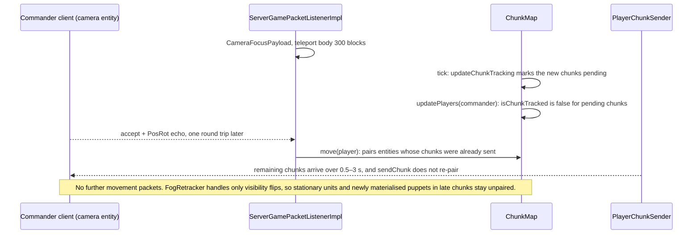

# Judgement: maintainability, correctness and portability

*Design round of 2026-10-21. One of the independent judgements of
[proposal A](proposal-a-core-first.md), [proposal B](proposal-b-engine-native.md) and
[proposal C](proposal-c-scale-first.md), all three read in full. Lens: maintainability,
correctness and testability, portability (to Minecraft 26.x and to an open-world mode), clarity of
boundaries, and the risk of architectural dead ends. Engine claims were spot-checked in the
decompiled Minecraft 1.21.1 + NeoForge 21.1.262 tree; `File.java:n` references below point into
it. "§n" means a section of the proposal being discussed.*

---

## Verdict

**Ranking: A, then C, then B.**

- **A (core-first) is the right backbone.** Rules and authoritative state sit in a deterministic
  core behind one narrow port that ArchUnit enforces. That gives behaviour tests that run in
  milliseconds, bugs from the game that replay in JUnit, a port surface confined to `mod`, and an
  open-world path that does not depend on chunk loading. Its costs are real but bounded, and each
  has a spike with an exit criterion: two representations of every unit, terrain semantics written
  again for kinematic bodies, and infrastructure built before the first unit walks. I found no
  fatal flaw. One fog leak needs closing: player entities.
- **C (scale-first) has the same authority model and testing strengths as A, plus the best single
  test idea of the round**: GameTest input logs replayed in L1 to the same hash. But C organises
  everything around 1,000 units, 8 factions and a 1,024² arena, which the owner has not asked for.
  The result carries the highest maintenance load of the three. Its distinguishing camera choice
  also has a verified pairing gap.
- **B (engine-native) is the quickest route to a first slice and the most vanilla-compatible, but
  it puts authority and behaviour into code typed against Minecraft.** That contradicts the settled
  rule "Rules in core, Minecraft in mod". It also moves behaviour tests into GameTests of 40–120 s,
  gives up bit-exact replay, makes the 26.x port reach into behaviour code, and leaves the
  open-world mode dependent on a parking subsystem that is designed but not built.
  Several of B's engine findings are still the best of the round and should be grafted.

| Sub-criterion | A | B | C |
|---|---|---|---|
| 1. Maintainability | 7 | 6 | 4 |
| 2. Correctness and testability | 9 | 5 | 7 |
| 3. Portability (26.x and open world) | 9 | 4 | 8 |
| 4. Clarity of boundaries | 9 | 6 | 7 |
| 5. Dead-end avoidance | 8 | 4 | 6 |
| **Total (of 50)** | **42** | **25** | **32** |

## The five sub-criteria

All five carry equal weight. In every column, 10 is best.

| # | Sub-criterion | What a 10 means |
|---|---|---|
| 1 | Maintainability | One developer with an AI assistant can understand, change and debug the code for years. Few concepts per feature, readable code, a bug seen in the game reproduces quickly, and there is little vanilla behaviour to neutralise and keep neutralised |
| 2 | Correctness and testability | Behaviour is testable at L1 and deterministically. The engine claims are right, and the design has no known bugs |
| 3 | Portability | A 26.x port touches only adapters. An open world needs no change to authority, persistence or simulation |
| 4 | Clarity of boundaries | Every datum has one owner. Module lines are enforced by the compiler and ArchUnit, and the port between core and engine is narrow |
| 5 | Dead-end avoidance | No decision forces a rewrite if a spike fails or a later mode arrives |

---

## Proposal A: core-first, 42/50

| Sub-criterion | Score | Rationale |
|---|---|---|
| Maintainability | 7 | **For:** one concern per package with thin adapters (§1.2); a single sender and a single block writer (§1.3); UnitAI state as plain data with an L1 test per transition (§5.4); a template compiler that collects every error, each with its file and JSON path (§6.2); `ReplayRunner` turns a bug seen in the game into a JUnit reproduction (§2.4). **Against:** two representations of every unit plus mirror code, by A's estimate 15–25 % more code in the unit and building slices (costs 1 and 6). Kinematic bodies need floor heights, falls, knockback impulses and hazard classes written again (§4.2–4.3, §4.5). `TickInputs` (8 lists) and `TickOutputs` (7 fields) form a wide surface that every new feature extends (§2.3) |
| Correctness and testability | 9 | **For:** whole matches, AI included, run in plain JUnit with fakes and state hashes (§14). One scenario runs in L1 and in L3 (§1.1, §14), invariants are checked after every tick, and golden journals guard regressions. Fog properties are asserted on replication frames (§10.2). Undecodable SavedData is quarantined, which matches the verified `DimensionDataStorage` behaviour (§3.3). Unit-vs-unit damage never reaches the i-frame branch (§4.4). The determinism bans are the most complete of the three, covering the `Set.of`/`Map.of` salt, `Collectors.toSet` and identity-hash keys (§1.3). Every engine claim I checked was right. **Against:** enemy commanders, who are spectators, and first-person bodies pass `ServerPlayer#broadcastToPlayer`, and §8.4 does not list them. Kinematic fidelity is unproven until S10 (R1). Mirroring HP into vanilla health dirties `SynchedEntityData` on every hit, which forces a position update (fact 14), and §10.5 does not budget it |
| Portability | 9 | **For:** `core` survives ports unchanged, and every known 26.x change maps to one adapter package (§16.1). Codecs defined in core plug into `SavedDataType` and `ValueInput` (§3.3). The camera needs no mixin (§11.1). For the open world, authority never depends on chunk loading: units without bodies travel on the portal graph, grids are paged, and arena assumptions sit in an `ArenaPolicy` that an `OpenWorldPolicy` later replaces (§3.5, §16.2). **Against:** an estimated 35–45 % of the Java is still `mod`. Caves and overhangs in an open world test the cap of 4 layers per column (§16.2, R5) |
| Clarity of boundaries | 9 | **For:** one driving port made of `@CoreApi` types, enforced by ArchUnit (§1.3, §2.3). Sim and client logic are kept apart inside core. A table names one owner per datum (§3.1). The mixin inventory is a test (§1.3). Three body modes sit behind three small records: `BodyPose`, `DriveIntent` and `BodyReport` (§4.2). **Against:** the wide input and output records will need sub-ports per subsystem to stay readable |
| Dead-end avoidance | 8 | **For:** the authority answer works for an arena and an open world alike (§17.1). PHYSICS bodies are a fallback per template inside the same seam (§4.2). Because the screen never sends sneak, the server-anchor camera stays available as a fallback (§17.7). Every top risk has a spike, an exit criterion and a fallback (§18). **Against:** if S10 pushes most templates to PHYSICS bodies, much of the simulation leaves the determinism guarantee. Replays survive because the inputs are journaled, but behaviour tests get fuzzier. Double bookkeeping (R11) is a velocity risk whose only fallback is generated mirror code |

## Proposal B: engine-native, 25/50

| Sub-criterion | Score | Rationale |
|---|---|---|
| Maintainability | 6 | **For:** the least infrastructure of the three: one representation per unit, plain NeoForge idioms, 2 mixins and 0 access transformers, and an inventory of the whole engine surface (§1.4). Objects instead of struct-of-arrays, and one writer per field (§3.1). **Against:** behaviour bugs reproduce only in a world, because the UnitAI states live in `mod` and are tested by GameTests of 40–120 s (cost 2, §5.4, §14). That is the slowest feedback loop for an assistant that runs the tests. B also carries a long list of vanilla behaviours to neutralise and keep neutralised (§4.2), including a re-grab listener plus a per-tick check for the cursor (§11.2) and the spectator side effects (§11.1). Stats are read from two places depending on the path, attributes or `StatBlock` (§6.2), a rule every change has to respect |
| Correctness and testability | 5 | **For:** the strongest engine analysis of the round. B finds and closes the leak of spectators to spectators (§8.3) and re-routes sounds through the fog-aware sender (§8.4); both are verified below. It adds a catch-all restore for protected blocks (§9.9) and encoded-size caps per payload (§10). **Against:** L1 covers only frameworks and formulas, which §14 admits. In the world, determinism is only "reproducible in practice", asserted as outcome bounds over seeds (§2.5), so flaky L3 outcomes are an accepted risk (R11), and there is no bit-exact replay. The i-frame fix is incomplete (verified). SavedData decode failures are not quarantined (verified). `StructureTemplate#placeInWorld` places a whole template per call, so it cannot honour the 8,192-blocks-per-tick budget of §2.2 |
| Portability | 4 | **For:** codecs everywhere, an `Ids` helper, extract-then-draw rendering and a HUD drawn from view-models (§16.1). Aggregates are counters and references are UUIDs (§3.4). **Against:** by B's own account a port touches unit behaviour, combat, construction and protection (§16.1), and every call site of `hurt`, `PathNavigation`, `MoveControl`, attributes and entity NBT moves with vanilla. The open world needs a `ParkingService` that is designed but not built. It stores parked units as vanilla entity NBT and has no answer for fights across the edge between loaded and unloaded chunks (§3.4, §16.2) |
| Clarity of boundaries | 6 | **For:** a simple rule for what goes into `core`, enforced by R1 and eight further ArchUnit rules (§1.3). A clear phase table around the vanilla entity loop (§2.3). **Against:** one feature is split three ways: the formula in `core`, the behaviour in `mod`, and the state in entity or vanilla fields. Combat, for example, has `CombatRules` in core, `AttackExecutor` and `DamageHooks` in mod, HP in vanilla health, resistances in custom attributes, and the other stats in `StatBlock`s (§4.6, §6.2). The fog switch exists both as a gamerule and in `MatchConfig` (§1.4, §2.1) |
| Dead-end avoidance | 4 | **For:** the body seam (`PhysicsBody`/`KinematicBody`, §4.4), activity-based LOD, counter aggregates and UUID references keep some doors open. **Against:** authority sits in a `PathfinderMob`. If S1 rejects the `Mob` base, `UnitNavigation extends GroundPathNavigation`, `UnitMoveControl extends MoveControl`, `HumanoidMobRenderer` and `createMobAttributes` all go (§4.1, §4.5, §18 R1). Moving behaviour into core later, which is B's own fallback for R11 and R12, is a rewrite. Bit-exact replays are given up: T3 replays run at D2 "or be dropped" (§2.5) |

## Proposal C: scale-first, 32/50

| Sub-criterion | Score | Rationale |
|---|---|---|
| Maintainability | 4 | **For:** any GameTest replays deterministically in L1 (§14), and `UnitView` flyweights plus `/strategos inspect` keep cold paths readable (§3.2). The engine surface is one mixin and two access-transformer lines (§16.1). **Against:** the heaviest design of the three: about 40 primitive columns in a preallocated `UnitStore`, an `OrderPool` of parallel arrays (§3.2), a timer wheel, 15 phases (§2.4), bubbles and a materialiser with caps and priorities (§3.4), `_streamed` variants of the entity types with a motion stream (§4.1, §10.3), a reset journal and a saved navigation model (§2.3), eight SavedData files per match plus an index (§3.3), and a runtime governor (§15.3). Most of it serves R1000, 8 factions and 1,024², beyond the owner's first two targets. C states the readability cost itself (cost 3) |
| Correctness and testability | 7 | **For:** a whole-match harness with seeded invariant fuzzing (§14). The cross-level replay check (§14). Identical hashes for 0, 1 and 4 threads (§7.6, S8). Admission counted in requests, so "busy" is deterministic (§7.6). HP kept out of `SynchedEntityData` (§4.1). **Against:** a verified pairing gap after camera jumps (below). Overriding `getDimensions(Pose)` does not compile (§4.1; LivingEntity.java:3423). The saved navigation model is restored without being checked against the world (§2.3), so a crash between the chunk and SavedData writes leaves it wrong silently. There is no SavedData quarantine (§3.3). The determinism bans are weaker than A's: no ban on `Set.of`/`Map.of`, and `HashMap` is banned only in some packages (§1.4 A4). With a cap of 400 puppets per bubble (§3.4), a battle of more than 400 units in one view shows the surplus only as dots. Players leak through the fog as in A |
| Portability | 8 | **For:** core is untouched by ports, with one adapter per change (§16.1). The open world is the natural case: units are virtual by default, and the simulation never assumes loaded chunks (§3.5, §16.2). **Against:** presentation depends on internals of the vanilla tracker: the `updateInterval = Integer.MAX_VALUE` semantics, `ServerEntity#sendChanges` and materialisation churn, which are exactly what 26.x keeps changing. The whole-arena bake and the saved navigation model must become paged (§16.2) |
| Clarity of boundaries | 7 | **For:** an `io` package for everything that crosses the boundary (§1.2), rules for layering and threads (§1.4 A8, A9), a single sender, and a clean split between core and presentation phases (§2.4). **Against:** every unit has two presences and three LOD dimensions: simulation tier, presentation tier and client model LOD (§4.3). `core.client` and `core.view` sit beside `sim` without A's rule keeping them apart. SoA columns shared by many systems are boundaries by convention only |
| Dead-end avoidance | 6 | **For:** the same authority model as A, so neither the open world nor a port forces a rewrite. The camera has a contained fallback (§18, risk 7). **Against:** the SoA store, the timer wheel and the bubbles are hard to unwind if they slow feature work. Abilities, garrisons and formations each add columns to a preallocated store. Scale machinery built before anything has been measured is the slowest code to remove |

---

## Spot checks against the decompiled sources

| # | Claim | Who relies on it | Verdict | Evidence |
|---|---|---|---|---|
| 1 | `LevelTickEvent.Pre` fires before `ServerLevel#tick`, and the tracker runs inside the chunk-source tick, before the entity loop. So poses written in Pre ship in the same tick | A, C; B (the tracker ships t−1) | Confirmed | MinecraftServer.java:1049–1052; ServerLevel.java:382, 403; ServerChunkCache.java:324–325 |
| 2 | Forced chunks keep an empty level ticking | all | Confirmed | ServerLevel.java:390 |
| 3 | `TicketController.forceChunk(level, UUID, x, z, add, ticking)` places a region ticket at distance 2 | all | Confirmed | TicketController.java:67–69; ForcedChunkManager.java:119 |
| 4 | `LivingEntity#getDimensions(Pose)` is final, so per-template sizes override `getDefaultDimensions` | A right, C wrong | C §4.1 does not compile | LivingEntity.java:3423, 3427 |
| 5 | `LivingEntity#kill` calls `hurt(genericKill, Float.MAX_VALUE)` | A | Confirmed | LivingEntity.java:302–303 |
| 6 | `LivingIncomingDamageEvent` fires before the i-frame branch, and the branch skips `bypasses_cooldown` sources | all | Confirmed. B's untagged damage types stay exposed after environmental hits | LivingEntity.java:1153, 1190–1205; DamageTypeTags.java:12 |
| 7 | Only `Mob`s enter `navigatingMobs`, and `sendBlockUpdated` loops over them | A, B, C | Confirmed | ServerLevel.java:1773–1781, 1093 |
| 8 | `Mob#serverAiStep` is final and runs navigation, then `customServerAiStep`, then the move control | B | Confirmed | Mob.java:773, 797–804 |
| 9 | Humanoid renderers, layers and models accept any `LivingEntity`; `HumanoidMobRenderer` needs a `Mob` | A, C | Confirmed | LivingEntityRenderer.java:31; HumanoidArmorLayer.java:32; ItemInHandLayer.java:18; HumanoidModel.java:22; HumanoidMobRenderer.java:12 |
| 10 | `noSave()` entities are never written to chunk storage | A, C | Confirmed | EntityType.java:1339; Entity.java:1709–1720, 1914–1917 |
| 11 | `readSavedData` logs any exception and returns null; `computeIfAbsent` then caches a fresh object, which the next dirty save writes over the file | A | Confirmed. B and C have no guard | DimensionDataStorage.java:43–75; SavedData.java:36–55 |
| 12 | In-memory connections still run `PacketEncoder` and `PacketDecoder` | A | Confirmed | Connection.java:549–574 |
| 13 | `ChunkMap#move` re-evaluates every tracked entity for the player. `ServerChunkCache#move` and `chunkMap` are public, `entityMap` is private, `TrackedEntity` is package-private and `updatePlayer` is public | all | Confirmed | ChunkMap.java:150, 1024–1031, 1278, 1327; ServerChunkCache.java:55, 464 |
| 14 | Pairing requires `isChunkTracked`, which is false while a chunk waits to be sent, and sending the chunk does not re-pair | none of the three | Confirmed. This breaks C's re-tracking after jumps | ChunkMap.java:245–248, 1336; PlayerChunkSender.java:76–83 |
| 15 | Every accepted movement packet, the 20-tick position reminder included, runs `ChunkMap#move` | A, B | Confirmed | ServerGamePacketListenerImpl.java:970; LocalPlayer.java:277, 284 |
| 16 | "Moved too quickly" triggers above 100 (squared) per packet and exempts only the singleplayer owner. "Moved wrongly" exempts spectators, and `noPhysics` skips the snap-back | A, B | Confirmed | ServerGamePacketListenerImpl.java:918–919, 946–955 |
| 17 | `teleport` moves the body at once, and the connection resets its baseline every tick, so the client's echo is a zero-length move | C | Confirmed | ServerGamePacketListenerImpl.java:262, 1044–1060 |
| 18 | A spectator viewer sees every player who is not spectating another entity, and a non-spectator player is shown to everyone | B | Confirmed. A and C leak enemy commanders and first-person bodies | ServerPlayer.java:957–962; Entity.java:3021 |
| 19 | `Camera#setup` posts `ComputeCameraAngles` and lerps the position from `xo` to `x`; `PlayerTickEvent.Pre` opens `Player#tick` | A, B | Confirmed. C's claim that player-follows-camera needs a `Camera` mixin is wrong | Camera.java:47–62; Player.java:257 |
| 20 | With a Screen open, keybinds are skipped. `setScreen(null)` grabs the mouse, and opening a screen releases every key mapping | A, C | Confirmed | Minecraft.java:1847–1849, 1060–1067 |
| 21 | `MovementInputUpdateEvent` fires before `sendPosition` reads `isShiftKeyDown()` | B | Confirmed | LocalPlayer.java:673–674, 743–744 |
| 22 | Attribute sync rides the update interval, while dirty entity data forces a position update | B, C | Confirmed | ServerEntity.java:121, 327–336 |
| 23 | `LightningBolt` uses `updateInterval(Integer.MAX_VALUE)` | C | Confirmed | EntityType.java:472–474 |
| 24 | `PlayLevelSoundEvent` is checked before the sound is broadcast | B | Confirmed | ServerLevel.java:1000, 1023 |
| 25 | `OnDatapackSyncEvent` fires at login before `addNewPlayer`, and again on reload | all | Confirmed | PlayerList.java:208, 234, 920 |
| 26 | `StructureTemplate` palettes are private while `fillFromWorld`, `placeInWorld` and `save` are public, and the 48-block cap belongs to the structure block | all | Confirmed. `placeInWorld` places a whole template per call | StructureTemplate.java:66, 83, 226, 609; StructureBlockEntity.java:37 |
| 27 | Levels hold attachments | B | Confirmed | Level.java:79 |
| 28 | `setGameMode` resets the camera for non-spectator modes, and a spectator's attack spectates the target | all | Confirmed | ServerPlayer.java:1589–1606, 1767–1773 |

### C's pairing gap after a camera jump

A and B do not hit this. Their commander keeps sending movement packets: every tick while
panning, and the 20-tick reminder while still. Each one runs `ChunkMap#move` (check 15), so late
chunks pair within a second. The fix for C is cheap: on NeoForge's `ChunkWatchEvent.Sent`, which
`sendChunk` posts (EventHooks.java:796), call `updatePlayer` for the match's puppets in that
chunk. C already plans the access transformer this needs.

---

## Fatal flaws

A flaw counts here if it would force a rewrite later or contradicts a verified fact or an owner
decision. Each item says which.

1. **B: forces a rewrite and conflicts with settled rules.** Authority and behaviour live in a
   `PathfinderMob` entity and in `mod` code typed against Minecraft: the UnitAI states, combat
   execution, construction and protection (§3.1, §5.4, §16.1). This contradicts design rule 3 of
   [03-design-process](../03-design-process.md) ("Rules in core, Minecraft in mod") and the 26.x
   strategy in [02-tooling](../02-tooling.md) ("game rules in `core`"). B's own fallbacks for R11
   and R12 are to move state into the core, which is the rewrite. If S1 rejects the `Mob` base,
   `UnitNavigation`, `UnitMoveControl`, `HumanoidMobRenderer` and `createMobAttributes` are
   replaced as well (§4.1, §4.5, §18).
2. **A, B and C: contradicts an owner decision.** Fields are infinite in all three: A §9.1
   (`FieldNode`: infinite), B §9.3 (`amount: "infinite"`) and C §9.1 ("fields infinite"). They
   follow [01-feasibility §6.2](../01-feasibility.md), but the owner decided that "mines and fields
   are deposit objects with a remaining amount" ([research README §1](../research/README.md)). The
   fix is cheap: fields use the deposit model with an amount and an optional reseed. The final
   design must either follow the decision or have the owner change it.
3. **C: contradicts verified engine behaviour.** Fog re-tracking misses units in chunks that are
   still pending after a camera jump (diagram above). This undermines C's case for a camera
   entity, and its rejection of player-follows-camera also says, wrongly, that it needs a
   `Camera` mixin (check 19). It is fixable without a rewrite.
4. **B: contradicts verified engine behaviour.** The i-frame fix is incomplete. Environmental
   damage keeps vanilla's 20 post-attack ticks (§4.6, point 5), and B tags its damage types
   `bypasses_armor` and `no_knockback` but not `bypasses_cooldown`. Unit hits within 10 ticks of
   fire, lava or cactus damage are therefore dropped or reduced (LivingEntity.java:1190–1197), and
   the L3 focus-fire test of §14 would not catch it unless it includes a burning target. Tag the
   damage types `minecraft:bypasses_cooldown`, as A and C do.
5. **C: contradicts a verified fact; trivial to fix.** §4.1 overrides `getDimensions(Pose)`, which
   is final in `LivingEntity`. Per-template sizes must override `getDefaultDimensions` instead
   (check 4).

## Other defects the synthesis must fix

| Defect | Where | Fix |
|---|---|---|
| Enemy commanders (spectators) and first-person bodies are shown to enemies regardless of fog, which matters from the 2–4 player stage on | A §8.4, C §8.4 (check 18) | B's `ServerPlayerMixin` (§8.3) |
| A SavedData decode exception silently resets a match on its next save | B §3.2, C §3.3 (check 11) | A's quarantine (§3.3) |
| The saved navigation model is not verified against the world on resume | C §2.3 | A's stored page hashes, re-sliced and compared on resume (§3.3) |
| An HP mirror in vanilla health forces a position update on every hit | A §3.1, not budgeted in §10.5; B accepts it (§10.4) | Send HP fractions on our own HUD channel, as C does (§4.1, §10.1), and set vanilla health only at death |
| The map paste budget cannot be enforced with `placeInWorld` | B §2.2 (check 26) | Our own budgeted placer over the parsed `Blueprint`, which A and C already use for buildings |
| A battle of more than 400 units in view leaves the surplus as dots | C §3.4 | No observation-driven materialisation in arenas (A); keep view-driven materialisation as the open-world reserve |
| The fog setting is duplicated between a gamerule and `MatchConfig` | B §1.4, §2.1 | Per-match rules only; gamerules only for world-wide policy (C §13) |

---

## Ideas to graft

### From A, the backbone

- `MatchCore.step(TickInputs) → TickOutputs` as the only driving port, with journaled inputs and a
  `ReplayRunner` that reports the first divergent tick (§2.3–2.4).
- Quarantine of undecodable SavedData, plus stored page hashes re-checked on resume (§3.3).
- The full list of determinism bans enforced by ArchUnit, and the hexagon rule through `@CoreApi`
  (§1.3). Modifier sums and products are taken in canonical source order (§6.1).
- One scenario, two runners: a scenario DSL in `core/testFixtures`, run in L1 with fakes and in L3
  through the GameTest generator (§1.1, §14).
- Help-join delivery at a fixed tick `t+k`, and budgets counted in work units, never in
  milliseconds (§2.3, §7.6).
- Units as `noSave()` `LivingEntity` views (not `Mob`), sized through `getDefaultDimensions`, with
  a `BodyRegistry` as their only creator and handling by removal reason (§3.4, §4.1).
- Unit-vs-unit damage resolved in the core, vanilla damage routed in from an overridden `hurt`,
  and our damage types tagged `bypasses_cooldown` (§4.4).
- Forced `updatePlayer` only for the (unit, viewer) pairs that flipped, through two
  access-transformer lines (§8.3).
- A `NetGateway` with typed audiences declared per payload and checked by an L2 test (§10.3).
- An `ArenaPolicy`/`OpenWorldPolicy` object that holds every arena-only assumption (§3.5).
- Camera jumps routed through the server even in singleplayer, so development exercises the
  dedicated server's movement check (§11.1).

### From B

- A `ServerPlayerMixin` on `ServerPlayer#broadcastToPlayer` that hides enemy commanders and fogged
  first-person bodies (§8.3).
- Cancelling `PlayLevelSoundEvent` for match entities and re-sending the sound through the
  fog-aware sender (§8.4).
- NeoForge data maps for block properties (`resource_yield`, `nav_class` overrides for other mods'
  blocks). Also `TemplateLint` for unknown keys, which codecs ignore silently, and the SHA-256 of
  the canonical JSON as the template-set version (§6.5).
- The engine-surface inventory as a reviewed artifact checked by a test (§1.4).
- A damage order that never removes the two lowest layers of a footprint, so abstract HP never
  opens a walkable passage (§9.8).
- A catch-all restore of indexed building blocks changed without the writer's flag (§9.9).
- An arena datapack dimension with slots 2,048 blocks apart and a fresh slot per match, offered as
  a map source alongside A's (§2.1–2.2).
- Aggregates kept as counters updated on events, never as scans of loaded entities (§3.4).
- `STANDARD` and `STRICT` delivery modes as the fallback if help-join stalls on slow hosts (§7.6).

### From C

- The cross-level check: each behaviour GameTest exports its input log, and an L1 test replays it
  to the same state hash (§14).
- `pathThreads = 0` for inline jobs, and a test that asserts identical hashes for 0, 1 and 4
  worker threads (§7.6, §14).
- A timer wheel for attack repeats, gather ticks and production completions (§2.5).
- A stateless counter-based RNG keyed by seed, stream, tick, key and salt (§2.6).
- Core-owned edits never fed back into navigation: construction and damage stages inside reserved
  footprints cost no navigation work (§7.7).
- A reset journal that records each block's original state on its first change, so arenas can be
  reused without copying worlds (§2.3).
- The R1 motion stream on entity types with `updateInterval(Integer.MAX_VALUE)`, as the concrete
  design of A's bandwidth reserve; it needs no mixin (§10.3).
- HP kept out of `SynchedEntityData` (§4.1).
- `UnitView` flyweights for readable cold-path access to SoA stores (§3.2).
- A runtime governor that degrades presentation only, and the CI runner used as the check for a
  host twice as slow (§15.3).
- Per-match `MatchRules` kept apart from world-wide gamerules (§13).

## Recommendation for the synthesis

1. **Take A as the backbone:** core-owned authority, the hexagon, the journal and kinematic views.
   Do not adopt C's scale machinery up front. Keep the SoA component stores of A §3.2, and add the
   timer wheel and the R1 stream only when a spike shows they are needed.
2. **Graft before M0 is specified:** B's player fog mixin and sound re-routing, A's quarantine
   (applied in every proposal's place), finite fields or an owner ruling on them, and C's
   cross-level replay check and thread-count test.
3. **Record as ADRs with the alternatives:**
   - The camera: player-follows-camera (A, B) or a camera entity with a teleported body (C, with
     the `ChunkWatchEvent.Sent` fix). Spike S9 decides on a dedicated server, measuring the cost of
     `ChunkMap#move` per panning commander against fill time after jumps.
   - The cursor: A's and C's `RtsScreen` (vanilla bindings inert by construction) or B's released
     mouse (other mods' keys and overlays keep working).
   - Unit bodies: `LivingEntity` views (A, C) or a `PathfinderMob` (B), decided by S1.
4. **Keep the kinematic default under S10.** If it fails, PHYSICS bodies per template stay inside
   A's seam, and their poses enter the journal as inputs.
