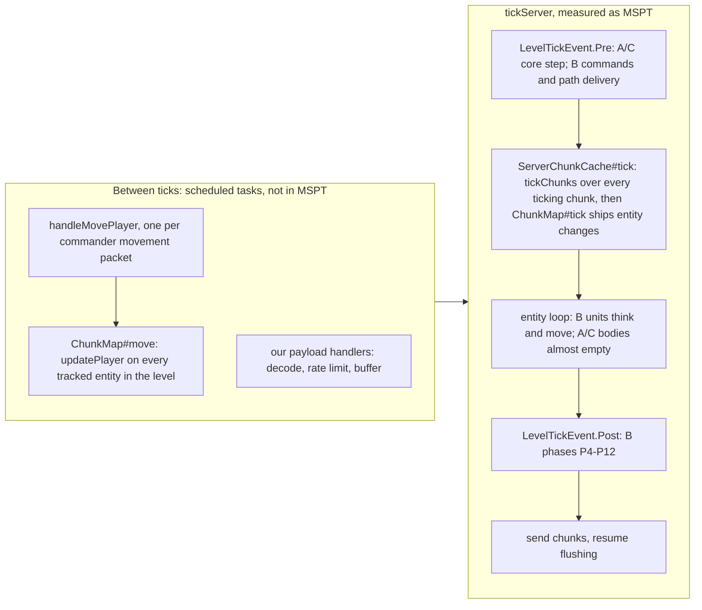

# Judgement: performance, scalability and multiplayer robustness

*Design round of 2026-10-21. One independent judge, one lens: performance and scalability (server
tick, network, client frame time) plus multiplayer robustness and security, judged against the
verified engine facts. Inputs: [proposal A](proposal-a-core-first.md),
[proposal B](proposal-b-engine-native.md) and [proposal C](proposal-c-scale-first.md), each read
in full; the [research digest](../research/README.md); [02-tooling](../02-tooling.md);
[01-feasibility](../01-feasibility.md) §3.4 and §5. Engine claims were spot-checked in the
decompiled Minecraft 1.21.1 + NeoForge 21.1.262 tree; `File.java:n` points into it (§5).
Numbers marked *(estimate)* are the judge's, not measured. Clean-room: only our documents and
the decompiled vanilla and NeoForge sources were read.*

Score scale: 10 = nothing to add at the owner's target scale; 7 = sound, with gaps that are
cheap to close; 5 = workable only after significant fixes; 1 = would not work.

---

## Verdict

| Sub-criterion | A core-first | B engine-native | C scale-first |
|---|---|---|---|
| 1. Server tick cost and scaling | 8 | 6 | 9 |
| 2. Tick stability and tail latency | 6 | 7 | 7 |
| 3. Network cost and replication | 7 | 7 | 9 |
| 4. Client frame and client tick | 6 | 6 | 8 |
| 5. Multiplayer robustness and security | 7 | 6 | 5 |
| **Total (of 50)** | **34** | **32** | **38** |

**Ranking in this lens: C, A, B.**

- At the owner's targets (solo with 2 × 150 units, then 4 × 150 = 600 on a 384² arena) all three
  fit the M4 Pro. They differ in headroom on a 2× slower or LAN host, in tail latency, and in
  what a hostile client can do.
- **C** has the best performance chassis: struct-of-arrays core, timer wheel, kinematic
  `LivingEntity` puppets that exist only inside per-player interest bubbles, a streamed motion
  channel ready behind vanilla tracking, and per-channel byte budgets. It is the weakest on
  robustness: no fault containment, no protection against corrupt saves, and a security claim
  that the engine contradicts.
- **A** is the same architecture family (core-owned state, kinematic `LivingEntity` bodies,
  deterministic path delivery) with a heavier presentation layer (every unit always has a body)
  and looser path admission, but it is the only proposal with fault containment, save
  quarantine and validation inside the core at the tick boundary.
- **B** pays vanilla physics per unit (2–3× the per-unit cost of A and C, with an O(n²) collision
  query in melee blobs that it does not count) and has the least headroom. It has the only path
  delivery that never stalls the main thread and the only fix for commanders seeing each other.
- **No proposal has a rewrite-forcing flaw in this lens.** All three make the commander a vanilla
  spectator and inherit spectator-only server paths that a modified client can use to read
  hidden information or leave the arena (§6.1). That must be closed before the 2–4 player stage.
- The synthesis should take C's presentation and replication layer on A's core and robustness,
  plus B's player-hiding mixin and non-stalling delivery made replayable (§9).

---

## 1. Sub-criteria

| # | Criterion | Scores high when |
|---|---|---|
| 1 | Server tick cost and scaling | Few µs per unit on the main thread, no O(n²) paths, work proportional to activity, headroom at 600–800 units on a 2× slower host, a route to more units and to the open world |
| 2 | Tick stability and tail latency | Every spike source is bounded by a count (path bursts, construction storms, materialisation, saves, preparation), overload is shed without breaking determinism, and the measurements see all main-thread time |
| 3 | Network cost and replication | Bytes per client bounded independently of the total unit count, few forced entity updates, interest management by faction and distance, enforced byte budgets, a reserve channel |
| 4 | Client frame and client tick | Bounded entity and model cost on screen, extract-then-draw, no per-frame scans, distance LOD, a smooth camera without mixins |
| 5 | Multiplayer robustness and security | Intent-only protocol validated at a consistent state, bounded decoding, rate limits, no fog leak through any channel (players and vanilla spectator powers included), fault containment, crash-safe saves |

---

## 2. Scores and rationale

### 2.1 Server tick cost and scaling

**A — 8.**
- Units are `LivingEntity` views whose server tick is skipped in `KINEMATIC` mode (§4.1): not in
  `navigatingMobs` (only `Mob`s join it, ServerLevel.java:1773–1781), an empty `checkDespawn`
  (Entity.java:3555), no `move()`, hence no collision queries; construction never visits units
  (§7.7).
- Struct-of-arrays core with generational handles (§3.2); counting-sort spatial grid every tick
  (§8.1); vision restamps only sources that changed cell (§8.2); analytic projectiles (§4.4);
  HPA* with corridor A* and flow fields for groups of 8 or more (§7.2–7.4); ORCA at tier cadence
  with k ≤ 10 (§7.5); every cap counts work, never time (§2.3).
- Targets of ≤ 7 µs core plus ≤ 4 µs body per unit (§15) give ≈ 6.6 ms at 600 units
  *(estimate from A's own targets)*.
- Every unit always has a body in an arena (§3.4), so the vanilla per-entity floor (two
  `EntityTickEvent` posts and `guardEntityTick`, ServerLevel.java:769–779; the tracker pass,
  ChunkMap.java:1159–1175) is paid for fogged AI armies too. View-driven materialisation exists
  only as the R2 fallback.
- The LOD tier depends on whether a human sees the unit (tier 0 versus tier 1, §4.1), and so does
  stuck-ladder step 3 (§7.5). That is cheap and still deterministic (vision is core state), but
  an AI-versus-AI perf batch with no human puts every moving unit in tier 1 and under-measures a
  real match. L6 needs a synthetic observer.

**B — 6.**
- The cost is stated honestly (Summary point 3, R1) and mitigated: rest ticks that skip
  `super.tick()` for working and idle units (§4.3); a no-op `checkDespawn`, which also skips the
  `MobDespawnEvent` vanilla posts every tick (Mob.java:745–746); pushing off;
  `shouldRecomputePath` false, so the `navigatingMobs` loop costs one virtual call per mob per
  shape change (ServerLevel.java:1086–1097), which makes B's 0.2–0.3 ms at 64 placements × 800
  units (§7.7) plausible; analytic projectiles (§4.6); a faction-masked unit grid (§8.1).
- Moving and fighting units run vanilla `travel`/`move`. Each move queries entities in its swept
  box (Entity.java:903 → EntityGetter.java:63–68), and `Level#getEntities` allocates a list and
  scans every entity of the overlapping sections plus every `PartEntity` in the level
  (Level.java:903–925). In a melee blob that is O(n) per unit and O(n²) per blob, the same cost
  class as the pushing B switches off, and it is not in B2's estimate. `baseTick` fluid and
  suffocation checks come on top.
- ≤ 10 µs per unit (B2, §15.1) is 2–3× A's and C's all-in targets; at 800 units it takes 8 ms
  before any match phase runs. B's own floor of 400 units on a 2× slower host (§15.1) is below
  the owner's 600-unit multiplayer target (01-feasibility §5.1).
- UnitAI runs per entity in vanilla's entity-list order, so there is no batched kernel to tune
  later, and the open world needs parking that is designed but not built (§3.4).

**C — 9.**
- Everything A has, plus: a timer wheel, so per-tick work scales with events (§2.5); units outside
  every interest bubble are not entities at all (§3.4), so a fogged AI army costs about 1.5 µs per
  moving unit and nothing in vanilla; the core's own block edits are never observed back (§7.7),
  so construction costs no navigation work; ORCA gives way to separation in cells with more than
  six units (§7.5), which bounds blob cost; stores are preallocated and never grow (§3.2).
- A per-phase budget table with p50 and p99 (§2.4) and the tightest totals: mod self time
  ≤ 3.5 / 8 ms at 1,000 units (§15.2).
- The reference arena is 1,024² = 4,096 force-loaded chunks (§2.1). `ServerChunkCache#tickChunks`
  builds and shuffles a list of every ticking chunk and calls `broadcastChanges` on each, every
  tick (ServerChunkCache.java:334–385), and C itself expects up to 600 MB of heap (§15.2), which
  in the solo-first target the integrated server shares with the client. The machinery is right;
  the default arena should be A's and B's 384² until S2 passes.
- Two presences per unit and spawn churn on camera jumps (≤ 16 spawns per tick per player, §3.4)
  are bounded main-thread work.

### 2.2 Tick stability and tail latency

**A — 6.**
- Count caps everywhere (§2.3); budgeted prepare and reset with a progress bar (§2.2); autosave
  ≤ 100 ms (§15); at most 64 materialisations (§3.4) and 4 page rebuilds (§7.7) per tick.
- Help-join: a result due at `t+k` that no worker has finished is computed by the main thread
  (§7.6), while admission allows 256 requests per tick and 2,048 outstanding, at up to 24,000
  expansions per job (§7.3, §7.8). A republished page invalidates every path that crosses it
  (§7.7); on a host whose pool is busy, that burst becomes a main-thread stall of tens of
  milliseconds *(estimate)*. R4/S7 names the risk, but the cap counts requests, not work.
- The global BlockWriter budget of 256 placements per tick (§9.5) is 4× B's and C's, both in
  server work and in client re-meshing (§6.5).
- The gates read `getTickTimesNanos` (§13, §15), which covers `tickServer` only
  (MinecraftServer.java:927–954). Packet handlers run as scheduled tasks between ticks
  (MinecraftServer.java:771–782), so each commander's `ChunkMap#move` per movement packet
  (ServerGamePacketListenerImpl.java:970) is invisible to every gate (§3).

**B — 7.**
- `STANDARD` delivery hands a late path result over at the next ready tick and counts it (§7.6):
  the main thread never waits in production. `STRICT` is for GameTests only.
- The overload policy doubles AI and replication cadences while MSPT p95 stays above 45 ms and
  never stretches unit, command or projectile phases (§2.4).
- Per-phase p50/p99 targets and count budgets (§2.3); 64 placements per tick per level,
  round-robin across sites (§9.7).
- Map pasting at 8,192 blocks per tick (§2.2) suits a lone match but spikes every other running
  match on the same server, which B supports; while any match runs it should share the
  placement scheduler's budget.
- Unit state is codec-encoded into every unit's NBT at each autosave (§3.2) and vanilla
  re-serialises entity chunks then; this is not budgeted.
- Fog re-evaluation through `ServerChunkCache#move` costs O(all tracked entities) per human per
  refresh (ChunkMap.java:1024–1031), about 0.3 ms each by B's estimate, which is acceptable. The
  per-panning-commander pass (≈ 0.3 ms per tick at 1,000 entities, §11.1) runs outside MSPT,
  the same blind spot as A.

**C — 7.**
- Admission of at most 64 new jobs per tick, a queue of 2,048, main-thread steals counted with a
  target of zero on the M4 Pro and ≤ 1 ms p99 on the slow host (§7.6, §15.2), and
  `pathThreads = 0` for small hosts; the CI runner doubles as the 2× slower host (§15.3).
- The runtime governor degrades presentation only (R1 on, lower HUD and summary rates, smaller
  bubbles) and never the core (§15.3 point 6): the deterministic way to shed load.
- Per-channel byte budgets per tick with deferral (§10.2); spawn caps (§3.4); save cost budgeted
  (≈ 250 KB of columns in under 2 ms, §3.3); resets run only while no match runs (§2.3).
- `replication.motionStream = auto` switches R0 to R1 when puppet motion passes 40 KB/s per
  client (§10.3). The update interval is fixed per `EntityType` (fact 23; C's own `_streamed`
  types), so the switch respawns every puppet as another type: a full re-pairing burst at exactly
  the moment bandwidth peaks. Choose R0 or R1 per match at start.
- Steals still move worker backlog onto the main thread (C's R5), and the between-tick blind
  spot applies, although C's camera cuts the number of `ChunkMap#move` passes (§4).

### 2.3 Network cost and replication

**A — 7.**
- One fog-aware `NetGateway`; every payload type declares its audiences and an L2 test checks
  them (§10.3), so broadcast-first networking cannot be written; per-recipient delta baselines
  for 2 Hz map-wide summaries at 1/8-block precision (§10.2, §10.4); per-player coalescing
  (§10.3); velocity updates off and `onGround` held constant, so the teleport packet sent on
  every flip (ServerEntity.java:150) never fires (§4.3); two synced bytes changed only on
  transitions (§10.1); a tier-4 reserve channel (§10.4); sizes measured at L1, L2, L3 and with
  JFR (§10.5). About 56 KB/s at 600 units against a 100 KB/s budget.
- HP is mirrored into vanilla health (§3.1), a `SynchedEntityData` value, so every hit makes the
  entity dirty and enters the update block that tick (ServerEntity.java:121): data packets plus
  off-cadence position packets in every fight, missing from the table. Quantise the mirror and
  budget it, or keep HP out of synced data as C does.
- 256 placements per tick are about 4 B each in section-update packets (ChunkHolder.java:182–211),
  up to ≈ 20 KB/s per client at saturation *(estimate)*, also missing from the table.
- `frame_ack` at up to 20/s (§10.1) buys nothing over TCP's ordered delivery; reconnects send a
  full frame anyway.

**B — 7.**
- Activity changes are limited to one per 10 ticks per unit and HP is bucketed (§10.3); displayed
  stats ride syncable attributes, which `ServerEntity#sendDirtyEntityData` sends inside the
  regular update without making the entity dirty (ServerEntity.java:121, 325–341), the cleanest
  use of vanilla channels in the three. Average and p99 budgets (≤ 64 / ≤ 96 KB/s, §10.4)
  enforced by L2 size tests, L3 byte counters and JFR `PacketSent` events; one fog-aware sender
  with recipient policies (§10.2).
- No per-channel budget per tick and no reserve design beyond "a custom batched movement
  channel" (§10.4). Positions ship one tick late, because units move in the entity loop after the
  tracker has run (ServerLevel.java:382 versus 403; B §2.3 says so).
- ≈ 60 KB/s against a 64 KB/s average at 800 units leaves no room for the unbudgeted items of §6.

**C — 9.**
- Bubbles cap paired puppets at 400 per player (§3.4), so per-client motion traffic is bounded
  whatever the total unit count. R1 puppet types use an update interval of `Integer.MAX_VALUE`
  (vanilla's lightning bolt does the same, EntityType.java:472–475), and `sendChanges` then takes
  the movement path only on dirty data or an impulse (ServerEntity.java:121), so a quantised
  5-byte motion stream at 10 or 5 Hz replaces it (§10.3). HUD HP and state go in
  `UnitHudDeltaPayload`, not in synced data, so fights force no position updates (§10.1); combat
  events are batched per tick; per-channel byte budgets per tick with deferral (§10.2); a Netty
  byte counter that includes vanilla packets (§13); budgets as average, 1-s peak and per tick
  (§10.4).
- The `auto` R0/R1 switch (§2.2) and the spawn bursts after jumps (≤ 80 KB, §10.4) are the costs;
  the second is the price of bubbles and acceptable.

### 2.4 Client frame and client tick

**A — 6.**
- Extract-then-draw into an immutable frame with vanilla render types in one buffer source
  (§11.5); view-models rebuilt at most once per client tick (§11.4); camera angles per frame
  through `ViewportEvent.ComputeCameraAngles`, no mixin (§11.1); far units as overlay markers
  (§10.4); Iris shadow-pass skip (§11.5).
- Every tracked unit is a full humanoid with armour and held-item layers; model LOD exists only
  as the R8 fallback; the client budget covers "our drawing + HUD ≤ 3 ms at 200 units" (§15),
  not unit rendering, 600 units or the client tick.
- 256 placements per tick are also a client re-mesh load (§6.5).

**B — 6.**
- Extract-then-draw at `AFTER_SKY` (§11.7); a client unit registry kept by join and leave
  events, with no per-frame entity scans (§11.6); the minimap re-uploads a changed chunk at most
  once a second (§11.7); a frame budget with and without Sodium (§15.1).
- The same full-cost humanoids (`HumanoidMobRenderer`) for every tracked unit and no LOD except
  the R9 fallback; per-tick body integration adds a tick of camera latency (§11.1, S6).

**C — 8.**
- Model LOD by distance: full model to 48 blocks, no armour to 112, body only beyond (§11.7); at
  most 400 puppets per player on the client (§3.4); preallocated overlay arrays; pushing off on
  the client too, where vanilla queries nearby players every tick (LivingEntity.java:2891–2893);
  a frame-smooth camera that writes `xo` and `setPosRaw` in `RenderFrameEvent.Pre` without a
  mixin (§11.1); budgets for unit rendering at 300 and 600 units and for the client tick (§15.2);
  culling boxes for large units (§11.7).
- Pop-in after camera jumps (filled within 25 ticks) is the visible cost of bubbles; the baked
  minimap covers the gap.

### 2.5 Multiplayer robustness and security

**A — 7.**
- Commands are validated inside the core at the tick boundary, on a consistent state, with
  per-command feedback (§5.2); identity comes from the connection; intents only; bounded decoding,
  with the correct note that vanilla's 32,767-byte cap applies only to unknown payloads
  (ServerboundCustomPayloadPacket.java:16–18); token buckets and a disconnect threshold (§10.6);
  L1 tests assert that no frame carries a hidden handle (§10.2).
- The only proposal with fault containment: an exception in a match step moves the match to
  `FAULTED`, saves journal and snapshot, and keeps the server running (§13). The only one that
  guards against vanilla's silent reset of undecodable SavedData (§3.3;
  DimensionDataStorage.java:43–75 logs the error, returns null, and `computeIfAbsent` builds a
  fresh object). Authoritative state lives in one per-match blob, so a crash mid-save cannot mix
  two saves.
- Camera jumps go through the server in every mode, so dedicated-server snap-backs cannot hide
  in singleplayer (§11.1).
- Its leak table (§8.4) misses two player channels: commanders, as spectators, are paired with
  each other (ServerPlayer.java:957–963) and see invisible entities (Entity.java:2420–2427), so
  each sees where the other is looking; first-person players are vanilla players visible to every
  commander in range whatever the fog. The spectator server paths of §6.1 are open as well.

**B — 6.**
- The only proposal that hides enemy commanders and fogged first-person bodies, with a HEAD
  mixin on `ServerPlayer#broadcastToPlayer` (§8.3, target at ServerPlayer.java:957). Validation at
  apply time, monotonic sequence numbers, ≤ 200 ids per command (§5.2, §10.5); `noSummon()`
  (§3.3); arena slots 2,048 blocks apart plus `broadcastToPlayer` false across matches (§2.1).
- No fault containment. UnitAI runs inside vanilla entity ticks, and `Level#guardEntityTick`
  turns any exception into a server crash unless NeoForge's `removeErroringEntities` (default
  false) is set, in which case the unit is silently discarded (Level.java:607–623;
  NeoForgeConfig.java:39–43). One UnitAI bug ends a four-player session.
- The sound row of §8.4 ("closed") does not work as written. `Entity#playSound` posts
  `PlayLevelSoundEvent.AtPosition`, which carries no entity (Entity.java:1138–1141,
  ServerLevel.java:989–1016), and B's units take vanilla `hurt`, which plays hurt and death
  sounds that way (LivingEntity.java:1263–1269) to everyone within range. Footsteps are already
  silenced by `MovementEmission.NONE` (Entity.java:689–716). Fix: `setSilent(true)` on units and
  re-emit their sounds through the fog-aware sender.
- Unit state lives in entity NBT and faction state in SavedData (§3.2): two stores written
  separately, so a crash between them can duplicate or lose resources. The roster check (§2.2)
  detects that but does not repair it.

**C — 5.**
- The strictest decoding: hard limits, and a decode error disconnects (§5.2); 30 intents/s with
  bursts of 60; identity by UUID; ownership, capability and visible-target checks before
  buffering; rejections counted (§10.5). In solo play fogged enemies are not entities at all
  (§3.4): fog by construction.
- §10.5 claims "camera focus is clamped to the bounds, so a commander body cannot stream chunks
  elsewhere". That holds only for honest clients: the server accepts a spectator's own movement
  packets anywhere at up to 10 blocks per packet (ServerGamePacketListenerImpl.java:918–922, no
  spectator exemption) and teleports a spectator to any entity UUID in any level on request
  (ServerGamePacketListenerImpl.java:1204–1214).
- The same two player-channel leaks as A.
- No fault containment: the core runs in `LevelTickEvent.Pre`, and nothing between
  `MinecraftServer#tickChildren` and the server loop catches a handler exception
  (MinecraftServer.java:1049–1058). No quarantine of undecodable SavedData. Nine SavedData files
  per match (§3.3) with no shared save epoch, so a crash mid-save can load units from one save
  and factions from another.

---

## 3. Where the cost lands in a server tick

- The tracker runs before the entity loop (ServerLevel.java:382 versus 403;
  ServerChunkCache.java:323–326). A's and C's poses written in `Pre` ship the same tick; B's
  units ship the next.
- `getTickTimesNanos` measures `tickServer` only (MinecraftServer.java:927–954). Packet handlers,
  including the O(entities) `ChunkMap#move` that every accepted movement packet triggers
  (ServerGamePacketListenerImpl.java:970; ChunkMap.java:1024–1031), are logged separately as
  scheduled tasks (MinecraftServer.java:771–782). All three budget tables miss that time.
- `tickChunks` walks every ticking chunk and, through `NaturalSpawner.createState`, every entity,
  every tick (ServerChunkCache.java:334–385; NaturalSpawner.java:62–92). Its cost scales with
  arena chunks and with entities whose category is not `MISC` (§6.6).

---

## 4. The commander body: cost per strategy

All three proposals keep chunk streaming and entity tracking centred on a server-side spectator
body. Where that body goes decides a large share of the multiplayer cost.

| Strategy | Used by | Server cost per panning commander | Terrain streaming | Fog re-check | Limits |
|---|---|---|---|---|---|
| Body follows the camera; the client moves its spectator body | A, B | One `ChunkMap#move` per movement packet, O(all tracked entities), up to 20/s, plus an all-entities pass in `ChunkMap#tick` on each section crossing (ChunkMap.java:1178–1182); outside MSPT | Chunks dropped behind and sent ahead on every view change (ChunkMap.java:1073–1090, 856–859) | Vanilla re-check on every packet, a reminder at least every 20 ticks (LocalPlayer.java:277–284) | Snap-back above ≈ 10 blocks per packet on dedicated servers; pans capped (A 8 blocks/tick, B 3) |
| Camera entity; the server teleports the body to the focus at ≤ 5 Hz | C | ≤ 5 teleports/s, each one `ChunkMap#move` from the client's echo (ClientPacketListener.java:733–734) plus a section-crossing pass | Same as above, centred on the focus | None from vanilla; C's own pass every 5 ticks | Body lags the focus by up to 8 blocks and 200 ms |
| Camera entity; body parked at the arena centre | 01-feasibility §3.4 fallback; A's R6 fallback | None while panning | Once per join for arenas up to 384² (view distance about 18) | Own pass only | Unit tracking range must cover the arena half-diagonal and is fixed per `EntityType`; the server clamps to the client's requested view distance (ChunkMap.java:840–842); not for the open world or C's 1,024² |

At 40 blocks/s and view distance 10, a moving view brings in about 50 chunks per second
*(estimate: 2.5 new rows of 21 chunks)*, each several KB on the wire *(estimate)*, which is several
times the whole entity budget of any proposal. None of the three budgets it. S9 must measure all
three variants (§10).

---

## 5. Spot checks against the decompiled sources

| # | Claim | Proposal | Verdict | Evidence |
|---|---|---|---|---|
| 1 | `LevelTickEvent.Pre` fires before `ServerLevel#tick`, and the tracker runs before the entity loop, so poses written in `Pre` ship the same tick | A §2.3, C §2.4 (B §2.3: units ship a tick late) | Holds | MinecraftServer.java:1049–1058; ServerLevel.java:382, 403; ServerChunkCache.java:315–326 |
| 2 | Only `Mob`s join `navigatingMobs`, and `sendBlockUpdated` loops over them only when a collision shape changes | A §4.1, B §7.7, C §4.1 | Holds | ServerLevel.java:1086–1097, 1773–1781 |
| 3 | `ServerChunkCache#move` is public, and `ChunkMap#move` runs `updatePlayer` on every tracked entity | B §8.3, C §11.1 | Holds; B's O(entities) cost model is right | ServerChunkCache.java:464–468; ChunkMap.java:1024–1031 |
| 4 | `entityMap` is private, `TrackedEntity` package-private, `updatePlayer` public | A §8.3, C §8.3 | Holds | ChunkMap.java:150, 1278, 1327 |
| 5 | Pairing is XZ distance ≤ min(range, view distance × 16), `broadcastToPlayer` and a tracked chunk | All | Holds | ChunkMap.java:1327–1345 |
| 6 | "Moved too quickly" above 100 × packets since the last tick (≈ 10 blocks per packet); only the singleplayer owner is exempt, spectators are not | A §11.1, B §11.1, C §11.1 | Holds | ServerGamePacketListenerImpl.java:918–922 |
| 7 | A camera entity stops movement packets; a still player camera sends a reminder every 20 ticks | A §8.3, C §11.1 | Holds | LocalPlayer.java:277–284, 700–702 |
| 8 | A server teleport moves the body at once, the client always answers with accept plus a position packet, and the movement baseline resets every tick | C §11.1 | Holds; a teleport that crosses a section also triggers `ChunkMap#tick`'s all-entities pass | ServerGamePacketListenerImpl.java:262, 1044–1060; ClientPacketListener.java:733–734; ChunkMap.java:1178–1182 |
| 9 | An update interval of `Integer.MAX_VALUE` has a vanilla precedent, and `sendChanges` then moves only on dirty data or an impulse | C §4.1, §10.3 | Holds | EntityType.java:472–475; ServerEntity.java:121 |
| 10 | An `onGround` flip (and every 400 updates) sends a teleport packet | A §4.3, C §4.1 | Holds | ServerEntity.java:150 |
| 11 | Syncable attribute changes ride the regular update and do not make the entity dirty | B §6.2 | Holds | ServerEntity.java:121, 325–341 |
| 12 | `ticking=false` forced chunks are entity-ticking (level 31), `ticking=true` adds forced random ticks and spawning, forced chunks keep a player-less level ticking | All | Holds | ForcedChunkManager.java:116–121; DistanceManager.java:197–201, 256–258, 294–297; ServerChunkCache.java:367; ServerLevel.java:390 |
| 13 | With level-33 tickets entities stay tracked, but vanilla calls `sendChanges` only in entity-ticking range, so that fallback needs R1 | C §2.2 | Holds | ChunkMap.java:1173 |
| 14 | Undecodable SavedData is logged and replaced by a fresh object | A §3.3 | Holds | DimensionDataStorage.java:43–75 |
| 15 | Vanilla's 32,767-byte serverbound cap applies only to unknown payloads | A §10.6 | Holds; registered payloads can also arrive split and are reassembled up to 128 MB by default | ServerboundCustomPayloadPacket.java:16–18; GenericPacketSplitter.java:141–162; NeoForgeConfig.java:90–93 |
| 16 | "Spectators are made invisible" | A §11.1 | Holds but incomplete: spectators see invisible entities and pair with every player whose camera is itself, so commanders see each other. B §8.3 gets this right | ServerPlayer.java:957–963, 1725–1732; Entity.java:2420–2427 |
| 17 | Sounds of our entities can be cancelled per match entity through `PlayLevelSoundEvent` | B §8.4 | Wrong for `AtPosition`, which carries no entity; hurt and death sounds take that path. Steps are silenced by `MovementEmission.NONE` | Entity.java:689–716, 1138–1141; ServerLevel.java:989–1016; LivingEntity.java:1263–1269 |
| 18 | Clamping the camera focus keeps the commander body from streaming chunks elsewhere | C §10.5 | Wrong against a modified client | ServerGamePacketListenerImpl.java:918–922, 1204–1214 |
| 19 | Pairing hooks cost no event-bus work | C §10.2 | Holds for our hook; NeoForge still posts `StartTracking`/`StopTracking` per pairing | ServerEntity.java:232–244 |
| 20 | Vanilla culls zombie-sized mobs at about 100 blocks | B §11.7 | Holds: 64 × clamp(render distance / 8, 1, 2.5) × entity distance, ≈ 96 blocks at render distance 12 | Entity.java:1692–1699; LevelRenderer.java:856–858 |
| 21 | Chunk sending ramps from 9 to 64 chunks per tick | A §11.1, C §11.1 | Holds | PlayerChunkSender.java:25–27 |
| 22 | `Mob#serverAiStep` order (sensing, selectors, navigation, `customServerAiStep`, controls); `Mob#checkDespawn` posts the despawn event every tick | B §4.2, §4.5 | Holds | Mob.java:745–746, 773–815 |
| 23 | Vanilla pushes against players on the client every tick | C §4.1 | Holds | LivingEntity.java:2891–2893 |

Independent checks behind the findings in §6:

| Fact | Evidence |
|---|---|
| A spectator is teleported to any entity UUID in any level on request, and NeoForge has no event for it (the `EntityTeleportEvent` subclasses are `TeleportCommand`, `SpreadPlayersCommand`, `EnderEntity`, `EnderPearl` and `ChorusFruit`) | ServerGamePacketListenerImpl.java:1204–1214; neoforge/event/entity/EntityTeleportEvent.java:102–221 |
| An attack packet from a spectator calls `setCamera(target)`; the body then follows the target every tick; the target is any entity id within 3 + 1 blocks of the eye | ServerPlayer.java:524–534, 1738–1756, 1767–1772; ServerGamePacketListenerImpl.java:1582–1594; Player.java:2297–2300; Attributes.java:55–56 |
| Spectators load and generate chunks only while `spectatorsGenerateChunks` is true, but chunk tracking runs for every player, so an ignored spectator still receives chunks that are already loaded | ChunkMap.java:992–994, 996–1016, 1061–1090, 721–729 |
| An exception in an entity tick crashes the server unless `removeErroringEntities` is set, which then discards the entity | Level.java:607–623; NeoForgeConfig.java:39–43 |
| A physics move queries entities in its box, with a new list and a scan of all part entities | Entity.java:903; EntityGetter.java:63–75; Level.java:903–925 |
| Light updates go only to players whose view border contains the chunk; interior changes are relit by the client | ChunkHolder.java:169–179; ChunkMap.java:253–265, 1096–1108 |
| A changed block dirties its render section and every neighbour within one block | LevelRenderer.java:2500–2512 |
| Vanilla entity ids come from one global counter and travel in every spawn packet | Entity.java:135, 154 |

---

## 6. Gaps all three share

### 6.1 Vanilla spectator powers break the fog

All three make the commander a vanilla spectator (A §11.1, B §11.1, C §11.1) and neutralise its
side effects only on the client. A modified client can still use these server paths:

1. **Teleport to any entity.** `ServerboundTeleportToEntityPacket` moves a spectator to any entity
   UUID in any level, with no event to cancel. Units' UUIDs arrive with every pairing, so a unit
   seen once can be found again while hidden; enemy players' UUIDs are in the player list. It also
   takes the commander out of the arena, or into another match.
2. **Spectate by attacking.** An attack packet makes the server call `setCamera(target)`; the body
   then follows the target every tick, and the client learns the target's position from its own.
   The target is resolved by entity id, hidden or not, within 4 blocks of the eye.
3. **Spectators see spectators and players.** Enemy commanders see each other's camera bodies,
   and every commander sees first-person players in range whatever the fog. B's mixin closes
   this; A and C do not mention it.
4. **No server-side bounds.** Spectator movement packets are accepted anywhere at up to 10 blocks
   per packet, and with `spectatorsGenerateChunks` at its default of true a commander can load
   and generate chunks outside the arena.

**Fix, before the multiplayer stage.** A mixin that drops `handleTeleportToEntityPacket` for match
members; `ServerPlayer#attack` and `setCamera` as no-ops for commanders; B's
`ServerPlayer#broadcastToPlayer` mixin; a clamp of the commander body to the match bounds after
every accepted move (teleport back, in `PlayerTickEvent.Post`); and `spectatorsGenerateChunks`
false in arena worlds. The arena is force-loaded and an ignored spectator still receives loaded
chunks, so commanders lose nothing (second-pass engine §7 advises keeping it on, which applies
only to bodies outside force-loaded chunks; S9 confirms). L3 adds mock players that send each of
these packets and asserts that nothing hidden reaches them.

### 6.2 MSPT does not see packet handlers

Every proposal gates on MSPT and on its own phase timers. `getTickTimesNanos` covers `tickServer`
only; payload handlers and `handleMovePlayer` run between ticks as scheduled tasks (§3). Add a
scheduled-task timer per tick (vanilla's sample logger already separates it) plus timers around
our C2S handlers, and gate the sum of tick and task time.

### 6.3 Terrain re-streaming on pans

See §4. With the body following the camera or the focus, panning resends terrain continuously; the
parked body sends it once per join. Add it to the bandwidth budget and to S9 and S11.

### 6.4 Pairing churn at the fog edge

Every visibility flip pairs or unpairs a body. A pairing sends a bundle (spawn, data, equipment,
attributes, our spawn payload) and posts NeoForge's tracking event (ServerEntity.java:232–244).
Units skirmishing along a vision edge can flip at every refresh, 2 Hz in A and B and 4 Hz in C's
re-tracking, so 50 such units cost tens of KB/s per viewer *(estimate)*. None of the three budgets
this. Hide only after a unit has been unseen for one refresh or one cell (4 blocks) past the
reveal edge, and document the bounded leak that hysteresis creates.

### 6.5 Block writes cost bytes and re-meshes

Each placement costs about 4 bytes per tracking client in a section-update packet and dirties its
render section and any neighbour within one block on every client. Light is not the problem:
light packets go only to players whose view border contains the chunk. Keep 64 placements per tick
(B, C), not 256 (A), and flush each site's pending placements in bursts at 4–5 Hz, so a section
is re-meshed 4–5 times a second rather than 20.

### 6.6 Smaller items

- **Mob category.** `NaturalSpawner.createState` walks every entity every tick. `Mob`s with
  persistence are skipped at once (B is covered); a `LivingEntity` puppet (A, C) is skipped only
  if its type's category is `MISC`, and otherwise costs a chunk and biome lookup per tick and
  counts toward the natural mob caps. Register unit types as `MobCategory.MISC`.
- **Probing by rejection.** A command that names a hidden unit and one that names no unit must get
  the same rejection reason, or handles (A, C) and entity ids (B) can be probed through the fog.
- **Entity-id side channel.** Gaps between the vanilla ids of visible spawns count the entities
  created meanwhile, hidden enemy units included (A and B create bodies at production). Document
  it in the leak table; no fix is needed for 2–4 friendly players.
- **Split packets.** NeoForge reassembles split payloads up to 128 MB by default. No Strategos
  payload comes near 1 MB, so lower `splitPacketMaxSizeLimitMb` on dedicated servers.
- **Save epochs.** B (entity NBT next to SavedData) and C (nine files per match) need a save epoch
  stamped into every blob and a refusal to load mixed epochs. A's single snapshot avoids it.

---

## 7. Fatal flaws

**None of the three proposals has a rewrite-forcing flaw in this lens.** Each must-fix item is a
local change:

| Item | Proposals | Why it cannot wait |
|---|---|---|
| Vanilla spectator powers leak hidden information and escape the arena (§6.1) | A and C in full, B partly (it hides players) | Contradicts design rule 5 (hidden information never leaves the server) and, for C §10.5, the verified movement and teleport handlers |
| No fault containment: one bug crashes a multiplayer server | B (UnitAI in entity ticks), C (core in `LevelTickEvent.Pre`) | Verified crash paths; A's `FAULTED` state is the fix |
| No guard against vanilla's silent reset of undecodable SavedData | B, C | Verified in `DimensionDataStorage`; one bad decode wipes a match |
| B's sound-leak closure relies on an event that carries no entity | B | Verified event routing; fix with `setSilent(true)` and fog-aware re-emission |
| R0/R1 auto-switch respawns every puppet at peak load | C | The update interval is fixed per `EntityType`; choose per match |
| Path admission counts requests while help-join puts the backlog on the main thread | A (256/tick), C (64/tick, milder) | Turns order bursts into tick spikes on slow or busy hosts |

---

## 8. Ideas to graft

**From A**
- Per-match fault containment (`FAULTED`, journal and snapshot saved, server keeps running)
  around every match handler, Pre and Post handlers and per-entity code included (§13).
- Quarantine of undecodable SavedData (§3.3), and authoritative state in one per-match snapshot.
- Command validation inside the core at the tick boundary, with per-command feedback (§5.2);
  payload audience declarations enforced by the gateway and checked in L2 (§10.3).
- Camera jumps through the server in every mode, singleplayer included (§11.1).
- Forced re-tracking of only the flipped (unit, viewer) pairs through the two-line access
  transformer (§8.3): O(flips × viewers), not O(entities) per viewer.

**From B**
- The `ServerPlayer#broadcastToPlayer` mixin hiding enemy commanders and fogged first-person
  players (§8.3).
- Delivery that never stalls the main thread (§7.6): a late path result lands on the next ready
  tick and is counted. In a deterministic core, journal the actual delivery tick as an input so
  replays stay exact; GameTests keep strict `t+k`.
- An overload policy that stretches only AI and replication cadences (§2.4), journaled in a
  deterministic core.
- Forced-update discipline (§10.3): synced values change only on transitions, rate-limited.
- A dedicated arena dimension with slots 2,048 blocks apart and a fresh slot per match (§2.1–2.2),
  for multi-match servers.
- The public `ServerChunkCache#move` as the access-transformer-free fallback for fog
  re-evaluation (§8.3).

**From C**
- Interest bubbles (§3.4): a unit is materialised only inside a connected player's bubble and only
  if that player's faction sees it, with caps per bubble and per level, spawn caps per tick and
  despawn hysteresis.
- Streamed puppet types plus a quantised motion stream as the reserve channel (§10.3), selected per
  match at start.
- Per-channel byte budgets per tick with deferral (§10.2), a Netty byte counter that includes
  vanilla packets (§13), and average, peak and per-tick budgets (§10.4).
- HUD HP and state outside `SynchedEntityData` and `onGround` held constant (§4.1, §10.1).
- Timer wheel (§2.5); core-owned edits never observed back (§7.7); separation instead of ORCA in
  dense cells (§7.5); incremental vision every tick with 5-tick re-tracking (§8.2–8.3).
- Count-based admission with `pathThreads = 0` and a test asserting identical hashes for 0, 1
  and 4 threads (§7.6, §14).
- A runtime governor that degrades only presentation (§15.3).
- Client model LOD, puppet caps and a client-tick budget (§11.7, §15.2).
- A camera entity with a server-moved body (§11.1), which cuts `ChunkMap#move` passes at least 4×.
- The CI runner as the 2× slower host, and "unit-attributable MSPT" measured by an A/B bench run
  with and without the match (§15.1, §15.3).

---

## 9. What the synthesis should take, in this lens

1. **Authority and bodies:** core-owned state with kinematic `LivingEntity` puppets (A §3–4,
   C §3–4). B's `PathfinderMob` physics survives only as the opt-in `PHYSICS` body.
2. **Presence:** C's bubbles behind A's materialiser. They bound server entities, client models
   and bandwidth together.
3. **Replication:** vanilla tracking with the A/C discipline (velocity off, constant `onGround`,
   no HP in synced data, transition-only synced bytes); C's byte budgets and counter; A's
   audience declarations; C's streamed types in reserve, chosen per match.
4. **Paths:** deterministic jobs admitted by summed expansion caps, not by request count; late
   results delivered at the next ready tick and journaled; strict `t+k` in tests.
5. **Fog:** C's per-tick counts and 5-tick re-tracking through A's access transformer; B's
   player mixin; fog-edge hysteresis; one rejection reason for hidden and missing targets.
6. **Commander:** C's camera entity; S9 picks between C's teleported body and a parked body for
   arenas up to 384²; §6.1's hardening in either case.
7. **Robustness:** A's containment and quarantine; one snapshot blob or epoch-stamped files;
   L3 modified-client tests.
8. **Budgets:** C's per-phase table plus between-tick task time; CI as the slow host.
9. **Arena:** 384² by default and 512² after S2. C's machinery keeps 1,024² possible later, not
   as a v1 default.
10. **Construction:** 64 placements per tick, flushed per site at 4–5 Hz.

---

## 10. Spike changes

| Spike | Add |
|---|---|
| S1 (cost per unit) | A melee blob of 300 units in 2–4 sections for physics bodies; per-unit µs inside and outside MSPT; unit types registered as `MISC` versus not |
| S2 (arena loading) | `tickChunks` and `NaturalSpawner.createState` time at 576, 1,024 and 4,096 chunks with 600 puppets present |
| S7 / S11 (bandwidth) | A scripted commander pan at 40 blocks/s across the arena, with chunk bytes counted; a fog-edge skirmish for pairing churn; a construction storm at the chosen placement budget |
| S9 (camera) | All three body strategies of §4; the modified-client checklist of §6.1 (teleport to entity, spectate by attack, out-of-bounds moves, chunk generation) with mock players |
| New: fault injection | An exception thrown from UnitAI or the core step during a two-player dedicated-server run; the server must keep running and the match must reach `FAULTED` |
