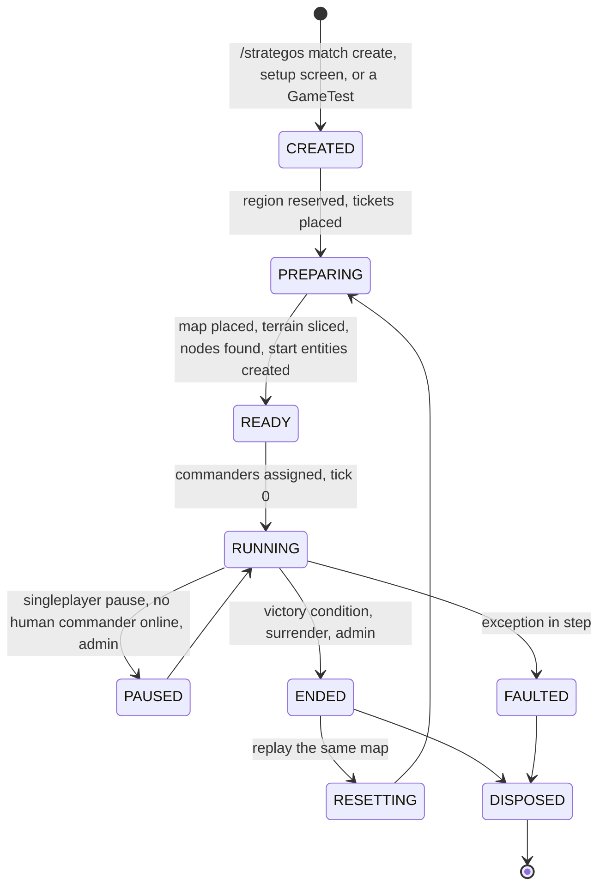
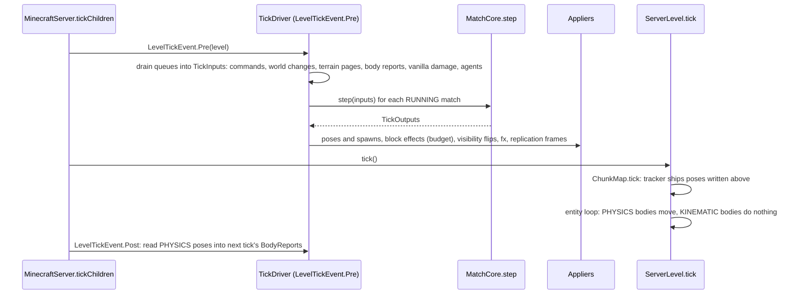
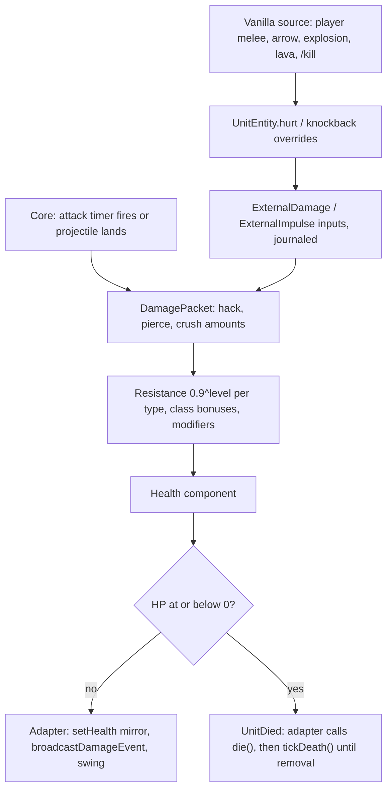
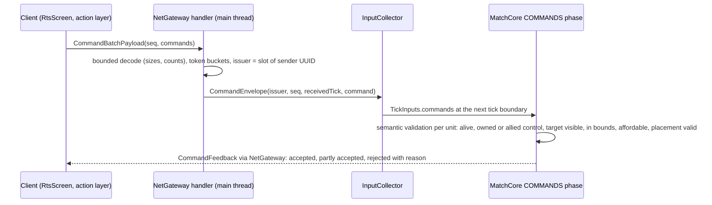
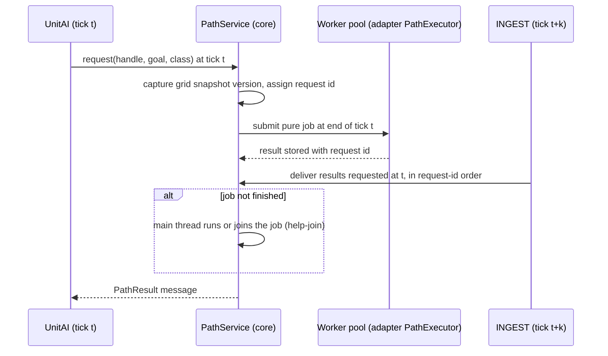
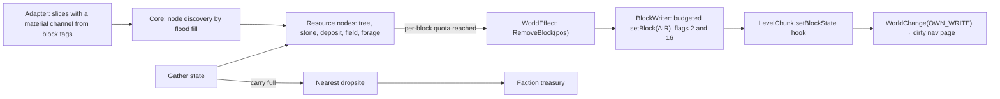
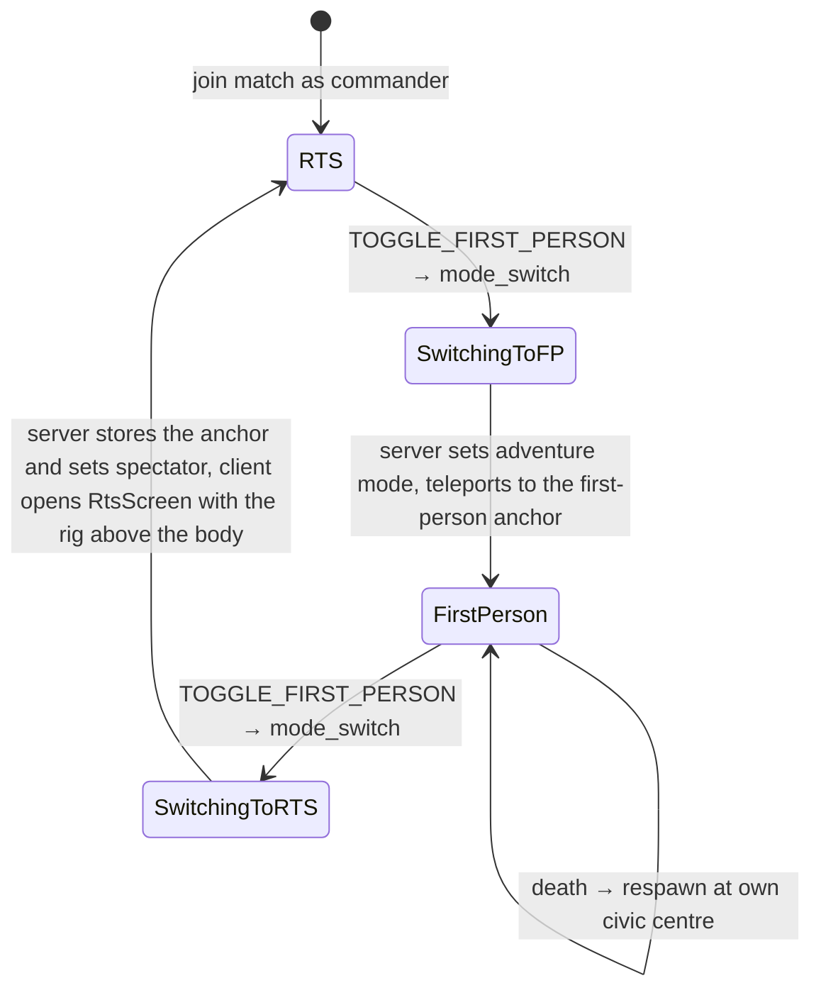

# Proposal A - core-first (hexagonal)

*Design round of 2026-10-21. Status: **proposal**, one of the competing architectures that will be
judged and synthesised into [04-architecture.md](../04-architecture.md) and ADRs. Inputs: the
[research digest](../research/README.md), [02-tooling.md](../02-tooling.md),
[03-design-process.md](../03-design-process.md), and the decompiled Minecraft 1.21.1 +
NeoForge 21.1.262 sources. Clean-room: designed only from the behavioural notes in
[research/](../research/); no GPL or all-rights-reserved source was opened.*

**Mandate.** Game rules and authoritative game state live in a deterministic, Minecraft-free core
(pure Java 21) behind ports. Minecraft is an adapter for bodies, world access, rendering, input,
persistence and networking. Optimise for testability (whole matches in plain JUnit), determinism,
portability to 26.x and a later open-world mode.

**Conventions.** `File.java:123` references point into the decompiled 1.21.1 + NeoForge 21.1.262
tree and were re-checked for this proposal (index in Appendix A). "Fact n" refers to
[research/README.md §3](../research/README.md). Figures marked *(estimate)* are hypotheses for
the M0 spikes.

---

## Summary

The core is a pure function per tick: `MatchCore.step(TickInputs) → TickOutputs`. Everything
the simulation learns from Minecraft (player commands, block changes, terrain slices, vanilla
damage, first-person players) arrives as journaled, ordered input records. Everything it wants
from Minecraft (unit poses, block placements, sounds, replication frames, visibility flips) leaves
as output records that thin adapters apply. The core owns unit position, HP, orders and stats;
the Minecraft entity is a non-saved view whose server tick is almost empty. Pathfinding, vision,
the modifier pipeline, templates, AI, replication interest rules and even the client's HUD logic
are plain Java tested in milliseconds. A whole match, including the AI opponent, runs in JUnit
with fake adapters and gives the same state hash every time; a match recorded in the real game
can be replayed in JUnit from its journal.

### Decisions at a glance

| # | Question | Decision | Section |
|---|---|---|---|
| 1 | Layout | `build-logic`, `core` (+ `testFixtures`, `jmh`), `mod` (+ `test`, `gametest`, `devtools`, `archTest`); ArchUnit enforces the hexagon, determinism bans, client isolation, one network sender and one block writer | 1 |
| 2 | What a match is | An axis-aligned region of one `ServerLevel` with match-local coordinates; any number per level; force-loaded with a `TicketController` (`ticking=false`) | 2 |
| 3 | Where the sim runs | `LevelTickEvent.Pre` of the hosting level, before the tracker ships positions; fixed 9-phase pipeline; slow systems on fixed cadences; budgets counted in work units, never in milliseconds | 2 |
| 4 | Authority | The core owns position, HP, orders, stats, buildings, resources and vision. Entities are `noSave()` views | 3 |
| 5 | Persistence | One registry `SavedData` plus one per match; DFU `Codec`s defined in core; `"v"` field and migrations on raw `Dynamic` data; decode failures quarantine instead of resetting | 3 |
| 6 | Unit entity | One `UnitEntity extends LivingEntity` (not `Mob`), three `EntityType`s by body size, template id in spawn data | 4 |
| 7 | Body seam | `KINEMATIC` (default: core integrates motion on its own nav grid; server tick skipped) or `PHYSICS` (vanilla `travel` driven by core intents; actual pose fed back as journaled input), per template | 4 |
| 8 | Damage | Unit-vs-unit damage never calls `LivingEntity#hurt`, so vanilla invulnerability frames cannot drop it; vanilla-originated damage is routed from an overridden `hurt` into the core | 4 |
| 9 | Commands | Typed command records in a registry (no action enum), validated at decode, rate-limited, and semantically validated at the tick boundary; 0 A.D. queue modes; HFSM UnitAI | 5 |
| 10 | Stats | The core modifier pipeline is the single source of truth; vanilla attributes are write-only mirrors of the few values vanilla code reads | 6 |
| 11 | Content | All templates through a reload listener with core-side inheritance, merge ops and derived kinds; registries only for engine-fixed things | 6 |
| 12 | Navigation | Layered 2.5D surface grid (≤ 4 standable surfaces per column) in 16×16 pages; HPA* portals + corridor A* + string pulling; flow fields for groups; ORCA avoidance; async jobs delivered at a fixed tick `t+k` | 7 |
| 13 | Fog | Per-faction 4-block vision grid every 10 ticks; `broadcastToPlayer` gate; forced `TrackedEntity#updatePlayer` for flipped pairs via an access transformer | 8 |
| 14 | Economy | Trees and stone are core nodes over real blocks removed through a budgeted block writer; deposits and fields are abstract nodes; abstract building HP with deterministic damage stages | 9 |
| 15 | Network | One fog-aware `NetGateway`; vanilla tracking for nearby bodies plus 2 Hz batched summaries computed per faction in core | 10 |
| 16 | Client | Player-follows-camera with the spectator body at the camera eye (no camera mixin), a non-pausing `RtsScreen` owning the cursor, perspective projection, view-models built in core | 11 |
| 17 | AI | A computer player is a command source inside the core, reading a fog-honouring view; scripted first, managers later | 12 |

### What the mandate costs

These are the honest prices of core-first; each is revisited in §18.

1. **Two representations of every unit.** A core record and an entity view, with explicit mirror
   code for every visible property. Expect roughly 15–25 % more code in the unit and building
   slices than a mob-centric design *(estimate)*.
2. **Terrain semantics re-implemented.** Kinematic units do not get vanilla step-up, fluids,
   knockback, pistons or falling for free; the nav grid must store floor heights and the core
   must model knockback and falls. Vanilla physics remains available per template, outside the
   determinism guarantee.
3. **Latency by design.** Path results arrive at `t+2` ticks (100 ms). Units start moving
   immediately on a provisional straight-line heading, so players do not feel it, but the first
   100 ms of motion are not on the final path.
4. **Determinism discipline.** `StrictMath`, no hash-ordered iteration, no wall clock, budgets in
   work units rather than adaptive time slices, and a journal. ArchUnit enforces most of it; the
   rest (hash maps keyed by objects whose `hashCode` is identity-based, such as records holding
   enums) needs code review and the determinism canary (S6).
5. **Weaker vanilla interop.** Mods that act on `Mob`s or listen to vanilla damage events see our
   units only partially; enchantments and armour do not apply to unit-versus-unit combat.
6. **Front-loaded infrastructure.** The harness, journal, ports and wire codecs come before the
   first unit walks: about 1–2 extra weeks in M0 *(estimate)*, repaid by L1 tests that run in
   seconds.

---

## 1. Module and package layout

### 1.1 Gradle projects and source sets

The settled three-project layout ([02-tooling.md](../02-tooling.md),
[testing.md §3](../research/testing.md)) stays. This proposal fixes what goes where and adds
`core/testFixtures` and `core/jmh`.

| Project | Plugins | Source sets | Contents |
|---|---|---|---|
| `build-logic` | `groovy-gradle-plugin` | `main` | `strategos.java-conventions` (toolchain 21, Spotless with palantir-java-format, ErrorProne + NullAway in JSpecify mode, JUnit platform, compact test logging); `strategos.core-conventions` (adds the plugin-free `jmh` source set and `JavaExec` task from [testing.md §4](../research/testing.md)) |
| `core` | `java-library`, `java-test-fixtures` | `main`, `test`, `testFixtures`, `jmh` | Simulation, content model, protocol, Minecraft-free client logic. `compileOnly` at the exact versions Minecraft ships: fastutil 8.5.12, DataFixerUpper 8.0.16 (codecs), slf4j-api 2.0.9, JSpecify 1.0.1. No Guava, Gson, JOML or Netty in `main` |
| `mod` | `net.neoforged.moddev` 2.0.148 | `main`, `test` (L2), `gametest` (L3), `devtools` (L4), `archTest` (L0), generated resources | NeoForge adapters, client, mixins, datagen |

`core/testFixtures` holds `SimHarness`, the fake adapters, voxel and map fixtures, the scenario
DSL, invariant checkers and `ReplayRunner`. Both `core/test` and `mod/gametest` use it, so one
scenario ("10 spearmen against 10 cavalry") runs under L1 with fakes and under L3 in a real world.

`mod/build.gradle` wiring (the core part follows [testing.md §3.2](../research/testing.md)):

```groovy
evaluationDependsOn(':core')
def core = project(':core')
neoForge {
    mods {
        strategos {
            sourceSet sourceSets.main
            sourceSet core.sourceSets.main          // core classes join the mod module in every run
            sourceSet core.sourceSets.testFixtures  // dev runs only; never in the jar
            sourceSet sourceSets.gametest           // dev runs only
            sourceSet sourceSets.devtools           // dev runs only
        }
    }
    unitTest { enable(); testedMod = mods.strategos }
}
dependencies { implementation core }
tasks.named('jar', Jar) { from core.sourceSets.main.output }   // one jar, one module
```

Other fixed points: no `module-info` in `core`; one mixin config (`strategos.mixins.json`) with one
common mixin; one access-transformer file with three lines (§8.3).

### 1.2 Package tree

`core` (root `dev.strategos.core`):

| Package | Key types | Responsibility |
|---|---|---|
| `shared` | `UnitHandle`, `FactionSlot`, `PlayerSlot`, `MatchId`, `TemplateId`, `Vec2d`, `Angles`, `DetRandom`, `IntIdMap` | Ids, deterministic math (`StrictMath` only), SplitMix64 RNG and stateless hashing, fastutil facades with defined iteration order |
| `content` | `RawTemplate`, `TemplateCompiler`, `MergeOp`, `TemplateFilter` (`FOUNDATION`, `PREVIEW`, `MIRAGE`), `TemplateSet`, `ClassFilter`, `ValuePath`, `TechDef`, `CivDef`, `AuraDef`, `AbilityDef`, `ResourceDef`, `MapManifest`, `BlueprintShape` | Template model, inheritance and validation; shared by server and client |
| `protocol` | `Command`, `CommandType`, `CommandRegistry`, `WireReader`, `WireWriter`, frame records (`UnitSummaryFrame`, `FactionStateFrame`, …), `Limits` | Client↔server message model and its binary encoding, Minecraft-free |
| `sim` | `MatchCore`, `TickInputs`, `TickOutputs`, `Phase`, `Scheduler`, `MatchBus`, `EntityStore`, `StateHasher` | The deterministic match: driving port, tick pipeline, entity storage |
| `sim.command`, `sim.order`, `sim.unitai`, `sim.ability` | `CommandQueue`, `CommandValidator`, `OrderQueue`, `QueueMode`, `Hfsm`, `UnitAi`, `Stance`, `AbilitySystem` | Commands to orders to behaviour |
| `sim.stats` | `Modifier`, `ModifierSource`, `StatService` | Modifier pipeline with caching and invalidation |
| `sim.combat`, `sim.economy`, `sim.production`, `sim.construction` | `AttackSystem`, `DamageModel`, `ProjectileSystem`, `Treasury`, `ResourceNode`, `GatherSystem`, `ProductionQueue`, `Population`, `Foundation`, `ConstructionSystem`, `DamageStages`, `PlacementRules` | Game rules |
| `sim.nav`, `sim.move`, `sim.spatial` | `BlockClass`, `VoxelSlice`, `PageBuilder`, `SurfacePage`, `SurfaceGrid`, `PortalGraph`, `CorridorAStar`, `FlowField`, `PathService`, `MotionSystem`, `Orca`, `FormationController`, `UnitGrid` | Terrain model, pathfinding, steering, spatial queries |
| `sim.vision`, `sim.territory` (T1) | `VisionGrid`, `VisionSystem`, `VisibilityIndex`, `VisibilityDelta` | Line of sight, explored state, fog queries |
| `sim.ai`, `sim.victory` | `ComputerPlayer`, `AiView`, `StrategyScript`, `AiModule`, `AiBudget`, `VictoryConditions` | Opponents and match end |
| `sim.replication` | `ReplicationService`, `InterestRules`, `DeltaEncoder` | What each faction may know, encoded per recipient |
| `sim.persist` | `MatchSnapshotCodec`, `SchemaVersion`, `Migrations` | Codecs and migrations for match state |
| `client` | `ClientMatchModel`, `SelectionSet`, `ControlGroups`, `BoxSelect`, `CommandCardBuilder`, view-model records, `HudLayout`, `ActionMap`, `CameraRig`, `GhostPlacement`, `MinimapModel` | Minecraft-free client logic, server never calls it |
| `port` | `PathExecutor`, `JournalSink`, `MetricsSink`, `Clock` | Driven ports the adapters implement |
| `diag` | `Metrics`, `PhaseTimers`, `BudgetMonitor` | Measurement (reads time only through `Clock`) |

`mod` (root `dev.strategos.mod`):

| Package | Key types | Responsibility |
|---|---|---|
| (root) | `Strategos` (`@Mod`), `StrategosServer`, `StrategosConfig`, `StrategosGameRules` | Entry point; per-server holder created on `ServerAboutToStartEvent`, dropped on stop |
| `registry` | `ModEntityTypes`, `ModDamageTypes`, `ModPayloads`, `ModTickets`, `ModKeyMappings` | Registration only |
| `entity` | `UnitEntity`, `UnitData`, `BodyMode` | The common entity class |
| `server.match` | `MatchRegistry`, `MatchRuntime`, `MatchRegionIndex`, `MapSource` (`Generated`, `Template`, `World`) | Match lifecycle and region routing |
| `server.tick` | `TickDriver`, `InputCollector` | Builds `TickInputs`, calls the core, applies `TickOutputs` |
| `server.world` | `BlockClassTable`, `SliceCapture`, `BlockWriter`, `BlockChangeRouter`, `RegionSnapshot`, `ArenaChunks` | World reads and writes, chunk tickets |
| `server.body` | `BodyRegistry`, `Materialiser`, `KinematicDriver`, `PhysicsDriver`, `DamageBridge`, `AgentTracker` | Entities as views; first-person players as external agents |
| `server.fog` | `FogGate`, `TrackerRefresher` | `broadcastToPlayer` backend; forced re-tracking |
| `server.net` | `NetGateway`, `Audience`, `C2sHandlers`, `RateLimiter`, payload records | The only sender |
| `server.content` | `TemplateReloadListener`, `BlueprintLoader`, `TemplateSync` | Data loading and client sync |
| `server.persist` | `RegistryData`, `MatchData`, `NbtBridge` | `SavedData` glue over core codecs |
| `server.protect`, `server.command`, `server.debug` | `ProtectionHandlers`, `StrategosCommands`, `DebugFeed` | Protection events, `/strategos`, dev feeds |
| `client` (+ `.mode`, `.camera`, `.input`, `.render`, `.hud`, `.minimap`, `.debug`, `.compat`) | `StrategosClient`, `RtsScreen`, `RigDriver`, `Picker`, `UnitRenderer`, `FrameExtractor`, `HudLayers`, `MinimapTextures` | Client adapters |
| `mixin` | `LevelChunkMixin` | The single mixin |
| `platform` | `Ids`, `NbtOpsBridge` | Wrappers around doomed APIs (`ResourceLocation` creation, NBT access) |

Test source sets use `dev.strategos.gametest` and `dev.strategos.devtools`.

### 1.3 Boundaries and how they are enforced

| Boundary | Rule | Enforcement |
|---|---|---|
| core is Minecraft-free | `core` compiles against the JDK and four `compileOnly` libraries only | Compile classpath |
| Sim and client logic stay apart | `core.sim..` ↛ `core.client..` and back; both may use `shared`, `content`, `protocol` | ArchUnit in `:core:test` |
| Determinism | In `core.sim`, `core.content`, `core.protocol`: no `System.currentTimeMillis`/`nanoTime`, `java.time`, `Math.random`, `java.util.Random`, `ThreadLocalRandom`, `java.lang.Math` transcendental methods (`sin`, `cos`, `tan`, `atan2`, `exp`, `log`, `pow`, `cbrt`, `hypot`, …), `HashMap`/`HashSet`/`IdentityHashMap`, `Set.of`/`Map.of`/`Map.ofEntries` (their iteration order is salted per JVM run), `Collectors.toSet`/`toMap`/`groupingBy`, `Thread`, parallel streams | ArchUnit method-call and dependency rules |
| Hexagon | `mod..` may use only `@CoreApi`-annotated types of `core.sim` (`MatchCore`, inputs, outputs, queries), never system internals | ArchUnit in `:mod:archTest` |
| Client isolation | `dev.strategos.mod..` outside `.client..` ↛ `net.minecraft.client..`, `com.mojang.blaze3d..`, `net.neoforged.neoforge.client..` | ArchUnit; L5 server smoke |
| One sender | Only `server.net.NetGateway` calls `PacketDistributor` or sends vanilla packets | ArchUnit |
| One block writer | Only `server.world.BlockWriter` calls `Level#setBlock`, `removeBlock` or `destroyBlock` | ArchUnit |
| No static mutable state | No non-final static fields and no static mutable collections, except the two holders (`StrategosServer`, `StrategosClient`) cleared on stop and logout (RoN's carry-over bugs, [prior-art §3.11](../research/prior-art.md)) | ArchUnit |
| Mixin inventory | Mixin config entries equal the inventory table in the architecture doc | L2 test |

---

## 2. Simulation model

### 2.1 What a match is in world terms

- **Region.** `MatchSpace(levelKey, origin, sizeX, sizeZ, minY, maxY)`: an axis-aligned box in one
  `ServerLevel`. The vanilla world border is not used: it is saved only for the overworld and
  every other level follows it (fact 10), so it cannot bound several matches.
- **Coordinates.** The core works in match-local `double` X/Z (`[0, sizeX)`) and absolute Y.
  World position = origin + local. GameTests run at random origins up to ±15 M blocks, where a
  `float` has a one-block ULP (fact 26); match-local doubles never meet that problem.
- **Several matches per level.** `MatchRegionIndex` maps each chunk to the few matches whose boxes
  touch it (usually one) and rejects overlapping boxes (2-block margin). Block changes and entity
  lookups route through it in O(1). Arena matches are chunk-aligned; GameTest matches use the
  test's own bounds (`GameTestHelper#getBounds()`, GameTestHelper.java:916), which are not, and
  neighbouring tests may share a chunk. So 50 tests of one batch run as 50 independent matches in
  one level (fact 27).
- **Level.** Any `ServerLevel`. v1 uses a region of the world the player is in; no runtime
  dimensions are needed.
- **Size.** Arenas of 256², 384² and 512² blocks (256, 576 and 1,024 chunks), Y band ≤ 128.
  The v1 target is 384² × 96, about 95 s to cross on foot
  ([01-feasibility §5.1](../01-feasibility.md)); 512² waits for spike S2.
- **Keeping it alive.** At prepare, every chunk gets a `TicketController.forceChunk(level, matchUuid,
  x, z, true, false)` ticket (TicketController.java:67). `ticking=false` already makes the chunk
  entity-ticking; `true` would add random ticks and natural spawning (fact 9). These tickets also
  keep a player-less level ticking (fact 8). The controller's `LoadingValidationCallback` drops
  tickets of matches that no longer exist.
- **Edges.** The core clamps positions, the nav grid has no cells outside, the camera rig clamps,
  and commands targeting outside are rejected.

### 2.2 Lifecycle



| Step | What happens | Where it runs |
|---|---|---|
| Create | Allocate `MatchId`, reserve the region, write a `MatchRecord` (level, box, map, seed, template-set hash, state) to the registry `SavedData` | Main thread, one tick |
| Prepare | (1) force-load chunks; (2) place map content, if the map is a template, through the `BlockWriter` budget; (3) optionally capture a `RegionSnapshot` for reset; (4) capture terrain slices for every nav page; workers classify them and build the pages, and the core publishes the surface grid and discovers resource nodes; (5) create start buildings and units from the map manifest | Budgeted over many ticks with a progress bar; classification and page building on workers |
| Start | Bind human commanders by UUID and AI slots to factions; tick 0 | One tick |
| Save | The per-match `SavedData` serialises a core snapshot; autosave every 6,000 ticks (fact 24) plus `ServerStoppingEvent` | Main thread, file write on NeoForge's IO worker |
| Resume | Registry loads; tickets are revalidated; terrain is re-sliced and compared with stored page hashes; bodies are re-materialised; singleplayer matches resume `PAUSED` | Budgeted |
| End | Victory freezes the simulation, sends results, keeps the world for inspection | One tick |
| Reset | Restore the `RegionSnapshot` through the budgeted writer, delete match data, prepare again | Budgeted |
| Dispose | Remove tickets, bodies, region index entry and match data files | One tick |

**How maps ship.** A map is a `MapManifest` at `data/<ns>/strategos/maps/<id>.json`: size, Y band,
start slots with starting entities, resource-rule overrides, default rules (population cap,
starting resources, victory). Its source is one of:

| Source | Content | Use |
|---|---|---|
| `generated` | A pregenerated region of an ordinary world; nodes are discovered from real trees and outcrops | v1 skirmish; no files to ship |
| `template` | Tiles of `.nbt` structures (`data/<ns>/structure/strategos_maps/<id>/x<i>_z<j>.nbt`, 32 × H × 32), written by a dev command that calls `StructureTemplate#fillFromWorld` directly (the 48-per-axis cap belongs to structure blocks, not templates) and parsed by our own reader, since template palettes are private (fact 25, StructureTemplate.java:66) | Hand-built maps; GameTests |
| `world` | A shipped world save whose datapack carries the manifest; each match starts from a fresh copy | Large authored maps, as [01-feasibility §6.2](../01-feasibility.md) suggests |

### 2.3 Tick pipeline

**Placement.** The core steps in `LevelTickEvent.Pre` for every level that hosts a `RUNNING`
match, matches in `MatchId` order. Verified order inside `MinecraftServer#tickChildren`: the
event fires right before `ServerLevel#tick` (MinecraftServer.java:1049–1052). Inside
`ServerLevel#tick`, `ServerChunkCache#tick` runs the tracker (`ChunkMap#tick`) *before* the entity
loop (engine.md §1.1, corrected), so kinematic poses written in the pre-event ship in the same
tick. The core steps only when `level.tickRateManager().runsNormally()` (TickRateManager.java:32),
so `/tick freeze` and `/tick step` freeze and step the match; the integrated server's pause skips
the whole server tick, so the match stops with it.



**The driving port** (all `@CoreApi`, the only core types the adapters may touch):

```java
public interface MatchCore {
    TickOutputs step(TickInputs in);          // advances exactly one tick
    MatchQueries queries();                   // read-only: visibility gate, unit lookups, UI and debug views
    MatchSnapshot snapshot();                 // codec-encodable state for SavedData
    long stateHash();
    static MatchCore create(MatchConfig config, TemplateSet templates, CorePorts ports) { … }
    static MatchCore restore(MatchSnapshot snapshot, TemplateSet templates, CorePorts ports) { … }
}
public record CorePorts(PathExecutor paths, JournalSink journal, MetricsSink metrics, Clock clock) { }
public record TickInputs(List<CommandEnvelope> commands, List<WorldChange> worldChanges,
        List<TerrainPage> pages,            // slices captured for rebuilds requested at t−4, built off-thread
        List<BodyReport> bodies, List<ExternalDamage> damage, List<ExternalImpulse> impulses,
        List<AgentUpdate> agents, List<SessionEvent> sessions) { }
public record TickOutputs(BodyFrame bodies, List<WorldEffect> effects, List<PageRebuildRequest> pages,
        VisibilityDelta visibility, List<FxEvent> fx, List<Notice> notices, List<MatchEvent> events) { }
```

**Phases inside `MatchCore.step`.** Fixed order; each phase finishes before the next starts; all
cross-system messages go through a typed, synchronous `MatchBus` with handlers in registration
order ([mechanics §2.5–2.6](../research/mechanics.md)).

| # | Phase | Systems | Cadence | Deterministic work cap | p95 target at 600 units |
|---|---|---|---|---|---|
| 0 | `INGEST` | Append inputs to the journal; apply world changes (dirty pages, node depletion, building integrity); publish delivered terrain pages; adopt PHYSICS poses; apply vanilla damage; update external agents; deliver path results requested at `t−k` | Every tick | ≤ 4 page publications, ≤ 256 path results | 0.4 ms |
| 1 | `COMMANDS` | Validate and apply human commands (from `INGEST`) and AI commands (from the previous tick) | Every tick | ≤ 256 commands per match; excess waits, FIFO | 0.2 ms |
| 2 | `AI` | Computer players think | Every 32 ticks, offset by slot | ≤ 5,000 evaluation units per think | 0.3 ms amortised |
| 3 | `UNIT_AI` | HFSM thinks, target acquisition, stance checks | Per unit by LOD tier (2/8/20 ticks), staggered by handle; wake events immediate | ≤ 400 thinks per tick | 1.0 ms |
| 4 | `MOVEMENT` | Formation slots, path following, flow sampling, ORCA, integration on the surface grid, spatial grid rebuild | Every tick; ORCA every 1–2 ticks by tier | k ≤ 10 neighbours per agent | 1.8 ms |
| 5 | `COMBAT` | Attack timers, hits, projectile landings, damage, deaths | Every tick (timers) | — | 0.5 ms |
| 6 | `ECONOMY` | Gathering, drop-off, production, construction, repair, population | Every tick (timers) | ≤ 256 block effects requested per tick | 0.4 ms |
| 7 | `WORLD` | Vision, auras, territory (T1), victory | Vision every 10 ticks per faction; auras 10; victory 20; territory on change | ≤ 150,000 vision cell updates per tick (one faction's update; excess sources wait for the next tick in handle order) | 0.5 ms amortised |
| 8 | `FINAL` | Flush destroyed entities, emit outputs and visibility deltas, refresh the replication read model; state hash in tests | Every tick | — | 0.3 ms |
| — | Adapter apply (outside the core) | Poses, materialisation, block writer, fx, network dispatch | Every tick | ≤ 64 spawns, ≤ 256 block writes | 1.2 ms |

**Scheduling slow systems.** Each system declares a `Cadence(period, offset)` or a per-entity
stagger `(tick + handle) % period`; the scheduler rejects two heavy systems on the same offset.

| System | Period | Offset or partition |
|---|---|---|
| Computer player *i* | 32 ticks | `8 × i mod 32` |
| Vision of faction *f* | 10 ticks | `2 × f mod 10` |
| Auras (T2) | 10 ticks | 5 |
| Victory check | 20 ticks | 7 |
| Replication summaries | 10 ticks (2 Hz) | 3, then spread per recipient |
| Nav page rebuild | every tick | after a 4-tick quiet period, ≤ 4 pages |
| Flow-field cache eviction | 100 ticks | 50 |
| Territory (T1) | on change | ≤ 1 recompute per 20 ticks, budgeted per tick |

**Budgets.** Every cap above counts deterministic work (thinks, nodes, cells, commands), never
elapsed time, so the same inputs always do the same work. Milliseconds are measured per phase
(§13) and compared with targets, but they never change behaviour inside a match. If a server is
too slow, the operator lowers caps in the match config (a journaled change).

### 2.4 Time, RNG and the scope of determinism

- **Time.** The match counts ticks; 20 per simulated second. Template durations are seconds and
  are rounded to ticks once, at template compile. No wall clock anywhere in `core.sim`. `/tick
  rate` changes real speed only.
- **Numbers.** Positions and velocities are `double` in match-local space. Since Java 17 all
  basic floating-point operations are strict IEEE 754, so the same JVM bytecode gives the same
  bits on the M4 Pro and on Linux CI; transcendental functions go through `StrictMath`.
  Accumulators (gather progress, build progress, resources) are fixed-point `int`/`long`
  (resources in thousandths).
- **RNG.** One SplitMix64 per match, seeded from the match seed. Named streams
  (`combat`, `ai/2`, …) derive their seeds by hashing the stream name, so adding a random draw in
  one system cannot shift another. Per-event randomness (projectile spread of attack *n*) uses a
  stateless hash `Rng.at(seed, stream, a, b)`, which is order-independent.
- **Order.** Entities iterate by handle. Maps are fastutil maps keyed by `int` or `EnumMap`s; no
  identity hashes, no `HashMap` iteration.

| Part | Deterministic? | How |
|---|---|---|
| Core state transitions | Yes, bit for bit | Pure step over journaled inputs |
| Path and page-build results | Yes | Pure jobs over immutable snapshots, delivered at a fixed tick (§7.6) |
| AI commands | Yes | AI runs inside the step with its own RNG stream |
| Human commands, block edits by players or vanilla, vanilla damage, first-person player positions, PHYSICS-body poses | No | Enter as journaled inputs; replays are exact given the journal |
| Vanilla entity ids, chunk load timing, network timing, client visuals | No | Never read by the core |

**Journal and replay.** `JournalSink` records each tick's `TickInputs` in a compact binary form,
segmented every 1,200 ticks, with the compiled `TemplateSet` and the initial snapshot at the
start. Dev and test runs record always; production keeps a 10-minute ring buffer (config). The
initial terrain slices of a 384² arena compress to roughly 1–3 MB *(estimate)*. `ReplayRunner`
(core testFixtures) replays a journal in plain JUnit and reports the first tick whose state hash
differs, so a bug seen in the game becomes a millisecond JUnit reproduction.

---

## 3. Authority and state

### 3.1 Who owns what

| Datum | Owner | Minecraft side |
|---|---|---|
| Unit position, heading, velocity | Core `Motion` | KINEMATIC: the entity mirrors it each tick. PHYSICS: the entity moves by vanilla `travel`; its pose returns as a journaled `BodyReport` that the core adopts |
| HP, max HP, damage taken | Core `Health` | Vanilla health mirrors the HP fraction on vanilla's default 20-point scale (`MAX_HEALTH` stays 20; the attribute is capped at 1,024, Attributes.java:102–104), so trackers get it through `SynchedEntityData` and the vanilla death animation works |
| Orders, queue, UnitAI state, stance, cooldowns | Core | None |
| Stats (speed, attack, armour, vision, gather rates) | Core modifier pipeline | `MOVEMENT_SPEED` and `STEP_HEIGHT` mirrored for PHYSICS bodies only |
| Owner faction, template, rank | Core | Faction and template index in spawn data |
| Carried resource, action pose | Core | Two synced bytes, changed only on transitions |
| Buildings: footprint, progress, HP, damage stage, queue, rally | Core | Blocks in the world are the visual; no building entity |
| Resource nodes | Core | Trees and stone are real blocks; deposits and fields are placed structures |
| Treasury, population, techs, diplomacy | Core | Payloads only |
| Vision and explored state | Core | Read by `broadcastToPlayer` |
| Terrain | The world | Core keeps a derived surface grid, rebuilt from slices |
| First-person players | Vanilla | Mirrored into the core as external agents each tick (vision source, target) |

### 3.2 Core state layout

- `EntityStore`: dense `int` handles (20-bit index + 12-bit generation), free list reused in handle
  order, components in struct-of-arrays stores (fastutil primitive arrays) per kind: `Identity`,
  `Motion`, `Health`, `Attack`, `OrderQueue`, `UnitAiState`, `Gatherer`, `Builder`, `Garrison`
  (T1), `Vision`, `Footprint`, `ProductionQueue`, `ResourceSupply`, `Dropsite`, `Population`.
  Units, buildings, resource nodes, formations and projectiles are all core entities.
- `MatchState`: tick, RNG, factions (treasury, population, techs, diplomacy row), `EntityStore`,
  `SurfaceGrid`, `VisionGrid`s, `TerritoryGrid` (T1), command queues, path requests, journal
  cursor. No references to Minecraft objects, so a snapshot is plain data.
- The handle is the only id clients and adapters use for units. Vanilla entity ids differ per
  session and are never stored; players are keyed by UUID, never by name.

### 3.3 Persistence

**`SavedData` split** (1.21.1 API: `new SavedData.Factory<>(ctor, load)` with a null fixer,
`level.getDataStorage().computeIfAbsent(factory, name)`; SavedData.java:57,
DimensionDataStorage.java:43):

| File (`data/<name>.dat`) | Level | Content | Dirty when |
|---|---|---|---|
| `strategos_registry` | Overworld | Schema version, `MatchRecord`s: id, level, box, map, seed, state, template-set hash | A match changes state |
| `strategos_match_<id>` | Hosting level | Core snapshot: entities and components, factions, queues, outstanding path results, RNG, tick | Every tick while running |
| `strategos_match_<id>_grids` | Hosting level | Explored bitsets, territory (T1), page content hashes | When explored or territory state changes |

The nav grid itself is not saved: it is rebuilt from the world on resume, and stored page hashes
flag any page that differs (a crash between chunk and data saves, an offline edit); a differing
page enters the journal like a block change. At save time `PathService.quiesce()` finishes
outstanding path and page-build jobs and stores their pending results, so a match continues
bit-identically after a reload.

**Codecs.** Every persisted record has a DFU `Codec` defined in core (DFU 8.0.16 is `compileOnly`).
The mod converts with `NbtOps`; L1 tests round-trip through `JsonOps`. On 1.21.5+ the same codecs
plug into `SavedDataType` and `ValueInput`/`ValueOutput` (§16).

**Versioning and migrations.** Each blob carries `"v"`. On load, `Migrations` walks
`v → v+1` functions on a DFU `Dynamic<?>` before decoding, so migrations work on NBT and JSON
alike and are tested in L1 with JSON fixtures and in L2 with NBT fixture files. A change in the
template-set hash is reported; templates referenced by the snapshot but missing from the new set
fail the load with a named error, unless the operator allows a lossy upgrade.

**Decode failures must not reset a match.** `DimensionDataStorage#readSavedData` logs any
exception and returns null, and `computeIfAbsent` then creates an empty object that overwrites the
file at the next save (DimensionDataStorage.java:43–75). Our loaders therefore never throw:
on failure they return a quarantined `MatchData` that keeps the raw tag, writes it back unchanged,
and marks the match `FAULTED` with the error. An L3 test loads a corrupted fixture and checks that
the file survives.

### 3.4 Entity materialisation

- `UnitEntity`'s types are built with `EntityType.Builder#noSave()` (EntityType.java:1339), so
  `Entity#getEncodeId()` returns null and the entity is never written to chunk storage
  (Entity.java:1914–1917, 1709–1720). Bodies cannot be restored from region files, so they cannot
  duplicate; the `BodyRegistry` is their only creator.
- After each step the `Materialiser` spawns bodies for units that want one and stand in an
  entity-ticking position (`ServerLevel#isPositionEntityTicking`, ServerLevel.java:1710), at most
  64 per tick, with spawn data carrying handle, template index, faction and body mode.
- `EntityLeaveLevelEvent` detaches a body, and `Entity#getRemovalReason()` decides the core's
  reaction: `UNLOADED_TO_CHUNK` → the unit continues without a body; a discard by another mod (a
  lag-clearing mod, say) → re-materialise next tick and log it. `/kill` never takes this path:
  `LivingEntity#kill` calls `hurt(genericKill, …)` (LivingEntity.java:302), which our override turns
  into lethal core damage. Portals are refused (`canUsePortal`, `canChangeDimensions` return false,
  Entity.java:2781, 2785).
- On server start, all bodies are recreated from core state. In an arena every chunk is
  force-loaded, so every unit has a body during a match.

### 3.5 Staying open to an open-world mode

- Authority never depends on chunk loading: a unit without a body keeps its record, orders and
  path, and moves along the coarse portal graph at its template speed (abstract travel,
  MineColonies' idea in [prior-art §4](../research/prior-art.md)).
- `MatchSpace` generalises to a `SpaceShape` (box for arenas, chunk set for an open world); every
  grid (surface, vision, territory, spatial) is paged by 16×16 columns, dense for arenas and
  sparse for open worlds.
- Force-loading everything becomes capped follow-tickets per active army; at least one
  `TicketController` ticket keeps a player-less level ticking (fact 8).
- Persistence is already per match; an open world is one long-lived match.
- Arena-only assumptions (prewarm every page, force-load every chunk, adventure-mode first person,
  protection of the whole region) live in an `ArenaPolicy` object, replaced by an
  `OpenWorldPolicy` later.

---

## 4. Units

### 4.1 Entity class design

One class carries every ground unit: `UnitEntity extends LivingEntity implements
IEntityWithComplexSpawn`. An `EntityType` (and with it the tracking range, update interval and
renderer) is fixed at startup (fact 23), so units map onto three types by body size:

| `EntityType` | Default size | `clientTrackingRange` | `updateInterval` | Velocity updates | Used by |
|---|---|---|---|---|---|
| `strategos:unit_humanoid` | 0.6 × 1.8 | 10 chunks | 3 | off (`setShouldReceiveVelocityUpdates(false)`) | workers, infantry, archers |
| `strategos:unit_mount` | 1.4 × 2.0 | 10 chunks | 3 | off | cavalry |
| `strategos:unit_large` | 2.0 × 2.0 | 12 chunks | 3 | off | rams, catapults (T1+) |

All three use `noSave()`. Per-template sizes inside a type override `getDefaultDimensions(Pose)`
(LivingEntity.java:3427; `getDimensions` is final at 3423) and call `refreshDimensions()`.

**Why `LivingEntity` and not a stripped `PathfinderMob`** (the engine report's default, made for
a design where vanilla physics owns position):

| Concern | `LivingEntity` | `PathfinderMob` |
|---|---|---|
| Construction cost | Not registered in `navigatingMobs` (the add is guarded by `instanceof Mob`, ServerLevel.java:1772), so the per-block-change loop in `sendBlockUpdated` (ServerLevel.java:1093) never visits units (fact 6) | Every unit is checked on every collision-shape change |
| Despawn | `Entity#checkDespawn` is empty (Entity.java:3555); no `MobDespawnEvent` | Needs overrides; the event is posted every tick |
| Vanilla AI | None to strip | `serverAiStep` is final and always runs sensing, selectors, navigation and controls (Mob.java:773) |
| Humanoid model, armour, held items | `LivingEntityRenderer`, `HumanoidArmorLayer`, `ItemInHandLayer` and `HumanoidModel` all accept `T extends LivingEntity` (verified generics) | Same, plus leash rendering |
| Vanilla physics when wanted | Set `zza`, yaw and speed; `aiStep` → `travel` does step-up, fluids and collision | `MoveControl` does the same |
| Lost | Spawn eggs, leads, `Mob#doHurtTarget`, mob-only hooks of other mods | — |

**Disabled.** On the server in `KINEMATIC` mode, `tick()` skips `super.tick()`: no `baseTick`
(fluid pushing, fire, suffocation, `LivingBreatheEvent`), no `aiStep`/`travel`/collision, no
`pushEntities`, no per-tick equipment detection, no combat tracker. What runs is `tickDeath()`
while dying. Always: `isPushable()` false and `pushEntities()` a no-op (fact 3), `getMovementEmission()`
returns `NONE` (fact 3), `shouldDropLoot()` false, riding refused, `hurt` and `knockback` routed
to the core (§4.4). What remains per unit: the `EntityTickEvent.Pre/Post` posts around `tick()`
(ServerLevel.java:776–778), entity-section bookkeeping on `setPos`, and the tracker.

**Client side** the vanilla tick stays: `lerpTo` interpolation and the walk animation computed
from position deltas at the end of `LivingEntity#travel` (LivingEntity.java:2346), which also runs
for remote entities. Client-only overrides: `isCurrentlyGlowing()` and `getTeamColor()` outline
the selection in faction colour (Entity.java:2407, 281); `shouldRenderAtSqrDistance` uses a fixed
192 blocks instead of the render-distance-dependent vanilla value (engine.md §1.4); armour and held
items come from the template on the client, so no equipment packets are sent.

**LOD tiers** (decided by the core, which is where the thinking happens):

| Tier | Units | Think period | Movement | Avoidance |
|---|---|---|---|---|
| 0 Active | Fighting, or moving and visible to a human commander | 2 ticks | every tick | every tick |
| 1 Moving | Moving, not visible to any human | 8 ticks | every tick | every 2 ticks |
| 2 Settled | Idle, gathering, building, garrisoned | 20 ticks or on wake | none while settled | none |
| 3 Abstract | No body (garrisoned, open-world travel) | 20 ticks | coarse graph | none |

Wake events (attacked, order received, target gone, node exhausted, block change under the unit,
aura or stat change) move a unit to tier 0 at once. Body cost is nearly flat across tiers because
kinematic bodies do no server work; tiers save core work.

### 4.2 The body seam

```java
public enum BodyMode { KINEMATIC, PHYSICS, NONE }
// core → adapter, in TickOutputs.bodies()
public record BodyPose(int handle, double x, double y, double z, float yaw, byte anim, boolean onGround) {}
public record DriveIntent(int handle, double wantX, double wantZ, double speed, float yaw) {}
// adapter → core, in TickInputs.bodies() (journaled)
public record BodyReport(int handle, Kind kind, double x, double y, double z, boolean onGround, LostReason reason) {}
```

| | `KINEMATIC` (default) | `PHYSICS` (opt-in per template) |
|---|---|---|
| Who integrates motion | Core, on the surface grid | Vanilla `travel` and `move` with `STEP_HEIGHT` 1.0 (fact 5) |
| Adapter per tick | `setPos`, yaw, head and body yaw from `BodyPose` | Sets yaw, `zza` and speed toward `DriveIntent`; after the entity loop reads the pose |
| Determinism | Inside the guarantee | Pose is a journaled input |
| Server cost | Near zero beyond the tracker | Collision and travel every tick (engine.md §1.1) |
| Gets for free | — | Step-up, fluids, knockback, pistons, falling |
| Core must model | Floor heights, slopes, water depth, knockback impulses, falls | Little |
| Use | All T0 units | Animals, boats (later), or a fallback if spike S10 rejects kinematic visuals |

### 4.3 Movement control

- **Integration.** Each tick the motion system advances a unit along its steering velocity over
  connected surfaces: up-steps ≤ 1.0 (humanoid) and drops ≤ 3 blocks per mobility class. Y is the
  floor height of the current surface, with up-steps smoothed over 2 ticks so units do not pop.
  Turn rate is limited per template.
- **Falls and impulses.** If the surface under a unit disappears (a block change), the core drops
  it to the next surface below and applies fall damage by height. Knockback from vanilla sources
  arrives as an impulse and becomes a short deterministic displacement along walkable cells.
- **Ground flag.** `onGround` stays true except during falls, because every flip of it forces a
  teleport packet (fact 14).
- **Client smoothness.** With `updateInterval` 3 and vanilla's 3-step `lerpTo`, interpolation is
  continuous; client walk animation comes from the deltas.
- **PHYSICS bodies.** The driver mimics `MoveControl`: yaw toward the wanted point, `zza` 1,
  speed from the mirrored `MOVEMENT_SPEED`; the core keeps steering and reads the pose back.

### 4.4 Combat hooks and the damage pipeline



- **Unit versus unit** is resolved entirely in the core: attack wind-up and repeat in ticks,
  0.9^level resistances, class multipliers, modifiers ([mechanics §1.8](../research/mechanics.md)).
  `LivingEntity#hurt` is never called for it, so the invulnerability-frame branch
  (`invulnerableTime > 10`, LivingEntity.java:1190) that silently drops focused fire (fact 4)
  cannot apply. Feedback is visual only: `ServerLevel#broadcastDamageEvent(entity, source)`
  (ServerLevel.java:1146) for the red flash and hurt sound, and `LivingEntity#swing` for the attack
  animation; both reach trackers only, so they respect fog.
- **Vanilla sources hitting units** (a first-person player's sword, a skeleton's arrow, TNT,
  lava under a PHYSICS body, `/kill`): `UnitEntity#hurt` is overridden on the server to translate
  the source into a core damage packet (melee → hack, arrows → pierce, explosions → crush, generic
  kill → lethal), enqueue it as `ExternalDamage`, call `broadcastDamageEvent`, and return true
  without calling `super.hurt`. `knockback(double, double, double)` (LivingEntity.java:1529) is
  overridden the same way. Vanilla armour, shields and totems never apply to units.
- **Units hitting players and vanilla mobs** use the target's own pipeline:
  `target.hurt(level.damageSources().source(STRATEGOS_HACK, attacker), amount)`
  (DamageSources.java:77). Our damage types are tagged `minecraft:bypasses_cooldown`, and a
  `LivingIncomingDamageEvent` handler sets `getContainer().setPostAttackInvulnerabilityTicks(0)`
  for them (DamageContainer.java:130), so massed archers lose nothing and later vanilla hits are
  not shadowed by our timer.
- **Projectiles** are analytic in the core (flight time, predicted aim, Gaussian spread from a
  stateless hash, hit resolved at landing); clients get a batched visual event, not an
  `AbstractArrow` per shot ([mechanics §1.9](../research/mechanics.md)).
- **Death.** The adapter sets health to 0, calls `die(source)` (LivingEntity.java:1408) for the
  vanilla death event and animation, drives `tickDeath()` (565) from the kinematic tick, and drops
  no loot. Core-side loot and experience are rule data.

### 4.5 Vanilla interactions

| Interaction | Status |
|---|---|
| Player melee and player arrows on units | Kept; routed into the core |
| Explosions | Kept; damage and impulse routed; blocks protected separately (§9.7) |
| Vanilla mobs targeting units (open world) | Kept; damage routed |
| Knockback | Re-implemented as a core impulse |
| Fire, lava, drowning, suffocation | KINEMATIC: replaced by hazard classes in the nav grid (units never path into them; a world change under a unit applies hazard damage). PHYSICS: kept, routed |
| Pushing and cramming | Disabled |
| Vibrations (`GameEvent.STEP`) | Disabled (`NONE`) |
| Step sounds | Client-side from the walk animation |
| Riding, leads | Disabled; mounts and garrisons are core states |
| Pistons | Ignored by KINEMATIC units (re-snapped next tick); arena pistons are cancelled (§9.7) |
| `/kill`, `/tp` on unit entities | `/kill` kills the core unit; `/tp` is overwritten by the next pose |
| Name tags, scoreboard teams | Not used for units: team membership is sent to every client and would leak units through fog (fact 16) |

---

## 5. Orders and commands

### 5.1 Command objects and their registry

```java
public interface Command { }                                  // not an enum, not a central switch
public record Move(UnitSet units, Vec2d target, QueueMode mode, int formation) implements Command { }
public record AttackMove(UnitSet units, Vec2d target, QueueMode mode) implements Command { }
public record UseAbility(UnitSet units, AbilityId ability, Target target, QueueMode mode) implements Command { }
public record Train(int building, TemplateId unit, int count) implements Command { }
public record PlaceFoundation(TemplateId building, Vec2d at, int rotation, UnitSet builders, QueueMode mode) implements Command { }
// … Gather, Build, Repair, Stop, SetStance, CancelTrain, Research, SetRally, Delete; Garrison and Diplomacy in T1

public record CommandType<C extends Command>(short wireId, Class<C> type, WireCodec<C> codec,
                                             Validator<C> validator, Handler<C> handler) { }
public record CommandEnvelope(PlayerSlot issuer, int clientSeq, long receivedTick, Command command) { }
```

- `CommandRegistry.register(CommandType)` is called at match-core construction; a new command is a
  new record plus one registration, not an enum value. Abilities never add command types: one
  `UseAbility` carries a data-defined ability id (the opposite of RoN's 138-value action enum,
  [prior-art §3.3](../research/prior-art.md)).
- `UnitSet` is an immutable sorted `int[]` of handles, at most 300 (0 A.D.'s selection limit).
- Computer players issue the same records through the same registry (§12).

### 5.2 Client-to-server validation



1. **Decode** with hard caps (§10.6). A malformed or oversized payload is dropped and counted.
2. **Gateway:** token buckets per player; the issuer is the match slot bound to the sender's UUID,
   never a name or a field in the payload.
3. **Core, at the tick boundary,** where the state is consistent: each handle must exist, be alive
   and belong to the issuer's faction (or an ally that granted control); attack targets must be
   visible to the issuer's faction; positions must lie in the match space and in explored area;
   costs are checked when spent, not when sent. Invalid parts are dropped, valid parts apply,
   and the issuer gets one feedback record per command.

### 5.3 Order-queue semantics

Each unit has an `OrderQueue` of at most 16 orders ([mechanics §2.4](../research/mechanics.md)):

| Mode | Trigger | Effect |
|---|---|---|
| `REPLACE` | Default right-click | Current order finishes now, queue cleared, new order starts |
| `QUEUE` | Shift held | Appended; starts when the queue drains to it |
| `PUSH_FRONT` | Internal interrupts (flee, return resources before a new gather, auto-repair) and forced commands | Inserted before the current order, which resumes afterwards |
| `finishOrder()` | Called by UnitAI when an order completes or fails | Pop, start the next order or go `IDLE` |

A group command becomes one order per unit with a per-unit destination (spread slots or formation
slots, §7.4) and a shared `groupId` so the units share one flow field. A building's rally point is
a list of queued orders given to each new unit (a node means auto-gather).

### 5.4 UnitAI hierarchical state machine

- **Framework** (`sim.unitai.Hfsm`): states form a tree; each `StateDef` has `enter`, `leave`,
  `onTick` and typed message handlers, and children inherit their parents' handlers. Current
  state is a state id plus a small per-state data record, so it saves as plain data. Each state
  declares its think period (MineColonies' per-transition tick rates,
  [prior-art §4](../research/prior-art.md)).
- **States (T0):**
  ```text
  INDIVIDUAL
    IDLE
    WALKING
    WALKING_AND_FIGHTING            (attack-move)
    COMBAT     { APPROACHING, ATTACKING, CHASING, FINDING_NEW_TARGET }
    GATHER     { APPROACHING, GATHERING, RETURNING, FINDING_NEW_TARGET }
    BUILD      { APPROACHING, BUILDING }
    REPAIR     { APPROACHING, REPAIRING }
    FLEEING
  FORMATION_MEMBER                  (T1)
  FORMATION_CONTROLLER              (T1, on formation entities)
  ```
  GARRISON, GUARD and PATROL arrive in T1.
- **Messages:** `Attacked`, `OrderReceived`, `TargetLost`, `PathResult`, `PathInvalidated`,
  `NodeExhausted`, `ConstructionFinished`, `StatsChanged`, `Arrived`.
- **Stances** are data: aggressive (default), defensive (leash at attack range + half vision),
  stand ground, passive (civilians, flee 12 blocks), violent
  ([mechanics §1.10](../research/mechanics.md)).
- The HFSM is the most-tested code in the project: every state transition has an L1 test.

### 5.5 Abilities

`AbilityDef` lives in templates: targeting (none, point, unit, area), range, cooldown, cost,
autocast flag, and a list of effect primitives from a small registry (`Damage`, `Heal`,
`ApplyModifiers` for N ticks, `Spawn`, `CaptureStrength`, `Teleport`). Effects run in the core
through the same damage and modifier pipelines. The client's command card lists abilities from the
template; the server validates range, cooldown and cost at the tick boundary.

---

## 6. Stats and content

### 6.1 Modifier pipeline

The single source of truth for every number a unit, building or faction uses
([mechanics §2.3](../research/mechanics.md)).

- **Value paths.** Strings such as `Attack/Melee/Damage/Hack`, `UnitMotion/WalkSpeed`,
  `ResourceGatherer/Rates/wood.tree` or `Cost/Resources/food`, interned to `int` ids when templates
  compile.
- **Modifier.** `Modifier(path, op ∈ {REPLACE, MUL, ADD}, value, filter, stage, priority, sourceId)`.
- **Evaluation.** For each stage in ascending order (default stage 0):
  `v = replace ?? v; v = v × Π mul; v = v + Σ add`. The result does not depend on the order in
  which sources were added: products and sums are taken in canonical source-id order, because
  floating-point arithmetic is not associative; ties between replacements go to higher priority,
  then lower source id. Explicit stages cover the rare "add, then multiply" combinations.
- **Class filters.** Templates carry class tokens (`Infantry Melee Spearman Organic`); tokens are
  interned to bit indices. Filter syntax: space-separated clauses are OR-ed, `+` joins tokens with
  AND, `!` negates (`"Infantry+Melee !Champion"`). Each clause compiles to a must-have and a
  must-not bitset, so a filter test is a few `long` operations.
- **Sources and scopes:**

| Source | Scope | Changes |
|---|---|---|
| Technologies, civ bonuses, phase bonuses, AI difficulty handicap | Faction | On research, phase-up, match start |
| Rank (T1) | Unit | On promotion |
| Status effects, ability buffs | Unit | Timed |
| Auras (T2) | Unit, spatial | Re-evaluated every 10 ticks |
| Territory, garrison (T1) | Unit | On tile or garrison change |

- **Caching and invalidation.** Level 1: one `StatBlock` (a `double[]` over the paths a template
  uses) per (template, faction), tagged with the faction's modifier-set version. Level 2: a
  per-unit overlay only for units with personal sources, tagged with the unit's version. A read
  is an array index plus a version compare; a stale block is recomputed lazily. Invalidation bumps
  versions and posts `StatsChanged(scope, paths)` on the `MatchBus`, so dependents refresh: max HP
  keeps the HP ratio, vision radius re-stamps, attack timers rescale.
- **Vanilla attributes** are write-only mirrors: `MOVEMENT_SPEED` and `STEP_HEIGHT` for PHYSICS
  bodies, set as base values by the adapter when the core reports a change. Vanilla health mirrors
  the HP fraction on a fixed 20-point scale (§3.1), so `MAX_HEALTH` never needs to follow the core.
  No vanilla attribute modifier is ever a source.
- **Client.** The same `StatService` code runs on the client against the client's template copy
  and the replicated tech list of its own faction, so tooltips show exactly the server's numbers.

Example technology (`data/strategos/strategos/techs/gather_wood_1.json`):

```json
{
  "cost": { "wood": 200, "metal": 100 },
  "researchTime": 40,
  "requires": { "phase": "village" },
  "modifications": [
    { "path": "ResourceGatherer/Rates/wood.tree", "mul": 1.25, "affects": "Worker" }
  ]
}
```

### 6.2 Template system

**Format and folders.** JSON under `data/<ns>/strategos/templates/**.json` (the path is the
`TemplateId`), plus `strategos/techs`, `civs`, `auras`, `resources` and `maps`. Building
geometry stays in `.nbt` structures under `data/<ns>/structure/strategos/buildings/`.

```json
{
  "parent": "strategos:template/unit_infantry_melee",
  "mixins": ["strategos:mixin/builder", "strategos:mixin/gatherer"],
  "Identity": { "name": "strategos.unit.spearman", "classes": "+Spearman" },
  "Cost": { "food": 50, "wood": 50, "population": 1, "trainTime": 10 },
  "Health": { "max": { "$op": "mul", "value": 1.1 } },
  "Attack": {
    "Melee": {
      "damage": { "hack": 4.5, "pierce": 4.0 },
      "bonuses": [ { "against": "Cavalry", "multiplier": 2.5 } ]
    }
  },
  "Body": { "entityType": "strategos:unit_humanoid", "model": "humanoid", "skin": "strategos:units/spearman" }
}
```

**Inheritance and merge operations.** `TemplateCompiler` resolves `parent` chains (cycle check
with the full chain in the error), then applies mixins left to right, then the template's own
body ([mechanics §2.1](../research/mechanics.md)):

| Construct | Meaning |
|---|---|
| Nested objects | Deep merge; the child wins per field |
| Scalars, arrays | Replaced |
| `{"$op": "add" \| "mul" \| "replace", "value": x}` | Applied to the inherited value at compile time |
| `{"$disable": true}` | Removes an inherited component |
| `{"$append": [..]}`, `{"$remove": [..]}` | Edit an inherited array |
| `"classes": "+Cavalry -Organic"` | Add or remove class tokens |

**Derived kinds** are code-defined filters over a resolved template, so one definition yields
related kinds: `FOUNDATION` (identity, footprint, cost, obstruction; health driven by progress; no
attack or vision), `PREVIEW` (footprint and visuals for the placement ghost), `MIRAGE` (last-seen
fields for fog ghosts, T1). Filters are Java functions in `content.TemplateFilter`, tested in L1.

**Loading: a reload listener, not datapack registries.** `TemplateReloadListener extends
SimplePreparableReloadListener<RawTemplates>` registered in `AddReloadListenerEvent`:
`prepare` (off-thread) reads every JSON file; `apply` (main thread) runs the core
`TemplateCompiler` with NeoForge's conditional ops (`makeConditionalOps()`,
ContextAwareReloadListener.java:54) and hands the result to the `StrategosServer`, which swaps
it into running matches at the next tick boundary (a journaled input). Datapack registries are not
used for templates: they load only at world load, ignore `/reload`, and decode each file alone, so
they cannot resolve parents (fact 22). Registries hold only engine-fixed things: entity types,
blocks, items, damage types. The cost: templates have no `Holder`s or tags for vanilla systems to
reference, ids are plain strings, and client sync is our own payload.

**Validation and error reporting.** Each component has a DFU `Codec` in core; errors carry the
file and the JSON path (`spearman.json: Attack.Melee.damage.hack: expected number`). The compiler
collects every error, never only the first. A reload with errors keeps the previous `TemplateSet`
and reports to the log, to operators in chat and through `/strategos templates errors`; an L2 test
loads all shipped data through the real listener and requires zero errors.

**Client sync.** On `OnDatapackSyncEvent` (at login before any entity pairing, and to every player
on `/reload`, fact 22) the server sends `TemplateSetPayload`: the compiled set plus its hash. Ids
are mapped to compact network indices in an append-only `TemplateIdTable` that survives reloads
within a session, so spawn data that names index 17 stays valid after a reload. The client checks
the hash and asks for a resend on mismatch.

**Hot reload.** `/reload` recompiles; caches are invalidated; units keep their template id and pick
up new numbers at once. Removing a template that a running match uses is refused with a named
error. This is the balance loop: edit JSON, `/reload`, run a scenario.

### 6.3 Data-defined units on a fixed set of entity types

- The template's `Body` block picks one of the three entity types, a model archetype
  (`humanoid`, `horse_rider`, `ram`), a skin, equipment for armour and held-item layers, and
  per-template dimensions.
- Spawn data (`IEntityWithComplexSpawn#writeSpawnData`) carries the unit handle, the template
  network index, the faction slot and the body mode; the client resolves model and texture from
  its own template copy.
- A datapack can add a unit that uses existing archetypes and any texture a resource pack ships;
  a new model archetype needs Java (fact 23).

---

## 7. Pathfinding and movement

### 7.1 Navigation representation: a layered 2.5D surface grid

**Choice.** Each column keeps a short list of standable surfaces (at most 4), each with a floor
height in 1/16 block, head clearance, and a surface class. Pages are 16×16 columns, immutable once
published, replaced copy-on-write.

| Option | Verdict |
|---|---|
| Single-layer 2.5D heightmap | Rejected: no bridges, wall walkways, tower floors, overhangs or caves; FrostedHeart's flow fields fail on exactly these ([prior-art §9](../research/prior-art.md)) |
| 3D cell band (RoN's ±24) | Rejected: ~49 cells per column to classify, store and search, where a ground unit only ever stands on 1–2 surfaces |
| **Layered surfaces** | Chosen: the standability graph of a 3D band, compressed to the surfaces that matter. Memory ≈ 2–3 KB per page, about 1.5 MB for a 384² arena and 9–12 MB for a 1,024² open-world area *(estimate; spike S8)* |

**Pipeline.**
1. **Classification (adapter).** `BlockClassTable` maps every `BlockState` id
   (`Block.BLOCK_STATE_REGISTRY`) to a 16-bit `BlockClass`: collision top height in 1/16 (from
   `getCollisionShape` against an empty getter; fences and walls count as 1.5), sturdy floor,
   passable, water or lava, climbable, door or gate, hazard (fire, magma, cactus, berry bush,
   powder snow), leaves, slow. Built at startup and again after tag reloads; it is immutable, so
   workers read it freely. Context-dependent shapes (scaffolding) are special-cased.
2. **Capture (adapter, main thread).** `PalettedContainer#copy()` of the sections that overlap a
   page's Y band (PalettedContainer.java:290); vanilla copies sections the same way for off-thread
   chunk meshing (fact 11).
3. **Slice and build (worker).** A worker classifies the copy into a core `VoxelSlice` (`short` per
   voxel) and runs the core's `PageBuilder` on it, a pure function: it scans each column top-down,
   emits a surface where a floor has enough passable clearance above it (2 blocks for humanoids, 3
   for large units), records the class, and precomputes the page's portals. Building footprints
   from the core's overlay are masked out, so our own building blocks never become terrain. The
   slice and its page reach the core as one `TerrainPage` input at the fixed delivery tick; the
   journal keeps the slice, and replays rebuild the page from it.
4. **Connectivity** is computed on demand: neighbouring surfaces connect if the rise is within the
   mobility class's step (1.0 humanoid), the drop within its limit (3), and clearance holds across
   the edge; diagonals need both orthogonal neighbours.

**Overlays** from the core, not from blocks: building footprints (obstruction, plus walkable roofs
and wall tops declared in templates), gates (passable for allies only), committed foundations.

### 7.2 Hierarchy

- **Portals** on page edges per mobility class (humanoid, mounted, large) and per surface layer;
  intra-page portal-to-portal costs computed by Dijkstra inside the page when it is built (HPA*,
  [engine §2.2](../research/engine.md)).
- **Connected components** by union-find over the portal graph per class: O(1) reachability, and
  `makeGoalReachable` picks the nearest surface in the unit's component when the goal is cut off
  (0 A.D.'s hierarchical layer, [mechanics §2.8](../research/mechanics.md)).
- A second level (4×4 pages) is added only for 1,024²+ areas and the open world.

### 7.3 Search

1. A* over the portal graph (Euclidean heuristic, ≤ 4,000 expansions) gives a corridor of pages.
2. A* over surfaces inside the corridor: 8 neighbours, costs 1 and √2, water ×4, doors ×1.5,
   slopes +0.5 per up-step, hazards impassable; ≤ 20,000 expansions, then a partial path to the
   best node with a `PARTIAL` flag.
3. String pulling over walkable surfaces produces waypoints.
4. Corridors are cached per (from page, to page, class, grid version).

**JPS is rejected:** it assumes uniform costs and 2D moves; step-ups, drops, water and door costs
break that, and every block edit would invalidate JPS+ preprocessing (engine.md §2.2, gap G8).

### 7.4 Group movement

- **Spread destinations (T0).** A group order assigns each unit a slot on a spiral around the
  target, 1.5 blocks apart, sorted by distance, so units do not pile on one point
  ([mechanics §1.11](../research/mechanics.md)).
- **Flow fields.** Orders of ≥ 8 units to one goal share a flow field over the corridor pages:
  cost field from surface classes, integration by Dijkstra from the goal with deterministic tie
  breaking, direction per surface; 3 bytes per surface. Cached per (goal cell, class, grid
  version), up to 256 fields, about 4 MB *(estimate)*; other groups heading to the same goal reuse
  it ([Emerson, Game AI Pro ch. 23](http://www.gameaipro.com/GameAIPro/GameAIPro_Chapter23_Crowd_Pathfinding_and_Steering_Using_Flow_Field_Tiles.pdf)).
- **Formations (T1).** A `FormationController` is a core entity, not a Minecraft entity: it
  follows one path at the slowest member's speed, assigns slots greedily by sorted projection, and
  members steer to their slots. Walk-only, as in 0 A.D. R28.

### 7.5 Local avoidance and stuck handling

- **ORCA**, a Java port of RVO2 (Apache-2.0, licence and NOTICE kept), on the XZ plane per surface
  layer: neighbours from the spatial grid (k ≤ 10 within 3 blocks), time horizon 1 s, blocked
  surface edges near the agent as static half-planes. Tier-0 units every tick, tier-1 every
  second tick. Arrival settles within 1.5 blocks so stopped groups do not jitter
  ([prior-art §3.5](../research/prior-art.md)).
- **Stuck ladder** (MineColonies' idea): no progress for 40 ticks → repath; 100 → step to the
  nearest free surface; 200 → advance one waypoint if no human faction sees the unit (a
  deterministic vision query); 400 → fail the order with a notice.

### 7.6 Threading model with deterministic delivery



- **Pure jobs.** A job reads only the immutable `SurfaceGrid` snapshot captured at request time
  and its own scratch arrays; it never touches `Level`, `ServerChunkCache` or vanilla caches (fact 11).
- **Fixed delivery.** Results requested at tick `t` are applied at `t+k` (`k` = 2 by default,
  part of the match config), in request-id order. If a job has not finished, the main thread
  claims and runs it, or waits for the worker that holds it; the result is identical either way,
  so only timing varies. 0 A.D. does the same with its turn-start delivery
  ([mechanics §2.6](../research/mechanics.md)).
- **Pool.** `strategos-path-N` daemon threads; size `clamp(cores / 3, 1, 4)`, leaving cores for the
  integrated client ([01-feasibility §5.4](../01-feasibility.md)); gamerule override.
- **Backpressure.** At most 2,048 outstanding requests per match and 256 admissions per tick;
  beyond that a request is answered `BUSY` (a count, so deterministic), distinct from `NO_PATH`;
  the unit keeps its old path and retries after 10 ticks (RoN's lesson).
- **Provisional steering.** A unit starts moving toward its goal on the tick the order applies;
  the path refines its motion at `t+k`, so players see a response within one tick.
- **Tests** inject a direct executor that computes at submit time; results still apply at `t+k`,
  so pooled and inline runs hash identically (spike S6 checks).
- Page builds (§7.1, step 3) use the same mechanism with `k` = 4.

### 7.7 Invalidation on block change

- **Hook:** one mixin at `LevelChunk#setBlockState(BlockPos, BlockState, boolean)`
  (LevelChunk.java:239), which sees every state change including direct chunk writes. NeoForge has
  no catch-all block event, and `ServerLevel#onBlockStateChange` misses direct writes (fact 12).
- **Routing:** `BlockChangeRouter` ignores client-side calls, queues off-thread ones to the main
  thread, looks the position up in `MatchRegionIndex` (one primitive-map lookup per block change
  in the whole server, since this path is hot), and records a
  `WorldChange(pos, oldClass, newClass, cause)` where `cause` is `OWN_WRITE` when the
  `BlockWriter` is writing (a thread-confined flag) and `EXTERNAL` otherwise. Changes that keep
  the `BlockClass` are discarded.
- **Core:** dirty pages are coalesced, rebuilt after 4 quiet ticks and at most 40 ticks after the
  first change, at most 4 pages per tick; units keep using the stale but walkable page meanwhile so
  nobody is stranded ([prior-art §3.5](../research/prior-art.md)). Paths crossing a republished
  page get `PathInvalidated`; a unit repaths at most once per 20 ticks.
- **No vanilla storm:** units are not `Mob`s, so `sendBlockUpdated` never loops over them (§4.1).

### 7.8 Budgets

| Item | Cap | Target at 600 units |
|---|---|---|
| Main-thread path work (admission, help-join, result application) | 256 admissions per tick | ≤ 0.8 ms p95, ≤ 2 ms p99 |
| Page capture and publication | 4 pages per tick | ≤ 0.4 ms p95 |
| Worker search | 20,000 low-level + 4,000 portal expansions per job | p95 job ≤ 2 ms |
| Delivery latency | `k` = 2 | 100 ms; help-join stall ≤ 0.5 ms p99 |
| Movement and avoidance (core) | k ≤ 10 neighbours | ≤ 1.8 ms p95 |
| 150 units crossing the arena | — | zero stuck units (MVP done criterion, [01-feasibility §6.3](../01-feasibility.md)) |

---

## 8. Spatial index, vision and fog of war

### 8.1 Spatial index and range queries

- **`UnitGrid`:** a uniform grid of 8-block cells, rebuilt at the end of `MOVEMENT` every tick by a
  counting sort of (cell, handle) into CSR arrays. Rebuilding 600 units costs microseconds, keeps
  handle order inside each cell, and needs no incremental bookkeeping. Dense for arenas (48 × 48
  cells at 384²), paged and sparse for the open world.
- **`StaticIndex`:** buildings, resource nodes and dropsites per 16×16 page, updated incrementally
  (they rarely change). Footprints are also indexed per page for placement and block-change
  routing.
- **Queries** are allocation-free callbacks: `forEachInRadius(x, z, r, filter, consumer)`,
  `nearest(x, z, r, filter)`, `nearestNode(resource, x, z)`, `nearestDropsite(faction, resource,
  x, z)`. A filter is a faction mask plus a class bitset, so each candidate costs a few bit tests.
- **Cadence.** Auto-targeting queries run at the unit's think period, not every tick
  (0 A.D.'s range manager idea, [mechanics §2.2](../research/mechanics.md)).

### 8.2 Vision grid

- **Grid.** Per faction, 4-block cells ([mechanics §1.18](../research/mechanics.md)): a `short[]`
  count of vision sources covering each cell and a bitset of explored cells. A 384² arena has
  9,216 cells: 18 KB of counts and 1.2 KB of explored bits per faction.
- **Sources.** Units (vision stat), buildings, and first-person players as external agents, so a
  player walking in first person sees what is around them.
- **Cadence.** Every 10 ticks per faction, factions staggered (§2.3). An update re-stamps only the
  sources that moved a cell or changed radius: subtract the old disk, add the new one, using
  precomputed disk stamps per radius. Buildings stamp once. At 32–48 blocks of vision (8–12 cells)
  a disk covers 200–450 cells; 150 moving units of one faction cost about 135,000 cell updates per
  update *(estimate)*.
- **Unit visibility.** `VisibilityIndex` keeps, per faction, a bitset over handles: visible if own,
  allied with shared vision, or standing in a cell with a count above zero. After each update it
  recomputes the bit for units that moved or stand in changed cells and emits a `VisibilityDelta`
  (handles that became visible or hidden).
- **Reads.** The published view is immutable until the next update; `FogGate` reads it in O(1)
  with no allocation.
- **Scope.** Radius vision without occlusion, like 0 A.D.; an occlusion stamp can be added behind
  the same interface. A `revealMap` rule (the MVP setting, [01-feasibility §6.4](../01-feasibility.md))
  marks every cell visible.

### 8.3 Server-side filtering and forced re-evaluation

- **Gate.** `UnitEntity#broadcastToPlayer(ServerPlayer)` (Entity.java:3021) returns
  `FogGate.canSee(player, this)`: observers see everything, non-participants follow the match
  rule (default: nothing), participants see what `VisibilityIndex` says for their faction. Vanilla
  pairs an entity with a player only if it is in range, `broadcastToPlayer` is true and the
  chunk is tracked (`TrackedEntity#updatePlayer`, ChunkMap.java:1327–1345), and it unpairs when the
  condition fails.
- **Why vanilla is not enough.** `updatePlayer` runs when the entity changes section, when the
  player's movement packet is processed (`ChunkMap#move`, ChunkMap.java:1024) and on add. A panning
  commander sends movement packets every tick; a still one sends a position reminder only every
  20 ticks (LocalPlayer.java:283–284), so a reveal could arrive up to a second late
  (contradictions, first pass §1).
- **Forced pass.** After each vision update, `TrackerRefresher` takes the `VisibilityDelta` and
  calls `TrackedEntity#updatePlayer(player)` for every flipped unit body and every online player of
  that faction (and allies sharing vision). The access transformer:
  ```text
  public net.minecraft.server.level.ChunkMap entityMap
  public net.minecraft.server.level.ChunkMap$TrackedEntity
  ```
  `entityMap` is private (ChunkMap.java:150) and `TrackedEntity` package-private (1278);
  `updatePlayer` is already public, and `ServerChunkCache#chunkMap` is public (ServerChunkCache.java:55).
  Cost: flips × players, typically under 200 calls per update. The pass never cancels
  `updatePlayer`, because cancelling also blocks unpairing (fact 16).
- **Latency.** A flip reaches clients at most 10 ticks plus one after the vision change.
- **Moonrise** calls vanilla `updatePlayer` every tick for nearby players
  ([engine §4.4](../research/engine.md)); the pass is then redundant but harmless, and the gate's
  O(1) cost matters because it runs entities × players times per tick.

### 8.4 Leaks policy

| Channel | v1 | Mechanism |
|---|---|---|
| Unit entities | Hidden | Gate plus forced pass |
| Entity-attached events: swing, damage flash, death | Hidden | Sent only to trackers (`broadcastAndSend`, ServerLevel.java:1141–1147) |
| Our payloads: summaries, details, buildings, faction state | Hidden | Interest rules in core (§10.2) |
| Our sounds and particles | Hidden | `NetGateway` audiences: trackers of the unit, or players whose faction sees the cell; per-player `ServerLevel#sendParticles(ServerPlayer, …)` |
| Projectile visuals | Hidden unless either end is visible to the recipient | Audience `SeesCell` for launch or impact |
| Effects of our block writes | Silent | `setBlock` with flags 2 and 16 plays no break sound or particles; we never call `destroyBlock` |
| Block changes: trees falling, buildings rising, damage stages | **Visible** | Chunk updates go to every player tracking the chunk. Documented leak; terrain secrecy (chunk gating with a match-start snapshot, RoN-style) is a later milestone ([engine §4.4](../research/engine.md)) |
| Scoreboard teams | Not used | Team membership would reach every client (fact 16) |
| Templates | Public by design | Rules, not secrets |

### 8.5 Where territory plugs in later

`sim.territory` (T1) runs in the `WORLD` phase on 8×8-block tiles: influence floods from sources
with falloff, connectivity to roots, recompute on change with a per-tick budget
([mechanics §1.17](../research/mechanics.md)). Its outputs feed `PlacementRules` (a validator in the
chain), the modifier pipeline (territory sources), capture decay (T1) and the AI. Clients draw
borders as static section geometry through `AddSectionGeometryEvent` (its renderers run on
chunk-build threads, so they get immutable copies; changes re-mesh via `LevelRenderer#setSectionDirty`,
LevelRenderer.java:2543). No other system changes when territory arrives.

---

## 9. Economy, production and construction

### 9.1 Resource data flow



Resource types are data (`strategos/resources/*.json`): food (fruit, grain, meat), wood, stone and
metal, each with subtypes for rate keys ([mechanics §1.1](../research/mechanics.md)).

| Node | World | Core model | Depletion |
|---|---|---|---|
| Tree | Real log and leaf blocks | `TreeNode`: log positions top-down, amount per log, remaining | Each per-log quota removes the top log; leaves go when the tree is exhausted (budgeted) |
| Stone outcrop | Real stone and ore blocks above ground | `StoneNode`: blocks ordered top-down, outside-in | Same; the order lowers hills instead of digging pits that trap units |
| Deposit (mine, quarry) | A placed structure | `DepositNode`: amount (for example 1,000 or 5,000), gatherer slots, visual stages at 75/50/25/0 % | Stage change removes that stage's blocks |
| Field | A building | `FieldNode`: infinite, 5 slots, diminishing returns 0.9 per extra gatherer ([mechanics §1.2](../research/mechanics.md)) | None |
| Forage | Real sweet berry bushes | `ForageNode`: amount, regrowth | Visual by block state age |

**Discovery.** During prepare, slices carry a material channel derived from block tags verified in
the 1.21.1 data: `minecraft:logs`, `minecraft:leaves`, `minecraft:base_stone_overworld`, `c:ores`
and its children (`c:ores/iron`, …). The core flood-fills clusters into nodes using
`ResourceNodeRules` from data (tag → resource, amount per block, cluster limits), so it is
deterministic and testable on synthetic slices. A map manifest can override or add nodes.

### 9.2 Gathering and dropsites

- `GATHER` approaches a free work point next to the node (trunk base, outcrop edge, deposit work
  markers), claims a slot, and gathers at `ResourceGatherer/Rates/<type.subtype>` per second
  through a fixed-point accumulator (thousandths per tick).
- When the carry capacity (a stat) is reached, the unit returns to the nearest dropsite of its
  faction that accepts the type (a spatial query), adds the load to the treasury and returns.
  When a node is exhausted the unit looks for the nearest node of the same subtype within 24
  blocks, then goes idle with a notice (idle-worker key).
- External edits (a first-person player breaking logs where the rules allow it) shrink the node
  through `WorldChange`; they credit nothing unless a rule says so.

### 9.3 Production queues and population

- One `ProductionQueue` per building, at most 5 entries; an entry is a unit batch (template × n)
  or a technology. Cost is paid when an entry is queued; population is reserved when it starts
  ([mechanics §1.5](../research/mechanics.md)).
- Batch time is `t × n^m` with `m` from the template (0.8 for most military buildings). Progress
  is counted in ticks.
- On completion the core creates units at the blueprint's `spawn` marker, the materialiser spawns
  their bodies, and they receive the building's rally orders.
- Population: `used` (unit costs plus reservations) against `cap = min(Σ bonuses of finished
  buildings, match max)`. A queue whose next batch does not fit waits.

### 9.4 Building placement

- **Client ghost.** The `PREVIEW` filter of the template follows the cursor, snapped to the block
  grid, rotated in 90° steps, and coloured by a client-side run of the same `PlacementRules` code
  against a terrain view sampled from the client's loaded chunks. This is prediction only.
- **Server.** `PlaceFoundation` runs `PlacementRules` against the authoritative surface grid and
  footprint overlay: inside the match space; every footprint column on land; floor-height spread
  ≤ 2 blocks (levelled by the foundation); no overlap with footprints, nodes or reserved cells;
  explored by the faction; distance rules (for example civic centres ≥ 64 blocks apart);
  territory in T1. On success the cost is deducted, an uncommitted core `Foundation` entity is
  created and the builders get `BUILD` orders.

### 9.5 Blueprints and progressive construction

- **Blueprints.** `BlueprintLoader` parses each `.nbt` file (`size`, `palette`,
  `blocks[{pos, state, nbt}]`) itself, because `StructureTemplate`'s palettes are private (fact 25),
  into an adapter `BlueprintPalette` (block states and block-entity NBT) and a core
  `BlueprintShape`: size, footprint mask, ordered block indices, damage ranks, and marker points.
  Markers are structure blocks in data mode whose metadata reads `spawn`, `door`, `rally` or
  `work`; they are not placed.
- **Order.** Y ascending; supports before attached blocks; torches, doors, beds and tall plants as
  pairs; block entities last (engine.md §8). Computed once per blueprint, in core.
- **Commit.** When the first builder arrives, the footprint becomes an obstruction in the nav
  overlay, units inside move to the nearest free surface, and the writer clears the footprint and
  fills columns down to the ground.
- **Progress.** Builders add `rate × n^0.7` in total (2 builders 1.62×, 5 builders 3.09×,
  [mechanics §1.6](../research/mechanics.md)) to a fixed-point progress `p`. The core requests
  `PlaceBlocks(building, from, to)` so that `floor(p × blockCount)` blocks exist. The writer places
  them with `UPDATE_CLIENTS` and `UPDATE_KNOWN_SHAPE` (Block.java:78, 81): the template already
  holds the final connected states, so neighbours do not cascade; a boundary shape update runs on
  completion.
- **Budget.** One global `BlockWriter` budget of 256 placements per tick across matches, in
  priority order: construction, damage stages, cosmetic removals. Vanilla batches a section's
  changes into one packet per tick.
- **Decoupling.** Progress, HP and obstruction are core state; blocks are the picture. If the
  writer lags behind, only the picture is late.

### 9.6 Abstract HP, visual degradation and repair

- HP lives in the core. `DamageStages` thresholds come from the template (default 85, 65 and 35 %,
  [mechanics §1.6](../research/mechanics.md)).
- Each removable block has a deterministic damage rank: a hash of blueprint id and block index,
  constrained by the build-order support graph so a block is never removed while something it
  holds up stays. Falling below a threshold removes the blocks whose rank is below that stage's
  fraction; repairing 2 % above it (hysteresis) places them back.
- At 0 HP the building is destroyed: remaining blocks are removed under the budget, the
  obstruction disappears, and the nav pages are rebuilt.
- Repair is a rule (free as in 0 A.D., or paid as in AoE2) at twice the build time with the same
  n^0.7 rule, and restores stages as HP rises.
- Removing a building block by any other means never changes HP, except through the protection
  conversions below.

### 9.7 Protection of building blocks

`ProtectedBlockIndex` (adapter) maps positions, per chunk, to building or node ids; it is filled
by the `BlockWriter` and by node discovery.

| Threat | Handler | Action |
|---|---|---|
| Player breaking | `BlockEvent.BreakEvent` | Cancel; optionally convert to building damage (rule) |
| Player or entity placing | `BlockEvent.EntityPlaceEvent` | Cancel inside footprints |
| Explosions | `ExplosionEvent.Detonate` | Remove protected positions from `getAffectedBlocks()` (ExplosionEvent.java:74); convert to crush damage by distance |
| Mobs breaking blocks | `LivingDestroyBlockEvent`, `EntityMobGriefingEvent` | Deny inside match regions |
| Pistons | `PistonEvent.Pre` | Cancel inside match regions |
| Fluids | `BlockEvent.FluidPlaceBlockEvent` | Cancel on protected targets |
| Natural spawns near players | `MobSpawnEvent.PositionCheck` | Deny inside arenas (the `ticking=false` ticket already avoids forced-chunk spawning, fact 9) |
| Fire | No event exists: fire removes blocks silently (fact 25) | Arena gamerule `doFireTick` false, non-flammable palettes; backstop: an `EXTERNAL` removal of a protected block seen by the hook is restored and may count as damage |

First-person players in an arena are in adventure mode, so vanilla already refuses breaking and
placing; the events are the second line.

---

## 10. Networking

### 10.1 Payload catalogue

Registration: `RegisterPayloadHandlersEvent#registrar("1")` with `playToServer` and
`playToClient` (PayloadRegistrar.java:44, 52), handlers on the main thread (the default). Each
`StreamCodec` delegates to the core's `WireCodec` for the same record, so the byte layout is
defined and size-tested in L1. Singleplayer is no shortcut: the in-memory connection still runs
`PacketEncoder`/`PacketDecoder` (Connection.java:549–574), so every codec runs in every mode.

**Client to server (intents):**

| Payload | Content | Caps |
|---|---|---|
| `strategos:command_batch` | Client sequence number, up to 32 commands | ≤ 4 KiB; ≤ 300 handles per command; 20 commands/s with bursts of 60; 3,000 handles/s |
| `strategos:camera_jump` | Target x/z (match-local), zoom | 4/s; inside the match space + 32 blocks; commanders only |
| `strategos:mode_switch` | RTS or first person | 1/s; match rules |
| `strategos:ui_query` | Details of one visible entity or own building | 10/s |
| `strategos:frame_ack` | Last applied summary sequence (delta baseline) | 20/s |
| `strategos:debug_request` | Dev overlay subscriptions | Op level 2, dev builds; 5/s |

**Server to client (state):**

| Payload | Content | Audience | Cadence |
|---|---|---|---|
| `strategos:template_set` | Compiled templates, id table, hash | Player | Login, `/reload` |
| `strategos:match_join` | Match id, box, factions, colours, your slot, rules | Player | Join, rejoin |
| `strategos:faction_state` | Treasury, population, phase, techs, queue summaries, idle counts | Own faction | On change, coalesced to ≤ 4 Hz |
| `strategos:unit_summary` | Delta frame: handle, template index, faction, x/z quantised to 1/8 block, HP byte, state | Each player: own units and visible enemies | 2 Hz |
| `strategos:unit_detail` | Orders, carried load, cooldowns, effective stats | Player, for selected own units | On change, ≤ 10 Hz |
| `strategos:building_state` | Progress, HP, stage, queue, rally, footprint | Own faction full; others last seen, once explored | On change, coalesced |
| `strategos:vision_delta` | Visible and explored cells, run-length encoded | Own faction and vision-sharing allies | 2 Hz |
| `strategos:fx_batch` | Projectile launches and impacts, gather and build sounds, particles | Spatial (§8.4) | Per tick |
| `strategos:feedback` | Command results, notices | Player or faction | Event |
| `strategos:match_event` | Lifecycle, results | Match | Event |
| `strategos:debug_feed` | Overlay data | Ops in dev | 2–10 Hz |

Vanilla channels carry the bodies: tracking and movement, spawn data through
`IEntityWithComplexSpawn`, health through vanilla synced data, and two synced bytes (action pose,
carried resource) that change only on transitions, because any dirty value forces a full position
update that tick (fact 14).

### 10.2 Interest management per faction

- `ReplicationService` (core, outside the hashed state) reads the state after each step and builds
  per-faction interest sets: own units and buildings in full; allies per diplomacy and shared
  vision; enemy units only while visible; enemy buildings as last-seen records once explored;
  observers everything.
- A `DeltaEncoder` per recipient keeps the last acknowledged baseline, so summary frames carry only
  changed entries and removals; a join or a lost baseline triggers a full frame.
- Because it is plain Java over plain state, L1 tests assert fog properties directly, for example
  "no frame addressed to faction B contains handle 41 while 41 is hidden from B".

### 10.3 The fog-aware single sender

- `NetGateway.send(Audience, Payload)` with `Audience` one of `Player(uuid)`, `Faction(match,
  slot)`, `TrackersOf(handle)` (implemented with `PacketDistributor.sendToPlayersTrackingEntity`,
  which inherits fog from pairing), `SeesCell(match, cell)` and `Match(match)`.
- Every payload type declares the audience kinds it may use; the gateway refuses others, and an L2
  test checks every declaration. Broadcast-first networking, RoN's 135 `PacketDistributor.ALL`
  call sites ([prior-art §3.8](../research/prior-art.md)), cannot be written.
- Per player per tick the gateway coalesces payloads and sends them in one call,
  `PacketDistributor.sendToPlayer(player, first, rest…)` (PacketDistributor.java:50).
- ArchUnit makes `NetGateway` the only sender (§1.3).

### 10.4 Replication tiers

| Tier | What | Mechanism | Rate |
|---|---|---|---|
| 1 | Bodies within ~160 blocks of the commander's body | Vanilla tracker, `broadcastToPlayer` gate, velocity updates off, interval 3 | 6.7 Hz |
| 2 | Every unit the faction knows, map-wide | `unit_summary` deltas, about 6 B per changed unit | 2 Hz |
| 3 | Details on demand | `unit_detail`, `building_state`, `faction_state` | Event |
| 4 (reserve) | A batched movement channel replacing tier 1 | Own delta encoding (~6 B per unit) and client interpolation | Only if tier 1 breaks the budget ([engine §4.3](../research/engine.md)) |

Units that the client knows from tier 2 but does not track in tier 1 are drawn as markers by our
overlay, so zooming out never makes an army vanish.

### 10.5 Bandwidth budget

Per client at 600 units, 300 of them visible and moving:

| Traffic | Estimate | Basis |
|---|---|---|
| Tier 1 | ≈ 44 KB/s | 300 × 22 B × 6.7 Hz, a computed upper bound (fact 15) |
| Tier 2 | ≈ 7 KB/s | ≤ 600 changed entries × 6 B × 2 Hz |
| Tiers 3 and fx | ≈ 5 KB/s | Event-driven |
| **Total** | **≈ 56 KB/s; budget ≤ 100 KB/s** | A 4-player host uploads ≤ 3.2 Mbit/s ([01-feasibility §5.3](../01-feasibility.md)) |

Measured at four levels: L1 (encoded sizes of core frames for synthetic states), L2
(`StreamCodec` sizes), L3 (mock players' outbound payloads), L6/L7 (JFR packet events by type).

### 10.6 Security

- **Bounded decoding:** lists through `ByteBufCodecs.list(maxSize)` (ByteBufCodecs.java:388) and
  `WireReader` bounds per field. Vanilla's 32,767 B serverbound cap applies only to unknown
  payloads (ServerboundCustomPayloadPacket.java:16); registered NeoForge payloads are bounded only
  by the protocol frame limits ([engine §4.1](../research/engine.md)), so our own caps (4 KiB per
  command batch) are what protects the server.
- **Rate limits:** token buckets per player and payload type; violations are dropped and counted;
  more than 100 per minute disconnects with a reason.
- **Identity** comes from the connection, never from a payload field; slots bind to UUIDs.
- **Intents only:** clients never send positions, HP or results.
- **Hidden information has no path out:** AI plans, enemy queues and hidden units are never
  encoded for a recipient that may not know them.
- **Platform:** NeoForge ≥ 21.1.264 (README §2). We do not rely on attachment sync for fogged data.

---

## 11. Client

### 11.1 The RTS camera: three decisions and the code paths behind them

| Axis | Choice | Rejected | Why, from the 1.21.1 client and server code |
|---|---|---|---|
| Body | **Player follows the camera**: the commander's own `LocalPlayer` stays the camera entity, in spectator mode, positioned at the camera eye each tick | A client camera entity (`Minecraft#setCameraEntity`, as in Camera Lib and Freecam); a server anchor through `ServerPlayer#setCamera` | `LocalPlayer#sendPosition` runs only while `isControlledCamera()`, which is `minecraft.getCameraEntity() == this` (LocalPlayer.java:277, 700). A camera entity stops movement packets, so `handleMovePlayer` → `ChunkMap#move` stops and chunk streaming and tracking stay at the parked body (fact 18). A server anchor drags the player onto it every tick and resets when Shift is held (`wantsToStopRiding`, ServerPlayer.java:524–534), and Shift is the queue key |
| Cursor | **A non-pausing full-window `RtsScreen`** that owns all input | Releasing the mouse and cancelling `InputEvent.MouseButton.Pre` with no screen open | With a screen open, `Minecraft#tick` skips `handleKeybinds` (Minecraft.java:1847–1849), `KeyboardHandler` sets and clicks no `KeyMapping` (KeyboardHandler.java:429, 475–481), and `MouseHandler#onPress` routes clicks to the screen and never grabs the mouse or clicks bindings (MouseHandler.java:89–125). Vanilla attack, use, hotbar, inventory, drop and chat bindings, which collide with RTS hotkeys, are inert by construction. Without a screen, every `setScreen(null)` re-grabs the mouse (Minecraft.java:1067) and every vanilla binding stays live |
| Projection | **Perspective**, FOV from `ViewportEvent.ComputeFov` | Orthographic | Orthographic needs a mixin on `GameRenderer#getProjectionMatrix` (GameRenderer.java:980), whose result also builds the culling frustum, plus a bypass of `Frustum#offsetToFullyIncludeCameraCube` (Frustum.java:33, called at LevelRenderer.java:875), which otherwise can loop forever (fact 20); its behaviour under Sodium culling and Iris shadows is untested |

**What these choices cost.** The commander is a spectator while commanding, so the avatar is not
in the world and cannot be attacked until the player switches to first person. With the screen
open, `KeyMapping`s do not update, so the action layer reads keys itself and must forward F1, F3
and F11 explicitly; vanilla's key-conflict display knows nothing about RTS contexts. Perspective
distorts distances near the screen edges, which box selection handles by projecting unit
positions rather than testing a ground rectangle.

**The rig.** `core.client.CameraRig` (pure math, unit-tested) holds focus point, yaw, pitch
(35–75°, default 55°), height above the focus ground (12–48 blocks by default) and FOV (55°), with
edge-pan, keyboard pan, drag-rotate and scroll-zoom targets smoothed per tick. The client adapter
applies it in two places:
- **Position, per tick:** in `PlayerTickEvent.Pre` for the local player (fired inside
  `Player#tick`, Player.java:257), which runs after `ClientLevel#tickNonPassenger` has called
  `setOldPosAndRot()` (ClientLevel.java:296–297). Setting the eye pose there keeps vanilla's
  per-frame interpolation from the old to the new position (`Camera#setup` lerps `xo` to `x`,
  Camera.java:58–62), and `LocalPlayer#tick` then sends it in the same tick.
- **Angles, per frame:** in `ViewportEvent.ComputeCameraAngles`, posted inside `Camera#setup`
  (Camera.java:53), so rotation is as smooth as the frame rate. No camera mixin is needed.

**Why a spectator body.** `Player#tick` sets `noPhysics = isSpectator()` (Player.java:258), so the
body passes through hills, trees and buildings; the server skips its "moved wrongly" check for
spectators (ServerGamePacketListenerImpl.java:946–952); spectators are made invisible
(ServerPlayer.java:1725–1729) and excluded from mob targeting (`EntitySelector.NO_CREATIVE_OR_SPECTATOR`,
EntitySelector.java:31). A non-spectator "commander state" would not work: the server replays every
movement packet through `player.move` with collisions and accepts the new position only if the
body has `noPhysics` or does not collide anew; otherwise it teleports the player back
(ServerGamePacketListenerImpl.java:936, 955–958, 993), so a camera gliding over a hill or a tower
would rubber-band. The three spectator side effects need input that the `RtsScreen` swallows:
scroll changes flying speed only when no screen is open (MouseHandler.java:183–189), attacking
spectates the target only through an attack packet (ServerPlayer.java:1767–1769), and the
spectator menu opens only through `handleKeybinds`.

**Server limits.** Pans are capped at 8 blocks per tick, below the dedicated server's "moved too
quickly" snap-back at 10 blocks per packet (ServerGamePacketListenerImpl.java:918). The
singleplayer host is exempt from that check, which would hide the problem in development, so
jumps go through the server in every mode: minimap clicks, control-group jumps and idle-unit jumps
send `camera_jump`; the server validates it and answers with
`ServerGamePacketListenerImpl#teleport` (line 1037). After a jump chunks fill at 9 to 64 per tick
(PlayerChunkSender.java:26–31), and `LocalPlayer#tick` does nothing until the body's chunk is loaded
(LocalPlayer.java:236), so the rig waits for it.

**Streaming reach.** The server streams `clamp(client render distance, 2, server view distance)`
chunks around the body (ChunkMap.java:840–841) and tracks units up to `min(range, view distance ×
16)` (ChunkMap.java:1331–1334). With the default 55° pitch, a 55° vertical FOV and a 16:9 window,
the farthest visible ground corner lies about 2.6 × the camera height from the body *(computed)*,
so the maximum 48-block height needs about 125 blocks: inside a 10-chunk unit range and the
default server view distance of 10. Shallower pitches see farther; units beyond tracking range
appear as tier-2 markers.

### 11.2 Input action layer

- `core.client.input`: `Action` ids (`CAMERA_PAN_*`, `CAMERA_ROTATE`, `ZOOM`, `SELECT`, `BOX_SELECT`,
  `ORDER_CONTEXT`, `QUEUE_MODIFIER`, `FORCE_ATTACK`, `CONTROL_GROUP_SET_n`, `CONTROL_GROUP_SELECT_n`,
  `COMMAND_SLOT_k`, `IDLE_WORKER`, `TOGGLE_FIRST_PERSON`, …), `Binding` (key or mouse plus
  modifiers), `ActionMap` per context (`RTS`, `PLACEMENT`, `TARGETING`, `FIRST_PERSON`), and an
  `InputState` that turns raw events into action events per frame and per tick. Pure and tested in L1.
- Adapter: `RtsScreen#keyPressed/keyReleased/mouseClicked/mouseDragged/mouseScrolled` feed raw
  events; held keys are polled with `InputConstants.isKeyDown`; key codes are converted once into
  our own `KeyCode`, which is where the 1.21.9 input-object change and the 26.3 SDL scancodes will
  land.
- Bindings are still registered as `KeyMapping`s (`RegisterKeyMappingsEvent`), so players rebind
  them in the vanilla Controls screen; the screen matches them with `KeyMapping#matches(keysym,
  scancode)`.
- The screen forwards F1, F2, F3 and F11 to vanilla, opens chat on the chat binding, and turns
  Escape into "cancel targeting or placement, else pause". When chat or the pause menu closes
  (`ScreenEvent.Closing`), the RTS mode reopens its screen on the next client tick.
- macOS pitfall: vanilla turns Ctrl + left click into a right click (MouseHandler.java:59–68), so
  default bindings never use Ctrl + click; select-all-of-type is a double click, as in 0 A.D.

### 11.3 Selection and picking

- **Matrices.** Every frame, `RenderLevelStageEvent` provides the projection and model-view
  matrices and the camera (`getProjectionMatrix()`, `getModelViewMatrix()`, `getCamera()`,
  RenderLevelStageEvent.java:85–113); the model-view is rotation-only, so the camera position is
  added (engine.md §5.1).
- **Retina.** The cursor (`MouseHandler#xpos()/ypos()`) is in window points, so it is normalised by
  `Window#getScreenWidth()/getScreenHeight()`, not by `getWidth()/getHeight()`, which are
  framebuffer pixels, 2× on the dev Mac (Window.java:425–447, fact 19). NDC = (2x/w − 1, 1 − 2y/h).
- **Rays.** Blocks: `level.clip(new ClipContext(from, to, Block.OUTLINE, Fluid.NONE,
  CollisionContext.empty()))`. Units: ray against AABBs of `UnitEntity`s from
  `ClientLevel#entitiesForRendering()` (ClientLevel.java:275). Buildings: block hit → building id
  through the client's footprint index from `building_state`.
- **Box select.** Project own units' positions with the same matrices and test them against the
  rectangle: pure math in `core.client.BoxSelect`, tested with synthetic matrices.
- **Selection model.** Click, box, double click (same template on screen), Shift adds, control
  groups 0–9 (Ctrl+n sets, n selects, Shift+n adds, double tap centres the camera), at most 300
  units. Hovering shows the context command and, before the click, where each unit will go
  (Legends' lesson, [prior-art §8](../research/prior-art.md)).

### 11.4 View-models for HUD, command card and minimap

- `ClientMatchModel` (core.client) mirrors replicated state: own faction, unit summaries and
  details, buildings, vision and explored cells. Payload handlers update it on the client thread.
- View-models are immutable records rebuilt at most once per client tick when their inputs change:
  `ResourceBarVM`, `SelectionPanelVM`, `CommandCardVM` (a grid of `CommandButtonVM` with action,
  icon, hotkey, enabled flag, reason, cost, tooltip), `ProductionQueueVM`, `MinimapVM`, `NoticeVM`.
  The command card intersects the selected templates' command lists and checks costs,
  requirements and population with the shared stat and template code.
- `HudLayout.compute(screenW, screenH, guiScale)` returns rectangles: pure, tested at several
  resolutions and GUI scales ([testing §7.5](../research/testing.md)). Drawing and hit-testing use
  the same rectangles.
- Drawing: GUI layers registered with `RegisterGuiLayersEvent` draw view-models only; in RTS mode
  the vanilla hotbar, crosshair, health, food, armour, air, experience and spectator layers are
  cancelled through `RenderGuiLayerEvent.Pre` (ids in `VanillaGuiLayers`). The `RtsScreen` draws
  nothing itself (its `renderBackground` is a no-op to skip the blur, Screen.java:377–384; its
  `isPauseScreen()` returns false, Screen.java:421).
- Minimap: a `NativeImage` tile per chunk from `BlockState#getMapColor` with height shading,
  uploaded to a `DynamicTexture`, refreshed on chunk load and block change; fog, unit dots and the
  camera frustum are drawn on top each frame (engine.md §5.2).

### 11.5 Rendering approach

- **Extract, then draw.** Each frame, `FrameExtractor` builds an immutable `RtsFrame` (selection
  rings, health bars, rally lines, order markers, placement ghost, projectile visuals, fog overlay,
  far-unit markers) from the client model and the entities; `RtsFrameRenderer` draws only from it,
  with vanilla `RenderType`s (`lines()`, `debugQuads()`, translucent position-colour) through one
  buffer source in `RenderLevelStageEvent` at `AFTER_TRANSLUCENT_BLOCKS`, overlays at
  `AFTER_PARTICLES`. This mirrors the 1.21.2 render states and 1.21.9 submission model
  ([platforms §6.4](../research/platforms.md)).
- **Units.** `UnitRenderer extends LivingEntityRenderer<UnitEntity, HumanoidModel<UnitEntity>>`
  with armour and held-item layers; skins per template; Sodium's model fast path applies
  ([libraries §3.1](../research/libraries.md)). The selected units' outlines also exempt them from
  Sodium's section-visibility culling (second-pass engine §5.3).
- **Under canopies.** No chunk-mesh mixins for hiding leaves: selected units show through their
  outline, and a "units through obstacles" option draws markers at unit positions in our overlay.
- **Fog.** Translucent darkening quads over non-visible cells, batched in one pass, a vanilla
  render type that shader packs keep. RoN's biome-tint fog is an option for later.
- **Sodium and Iris.** No custom shaders, no raw GL, no `RenderSystem` state tricks. A soft
  dependency on the Iris API skips our overlays in the shadow pass. Every client feature runs once
  under `-Pcompat`.

### 11.6 Switching to and from first person



- **To first person:** the server validates the switch, sets the arena's first-person game mode
  (adventure; survival in a later open world) through `ServerPlayer#setGameMode`
  (ServerPlayer.java:1589), and teleports the player to the first-person anchor: the last place
  they walked, or their civic centre. The client closes the `RtsScreen` (which grabs the mouse) and
  restores the vanilla HUD.
- **Back to RTS:** the server stores the anchor, sets spectator mode; the client opens the
  `RtsScreen` and places the rig focus on the body.
- **In first person** the player is an external agent of the core: a vision source, a target for
  enemy units, and a source of `ExternalDamage` against units.

---

## 12. AI opponent

- **A player like any other.** `sim.ai.ComputerPlayer` is a command source inside the core. It
  reads an `AiView`, a read-only facade over its own faction in full and everything else through
  its faction's visibility (cheating levels must say so explicitly), and it emits ordinary
  `Command` records. They enter the next tick's `COMMANDS` phase and pass the same validators as a
  human's. The AI never writes state; its difficulty handicap is a faction-scoped modifier source,
  as in Petra ([mechanics §1.24](../research/mechanics.md)).
- **Scheduling.** A think every 32 ticks, offset by slot; events (under attack, building lost)
  schedule an early think. Work per think is capped in evaluation units (5,000), not time. Heavy
  searches, such as scoring building sites over the surface grid, are pure jobs on the same
  executor with fixed-tick delivery, so the AI stays deterministic.
- **v1: scripted, data-driven.**
  - `StrategyScript` (JSON): opening build orders with conditions ("population ≥ 10 → barracks"),
    target worker ratios per resource, army composition, an attack schedule (time, size, telegraph
    lead time). Two or three openings (boom, rush, balanced) for variety.
  - Managers: `EconomyManager` (assigns idle workers toward the ratios from one central budget,
    not Petra's per-queue accounts, [mechanics §2.9](../research/mechanics.md)); `BuildManager`
    (sites from a site map computed at match start: flat footprints near resources and
    dropsites); `ProductionManager` (keeps queues full within the budget); `MilitaryManager`
    (musters at a rally point, attacks in waves telegraphed by a notice, a minimap ping and a
    countdown, defends, retreats at thresholds); `RebuildManager`.
  - Two difficulty levels through handicap modifiers and reaction delays.
- **Growing into a Petra-like planner.** Every manager implements
  `AiModule.think(AiView, AiBudget, CommandSink)`. Planner modules (headquarters, bases, attack
  plans, defence armies) replace scripted ones one at a time without changing the core API.
- **Tests.** L1: seeded AI-versus-AI matches with fakes, bounds on workers at minutes 5 and 10,
  idle share, banked resources, wave timing, and a watchdog (two minutes without a command counts
  as a stall). L3: headless AI-versus-AI on the GameTest server in its own batch. MVP criterion:
  ten seeded matches each end with a winner within 45 minutes ([01-feasibility §6.3](../01-feasibility.md)).

---

## 13. Observability and tooling

- **Metrics** (`core.diag`, time only through the `Clock` port): per-phase timers; counters and
  histograms over ring buffers of the last 600 ticks with p50/p95/p99. Recorded: phase times,
  units and bodies per LOD tier, path requests (ok, partial, no path, busy), nodes expanded,
  help-join waits, page rebuilds, block writes queued and applied, commands accepted and rejected
  by reason, payload bytes by type per player, vision cell updates, stat-cache hit rate. The
  adapter adds tracker-refresh calls, materialisations and MSPT from
  `MinecraftServer#getTickTimesNanos()` (MinecraftServer.java:1755).
- **Debug overlay** (client, operators in dev builds or with permission): panels for phase bars,
  counters, path-latency histogram and network bytes; world overlays for surface classes and
  layers, portals, paths and corridors, flow-field arrows, vision per faction, LOD tier per unit,
  spatial cells, footprints and damage ranks. Data comes from `debug_feed` subscriptions; vanilla's
  1.21.1 debug renderers are inert ([engine §10](../research/engine.md)).
- **Commands** (`RegisterCommandsEvent`, permission level 2):

| Command | Purpose |
|---|---|
| `/strategos match create\|list\|start\|pause\|resume\|end\|reset\|dispose\|tp` | Lifecycle |
| `/strategos spawn <template> [count] [faction]`, `/strategos order <selector> <order>` | Scenarios by hand |
| `/strategos stats <unit> [path]` | Modifier breakdown: base, each source and stage, result |
| `/strategos templates reload\|errors\|dump <id>` | Content work |
| `/strategos nav show\|rebuild\|path <from> <to>` | Pathfinding |
| `/strategos fog show\|reveal <faction>` | Vision |
| `/strategos perf start\|stop\|dump`, `/strategos journal save <file>`, `/strategos hash` | Measurement, replay, determinism |
| `/strategos ai <slot> pause\|step\|explain` | AI debugging |
| `/strategos-client …` (`RegisterClientCommandsEvent`) | Overlay and camera toggles |

- **Gamerules** (`GameRules.register`, GameRules.java:207): `strategosPathThreads`,
  `strategosPathDelayTicks`, `strategosBlockWritesPerTick`, `strategosPageRebuildsPerTick`,
  `strategosBodySpawnsPerTick`, `strategosJournalMode`. Values that affect determinism are copied
  into the match config at start; changing them mid-match goes through `/strategos match config`,
  a journaled input. Arena defaults also set vanilla `doFireTick` false.
- **Config** (`ModConfigSpec`): SERVER for limits (matches, units per match, rate limits,
  auto-pause without humans); CLIENT for camera sensitivity, edge pan, overlay defaults and "units
  through obstacles".
- **Fault containment.** An exception in `MatchCore.step` moves the match to `FAULTED`, saves the
  journal and snapshot, logs once and leaves the server running; dev and test runs rethrow.

---

## 14. Testing seams per level

| Level | What this architecture makes testable there | Examples | Task |
|---|---|---|---|
| L0 static | Boundaries and determinism rules | ArchUnit rules of §1.3; mixin inventory; Spotless; ErrorProne + NullAway | `spotlessCheck`, `compileJava`, `:core:test` (ArchUnit part), `:mod:archTest` |
| L1 core unit | **All game rules and whole matches**, without Minecraft | HFSM transitions; modifier stages and filters; template merge ops and error paths; page building on synthetic voxel slices (stairs, slabs, bridges, water); A*/HPA*/flow fields; ORCA; vision and fog properties; replication frames never carrying hidden handles; wire-codec sizes; client selection, layout, command card and camera-rig math; AI-versus-AI matches; seeded invariant runs; replay and golden-journal hashes | `:core:test` (seconds) |
| L1 bench | Hot paths | Spatial grid, A*, flow fields, ORCA, stat cache, page builder | `:core:jmh`, gate > 15 % regression |
| L2 MC unit | Adapter pieces that need Minecraft classes but no world | NBT round trips and migrations from fixture files; every `StreamCodec` round trip and size cap; all shipped templates through the real reload listener with zero errors; blueprint parsing; `BlockClassTable` over every registered block state; entity-type settings (`noSave`, ranges, intervals); payload audience declarations | `:mod:test` |
| L3 GameTest | The adapters in a real server world | Materialisation and pose sync; kinematic movement over a slab and stair arena; block change → page rebuild → repath; construction and protection; damage stages; fog gate with mock players and their outbound payloads; save → reload → identical state hash; quarantine of a corrupted save; 50 parallel matches in one batch without interference | `:mod:runGameTestServer` |
| L4 client scenario | RTS mode on screen (owner consent) | HUD layout, rings, fog overlay, picking at GUI scale 2 on Retina, camera rig poses, with JSON of camera pose, HUD rectangles and pick results | `:mod:runScenario` |
| L5 server smoke | No client classes on a dedicated server; a headless match | Boot marker; create a template-map match, run 600 ticks of AI versus AI, write metrics, halt | `:mod:runServerSmoke` |
| L6 performance | Budgets of §15 | Perf GameTest batch at 2× the unit target in a solo batch; JMH baselines | perf batch, `:core:jmh` |
| L7 manual | Feel and multiplayer | Dedicated server with two clients, owner demos | owner |

**The deterministic core harness** (`core/testFixtures`):

```java
var h = SimHarness.builder()
        .terrain(VoxelFixtures.flat(96, 48, 64))   // 96 × 48 blocks, floor at y = 64; or VoxelFixtures.ascii(…)
                                                   // for walls, water and steps, or TerrainFixtures.hills(seed)
        .templates(TestTemplates.mvp())
        .factions(2)
        .seed(42)
        .build();
h.spawn("strategos:unit/spearman", 10, h.faction(0), h.at(20, 20));
h.spawn("strategos:unit/cavalry", 10, h.faction(1), h.at(60, 20));
h.command(h.player(0), new AttackMove(h.unitsOf(0), new Vec2d(60, 20), QueueMode.REPLACE));
h.runUntil(() -> h.unitsOf(1).isEmpty(), 20 * 60);
assertThat(h.unitsOf(0)).hasSizeGreaterThanOrEqualTo(4);
h.assertInvariants();
assertThat(h.stateHash()).isEqualTo(h.replay().stateHash());
```

- **Fakes:** `FakeWorld` (an in-memory voxel grid that applies `WorldEffect`s with a deterministic
  budget and emits `WorldChange`s), `FakeBodies` (records poses; PHYSICS bodies follow a simple
  deterministic integrator), `FakeNet` (collects replication frames per recipient), a direct
  executor and a fixed clock.
- **Invariants checked after every tick in harness runs:** resource conservation (treasury +
  carried + spent + node remainders constant, fields excepted), population ≤ cap, HP within
  [0, max], every unit inside the match space and on a surface, no overlapping footprints, order
  queues ≤ 16, no unit stuck longer than 400 ticks, no hidden handle in any frame.
- **Seeded invariant runs:** `@ParameterizedTest` over 200 seeds with random command streams, the
  seed printed on failure ([testing §4](../research/testing.md)); no property-testing library.
- **Golden journals** under `core/src/test/resources/journals/` with expected hashes at checkpoints;
  a hash change fails until it is re-baselined with a reason.
- **Map-scale scenarios** (150 units crossing a 384² arena) run in L1 on synthetic terrain in
  seconds. In L3, structure arenas stay ≤ 48 blocks per axis (fact 26) and larger terrain is
  generated in setup inside a solo batch; this settles the "200-unit cross-map GameTest" question
  (contradictions, first pass §13).
- **One scenario, two runners.** Scenario definitions live in `core/testFixtures`; the L3
  generator registers them as GameTests through `RegisterGameTestsEvent` with `strategos:` template
  names, our own JUnit XML report and the empty-set guard ([testing §6.2](../research/testing.md)).
  Each test creates its own match in its bounds, so batches run in parallel safely.

---

## 15. Performance plan

**Unit counts** follow [01-feasibility §5.1](../01-feasibility.md): MVP 2 × 150 (+ about 30 neutral),
multiplayer 4 × 150 = 600, stretch 4 × 200 = 800 only with 2× headroom; performance tests run at
twice the current target.

| Budget | Definition | Target | Measured by | Enforced by |
|---|---|---|---|---|
| Core | `MatchCore.step` plus our adapter appliers, per tick | ≤ 5 ms p50, ≤ 10 ms p99 at 600 units; phase targets in §2.3 | `PhaseTimers` | L6 perf batch: local gate at the budget, CI at 3×; `BudgetMonitor` warnings at runtime |
| Strategos-attributable | Core + vanilla work on our entities (entity loop, tracker, section moves) + server-thread path work + replication | ≤ 17 ms p95 at 600 units | MSPT with and without bodies (S1), `/neoforge track entity` | S1 sets the baseline; L6 regression gate |
| Whole tick | MSPT | ≤ 23 ms p95 at 600 units, so a host twice as slow holds 20 TPS | `getTickTimesNanos` | L6 |
| Per unit | Core ≤ 7 µs average; kinematic body ≤ 4 µs | — | JMH (core), S1 (body) | JMH > 15 % regression fails |
| Pathfinding | §7.8 | Main thread ≤ 0.8 ms p95; delivery 2 ticks; help-join ≤ 0.5 ms p99 | Path metrics | L6; S7 |
| Network | §10.5 | ≤ 100 KB/s per client at 600 units | L1/L2 sizes, L3 mock players, JFR | L2 size tests fail over budget |
| Client frame | Our drawing + HUD; 200 units on screen | ≤ 3 ms; frame p99 ≤ 25 ms | S4, scenario frame times | L4 with consent |
| Memory | Core state per 384² match at 600 units | ≤ 64 MB | JFR heap | L6 |
| Autosave | Serialising a match | ≤ 100 ms | Timer around `save` | L6 |
| Prepare | A 384² template map | ≤ 60 s | Timer | S2 |

Mechanics that keep the numbers honest: hot loops allocate nothing (JFR allocation profiling in
M0); phase timers are always on (two `nanoTime` calls per phase per tick); `/strategos perf dump`
writes CSV for the assistant to read; budgets are deterministic caps (§2.3), so a slow machine
never changes game behaviour, only frame pacing.

---

## 16. Porting seams

### 16.1 Minecraft 26.x

`core` survives every port unchanged: it touches neither Minecraft nor NeoForge, compiles to
Java 21 bytecode that runs on Java 25, and uses only DFU `Codec`s, which the newer APIs consume
directly. Each known change ([platforms §6.3](../research/platforms.md),
[engine §5.3](../research/engine.md)) lands in one adapter package:

| Change (version) | Seam | Core impact |
|---|---|---|
| Entity render states (1.21.2), feature submission (1.21.9) | `client.render`: `FrameExtractor` already produces immutable state; renderers are rewritten | None |
| GUI render states (1.21.6), `GuiGraphicsExtractor` (26.1) | `client.hud` draws view-models only | None |
| Input events as objects (1.21.9), SDL instead of GLFW (26.3) | `client.input` key conversion into `KeyCode` | None |
| Camera render state (26.1) | `client.camera`: two event handlers, no mixin | None |
| `SavedDataType` (1.21.5), `ValueInput`/`ValueOutput` (1.21.6), `SavedDataStorage` (26.1) | `server.persist`: the same codecs plug in | None |
| Ticket rework (1.21.5, flags in 1.21.9) | `server.world.ArenaChunks` | None |
| GameTest as registries (1.21.5) | `gametest` generator backend | None; scenarios unchanged |
| `ResourceLocation` → `Identifier` (1.21.11) | `platform.Ids` | None; core ids are strings |
| `AddServerReloadListenersEvent` (NeoForge 21.4.84), reloadable datapack registries (26.3) | `server.content` | Optional: templates could move into a reloadable registry; the compiler stays |
| Mixin on `LevelChunk#setBlockState`; access transformer on `ChunkMap` | Inventory, re-verified per version | None |

The share of Java that a port touches is expected to be 35–45 % (all of `mod`), with rendering,
GUI and input at most 15 % *(estimate)*.

### 16.2 Open-world mode

| Seam | Arena (now) | Open world (later) |
|---|---|---|
| Space | `MatchSpace` box | `SpaceShape` chunk set; sparse paged grids |
| Bodies | Always materialised (force-loaded) | Materialised in entity-ticking chunks; abstract travel otherwise |
| Terrain knowledge | All pages prewarmed | Pages built on chunk load; persisted portal summaries for unloaded pages so long-range plans need no loading |
| Chunk loading | Every chunk ticketed | Capped follow-tickets per active army; one ticket keeps the level alive (fact 8) |
| Camera | Clamped to the box | Clamped to the faction's command area and to generated chunks (spectators generate chunks by default) |
| First person | Adventure mode | Survival; protection rules per `OpenWorldPolicy` |
| Persistence | Per match | One long-lived match; journal ring only |
| Fog | Entities hidden | Same, terrain secrecy later |

The honest cost: vanilla terrain with caves and overhangs tests the 4-layer cap; long-lived matches
grow state; and the core must never cause chunk generation, which the camera clamp and AI target
rules guarantee.

---

## 17. Resolution of the contradictions ([README §6](../research/README.md))

**1. Authority.** The core owns unit position, HP and orders. In the default `KINEMATIC` body the
entity only mirrors the pose; in the opt-in `PHYSICS` body vanilla moves it and the pose returns as
a journaled input that the core adopts. This fixes the tick order (core in `LevelTickEvent.Pre`,
then the tracker ships the poses, then the entity loop), persistence (core snapshots in per-match
`SavedData`; entities are `noSave()` and never duplicate) and replication (summaries and interest
computed from core state; bodies tracked by vanilla behind the fog gate). It works in a
force-loaded arena, where every unit has a body, and in an open world, where a unit simply has no
body while its chunk is not entity-ticking.

**2. Stats.** The core modifier pipeline is the only source of truth for every stat. Vanilla
attributes are write-only mirrors for the values vanilla itself reads (`MOVEMENT_SPEED` and
`STEP_HEIGHT` for PHYSICS bodies), set as base values, never modified by attribute modifiers;
vanilla health mirrors the HP fraction on a fixed 20-point scale. RoN's syncable attributes are
not needed: clients get stats through `unit_detail` and compute tooltips with the same pipeline
code, and attribute sync would bypass the fog-aware sender.

**3. Content definitions.** A reload listener with core-side inheritance, merge operations and
derived kinds handles all templates, technologies, civilisations and maps; datapack registries are
not used for them, because 1.21.1 registries load once, ignore `/reload` and decode files alone
(fact 22). Registries keep only engine-fixed things (entity types, blocks, items, damage types).
No planned feature needs `Holder`s or tags pointing at templates: class filters use template
tokens. NeoForge 26.3's reloadable registries are reconsidered at the port.

**4. Determinism.** Yes: path and page-build jobs read immutable snapshots and are delivered at a
fixed tick `t+k` in request order, with the main thread running or joining unfinished jobs, so
results never depend on thread timing; every budget counts work, not time; `StrictMath` and
ordered collections are enforced by ArchUnit. Determinism stops at the port boundary: vanilla
physics of PHYSICS bodies, player and vanilla block edits, vanilla damage and first-person player
positions are not reproducible, so they enter as journaled inputs, and a replay of the journal is
exact.

**5. Navigation representation.** Layered 2.5D: up to four standable surfaces per column with
floor heights in 1/16 block, in 16×16 pages, plus core overlays for buildings and gates. It
represents bridges, walls and multi-storey buildings that a single layer cannot, at a fraction of
a 3D band's cost. Search is HPA* over page portals, corridor A* and string pulling, with flow
fields for groups; JPS is rejected because step, drop, water and door costs are non-uniform.

**6. Fog refresh.** Vision updates every 10 ticks per faction; right after each update, the
adapter calls `TrackedEntity#updatePlayer` for exactly the (unit, viewer) pairs whose visibility
flipped, through an access transformer on `ChunkMap.entityMap` and `ChunkMap$TrackedEntity`, and
never cancels `updatePlayer`. Leaks: entities, entity-attached events, our payloads, sounds,
particles and projectile visuals are hidden; terrain and block changes (felled trees, rising
buildings, damage stages) remain visible in v1 and are documented; terrain secrecy is a later
milestone.

**7. Commander camera and input.** Player-follows-camera with the spectator body at the camera eye,
because a camera entity stops `sendPosition` and with it streaming and the movement-packet
re-check (LocalPlayer.java:277, 700); a non-pausing `RtsScreen` owns the cursor, because with a
screen open vanilla processes no keybinds and grabs no mouse (Minecraft.java:1847,
MouseHandler.java:89–125); perspective projection, because orthographic needs a projection mixin
and a frustum bypass. No camera mixin is required. With the screen consuming keys, the client
also never sends sneak state, which keeps the `ServerPlayer#setCamera` anchor available as the
fallback (§18, R6).

**8. Budgets.** The two figures measure different things and both are kept, at the design scale of
600 units: the **core budget** (our step and appliers) is ≤ 5 ms p50 and ≤ 10 ms p99, gated in L6;
the **Strategos-attributable budget** (core plus vanilla work on our entities, server-thread path
work and replication) is ≤ 17 ms p95, the engine report's "about 20 ms for units". S1 measures the
difference between the two and replaces the unverified per-unit estimates.

**9. GameTest wiring.** GameTests live in the `gametest` source set merged into the `strategos`
mod group in dev runs, registered by our own generator through `RegisterGameTestsEvent` with
`strategos:` template names, our JUnit XML reporter and the empty-report guard; no second mod. The
`core/testFixtures` source set joins the same group so scenarios are shared with L1. Spike S5
verifies the wiring; the fallback is a separate `strategos_gametest` mod.

**10. Licensing of prior art.** Clean-room only. Designs come from the behavioural notes in the
research; no GPL or all-rights-reserved code is opened. The only adapted code is RVO2 (Apache-2.0,
licence and NOTICE kept, changes marked). The camera design needs no code from Camera Lib or
Freecam. Each subsystem's design sources are recorded in the architecture document.

**Other items from [contradictions.md](../research/contradictions.md):**

| Item | Resolution here |
|---|---|
| Force-loading flag | `ticking=false` (§2.1) |
| jqwik | Not used; seeded parameterised tests (§14) |
| `EphemeralTestServerProvider` | L2 only, for data and codec checks; worlds are GameTests (§14) |
| 200-unit cross-map acceptance test vs 48-block arenas | L1 on synthetic terrain; L3 small arenas; solo perf batch (§14) |
| Per-chunk state | No chunk attachments for authoritative data; per-match `SavedData` (§3.3) |
| Building HP | Abstract HP with deterministic damage stages (owner decision; §9.6) |
| junit-bom pin | 5.14.4 ([02-tooling.md](../02-tooling.md)) |
| GPL as an escape hatch | Not taken (item 10) |

---

## 18. Top risks and the spikes that retire them

| # | Risk | Impact | Spike | Method | Exit criterion | Fallback |
|---|---|---|---|---|---|---|
| R1 | Kinematic movement looks wrong on slabs, stairs, snow, paths, farmland and water; knockback feels dead | Units float or sink; first-person combat feels off | **S10** kinematic fidelity | Arena with every partial block and shallow water; units walk loops; screenshots under L4 (consent) and pose traces against floor heights | Visual error ≤ 1/16 block on floors; no visible pops at steps | `PHYSICS` bodies per template |
| R2 | Server cost per unit is higher than planned (tracker, section moves, event posts) | Population cap drops | **S1** (extended) | `LivingEntity` kinematic vs `LivingEntity` physics vs stripped `PathfinderMob` at 200/500/1,000 units, idle, moving, fighting; with and without Lithium | Kinematic ≤ 4 µs per unit beyond the core | Tier-4 movement channel; bodies only within reach of any viewer ("view-driven materialisation", possible because the core owns state) |
| R3 | Hidden nondeterminism (enum-keyed hash iteration, thread timing, floating point) | Replays and golden journals become flaky; trust in L1 erodes | **S6** determinism canary | Same match twice per run, inline and pooled executors, macOS and Linux CI; one L3 match journaled and replayed in L1 | Identical hashes at every checkpoint | Find with `ReplayRunner` first-divergence; tighten ArchUnit |
| R4 | Help-join stalls the main thread under order bursts | Tick spikes | **S7** path service | 200 simultaneous requests on a 384² arena, k = 1–4, pool sizes 1–4 | p99 help-join ≤ 0.5 ms at k = 2; p95 order-to-path ≤ 5 ticks | Raise `k` per match; lower node caps; more workers |
| R5 | Layered surfaces miss real terrain (more than 4 layers, odd collision shapes) or cost too much | Stuck units, slow rebuilds | **S8** terrain census and JMH | Count surfaces per column on vanilla 512² samples from several biomes and on hand-built bridges and walls; bytes per page, build time per page, A*/HPA* expansions | ≥ 99.9 % of columns ≤ 4 layers; page build ≤ 0.5 ms; rebuild ≤ 2 ms per tick | Raise the cap; Y-band limits per map |
| R6 | The camera design misbehaves on a dedicated server: snap-backs, slow fill after jumps, chat and pause restore, F-key forwarding, Retina picking | Commander UX | **S9** camera spike (consent) | Dedicated dev server, two clients, 1,000 tracked dummies; scripted pans at 10–60 blocks/s and 300-block jumps; log snap-back warnings, fill ticks, `ChunkMap#move` cost; pick known blocks at GUI scale 2 | Zero snap-backs; fill ≤ 2 s; picks within one block | Server-driven anchor (`ServerPlayer#setCamera`) with the Shift reset neutralised, or a parked body for arenas |
| R7 | Forced re-tracking is wrong or slow (Moonrise interaction) | Fog leaks or reveal lag | part of **S9** | Stationary camera, units entering and leaving vision; with and without Moonrise; mock-player payload audit in L3 | Reveal ≤ 11 ticks; zero hidden pairings | Re-check per player with the public `ServerChunkCache#move(ServerPlayer)` (ServerChunkCache.java:464) |
| R8 | Client frame time with hundreds of humanoids | Population cap; zoom limits | **S4** (consent) | 200/500/1,000 units, layers on and off, Sodium on and off | ≤ 6 ms for 200 armoured units with Sodium | Far units as overlay markers; fewer layers at distance |
| R9 | Bandwidth with four clients | Multiplayer stage | **S11** | 4 mock players, 600 units moving and fighting; JFR packet events | ≤ 100 KB/s per client | Tier-4 channel |
| R10 | Map preparation and reset are slow or large | Long loading screens, disk use | **S2** (extended) | 384² and 512² template maps: placement, slicing, node discovery, snapshot size | Prepare ≤ 60 s; snapshot ≤ 50 MB | `world` map source copied as files instead of placed |
| R11 | Double bookkeeping slows a solo developer | Velocity | M0 walking skeleton | One command → one unit → one move, saved, replayed and tested end to end, timed | Skeleton in ≤ 2 weeks | Generate mirror code from component declarations |
| R12 | Template system complexity (merge ops, filters) | Confusing errors, slow content work | Content spike in M0 | 20 templates, two inheritance levels, `/reload` cycle, error messages | Every error names file and JSON path; `/reload` ≤ 2 s | Fewer operators; datagen helpers |

S1, S2 and S5 are already planned for M0 ([README §7](../research/README.md)); S6 runs in M0 as
part of the core kernel; S7, S8 and S10 open M1; S9 opens M2; S3 and S4 need the owner's consent.

---

## Appendix A. Verified API index

Every Minecraft and NeoForge name used above was checked in the decompiled 1.21.1 + NeoForge
21.1.262 tree on 2026-10-21.

| API | Location | Used for |
|---|---|---|
| `Mob#serverAiStep` (final), `customServerAiStep` | Mob.java:773, 818 | Why units are not `Mob`s |
| `ServerLevel` adds only `Mob`s to `navigatingMobs` | ServerLevel.java:1772–1781 | Construction cost (§4.1) |
| `ServerLevel#sendBlockUpdated` loop | ServerLevel.java:1080–1093 | Same |
| `Entity#checkDespawn` (empty) | Entity.java:3555 | No despawn cost |
| `ServerLevel#tickNonPassenger` (`setOldPosAndRot`, `EntityTickEvent`) | ServerLevel.java:769–779 | Remaining per-entity cost |
| `LivingEntity#hurt`, i-frame branch | LivingEntity.java:1142, 1190 | Damage pipeline |
| `LivingEntity#knockback`, `die`, `tickDeath`, `kill` (calls `hurt(genericKill)`), `swing` (animate packet to trackers) | LivingEntity.java:1529, 1408, 565, 302, 1857–1875 | Impulses, death, `/kill`, attack animation |
| `Attributes.MAX_HEALTH` range 1–1,024 | Attributes.java:102–104 | Health mirrored as a fraction |
| `Entity#getRemovalReason`, `canUsePortal`, `canChangeDimensions` | Entity.java:3642, 2781, 2785 | Body loss handling, no portals |
| `LivingEntity#getDimensions` (final), `getDefaultDimensions` | LivingEntity.java:3423, 3427 | Per-template sizes |
| `LivingEntity#travel` → `calculateEntityAnimation` | LivingEntity.java:2346 | Client walk animation |
| `Entity#broadcastToPlayer`, `getBoundingBoxForCulling` | Entity.java:3021, 3030 | Fog gate, culling |
| `Entity#isCurrentlyGlowing`, `getTeamColor`, `shouldRenderAtSqrDistance`, `getMovementEmission` | Entity.java:2407, 281, 1692, 1184 | Selection, render distance, vibrations |
| `Entity#getEncodeId` (`canSerialize` gate), `saveAsPassenger` | Entity.java:1914, 1709 | `noSave()` views |
| `EntityType.Builder#noSave`, `clientTrackingRange`, `updateInterval`, `setShouldReceiveVelocityUpdates` | EntityType.java:1339, 1359, 1364, 1384 | Entity types |
| `LivingEntityRenderer`, `HumanoidArmorLayer`, `ItemInHandLayer`, `HumanoidModel` bounds `T extends LivingEntity` | renderer/entity/*.java, model/HumanoidModel.java:22 | Rendering `LivingEntity` units |
| `ServerLevel#broadcastDamageEvent`, `broadcastEntityEvent` | ServerLevel.java:1141–1147 | Hit feedback to trackers |
| `DamageSources#source(ResourceKey, Entity)`; `DamageContainer#setPostAttackInvulnerabilityTicks` | DamageSources.java:77; DamageContainer.java:130 | Units hitting players |
| `ChunkMap.entityMap`, `TrackedEntity`, `updatePlayer`, `move(ServerPlayer)`, `getPlayerViewDistance`, `getPlayersWatching` | ChunkMap.java:150, 1278, 1327, 1024, 840, 1242 | Fog pass, streaming reach |
| `ServerChunkCache#chunkMap` (public), `move(ServerPlayer)` | ServerChunkCache.java:55, 464 | Fog pass, fallback |
| `TicketController` record, `forceChunk(…, UUID, …)`; `RegisterTicketControllersEvent#register`; `LoadingValidationCallback` | TicketController.java:27, 67; RegisterTicketControllersEvent.java:29 | Arena loading |
| `TickRateManager#runsNormally` | TickRateManager.java:32 | Freeze and step |
| `MinecraftServer#tickChildren` (`LevelTickEvent.Pre` before `ServerLevel#tick`), `getTickTimesNanos` | MinecraftServer.java:1049–1052, 1755 | Tick placement, metrics |
| `LevelChunk#setBlockState(BlockPos, BlockState, boolean)` | LevelChunk.java:239 | Block-change hook |
| `Block.UPDATE_CLIENTS`, `UPDATE_KNOWN_SHAPE` | Block.java:78, 81 | Construction writes |
| `PalettedContainer#copy` | PalettedContainer.java:290 | Terrain capture |
| `Block.BLOCK_STATE_REGISTRY`; `BlockStateBase#getCollisionShape(BlockGetter, BlockPos)`; `EmptyBlockGetter.INSTANCE` | Block.java:68; BlockBehaviour.java:729; EmptyBlockGetter.java:12 | `BlockClassTable` |
| `StructureTemplate` palettes (private), `fillFromWorld`, `placeInWorld` | StructureTemplate.java:66, 83, 226 | Blueprints, map tiles |
| `SavedData.Factory`; `DimensionDataStorage#computeIfAbsent` and its null-on-error read | SavedData.java:57; DimensionDataStorage.java:43–75 | Persistence, quarantine |
| `AddReloadListenerEvent#addListener`; `SimplePreparableReloadListener`; `ContextAwareReloadListener#makeConditionalOps` | AddReloadListenerEvent.java:44; SimplePreparableReloadListener.java:25–27; ContextAwareReloadListener.java:54 | Templates |
| `OnDatapackSyncEvent#getRelevantPlayers`, `getPlayer` | OnDatapackSyncEvent.java:43, 53 | Template sync |
| `PayloadRegistrar#playToServer/playToClient`, `versioned`; `PacketDistributor#sendToPlayer`, `sendToPlayersTrackingEntity` | PayloadRegistrar.java:44, 52, 145; PacketDistributor.java:50, 89 | Networking |
| `ByteBufCodecs.list(maxSize)`; vanilla cap of 32,767 B for unknown custom payloads | ByteBufCodecs.java:388; ServerboundCustomPayloadPacket.java:16 | Bounded decoding |
| In-memory connection still encodes packets | Connection.java:549–574 | Codecs run in singleplayer |
| `ServerLevel#sendParticles(ServerPlayer, …)` | ServerLevel.java:1276 | Fog-safe particles |
| `ServerGamePacketListenerImpl#handleMovePlayer` (too quickly, moved wrongly, collision replay and snap-back), `teleport` | ServerGamePacketListenerImpl.java:918, 936, 946–958, 993, 1037 | Camera limits, jumps, why a spectator body |
| `ServerPlayer` camera follow, `setGameMode`, `getCamera/setCamera`, `attack`, spectator invisibility | ServerPlayer.java:524–534, 1589, 1734–1738, 1767, 1725–1729 | Camera choice, mode switch |
| `EntitySelector.NO_CREATIVE_OR_SPECTATOR` | EntitySelector.java:31 | Mobs ignore the commander body |
| `PlayerChunkSender.MAX_CHUNKS_PER_TICK`, desired 9 | PlayerChunkSender.java:26, 31 | Fill after jumps |
| `Player#tick` (`PlayerTickEvent.Pre`, `noPhysics = isSpectator()`) | Player.java:257–258 | Rig position, spectator body |
| `LocalPlayer#tick` (`hasChunkAt` gate), `sendPosition`, `isControlledCamera`, position reminder | LocalPlayer.java:236, 266–305, 700 | Camera choice |
| `ClientLevel#tickNonPassenger`, `entitiesForRendering` | ClientLevel.java:296, 275 | Interpolation, picking |
| `Minecraft#tick` keybind gate; `setScreen` release and grab | Minecraft.java:1847–1849, 1061, 1067 | Cursor choice |
| `KeyboardHandler#keyPress` KeyMapping gate | KeyboardHandler.java:429, 475–481 | Cursor choice |
| `MouseHandler#onPress`, `onScroll`, `xpos/ypos`, macOS Ctrl-click | MouseHandler.java:52–135, 146–190, 345–351, 59–68 | Cursor choice, picking |
| `Window#getWidth/getHeight` (framebuffer), `getScreenWidth/Height`, `getGuiScaledWidth` | Window.java:425–451 | Retina picking |
| `Screen#renderBackground`, `isPauseScreen` | Screen.java:377, 421 | `RtsScreen` |
| `Camera#setup`, `ViewportEvent.ComputeCameraAngles`, `ComputeFov#setFOV` | Camera.java:47–62; ViewportEvent.java:254, 327, 350 | Camera without mixins |
| `GameRenderer#getProjectionMatrix`; `Frustum#offsetToFullyIncludeCameraCube` | GameRenderer.java:980; Frustum.java:33, LevelRenderer.java:875 | Why not orthographic |
| `RenderLevelStageEvent` getters and stages | RenderLevelStageEvent.java:64–207 | Picking matrices, world overlays |
| `RegisterGuiLayersEvent`, `RenderGuiLayerEvent.Pre` (cancellable), `VanillaGuiLayers` | RegisterGuiLayersEvent.java:47–107; RenderGuiLayerEvent.java:70; VanillaGuiLayers.java:18–42 | HUD |
| `AddSectionGeometryEvent#addRenderer`, `LevelRenderer#setSectionDirty` | AddSectionGeometryEvent.java:72; LevelRenderer.java:2543 | Static decals |
| `KeyMapping#matches`, `IKeyMappingExtension#getKey`, `RegisterKeyMappingsEvent#register`, `InputConstants.isKeyDown` | KeyMapping.java:182; IKeyMappingExtension.java:22; RegisterKeyMappingsEvent.java:35; InputConstants.java:185 | Action layer |
| `ScreenEvent.Opening/Closing` | ScreenEvent.java:978, 1026 | Restoring the RTS screen |
| `BlockEvent.BreakEvent`, `EntityPlaceEvent`, `FluidPlaceBlockEvent`; `ExplosionEvent.Detonate#getAffectedBlocks`; `PistonEvent.Pre`; `MobSpawnEvent.PositionCheck` | BlockEvent.java:69, 98, 205; ExplosionEvent.java:65–75; PistonEvent.java:77; MobSpawnEvent.java:236 | Protection |
| `GameRules.register`, `RULE_DOFIRETICK` | GameRules.java:207, 35 | Tunables, arena rules |
| `GameTestHelper#getBounds`, `onEachTick`, `getTick`; `TestFunction` constructor; `StructureUtils.testStructuresDir`; `GlobalTestReporter.replaceWith`; `RegisterGameTestsEvent#register` | GameTestHelper.java:916, 930, 912; TestFunction.java:26; StructureUtils.java:38; GlobalTestReporter.java:6; RegisterGameTestsEvent.java:39 | L3 harness |
| Block tags `minecraft:logs`, `minecraft:leaves`, `minecraft:base_stone_overworld`, `c:ores` | data/minecraft/tags/block/*.json, data/c/tags/block/ores.json | Node discovery |
