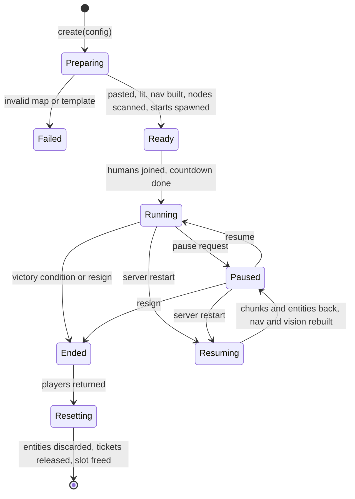
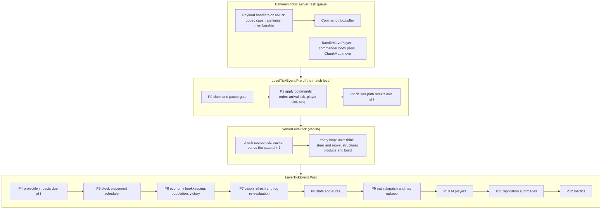
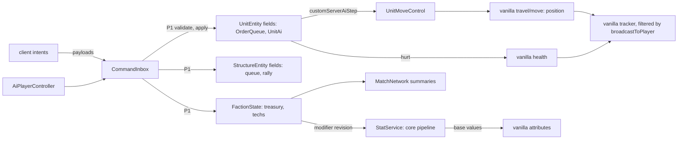
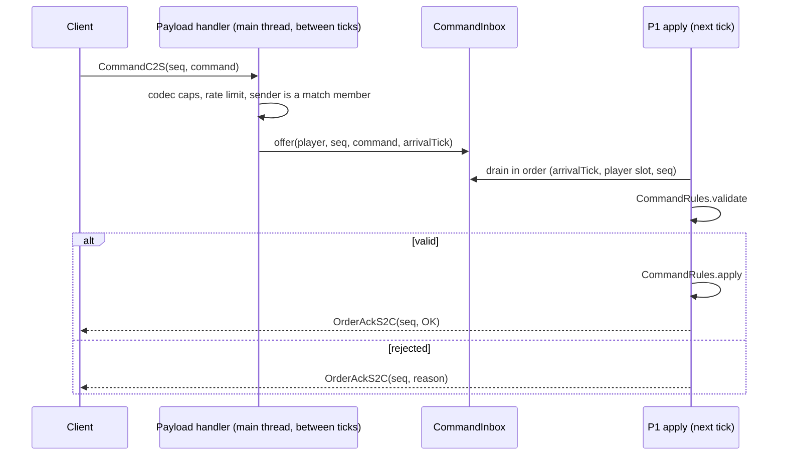
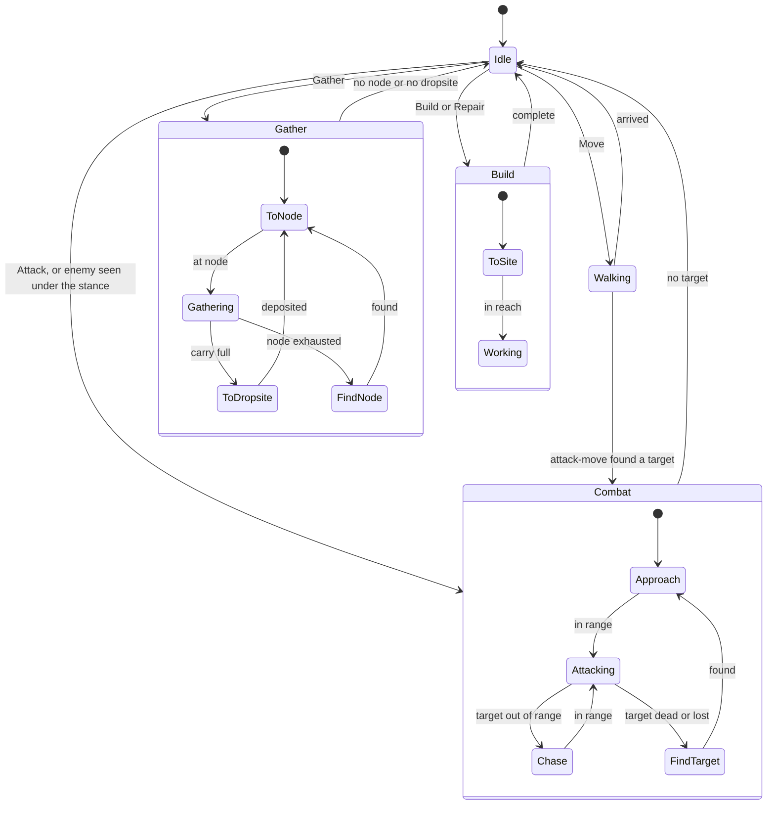
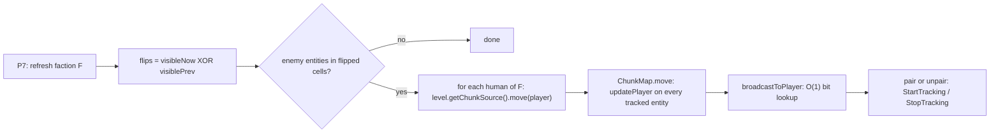
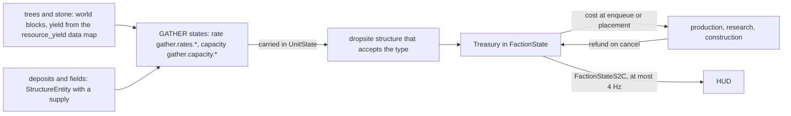
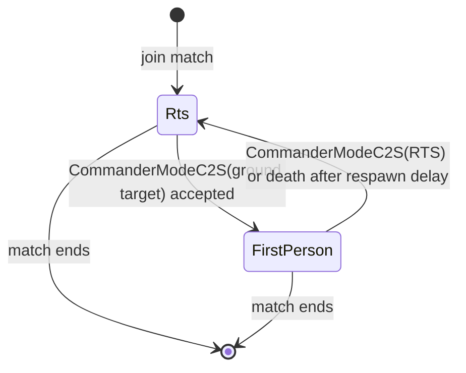

# Proposal B - engine-native pragmatist

*Design round of 2026-10-21. One of several competing architecture proposals; the owner judges.
Target: Minecraft 1.21.1, NeoForge ≥ 21.1.264, the toolchain in [../02-tooling.md](../02-tooling.md).
Evidence: [../research/README.md](../research/README.md) (cited as "README fact N" for its §3 list)
and the reports it indexes. Source paths are relative to the decompiled 1.21.1 + NeoForge 21.1.262
tree (`scratchpad/mc-src-1.21.1/`); every class, method, field and event named here was grepped
there. Numbers marked "estimate" are hypotheses for the spikes in §18.*

## Summary

**Thesis.** Let Minecraft be the engine. A unit is a stripped `PathfinderMob` that owns its state:
vanilla position and physics, vanilla health, vanilla attributes for the stats vanilla consumes,
and Java fields for orders and AI. A match is a bounded region of a level with its own runtime
objects and SavedData. A thin pure-Java `core` holds only what clearly pays off there: stat and
modifier math, template merging, rule formulas, generic order-queue and state-machine frameworks,
pathfinding and steering algorithms, vision grids, and AI planning. Everything that reads or
writes the world lives in `mod` and uses NeoForge idioms.

| Question | Proposal B |
|---|---|
| Who owns a unit | The entity. Faction totals, counters and a roster live in match SavedData |
| Tick model | Units tick in the vanilla entity loop; match systems run in `LevelTickEvent.Pre/Post` in a fixed phase order |
| Stats | Core modifier pipeline is the only writer; vanilla attributes carry the results vanilla needs |
| Content | One reload listener with 0 A.D.-style inheritance; NeoForge data maps for block properties; no custom datapack registries |
| Movement | Layered 2.5D nav grid, A* (then HPA*) on workers, results delivered at t+2; vanilla `GroundPathNavigation` follows our paths; ORCA steering into our `MoveControl`; vanilla `travel`/`move` physics |
| Fog | `broadcastToPlayer` overrides, a vision grid every 10 ticks, forced re-evaluation through the public `ServerChunkCache#move(ServerPlayer)` |
| Camera | The commander's own player is a spectator body that *is* the camera; released mouse; perspective; no camera mixin |
| Engine surface | 2 mixins, 0 access transformers, 2 custom static registries, 1 reload listener, 2 data maps, 20 payload types |

**What this costs, stated plainly.**
1. No bit-exact whole-match replay. Determinism is bit-exact in `core` and "reproducible in
   practice" in the world (§2.5). In-world tests assert outcomes within bounds, not state hashes.
2. Unit behaviour (the UnitAI states) is tested in GameTests (L3, 40–120 s per run), not in
   millisecond core tests. Only the frameworks and formulas under it are L1.
3. A unit's cost includes vanilla physics and NeoForge's per-entity event posts. The design
   ceiling is about 800–1,200 units, not the 1,500–2,000 a kinematic-puppet design might reach.
   Activity LOD (§4.3) and the body seam (§4.4) are the mitigations; spike S1 decides.
4. More code touches Minecraft types, so a 26.x port rewrites more of `mod` than a
   ports-and-adapters design would (§16).
5. The open-world mode needs a unit "parking" mechanism. It is designed here (§3.4), not built.
6. We inherit vanilla quirks and must neutralise each one: invulnerability frames, tracking
   cadence, spectator rules, forced position updates on dirty entity data. Each is listed where
   it is handled.

**Why accept these costs.** Time to a playable slice: no parallel world model, no entity-to-record
synchronisation, no custom replication of positions, no custom physics. Compatibility: units are
real mobs, so potions, explosions, player swords, Jade-style overlays, `/attribute`, `/data` and
other mods' entity hooks work on them unchanged. Least infrastructure: the inventory in §1.4 is
the whole engine surface.

---

## 1. Module and package layout

### 1.1 Gradle projects and source sets

| Project | Plugin | Source sets | Dependencies | Notes |
|---|---|---|---|---|
| `build-logic` | `groovy-gradle-plugin` | `main` | Spotless 8.10.4, `net.ltgt.errorprone` 5.1.1 | Convention plugin `strategos.java-conventions`: toolchain 21, ErrorProne 2.50.0 + NullAway 0.14.2 (JSpecify mode), palantir-java-format 2.102.0, JUnit Platform |
| `core` | `java-library`, `java-test-fixtures` | `main`; `test` (L1); `testFixtures` (sim harness, ASCII maps); `jmh` (L6) | `compileOnly` fastutil 8.5.12, Gson 2.10.1, slf4j-api 2.0.9 — all shipped by Minecraft 1.21.1 | No DFU, no `module-info`, root package `dev.strategos.core` |
| `mod` | `net.neoforged.moddev` 2.0.148 | `main` (common + client, ships); `test` (L2, MDG `unitTest`); `gametest` (L3); `devtools` (L4); `archTest` (L0) | `implementation project(':core')`; `testImplementation testFixtures(project(':core'))`; `net.neoforged:testframework:21.1.264` for `test` and `gametest` | `mods { strategos { sourceSet main; sourceSet core.main; sourceSet gametest; sourceSet devtools } }`; `jar { from core.sourceSets.main.output }` (testing §3.2) |

Core has no serialization framework. Codecs for core records live in one `mod` file
(`persist/CoreCodecs`), round-trip tested at L2. This keeps `core` a library of algorithms and
plain records.

### 1.2 Package tree

```
core  dev.strategos.core
  common/    StatPathId and token interning, Ticks (seconds <-> ticks), Result, Checks
  math/      Vec2d, Rect2i, MatchCoords (match-local cell math), DiscTables, Octile
  random/    MatchRandom (xoroshiro128++ seeded by SplitMix64), RandomStreams, CounterRandom
  grid/      BitGrid, ShortGrid, DenseGrid<T> over match-local cells; SparseTileGrid (open world)
  stat/      StatPath, PathPattern, ModifierOp, Modifier, ClassFilter, ClassTokens,
             ModifierSet, StatPipeline, StatBlock, StatCache
  template/  TemplateResolver (parent/mixin/ops on Gson trees), MergeOps, TemplateFilters,
             TemplateProblem, TemplateReport, CanonicalJson (hash)
  rules/     CombatRules, Ballistics, GatherRules, ConstructionRules, ProductionRules,
             PopulationRules, RepairRules, VictoryRules
  econ/      ResourceId, ResourceBundle, Treasury (ledger), PopulationLedger, ProductionQueue
  order/     OrderQueue<O>, QueueMode, DestinationSpread
  fsm/       HfsmDef<C, M>, State<C, M>, Hfsm (runtime), HfsmSnapshot
  nav/       Surface (packed int), ColumnGrid, ClusterData, NavSnapshot, MobilityClass,
             CostModel, Components, PortalGraph, AStar, HpaPlanner, StringPuller,
             FlowField, FlowFieldCache, PathRequest, PathResult, PathService, DeliveryMode
  steer/     Orca (port of RVO2, Apache-2.0), OrcaAgent, SteeringParams
  vision/    VisionGrid, ExploredMap, VisionStamper, FlipSet
  ai/        AiSnapshot, AiIntent, AiBrain, ScriptedAi, BuildOrder, EconomyAllocator, AttackTimer
  metrics/   PhaseTimer, RollingPercentiles, Counters

core testFixtures  dev.strategos.core.testkit
  AsciiMaps, SnapshotBuilders, NavSim, EconSim, Seeds, StateHash

mod  dev.strategos
  Strategos            @Mod entry; wires DeferredRegisters, configs, event subscribers
  registry/            entity types, attributes, damage type keys, custom registries
                       (command_type, ability_type), data maps, attachments, gamerules, ticket controller
  match/               Match, MatchId, MatchRegion, MatchConfig, MatchLifecycle, MatchClock,
                       MatchTicker (phase pipeline), LevelMatches (level attachment), MatchIndexData,
                       MatchSavedData, FogSavedData, MatchRoster, MatchMember, MatchEvents (internal bus),
                       ArenaSlots; map/ (MapSpec, MapPaster, MapExporter)
  faction/             FactionState, Diplomacy, TechState, FactionModifiers
  unit/                UnitEntity, InfantryEntity, CavalryEntity, SiegeEntity, UnitState, UnitFactory,
                       UnitLod; body/ (UnitBody, PhysicsBody, KinematicBody);
                       move/ (UnitMoveControl, UnitNavigation, MovementSource, StuckLadder);
                       ai/ (UnitAi, state classes, orders, UnitMessage)
  structure/           StructureEntity, StructureState, Blueprint, BlueprintLoader, BuildOrderPlanner,
                       ConstructionSite, BlockPlacementScheduler, DamageVisuals, StructureBlockIndex,
                       PlacementRules, Protection
  economy/             ResourceNodeIndex, NodeScanner, TreeNode, Dropsites, GatherService,
                       ProductionService, PopulationService
  combat/              AttackExecutor, ProjectileScheduler, DamageHooks, StrategosDamageSources, DeathHandler
  stat/                StatService (pipeline facade), AttributeBridge, AuraSystem
  content/             TemplateReloadListener, TemplateSet, TemplateDecoder, TemplateLint,
                       codecs/, UnitTemplate, BuildingTemplate, TechTemplate, CivTemplate, ResourceDef
  nav/                 NavService (per match), ColumnClassifier, BlockChangeHub, PathRequests
  spatial/             MatchUnitIndex, StructureIndex
  vision/              FogService, Reveal
  world/               WorldEdits (the only path for our block writes: authorisation, effects, invalidation)
  command/             Command (sealed), CommandType, CommandRules, CommandInbox, RateLimiter, OrderAck
  net/                 StrategosNetwork (registration), MatchNetwork (single sender), payload/{c2s,s2c}
  ai/                  AiPlayerController, AiSnapshotBuilder, IntentTranslator, PlacementSearch
  commander/           CommanderState (player attachment), CommanderModes, CameraJumps
  persist/             CoreCodecs, Migrations, NbtCodecs, Versioned
  debug/               ServerCommands (/strategos), MatchProfiler, DebugPayloads, JfrEvents
  config/              StrategosConfig (ModConfigSpec server + client)
  compat/              optional integrations behind class-presence checks (Iris)
  mixin/               LevelChunkMixin, ServerPlayerMixin
  client/              StrategosClient; mode/, camera/, input/, pick/, select/, state/,
                       hud/ (view-models, HudLayout, layers), render/, screen/, net/
mod gametest  dev.strategos.gametest   generator, MatchTestKit, JUnitXmlReporter, suites
mod devtools  dev.strategos.devtools   scenario harness (testing §7.2)
mod test      dev.strategos.**         L2 tests next to the code they test
mod archTest  dev.strategos.arch       ArchitectureRules
```

### 1.3 Boundaries and how they are enforced

**What goes into `core`.** Code goes into `core` when it touches no world state and is a formula,
an algorithm over our own data structures, or a generic framework that `mod` instantiates.
Anything that reads or mutates the level, entities, players or packets is `mod`.

| # | Rule | Enforcement |
|---|---|---|
| R1 | `dev.strategos.core..` depends only on the JDK, fastutil, Gson, slf4j, JSpecify | Gradle (no Minecraft on `core`'s classpaths) + ArchUnit |
| R2 | Nothing outside `dev.strategos.client..` references `client..`, `net.minecraft.client..` or `com.mojang.blaze3d..` | ArchUnit + L5 dedicated-server smoke |
| R3 | Only `dev.strategos.net..` calls `PacketDistributor` | ArchUnit |
| R4 | No non-final static fields and no static mutable collections outside `registry..` holders | ArchUnit (prevents RoN's state-carry-over bug, prior-art §3.11) |
| R5 | Gameplay packages never call `Entity#getRandom`, `Level#getRandom`, `Math.random`, `java.util.Random`, `System.currentTimeMillis`, `System.nanoTime` (allowed in `debug..`, `core.metrics..`) | ArchUnit method-call rules |
| R6 | Hot packages (`core.nav..`, `core.steer..`, `core.vision..`, `unit..`, `spatial..`) use no `java.util.stream` | ArchUnit (RoN PR #348 lesson) |
| R7 | Our block writes go through `world.WorldEdits` only | ArchUnit on `Level#setBlock`, `Level#removeBlock`, `Level#destroyBlock` call sites |
| R8 | Mixins only in `dev.strategos.mixin`, exactly the inventory below | L0 test compares `strategos.mixins.json` with the inventory |
| R9 | `main` never depends on `gametest` or `devtools` | compile classpath + ArchUnit |

All packages carry `@NullMarked` (`package-info.java`); NullAway runs in JSpecify mode.

### 1.4 Engine surface inventory

| Kind | Items | Count |
|---|---|---|
| Mixins | `LevelChunkMixin`: RETURN of `LevelChunk#setBlockState(BlockPos, BlockState, boolean)` (`world/level/chunk/LevelChunk.java:239`) → `BlockChangeHub`. `ServerPlayerMixin`: HEAD of `ServerPlayer#broadcastToPlayer` (`server/level/ServerPlayer.java:957`) → hide enemy commanders and fogged first-person players | 2 |
| Access transformers | none: `ServerChunkCache#move(ServerPlayer)` is public (`server/level/ServerChunkCache.java:464`), `StructureTemplate#save` is public (`…/templatesystem/StructureTemplate.java:609`), `Mob`'s control fields are protected (`world/entity/Mob.java:108-112`) | 0 |
| Entity types | `strategos:infantry`, `cavalry`, `siege`, `structure` (`ship` in T2) | 4 |
| New attributes | `strategos:resist_hack`, `resist_pierce`, `resist_crush`, `vision_range`, all syncable | 4 |
| Damage types (datapack) | `strategos:hack`, `pierce`, `crush`, `splash` | 4 |
| Custom static registries | `strategos:command_type`, `strategos:ability_type`, synced (`registries/RegistryBuilder.java:92`) | 2 |
| Data maps on `minecraft:block` | `strategos:resource_yield`, `strategos:nav_class` (`registries/datamaps/DataMapType.java:85-161`) | 2 |
| Reload listeners | `TemplateReloadListener` (units, structures, techs, civs, resources, auras, maps, AI build orders) | 1 server + 1 client (appearances) |
| Attachments | `strategos:level_matches` on `ServerLevel` (transient); `strategos:commander` on players (codec, copy on death, synced to self) | 2 |
| SavedData | `strategos_index` (overworld), `strategos_match_<id>`, `strategos_fog_<id>` (match level) | 3 kinds |
| Ticket controller | `strategos:match`, `ticking=false`, with a `LoadingValidationCallback` | 1 |
| Dimension (datapack JSON) | `strategos:arena`: void flat generator, biome `minecraft:the_void` | 1 |
| Payloads | 7 C2S (2 of them T1, 1 dev-only), 13 S2C (1 dev-only) (§10) | 20 |
| Gamerules | `strategosFogOfWar`, `strategosFriendlyFire`, `strategosFirstPerson` (`world/level/GameRules.java:207`) | 3 |
| Config files | `strategos-server.toml`, `strategos-client.toml` (`ModConfigSpec` + `ConfigurationScreen`) | 2 |
| GUI layers | resource bar, selection panel, command card, minimap, alerts, debug | 6 |

Server events used: `LevelTickEvent.Pre/Post`, `LivingIncomingDamageEvent`, `BlockEvent.BreakEvent`,
`BlockEvent.EntityPlaceEvent`, `BlockEvent.FluidPlaceBlockEvent`, `ExplosionEvent.Detonate`,
`PistonEvent.Pre`, `EntityMobGriefingEvent`, `LivingDestroyBlockEvent`,
`PlayLevelSoundEvent.AtEntity/AtPosition`, `OnDatapackSyncEvent`, `AddReloadListenerEvent`,
`DataMapsUpdatedEvent`, `RegisterCommandsEvent`, `RegisterPayloadHandlersEvent`,
`RegisterTicketControllersEvent`, `RegisterDataMapTypesEvent`, `EntityAttributeCreationEvent`,
`LevelEvent.Load`, `PlayerEvent.PlayerLoggedInEvent/LoggedOutEvent`, `RegisterGameTestsEvent`
(gametest source set). Client events: `ClientTickEvent.Pre/Post`, `InputEvent.MouseButton.Pre`,
`InputEvent.MouseScrollingEvent`, `MovementInputUpdateEvent`, `RenderLevelStageEvent`,
`RegisterGuiLayersEvent`, `RenderGuiLayerEvent.Pre`, `RegisterKeyMappingsEvent`,
`ViewportEvent.ComputeFov`, `ScreenEvent.Closing`, `EntityRenderersEvent`,
`ClientPlayerChangeGameTypeEvent`, `RegisterClientReloadListenersEvent`.

---

## 2. Simulation model

### 2.1 What a match is in world terms

A `Match` is a server object owned by the `strategos:level_matches` attachment of the level it
plays in. Level attachments can be built from the holder and need no serializer
(`attachment/AttachmentType.java:95-109`), so the runtime dies with its `ServerLevel` and nothing
static survives a world switch.

| Part | Content |
|---|---|
| Identity | `MatchId` (int, allocated by `strategos_index` on the overworld), level key |
| `MatchRegion` | Block-aligned box: min X/Z, size X/Z, min/max Y. Arena regions are chunk-aligned; GameTest regions are `GameTestHelper#getBounds()` (`gametest/framework/GameTestHelper.java:916`) and need not be |
| `MatchConfig` | Map id, factions (civ, human UUID or AI profile, team), population cap (default 200), starting resources, victory conditions, fog on/off, region mode (`ARENA_SLOT`, `EXTERNAL`, later `WORLD`), ticket policy (`TICKETS` or `NONE` for GameTests), path delivery mode (`STANDARD` or `STRICT`) |
| Runtime, one per match | `MatchClock`, `MatchRandom`, `MatchRoster`, `CommandInbox`, `NavService`, `MatchUnitIndex`, `StructureIndex`, `ResourceNodeIndex`, `FogService`, `StatService`, `ProjectileScheduler`, `AiPlayerController`s, `MatchNetwork`, `MatchProfiler`, `MatchEvents` |
| Shared per level | `BlockPlacementScheduler` (fair share across matches), `BlockChangeHub` (routes block changes to matches by chunk) |
| Persistence | `strategos_match_<id>` and `strategos_fog_<id>` in the match level's data storage. Names stay flat because `DimensionDataStorage#getDataFile` is `new File(dataFolder, name + ".dat")` (`world/level/storage/DimensionDataStorage.java:39-40`) |

**Which level.** Production matches run in the datapack dimension `strategos:arena`
(`data/strategos/dimension/arena.json` + `dimension_type/arena.json`): a flat generator with no
layers and the `minecraft:the_void` biome. Every world with the mod has it, the player's overworld
stays untouched, void chunks cost nothing to generate, and the empty biome spawn list plus
`ticking=false` tickets keep vanilla mobs out (README fact 9). The vanilla world border cannot
bound matches (README fact 10), so the region is ours.

**Slots.** Arena slot *k* starts at chunk X = 128·*k*, Z = 0. Slots are 2,048 blocks apart, beyond
the 512-block maximum tracking reach (32 chunks of view distance); `broadcastToPlayer` also
returns false across matches, so isolation does not rely on distance.

**Several matches per level.** `LevelMatches` holds `Int2ObjectMap<Match>` and a
`Long2ObjectMap<Match[]>` from chunk to the matches overlapping it (normally one; GameTest
regions are not chunk-aligned). Block-to-match resolution checks region containment. GameTests
create one match per test inside the shared GameTest level. Tests in a batch run concurrently at
a random origin up to ±15 M blocks (README fact 26), so all simulation grids use match-local
integer cells (`MatchCoords`); only entity positions are absolute doubles.

**Sizes.** v1 maps: 256×256 (1v1, 256 chunks) and 384×384 (2–4 players, 576 chunks); 512×512
(1,024 chunks) only if spike S2 passes. Y range ≤ 128 blocks per map.

### 2.2 Lifecycle



| Step | What happens | Cost |
|---|---|---|
| Create | Validate config against the `TemplateSet` and `MapSpec`; allocate id and slot in `strategos_index`; write `MatchSavedData` | < 1 ms |
| Prepare: tickets | `TicketController.forceChunk(level, matchUuid, x, z, true, false)` for every region chunk (`common/world/chunk/TicketController.java:47-67`). `ticking=false` already makes forced chunks entity-ticking; `true` would add random ticks and natural spawning (README fact 9) | 256–1,024 tickets |
| Prepare: paste | `MapPaster` places the map tiles with `StructureTemplate#placeInWorld`, flags 2\|16, 8,192 blocks per tick (count budget) | 256²: 2–3 M blocks, 5–15 s (estimate, S8) |
| Prepare: settle | Wait until `LevelLightEngine#hasLightWork()` is false (`world/level/lighting/LevelLightEngine.java:38`) | seconds (S8) |
| Prepare: nav | Classify every block column on the main thread (16,384 per tick while preparing, 64 chunks' worth), then build clusters on workers | 256²: about 1 s (estimate, S7) |
| Prepare: scan | `NodeScanner` finds trees and stone outcrops through the `strategos:resource_yield` data map, skipping sections whose palette has no candidate state | < 1 s |
| Prepare: spawn | Player starts from `MapSpec` (completed structures, units, deposits) through `UnitFactory` and `StructureFactory` | – |
| Ready → Running | Humans are teleported in as commanders (spectator, §11.1); 5 s countdown; clock starts at 0 | – |
| End | Victory check every 20 ticks (conquest: a faction has no units and no structure with class `ConquestCritical`); stats screen; AI off; orders cleared | – |
| Reset | Discard every roster entity, release tickets, delete the match's SavedData, retire the slot. New matches always take a fresh slot, so no reset ever wipes terrain in a loaded area; retired slots' region files are deleted at the next server start, before the arena level loads | – |
| Save | Vanilla autosave every 6,000 ticks and on stop: entities with their chunks, our SavedData when dirty; serialisation on the main thread, file write on NeoForge's IO worker (README fact 24) | – |
| Resume | `LevelEvent.Load` of the arena level reads `strategos_index`; NeoForge restores tickets from `ForcedChunksSavedData`, our `LoadingValidationCallback#validateTickets` (`…/chunk/LoadingValidationCallback.java:18`) drops tickets of dead matches; entities rejoin through `onAddedToLevel`; the roster count is checked; nav and vision are rebuilt; path requests are not saved (units re-request on their first think) | seconds |

**How maps ship.** A map is `data/<ns>/strategos/maps/<id>.json` (`MapSpec`: size, Y range, tile
grid, player slots with start entities, deposits, AI hints such as expansion spots, default
victory conditions) plus tiles in the vanilla structure format at
`data/<ns>/structure/strategos/maps/<id>/t_<x>_<z>.nbt`, 32×32 columns each. Tiles are made by
`/strategos map export <id> <from> <to>`, which uses `StructureTemplate#fillFromWorld` directly:
the 48-block cap belongs to the structure block (`StructureBlockEntity.MAX_SIZE_PER_AXIS`), not to
the template (`StructureTemplate.java:83`). Tiles skip air, and a `baseFill` rule in `MapSpec`
fills each column below the lowest stored block, which keeps files small. Datapacks can add or
override maps. If S8 shows tiles too slow or too large, the fallback is copying region files into
a fresh slot with chunk coordinates rewritten.

### 2.3 Tick pipeline



Facts this order rests on: `MinecraftServer#tickChildren` posts `LevelTickEvent.Pre` and `.Post`
around `ServerLevel#tick` for each level and ticks connections and `GameTestTicker` after all
levels (`server/MinecraftServer.java:1033-1090`), so GameTest assertions see the post-phase
state. The tracker runs inside the chunk-source tick, before the entity loop, and so ships the
previous tick's state (engine §1.1). Payloads are handled as server tasks between ticks, so the
inbox decouples arrival time from application time. The entity loop calls `setOldPosAndRot`,
increments `tickCount` and posts `EntityTickEvent.Pre/Post` around every `Entity#tick`
(`server/level/ServerLevel.java:769-779`).

| Phase | Hook | Cadence | Control budget (counts) | Monitored ms, p50 / p99 |
|---|---|---|---|---|
| P0 clock | Pre | 1 | – | – |
| P1 commands | Pre | 1 | ≤ 64 commands per tick per match; the rest wait | 0.1 / 0.5 |
| P2 path delivery | Pre | 1 | all results due at t | 0.1 / 0.4 |
| Units | entity loop | 1 | LOD cadences (§4.3) | 8 / 12 at 800 units |
| Structures | entity loop | 1 (producing, building), 20 (otherwise) | – | 0.2 / 0.5 |
| P4 projectiles | Post | 1 | all impacts due | 0.1 / 0.5 |
| P5 placement | Post | 1 | 64 block placements per tick per level | 0.4 / 1.2 |
| P6 economy | Post | 1; victory every 20 | – | 0.05 / 0.2 |
| P7 vision | Post | each faction every 10, staggered | at most one faction refresh per tick | 0.3 / 0.8 |
| P8 stats | Post | 10, staggered; on change | ≤ 64 aura sources per tick | 0.1 / 0.5 |
| P9 paths and nav | Post | 1 | ≤ 256 requests dispatched; ≤ 1,024 dirty block columns reclassified per tick | 0.9 / 1.5 |
| P10 AI | Post | each AI every 20, staggered | ≤ 32 commands per think | 0.3 / 2.0 |
| P11 replication | Post | 2–4 Hz per player | – | 0.3 / 0.8 |
| P12 metrics | Post | 1 | – | 0.02 |

### 2.4 Scheduling slow systems

- **Stagger by match-local serial.** Every unit gets a serial from its match at creation; cadence
  offsets use `serial % interval`. `Entity#getId()` comes from a global counter
  (`world/entity/Entity.java:135-154`) and differs between runs.
- **Factions and AI players** stagger by index: faction *f* refreshes vision when
  `(clock + f·10/F) % 10 == 0`; AI *p* thinks when `(clock + p·20/P) % 20 == 0`.
- **Budgets that change outcomes are counts, not milliseconds.** A wall-clock budget would make
  game state depend on CPU speed and break §2.5's D2 tier. Counts are calibrated so their time
  stays under the monitored figures on the M4 Pro; `MatchProfiler` warns when a phase exceeds its
  p99 for three consecutive seconds.
- **Overload policy** (STANDARD mode only, off in STRICT): while MSPT p95 stays above 45 ms, AI
  and replication cadences double. Unit, command and projectile phases never stretch.
- **Per-state cadences** inside UnitAI (MineColonies' per-transition tick rates, prior-art §4)
  are declared next to each state (§5.4).

### 2.5 Time, RNG and the scope of determinism

**Time.** `MatchClock.tick` (a long) advances only while the match runs. Template durations are
seconds, converted once to ticks at decode time (`Ticks.ofSeconds`, round half up). Vanilla
`/tick rate|freeze|step|sprint` scales or stops everything, and the integrated server's pause
stops it in singleplayer. A match pause (multiplayer) stops P1–P12, and our entities skip their
work in `tick()` after vanilla's bookkeeping. No game logic reads the wall clock (R5).

**RNG.** `MatchRandom` (core): xoroshiro128++ seeded by SplitMix64 from the match seed, with named
streams (`COMBAT`, `MAP`, `LOOT`, `AI_<p>`) derived by hashing (seed, stream id), so a new draw in
one system never shifts another. Per-unit decisions use `CounterRandom.of(seed, serial, purpose,
counter)`, a stateless hash that is stable under any iteration order. Stream states and counters
are persisted. Vanilla's per-entity `RandomSource` is seeded from a unique time-based seed
(`Entity.java:194`, `util/RandomSource.java:21-23`); it stays for cosmetics (step and hurt sound
pitch) and is banned in gameplay code (R5).

| Tier | Scope | Guarantee | Tested by |
|---|---|---|---|
| D1 bit-exact | All of `core`: formulas, pipeline, template merge, A*/HPA*/flow fields on a snapshot, ORCA step, vision stamping, AI brain on a snapshot, `NavSim` and `EconSim` runs | Same inputs and seed ⇒ same outputs and state hash | L1 seeded runs (200 seeds) with replay hashes |
| D2 reproducible in practice | In-world match logic: command order, path delivery in STRICT mode, staggering, match RNG, spawn order, vanilla physics | Same build, map, seed and command script ⇒ same outcome in almost every run | L3 GameTests over 3–5 seeds, asserting outcome bounds |
| D3 not deterministic | Vanilla entity RNG (cosmetic only), worker timing (neutralised by fixed-tick delivery), packet arrival (neutralised by the inbox), GameTest origin (neutralised by match-local cells), tick-order changes from Lithium or Moonrise | none | – |

Determinism stops at vanilla physics: `Entity#move` is deterministic Java, but its inputs include
the entity iteration order and any other mod's entities in the region. Replays (T3) would replay a
command log on a server at D2, or be dropped.

---

## 3. Authority and state

### 3.1 Who owns what

| State | Authoritative owner | Persistence | Replication |
|---|---|---|---|
| Unit position, rotation, velocity, on-ground | The entity, via vanilla `travel`/`move` | Vanilla entity NBT in its chunk | Vanilla tracking, velocity updates off |
| Unit HP | Vanilla health; max from `MAX_HEALTH` | Vanilla NBT | Vanilla health data to trackers |
| Orders, AI state, carried resources, stance, rank, cooldowns, serial, template id, faction | `UnitEntity` fields (`UnitState` + runtime) | `UnitState.CODEC` in entity NBT under `strategos`, with `v` | `SynchedEntityData`: template id, faction, activity, carried bucket; details on demand |
| Unit stats | Computed by `StatService` (core pipeline) | not persisted | Syncable attributes (§6.2) |
| Structure state: template, faction, footprint, rotation, progress, abstract HP, queue, rally, supply, damage stage | `StructureEntity` fields | `StructureState.CODEC` in entity NBT | `SynchedEntityData` (template, faction, state, HP and progress buckets); queue to owner |
| Structure blocks | World blocks | Chunks | Vanilla block updates |
| `StructureBlockIndex` | Derived from structures (blueprint × rotation × progress × damage stage) | not persisted | – |
| Faction: treasury, population counters, techs, modifiers, diplomacy, statistics | `FactionState` in `MatchSavedData` | `strategos_match_<id>` | `FactionStateS2C` to members |
| Explored map | `FogService` | `strategos_fog_<id>` | Fog deltas to members |
| Match: config, lifecycle, clock, RNG, roster, slot | `Match` + `MatchSavedData` | `strategos_match_<id>`, `strategos_index` | `MatchJoinS2C`, `MatchStateS2C` |
| Trees and stone | World blocks | Chunks | Blocks |
| Node index, nav grid, unit index, current vision | Derived runtime | Rebuilt on resume | Debug only |
| Commander: membership, mode, camera pose, return position, first-person kit | `strategos:commander` player attachment | Attachment codec | Attachment sync to self (needs 21.1.264, README fact 17) |
| Selection, control groups, camera smoothing | Client | – | – |

**One writer per field.** Vanilla writes position, velocity, health and vanilla attribute
modifiers. Our code writes everything else. The core writes nothing; it computes.



### 3.2 Persistence: SavedData split, codecs, versioning, migrations

- **Entities.** `addAdditionalSaveData` stores `UnitState` (or `StructureState`) encoded with
  `NbtOps.INSTANCE` under key `strategos`. `readAdditionalSaveData` runs `Migrations.unit(tag)`
  first, then decodes. A decode failure flags the entity `corrupt`, freezes it and reports it in
  `/strategos match check`; it is never dropped silently.
- **SavedData** through `new SavedData.Factory<>(ctor, load, null)` and
  `DimensionDataStorage#computeIfAbsent` (README fact 24):

  | Blob | Level | Content | Typical size |
  |---|---|---|---|
  | `strategos_index` | overworld | next ids, slot table, match → level, state | < 1 KB |
  | `strategos_match_<id>` | match level | config, lifecycle, clock, RNG streams, factions (treasury, population, techs, modifiers, diplomacy, statistics), roster (UUID → serial, template, faction, kind, alive), AI brain states | 10–100 KB |
  | `strategos_fog_<id>` | match level | explored bitsets per faction, run-length encoded | 1–8 KB |

- **Dirty discipline.** `setDirty()` only on change. Serialisation happens at autosave and on stop.
- **Versions.** Every blob root and every entity `strategos` compound carries `"v"`. `Migrations`
  holds ordered `Migration(from, to, UnaryOperator<CompoundTag>)` steps per blob kind, run on raw
  NBT before codec decoding. Vanilla DataFixers are not used (`DataFixTypes` null).
- **Fixtures.** Each released version adds `mod/src/test/resources/fixtures/<kind>_v<N>.nbt`; L2
  migrates and decodes them all, and a GameTest loads an entity fixture into a level.
- Every format is a `Codec`, so the 1.21.5 (`SavedDataType`), 1.21.6 (`ValueInput`/`ValueOutput`)
  and 26.1 (`SavedDataStorage`) changes stay inside `persist/NbtCodecs` (engine §7).

### 3.3 Entity materialisation

- **Arena (v1).** The whole region is force-loaded for the match's lifetime, so match entities
  never unload and there is no materialisation layer. That is the central simplification of this
  proposal.
- **Creation** goes only through `UnitFactory` and `StructureFactory` (production, map start,
  tests, `/strategos spawn`): they assign the serial, write the roster entry and apply stats before
  `level.addFreshEntity`. `noSummon()` makes vanilla `/summon` refuse our types
  (`commands/arguments/ResourceArgument.java:86`), so no unowned unit can appear.
- **Registration.** `onAddedToLevel()` registers the entity in `MatchUnitIndex` or
  `StructureIndex`; `onRemovedFromLevel()` unregisters it (NeoForge hooks, `Entity.java:3739/3742`).
  The removal reason decides the counters: `KILLED`/`DISCARDED` mark the roster entry dead and
  update population; `UNLOADED_TO_CHUNK` (impossible in the arena) marks it unloaded and leaves
  counters unchanged.
- **Garrison (T1)** is the first dematerialisation: the unit is saved with `Entity#saveWithoutId`
  into the structure's state and discarded; ungarrisoning recreates it with
  `EntityType.loadEntityRecursive`. The open world reuses exactly this.

### 3.4 Staying open to an open-world mode

1. **Region mode `WORLD`**: a rectangle in any level. Nothing assumes the arena dimension.
2. **Aggregates are counters, never scans of loaded entities**: population, housing, unit counts
   per template for limits, dropsite lists by structure id. They stay correct when chunks unload.
3. **References are `EntityRef(UUID, transient int id)`**, resolved through
   `ServerLevel#getEntity(UUID)` (`server/level/ServerLevel.java:1326`); absence is a normal case
   (the order waits or fails).
4. **Parking** (not built in v1): when a unit on a long order would enter unloaded terrain, or its
   chunk is about to unload, `ParkingService` saves it into the roster as vanilla NBT and advances
   it along the abstract path at its speed (MineColonies' `TravellingManager` idea, prior-art §4).
   It is recreated when the destination chunk is entity-ticking. Needs the abstract nav graph
   persisted per region.
5. **Follow-tickets** for a capped number of active groups: a custom `TicketType` with a
   lifespan, plus one `TicketController` ticket so an empty level keeps ticking (engine §3.2).
6. **Sparse grids**: `VisionGrid`, `TerritoryGrid` and nav cluster storage are interfaces with a
   dense arena implementation and a `SparseTileGrid` world implementation.
7. **Hooks route by `LevelMatches`**, so protection and nav invalidation already work in any level.

v1 builds items 1–3 and 7, and the interfaces of item 6.

---

## 4. Units

### 4.1 Entity classes

```
UnitEntity extends PathfinderMob implements MatchEntity      abstract; all behaviour
  InfantryEntity   strategos:infantry   sized(0.6, 1.8)   clientTrackingRange 10   updateInterval 3
  CavalryEntity    strategos:cavalry    sized(1.4, 2.2)   clientTrackingRange 10   updateInterval 3
  SiegeEntity      strategos:siege      sized(2.4, 2.4)   clientTrackingRange 12   updateInterval 4
StructureEntity extends Entity implements MatchEntity        strategos:structure; AABB from the
                                                             footprint (Entity#makeBoundingBox is
                                                             protected, Entity.java:408); range 16,
                                                             interval 20
```

All types use `setShouldReceiveVelocityUpdates(false)` and `noSummon()`. The three unit
subclasses exist only because an `EntityType`, its renderer and its dimensions are fixed at
startup (README fact 23); they add no behaviour. Three classes carry any number of data-defined
units, which avoids RoN's one-mob-subclass-per-unit anti-pattern (README §5).

`PathfinderMob` is the base because it keeps held-item and armour rendering, compatibility with
mods that act on `Mob`, and the vanilla navigation that §4.5 reuses as a path follower (engine
§1.3). S1 measures it against a `LivingEntity` base and the kinematic body.
`UnitEntity.createAttributes()` starts from `Mob.createMobAttributes()` (`Mob.java:159`), which
already carries `MAX_HEALTH`, `MOVEMENT_SPEED`, `KNOCKBACK_RESISTANCE`, `STEP_HEIGHT` and `SCALE`
from `LivingEntity.createLivingAttributes()` (`LivingEntity.java:321`), raises the `STEP_HEIGHT`
base from 0.6 to 1.0, and adds our four attributes; it is registered in
`EntityAttributeCreationEvent`.

### 4.2 What is switched off

| Vanilla behaviour | Override | Evidence |
|---|---|---|
| Despawn, and the per-tick `MobDespawnEvent` | `setPersistenceRequired()`, `removeWhenFarAway` false, `checkDespawn()` no-op | Runs every tick before the range gate (engine §1.1) |
| Goals, brain | Empty `registerGoals`; the default brain is never ticked | engine §1.4 |
| Pushing and cramming | `isPushable` false; `pushEntities()` no-op | O(n²) in clumps; cramming damage from 24 neighbours (README fact 3) |
| Step vibrations | `getMovementEmission()` returns `NONE` | `SOUNDS` still emits `GameEvent.STEP` (engine §1.4) |
| Loot pickup, drops | `canPickUpLoot` false; `shouldDropLoot()` false; `dropCustomDeathLoot` no-op, because it drops equipment by drop chance (`Mob.java:979`) | Economy is abstract |
| Vanilla path search | `UnitNavigation#createPath(...)` returns null; `shouldRecomputePath` returns false; `recomputePath` no-op | 0.1–0.5 ms per search; `sendBlockUpdated` recompute storms (`ServerLevel.java:1080-1110`) |
| Leash, riding, portals | `canBeLeashed` false; `startRiding(Entity, boolean)` false; `canChangeDimensions` false | Match integrity |
| Name rendering | `shouldShowName` false | The HUD shows names |
| Velocity packets | `setShouldReceiveVelocityUpdates(false)` | About 12 B per update (README fact 14) |
| Invulnerability frames against entity damage | `LivingIncomingDamageEvent#setInvulnerabilityTicks(0)` (§4.6) | Focus fire silently loses damage (`LivingEntity.java:1189-1205`) |
| Global entity id for staggering | Match serial | `Entity.java:135-154` |

### 4.3 LOD tiers, chosen by activity

| Tier | Entered when | Think every | Physics | Target scan every | Wakes on |
|---|---|---|---|---|---|
| A0 combat | In a combat state, or damaged within 60 ticks | 2 ticks | every tick | 10 | – |
| A1 moving | Following a path, flow field or slot | 4 | every tick | 10 (attack-move, aggressive stance) | – |
| A2 working | Gathering, building or repairing in place | 10 | skipped while grounded and still | 20 | damage, new order, block change in its cell, non-zero velocity |
| A3 resting | Idle, standing ground with no enemy, holding | 20 | skipped | 10 (aggressive, defensive) | as A2, plus an effect, fire or fluid |
| A4 parked | Open world only: in the roster as NBT | – | – | – | destination chunk entity-ticking |

In A2 and A3 `UnitEntity#tick()` runs a rest tick instead of `super.tick()`: it decrements
`hurtTime` and `invulnerableTime` (only `LivingEntity#baseTick` does that, engine §1.4), refreshes
wake flags from cheap getters (`isInWater`, `isOnFire`, active effects, delta movement) and runs
UnitAI on its cadence. Vanilla still does `setOldPosAndRot`, `tickCount++` and the
`EntityTickEvent` posts around it. Estimate: 60–80 % of a stripped mob's tick saved for the
roughly half of all units that gather or idle in a typical match (S1 measures).

LOD follows activity, not observation. Skipping work where no camera looks would make the
simulation depend on where players look, break the D2 tier and hide bugs from the watcher. The
client interpolates every unit the same way whatever the server tier.

### 4.4 The body seam

```java
public sealed interface UnitBody permits PhysicsBody, KinematicBody {
    void step(UnitEntity unit, MoveIntent intent);   // called from UnitMoveControl#tick
    boolean grounded(UnitEntity unit);
}
public record MoveIntent(double vx, double vz, float yaw, boolean jump) {}
```

- **`PhysicsBody`** (default) writes `zza`/`xxa`, yaw and speed, and vanilla `travel` → `move`
  does the rest: collisions, step-up through `STEP_HEIGHT` 1.0 (README fact 5), slabs, stairs,
  snow layers, fluids, knockback, falling.
- **`KinematicBody`** sets `noPhysics` and no gravity and moves the unit along the path polyline,
  sampling floor heights from the nav snapshot. It drops back to physics on knockback, combat,
  water, doors or a narrow segment.

Uses of the seam: S1's comparison; a cheaper long-march mode on open terrain if physics proves too
expensive; isolation of physics fidelity bugs. Nothing outside `UnitMoveControl` knows which body
runs. Cost: the movement GameTest suite runs both bodies.

### 4.5 Movement control

Inside `Mob#serverAiStep` (`world/entity/Mob.java:773-812`) the order is fixed:
`navigation.tick()`, then `customServerAiStep()`, then `moveControl.tick()`. Strategos uses it so:

1. `UnitNavigation extends GroundPathNavigation` follows paths we install with
   `moveTo(Path, speed)` (`ai/navigation/PathNavigation.java:203`); vanilla `followThePath` sets
   the wanted position and `doStuckDetection` (`:310`) feeds the stuck ladder. Our paths are
   converted to vanilla `Path` objects (`new Path(List<Node>, BlockPos, boolean)`,
   `level/pathfinder/Path.java:22`) of string-pulled waypoints.
2. `customServerAiStep()` runs UnitAI on its cadence and selects a `MovementSource`:
   path-follow, flow-field, formation slot or direct steering for short open approaches.
3. `UnitMoveControl extends MoveControl` overrides `tick()`: preferred velocity from the source,
   ORCA adjustment against at most 10 neighbours within 2.5 blocks from `MatchUnitIndex` (§7.5),
   turn rate ≤ 45° per tick, speed from the `MOVEMENT_SPEED` attribute (so Slowness and Speed
   potions apply), then `MoveIntent` to the body. In deep water it sets jumping to stay afloat.
4. Arrival: settle radius 1.5 blocks in groups (RoN), 0.5 alone, with an "arrived" latch against
   jitter.

**Stuck ladder** (MineColonies, prior-art §4): no progress for 40 ticks or vanilla stuck detection
→ (1) re-request the path; (2) step to a free adjacent surface chosen with `CounterRandom`;
(3) request again ignoring units and accepting a partial path; (4) after 600 ticks, teleport at
most 4 blocks along the path to a free surface, counted and logged; (5) fail the order, idle and
notify the owner.

### 4.6 Combat hooks and the damage pipeline

1. **Timing.** `AttackExecutor`, driven by the UnitAI attack state, reads prepare and repeat times
   (`attacks.<slot>.prepare`, `.repeat`, in ticks), checks edge-to-edge range between AABBs and
   facing.
2. **Damage.** Core `CombatRules.damage(profile, resist, classes)` = Σ over hack, pierce, crush of
   damage × 0.9^resist, times the class bonuses that match (mechanics §1.8, re-derived).
3. **Melee** applies it at once with `target.hurt(sources.of(type, attacker), amount)` for living
   targets, or `StructureEntity#applyDamage(amount, attacker)` for structures (abstract HP, §9.8).
   `swing(MAIN_HAND)` gives the arm animation through vanilla's animate packet, which only
   trackers receive.
4. **Ranged attacks are analytic, not arrow entities.** `ProjectileScheduler.launch` computes the
   flight time, aims at the target's position extrapolated by its last velocity, adds Gaussian
   spread σ = spread × distance / 100 (mechanics §1.9) from `CounterRandom`, and queues the impact
   ordered by (tick, launch id). P4 resolves it: the intended target if its AABB inflated by 0.3
   contains the landing point, otherwise the nearest unit within 0.6 blocks, otherwise a miss.
   Splash (T1) uses `MatchUnitIndex` with falloff 1 − d²/r². Clients get a fog-filtered
   `EffectS2C` and draw a client-only arrow. This is the one place where the engine-native default
   loses: a hundred archers would keep 150–200 arrow entities alive, each ticking and tracked, with
   physics-dependent hits (mechanics §1.9 makes the same call).
5. **`DamageHooks`** listens to `LivingIncomingDamageEvent`, which fires before the
   invulnerability check (`LivingEntity.java:1153`). For a `UnitEntity` target: entity-caused
   damage gets `setInvulnerabilityTicks(0)` (`event/entity/living/LivingIncomingDamageEvent.java:84`),
   while environmental damage (fire, lava, cactus) keeps vanilla frames; damage from vanilla
   attackers is converted with `CombatRules.convertVanilla` (class from damage type tags:
   `is_projectile` → pierce, `is_explosion` → crush, otherwise hack; then the target's
   resistances); friendly fire is cancelled unless `strategosFriendlyFire` is on.
6. **Damage types** `data/strategos/damage_type/{hack,pierce,crush,splash}.json` are tagged
   `minecraft:bypasses_armor` (our formula already applied resistances) and
   `minecraft:no_knockback` (melee knockback scatters formations; charges use a separate source
   with knockback). Both tags exist in 1.21.1 (`tags/DamageTypeTags.java`).
7. **Death.** `die` posts `UnitDied` on `MatchEvents` (roster, population, conquest check, XP in
   T1); the vanilla 20-tick death animation stays.

### 4.7 Vanilla interactions kept

| Interaction | Kept | Notes |
|---|---|---|
| A first-person player's melee and bow against units | yes | Converted damage |
| Vanilla projectiles, explosions, splash potions, beacons | yes | Units are real mobs; attributes make effects work for free |
| Knockback | yes | Scaled by `KNOCKBACK_RESISTANCE` per template (default 0.6) |
| Swimming, water slowdown | yes | Nav costs keep units out of deep water |
| Falling and fall damage | yes | Nav allows drops of up to 3 blocks |
| Fire, lava, suffocation, drowning | yes | Nav hazard class; resting units wake |
| Pushing, cramming | no | ORCA |
| Despawn, loot pickup, leash, riding, portals | no | |

---

## 5. Orders and commands

A **command** is a player's (or AI's) intent; an **order** is one entry in one unit's queue. One
command usually fans out into many orders.

### 5.1 Command objects and their registry

```java
public sealed interface Command permits MoveCommand, AttackCommand, AttackMoveCommand,
        GatherCommand, BuildCommand, PlaceStructureCommand, RepairCommand, StopCommand,
        StanceCommand, TrainCommand, CancelProductionCommand, ResearchCommand, SetRallyCommand,
        AbilityCommand, DeleteCommand, GarrisonCommand, UngarrisonCommand, ResignCommand {
    CommandType<?> type();
}

public record CommandType<C extends Command>(
        StreamCodec<RegistryFriendlyByteBuf, C> codec, CommandRules<C> rules) {}

public interface CommandRules<C extends Command> {
    Verdict validate(CommandContext ctx, C command);   // pure checks against current state
    void apply(CommandContext ctx, C command);        // writes orders, queues, treasury
}
```

Every type is an entry in the synced `strategos:command_type` registry
(`DeferredRegister.makeRegistry(b -> b.sync(true))`). The payload codec dispatches on it with
`ByteBufCodecs.registry(...)` and `StreamCodec#dispatch` (`network/codec/ByteBufCodecs.java:485`,
`StreamCodec.java:91`). Commands name units by vanilla entity id (a VarInt the client knows), which
the server resolves with `ServerLevel#getEntity(int)` and checks. The AI builds the same records
without the network. A registry instead of an enum keeps addon commands possible and avoids RoN's
138-value action enum (prior-art §3.3).

### 5.2 Validation from client to server



Checks at apply time: the sender controls the faction (observers control nothing); every unit
exists, is alive, belongs to that faction and this match; the target exists and is visible to the
faction, or is a structure it has seen; positions lie inside the region; templates and techs are
available (requirements and `TOKENS` modifiers); the cost is affordable and deducted
atomically; placements pass `PlacementRules`. Sequence numbers are monotonic per player and
duplicates are dropped. Validation runs at apply time, not arrival time, because the state may
change in between.

### 5.3 Order-queue semantics

Core `OrderQueue<O>`, at most 32 queued orders per unit:

| Mode | Trigger | Effect |
|---|---|---|
| `REPLACE` | default | Drop queued orders, interrupt the current one (its `exit` hooks run), start the new one |
| `QUEUE` | Shift | Append; start at once if idle |
| `PUSH_FRONT` | system interrupts: flee, return cargo before a new gather | Insert before the current order, which resumes afterwards from its memento |
| `FINISH` | the current order completes | Start the next order, or go idle; post `OrderFinished` (rally chains) |

Group fan-out: a `MoveCommand` with N units gets destination slots from core `DestinationSpread`
(box spread around the target, spacing from body radii, assignment by angle and distance), so
groups don't line up (mechanics §1.11). Each unit gets `MoveOrder(slot, groupId)`; the group id
lets `NavService` share the abstract path or a flow field. Order records (`unit/ai`): `Move`,
`AttackMove`, `Attack(EntityRef)`, `Gather(NodeRef)`, `ReturnCargo`, `Build(EntityRef)`,
`Repair(EntityRef)`, `Garrison`, `Patrol` and `Guard` (T1), `Flee` (internal), `Ability(id,
target)`.

### 5.4 The UnitAI hierarchical state machine

The framework is core `Hfsm<C, M>`: states form a tree declared once per machine; each state has
`enter`, `exit`, `tick` (on its own cadence) and `handle(message)`, which bubbles to the parent
when unhandled. Transitions requested through `ctx.go(state)` run after the handler returns, never
re-entrantly. A snapshot is the active leaf path plus small memento records per state. L1 tests
cover transition order, enter/exit pairing, bubbling, resumption after `PUSH_FRONT` and snapshot
round trips.

The states live in `mod`, written against `UnitEntity` and Minecraft types:



A `FormationMember` top state (T1) sits beside this one, as in 0 A.D. (mechanics §2.4). Stances
(aggressive, defensive, stand ground, passive) are parameters read by `Idle` and `Combat`: scan
radius and chase limits follow mechanics §1.10; passive units flee through `PUSH_FRONT`.
Messages (`UnitMessage`, sealed): `OrderChanged`, `Damaged(attacker)`, `TargetLost`, `PathReady`,
`PathFailed(reason)`, `PathInvalidated`, `Stuck`, `NodeExhausted`, `StructureCompleted`,
`Arrived`, `StanceChanged`, `Wake`. The machine snapshot and the order queue persist in
`UnitState`.

The honest cost: the states are tested in GameTests, one suite per state family (§14).

### 5.5 Abilities

Ability *types* are code in the synced `strategos:ability_type` registry (`strategos:charge`,
`heal`, `eject`, `set_formation`, …), each with a target codec and an executor. Ability
*instances* are template data:

```json
"abilities": { "charge": { "type": "strategos:charge", "cooldown": 20, "range": 12, "autocast": false,
                           "requires": "strategos:techs/cavalry_training" } }
```

The command card shows the selection's abilities, filtered by requirements and `TOKENS`
modifiers; `AbilityCommand` runs them; cooldowns live in `UnitState`; parameters are stat paths
(`abilities.charge.cooldown`), so techs can modify them.

---

## 6. Stats and content

### 6.1 The modifier pipeline

**Value paths.** Every numeric leaf of a compiled template is a stat addressed by its dotted
path: `health.max`, `resist.pierce`, `attacks.melee.damage.hack`, `attacks.ranged.range`,
`gather.rates.wood.tree`, `gather.capacity.wood`, `cost.food`, `production.batch_exponent`,
`build.time`, `housing`, `vision`. Paths are interned to `StatPath` ints when a template set
compiles, so data-defined resources get stat paths with no code.

**Modifiers.** `Modifier(PathPattern path, ModifierOp op, Value value, ClassFilter affects,
Source source, int priority)` with `op ∈ {ADD, MUL, REPLACE, TOKENS}`; a pattern may end in `*`
(`gather.rates.wood.*`). Evaluation in core `StatPipeline`:
r = the highest-priority `REPLACE`, else the base; value = (r + Σ ADD) × Π MUL, clamped to the
path's declared range. `TOKENS` edits token lists with `+a -b` (0 A.D.'s token operations): a
tech adds a unit to a barracks' `production.units`, or removes an ability, the same way it
changes a number.

**Class filters.** `"Infantry Melee | Cavalry !Elephant"`: an OR of AND-terms with negation,
evaluated against interned class-token bitsets in O(words).

**Sources and scopes.** Faction-wide: civ bonuses, techs, phase bonuses, AI handicap, map
modifiers, held in `FactionModifiers` with a revision counter. Entity-local: rank (T1), auras
received (T2), status effects (T2), held in `UnitState` with a dirty flag.

**Caching.** A `StatBlock` (dense `double[]` over one template's paths) per (faction, template),
keyed by (template-set version, faction revision), shared by every unit of that template in that
faction. A unit with local modifiers gets a copy-on-write block. Production and placement read
template-level stats (cost, train time, population, build time) from the shared block. The client
computes its own faction's blocks with the same core code from the synced templates and its
researched techs, so tooltips need no stat payloads.

**Invalidation.** A tech, civ or handicap change bumps the faction revision and posts
`StatsChanged(faction, affectedTemplates)` (templates whose classes match a changed filter). P8
refreshes the attribute bases of affected units (roster by template; O(units) per research, which
is rare) and keeps HP fractions when max HP changes. A reload bumps the template-set version and
every block rebuilds lazily.

### 6.2 Vanilla attributes: one writer, one reader per path

Our modifiers never become vanilla `AttributeModifier`s. The pipeline writes attribute **base
values**; vanilla modifiers on top come only from vanilla and other mods (potions, beacons). Code
reads attribute-backed paths through `getAttributeValue`, so potions count, and every other path
from the `StatBlock`.

| Path | Attribute | Why it is an attribute |
|---|---|---|
| `health.max` | `Attributes.MAX_HEALTH` | Vanilla health |
| `movement.speed` | `MOVEMENT_SPEED` | Vanilla movement, potions |
| `movement.step_height` | `STEP_HEIGHT` | Vanilla step-up (README fact 5) |
| `resist.knockback` | `KNOCKBACK_RESISTANCE` | Vanilla knockback |
| `body.scale` | `SCALE` | Hitbox and render size variants |
| `resist.hack`, `.pierce`, `.crush` | `strategos:resist_*` | Clients show enemy resistances |
| `vision` | `strategos:vision_range` | Clients show it; debugging with `/attribute` |

Syncable attributes reach trackers in `ServerEntity#sendDirtyEntityData` at the update interval
(`server/level/ServerEntity.java`, `ai/attributes/AttributeMap.java:30-38`) without forcing an extra
position update, unlike dirty `SynchedEntityData` (README fact 14). The rest cannot be attributes:
the attribute registry is static, and resource and ability paths are data-defined. That is the
trade-off against RoN's all-attributes design (prior-art §3.4).

### 6.3 Template format

```json
// data/strategos/strategos/templates/units/spearman.json
{
  "parent": "strategos:units/base_infantry",
  "mixins": ["strategos:mixins/melee", "strategos:mixins/builder", "strategos:mixins/gatherer"],
  "classes": "+Spearman +Melee -Ranged",
  "display": { "name": "unit.strategos.spearman", "icon": "strategos:icons/spearman" },
  "body": "infantry",
  "appearance": "strategos:spearman",
  "cost": { "food": 50, "wood": 50 },
  "population": 1,
  "train_time": 10.0,
  "health": { "max": 100 },
  "resist": { "hack": 5, "pierce": 5, "crush": 1 },
  "movement": { "speed": { "$mul": 0.95 } },
  "attacks": {
    "melee": { "damage": { "hack": 3.0, "pierce": 2.5 }, "range": 2.5, "prepare": 0.5, "repeat": 1.0,
               "bonuses": [ { "against": "Cavalry", "multiplier": 3.0 } ] }
  },
  "vision": 24
}

// data/strategos/strategos/templates/techs/wood_gathering_1.json
{
  "parent": "strategos:techs/base_economy",
  "cost": { "food": 200, "wood": 100 },
  "research_time": 40,
  "requires": { "phase": "strategos:phases/village" },
  "modifiers": [ { "path": "gather.rates.wood.*", "op": "mul", "value": 1.25, "affects": "Worker" } ]
}
```

Numbers are placeholders re-derived at Minecraft scale (clean-room rule, README §8).

| Operation | Syntax | Effect |
|---|---|---|
| Override | plain value | Child wins |
| Add, multiply | `{"$add": n}`, `{"$mul": n}` | Applied to the inherited number |
| Replace | `{"$replace": v}` | Replaces objects instead of merging them |
| Remove | `{"$remove": true}` | Deletes the key |
| Lists | `{"$append": [...]}`, `{"$remove": [...]}` | Arrays replace by default |
| Tokens | `"+A -B C"` | Add or remove class tokens (0 A.D.'s `-Organic`) |

Merge order: the parent chain from the root down, then the mixins in listed order, then the
template's own body. Cycles are errors that name the chain; `"abstract": true` templates cannot
be instantiated.

```
data/<ns>/strategos/templates/{units,structures,techs,civs,resources,auras,formations,mixins}/**.json
data/<ns>/strategos/templates/ai/build_orders/*.json
data/<ns>/strategos/maps/<id>.json
data/<ns>/structure/strategos/buildings/<id>.nbt          blueprints (vanilla structure format)
data/<ns>/structure/strategos/maps/<id>/t_<x>_<z>.nbt     map tiles
data/strategos/data_maps/block/{resource_yield,nav_class}.json
data/strategos/damage_type/*.json
```

### 6.4 Derived kinds

`TemplateFilters` (core) derives related kinds in code, like 0 A.D.'s `special/filter/`, as views
over a compiled template rather than files:
- `foundation(structure)`: footprint, blueprint, cost, build time, max HP (HP starts at 1), class
  `Foundation`; no production, garrison, housing or dropsite; vision 4.
- `preview(structure)`: footprint, blueprint, placement rules, appearance; client-only.
- `ghost(structure)`: name, footprint, owner, last-seen HP bucket; the client's memory of a fogged
  structure's overlay. Its blocks stay visible anyway in v1 (§8.4).
- `corpse(unit)` (T2): appearance only.

### 6.5 Loading: a reload listener, not datapack registries

1.21.1 datapack registries load only at world load, ignore `/reload` and decode each file alone,
so they cannot resolve parents; a reload listener re-runs on `/reload` and owns its parsing
(README fact 22, engine §6). No planned feature needs a `Holder` or a tag that points at a
template: class tokens replace tags, and saves and entities reference templates by id. So:

1. `AddReloadListenerEvent#addListener(new TemplateReloadListener(event.getConditionContext(),
   event.getRegistryAccess()))` (`event/AddReloadListenerEvent.java:44-74`).
2. **Prepare** (background executor): list `strategos/templates/**/*.json` and maps; parse with
   Gson. No game state is touched.
3. **Apply** (main thread): core `TemplateResolver` (parents, mixins, operations, cycles) yields
   canonical merged JSON per template; mod `TemplateDecoder` decodes it with DFU codecs over
   `RegistryOps` (item and block references resolve) with NeoForge conditions honoured;
   `TemplateLint` checks unknown keys (codecs ignore them, so typos would otherwise vanish),
   unknown class tokens and stat paths, missing blueprints and appearances, and dangling
   production references; the result is an immutable `TemplateSet` whose version is the SHA-256
   of the canonical JSON; it is swapped in atomically and `TemplatesReloaded` is posted.
4. **Data maps** handle block properties: `strategos:resource_yield` (block → resource and amount,
   tags allowed, e.g. `#minecraft:logs` → 20 wood) and `strategos:nav_class` (overrides for blocks
   whose collision shape misleads, including other mods' blocks). NeoForge reloads and syncs them;
   `DataMapsUpdatedEvent` triggers re-scans.

**Errors.** `TemplateProblem(file, JSON pointer, severity, message)`; one summary line and each
problem at WARN; `/strategos templates errors` lists them. Invalid templates and everything that
depends on them are excluded; a match that needs an excluded template refuses to start and says
which. L2 `ShippedContentTest` fails on any error or warning in shipped data.

### 6.6 Client sync and hot reload

`OnDatapackSyncEvent` sends `TemplateSetS2C`: the client view of every template (names, icons,
appearance, body, classes, costs, base stats, abilities, production lists, footprint and
blueprint ids) plus the version hash. At login the event fires at `PlayerList.java:208`, before
`addNewPlayer` at `:234`, so templates arrive before any entity pairs. On `/reload` it fires for
everyone at `:920` while entities already exist; the client swaps its set and re-resolves visuals
by template id, and server units pick up new stats in P8. About 200 templates × 1 KB ≈ 200 KB
before compression, well inside registered-payload frame limits (engine §4.1). A template that
disappears on reload leaves its units on their last good snapshot, flagged, until the match ends.

### 6.7 Data-defined units on a fixed set of entity types

- The template's `body` (`infantry`, `cavalry`, `siege`) picks the `EntityType`.
- Its `appearance` names a client `UnitAppearance` defined in resource packs
  (`assets/<ns>/strategos/appearances/<id>.json`: model kind, texture, equipment per slot,
  animation set), loaded by a client reload listener.
- Equipment visuals use real equipment slots filled with display stacks whose
  `minecraft:attribute_modifiers` component is empty, so vanilla armour and held-item layers draw
  them and vanilla equipment sync carries them, with no stat side effects.
- The template id travels in `SynchedEntityData` as a string, set once at spawn and sent with the
  pairing data; the renderer caches the appearance per id.
- `SCALE` gives size variants within one body.
- A datapack can add units that combine shipped appearances; a new look needs a resource pack on
  every client (README fact 23). An unknown appearance falls back to a placeholder model with a
  client warning.

---

## 7. Pathfinding and movement

### 7.1 Representation: layered 2.5D columns

| Option | Handles | Fails on | Memory, 512² | Verdict |
|---|---|---|---|---|
| One surface per column | Open terrain | Bridges, wall walkways, multi-storey buildings, overhangs, caves (FrostedHeart, prior-art §9) | ~1 MB | rejected |
| 3D cell band (RoN ±24) | Everything inside the band | Memory and search over air cells; the band must track terrain | ~48 MB at 1 B per cell | rejected |
| **Up to 4 standable surfaces per column** | Everything a ground unit can stand on: bridges, walkways, roofs, caves | Columns with more than 4 surfaces (rare; counted by the S7 census) | ~1.2 MB | **chosen** |

Ground units only ever stand on surfaces, so a column's list of surfaces is exactly the 3D
information they need. Units on walls and towers (0 A.D. turrets), bridges and multi-storey
buildings work, which the single-layer grid cannot do (gaps §G8).

A `Surface` packs into 32 bits: floor Y (9) | floor fraction (3: slabs, snow, carpets) | headroom
(2: < 2, 2, 3, ≥ 4) | class (4: ground, shallow water, deep water, door, gate, hazard, later
ladder and road) | cost code (4) | connectivity to the 8 neighbours (8: step up ≤ 1, drop ≤ 3) |
2 spare. Storage per chunk column: `int[256]` for the first surface and a small overflow map for
extra layers.

### 7.2 Classification

On the main thread, never off it (README fact 11), per chunk column from `LevelChunkSection`s:
all-air sections are skipped; each `BlockState`'s class (collision top height, full or partial,
fluid, door, gate, fence and wall tags, `strategos:nav_class` override) is cached in a
`Reference2IntOpenHashMap`; a vertical scan emits surfaces with headroom ≥ 2; a second pass sets
neighbour connectivity and the precomputed wall-proximity ("crowd") cost. Only dirty block
columns are reclassified, as RoN reclassifies only the changed box (prior-art §3.5); their
clusters' portals and edges are rebuilt on workers. Results go into a fresh `ClusterData`,
immutable once published. Count budget: 1,024 block columns per tick in play (four chunks' worth),
16,384 while preparing.

### 7.3 Hierarchy and search

- **Clusters** of 16×16 columns, aligned with chunks. **Portals**: maximal runs of mutually
  connected surfaces across each cluster edge, per layer; one node at the middle of a run, two at
  its ends for runs longer than 8. **Intra-cluster edges** by Dijkstra from each portal, computed
  on workers and cached in `ClusterData`.
- **Components** per mobility class (`SMALL`: headroom 2; `LARGE`: headroom 3 and one cell of
  clearance), by union-find over the portal graph, stored per surface for O(1) reachability.
- **Query**: (1) compare components; for an unreachable goal, `MakeGoalReachable` picks the
  nearest surface in the start's component by a search outward from the goal (0 A.D.,
  mechanics §2.8); (2) abstract A* over portals, with start and goal attached by cluster-local
  Dijkstra; (3) low-level A* per abstract edge in its two-cluster corridor, octile heuristic with
  weight 1.0; (4) string pulling by line-of-walk checks on surfaces; (5) conversion to a vanilla
  `Path`.
- **Costs per move**: orthogonal 1, diagonal 1.414 with no corner cutting, step up +0.5, drop
  +0.25 per block, shallow water ×2, deep water ×5 (forbidden for `LARGE`), own door or gate +2
  (enemy gates impassable), hazard +50, plus the precomputed crowd cost (RoN PR #445: computing it
  per search was ~95 % of A* time, prior-art §3.5).
- **JPS is rejected**: it assumes uniform costs, which step, drop, water and door costs break,
  and block edits invalidate its preprocessing (engine §2.2).
- **Slice simplification.** On 256² maps, plain A* over the grid (65 k columns) is affordable on
  workers. The first playable slice ships A* + string pulling + destination spreading + ORCA;
  HPA* and flow fields follow before 384² maps. `PathService`'s API does not change.

### 7.4 Group movement

- **Fewer than 12 units, one destination**: one abstract path per group, low-level refinement per
  unit from its own position into the corridor, destinations from `DestinationSpread`.
- **12 or more**: a flow field over the corridor clusters and the goal cluster: integration field
  by Dijkstra from the slot area, one direction per surface, cached in `FlowFieldCache` (LRU of 32
  per match, keyed by goal cell, mobility class and snapshot version), built on workers
  (Supreme Commander 2 technique, engine §2.2). Within 8 blocks of the goal, units switch to slot
  steering.
- **Formations (T1)**: a server-side `FormationController`, not an entity (mechanics §1.11): one
  path for the centre at the slowest member's speed, slots rotated by heading, greedy slot
  assignment by distance; walk-only, as 0 A.D. defaults.

### 7.5 Local avoidance

ORCA, ported from RVO2 (Apache-2.0; licence and NOTICE kept, changes marked), in `core.steer`:
2D agents on the XZ plane within the same surface band (|Δy| < 1.5); neighbour distance 2.5,
at most 10 neighbours, time horizon 2 s (40 ticks); radius per body (0.35 infantry, 0.8 cavalry,
1.2 siege); maximum speed from the attribute. Static obstacles are not ORCA obstacles: paths avoid
them and vanilla collision settles the rest. Idle units are agents with zero preferred velocity,
so movers squeeze past them, which plays the role of 0 A.D.'s pushing pressure. Cost estimate:
1–2 µs per moving unit per tick (JMH target).

### 7.6 Threading with deterministic delivery

- `PathService` (core) runs a fixed pool of `max(1, min(4, cores/2 − 1))` daemon threads
  (configurable), each with its own scratch buffers, and a bounded queue of 2,048 requests per
  match. When full it answers `BUSY`, distinct from `NO_PATH`; the unit keeps its old path and
  retries after 10 ticks (RoN backpressure, prior-art §3.5).
- `PathRequest(id, serial, orderSeq, snapshot, start, goal, mobility, flags, dueTick)` →
  `PathResult(id, status, waypoints, approximate)`.
- **Delivery in P2 at `dueTick = t + 2`**, in request-id order. Results whose order has since
  changed are dropped. A result not ready on time is handled per mode: `STANDARD` delivers it at
  the first later tick and counts `path.late`; `STRICT` makes the main thread wait for that future,
  which cannot deadlock because workers never wait on the main thread. GameTests use `STRICT`: the
  GameTest server runs ticks back to back (README fact 26), so delivery must not depend on
  speed.
- **Snapshots**: `NavSnapshot(version, ClusterData[])`. Publishing after dirty clusters are rebuilt
  copies the reference array (1,024 references at 512²). Workers keep the snapshot they started
  with.

### 7.7 Invalidation on block change

`LevelChunkMixin` hooks the return of `LevelChunk#setBlockState(BlockPos, BlockState, boolean)`.
When the level is a `ServerLevel` with matches and the state really changed, `BlockChangeHub`
routes the change to every overlapping match: `NavService` marks the column dirty (if shape,
fluid or class changed); `ResourceNodeIndex` and `StructureBlockIndex` update; resting units in the
cell wake. The mixin is needed because `ServerLevel#onBlockStateChange` misses direct chunk writes
and is deferred during player placement, and NeoForge's block events only cover player and entity
actions (README fact 12, engine §2.3). Dirty columns are rebuilt after 4 quiet ticks and at most
40 ticks after the first change; the stale but walkable snapshot serves meanwhile, so units are
never stranded (RoN). Units whose path crosses a rebuilt cluster get `PathInvalidated` and
re-request, staggered by serial.

Vanilla's `sendBlockUpdated` still loops over every `Mob` per shape change; our
`shouldRecomputePath` returns false at once. Heavy construction (64 placements and ~10 removals
per tick) with 800 units makes about 60 k such calls per tick, 0.2–0.3 ms (estimate; S1 and S7).

### 7.8 Budgets

Main thread: classification of 1,024 block columns per tick (≈ 0.8 ms, estimate); dispatch and
delivery ≤ 0.3 ms. Latency: order to first step ≤ 3 ticks at p95; a 200-unit group order fully delivered
within 6 ticks at p95. Worker targets: abstract search ≤ 0.2 ms, refinement ≤ 0.1 ms per unit,
flow field over 8 clusters ≤ 2 ms. All are estimates with JMH gates (§15).

---

## 8. Spatial index, vision and fog of war

### 8.1 Spatial index and range queries

- **`MatchUnitIndex`**: a uniform grid of 8×8-block cells over the region (64×64 cells at 512²),
  each holding the units in it plus a faction bitmask so scans skip cells without enemies.
  Updated when a unit crosses a cell boundary, checked after physics; about 1–2 % of moving units
  cross per tick. Queries: enemies of a faction within a radius with a class filter, nearest-k,
  units in a cell set (vision, splash, ORCA neighbours).
- **`StructureIndex`**: footprint rectangles over the same cells. **`ResourceNodeIndex`**: trees,
  stone outcrops and deposits per resource type.
- **Vanilla queries stay where vanilla runs them**: explosions, vanilla projectiles and splash
  potions find our units through `getEntitiesOfClass` because they are real entities. Our own
  hot queries avoid `Level#getEntities` because it cannot filter by faction and NeoForge scans
  every `PartEntity` on each call (README fact 7).

### 8.2 Vision grid

Per faction, 4×4-block cells (128×128 at 512², 16 k cells), three `long[]` bitsets: `visibleNow`,
`visiblePrev`, `explored` (monotonic). Every 10 ticks per faction (staggered) P7 swaps
`visibleNow` into `visiblePrev`, clears it and stamps discs from precomputed offset tables
(`DiscTables`) for every source: own units and structures, allies with shared vision (T1),
first-person bodies of the faction, and reveal stamps (an attacker hitting the faction's units is
revealed to it for 60 ticks). There is no terrain occlusion in v1, as in 0 A.D. and AoE2.
Cost: 200 units × ~113 cells ≈ 22 k bit sets per refresh (estimate).

### 8.3 Fog enforcement and forced re-evaluation

`UnitEntity` and `StructureEntity` override `broadcastToPlayer(ServerPlayer)`, which
`TrackedEntity#updatePlayer` checks before pairing (`server/level/ChunkMap.java:1327-1345`):
member lookup by UUID; same faction, ally or observer → true; enemy → the `visibleNow` bit of the
entity's cell; another match → false; not in any match → true. It must be O(1), because under
Moonrise it runs every tick for every tracked entity and nearby player (engine §4.4).

Vanilla re-evaluates pairing only on section changes, player movement and spawn (README fact 16),
so P7 forces it:



`ServerChunkCache#move(ServerPlayer)` is public and loops over every tracked entity for that
player (`ServerChunkCache.java:464-468`, `ChunkMap.java:1024-1031`), so no access transformer is
needed (libraries §3.8). Cost: about 1,000 entities × ~0.3 µs ≈ 0.3 ms per player per refresh
with flips, ≤ 1.2 ms per 10 ticks at 4 players (estimate; S9). Under Moonrise the loop is skipped
and the per-tick re-evaluation makes it redundant but harmless. `updatePlayer` is never cancelled,
because that also blocks unpairing (README fact 16). Worst-case fog latency: 10 ticks.

**Players.** Vanilla shows spectators to spectators (`ServerPlayer.java:957-962`), so without
help an enemy commander's camera position leaks. `ServerPlayerMixin` cancels
`ServerPlayer#broadcastToPlayer` with false when both players are members of one match and enemies,
and the target is a commander (always hidden) or a first-person body in a cell the viewer's faction
does not see.

### 8.4 Leak policy

| Channel | v1 status | Mechanism |
|---|---|---|
| Our entities (units, structures) | closed | `broadcastToPlayer` + forced re-evaluation |
| Enemy players (commanders, first-person bodies) | closed | `ServerPlayerMixin` |
| Our payloads (minimap, details, events, effects) | closed by construction | Single fog-aware sender (§10.2), ArchUnit R3 |
| Sounds made by our entities | closed | `PlayLevelSoundEvent.AtEntity/AtPosition` are cancellable and fire before vanilla's range broadcast (`ServerLevel.java:990-1035`); cancelled for match entities and re-sent to viewers whose faction sees the cell |
| Particles and block-break effects of our actions | closed | `WorldEdits` writes blocks without `destroyBlock` effects and emits effects through the sender |
| Block-break progress | closed | Our workers never send it |
| Health and equipment of visible units | open by design | Only trackers receive them; AoE shows enemy HP too |
| Terrain and block changes (construction, gathering) | **open in v1** | Chunks stream by view distance; terrain secrecy is T3 (RoN-style chunk and section gating, engine §4.4) |
| Vanilla-originated sounds and level events (TNT, player actions) | open | Accepted |
| Scoreboard teams | closed | Never used for units (README fact 16) |

### 8.5 Where territory plugs in later

`TerritoryGrid` per match (8×8-block tiles: owner byte, connected flag), recomputed on a worker
when influence sources change (structure completed or destroyed, phase change), read by
`PlacementRules` and the minimap, synced as a compact owner grid on change. It uses the same
`MatchCoords` cells, the P6 slot and the dense/sparse grid interfaces, so it adds no new
infrastructure (mechanics §1.17).

---

## 9. Economy, production and construction

### 9.1 Resource data flow



Resources are data (`templates/resources/*.json`: id, name, icon, subtypes), as mechanics §1.1
asks; `Treasury` (core) keys them by interned id and keeps income, spending and refund counters
per resource. Conservation (starting + gathered + refunded = stock + spent) is an L1 seeded
invariant and an L3 assertion.

### 9.2 Trees and stone: real blocks

`NodeScanner` builds `TreeNode`s at preparation and on block changes: a connected set of log
blocks plus the leaves within 4 blocks that belong to it. Remaining amount = remaining logs ×
yield (data map) + a fractional accumulator. Workers remove logs top-down so no tree floats, and
leaves go in batches once no log supports them. Up to 8 gatherers per tree, standing on surfaces
within reach 1.5 of its base. Stone outcrops are the same, for blocks tagged
`#strategos:gatherable_stone`, removed top-down per column. Removal goes through `WorldEdits`
(`setBlock(pos, AIR, UPDATE_CLIENTS)`, no drops, fog-filtered effects), and the block-change hook
updates nav.

### 9.3 Deposits and fields

Mines and quarries are map-placed `StructureEntity`s of kind `deposit`: a remaining amount (for
example 5,000 metal), a gatherer limit, and visual stages at 66, 33 and 0 % that swap ore blocks
for stone, using the same mechanism as building damage (§9.8). Fields are buildable structures
with `supply: { resource: "food.grain", amount: "infinite", max_gatherers: 5,
diminishing: 0.9 }`; output follows mechanics §1.2's diminishing-returns rule; crop growth stages
cycle with gathering for visual feedback (crops have no collision, so nav is unaffected).

### 9.4 Gathering and dropsites

The gather states (§5.4) choose the nearest reachable node of the ordered subtype, approach a free
gather position, accrue rate × elapsed ticks while working (LOD A2), carry up to capacity, return
to the nearest dropsite that accepts the type (path-distance estimate from the abstract graph),
deposit, and loop. When a node runs out, the unit takes the nearest node of the same subtype
within 32 blocks, or idles and notifies the owner.

### 9.5 Production and population

- Structures declare `production: { units: [...], techs: [...], batch_exponent: 0.8 }`.
  `ProductionQueue` (core) holds items with progress; batch time = time × count^exponent through
  the pipeline (mechanics §1.5). Cost is paid at enqueue; population is reserved when an item
  starts, and an item blocked by the cap shows "housing needed".
- On completion the unit spawns at the blueprint's exit marker (or the footprint edge nearest the
  rally point) on a free surface and gets its rally order as a command, the same path humans and
  the AI use.
- `PopulationLedger` per faction: used = alive units' population + reserved; cap = min(Σ housing
  of completed structures + civ base, the match cap). Counters change on events, never by scans.

### 9.6 Placement and blueprints

- **Blueprints** are vanilla structure `.nbt` files, authored with structure blocks (48³ is enough
  for buildings) and loaded through `StructureTemplateManager#get` (`…/StructureTemplateManager.java:94`).
  The palette is private (`StructureTemplate.java:66`), so `BlueprintLoader` round-trips the
  template through the public `save(CompoundTag)` and parses `size`, `palette` and `blocks` into an
  immutable `Blueprint`: palette, entries, markers (exit, garrison, rally anchor) taken from
  data-mode structure blocks, a precomputed build order and damage order, and rotations computed
  on demand.
- **Client preview**: the blueprint's blocks baked once per rotation into a vertex buffer and drawn
  translucent, tinted green or red by the client running the same `PlacementRules` against its
  world.
- **Server validation** (`PlacementRules`): inside the region; footprint slope ≤ the template's
  `placement.max_slope` (default 2) from `Heightmap.Types.MOTION_BLOCKING_NO_LEAVES`; no overlap
  with structures or deposits; spacing rules (such as minimum distance between centres); territory
  (T1); requirements and cost. On success the cost is deducted, a `StructureEntity` spawns as a
  foundation (progress 0, HP 1), site preparation is scheduled (clear vegetation above the
  foundation level, fill below with the template's foundation block, budgeted) and the builders get
  `Build` orders.

### 9.7 Progressive construction

- Work needed = `build.time` in ticks. Total rate = base rate × n^0.7 for n builders (0 A.D.;
  `ConstructionRules`, mechanics §1.6); the AoE2 formula RoN uses is a one-line alternative.
- Progress p sets the target count of placed blocks, ⌈p × N⌉. The per-level
  `BlockPlacementScheduler` places blocks in build order, round-robin across structures, at most
  64 per tick, with flags `UPDATE_CLIENTS | UPDATE_KNOWN_SHAPE` (2|16) because the template holds
  final connected states; on completion it runs a shape-update pass along the boundary and places
  block entities with their NBT (README fact 25).
- Build order: Y ascending; supports before attached blocks; doors, beds and tall plants as pairs;
  block entities last.
- HP rises with progress. A unit standing where a block is due delays that block and gets a
  "clear the footprint" message.
- Completion switches components on: production, dropsite, housing, vision.

### 9.8 Abstract HP, visual degradation and repair

HP is a double in `StructureState`. Damage stage d = ⌊(1 − HP/max) × 10⌋, capped at 8; the
target number of removed blocks is round(N × f(d)), with f rising to 0.5 at stage 8.
`damageOrder` is fixed per blueprint and rotation and never lists blocks in the lowest two layers
of the footprint, so damage never opens a walkable passage and nav stays consistent with abstract
HP. Removed blocks become air, or a damaged variant where the structure template's
`damaged_variants` table maps the block (cracked bricks, mossy cobble). Repair walks the same order
backwards. At HP 0 the remaining blocks are removed through the scheduler with rubble particles,
freeing the footprint. Repair costs nothing in T0 (0 A.D.); a cost is a template value.

### 9.9 Protection of building blocks

`StructureBlockIndex` (per level, `Long2IntOpenHashMap` from block position to structure serial)
covers every placed block and the footprint of foundations.

| Threat | Hook | Response |
|---|---|---|
| Player breaks a block | `BlockEvent.BreakEvent` | Cancel; an enemy in first person deals converted damage to the structure instead |
| Player or entity places into a footprint | `BlockEvent.EntityPlaceEvent` | Cancel |
| Explosion | `ExplosionEvent.Detonate` | Remove indexed positions from the affected list; convert them to crush damage |
| Mobs (endermen, ravagers, withers) | `EntityMobGriefingEvent`, `LivingDestroyBlockEvent` | Cancel for indexed positions |
| Pistons | `PistonEvent.Pre` | Cancel if any moved or destroyed position is indexed |
| Fluids | `BlockEvent.FluidPlaceBlockEvent` | Cancel on indexed positions |
| Fire (no event, engine §8) | `doFireTick` false in skirmish worlds; otherwise the catch-all | – |
| Anything else (other mods, direct chunk writes) | `LevelChunkMixin`: an indexed position changed without `WorldEdits`' authorisation flag | Restore at the end of the tick and log once per source |

---

## 10. Networking

### 10.1 Payload catalogue

All payloads are registered through `RegisterPayloadHandlersEvent` with
`registrar("1")`, handlers on the main thread; dev-only ones are `.optional()` (README fact 13).

Client to server:

| Payload | Content | Size cap | Rate limit |
|---|---|---|---|
| `CommandC2S` | seq (VarInt), command dispatched on `strategos:command_type` | ≤ 200 entity ids (`ByteBufCodecs.list(200)`, `ByteBufCodecs.java:388`), ≤ 4 KB | 20/s, burst 40 |
| `CameraJumpC2S` | target x, z | 16 B | 4/s |
| `CommanderModeC2S` | RTS or first person, ground target | 32 B | 1/s |
| `InterestC2S` | entity ids for the detail stream | ≤ 32 ids | 4/s |
| `LobbyC2S` (T1) | ready, civ, team | 64 B | 2/s |
| `PingC2S` (T1) | minimap ping | 16 B | 2/s |
| `DebugSubscribeC2S` (dev) | layers, area | 64 B | operators only |

Server to client:

| Payload | Sent | To | Size |
|---|---|---|---|
| `TemplateSetS2C` | datapack sync (login, `/reload`) | joining player or all | ~200 KB |
| `MatchJoinS2C` | join, rejoin | the member | ~5 KB + explored map |
| `MatchStateS2C` | lifecycle changes; clock sync every 5 s | members | 32 B |
| `FactionStateS2C` | on change, ≤ 4 Hz | faction members | ~60 B |
| `ProductionS2C` | on change | faction members | ~40 B per structure |
| `MinimapS2C` | 2 Hz | each member, fog-filtered | ~4 B per unit shown |
| `FogDeltaS2C` | after a refresh with changes | faction members | 10–200 B, run-length encoded |
| `SelectionDetailS2C` | 4 Hz for the interest set | the requester | ~30 B per unit |
| `OrderAckS2C` | per command | the sender | 6 B |
| `EventS2C` | alerts, notifications | by policy | ~20 B |
| `EffectS2C` | projectiles, sounds and particles of our actions | viewers who see the position | ~20 B |
| `MatchEndS2C` | end | members | ~2 KB |
| `DebugS2C` (dev) | 4 Hz while subscribed | operators | ≤ 16 KB |

### 10.2 Interest management and the single sender

Every match payload goes through `MatchNetwork.send(Recipients, payload)`. Recipient policies:
`member(p)`, `faction(f)`, `allies(f)`, `observers()`, `visibleAt(cell)` (members whose faction sees
the cell, plus observers) and `match()`. Each send resolves the policy to players and calls
`PacketDistributor.sendToPlayer`; flushing is already once per player per tick
(`MinecraftServer#tickChildren` suspends and resumes flushing, engine §4.2). ArchUnit R3 forbids
any other sender, which closes the RoN failure of 135 broadcast call sites with fog added later
(prior-art §3.8).

### 10.3 Replication tiers

1. **Vanilla tracking** for units and structures: positions, rotations, equipment, health, and
   `SynchedEntityData` for template id (string), faction (byte), activity (byte: idle, move,
   attack, gather, build, dying) and carried (byte: type and amount bucket). Every dirty
   `SynchedEntityData` write forces a full position update that tick (README fact 14), so activity
   changes are rate-limited to one per 10 ticks per unit and HP-like values are bucketed.
   Attribute changes ride the normal interval for free (§6.2).
2. **Batched summaries** at low rates: minimap, faction state, production queues, selection
   details, fog deltas.
3. **Events**: acknowledgements, alerts, effects.

There is no client-side prediction of movement. The client gives immediate feedback (order
markers, voice lines, a waypoint preview) and waits one round trip plus at most two ticks for
units to move.

### 10.4 Bandwidth budget

Per client at design scale (4 × 200 units, ~300 of them visible and moving):

| Stream | Estimate |
|---|---|
| Vanilla tracking with velocity off: 300 × ~22 B × 6.7 Hz | ~44 KB/s (README fact 15, an upper bound) |
| Minimap: 800 × 4 B × 2 Hz | ~6.4 KB/s |
| Health-driven forced updates in fights | ~3–6 KB/s |
| Faction state, production, details, fog, events, effects | ~3 KB/s |
| **Total** | **~60 KB/s ≈ 0.5 Mbit/s** |

Budget: ≤ 64 KB/s average and ≤ 96 KB/s at p99 over 1-second windows per client; a host with three
remote clients uploads ≤ 1.6 Mbit/s. Enforcement: L2 encoded-size tests per payload at reference
counts; L3 perf tests count bytes of our payloads per mock player; L7 sessions read vanilla's JFR
`minecraft.PacketSent` events, which carry `bytes` (`util/profiling/jfr/event/PacketEvent.java`).
Above budget, the reserve is a custom batched movement channel at ~6 B per unit (engine §4.3).

### 10.5 Security

| Threat | Defence |
|---|---|
| Ordering others' units, or units of another match | Ownership and membership checks at apply time |
| Targeting unseen units | Visibility check against the faction's vision |
| Out-of-bounds positions | Region checks; camera jumps clamped to the region |
| Spam | Token buckets per player and payload class; sustained violation logs, then kicks (configurable) |
| Oversized payloads | Codec-level caps (list sizes, string lengths) before allocation; ≤ 4 KB per command |
| Replays and duplicates | Monotonic sequence numbers per player |
| Cheating with movement | Only the commander body moves client-side, under vanilla's movement checks |
| Leaks | §8.4 |

---

## 11. Client

### 11.1 RTS camera: the player follows the camera

**Decision.** In RTS mode the commander's own player is a **spectator** whose body *is* the
camera. The client integrates camera input (pan, zoom, rotate) and sets the body's position and
rotation in `ClientTickEvent.Post`; vanilla interpolates between ticks, because `Camera#setup`
lerps from `entity.xo` to `entity.getX()` and posts `ViewportEvent.ComputeCameraAngles` before
setting the position (`client/Camera.java`, setup). No camera mixin is needed.

Why, by code path:

| Alternative | What the code does | Consequence |
|---|---|---|
| Client camera entity (Freecam, Camera Lib) | `LocalPlayer#sendPosition` sends movement only when `isControlledCamera()` (`client/player/LocalPlayer.java:266-277, 700`) | No movement packets: chunks and tracking stay around the parked body, and vanilla's ≤ 20-tick re-check stops (README fact 18). Needs an anchor protocol and a whole-arena view distance |
| Server camera entity (`ServerPlayer#setCamera`) | Leaving non-spectator modes or holding Shift resets the camera (gaps §G2) | Shift is our queue modifier |
| **Spectator body = camera** | Streaming and tracking follow the body; spectators have `noPhysics` (`world/entity/player/Player.java:258`) and get no in-wall overlay (`client/renderer/ScreenEffectRenderer.java:40`) | Works at any arena size with render distance 12–16; the first-person switch is a game-mode change |

Camera parameters: pitch 55° (40–75°), altitude 24–96 blocks above the terrain under the focus,
FOV 60° through `ViewportEvent.ComputeFov`, yaw by Q/E or middle-drag, pan speed 20–60 blocks/s
scaled by altitude, edge pan at 8 px.

Costs and their handling:
- **Dedicated servers.** The movement check has no spectator exemption, only the singleplayer
  owner's (`server/network/ServerGamePacketListenerImpl.java:872-…`): about 10 blocks per packet.
  Pans stay below 3 blocks per tick; jumps (minimap click, base hotkey, alert jump) go through
  `CameraJumpC2S`, which the server validates and answers with `ServerPlayer#teleportTo`, as RoN
  does.
- **Spectator side effects** (README fact 18): scroll changes flying speed → our scroll handler
  cancels `InputEvent.MouseScrollingEvent` (cancellable, `client/event/InputEvent.java:136`) and
  zooms; attacking makes the player spectate the target (`ServerPlayer.java:1767-1772`) → all mouse
  buttons are consumed (§11.2); the hotbar becomes the spectator menu → hotbar keys are drained in
  `ClientTickEvent.Pre` (they become control groups) and the vanilla HUD layers are cancelled.
- **Enemy commanders are visible to each other** as spectators → `ServerPlayerMixin` (§8.3).
- **Pan cost**: each accepted movement packet runs `ChunkMap#move`, O(tracked entities): about
  0.3 ms per panning commander per tick at 1,000 entities (estimate; S6).
- **Latency**: per-tick integration adds one tick (50 ms) to camera response. S6 decides whether a
  per-frame offset (a `Camera#setup` TAIL mixin) is worth a third mixin.

### 11.2 Cursor: released mouse, no Screen

RTS mode calls `MouseHandler#releaseMouse()` and cancels every `InputEvent.MouseButton.Pre` while
no screen is open; NeoForge posts it before vanilla's grab (`client/MouseHandler.java`, `onPress`).
`Minecraft#setScreen(null)` re-grabs the mouse whenever any screen closes (`client/Minecraft.java:1058-1067`),
so a `ScreenEvent.Closing` listener and a per-tick check release it again.

Why not a non-pausing Screen (libraries §3.2): with a screen open, `Minecraft#tick` skips
`handleKeybinds` (`Minecraft.java:1847-1849`), so our key mappings and other mods' hotkeys stop
for the whole RTS session, and HUD mods that hide their overlays while any screen is open would
vanish. With the released mouse, chat, F3, screenshots, Tab and other mods' keys keep working. The
cost is our own hit-testing for HUD widgets (command card, minimap, selection panel), which lives in
pure layout code tested at L1 (§11.6). Menus (lobby, tech tree, match end) are ordinary Screens.

macOS: vanilla turns Ctrl+left-click into a right-click before the Pre event (`MouseHandler#onPress`,
`fakeRightMouse`). The default macOS bindings use Cmd for control groups and double-click for
"select all of type".

### 11.3 Projection: perspective

Perspective at 40–75° pitch needs no mixin. Orthographic needs a mixin on
`GameRenderer#getProjectionMatrix` and a bypass of `Frustum#offsetToFullyIncludeCameraCube`, whose
loop otherwise freezes the game (README fact 20), and its behaviour under Sodium's culling is
unverified (gaps §G2). Orthographic can come later as an option behind the same camera controller.

### 11.4 Input action layer

- `RtsAction` names every action: select, add to selection, box select, context order, queue
  modifier, attack-move, stop, stance keys, control groups 1–9 (set, recall, add), camera pan,
  rotate and zoom, jump to alert, idle worker, idle soldier, first-person toggle, debug overlay.
- Keys are `KeyMapping`s registered in `RegisterKeyMappingsEvent` under
  `key.categories.strategos`, with an `RtsKeyContext` (`IKeyConflictContext`, active only in RTS
  mode), so they appear and rebind in vanilla's Controls screen and are checked for conflicts.
- `MouseRouter` turns raw button and scroll events into gestures (click, double-click, drag-box,
  right-click, edge pan).
- Each client tick the layer emits an immutable `InputFrame` that controllers consume in order:
  `HudController` (consumes clicks inside HUD rectangles), `SelectionController`,
  `OrderController`, `CameraController`.
- Vanilla input is neutralised in RTS mode: `MovementInputUpdateEvent` zeroes impulses, jumping
  and shift (`shiftKeyDown` would otherwise send `PRESS_SHIFT_KEY`); inventory, drop, swap-hands,
  pick-block, perspective and hotbar keys are drained with `consumeClick` in `ClientTickEvent.Pre`,
  which fires before `handleKeybinds` (`Minecraft.java:1799`).

This layer is also the 26.x seam for input changes (platforms §6.4 point 7).

### 11.5 Selection and picking (Retina-correct)

- Cursor in window coordinates from `MouseHandler#xpos()/ypos()`, normalised by
  `Window#getScreenWidth/Height` (`com/mojang/blaze3d/platform/Window.java:441-447`), never by
  `getWidth/Height`, which are framebuffer pixels and twice as large on the Retina Mac (README
  fact 19). HUD hit-testing uses vanilla's own conversion, `xpos × guiScaledWidth / screenWidth`.
- NDC = (2x/w − 1, 1 − 2y/h); unprojection with the inverse of projection × model-view captured at
  `RenderLevelStageEvent` `AFTER_SKY` each frame, plus `Camera#getPosition()` because the
  model-view matrix is rotation-only.
- Pick order: HUD → units (ray against AABBs inflated by 0.2 over `ClientMatchState`'s unit list at
  interpolated positions) → structures (footprint boxes) → resource nodes (block hit plus node
  lookup) → terrain (`level.clip` with `ClipContext.Block.OUTLINE`, `Fluid.NONE`).
- Box select projects each own unit's feet and head into screen space; military units win over
  workers in a mixed box (configurable); double-click selects all of the template on screen.
- Control groups are client-side lists of entity ids.

### 11.6 View-models for HUD, command card and minimap

`ClientMatchState` mirrors what the server sent: the template set, own faction state, a unit
registry kept by client `EntityJoinLevelEvent`/`EntityLeaveLevelEvent` (no per-frame entity scans),
minimap data, fog bits and production queues. Once per client tick it produces immutable
view-models:

| View-model | Content |
|---|---|
| `HudModel` | Resources, population, phase, idle workers and soldiers, alerts |
| `SelectionModel` | Selected units grouped by template with HP, current order, carried resources |
| `CommandCardModel` | Buttons: action id, icon, hotkey, enabled, cost, tooltip, progress |
| `ProductionModel` | Queues of the selected structures |
| `MinimapModel` | Terrain texture handle, unit dots, fog overlay, the camera's view trapezoid |

`HudLayout.compute(screenW, screenH, guiScale)` returns rectangles; it is pure and tested at L1 for
GUI scales 1–4 and 16:9, 16:10 and 21:9. GUI layers (`RegisterGuiLayersEvent`) only draw
view-models; vanilla layers that make no sense in RTS mode (hotbar, crosshair, health, food,
experience, spectator tooltip) are cancelled in `RenderGuiLayerEvent.Pre`.

### 11.7 Rendering

- **Extract, then draw.** At `AFTER_SKY` each frame, `RtsFrameExtractor` builds an immutable
  `RtsFrame` from client state at the frame's partial tick: selection rings, health bars, order
  lines and waypoints, rally flags, the placement ghost, the drag box, debug primitives. Draw passes
  read only the frame: rings and the ghost at `AFTER_TRANSLUCENT_BLOCKS`, bars and lines at
  `AFTER_ENTITIES`.
- Vanilla `RenderType`s only (`lines()`, `debugQuads()`, translucent block rendering for the ghost)
  through the shared buffer source; no custom shaders, no raw GL (README fact 21). Sodium dispatches
  these stage events and leaves entity rendering vanilla; under Iris, custom shaders would be
  ignored, so there are none.
- **Selection outline**: client-side overrides of `isCurrentlyGlowing()` and `getTeamColor()`
  (README fact 21); the vanilla outline also shows units through canopies. When an Iris shader pack
  is active (detected through `compat/` by class presence) the rings carry selection alone.
- **Units**: `UnitRenderer` extends `HumanoidMobRenderer` with vanilla armour and held-item layers,
  textures from the appearance; the cavalry renderer draws horse and rider as one entity;
  procedural walk, attack and gather swings from the activity byte. `shouldRenderAtSqrDistance` is
  raised to 160 blocks, because vanilla culls zombie-sized mobs at ~100 blocks by default
  (engine §1.4).
- **Minimap**: one `DynamicTexture` built from `BlockState#getMapColor` with heightmap shading at
  match join, updated per changed chunk at most once a second; fog as a second texture; units as
  dots drawn in the GUI layer.
- Leaf hiding is deferred: under Sodium it needs separate mixins (prior-art §7).

### 11.8 Switching to and from first person



- **Server.** `CommanderModes` validates (the `strategosFirstPerson` gamerule, a 5 s cooldown, the
  target inside the faction's explored area and outside structures). RTS → first person:
  `ServerPlayer#setGameMode(ADVENTURE)` (blocks stay protected; survival is a match option),
  teleport to the ground target, restore the first-person kit from the commander attachment.
  First person → RTS: `setGameMode(SPECTATOR)`, raise to the stored camera pose. `setGameMode`
  resets the camera and abilities (`ServerPlayer.java:1589-1606`). A first-person body is a vision
  source for its faction and a target for enemy units.
- **Client.** `ClientPlayerChangeGameTypeEvent` and the synced commander attachment switch the
  input mode (release or grab the mouse), the HUD (full RTS HUD or a compact one: resources,
  minimap, alerts) and the camera controller.

---

## 12. AI opponent

**Architecture.** One `AiPlayerController` per AI faction (mod) runs in P10 every 20 ticks,
staggered by player index (Petra runs every 1.6 s, mechanics §1.24):

1. `AiSnapshotBuilder` copies what the AI may know into a core `AiSnapshot`: treasury, population,
   phase, own units by template, class and state (idle workers, gatherers per resource, army
   groups), own structures and progress, enemy entities currently visible to its faction plus
   remembered enemy structures, map hints from `MapSpec`, the clock. The AI sees through its own
   fog, which keeps it fair and makes difficulty a matter of modifiers and cadence.
2. Core `AiBrain.think(snapshot)` returns `AiIntent`s: train, build near a location, research,
   set gather ratios, attack a point, defend a point.
3. `IntentTranslator` turns intents into ordinary `Command`s, choosing concrete workers and
   searching placements with `PlacementSearch` (`PlacementRules` plus nav components), and puts
   them into the same `CommandInbox`, where they are validated like a human's.

**Scripted AI first** (`ScriptedAi`, core): a data-driven build order
(`templates/ai/build_orders/<civ>_<profile>.json`: steps with conditions on population, resources
and time, and actions); an `EconomyAllocator` with target worker ratios and one central budget that
reserves resources for the next steps (Petra's per-queue accounts overshoot, README §4); houses
when free population drops below 5; attack waves at set times or army sizes against the nearest
known enemy structure, announced 20 s ahead with an alert to the target (Legends and MineColonies,
prior-art §4 and §8); defence that rallies nearby military to an attacked structure.

**Difficulty** through the same modifier pipeline: gather rate and build time handicaps by level
(mechanics §1.24 lists Petra's), plus think cadence and a cap of commands per think.

**Towards a Petra-like planner.** `AiBrain` is an interface. A later `PlannerAi` composes core
managers over the same snapshot and intents: headquarters, economy with the central budget, build
planner, attack planner (rush, raid, attack plans with states), defence manager. Map analysis
(chokepoints from nav components, expansion spots) is computed once at match start and passed in as
snapshot data. Base layouts vary by build-order profile, because identical AI bases were a Legends
complaint (prior-art §8).

**Tests.** L1: brain decisions on synthetic snapshots ("300 wood, population 9 of 10 → house");
`EconSim` checks that a build order reaches Town phase within its time window across seeds. L3:
the scripted AI against a passive opponent on a small map trains workers, builds houses and launches
its first wave within the expected tick window.

---

## 13. Observability and tooling

**Debug overlay** (client; dev runs or operators): toggled by an `RtsAction` or
`/strategos debug <layer> on|off`. Layers: nav surfaces coloured by class near the cursor, clusters
and portals, unit paths and waypoints, flow-field arrows, the own faction's vision grid (observers:
any), unit labels (serial, state path, LOD tier, head of the queue), ORCA neighbours, the
construction schedule. Data comes from the optional `DebugS2C` for the cursor area at 4 Hz and is
drawn with `DebugRenderer.renderFilledBox`/`renderFloatingText` and lines (engine §10). Vanilla's
own path debug packets are inert in 1.21.1.

**Timings and metrics.** `MatchProfiler` is always on: `PhaseTimer`s around P0–P12 (two
`nanoTime` calls per phase), timing of every unit tick split into ours (UnitAI, steering, stat
reads) and vanilla's (the rest of `tick()`), rolling 600-tick windows with p50/p95/p99, and counters:
path requests, late and busy results, columns reclassified, flow fields built, units per LOD tier,
payload bytes per type per player, commands applied and rejected, placements per tick, stuck-ladder
steps. Exposed through `/strategos perf` (a text table the assistant can read), an overlay panel, JFR
events (`dev.strategos.Phase`, `dev.strategos.PathRequest`), and `MatchProfiler.snapshot()` for
GameTests. Profiling beyond that uses the settled tools: `/tick query`, `/neoforge track`, JFR with
`jfr view hot-methods`, spark in dev runs (02-tooling).

**Server commands** (`/strategos`, permission 2): `match create|start|pause|resume|end|reset|list|info|check`,
`skirmish <map> [ai=<profile>]` (the slice's entry point until the lobby, T1), `spawn <template>
<count> [faction] [pos]`, `order <selector> <command…>`, `faction <id> give <resource> <n>`,
`templates reload|errors|dump <id>`, `map export|paste`, `nav rebuild|stats|census`,
`fog reveal|reset`, `ai pause|step|explain`, `perf [reset]`, `lod`.

**Gamerules** (per world, for gameplay switches players expect to toggle in game):
`strategosFogOfWar`, `strategosFriendlyFire`, `strategosFirstPerson`. **Server config**
(`strategos-server.toml`, technical tunables): path threads, nav columns per tick, placement budget,
fog refresh ticks, summary rates, rate limits, LOD cadences, overload policy. **Client config**:
camera speeds, edge pan, zoom limits, inversion, HUD scale, macOS modifier mapping, overlay toggles.
Per-match settings (population cap, starting resources, victory, AI difficulty) are `MatchConfig`,
never gamerules.

---

## 14. Testing seams per level

| Level | What Proposal B tests there | Key suites and tools |
|---|---|---|
| L0 static | Formatting, compile, ErrorProne + NullAway, ArchUnit R1–R9, the mixin inventory | `spotlessCheck`, `compileJava`, `:mod:archTest` |
| L1 core unit | Stat pipeline and class filters; template merge (golden input/output trees); rule formulas (gather timing, n^0.7 builders, n^0.8 batches, 0.9^resist, field returns); `OrderQueue`; `Hfsm` framework; nav on ASCII maps (A* optimality against Dijkstra, HPA* within a bound, components, `MakeGoalReachable`, flow-field correctness, string-pull validity); `PathService` delivery modes on a fake clock; ORCA invariants; vision stamping and flip sets; treasury conservation; production timing; AI brain decisions; `HudLayout` | JUnit 5.14.4 + AssertJ; seeded `@ParameterizedTest` over 200 seeds with the seed in every message (no jqwik, testing §4) |
| L2 MC-bootstrapped JUnit | Codec round trips (`UnitState`, `StructureState`, `MatchSavedData`, `FogSavedData`, `CoreCodecs`); every payload `StreamCodec` with encoded-size caps; migrations over fixtures; shipped templates decode and lint clean; every shipped blueprint parses and has a valid build order; data maps decode; lang keys and appearance files exist; damage type tags | MDG `unitTest`, `EphemeralTestServerProvider` for registry-backed decoding only (contradictions second pass §10) |
| L3 GameTest | Movement (slab, stair and snow arena, water, gates; both bodies); pathing (invalidation, unreachable goals); combat (focus-fire damage sums prove the i-frame fix; counters within bounds over seeds; projectile hit rates); economy (gather timing, node exhaustion, dropsites, fields); construction (k builders finish on time ±1 tick, build order, damage stages, repair, protection against explosions, pistons and breaking); production (batch of 5, rally); fog (pairing seen through `PlayerEvent.StartTracking`/`StopTracking`, fired from `ServerEntity` pairing, `server/level/ServerEntity.java:236/244`; latency ≤ 10 ticks; enemy commander hidden); commands (ownership, visibility, bounds, rate limits); persistence (entity NBT and SavedData round trips); isolation (two matches in one batch); AI (first wave on time); perf batch | Own generator, JUnit XML reporter, non-empty-report guard, filter, SNBT arenas (testing §6.2); `MatchTestKit`: `TestMatches.create(helper, map, factions)`, spawn and command helpers through the real inbox, `STRICT` delivery, mock players from testframework |
| L4 client scenario | Default camera pose, box select, command card at GUI scales 2 and 3, minimap, placement ghost, first-person switch, Sodium and Iris variants | Scenario harness (testing §7.2); runs only with the owner's consent (S3) |
| L5 server smoke | Dedicated server boots; no client class loads; arena dimension and ticket controller present | `runServerSmoke` with marker file |
| L6 performance | JMH for A*, HPA*, flow fields, ORCA, pipeline, vision; perf GameTests for phase and unit-tick budgets; client frame time (S4) | `:core:jmh` against `perf/baseline-m4pro.json`; `-Pgametest.filter='^perftests\.'` |
| L7 manual | Dedicated server + 2 clients at milestones; production jar under mc-runtime-test on releases | Owner |

**The deterministic core harness** (`core` testFixtures): `AsciiMaps` and `SnapshotBuilders` build
nav snapshots from text; `PathService` runs synchronously or with a fake clock; `NavSim` moves
kinematic agents with real paths, flow fields and ORCA at a fixed step and asserts invariants
(nobody overlaps by more than ε, everyone arrives, no deadlock within T) plus a replay hash;
`EconSim` runs the economy and the build-order interpreter with idealised workers (travel time from
path lengths) for balance checks; `StateHash` hashes core state for D1 replays. Honest limit: these
prove the algorithms, not in-world behaviour, which is what L3 is for. That is the largest testing
difference from a deterministic-core proposal.

GameTest wiring: the `gametest` source set joins the `strategos` mod group in dev runs and registers
through `RegisterGameTestsEvent` with our own generator (testing §6.2): one mod id and namespace, no
second `mods.toml`, access to package-private code; the jar contains only `main` and `core`.
Spike S5 verifies it.

---

## 15. Performance plan

### 15.1 Budgets

Reference: M4 Pro, NeoForge 21.1.264, 384² arena, 4 factions × 200 units, 100 structures, 300
projectiles in flight, 4 players.

| Budget | Target | Measured by | Enforced by |
|---|---|---|---|
| B1: Strategos phases outside the entity loop | ≤ 3 ms p50, ≤ 6 ms p99 | `MatchProfiler` phase timers | Perf GameTest asserts p95 per phase locally; CI at 3× (testing §6.4) |
| B2: our entities' ticks, vanilla parts included | ≤ 8 ms p50, ≤ 12 ms p99 (≤ 10 µs per unit on average) | Unit tick timers | Perf GameTest at 200, 400 and 800 units |
| B2a: our own code inside B2 | ≤ 2 ms p50 | Split timers | Perf GameTest |
| Testing §9's "mod's own work" = B1 + B2a | ≤ 5 ms p50, ≤ 10 ms p99 | sum | Perf GameTest |
| B3: whole-tick MSPT | ≤ 20 ms p50 on the M4 Pro, so a 2× slower host stays under 50 ms | `MinecraftServer#getTickTimesNanos` | Perf GameTest; S1 and S2 baselines |
| Unit counts | Design 800; stretch 1,200 at B3 ≤ 30 ms; floor 400 on a 2× slower host | Perf GameTests at 200/400/800/1,200 | Owner approves baselines |
| Path latency | Order to first step ≤ 3 ticks p95; 200-unit order delivered ≤ 6 ticks p95 | Path counters | Perf GameTest |
| Fog latency | ≤ 10 ticks | Fog GameTest | L3 |
| Network | ≤ 64 KB/s average, ≤ 96 KB/s p99 per client | L2 sizes, L3 byte counters, L7 JFR | L2 hard caps, L3 assertion |
| Client frame | Mod rendering + HUD ≤ 3 ms per frame at 1080p with 300 visible units; frame p99 ≤ 25 ms with Sodium, ≤ 33 ms without | Scenario harness frame timings in `RenderFrameEvent` | L4 and S4, with consent |
| Hot core algorithms | No regression > 15 % | JMH | `verifyPerf` against the committed baseline |
| Memory | Nav ≤ 2 MB, vision ≤ 0.2 MB per faction, ~4 KB per unit entity at 512² | Heap histogram in S1 and S2 | Spike reports |

The contradiction between "≤ 5 ms of mod work" and "≈ 20 ms for units" disappears once both are
defined: they measure different scopes (§17.8).

### 15.2 How the numbers stay honest

- Perf GameTests run in their own batch, alone, so concurrent tests don't share their ticks; they
  drop the first 200 ticks (JIT warm-up) and assert percentiles of our own timers, because the
  GameTest server never sleeps (testing §6.4).
- Every perf claim in a milestone comes from a spike report in `spikes/` with numbers (design rule 2
  of 03-design-process).
- Baselines are per machine and change only with the owner's approval.
- The `-Pcompat` profile (Sodium, Iris, Lithium, ModernFix, FerriteCore, Entity Culling,
  ImmediatelyFast) runs the client budgets at milestones.

---

## 16. Porting seams

### 16.1 To Minecraft 26.x

| 26.x change (engine §3.3, §5.3, §6, §7) | Where it hits Proposal B | Seam |
|---|---|---|
| Render states (1.21.2), pipelines (1.21.5), submissions (1.21.9), RenderType shuffle (1.21.11), camera render state (26.1), Vulkan (26.2), Renderpearl (26.3) | `client/render`, unit renderers | Extract-then-draw `RtsFrame`; vanilla `RenderType`s only; renderers are thin |
| GUI render states (1.21.6) | `client/hud` | Layers draw immutable view-models; layout is pure code |
| Input events (1.21.9), SDL scancodes (26.3) | `client/input` | `RtsAction` layer |
| `SavedDataType` (1.21.5), `ValueInput`/`ValueOutput` (1.21.6), `SavedDataStorage` (26.1) | `persist`, entity save methods | Everything is a `Codec`; one bridge class |
| `TicketType` registry (1.21.5) | `match` tickets | `TicketController` still exists in 26.3 |
| GameTest registries (1.21.5) | `gametest` | Our generator and `MatchTestKit` are the only callers |
| `AddServerReloadListenersEvent` (21.4), `NewDatapackRegistryEvent` with reloadable registries (26.3) | `content` | One listener class; inheritance stays ours either way |
| `ResourceLocation` → `Identifier` (1.21.11) | everywhere | Ids are created through `Ids` helpers |
| `broadcastToPlayer` on 26.x (unverified) | fog | One override per entity class plus the mixin; checked in the port spike |

**The honest part.** In this proposal unit behaviour (`unit/ai`), combat, construction and
protection are written against Minecraft types, so the port also touches them wherever entity,
damage and block APIs moved, not just the adapters. A ports-and-adapters design (platforms §6.4)
would leave them untouched. Mitigations: small classes per concern, codecs everywhere, no mixins
outside the two in the inventory, and the time-boxed port spike at the 26.x decision gate
(02-tooling) measuring the real cost before any commitment.

### 16.2 To an open-world mode

§3.4 lists the seams. The work an open world adds: `ParkingService` with abstract travel, persisted
abstract nav graphs per region, sparse grid implementations, follow-tickets for active groups, fog
on unbounded space (sparse vision tiles; terrain secrecy still T3), protection outside arenas (a fire
mixin, because `doFireTick` cannot be turned off for one region), and match regions in shared worlds
with players who are not members (they see everything outside matches; members see their match's
fog). Nothing in v1 has to be rewritten for it, because no v1 code derives faction totals from
loaded entities or assumes a match owns its whole level.

---

## 17. Resolution of the contradictions in research README §6

**17.1 Authority.** Unit position, HP and orders belong to the entity, not to the core. Position
and velocity are vanilla's, written by `travel`/`move`; HP is vanilla health; orders, UnitAI state,
cargo and identity are fields of `UnitEntity`, persisted in its NBT through `UnitState.CODEC`;
structures likewise. The match owns what is not a single entity's: faction treasuries, techs and
modifiers, population and other counters, the roster, the clock and RNG, all in `MatchSavedData`.
The core owns no state. This fixes tick order (units in the vanilla entity loop, match systems
around it, §2.3), persistence (entities with chunks, match data in SavedData, §3.2) and replication
(vanilla tracking plus summaries, §10.3). It works for a force-loaded arena because entities never
unload there; it stays possible for an open world because aggregates are counters, references are
UUIDs and parking reuses vanilla entity NBT (§3.4).

**17.2 Stats.** Both, with one source of truth: the core modifier pipeline is the only writer of
stat values from templates, techs, civ bonuses, auras and handicaps. Vanilla attributes carry the
results vanilla consumes (`MAX_HEALTH`, `MOVEMENT_SPEED`, `STEP_HEIGHT`, `KNOCKBACK_RESISTANCE`,
`SCALE`) and four syncable RTS attributes clients display (three resistances, vision); the pipeline
writes their base values and vanilla modifiers on top come only from vanilla and other mods. Every
other path, including data-defined resources and abilities, lives in shared `StatBlock`s. Each path
has exactly one read location (§6.2).

**17.3 Content definitions.** A reload listener with our own inheritance for all templates (units,
structures, techs, civs, resources, auras, maps, AI build orders), decoded by codecs and synced on
`OnDatapackSyncEvent` with a hash; NeoForge data maps for block properties (yields, nav overrides);
vanilla datapack registries only where vanilla demands them (damage types, the arena dimension). No
custom datapack registry in v1: no feature needs a `Holder` or tag pointing at a template, 1.21.1
registries ignore `/reload` and cannot resolve parents (README fact 22), and `/reload` balance
iteration matters for the AI-assisted tuning loop (gaps §G6). This sides with engine §6 and
mechanics §2.11 against platforms §6.4(8) and libraries §3.3. On 26.3, reloadable registries can be
reconsidered; our inheritance would stay.

**17.4 Determinism.** Yes: async path results are delivered at a fixed tick, t + 2, in request
order. In `STRICT` mode (GameTests, balance runs) the main thread waits for a late result, which
cannot deadlock because workers never touch the main thread; in `STANDARD` mode a late result lands
on the next ready tick and is counted. Determinism is bit-exact in the core (D1) and reproducible in
practice in the world (D2), where it stops at vanilla physics and entity iteration order. We keep
D2 with the inbox, staggering by match serial, the match RNG, count-based budgets and no wall clock,
and test it with outcome bounds over several seeds rather than state hashes (§2.5).

**17.5 Navigation representation.** Layered 2.5D columns with up to four standable surfaces each:
it represents bridges, wall walkways, roofs and caves, which a single layer cannot, at ~1.2 MB for
512² against ~48 MB for a 3D band, because ground units only ever stand on surfaces. Search is
octile A* with non-uniform costs on workers, string pulling, and HPA* over chunk clusters with
connected components for reachability; flow fields for large groups. JPS is rejected because step,
drop, water and door costs break its uniform-cost assumption and block edits invalidate its
preprocessing (§7.1–7.3).

**17.6 Fog refresh.** Vision is recomputed per faction every 10 ticks, staggered; when cells flip
and enemy entities sit in them, P7 calls the public `ServerChunkCache#move(player)` for that
faction's humans, which re-runs `updatePlayer` (and so our `broadcastToPlayer`) for every tracked
entity; latency is at most 10 ticks, no access transformer is needed, `updatePlayer` is never
cancelled, and Moonrise makes the pass redundant but harmless. The spectator commander keeps sending
movement packets, so vanilla's own ≤ 20-tick re-check also continues (contradictions §1). Leaks
outside the entity filter: sounds of our entities are re-routed through the fog-aware sender via the
cancellable `PlayLevelSoundEvent`; particles and block-break effects of our actions never use
vanilla broadcasts; block-break progress is never sent; enemy commanders and fogged first-person
bodies are hidden by `ServerPlayerMixin`; terrain and block changes stay visible in v1 by decision,
with terrain secrecy in T3 (§8.4).

**17.7 Commander camera and input.** Player follows camera: the commander is a spectator whose body
is the camera, so chunks and tracking follow it and movement packets keep flowing; a camera entity
would stop them (`LocalPlayer#sendPosition` is gated on `isControlledCamera()`), and a server camera
resets on Shift. A released mouse with cancelled `InputEvent.MouseButton.Pre`, not a Screen, because
a Screen stops `handleKeybinds` and other mods' keys and overlays. Perspective, not orthographic,
because it needs no projection mixin and no frustum bypass. Costs: a mixin hiding enemy spectators,
a camera-jump intent for dedicated servers, our own HUD hit-testing, one tick of camera latency to
be judged in S6 (§11).

**17.8 Budgets.** They measure different things and both hold. Testing §9's "mod work ≤ 5 ms p50 /
≤ 10 ms p99 at 4 × 200" is B1 + B2a: our phases plus our own code inside unit ticks. Engine §1.2's
"≈ 20 ms for units" is a ceiling for the whole unit loop including vanilla physics; B2 targets 8 ms
p50 at 800 units, within that ceiling. B3 caps the whole tick at 20 ms p50 on the M4 Pro. S1
measures all three at 200/500/1,000 units, idle, moving and fighting, with the per-unit split
between our code and vanilla (§15.1).

**17.9 GameTest wiring.** Source sets merged into the `strategos` mod group, registered through
`RegisterGameTestsEvent` with our own generator, the JUnit XML reporter and the non-empty-report
guard (testing §6.2), not a separate `strategos_gametest` mod. One namespace passes the namespace
filter without tricks, tests reach package-private code, there is one `mods.toml`, and the generator
fixes 1.21.1's swapped retry attributes. S5 verifies dev runs and that the jar holds only `main` and
`core`.

**17.10 Licensing of prior art.** Clean-room as README §8 states: no GPL or all-rights-reserved code
or assets, behavioural notes only. This proposal needs no third-party code at all except the RVO2
port (Apache-2.0, in `core.steer`, licence and NOTICE kept, changes marked). Camera Lib and Freecam
(MIT) may be read but are not needed, because the spectator-body camera is plain vanilla behaviour.
Every number is re-derived at Minecraft scale.

---

## 18. Top risks and the spikes that retire them

| # | Risk | Spike | Question and success criterion | Fallback |
|---|---|---|---|---|
| R1 | Vanilla physics plus NeoForge's per-entity events make units too expensive | **S1** (planned) | µs per unit (ours vs vanilla) for `PathfinderMob` + `PhysicsBody`, `KinematicBody`, and a `LivingEntity` base at 200/500/1,000 units, idle, moving, fighting; also the `navigatingMobs` loop during construction. Pass: ≤ 10 µs average at 800 mixed units, A2/A3 rest ticks ≤ 3 µs | Kinematic body for marching; `LivingEntity` base if `Mob` overhead dominates; lower the design count |
| R2 | Force-loading the arena with no players costs too much | **S2** (planned) | MSPT, heap and autosave at 256, 576 and 1,024 forced chunks. Pass: < 2 ms MSPT idle at 576 chunks | Smaller maps; per-slot partial loading |
| R3 | Spectator-body camera feels laggy or pans cost too much on servers | **S6** (new, 2 days) | Pan cost per commander with 1,000 tracked entities; camera feel at 50 ms latency; "moved too quickly" warnings at 60 blocks/s; fill time after 300-block jumps on a dedicated server. Pass: ≤ 0.5 ms per panning commander, no warnings, owner accepts the feel | Per-frame offset mixin on `Camera#setup` (mixin 3); throttled body updates |
| R4 | Vanilla path following plus ORCA jitters, or crowds jam | **S7** (new, 3 days) | `NavSim` crowds of 200 through a 3-wide gate; the same in a GameTest arena; terrain census (surfaces per column, Y range) on 512² samples; classification cost; JMH of A* and HPA*. Pass: all arrive with no stuck ladder past step 2; ≥ 99.9 % of columns with ≤ 4 surfaces; classification ≤ 0.8 µs per block column (≤ 200 µs per chunk) | Our own `PathFollower` instead of `GroundPathNavigation`; flow fields for medium groups too |
| R5 | Map tiles are too slow to paste or too big to ship | **S8** (new, 1 day) | Export and paste a 256² hand-built map: time to playable including light, file size. Pass: ≤ 20 s, ≤ 10 MB | Region-file copy into a fresh slot with chunk coordinates rewritten |
| R6 | Forced fog re-evaluation through `ServerChunkCache#move` is too slow | **S9** (new, half a day) | Cost per call at 1,000 tracked entities, with and without Moonrise. Pass: ≤ 0.5 ms | Access transformer on `ChunkMap.entityMap` and `TrackedEntity#updatePlayer` to re-check only flipped entities (libraries §3.8) |
| R7 | Attribute-backed stats and per-unit `AttributeMap`s cost more than expected | folded into S1 | Heap per unit; attribute refresh cost on a tech affecting 400 units. Pass: ≤ 6 KB per unit, refresh ≤ 2 ms | Fewer custom attributes; `StatBlock` reads only |
| R8 | GameTest wiring, report guard and STRICT delivery misbehave | **S5** (planned) | Merged source sets in dev and jar; JUnit XML; empty-set guard; STRICT delivery under back-to-back ticks | Separate test mod |
| R9 | Hundreds of humanoid models drop client frames | **S4** (planned, consent) | Frame time at 200/500/1,000 units with and without Sodium | Distance LOD for layers and animation; impostors later |
| R10 | Unattended client scenarios disturb the owner | **S3** (planned, consent) | Focus, rendering when covered, Retina size, PNG repeatability | Linux container goldens; owner-attended runs |
| R11 | D2 reproducibility fails in practice (flaky L3 outcomes) | inside S1 and S7 | Same seed and script 20 times; outcome variance | Wider bounds; more state moved into the core harness |
| R12 | The 26.x port of a mod this engine-coupled costs too much | port spike at the decision gate | Time to port `mod` to the leading 26.x line | Stay on 1.21.1 longer; extract more into `core` before porting |

**Order.** S5 first (the build must be right), then S1 and S2 (they set the unit count and arena
size), then S7 and S8 (the slice's movement and map), then S6 and S9 (they gate the camera and fog
milestones). S3 and S4 wait for the owner's consent.

**What the first playable slice takes from this proposal.** Three unit entity types and the
structure entity; the reload listener with a dozen templates; A* on workers with string pulling,
destination spreading and ORCA; analytic projectiles; trees, one deposit kind and fields; four
structures with blueprints, construction, abstract HP and protection; production and population;
the spectator-body camera, released-mouse input, HUD and minimap; entity fog with the fog-aware
sender from day one, so fog is never bolted on later (README §5); the scripted AI with one build
order; L0–L3 and L5 green. HPA*, flow fields, formations, territory, garrisons and the lobby come in
later milestones without changing the seams above.
