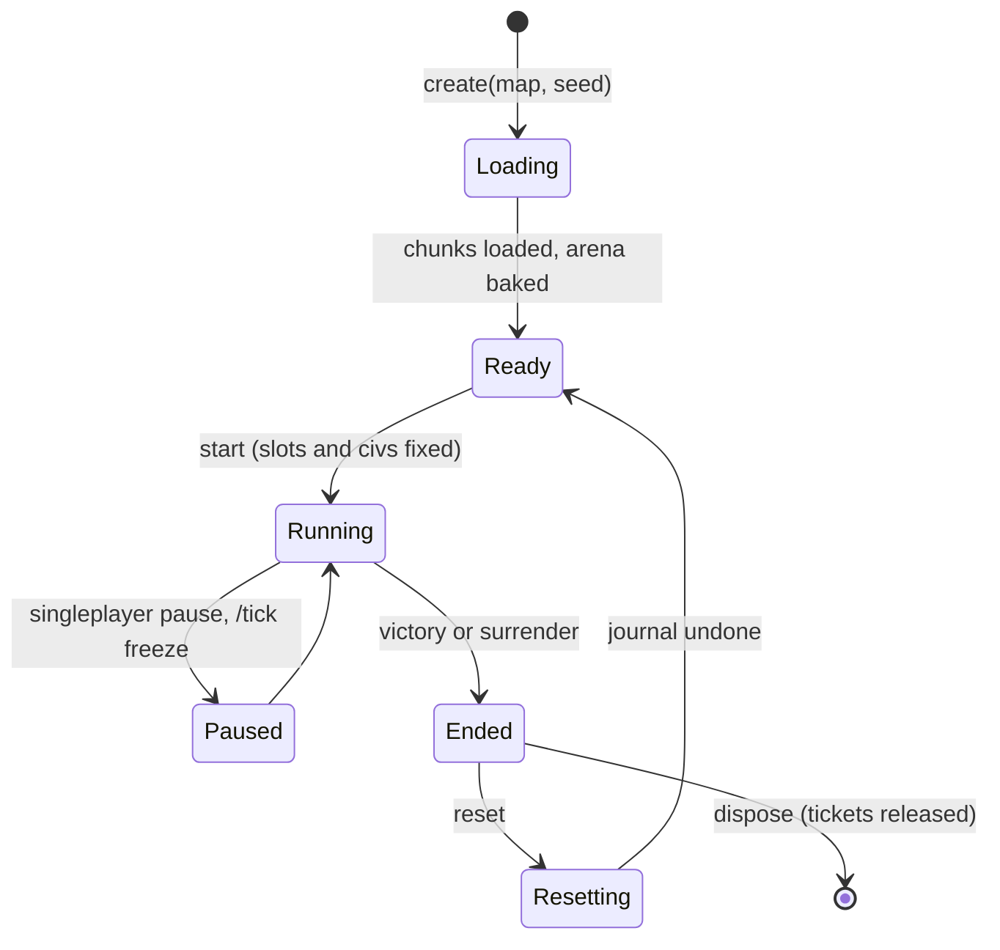
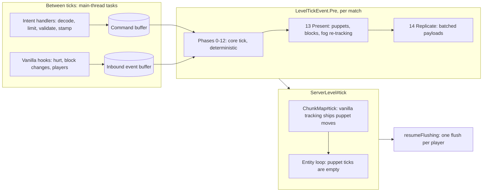
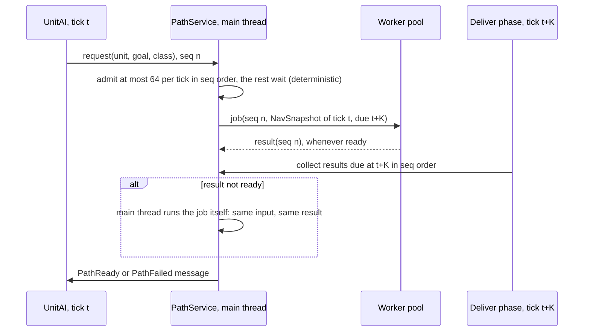
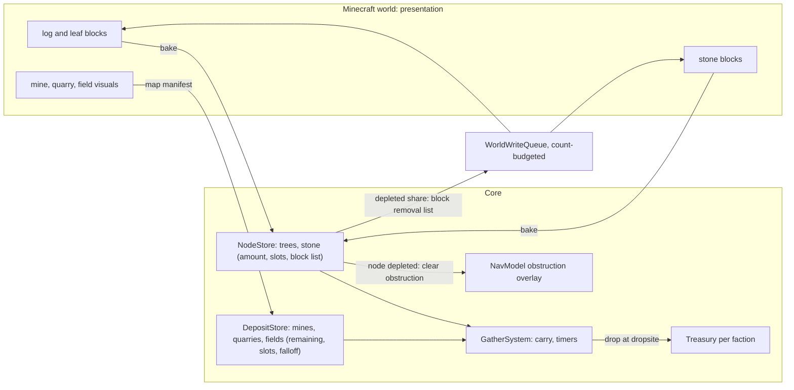
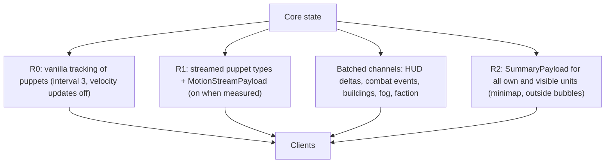

# Proposal C - scale-first systems

*Architecture proposal for Strategos, 2026-10-21. One of several competing proposals. Mandate:
1,000+ units across up to 8 factions on a 1,024 × 1,024 arena at 20 TPS, with headroom on a
host twice as slow as the owner's M4 Pro. Data-oriented stores, batched systems, level-of-detail
ticking, async jobs with deterministic delivery, custom replication where measurement demands
it, budgets measured from week one.*

**Sources.** [Research digest](../research/README.md) (cited as *README §n*), [tooling](../02-tooling.md),
the research reports (cited as *engine §n*, *mechanics §n*, *prior-art §n*, *libraries §n*,
*testing §n*, *platforms §n*), [contradictions](../research/contradictions.md) and
[gaps](../research/gaps.md). Every Minecraft and NeoForge name in this document was checked in
the decompiled Minecraft 1.21.1 + NeoForge 21.1.262 tree; citations of the form
`ChunkMap.java:1151` refer to it (full paths in Appendix A). Clean-room: nothing here comes from
GPL or all-rights-reserved code; RoN, MineColonies and 0 A.D. appear only through the research
reports' behavioural notes.

---

## Summary

**Core idea.** The Minecraft-free core *is* the simulation. It owns every unit, building,
faction and order in struct-of-arrays stores, ticks them in fixed phases with work proportional
to activity, and never reads the world: terrain enters it as a baked navigation model plus
logged patches, and whatever players or vanilla do enters as logged events. Minecraft is the
presentation layer (puppet entities, blocks, HUD) and an input source. A unit becomes an entity
only where a player can see it.

| Area | Decision | Main reason |
|---|---|---|
| Authority | All unit, building, faction and order state lives in core struct-of-arrays stores; entities are kinematic puppets | One source of truth; deterministic replays; core cost independent of entity count |
| Presence | Units are entities only inside interest bubbles around connected players (≤ 400 per player); elsewhere they exist only in the core | Unwatched AI armies cost ≈ 1.5 µs per moving unit and nothing in vanilla |
| Unit entity | `UnitPuppet extends LivingEntity` (not `Mob`), `noSave()`, empty server tick, no physics, no pushing | Not in `navigatingMobs`; no despawn, goal or navigation machinery; vanilla humanoid renderers still apply |
| Arena | A bounded region of a level, force-loaded with a NeoForge `TicketController` (`ticking=false`); several matches per level | World writes never trigger synchronous chunk loads; parallel GameTests |
| Tick | One core tick per match in `LevelTickEvent.Pre`, 15 fixed phases, activity-based LOD, timer wheel | Puppet positions are written before `ChunkMap#tick` ships them; work ∝ activity |
| Determinism | Bit-identical given seed and logged inputs; async jobs delivered at tick t + K (K = 2) | Replays, reproducible GameTests, balance simulations |
| Navigation | Layered 2.5D grid in 16 × 16 tiles; HPA* over tile regions with lazy A* refinement; flow-field tiles; ORCA | Bridges and walls without 3D-search cost; cross-map orders stay cheap |
| Stats | Core modifier pipeline is the only source of truth; hot stats copied into columns | One pipeline for techs, ranks, auras, civ bonuses and AI handicaps |
| Content | Reload listener with core-side inheritance, own sync payload, content hash | Parent templates and `/reload` hot-editing |
| Network | Vanilla tracking for puppets (R0) → streamed motion types (R1) when measured; fog-filtered batched channels; one sender | ≤ 64 KB/s per client at the reference load |
| Camera | Client-only camera entity + server-side spectator body teleported to the camera focus ≤ 5 Hz; non-pausing `RtsScreen`; perspective | No 20 Hz O(entities) `ChunkMap#move` passes; streaming follows the focus on dedicated servers; Iris-safe |
| Budget | Mod self time ≤ 3.5 ms p50 / ≤ 8 ms p99 at R1000 on the M4 Pro | Leaves more than half of a 2×-slower tick free |

**Reference load R1000** (used by every budget below): 8 factions × 125 units = 1,000 units;
160 buildings; one human and seven AIs (solo) or four humans and four AIs (server); 40 % of units
moving, 20 % fighting, 30 % working, 10 % idle; one 300-unit battle inside a human's view; path
requests averaging 10 and bursting to 64 per tick; about 2,000 block writes per minute.

**What scale-first costs.**
1. Kinematic puppets give up vanilla physics on units: no knockback from vanilla sources, no
   pistons, currents or fall damage, and first-person players walk through units (units walk
   around players). A physics-body seam exists for templates that need it.
2. Each unit has two presences (virtual and materialised) and a materialiser keeps them in step:
   more code, and spawn bursts when a camera jumps.
3. Struct-of-arrays code is less readable than objects and needs discipline: typed handles with
   generations, invariant fuzzing, accessor views for cold paths.
4. Deterministic delivery adds K = 2 ticks (100 ms) to every long path and can stall the main
   thread on an overloaded host.
5. Fog of war hides entities but not terrain blocks until a later milestone: enemy buildings are
   real blocks a modified client can see when it holds their chunks.
6. The compact channels (summary, combat events, motion stream) are ours to maintain across ports.

---

## 1. Module and package layout

### 1.1 Gradle projects and source sets

```
strategos/
├─ settings.gradle            foojay 1.0.0; includeBuild 'build-logic'; include 'core', 'mod'
├─ gradle/libs.versions.toml  every pin from docs/02-tooling.md
├─ build-logic/               strategos.java-conventions (toolchain 21, Spotless, ErrorProne + NullAway)
│                             strategos.jmh-conventions (jmh source set + JavaExec, no plugin; testing §4)
├─ core/                      java-library + java-test-fixtures, NO Minecraft
│  ├─ src/main/java           dev.strategos.core..
│  ├─ src/test/java           L1: unit, invariant, determinism and replay tests
│  ├─ src/testFixtures/java   dev.strategos.core.testkit: SimHarness, MapFixture, RandomCommands, Invariants
│  └─ src/jmh/java            L6 kernels: movement, ORCA, grids, A*/HPA*, flow fields, vision, stats
└─ mod/                       net.neoforged.moddev 2.0.148
   ├─ src/main/{java,resources}       dev.strategos.mod..; accesstransformer.cfg; strategos.mixins.json
   ├─ src/generated/resources         datagen output (CI: git diff --exit-code)
   ├─ src/test/java                   L2: FML JUnit (codecs, payload sizes, content, save fixtures)
   ├─ src/gametest/{java,structures}  L3 GameTests, L6 perf GameTests, JUnit XML reporter, SNBT arenas
   ├─ src/devtools/java               L4 scenario harness, L6 bench-server driver, dev byte counter
   └─ src/archTest/java               ArchUnit rules on the plain JVM
```

- Dev runs: the `strategos` mod group is `mod.main + core.main + mod.gametest + mod.devtools +
  core.testFixtures` (MDG `mods { strategos { sourceSet … } }`, testing §3.2). The jar is
  `mod.main + core.main` via `jar.from(core output)`, as settled in 02-tooling. GameTests stay in
  the `strategos` mod group (§17, point 9).
- Runs: `client`, `client2`, `server`, `gameTestServer`, `serverSmoke`, `scenario`,
  `benchServer` (a self-terminating dedicated server that builds a 1,024² match, runs a scripted
  scenario and writes JSON metrics).
- `core` compiles against the JDK plus `compileOnly` fastutil 8.5.12, DataFixerUpper 8.0.16,
  slf4j-api 2.0.9, JOML 1.10.5 and JSpecify 1.0.1, the versions Minecraft ships (02-tooling).

### 1.2 Core packages (`dev.strategos.core`)

| Package | Responsibility | Key types |
|---|---|---|
| `sim` | match tick driver, phase order, schedules, rules | `MatchSim`, `TickPhase`, `PhaseRunner`, `TimerWheel`, `MatchRules` |
| `store` | struct-of-arrays stores and handles | `UnitStore`, `BuildingStore`, `ProjectileStore`, `UnitRef`, `TierLists`, `OrderPool`, `UnitView` |
| `math` | deterministic maths and randomness | `DMath` (`StrictMath` wrappers, angle tables), `Rng` (counter-based), `Quant` |
| `nav` | navigation model, hierarchy, search | `NavModel`, `NavTile`, `NavSnapshot`, `RegionGraph`, `Components`, `GridAStar`, `HpaSearch`, `Funnel`, `FlowFieldCache`, `PathService` |
| `move` | steering, avoidance, formations | `MovementSystem`, `Orca` (RVO2 port), `FormationGroup`, `FormationTemplate`, `SlotAssigner`, `FormationPlanner` |
| `spatial` | range queries | `UnitGrid`, `BuildingGrid`, `NodeIndex` |
| `vision` | fog of war | `VisionGrid`, `ExploredMap`, `FlipSet`, `TerritoryQuery` |
| `order` | commands, validation, queues | `Command` (sealed), `CommandType`, `CommandRegistry`, `CommandValidator`, `QueueMode`, `OrderQueue` |
| `unitai` | hierarchical state machine | `UnitAi`, `StateDef`, `StateTable`, `Message`, `Stance` |
| `combat` | attacks, damage, projectiles | `CombatSystem`, `DamageModel`, `ProjectileSystem`, `TargetScanner` |
| `economy` | resources, gathering, deposits, population | `ResourceTypes`, `Treasury`, `GatherSystem`, `NodeStore`, `DepositStore`, `DropsiteIndex`, `Population` |
| `production` | training and research queues | `ProductionSystem`, `QueueItem`, `ResearchSystem` |
| `build` | placement, construction, building HP | `Blueprint`, `BuildPlan`, `PlacementValidator`, `ConstructionSystem`, `DamageStages`, `WorldEdit` |
| `stats` | modifier pipeline | `ValuePath`, `PathIds`, `Modifier`, `ClassFilter`, `StatPipeline`, `StatRows` |
| `content` | templates | `RawTemplate`, `TemplateResolver`, `TemplateSet`, `TemplateFilters`, `ContentCodecs`, `ContentProblem` |
| `faction` | players, factions, diplomacy | `FactionStore`, `Diplomacy`, `PlayerSlot`, `Controller` |
| `ai` | AI players | `AiPlayer`, `AiView`, `CommandSink`, `ScriptedAi`, `EconomyBudget` |
| `job` | async jobs with deterministic delivery | `JobSystem`, `JobSpec`, `DueQueue`, `JobExecutor` (port) |
| `io` | everything that crosses the core boundary | `InboundEvent` (`TerrainPatch`, `ExternalHit`, `AgentFeed`, `BodyReadback`…), `OutboundEvent`, `SimBus`, `ByteSink`/`ByteSource` |
| `persist` | save formats | `ColumnCodec`, `ColumnSink`/`ColumnSource`, `SaveSchema`, `Migrations` (on DFU `Dynamic`) |
| `replay` | logs and hashes | `InputLog`, `Replayer`, `StateHasher` |
| `metrics` | timing (the only package allowed to read clocks) | `PhaseTimers`, `LogHistogram`, `Counters` |
| `client` | pure client logic | `ClientMatchState`, `SelectionModel`, `InputMapper`, `RtsAction`, `CameraModel`, `PickMath`, `CommandBuilder` |
| `view` | immutable view-models | `HudModel`, `SelectionPanelModel`, `CommandCardModel`, `MinimapModel`, `Layout` |

### 1.3 Mod packages (`dev.strategos.mod`)

| Package | Responsibility | Key types |
|---|---|---|
| `mod` | entry point, ids | `Strategos` (`@Mod`), `Ids` (the only place that builds `ResourceLocation`s) |
| `mod.registry` | registrations | `ModEntities`, `ModPayloads`, `ModTickets`, `ModDamageTypes`, `ModConfig`, `ModGameRules`, `ModKeys` |
| `mod.server` | per-server root object | `StrategosServer` (created on `ServerAboutToStartEvent`, dropped on `ServerStoppedEvent`) |
| `mod.server.match` | hosting core matches | `MatchManager`, `MatchHost`, `ArenaTickets`, `MapManifest`, `ArenaBaker`, `ResetJournal` |
| `mod.server.tick` | driving the core | `SimDriver` (`LevelTickEvent.Pre`), `PresentationSync` |
| `mod.server.world` | world ↔ core | `NavClassTable`, `SectionSnapshotter`, `TerrainPatcher`, `BlockChangeHook`, `WorldWriteQueue`, `AgentFeedBuilder` |
| `mod.server.entity` | puppets | `UnitPuppet`, `UnitBody` (`KinematicBody`, `PhysicsBody`), `Materializer`, `PuppetIndex` |
| `mod.server.net` | intents and replication | `IntentHandlers`, `IntentLimiter`, `ReplicationService`, `InterestSets`, `FogRetracker`, channel writers |
| `mod.server.persist` | SavedData | `MatchIndexData`, `MatchPartData`, `NbtColumns`, `NbtDynamicBridge` |
| `mod.server.content` | templates | `TemplateReloadListener`, `ContentSync`, `BlueprintLoader` |
| `mod.server.protect` | arena and building protection | `BuildingProtection`, `BuildingBlockIndex`, `ArenaRules` |
| `mod.server.command` | `/strategos` | `StrategosCommands` |
| `mod.server.debug` | dev data | `DebugStreams`, `PerfDump`, JFR event classes |
| `mod.net` | payload records and `StreamCodec`s (both sides) | `*Payload`, `CoreBufAdapter` (core `ByteSink`/`ByteSource` over `FriendlyByteBuf`) |
| `mod.client` | client root | `StrategosClient`, `ClientSession` (per connection) |
| `mod.client.camera` | camera | `RtsCameraEntity`, `RtsCamera`, `FocusSender` |
| `mod.client.input` | input | `RtsScreen`, `InputBridge` |
| `mod.client.state` | client mirror | `ClientMirror`, `ClientUnitIndex`, `MotionStreamApplier` |
| `mod.client.render` | world rendering | `UnitRenderer`, `ModelRegistry`, `FrameExtractor`, `OverlayPass`, `ProjectileVisuals`, `MinimapTexture` |
| `mod.client.hud` | GUI layers | `ResourceBarLayer`, `SelectionPanelLayer`, `CommandCardLayer`, `MinimapLayer`, `PerfLayer` |
| `mod.client.compat` | soft dependencies | `IrisCompat` |
| `mod.mixin` | mixins (one in T0) | `LevelChunkMixin` |

### 1.4 Boundaries and how they are enforced

1. **Compile time.** `core` has no Minecraft or NeoForge class on its classpath, so it cannot
   import one.
2. **ArchUnit** (`:mod:archTest`, plain JVM, testing §10), failing the build:
   - **A1 client isolation:** nothing outside `dev.strategos.mod.client..` depends on
     `net.minecraft.client..`, `com.mojang.blaze3d..` or `net.neoforged.neoforge.client..`.
   - **A2** `mod.server..` never depends on `mod.client..`.
   - **A3 single sender:** only `mod.server.net..` calls `PacketDistributor` or a connection's
     `send`.
   - **A4 determinism:** nothing in `core..` except `core.metrics` calls `System.nanoTime`,
     `System.currentTimeMillis`, `Instant.now`, `java.util.Random`, `ThreadLocalRandom`, or
     `Math.sin|cos|tan|asin|acos|atan|atan2|exp|log|pow|cbrt` (`DMath` wraps `StrictMath`);
     `java.util.HashMap`/`HashSet` are banned in `core.sim..`, `core.store..` and the systems
     (fastutil maps keyed by `int` are allowed: their order depends only on the operation
     sequence).
   - **A5 no static mutable state** in `core..` and `mod.server..`: no non-final static fields;
     static finals only of immutable types (RoN's world-leak bugs, prior-art §3.11).
   - **A6 hot paths:** classes annotated `@HotPath` don't depend on `java.util.stream..` or boxed
     collections.
   - **A7 mixins** call only `BlockChangeHook` and contain no game logic.
   - **A8 core layering:** `store`, `math`, `nav`, `spatial`, `vision`, `stats`, `content` don't
     depend on `sim`, `unitai` or `ai`; only `sim` wires systems together.
   - **A9 threads:** only `core.job` creates threads or executors.
3. **ErrorProne + NullAway** (JSpecify mode) at error level on main sources (02-tooling).
4. **Replay tests** in CI catch nondeterminism that the static rules miss (§14).

---

## 2. Simulation model

### 2.1 What a match is in world terms

A match is a `MatchHost` bound to one `ServerLevel`, one `MatchBounds` and one core `MatchSim`,
identified by a `MatchId` (UUID).

- **Bounds:** `minX`, `minZ` (multiples of 16 in production), `sizeX`, `sizeZ` ≤ 2,048 and a
  navigation band `minY..maxY` (default 64 blocks). The reference arena is 1,024 × 1,024 =
  64 × 64 = 4,096 chunks.
- **Coordinates:** the core works in match-local `float`s (`x − minX`, `y − minY`, `z − minZ`);
  at ≤ 2,048 their precision is ≤ 2.4 × 10⁻⁴ block. The mod converts with `double`s. GameTests at
  random origins within ±15 M blocks (README §3.26) therefore don't affect the core.
- **Several matches per level** are allowed when bounds don't overlap and keep a margin of at
  least the unit tracking range plus two chunks (192 blocks), so bubbles, puppets and tickets
  never cross. `MatchManager` keeps a per-level interval index that routes positions and block
  changes to a match in O(log n).
- **No statics:** `StrategosServer` owns `MatchManager`, which owns the matches (A5).
- **Which level:** T0 runs one match in the overworld of a map world. GameTests run dozens of
  small matches in the GameTest level, each with bounds = `GameTestHelper#getBounds()`
  (GameTestHelper.java:916). A later `strategos:arena` datapack dimension can host several
  arenas per server; the core does not care.
- **World border:** not used, because every level follows the overworld border (README §3.10).
  The bounds are enforced by the command validator, the commander-body clamp and the
  materialiser, and shown by a client-side boundary decal.

### 2.2 Keeping the arena loaded

`ArenaTickets` places one `TicketController("strategos:arena")` ticket per arena chunk with
`ticking=false` (TicketController.java:47-68). Every arena chunk is then entity-ticking at level
31, and random ticks and natural spawning happen only within 128 blocks of a non-spectator player,
as anywhere in vanilla (ServerChunkCache.java:367, ChunkMap.java:983-990; contradiction 9 of the
first pass). The level keeps ticking with no players because NeoForge counts these chunks
(ServerLevel.java:390). Tickets persist in `ForcedChunksSavedData`; the controller's
`LoadingValidationCallback` drops tickets of matches that no longer exist.

Why load the whole arena: felling a tree or building an AI base far from every player never
triggers a synchronous chunk load; vanilla tracking works for a puppet anywhere in the arena; it
matches what the GameTest runner does with test chunks. Cost: heap for 4,096 chunks and a
per-tick pass of `ServerChunkCache#tickChunks` over them (filter, shuffle, spawn check,
`broadcastChanges`: ServerChunkCache.java:334-385). Spike S2 measures both. Fallback: level-33
region tickets (`addRegionTicket(type, pos, 0, value)`, DistanceManager.java:197-202) keep the
chunks loaded but not ticking; entities in them are still tracked (`Visibility.fromFullChunkStatus`,
Visibility.java:26-31), and R1 streaming (§10.3) does not depend on entity ticking.

### 2.3 Lifecycle



- **Create** (`/strategos match create <map> [seed]`, later a setup screen): read the map
  manifest, validate bounds, place tickets, wait until every arena chunk is loaded (progress
  shown), then **bake**: copy the band's sections on the main thread with
  `LevelChunkSection#getStates().copy()` (PalettedContainer.java:290, ≈ 5 µs each, 16k sections),
  classify them off-thread with `NavClassTable` (§7.1), and build the navigation model, the
  resource-node index and the initial obstruction overlays. Expected: ≈ 0.1 s of main-thread time
  and ≈ 0.4 s of worker time for 4,096 chunks; chunk loading itself dominates (S2).
- **Start:** factions, slots and starting entities come from the manifest and civ data.
- **Save and resume:** autosave (every 6,000 ticks: MinecraftServer.java:939-946, 977-989) or
  `/strategos match save` writes the match's SavedData (§3.3). On server start `MatchManager`
  reads the match index, the persisted tickets reload the arena, the core stores and the saved
  navigation model are restored (no re-bake, so the resumed match uses exactly the model it had;
  dirty tiles pending at save time are re-queued), and the match continues at the saved tick.
  Puppets are never saved, so chunk reloads cannot duplicate units (§3.4).
- **End:** the victory system emits `MatchEnded`; the core stops; puppets despawn after 10 s;
  results go to clients.
- **Reset:** `ResetJournal` records the original state of every block inside the bounds the first
  time it changes during the match (fed by the block-change hook, §7.7). Reset replays it
  backwards through the world-write queue at 1,024 blocks per tick while no match runs: 50k
  changed blocks in ≈ 2.5 s, with no world copying, and it works for several matches in one level.
- **Shipping maps:** a map is a world template (a zipped save) with a manifest at
  `data/strategos/map/<id>.json`: bounds, nav band, player starts, deposits (positions,
  footprints, amounts), allowed civs, map version. Installed like any world (singleplayer
  `saves/`, server `level-name`). The world sets `doMobSpawning=false` and `doFireTick=false`.
  Later, `.stmap` packages (region files plus manifest) can be installed into region-aligned slots
  of an arena dimension for multi-arena servers; the journal reset makes both kinds reusable.

### 2.4 Tick pipeline

`SimDriver` subscribes to `LevelTickEvent.Pre`; for each `MatchHost` of that level, in creation
order, it runs one core tick (phases 0-12) and the presentation phases (13-14). Then vanilla
`ServerLevel#tick` runs. Inside it, `ServerChunkCache#tick` calls `ChunkMap#tick`, which ships
entity changes (ServerChunkCache.java:323-325, ServerLevel.java:382), *before* the entity loop
(ServerLevel.java:403). Puppet positions written in `Pre` therefore leave the server in the same
tick. Intents arrive between ticks as main-thread tasks (payload handlers on
`HandlerThread.MAIN`) and are buffered. Each player gets one flush per tick, at
`resumeFlushing` (MinecraftServer.java:1034, 1083). The core honours `/tick freeze|step|sprint`
through `level.tickRateManager()`, which GameTests and debugging use.



| # | Phase | Work | Cadence | Budget p50 / p99 (ms, M4 Pro, R1000) |
|---|---|---|---|---|
| 0 | Begin | `tick += 1`; swap command and event buffers; publish nav snapshot version | every tick | – |
| 1 | Deliver | apply job results due at this tick in (due, seq) order; the main thread runs late jobs itself | every tick | 0.10 / 0.50 |
| 2 | Inputs | inbound events: terrain patches, external hits, agent feed, body readbacks, disconnects | every tick | 0.05 / 0.20 |
| 3 | Commands | validated commands in (stamp, source, seq) order; AI commands issued last tick | every tick | 0.05 / 0.30 |
| 4 | Timers | timer-wheel events due now: attack hits, gather ticks, production done, build steps | every tick | 0.15 / 0.50 |
| 5 | Think | UnitAI for units whose think slot is due | staggered, 2–20 ticks | 0.40 / 1.00 |
| 6 | Combat | staggered target scans, projectile landings, damage, deaths | every tick | 0.30 / 0.80 |
| 7 | Economy | deliveries, deposits, production, construction progress, population | event-driven | 0.15 / 0.40 |
| 8 | Movement | formation controllers → desired velocity → ORCA (tier cadence) → integrate on nav floors | every tick | 0.90 / 1.80 |
| 9 | Spatial | rebuild the unit grid by counting sort | every tick | 0.05 / 0.10 |
| 10 | Vision | restamp units that changed vision cell; collect visibility flips | every tick | 0.08 / 0.25 |
| 11 | Slow | AI players, auras, territory, stat refresh | scheduled (§2.5) | 0.25 / 1.50 |
| 12 | Flush | destroy the dead, free slots, emit outbound events, optional state hash | every tick | 0.05 / 0.15 |
| 13 | Present | materialise and dematerialise, write puppet frames, world-write queue, terrain section copies, fog re-tracking | every tick | 0.50 / 2.00 |
| 14 | Replicate | per-player batched payloads | per channel rate | 0.40 / 1.00 |
| | **Mod self time** | | | **≤ 3.5 / ≤ 8.0** |

Phases 0-12 are the deterministic core; 13-14 are mod presentation. Per-phase p99 values are
individual caps and do not add up; the total p99 cap is 8 ms.

### 2.5 Scheduling of slow systems

Timers replace polling: `TimerWheel` (256 one-tick slots plus an overflow heap) holds attack
repeats, gather ticks, production and research completions, construction steps and think slots,
so per-tick work scales with events, not with units.

| System | Cadence | Offset |
|---|---|---|
| AI player think | 20 ticks | 2 × faction index (8 factions spread over 16 ticks) |
| Auras (T2) | 10 ticks | aura id mod 10 |
| Territory (T1) | on influence change, at least 20 ticks apart | async job |
| Target scan, ACTIVE units | 4 ticks | slot mod 4 |
| Target scan, IDLE units | 10 ticks | slot mod 10 |
| Fog re-tracking (presentation) | 5 ticks | match index |
| Summary payload (presentation) | 10 ticks | player index |

### 2.6 Time, RNG and the scope of determinism

- **Time:** one `int` tick counter per match; all durations in ticks (template seconds ×
  20, rounded at load); no clocks in the core (A4).
- **RNG:** counter-based, `Rng.u32(matchSeed, stream, tick, key, salt)` = a SplitMix64 finaliser
  over the packed inputs, with one stream per purpose (spread, loot, AI choice…). It needs no
  state, so adding a unit or reordering a loop never shifts other values, and future parallel
  kernels stay deterministic.
- **Floating point:** Java 17+ arithmetic is strict IEEE 754 everywhere (JEP 306), `Math.sqrt` is
  correctly rounded, and transcendental functions go through `StrictMath`. `float` positions are
  therefore identical across machines without fixed point.
- **Order:** systems iterate dense slot lists; slots are reused from a LIFO free list; caches that
  change *timing* (flow fields, §7.4) evict by sim tick, never by wall time.
- **Scope:** given the bake, seed, `MatchRules`, content hash and the input log (commands and
  inbound events with tick stamps), the core reproduces bit-identical state hashes. Everything that
  enters from outside is logged: player commands, first-person positions and hits, block changes
  not made by the core, content epochs after `/reload`, disconnects, physics-body readbacks.
- **Where it stops:** vanilla physics (only in the optional physics body), players and vanilla
  entities themselves, the visible world (block writes are count-budgeted and can lag the core),
  presentation (materialisation, replication) and profiling.

---

## 3. Authority and state

### 3.1 Who owns what

| State | Source of truth | Written by | Reaches clients as |
|---|---|---|---|
| Unit position, velocity, facing | core `UnitStore` | `MovementSystem` | puppet position (R0/R1), summary |
| Unit HP, statuses | core | `CombatSystem`, `ExternalHit` events | HUD deltas, summary |
| Orders, FSM state | core | commands, `UnitAi` | HUD (own units) |
| Stats | core `StatPipeline` | techs, phases, ranks, auras, civ bonuses, AI handicap | tooltips, command card |
| Buildings: footprint, HP, progress, queues | core `BuildingStore` | construction, combat, production | building payloads; blocks |
| Building blocks | world, as presentation of core state | `WorldWriteQueue` only | vanilla chunk updates |
| Terrain (all other blocks) | world | anyone; changes enter the core as `TerrainPatch` events | vanilla |
| Navigation model | core `NavModel` (bake + overlays + patches) | core | debug overlay |
| Trees, stone nodes, deposits | core `NodeStore`, `DepositStore` | `GatherSystem` | HUD |
| Treasury, population, techs, diplomacy | core `FactionStore` | economy, research, commands | faction payload |
| Visibility, explored state | core `VisionGrid` | vision phase | fog payload, `broadcastToPlayer` |
| First-person player bodies | vanilla | vanilla | vanilla |
| Commander body position | mod (camera focus) | focus intents | vanilla (spectator) |

### 3.2 Stores

`UnitStore` is preallocated at match start for the sum of faction population caps × 1.25
(≤ 4,096 slots; no growth during play). Its columns, grouped by the system that reads them:

- identity: `int[] gen`, `short[] template`, `byte[] faction`, `byte[] tier`, `int[] flags`
- kinematics: `float[] x, y, z, vx, vz, yaw`, `byte[] layer`, `int[] navCell, gridCell, visCell`
- motion control: `int[] path`, `short[] pathCursor`, `int[] group`, `byte[] slot`, `float[] goalX, goalZ`
- combat: `float[] hp`, `int[] target`, `int[] nextAttack`, `byte[] stance`
- hot stats, refreshed on `StatsChanged`: `float[] speed, radius, vision, maxHp, range`, `short[] armourRow`
- economy: `byte[] carryType`, `short[] carry`, `int[] workTarget`
- behaviour: `short[] state`, `int[] stateSince`, `int[] nextThink`, `int[] orderHead`, `byte[] orderCount`

- **Handles:** `UnitRef` is an `int` = `(generation << 18) | slot`, 0 = none (262,144 slots,
  14-bit generation). Every dereference checks the generation in debug builds; `CommandValidator`
  always does.
- **Tier lists:** dense `IntList`s of slots per tier (§4.3). Systems iterate only the lists they
  need; units change lists in deterministic order.
- **Orders:** `OrderPool` keeps preallocated records in parallel arrays (`type`, `mode`,
  `targetRef`, `tx`, `ty`, `tz`, `arg0..2`, `next`) with a free list; ≤ 32 queued orders per unit.
- **Cold data stays as records:** templates, buildings (≤ a few hundred), production queues, AI
  plans, formation groups.
- **Ergonomics:** `UnitView` is a slot-bound flyweight with readable getters and `toString` for
  cold code and logs; `/strategos inspect` prints one unit.

Why struct-of-arrays here: the movement, avoidance, vision and grid kernels touch four to eight
columns of every moving unit every tick. Contiguous primitive arrays keep that in cache, allocate
nothing per tick, serialise as whole columns, and copy cheaply for off-thread readers (AI
analysis, replay hashing).

### 3.3 Persistence

SavedData per match lives in the match level's `DimensionDataStorage`, one file per subsystem
with flat names (`computeIfAbsent(factory, name)` maps the name to `data/<name>.dat`), created
with `new SavedData.Factory<>(ctor, load)` (SavedData.java:57):

| File | Content | Format | Dirty when |
|---|---|---|---|
| `strategos_matches` (overworld) | match index: id, level, bounds, map, status | DFU codec | create, end |
| `strategos_m<id>_meta` | rules, seed, tick, content hash, K, schema version | codec | every save |
| `strategos_m<id>_units` | `UnitStore` columns, order pool, FSM state | column codec | every save while running |
| `strategos_m<id>_buildings` | building records, queues, progress, damage stages | codec | on change |
| `strategos_m<id>_factions` | treasury, population, techs, diplomacy, AI player state | codec | on change |
| `strategos_m<id>_world` | node and deposit amounts, obstruction overlays, pending world writes, reset journal | columns + codec | on change |
| `strategos_m<id>_nav` | navigation terrain layers and pending dirty tiles (≈ 6 MB raw, about 1-2 MB compressed for regular terrain; S10 confirms) | byte columns | after terrain patches |
| `strategos_m<id>_fog` | explored bitsets per faction | long arrays | on change |
| `strategos_m<id>_jobs` | pending job *requests* with due ticks (re-submitted on load, so save/load is deterministic) | codec | every save |

- **Cost:** the NBT tree is built and copied on the main thread; NeoForge writes it on an IO
  worker (SavedData.java:36-55). Columns become `IntArrayTag`, `ByteArrayTag` and `LongArrayTag`
  (floats via `Float.floatToRawIntBits`): about 40 columns × 2,000 slots ≈ 250 KB, under 2 ms.
  The journal (≤ 100k entries of packed position + palette index) is ≈ 1.2 MB.
- **Codecs:** records use DFU `Codec`s defined in core; columns use `ColumnCodec` over the
  `ColumnSink`/`ColumnSource` port, implemented with NBT in the mod and in memory in tests.
- **Versioning:** every blob carries `"v"`. `Migrations` (core) upgrade the raw tree step by step
  on DFU `Dynamic<?>` before decoding, so the same code runs on `NbtOps` in the mod and on
  `JsonOps` in L1 tests (README §3.24). Fixture saves of every released schema live in
  `mod/src/test/resources/fixtures/` and load in L2.
- **Ids:** templates, techs and resources are saved as namespaced strings with a per-file
  palette, never as dense indices (those are per content epoch).
- **Port note:** codec-first persistence keeps 1.21.5's `SavedDataType` and 1.21.6's
  `ValueInput`/`ValueOutput` inside `mod.server.persist` (engine §7).

### 3.4 Entity materialisation

`Materializer` (phase 13) keeps the set of puppets per match.

- **Bubble:** one disc per connected player around the player's server-side body (the commander's
  camera focus or the first-person player), radius `R = min(144, trackingRange − 16,
  viewDistance × 16 − 16)` blocks. It always lies inside the puppets' vanilla tracking range:
  `clientTrackingRange` 10 = 160 blocks, scaled by the server's entity-broadcast percentage and
  capped by the player's view distance (ChunkMap.java:1327-1336, 1347-1361, 840-842).
- **Rule:** a unit is materialised iff it lies in at least one bubble and is visible to at least
  one bubble owner's faction (or has been within the last 40 ticks). In solo play most fogged
  enemies are therefore not entities at all; with several players, `broadcastToPlayer` hides
  materialised units from players who can't see them (§8.3).
- **Caps:** ≤ 400 puppets per bubble and ≤ 1,000 per level; ≤ 16 spawns per tick per player (a
  full camera jump fills in ≤ 25 ticks); despawn hysteresis 24 blocks or 40 ticks. Over the cap,
  priority: own selected > own > allied > visible enemy, then distance to the bubble centre.
- **Spawn data:** `IEntityWithComplexSpawn#writeSpawnData` carries `UnitRef`, the template index
  with its content epoch (so the client can re-map it through string ids after a `/reload`),
  faction, rank and carry type; the client's `ClientUnitIndex` maps entity ids to `UnitRef`s.
- **Never saved:** unit entity types are built with `EntityType.Builder#noSave()`
  (EntityType.java:1339), so `getEncodeId()` is null and `Entity#save` writes nothing
  (Entity.java:1709-1733, 1914-1917). A chunk reload cannot duplicate a unit; the core
  re-materialises it.

### 3.5 Staying open to an open world

The core never assumes loaded chunks or entities: a virtual unit is the normal state, terrain is
an input, and bounds are a parameter. §16 lists what an open-world mode would change.

---

## 4. Units

### 4.1 Entity class

`UnitPuppet extends LivingEntity implements IEntityWithComplexSpawn`.

Why `LivingEntity` and not `Mob`/`PathfinderMob`: only `Mob`s join `navigatingMobs`, the list
`sendBlockUpdated` loops over on every block change (ServerLevel.java:193, 1093, 1781), so
construction stops costing O(blocks × units); there is no despawn check, `MobDespawnEvent`, goal
selector or `PathNavigation`. Vanilla art still works: `LivingEntityRenderer`, `HumanoidModel`,
`HumanoidArmorLayer` and `ItemInHandLayer` accept any `LivingEntity` (LivingEntityRenderer.java:31,
HumanoidModel.java:22, HumanoidArmorLayer.java:32, ItemInHandLayer.java:18).
`HumanoidMobRenderer` requires a `Mob` and is not used.

Entity types are fixed at startup (README §3.23): three size classes in two replication variants,
plus the camera.

| Type | Size | Tracking | Update interval | Use |
|---|---|---|---|---|
| `strategos:unit_small` | 0.6 × 1.8 | 10 chunks | 3 ticks | infantry, workers |
| `strategos:unit_mounted` | 1.3 × 2.4 | 10 | 3 | cavalry |
| `strategos:unit_large` | 2.6 × 2.6 | 10 | 3 | siege |
| `strategos:unit_*_streamed` | same | 10 | `Integer.MAX_VALUE` | R1: movement goes through our stream (§10.3); vanilla's `LightningBolt` uses the same interval (EntityType.java:474) |
| `strategos:rts_camera` | 0 × 0 | – | – | client-only camera entity; its constructor refuses a server level |

All unit types use `noSave()`, `noSummon()`, `fireImmune()` and
`setShouldReceiveVelocityUpdates(false)` (EntityType.java:1334-1384). Default attributes are
registered in `EntityAttributeCreationEvent`. Per-template sizes override `getDimensions(Pose)`.
`LivingEntity`'s abstract equipment methods (`getArmorSlots`, `getItemBySlot`, `setItemSlot`,
`getMainArm`: LivingEntity.java:2074-2078, 3127) are backed by two small slot arrays filled from
the template, as vanilla's armour stand does.

Disabled on the server:
- `tick()` is overridden without `super.tick()`: no `baseTick` (fluids, fire, portals), effects,
  `detectEquipmentUpdates`, `aiStep`, `travel` or `pushEntities` (LivingEntity.java:2453-2530,
  2721-2850). The server tick is empty; `PresentationSync` writes the frame before `ChunkMap#tick`.
- `move()` is never called, so no collision query, step sound or `GameEvent.STEP`.
- `isPushable()` false and `pushEntities()` a no-op (on the client too, where vanilla queries
  nearby players every tick); `canBeCollidedWith()` false.
- `hurt(...)` forwards to the core (§4.5); `knockback(...)` is a no-op; death is driven by the core.
- Equipment changes (rank-ups) are pushed by `ReplicationService` with
  `ServerChunkCache#broadcast(entity, ClientboundSetEquipmentPacket)` (ServerChunkCache.java:482),
  because `detectEquipmentUpdates` is private to the skipped tick (LivingEntity.java:2581).
- `onGround` stays constant, so `ServerEntity#sendChanges` never sends the teleport packet it
  sends on every flip (ServerEntity.java:150).
- `SynchedEntityData` only for rarely changing values (rank, carry type, pose), because a dirty
  value forces the full position update that tick (ServerEntity.java:121).

On the client, `tick()` runs a lean path: position and head lerp (`lerpTo`, `lerpHeadTo`), walk
animation from position deltas (`calculateEntityAnimation`), and `swing` and `animateHurt`
triggered by our combat events (LivingEntity.java:1689, 1857, 2373, 2971, 3006).
`shouldRenderAtSqrDistance` renders to 192 blocks; `isCurrentlyGlowing()` and `getTeamColor()`
outline the local selection in faction colour without a server round trip (Minecraft.java:2624,
Entity.java:281, 2407).

### 4.2 The body seam

```java
sealed interface UnitBody permits KinematicBody, PhysicsBody {
    void applyFrame(UnitPuppet puppet, PuppetFrame frame);   // phase 13
}
```

- **`KinematicBody`**, the default for every T0-T1 template: the core integrates the position on
  the navigation model; the puppet is set from it (`setPos`, `setYRot`, `setYHeadRot`,
  `yBodyRot`). Cost: one `setPos` per moved puppet per tick.
- **`PhysicsBody`**, opt-in per template (`"body": {"mode": "physics"}`), for units that must
  interact with vanilla physics (a future boat, units thrown by explosions). Its tick runs vanilla
  `travel`/`move` toward the core's desired velocity; `PresentationSync` reads the resulting
  position in `LevelTickEvent.Post` and logs a `BodyReadback` event that the core applies next
  tick. While virtual, such a unit moves kinematically. Cost: vanilla movement per unit
  (engine §1.1) and readbacks in the input log.

### 4.3 Level-of-detail tiers

Simulation tiers depend on **activity, never on observation**, so a battle plays out the same
whether or not anyone watches it.

| Tier | Units | Think | Avoidance | Target scan |
|---|---|---|---|---|
| ACTIVE | fighting, just ordered, formation members | every 2 ticks | ORCA every 2 ticks | every 4 ticks |
| MOVING | walking, no enemy near | every 4 ticks | ORCA every 4 ticks, separation between | every 8 ticks |
| WORKING | gathering, building, repairing in place | timers only | none | every 20 ticks |
| IDLE | no order | every 10 ticks | none | every 10 ticks |
| DORMANT | garrisoned, queued, dying | none | none | none |

Messages wake a unit at once regardless of tier (an `Attacked` message makes a passive civilian
flee in the same tick). Presentation adds two observation-based tiers: P0 materialised in a
bubble, P1 virtual (summary only). Client model detail (§11.7) is a third, client-only LOD.

### 4.4 Movement control

- Per tick, `MovementSystem` turns each moving unit's path follower (next waypoint or flow-field
  direction) or formation slot into a desired velocity, blends ORCA's collision-free velocity,
  and integrates: the horizontal step is clamped so the unit never enters a cell impassable for
  its mobility class (it slides along the blocked axis); the height is the floor of the cell
  under it, stored at 1/16 block (§7.1), smoothed so a one-block step takes four ticks.
- Drops of up to 3 blocks are one-way edges with a fall time; deep water is impassable for
  non-swimmers; shallow water slows to × 0.7.
- First-person players and other vanilla living entities inside the bounds arrive each tick as
  an `AgentFeed` event (position, radius, faction); ORCA treats them as non-reactive agents, so
  units walk around players.
- Arrival: a settle radius of 1.5 blocks for groups (RoN's lesson, prior-art §3.5).
- Stuck ladder (MineColonies' idea, README §4): no progress for 40 ticks → repath; three failures
  → nearest reachable cell via `Components`; still stuck → deterministic nudge to the nearest free
  cell; each step is counted and shown in the debug overlay.

### 4.5 Combat hooks and the damage pipeline

- **Unit against unit or building** never touches vanilla `hurt`. The core computes damage =
  Σ over damage types of amount × 0.9^resistance × bonus (0 A.D.'s model, mechanics §1.8),
  subtracts it from the HP column, and emits `Hit` and `Died` events. Invulnerability frames
  cannot swallow focused fire because they are never involved (README §3.4).
- **Attack timing** is a pair of timer-wheel events: wind-up, then repeat. Ranged attacks launch
  analytic projectiles (flight time, deterministic spread from `Rng`) resolved at the landing tick
  on the spatial grid; clients only get a "launched" event to animate (mechanics §1.9).
- **Vanilla to core:** `UnitPuppet#hurt(DamageSource, float)` (LivingEntity.java:1142) becomes an
  `ExternalHit {unit, attacker UUID, attacker faction, amount, damage type}` inbound event, applied
  next tick through the same damage model with a data-defined "player weapon" attack. Player melee
  and vanilla arrows therefore work against materialised units.
- **Core to vanilla:** hits on first-person players become `HurtAgent` outbound events, applied
  with `player.hurt(source, amount)` using our `strategos:unit_attack` damage type tagged
  `minecraft:bypasses_cooldown`, so ten archers aren't reduced to one hit per half-second
  (LivingEntity.java:1190, DamageTypeTags.java:12). Player armour applies as usual.
- **Factions:** the core's `Diplomacy` decides friendly fire; scoreboard teams are never used for
  units because membership is broadcast to every client (README §3.16).

### 4.6 Vanilla interactions kept

| Interaction | Status |
|---|---|
| Player melee against a unit | kept (`hurt` forward) |
| Vanilla arrows and tridents hitting a unit | kept (`hurt` forward) |
| Knockback, pistons, water currents, explosions moving units | dropped (kinematic) |
| Fall damage, drowning, fire, potion effects on units | dropped; core statuses later (T2) |
| Players colliding with units | dropped: players walk through units, units avoid players |
| Units hitting first-person players | kept (core → `player.hurt`) |
| Held items, armour rendering, name tags, glow outline | kept |
| Leads, riding, spawn eggs, `/summon` | dropped (`noSummon`) |
| Farmland trampling, vibrations, step sounds | dropped (`move` is never called) |

---

## 5. Orders and commands

### 5.1 Command objects and their registry

- `sealed interface Command` with records in core: `Move`, `AttackMove`, `Attack`, `Stop`,
  `Gather`, `Build`, `Repair`, `Garrison`, `Unload`, `Patrol`, `SetStance`, `SetFormation`,
  `Train`, `Research`, `SetRally`, `Delete`, `UseAbility`.
- `CommandType<C>`: id (`strategos:move`), a binary codec over core `ByteSink`/`ByteSource` with
  hard limits, a validator and an applier, registered in `CommandRegistry`. Content can add
  abilities (§5.5) but not command types. There is no action enum (RoN has 138 values,
  prior-art §3.3).
- The client's `CommandBuilder` (pure), the AI's `CommandSink` and the tests all produce the same
  objects.

### 5.2 Client-to-server validation

On the main thread, before anything is buffered:
1. Decode with limits: ≤ 300 units, ≤ 64 argument bytes; a decode error disconnects.
2. Rate limit: token bucket per player, 30 intents/s sustained, burst 60.
3. Identity: sender UUID → `PlayerSlot` → faction; never player names (prior-art §3.3).
4. Ownership: every `UnitRef` alive and owned by the sender's faction or under allied control;
   stale references are dropped one by one.
5. Capability: the unit's template allows the command (builder, gatherer, ability list).
6. Targets: positions finite and inside the bounds; target units and buildings alive and visible
   to the sender's faction, so ids cannot probe the fog.
7. Stamp `(tick + 1, player slot, seq)` and buffer. Costs are re-checked when the command is
   applied, because the treasury can change in between.

Rejections return `CommandRejectedPayload(seq, reason)` to the sender.

### 5.3 Order-queue semantics

| Mode | Trigger | Effect |
|---|---|---|
| REPLACE | default click | leave the current state (`onLeave`), clear the queue, push, start |
| QUEUE | Shift | append; start if idle |
| PUSH_FRONT | internal interrupts: flee, alarm garrison, packing (T2) | insert before the current order, which is suspended and resumed afterwards if still valid |
| FINISH | internal | pop the current order; start the next one or go IDLE with the stance's behaviour |

A command for many units with a formation creates one `FormationGroup` (a core object, not an
entity), and each unit gets a member order referencing it (mechanics §1.11).

### 5.4 UnitAI hierarchical state machine

- `StateTable` of `StateDef { id, parent, thinkPeriod, onEnter, onTick, onMessage, onLeave }`.
  The callbacks are static functions over `(SimContext, slot)`; per-unit state is one `short`
  plus the `stateSince`, `target` and `workTarget` columns, so it saves as plain data.
- Top states: INDIVIDUAL and FORMATION_MEMBER; the formation's controller logic lives in
  `FormationGroup`.
- INDIVIDUAL in T0: IDLE, WALKING, WALK_AND_FIGHT, COMBAT {APPROACHING, ATTACKING, CHASING,
  FINDING_TARGET}, GATHER {APPROACHING, GATHERING, RETURNING, FINDING_NODE}, BUILD, REPAIR,
  GARRISON, FLEE. T1 adds PATROL, GUARD, CAPTURE, HEAL.
- Messages are typed and delivered synchronously by `SimBus` to the leaf state, bubbling to
  parents until handled: `PathReady`, `PathFailed`, `Arrived`, `TargetLost`, `Attacked`,
  `CarryFull`, `NodeDepleted`, `OrderChanged`, `BuildingDone`, `StatsChanged`.
- Stances: violent, aggressive (default), defensive, standground, passive (default for
  civilians), as in mechanics §1.10.

### 5.5 Abilities

Abilities are template data:
`"abilities": [{"id", "kind": "active|toggle|aura|passive", "cooldown", "cost", "range", "effect": {"type": "strategos:apply_modifiers", …}}]`.
One command type, `UseAbility(ability, units, target)`, covers all of them. Effect executors are
code registered by effect type (`apply_modifiers`, `spawn_projectile`, `area_damage`, `heal`);
they act through the modifier pipeline or the damage model, never through per-ability code paths.

---

## 6. Stats and content

### 6.1 Modifier pipeline

- **Value paths:** strings such as `Attack/Melee/Damage/Hack`, interned into dense `int` ids at
  content load.
- **Modifier:** `{path, op ∈ ADD | MUL | REPLACE, value, filter, source, priority}`. The filter is
  a class-token expression (`Infantry Melee !Elephant`) compiled to two 64-bit masks
  (all-of, none-of) over the content's tokens.
- **Scopes:** MATCH (rules), FACTION (techs, phases, civ bonuses, AI handicap) and UNIT (rank,
  auras, ability effects).
- **Order:** the highest-priority REPLACE wins, then the sum of ADDs, then the product of MULs;
  within each step modifiers are applied in (source id, modifier id) order, so float results
  never depend on insertion order.
- **Caching:** faction-scope results per (faction, template) as dense rows `float[pathCount]`
  (8 factions × 300 templates × 128 paths × 4 B ≈ 1.2 MB), rebuilt lazily when the faction's
  version changes. Unit-scope modifiers live in a sparse overlay for the few units that have any,
  flagged in the unit's `flags` column.
- **Hot columns:** speed, radius, vision, max HP, range and armour row are copied into unit
  columns on `StatsChanged`; kernels read columns, everything else calls
  `StatPipeline.get(slot, path)`.
- **Invalidation by message:** a finished tech bumps its faction's version and broadcasts
  `StatsChanged(faction)`; dependants refresh (current HP scales with max HP, vision restamps,
  speed changes).
- Vanilla `Attributes` are not used for game stats (§17, point 2). A first-person player's
  `ATTACK_DAMAGE` is read only at the boundary, to size an `ExternalHit`.

### 6.2 Template system

Format: JSON under `data/<ns>/strategos/templates/**.json`.

```json
{
  "parent": "strategos:template/unit_infantry_melee",
  "mixins": ["strategos:mixin/builder", "strategos:mixin/gatherer"],
  "classes": ["+Spear", "-Organic"],
  "body": {"entity": "strategos:unit_small", "model": "strategos:spearman", "mode": "kinematic"},
  "cost": {"food": {"$replace": 50}, "wood": 50},
  "stats": {
    "Health/Max": 100,
    "Attack/Melee/Damage/Hack": {"$add": 1.5},
    "Attack/Melee/Bonus/Cavalry": {"$mul": 2.5},
    "Speed/Walk": 4.0
  },
  "abilities": {"$remove": ["strategos:ability/sprint"]}
}
```

- **Inheritance** (`TemplateResolver`, pure core): the parent chain first, then mixins left to
  right; deep merge where the child wins; operations `$add`, `$mul`, `$replace`, `$remove`,
  `$disable` (switches a component off); token lists edited with `+`/`-`; cycle detection;
  `"abstract": true` templates cannot be instantiated (mechanics §2.1).
- **Derived kinds** by code-defined filters, pure functions `Template → Template`
  (README §4): `foundation` (cost paid, HP from 1, footprint only, no production), `preview`
  (placement ghost: model and footprint), `mirage` (last-seen building in fog).
- **Decoding:** the merged JSON is decoded with DFU codecs from `ContentCodecs` through
  `makeConditionalOps()` (ContextAwareReloadListener.java:54), so NeoForge conditions apply.
- **Validation:** schema (codecs), references (parents, mixins, techs, resources, models, entity
  types), ranges (positive times, speed ≤ 12 blocks/s), cross-checks (every trainable unit has a
  model id the client knows). All problems are collected as `ContentProblem {file, JSON pointer,
  message}` instead of failing on the first one.
- **Error reporting:** every problem is logged with file and pointer; a `/reload` with problems
  keeps the previous `TemplateSet` active and sends operators a chat summary; an L2 test loads all
  shipped data and asserts zero problems.
- **Loading mechanism:** a reload listener, not datapack registries. `TemplateReloadListener
  extends SimplePreparableReloadListener` is registered in `AddReloadListenerEvent`
  (AddReloadListenerEvent.java:44); `prepare` reads JSON on the reload executor; `apply` resolves,
  decodes and validates, and hands an immutable `TemplateSet` with a content hash to
  `MatchManager`, which swaps it at the next tick boundary and starts a new content epoch (logged
  for replays). Datapack registries can't resolve parents and ignore `/reload` (README §3.22).
- **Client sync:** `ContentSyncPayload` on `OnDatapackSyncEvent` (OnDatapackSyncEvent.java:43-53)
  carries the client subset (names, icons, model ids, costs, classes, abilities, footprints) with
  a string palette, ≈ 50-200 KB, plus the hash. At login it arrives before any entity pairing; on
  `/reload` puppets already exist, so the client re-resolves their template ids against the new
  set (README §3.22).
- **Hot reload:** `/reload` works in a running dev world or GameTest server, the balance loop the
  assistant needs. Units keep their template string ids and stat rows rebuild; a set that removes
  templates still in use is refused.

### 6.3 Data-defined units on a fixed set of entity types

A template names one of the fixed entity types in `body.entity` and a client model id in
`body.model`. The client's `ModelRegistry` maps model ids to `ModelLayerLocation`s baked at
startup. A datapack can add units that reuse shipped models and textures; new art needs a
resource pack plus a model-registry entry (README §3.23). There are no datapack registries for
content in T0-T1; civilisations and damage classes are templates too.

---

## 7. Pathfinding and movement

### 7.1 Representation: layered 2.5D tiles

Each 16 × 16 tile (one chunk column) stores, per column, one base layer and up to three extra
layers: the standable surfaces inside the match's navigation band (bridges, walls, upper floors,
caves inside the band).

| Field | Bits | Meaning |
|---|---|---|
| floor | 16 | floor height in 1/16 block above the band minimum |
| clearance | 8 | head room in quarter blocks |
| surface | 8 | land, shallow water, deep water, damaging, leaves, unknown |
| cost | 8 | precomputed move cost including wall proximity (per cell once, not per search: RoN's 10× lesson, prior-art §3.5) |
| pass | 8 | one passability bit per mobility class (SMALL, MOUNTED, LARGE, SWIM…) after footprint inflation |

Plus a region id per cell for two mobility classes and the core-owned obstruction overlay
(buildings, nodes, deposits). Memory at 1,024²: base layer 6 MB, regions 2 MB, extra layers
≈ 0.5 MB (≈ 5 % of columns, to be confirmed by S10), overlays 1 MB: ≈ 10 MB.

- **Why not a single 2.5D layer:** no bridges, walls, towers or multi-storey buildings
  (gaps G8; FrostedHeart's limits, prior-art §9).
- **Why not a 3D band:** RoN's ±24 band holds 48 times the cells and 3D A* expands far more
  nodes. Walking units only ever stand on surfaces, so storing surfaces is exact for them.
- **Cost of the choice:** no climbing, ladders or flight; more than four surfaces per column
  inside the band are truncated (rare in arenas, S10 census).
- **Classification:** `NavClassTable` maps every block state (`Block.BLOCK_STATE_REGISTRY`,
  Block.java:68) to a surface class and collision top height, computed once at server start from
  `getCollisionShape(EmptyBlockGetter.INSTANCE, BlockPos.ZERO)` (BlockBehaviour.java:729). States
  whose shape depends on position are flagged and classified on the main thread. Tiles are
  classified by jobs over `PalettedContainer#copy()` snapshots of the band's sections, never over
  live chunks (README §3.11).

### 7.2 Hierarchy

- **Regions:** per tile and mobility class, the connected components of the tile's cells across
  its layers (usually one to three).
- **Portals:** maximal passable spans across each tile edge between two regions, one abstract
  node per portal, with intra-region edge costs from a small Dijkstra cached per tile version.
- **Components:** union-find over regions per class answers "reachable?" in O(1);
  `makeReachable(goal)` moves an unreachable goal to the nearest cell in the unit's component
  (0 A.D.'s idea, mechanics §2.8).
- At 1,024²: 4,096 tiles, ≈ 8k regions and ≈ 25k portal nodes per class.

### 7.3 Search

- **Short moves** (grid line of sight, ≤ 24 blocks): no search, synchronous and deterministic.
- **Local** (same or neighbouring tile): A* over cells with the octile heuristic (admissible,
  weight 1.0), capped at 4,096 expansions.
- **Long:** HPA* over portals (A* with a Euclidean heuristic, capped at 20,000 expansions) gives a
  corridor of tiles; refinement is lazy: a unit refines only its next two tiles with local A* as it
  advances, so a changed order wastes little work (Botea et al., engine §2.2).
- **Smoothing:** string pulling with height-aware grid line of sight inside the corridor.
- **No JPS:** its uniform-cost assumption breaks with our cost field, steps, drops and water
  (engine §2.2).

### 7.4 Group movement

- Groups of eight or more units with one destination share one abstract path and **flow-field
  tiles**: per corridor tile, an integration field toward its exit portal or the goal (a Dijkstra
  over 256 cells, ≈ 10-20 µs per tile). Fields are cached in an LRU keyed by (tile, version,
  target, class); eviction runs on sim ticks, because hits and misses change timing (§2.6).
- **Formations** (T1): `FormationTemplate` (line, box, column) gives slot offsets; `SlotAssigner`
  assigns greedily by sorted angle and distance; the group moves at its slowest member's speed and
  narrows into a column where the corridor's clearance requires it.
- Without a formation, destinations are spread around the target point so units don't stack
  (0 A.D. R28, mechanics §1.11).
- Before an order is confirmed, the client shows the exact slots computed by the same pure
  `FormationPlanner` (Legends lesson, prior-art §8).

### 7.5 Local avoidance

- ORCA, ported from RVO2 (Apache-2.0, notice kept in `NOTICE`), on the XZ plane per layer group:
  neighbours from the unit grid within 3 blocks, at most 8; time horizon 20 ticks; ACTIVE units
  every 2 ticks, MOVING units every 4 ticks with cheap separation in between. Static obstacles are
  the navigation grid itself: units are clamped to passable cells after integration.
- In cells with more than six units, ORCA gives way to separation steering (0 A.D.'s "pressure"),
  which bounds cost inside blobs.
- Budget: ≤ 0.8 ms per tick at R1000 (≈ 500 solves at ≈ 1.5 µs).

### 7.6 Threading with deterministic delivery



- **Snapshots:** `NavSnapshot` is an array of immutable `NavTile` references plus a version; a
  changed tile is replaced by a new object at the tick boundary (copy-on-write), so a new snapshot
  costs one 4,096-reference copy, and only on ticks with changes.
- **Delivery:** K = 2 ticks by default (a match rule, logged); results are applied in (due tick,
  seq) order. A late result is computed by the main thread (work stealing), so results never
  depend on timing; only latency does.
- **Admission** is count-based (≤ 64 new jobs per tick, queue ≤ 2,048) and "busy" is a function
  of queue length, unlike RoN's timing-dependent backpressure (prior-art §3.5).
- **Pool:** `strategos-path-N` daemon threads, N = clamp(cores / 2 − 1, 1, 4), each with its own
  scratch memory (binary heap and generation-stamped closed set on `int` arrays).
  `pathThreads = 0` runs every job inline at its due tick with identical results, for one- or
  two-core hosts and for L1 tests.
- Workers never touch `Level`, `ServerChunkCache` or the level's `PathTypeCache` (README §3.11).
- The same `JobSystem` delivers flow fields, terrain classification, territory and AI analyses.

### 7.7 Invalidation on block change

- **Core-owned edits are never observed back.** When a tree node is depleted, the core clears its
  obstruction overlay; a building footprint is reserved when its foundation is committed and
  released when the building is destroyed; foundation grading updates floor heights from the
  core's own plan. Progressive construction and damage-stage block changes inside a footprint
  therefore cause no navigation work at all.
- **External edits** (first-person players, explosions, fluids, other mods) are caught by one
  mixin on `LevelChunk#setBlockState(BlockPos, BlockState, boolean)` (LevelChunk.java:239), which
  sees every change, including direct chunk writes (README §3.12). `BlockChangeHook` routes
  positions inside a match to its dirty-tile set, reset journal and building index. Writes made by
  `WorldWriteQueue` set a flag so they are not counted twice.
- Dirty tiles are reclassified after two quiet ticks and at most 20 ticks after the first change,
  at most 8 tiles per tick. The budget is a count, never a time, because the result enters the
  core: it arrives as a logged `TerrainPatch` event. Units whose corridor crosses a patched tile
  repath lazily; stale tiles stay walkable meanwhile, so units are not stranded (engine §2.3).

### 7.8 Budgets

| Item | Budget |
|---|---|
| Main thread: delivery (no steals expected on the M4 Pro) | ≤ 0.1 ms p50, ≤ 0.5 ms p99 |
| Main thread: section copies for reclassification | ≤ 0.2 ms per tick |
| Workers | ≤ 2 cores on average during R1000 bursts |
| Long path request on a worker | ≤ 0.5 ms p95 |
| Memory per match | ≤ 16 MB (model 10, flow cache 2, paths 1, scratch 1 per worker) |

---

## 8. Spatial index, vision and fog of war

### 8.1 Spatial index and range queries

- `UnitGrid`: uniform 8-block cells (128 × 128 = 16,384 at 1,024²), rebuilt every tick by
  counting sort into `cellStart[]` and `cellUnits[]` (≈ 15 µs at 1,000 units). Each cell also
  keeps a `factionMask` byte (eight factions fit in a byte), so enemy queries skip cells without
  enemies.
- Queries (radius, nearest enemy by ring expansion, rectangle) are allocation-free callbacks over
  `int` slots.
- `BuildingGrid` (updated on place and destroy), `NodeIndex` per tile for nearest-node queries,
  and per-faction dropsite lists (≤ 50, scanned linearly).

### 8.2 Vision grid and cadence

- 4 × 4-block cells (256 × 256 = 65,536 at 1,024²); per faction a `short[]` visibility count
  (128 KB) and an explored bitset (8 KB); eight factions ≈ 1.1 MB (mechanics §1.18).
- Incremental updates: when a unit changes vision cell or radius, spawns or dies, its disc is
  unstamped and restamped from precomputed offset tables (radius ≤ 32 cells). A unit walking 0.25
  blocks per tick changes cell every 16 ticks, so 1,000 moving units cost ≈ 25k cell writes per
  tick (≈ 25 µs). No terrain occlusion in T0; an elevation bonus can come later.
- Count transitions 0 ↔ 1 per faction are collected into `FlipSet`s every tick.

### 8.3 Server-side filtering and forced re-evaluation

- `UnitPuppet#broadcastToPlayer(ServerPlayer)` (Entity.java:3021) is O(1): own or allied → true;
  otherwise `vision.count(faction(player), visCell(unit)) > 0`; observers → true. Vanilla calls it
  from `TrackedEntity#updatePlayer` (ChunkMap.java:1327-1345).
- Vanilla re-evaluates pairing only on section changes, on the viewer's movement packets and on
  add (README §3.16), and our commander's client sends no movement packets (§11.1). Re-evaluation
  is therefore ours: every 5 ticks `FogRetracker` collects (a) puppets standing in flipped cells
  and (b) materialised enemy puppets that crossed between a visible and a hidden cell, and calls
  `TrackedEntity#updatePlayer(player)` for the affected faction's players. That needs access
  transformers on `ChunkMap.entityMap` (ChunkMap.java:150) and the package-private
  `ChunkMap$TrackedEntity` (ChunkMap.java:1278), reached through the public
  `ServerChunkCache#chunkMap` (ServerChunkCache.java:55). `updatePlayer` is never cancelled, so
  unpairing keeps working (README §3.16).
- Cost: flips are local, a few dozen puppets per pass; a mass reveal is capped at 256 re-checks per
  pass, the rest go next pass.

### 8.4 Leaks policy

| Channel | T0-T1 policy |
|---|---|
| Puppets | hidden at pairing level; authoritative |
| Our payloads (summary, combat events, HUD, buildings) | filtered per viewer faction by the single sender |
| Unit sounds and particles | made client-side from filtered events; the server never plays positional sounds for units |
| Projectiles | not entities; launch events sent only when shooter or target is visible |
| Scoreboard teams | never used for units |
| Block changes in fog (felled trees, construction, damage stages) | leak through vanilla chunk updates to clients holding the chunk; accepted for T0-T1 and solo; T3 adds section-packet gating with fogged snapshots |
| Enemy buildings in unexplored land | visible as blocks to a modified client holding those chunks; the client overlay paints unexplored black and fogged grey; T3 gating |
| Block-break progress | never sent for units |

### 8.5 Where territory plugs in

`TerritoryGrid` of 8 × 8-block tiles (128 × 128 at 1,024²; mechanics §1.17) is computed by a job
with deterministic delivery whenever an influence source changes, at most every 20 ticks.
Consumers: `PlacementValidator`, capture and decay (T2), the minimap. T0 ships the
`TerritoryQuery` interface with "within radius of an own Civic Centre" as its implementation
(mechanics §4.1).

---

## 9. Economy, production and construction

### 9.1 Resource data flow



- **Trees** (real blocks): a node is a connected set of logs plus the leaves within four blocks of
  them; amount = logs × `woodPerLog` (data; 35 makes a six-log tree hold about 200, like 0 A.D.'s
  trees, mechanics §1.2); at most four gatherers; work spots are the passable cells around the
  trunk, found at bake time. A log is removed top-down each time `woodPerLog` has been gathered;
  the last one also removes the leaves (forced chunks without random ticks never decay leaves).
- **Loose stone** (real blocks: outcrops, boulders): a node is a connected set of stone-class
  blocks, removed from the outside in.
- **Deposits** (mines, quarries, fields) are abstract objects with a remaining amount (fields
  infinite), slots (mines 12 or 24, fields 5) and diminishing returns (fields 0.9ⁿ). Their
  visuals are blocks placed by the map and never mined.
- **Treasury:** an `int` per resource type per faction; resource types are data.
- A first-person player who breaks a node block shrinks the node by that block's share (seen by
  the block-change hook) and gains nothing (a match rule).

### 9.2 Gathering and dropsites

GATHER substates (§5.4). Gathering is a timer per worker (one unit every 1/rate seconds); a full
carry walks to the nearest dropsite of the faction that accepts the resource; delivery adds to the
treasury; the worker returns to its node or, when it is depleted, to the nearest similar node
within 24 blocks via `NodeIndex`. Rates, capacities and bonuses are stats
(`Gather/Rate/wood.tree`, `Gather/Capacity/wood`).

### 9.3 Production queues and population

Each building record owns a queue of `QueueItem {template or tech, count, progress, paid}`. Cost
is paid on enqueue and refunded on cancel; population is reserved when an item starts; batch time
is `t × nᵇ` with b a stat (0.8 by default, mechanics §1.5). Units spawn at the free cell nearest
the building's spawn point, then follow the rally order (a position, a node → gather, a building
→ garrison). Population cap = sum of housing bonuses of completed buildings, limited by
`MatchRules.popCap` (200 per faction by default; the final value is an open owner decision).

### 9.4 Building placement and blueprints

- **Blueprints:** vanilla structure `.nbt` files (`data/<ns>/structure/<path>.nbt`, engine §8),
  parsed by the mod into an immutable core `Blueprint` (palette of block-state strings, packed
  positions); the mod keeps the matching `BlockState` palette. Precomputed per blueprint: build
  order (Y ascending, supports before attached blocks, paired blocks together, block entities
  last), damage-stage removal sets, footprint mask, door and spawn points. `BlueprintLoader` runs
  inside the template reload listener, so blueprints hot-reload with the templates.
- **Placement:** the client draws the `preview` ghost and runs the pure `PlacementValidator` on
  its own knowledge for instant feedback; the server runs the same validator authoritatively:
  bounds, footprint free of units, buildings and nodes in the core grids, slope ≤ 2 blocks across
  the footprint from floor heights, territory, explored state, distance rules. On success the cost
  is paid, a foundation record is created and the footprint is reserved as pending; the first
  builder to arrive commits it (units are pushed out, the obstruction is set), as in 0 A.D.
  (mechanics §1.6).

### 9.5 Progressive construction

- **Core:** `progress += Σ builder work` with the n^0.7 builder rule (data; the AoE2 formula
  `3 × base / (builders + 2)` is an alternative ruleset); HP rises with progress;
  `placedTarget = floor(progress × blocks)`.
- **Mod:** `WorldWriteQueue` places blocks in blueprint order with `UPDATE_CLIENTS |
  UPDATE_KNOWN_SHAPE` (2 | 16, Block.java:78-81) and finishes with a shape-update pass along the
  boundary (engine §8). Global count budget: 64 blocks per tick (1,280 per second; twenty
  500-block houses built in 30 s need ≈ 340 per second). Priority: gathering removals, then
  construction, then damage stages, then cosmetics.

### 9.6 Abstract HP, visual degradation and repair

- HP is a core float. `DamageStages` thresholds at 75, 50 and 25 % (data) map to precomputed block
  subsets (top layers and edges first, deterministic per blueprint). Crossing a threshold
  downwards queues their removal; crossing it upwards during repair queues their restoration.
  Destruction removes the remaining blocks over a few seconds (or swaps in a rubble palette),
  releases the footprint and drops loot.
- Repair is free by default (0 A.D.); the AoE ruleset charges a data-defined fraction. Repair
  takes twice the build time with the same builder rule (mechanics §1.6).

### 9.7 Protection of building blocks

- `BuildingBlockIndex`: per chunk section, a sorted array of packed positions → building id;
  O(log n) lookups from event handlers.
- `BlockEvent.BreakEvent`: cancel; with the rule `firstPersonSiege`, convert to damage instead.
  `BlockEvent.EntityPlaceEvent` inside a footprint: cancel. `ExplosionEvent.Detonate`: remove
  building blocks from the affected list and apply damage instead. `PistonEvent.Pre`: cancel when
  it would move building blocks. `LivingDestroyBlockEvent` and `EntityMobGriefingEvent`: cancel
  inside bounds. `BlockEvent.FluidPlaceBlockEvent`: cancel inside footprints.
- Fire removes blocks without an event (README §3.25): map worlds set `doFireTick=false` and
  blueprints avoid flammable blocks; anything else is caught by the block-change hook and either
  restored (rule `restore`) or turned into damage.
- Natural spawning: map worlds set `doMobSpawning=false`; `MobSpawnEvent.PositionCheck` denies
  spawns inside bounds as a second line.

---

## 10. Networking

### 10.1 Payload catalogue

All payloads are registered in `RegisterPayloadHandlersEvent` with `.versioned("1")`
(PayloadRegistrar.java:44-158); client-to-server handlers run on `HandlerThread.MAIN`.

**Client-to-server intents**

| Payload | Content | Limits |
|---|---|---|
| `CommandIntentPayload` | seq, command type, unit refs (delta-coded varints), queue mode, target, args | ≤ 300 units, args ≤ 64 B, ≤ 2 KB |
| `PlaceBuildingPayload` | seq, template, origin, rotation, builders, queue mode | ≤ 300 builders |
| `ProductionPayload` | seq, building, template or tech, count, enqueue or cancel index | count ≤ 25 |
| `CameraFocusPayload` | focus x and z, zoom | ≤ 5 Hz, clamped to bounds |
| `ModeSwitchPayload` | RTS or FIRST_PERSON, drop position | ≤ 1 Hz |
| `MatchControlPayload` | ready, pause and resume (singleplayer), surrender | ≤ 1 Hz |
| `FlarePayload` | position | ≤ 1 per 2 s |
| `DebugSubscribePayload` (optional, dev) | debug channels | permission level 2 |

**Server-to-client state**

| Payload | Content | Rate | Audience |
|---|---|---|---|
| `ContentSyncPayload` | client subset of the template set, hash | on datapack sync | each player |
| `MatchJoinPayload` | match id, bounds, factions, colours, diplomacy, slot, rules, baked minimap colours (256 × 256) | once | joining player |
| `FactionStatePayload` | treasury, population, phase, researched techs (delta) | on change, ≤ 4 Hz | faction; allies get part |
| `UnitHudDeltaPayload` | HP fraction (1 B) and state bits for own and visible units in the bubble | 5 Hz, changes only | per player |
| `CombatEventsPayload` | swings, launches (from, to, flight ticks, kind), hits (hurt flash), deaths | every tick, batched | per player: bubble and fog |
| `BuildingStatePayload` | footprint, HP, progress, stage; queue for the owner only | on change | per player, fog (mirages) |
| `FogPayload` | visibility and explored deltas as changed 16 × 16-cell blocks, run-length encoded | 4 Hz | per faction |
| `SummaryPayload` | own units and visible enemies, quantised: x, z at 1 block, template, faction, state (≈ 4 B per unit) | 2 Hz | per player |
| `MotionStreamPayload` (R1) | per paired puppet: ref delta, Δx and Δz at 1/32 block, Δy, yaw (1 B), flags | 10 Hz near the focus, 5 Hz beyond 64 blocks | per player |
| `NotificationPayload` | under attack, production done, phase reached, incoming AI attack | on event | per player |
| `CommandRejectedPayload` | seq, reason | on event | sender |
| `Debug*Payload` (optional) | nav tiles, paths, flow fields, fog grid, perf | on demand | subscribed operators |

### 10.2 Interest management and the single sender

- `InterestSet` per player: faction, allies, bubble, and the set of puppets paired with the player,
  maintained from `Entity#startSeenByPlayer` and `stopSeenByPlayer`, which `ServerEntity` calls on
  pairing and unpairing (ServerEntity.java:233-245, Entity.java:3085-3091), with no event-bus cost.
- `ReplicationService` is the only code that sends match payloads (A3). Every item passes
  `relevant(player, item)`: ownership, alliance or fog visibility; bubble membership for 3D events;
  the channel's rate. This is the fog-aware single sender of prior-art §12, the opposite of RoN's
  135 broadcast call sites (prior-art §3.8).
- Writers reuse buffers per player; each channel has a byte budget per tick; overflow defers
  low-priority items (HUD deltas, far motion) by a tick. Deltas are cumulative, so deferring never
  loses state.

### 10.3 Replication tiers



- **R0, default:** vanilla tracking carries existence, pairing, fog and movement, with velocity
  updates off and interval 3: ≈ 22 B per moving-unit update at 6.7 Hz (engine §4.3).
- **R1:** the materialiser spawns the `_streamed` types. Vanilla still pairs, spawns and removes
  them and sends their entity data and equipment, but with an update interval of
  `Integer.MAX_VALUE` `ServerEntity#sendChanges` takes its movement path only when entity data is
  dirty or an impulse is set (ServerEntity.java:121), which puppets avoid. Our stream sends
  quantised deltas at ≈ 5 B per update, and the client applies them with `lerpTo`. No mixin is
  needed. It is enabled per server
  (`replication.motionStream = r0 | r1 | auto`); `auto` switches when measured puppet motion
  exceeds 40 KB/s per client.
- **R2:** units outside every bubble reach clients only as summary dots.

### 10.4 Bandwidth budget per client

Dedicated server, R1000, a 300-unit battle in view:

| Channel | Budget |
|---|---|
| Puppet motion (≤ 400 paired, half of them moving) | R0 ≤ 30 KB/s; R1 ≤ 10 KB/s |
| Spawn bursts (camera jump) | ≤ 80 KB, spread over ≤ 25 ticks |
| Combat events | ≤ 6 KB/s |
| HUD deltas | ≤ 4 KB/s |
| Summary | ≤ 6 KB/s |
| Fog | ≤ 2 KB/s |
| Buildings, faction, notifications | ≤ 2 KB/s |
| **Total** | **≤ 64 KB/s average, ≤ 128 KB/s peak in any 1-s window, ≤ 8 KB per tick** |
| Client-to-server intents | ≤ 2 KB/s |

Host upload for four players: ≈ 256 KB/s (2 Mbit/s).

### 10.5 Security

- The validation pipeline of §5.2: decode limits, rate limits, identity by UUID, ownership,
  capability, visible targets only.
- Size caps at decode time with `ByteBufCodecs.list(maxSize)` and `byteArray(maxSize)`
  (ByteBufCodecs.java:214, 388).
- Handlers reject senders outside a match and observers' commands; camera focus is clamped to the
  bounds, so a commander body cannot stream chunks elsewhere.
- Debug subscriptions need permission level 2.
- Rejections are counted per player; 50 in 10 s disconnects.

---

## 11. Client

### 11.1 The RTS camera

**Decision: a client-only camera entity, plus a server-side spectator body that follows the
camera's ground focus.**

- **Client.** `RtsCameraEntity` is installed with `Minecraft#setCameraEntity`
  (Minecraft.java:2619). `Camera#setup` takes the position from the camera entity's `xo → x` lerp
  and the angles from `ViewportEvent.ComputeCameraAngles` (Camera.java:47-73). In
  `RenderFrameEvent.Pre` the controller writes the per-frame position into both the previous
  position (the public `xo`, `yo`, `zo`: Entity.java:161-163) and the current one (`setPosRaw`), so
  motion is frame-smooth without a `Camera` mixin. The camera type stays first person, so the
  detached-camera raycasts (`getMaxZoom`) never run; view bobbing and hurt tilt only apply to a
  player or living camera entity (GameRenderer.java:888-889, 914-917), and the first-person hand
  is not drawn in spectator mode (GameRenderer.java:954). The local player's body is hidden with
  `RenderPlayerEvent.Pre` in RTS mode.
- **Server.** The commander's `ServerPlayer` is a spectator: no collision (Player.java:258), not
  counted for spawning (ChunkMap.java:983-990), still loading chunks while
  `spectatorsGenerateChunks` is true (ChunkMap.java:992-994). A `CameraFocusPayload` (≤ 5 Hz, only
  after the focus moved ≥ 8 blocks) makes the server teleport the body to the focus with
  `connection.teleport(...)` (ServerGamePacketListenerImpl.java:1044-1060). The client answers
  with an accept and a position packet even though the player is not its camera
  (ClientPacketListener.java:733-734); that runs `ChunkMap#move` once
  (ServerGamePacketListenerImpl.java:970), and `ChunkMap#tick` re-centres chunk tracking every
  tick (ChunkMap.java:1151-1154).
- **Why:** with a separate camera entity the client sends no periodic movement packets
  (LocalPlayer.java:277) and ignores movement input (LocalPlayer.java:689). The server therefore
  runs the O(tracked entities) `ChunkMap#move` (ChunkMap.java:1024-1031) at most five times per
  second per panning commander instead of twenty. Jumps of any length are server-initiated
  teleports: the connection resets its movement baseline every tick
  (ServerGamePacketListenerImpl.java:262), so the client's echo is a zero-length move and the
  "moved too quickly" check (ServerGamePacketListenerImpl.java:919) never fires on dedicated
  servers. Smoothness doesn't depend on latency. Freecam's camera-entity design is
  the pattern Iris recommends (libraries §3.7).
- **Rejected:** *player follows the camera* (a `Camera` mixin plus a client-moved body) costs 20
  O(N) `ChunkMap#move` passes per second per panning commander and still needs teleport requests
  for jumps; *server `setCamera`* moves the body onto the camera every tick and resets when
  `wantsToStopRiding()` reports Shift (ServerPlayer.java:524-534), which collides with
  Shift-queueing (gaps G2).
- **Limits:** pitch 40-75°, height 12-64 blocks above the focus terrain, far edge of the view
  ≤ 140 blocks from the focus, so everything visible lies inside the bubble (§3.4). A jump outside
  the streamed area takes ≈ 0.5-3 s to fill, because `PlayerChunkSender` sends 9-64 chunks per
  tick (PlayerChunkSender.java:25-31); the client fades in and the minimap shows the baked map
  meanwhile.

### 11.2 Cursor capture

**Decision: a non-pausing `RtsScreen`** (`isPauseScreen()` false, empty `renderBackground` to
skip the blur: Screen.java:377-421).

- With a screen open, `Minecraft#tick` skips `handleKeybinds` (Minecraft.java:1846-1849) and
  `KeyboardHandler` presses no `KeyMapping` (KeyboardHandler.java:429-481). No vanilla binding
  (inventory, hotbar, spectator menu, drop) can fire; every key and mouse event reaches our
  screen. Scrolling reaches `Screen#mouseScrolled` instead of the spectator flight speed
  (MouseHandler.java:146-198); clicks never grab the mouse or attack.
- The HUD still renders under a screen (GameRenderer.java:1075-1098), so our GUI layers draw
  normally.
- `RtsScreen` forwards F1, F2 and F3 itself, opens chat (`T`, `/`) and the pause menu (Esc), and
  reopens after they close (`setScreen(null)` re-grabs the mouse: Minecraft.java:1060-1067).
- **Rejected:** releasing the mouse and cancelling `InputEvent.MouseButton.Pre` keeps vanilla
  keybinds live, which in spectator mode means hotbar → spectator menu and scroll → flight speed,
  and every closed screen re-grabs the cursor: a long list of cancellations to maintain.

### 11.3 Projection

**Decision: perspective**, FOV 50-60°, pitch 40-75°. It needs no mixin and no frustum hack;
orthographic projection needs a mixin on `GameRenderer#getProjectionMatrix` (no NeoForge event
replaces it) and a bypass of the `Frustum#offsetToFullyIncludeCameraCube` loop
(GameRenderer.java:980, LevelRenderer.java:875, Frustum.java:33; README §3.20), and Sodium's
culling with it is untested. Orthographic stays an optional later milestone with its own spike.

### 11.4 Input action layer

Core `InputMapper` turns raw events from `RtsScreen` (key and scan code, modifiers, mouse button,
GUI-unit coordinates) into `RtsAction`s: `SELECT`, `ADD_SELECT`, `BOX_SELECT`, `CONTEXT_ORDER`,
`QUEUE_MODIFIER`, `FORCE_ATTACK`, `GROUP_SET(n)`, `GROUP_RECALL(n)`, `CAMERA_PAN`, `ZOOM`,
`ROTATE`, `NEXT_IDLE_WORKER`, `BUILD_MENU`, the command-card hotkey grid. Bindings are
`KeyMapping`s registered in `RegisterKeyMappingsEvent`, so players rebind them in the controls
menu; `RtsScreen` matches them with `KeyMapping#matches(keyCode, scanCode)` (KeyMapping.java:182).
The mapping and the gestures (double-click 300 ms, drag ≥ 4 GUI pixels) are pure and L1-tested;
the 1.21.9 input objects and 26.3's SDL codes only touch `InputBridge` (platforms §6.3).

### 11.5 Selection and picking

- **Retina:** `RtsScreen` receives the cursor in GUI units, already scaled from window
  coordinates (`xpos × guiScaledWidth / screenWidth`, MouseHandler.java:154-155). NDC =
  (2x / guiScaledWidth − 1, 1 − 2y / guiScaledHeight). Framebuffer sizes (`Window#getWidth`, twice
  the window size on the Retina Mac, Window.java:425-447) are never used for picking.
- **Matrices:** projection and model-view are captured at `RenderLevelStageEvent.Stage.AFTER_ENTITIES`
  (`getProjectionMatrix`, `getModelViewMatrix`: RenderLevelStageEvent.java:85-92); the model-view
  is rotation-only, so the camera position is added (engine §5.1).
- **Click:** a ray through the cursor; units by ray–AABB over `ClientUnitIndex` (our puppets only,
  not every entity); buildings by ray–AABB over mirrored footprints; terrain by `level.clip` with
  `ClipContext.Block.OUTLINE`.
- **Box:** each own unit's centre and head are projected into GUI space and tested against the
  rectangle; a double click selects the same template on screen; control groups 0-9 are kept
  client-side as `UnitRef`s.
- `PickMath` is pure (`core.client`) and tested at GUI scales 1-4 with Retina and non-Retina
  window/framebuffer ratios.

### 11.6 View-models for HUD, command card and minimap

`ClientMatchState` (core, pure) is the mirror that payloads write into. Once per client tick,
`core.view` builds immutable `HudModel` (resources, population, phase, idle workers,
notifications), `SelectionPanelModel` (grouped by template, with HP), `CommandCardModel`
(buttons: action, icon, hotkey, enabled, cost, cooldown, tooltip) and `MinimapModel` (dots, fog,
camera trapezoid, pings). GUI layers registered in `RegisterGuiLayersEvent` draw only from these
models; the vanilla hotbar, crosshair and health layers are cancelled in RTS mode through
`RenderGuiLayerEvent.Pre`. Layout maths (anchors, scaling, overlap) is pure and tested at several
GUI scales; screenshots only confirm the drawing (testing §7.5).

### 11.7 Rendering

- **Extract, then draw.** `FrameExtractor` fills preallocated arrays (`OverlayFrame`) once per
  frame in `RenderFrameEvent.Pre`: selection rings, health bars, rally lines, order previews,
  placement ghost, projectile visuals, fog quads. `OverlayPass` draws them at
  `AFTER_TRANSLUCENT_BLOCKS` in one `MultiBufferSource.BufferSource` batch with vanilla
  `RenderType.lines()`, `debugQuads()` and translucent types (RenderType.java:774-1079). No custom
  shaders, no raw GL, no `RenderSystem` state changes (02-tooling).
- **Units:** `UnitRenderer extends LivingEntityRenderer<UnitPuppet, HumanoidModel<UnitPuppet>>`
  with a model per template and a client LOD: full model, armour and held item up to 48 blocks
  from the camera; no armour layer up to 112; body only beyond. S4 sets the final distances.
  Sodium's entity fast path applies to vanilla models (libraries §3.1).
- **Fog:** unexplored and fogged 4 × 4 cells are darkening quads at terrain height in the overlay
  pass (≈ 1,500 in view) and an overlay on the minimap; no post-processing, which Iris would not
  run (libraries §3.7).
- **Minimap:** one 256 × 256 `DynamicTexture` (4 blocks per pixel at 1,024²) from the map colours
  baked at join, patched on block changes; dots and fog drawn per frame.
- **Sodium and Iris:** vanilla RenderTypes keep working under shader packs because Iris overrides
  the vanilla shader getters (libraries §3.7). `IrisCompat`, loaded only when Iris is present,
  skips the overlay pass during the shadow pass. Large units override `getBoundingBoxForCulling`
  (Entity.java:3030), which Sodium culls by. Tested with 02-tooling's `-Pcompat` profile.

### 11.8 Switching to and from first person

- **RTS → first person:** `ModeSwitchPayload(FIRST_PERSON, dropPos)`. The server checks the rule
  `allowFirstPerson`, that `dropPos` is inside the bounds, explored and standable, switches the
  game mode (survival or adventure per rules) and teleports the body there. The client sets the
  camera entity back to the player and closes `RtsScreen`, which re-grabs the mouse. The bubble
  re-centres on the player.
- **First person → RTS:** `ModeSwitchPayload(RTS)`. The server switches to spectator and teleports
  the body to the last focus; the client installs the camera entity and opens `RtsScreen`.
- The first-person body keeps a normal inventory and health. Whether it may fight, and whether
  units target it, are match rules.

---

## 12. AI opponent

- **Same API as humans.** `AiPlayer.think(AiContext, AiView, CommandSink)` runs in phase 11 every
  20 ticks, offset by 2 × faction index. Its commands go through the same `CommandValidator` and
  buffer as human intents, stamped for the next tick; the AI never writes state directly
  (mechanics §1.24).
- **Fair view:** `AiView` is a read-only façade over core state filtered by the AI's own fog
  (`aiVision = fair | omniscient`; the first scripted AI may start omniscient but still issues only
  legal commands).
- **Budget:** ≤ 0.5 ms per think at R1000. The AI is deterministic, so its budget is fixed work per
  think, never a time cut-off. Expensive analyses (placement search on the territory and
  obstruction grids, map analysis at start) are jobs with deterministic delivery.
- **T0-T1 scripted AI.** `ScriptedAi` reads `data/<ns>/strategos/ai/<profile>.json`: build-order
  steps with conditions; worker ratios per resource; a housing rule (build a house when population
  ≥ cap − 3); a military production loop; timed attack waves, telegraphed 30 s ahead with a
  notification and a minimap marker (Legends and MineColonies lessons, README §4); defence (rally
  to an attacked building); base layouts drawn from several placement templates per start
  position, so bases differ.
- **T2 Petra-like planner.** Modules behind `AiModule.plan(view, budget, out)`: `Headquarters`
  with one central `EconomyBudget` (priorities, no per-queue accounts: Petra's overshoot lesson,
  mechanics §2.9), `BaseManager`, `GatherAssigner`, `BuildPlanner`, `AttackPlanner` (plans move
  from assembling to walking to engaged), `DefenseManager`; profiles balanced, aggressive and
  defensive; difficulty through faction-scope modifiers on gather and build rates, exactly like
  any other bonus.
- AI state is persisted with its faction (§3.3), so a resumed match continues the same plan.

---

## 13. Observability and tooling

- **Timers:** `PhaseTimers` wrap every phase of §2.4 and every system; a `LogHistogram` over a
  600-tick window gives p50, p95, p99 and max.
- **Counters:** units per tier, puppets, spawns and despawns per second, path requests, queue
  depth, job latency, main-thread steals, terrain patches, world writes per tick, bytes per
  channel per player, intents and rejections.
- **Outputs:** `/strategos perf [phase|net|path]` prints text tables; `PerfLayer` shows them in
  dev; `perf/<match>-<tick>.json` dumps are what the assistant reads; JFR events
  (`jdk.jfr.Event` subclasses for phases, path jobs and replication, switched on by
  `-Dstrategos.jfr=true`) appear in `jfr print` and `jfr view`. spark and `/tick query` remain for
  whole-server views (engine §1.5, testing §9).
- **Debug overlays** (dev only, fed by `.optional()` payloads on subscription): navigation classes,
  regions and portals, paths and corridors, flow-field arrows, the fog grid per faction, tier and
  state labels per unit, bubbles, materialisation churn, building stages (RoN's F7 overlay idea,
  prior-art §3.5).
- **Commands** (`RegisterCommandsEvent`): `/strategos match create|start|pause|resume|save|end|reset|list`,
  `spawn <template> <count> [faction] [pos]`, `order …`, `inspect <unit|building>`, `perf …`,
  `debug <channel> on|off`, `content reload|validate|hash`, `ai <faction> profile|pause|step`,
  `fog reveal|reset`, `replay record|stop|verify`, `bench <scenario> [ticks]`.
- **Config** (`ModConfigSpec`). SERVER: path threads, admission per tick, default K,
  materialisation caps, bubble radius, replication mode and rates, world-write budget, debug
  permissions. CLIENT: camera speeds, edge pan, zoom limits, model LOD distances.
- **Match rules** (`MatchRules`, saved per match): population cap, fog, revealed map, starting
  resources, victory condition, `allowFirstPerson`, `firstPersonSiege`, AI vision, K.
- **Gamerules** only for world-wide policy, because game rules belong to the world, not to a match
  (`MinecraftServer#getGameRules` returns the overworld's: MinecraftServer.java:1727):
  `strategosAllowMatchCreation` and `strategosProtectArena`, registered with `GameRules.register`
  (GameRules.java:207).
- **Dev byte counter** (devtools): a Netty handler that counts real bytes per player, vanilla
  packets included, in bench and multiplayer dev runs.

---

## 14. Testing seams per level

| Level | Tested here | How |
|---|---|---|
| L0 static | formatting, compilation, ErrorProne and NullAway, ArchUnit A1-A9 (client isolation, single sender, determinism bans, no static state, hot paths, layering) | `spotlessCheck`, `compileJava`, `:mod:archTest` |
| L1 core unit | every system on synthetic maps: damage model, modifier pipeline, template resolver, order queues, FSM transitions, A*, HPA*, flow fields, ORCA, vision, economy, production, construction stages, AI scripts, command codecs and validation, persistence columns and migrations on `JsonOps`, view-models, input mapping, picking maths; replay hashes; seeded fuzz invariants over 200 seeds | `:core:test` with `core.testkit` |
| L2 Minecraft JUnit | codec and `StreamCodec` round-trips with size budgets; worst-case payloads; shipped content loads with zero problems; `NavClassTable` over every block state; blueprint parsing; NBT column codec; fixture saves through migrations | `:mod:test` (FML JUnit; `EphemeralTestServerProvider` only for registry access, testing §5) |
| L3 GameTest | puppets materialise, dematerialise and never save; frame sync; fog pairing and re-tracking with mock players; player melee and arrows reach the core; building protection; world-write budget; construction places blueprint blocks; tree felling; terrain patches from external edits; save and load of a running match; journal reset; content swap on `/reload`; intent validation with `GameTestPlayer`s that record outbound payloads (testing §6.3) | `:mod:runGameTestServer`: own generator, JUnit XML, non-empty-report check (testing §6.2) |
| L4 client scenario | `RtsScreen` input, camera transform, picking accuracy on Retina, HUD layout, overlays, fog drawing, unit LOD, Sodium and Iris profiles | `:mod:runScenario` (owner consent, S3) |
| L5 server smoke | common code loads on a dedicated server; payloads register; no client class loads | `:mod:runServerSmoke` with marker file |
| L6 performance | JMH kernels with per-unit budgets; core R1000 headless run; perf GameTest batch (R1000 on a 1,024² region of the flat GameTest world, alone in its batch); bench server with real byte counts | `:core:jmh`, `-Pgametest.filter='^perftests\.'`, `runBenchServer` |
| L7 manual | camera and combat feel, 2-4-player sessions on a dedicated server, the production jar | owner, at milestones |

The deterministic core harness (`core.testkit`) runs a whole match without Minecraft:

```java
@Test
void spearmenBeatCavalry() {
    var map = MapFixture.flat(128, 128).withForest(40, 40, 12);
    var sim = SimHarness.builder(map).content(TestContent.t0()).seed(42).factions(2).build();
    var spears = sim.spawn("strategos:unit/spearman", 0, 10, cell(20, 20));
    var cavalry = sim.spawn("strategos:unit/cavalry_javelineer", 1, 10, cell(60, 20));
    sim.issue(0, Commands.attackMove(spears, cell(60, 20)));
    sim.runUntil(s -> s.alive(cavalry) == 0 || s.alive(spears) == 0, 20 * 120);
    assertThat(sim.alive(spears)).as("seed=%d", sim.seed()).isPositive();
    assertThat(sim.stateHash()).isEqualTo(sim.replayFromLog().stateHash());
}

@ParameterizedTest @MethodSource("seeds")          // 0..199
void invariantsHoldUnderRandomCommands(long seed) {
    var sim = SimHarness.builder(MapFixture.random(seed, 256, 256))
        .content(TestContent.t0()).seed(seed).factions(4).build();
    var random = new SplittableRandom(seed);
    for (int t = 0; t < 4_000; t++) {
        RandomCommands.maybeIssue(sim, random);
        sim.tick();
        Invariants.check(sim);   // passable cells, 0 ≤ hp ≤ max, resources conserved, refs valid, pop ≤ cap
    }
}
```

- `MapFixture` builds navigation models from ASCII art, height functions or noise, so L1 tests
  need no world.
- `SimHarness` runs jobs inline (`pathThreads = 0`) by default and with a real pool in a
  dedicated test that asserts identical hashes for 0, 1 and 4 threads.
- GameTests are written against a thin `MatchTest` DSL (arena, spawn, order, advance ticks,
  assert) on top of our generator, so 1.21.5's registry-based GameTests only change its backend
  (platforms §6.4).
- **Cross-level check:** behaviour GameTests export their input log; an L1 test replays it against
  the same bake and must reach the same hash, which catches nondeterminism leaking through the
  adapters.

---

## 15. Performance plan

### 15.1 What is measured

- **Mod self time:** wall time inside phases 0-14 per tick (§2.4), from `PhaseTimers`.
- **Unit-attributable MSPT:** whole-server MSPT at R1000 minus MSPT of the same arena loaded
  with no match. It includes vanilla's cost for puppets and tracking.
- **Total MSPT:** `MinecraftServer#getTickTimesNanos` (MinecraftServer.java:1755) and
  `/tick query`.

### 15.2 Budgets

Unit counts: R1000 (Summary) is the design point; a match store holds up to 4,096 units; puppets
are capped at 400 per player and 1,000 per level (§3.4). Per-phase server budgets are in the
§2.4 table; the totals and the rest are here.

| Budget | M4 Pro | 2× slower host | Measured by |
|---|---|---|---|
| Mod self time | ≤ 3.5 ms p50, ≤ 8 ms p99 | ≤ 7 / 16 ms | phase timers in perf GameTest and bench |
| Unit-attributable MSPT | ≤ 6 ms p50, ≤ 12 ms p99 | ≤ 12 / 24 ms | bench A/B |
| Total MSPT | ≤ 12 ms p50, ≤ 20 ms p99 | ≤ 24 / 40 ms (52 % / 20 % headroom) | tick times |
| Core cost per moving unit | ≤ 1.5 µs | | JMH, harness |
| Core cost per working or idle unit | ≤ 0.1 µs | | harness |
| Vanilla + presentation cost per puppet | ≤ 3 µs | | S1 |
| Long path request (worker) | ≤ 0.5 ms p95 | | JMH |
| Order-to-move latency, long path | K = 2 ticks | | GameTest |
| Main-thread job steals | 0 on M4 Pro; ≤ 1 ms p99 on the slow host | | counters |
| Core memory per match | ≤ 32 MB | | heap histogram in bench |
| Arena chunks (4,096) | ≤ 600 MB heap | | S2 |
| Network per client | ≤ 64 KB/s average, ≤ 128 KB/s peak, ≤ 8 KB per tick | | byte counters |
| Client: mod overlays + HUD | ≤ 2 ms per frame | | L4 |
| Client: unit rendering | ≤ 6 ms per frame at 300 visible units, ≤ 12 ms at 600 | | S4 |
| Client frame time | p99 ≤ 25 ms with 300 visible units | | L4 |
| Client tick: mirror, view-models, puppet ticks | ≤ 2 ms per client tick at 600 puppets | | L4 |

### 15.3 How the budgets are enforced

1. **JMH gates** on core kernels (movement, ORCA, grid rebuild, A*, HPA*, flow field, vision
   stamp, stat lookup): fail on a regression over 15 % against the committed baseline for the
   machine (testing §4).
2. **Perf GameTest gates:** p95 of mod self time at R1000, gated at the budget locally and at 3×
   on CI, numbers uploaded as artifacts.
3. **Slow-host check:** the M4 Pro scores ≈ 3,900 in Geekbench 6 single-core (engine §1.2); the
   server cores of GitHub's standard Linux runners are estimated at roughly half that (to be
   confirmed by running the same bench on both). The CI perf run then doubles as the 2×-slower
   host: it must stay within the right-hand column, with retries for noisy runners and a trend
   chart.
4. **Payload size tests** (L2) encode worst-case payloads and check them against channel caps;
   the bench reports real bytes per channel.
5. **Bench server** run by the assistant whenever a hot path changes and at least weekly; its JSON
   is compared with the last baseline.
6. **Runtime governor:** when a presentation phase exceeds its p99 cap for 100 ticks it degrades
   presentation only (R1 on, lower HUD and summary rates, smaller bubbles) and logs it. It never
   touches the core, which stays deterministic.
7. A budget regression blocks a merge until the owner approves a new baseline (testing §13).

---

## 16. Porting seams

### 16.1 Minecraft 26.x

| Area | 26.x change (platforms §6.3, engine §5.3) | Seam that contains it |
|---|---|---|
| Simulation | none | `core` is untouched by any port |
| Rendering | 1.21.2 render states, 1.21.9 submissions, 1.21.11 RenderType shuffle, 26.2 Vulkan, 26.3 Renderpearl | `FrameExtractor` → `OverlayPass` already separates extraction from drawing; `UnitRenderer` maps our per-unit state into whatever render state the version wants |
| GUI | 1.21.6 GUI render state, 26.1 `GuiGraphicsExtractor` | widgets draw only from `core.view` models |
| Input | 1.21.9 input objects, 26.3 SDL scancodes | `InputBridge` → core `InputMapper` |
| Persistence | 1.21.5 `SavedDataType`, 1.21.6 `ValueInput`/`ValueOutput`, 26.1 `SavedDataStorage` | DFU codecs and the column port; only `mod.server.persist` changes |
| Chunk tickets | 1.21.5 ticket rework; `TicketController` still exists in 26.3 | `ArenaTickets` |
| GameTest | 1.21.5 registry-based tests | our generator and `MatchTest` DSL; only its backend changes |
| Data | `AddServerReloadListenersEvent` (21.4+), 26.3 reloadable registries | `TemplateReloadListener`; registries reconsidered at the port gate |
| Names | `ResourceLocation` → `Identifier` (1.21.11) | `Ids` helper |
| Fog hooks | `broadcastToPlayer` on 26.x unverified | `UnitPuppet` override and `FogRetracker` are the only users |
| Mixins and ATs | one mixin (`LevelChunk#setBlockState`), two AT lines (`ChunkMap.entityMap`, `ChunkMap$TrackedEntity`) | inventoried in `mod.mixin` and `accesstransformer.cfg` |

### 16.2 An open-world mode

1. **Bounds** become a set of active regions; `MatchBounds` is already a parameter, not an
   assumption.
2. **Navigation tiles** become paged: built on chunk load under a count budget, evicted by LRU;
   unknown tiles count as expensive in HPA*.
3. **Units** are virtual by default already, so the simulation does not depend on loaded chunks;
   off-screen movement is the same kinematic integration (engine §3.2).
4. **World writes** to unloaded chunks wait in the queue until the chunk loads, or use a short
   custom ticket for that write.
5. **Chunk loading:** whole-arena tickets are replaced by follow-tickets for active groups, capped
   (engine §3.2), plus one `TicketController` ticket per level that may be empty.
6. **Vision, territory and explored state** become sparse pages per region; resource nodes are
   discovered on `ChunkEvent.Load` under a budget.
7. **Persistence** splits world-scale SavedData into region pages.

---

## 17. Resolution of the contradictions in README §6

1. **Authority.** The core owns unit position, HP, orders, stats and FSM state, and the entity is
   a kinematic puppet that `PresentationSync` sets from the core before vanilla tracking runs
   (§2.4, §4.1). This fixes the tick order (core in `LevelTickEvent.Pre`, vanilla tracking ships
   the same tick), persistence (SavedData columns; entities `noSave()`, so nothing can duplicate),
   and replication (vanilla tracking of puppets, then R1). It works for a force-loaded arena now,
   and because most units are virtual most of the time, it already works where chunks are not
   loaded, which is what an open world needs (§16.2). Vanilla physics survives only as the opt-in
   physics body, whose readbacks are logged inputs.

2. **Stats.** The core modifier pipeline is the single source of truth; vanilla Attributes are not
   used for RTS stats at all. RoN's syncable Attributes (prior-art §3.4) would put a second copy
   of every stat on every entity, cost sync traffic, and not exist for virtual units. Clients get
   the values they display (tooltips, command card, HP fractions) through our payloads. The only
   vanilla attribute the core reads is a first-person player's attack damage, converted at the
   boundary into an `ExternalHit`.

3. **Content definitions.** A reload listener with core-side inheritance, our own sync payload and
   a content hash (§6.2). Datapack registries cannot resolve parents and ignore `/reload` on 1.21.1
   (README §3.22), and no planned feature needs Holders or tags for templates: class tokens replace
   tags, and saves use namespaced string ids. Stable numeric ids exist only within a content epoch.
   NeoForge 26.3's reloadable registries are reconsidered at the port gate.

4. **Determinism.** Yes: async results are delivered at a fixed tick t + K (K = 2), computed from
   the snapshot of tick t, admitted by count, and computed by the main thread if late, so results
   never depend on timing (§7.6). The core is bit-deterministic given the bake, seed, rules,
   content hash and input log (§2.6). Determinism stops at vanilla physics (unused by default),
   players and vanilla entities, the visible world and presentation; all of those enter the core
   only as logged inputs. Floats need no fixed point because Java's arithmetic is strict; the
   transcendental functions go through `StrictMath`.

5. **Navigation representation.** A layered 2.5D grid in 16 × 16 tiles (one base layer and up to
   three extra surfaces per column inside the navigation band), with floor heights at 1/16 block,
   precomputed costs and per-class passability (§7.1). It represents bridges, walls and upper
   floors that a single layer cannot, at about 10 MB for 1,024² instead of a 3D band's tens of
   times more cells and search effort. Search is A* locally and HPA* over tile regions with lazy
   refinement; JPS is rejected because our costs, steps and water break its uniform-cost
   assumption (engine §2.2).

6. **Fog refresh.** Visibility counts update every tick; forced re-evaluation runs every 5 ticks
   for puppets in flipped cells and for enemies that crossed a visibility edge, through access
   transformers on `ChunkMap.entityMap` and `ChunkMap$TrackedEntity#updatePlayer`, never by
   cancelling `updatePlayer` (§8.3). We don't rely on the viewer's movement packets, because the
   commander's camera entity stops them (LocalPlayer.java:277), which is exactly why the reports
   disagreed. In solo play, fogged enemies are usually not entities at all. Leaks through chunk
   updates, buildings as blocks, and so on are listed in §8.4 and accepted until T3.

7. **Commander camera and input.** A client-only camera entity with a server-side spectator body
   teleported to the camera focus at ≤ 5 Hz; a non-pausing `RtsScreen` owns the cursor; perspective
   projection (§11.1-11.3). The camera entity removes 20 Hz O(entities) movement passes and keeps
   panning smooth regardless of latency; teleports avoid "moved too quickly" on dedicated servers;
   the screen silences every vanilla binding without a list of cancellations; perspective needs no
   mixin. Spike S9 validates it on a dedicated server with Sodium and Iris.

8. **Budgets.** The two figures measure different things and both are now defined (§15.1). "Mod
   self time" is our code; this proposal budgets it at ≤ 3.5 ms p50 and ≤ 8 ms p99 at R1000, a
   stricter per-unit target than testing §9's ≤ 5 / 10 ms at 4 × 200. "Unit-attributable MSPT"
   adds vanilla's cost of puppets and tracking: ≤ 6 / 12 ms. Engine §1.2's "≈ 20 ms of the tick
   for units" becomes a ceiling, not a target: on a 2×-slower host our unit-attributable time is
   12 ms p50 and 24 ms p99, and the whole tick stays at ≤ 24 / 40 ms, so 20 TPS holds with
   headroom even at p99 (§15.2). Both quantities are measured in M0 (S1, perf GameTest) and gated
   from then on.

9. **GameTest wiring.** GameTests live in a `gametest` source set merged into the `strategos` mod
   group for dev runs, registered through `RegisterGameTestsEvent` by our own generator with
   `strategos:` template names, JUnit XML and the non-empty-report check (testing §6.2). A separate
   test mod adds a second mods.toml and namespace for no gain here, and the generator also fixes
   1.21.1's swapped retry attributes. Spike S5 verifies the wiring; if the merge misbehaves, the
   separate mod (platforms §7.3) is the fallback.

10. **Licensing of prior art.** Clean-room only (README §8). Every RoN, MineColonies and 0 A.D.
    idea used here comes from the reports' behavioural notes; numbers are re-derived at Minecraft
    scale. The only code we adapt is RVO2's ORCA (Apache-2.0, licence and notice kept, changes
    marked); i113w Camera Lib and Freecam (MIT) may be read for the camera spike. Since nothing is
    copied from GPL sources, the GPL-escape-hatch debate (contradiction 14) does not arise.

---

## 18. Top risks and the spikes that retire them

| # | Risk | Impact | Retired by | Fallback |
|---|---|---|---|---|
| 1 | Kinematic puppets look wrong on stairs, slabs, snow and water, or first-person interplay feels poor | feel | S6 | finer height smoothing; physics body for affected templates |
| 2 | Per-puppet vanilla cost (entity loop, NeoForge's per-entity event posts, tracking) is above 3 µs | server budget | S1 | smaller bubbles, lower caps, R1 types |
| 3 | Client frame time with 300-600 humanoids | client budget | S4 | stronger model LOD, lower caps; instancing later behind a vanilla fallback |
| 4 | Vanilla tracking bandwidth in big battles | network | S7 | R1 motion stream |
| 5 | Deterministic delivery stalls the main thread on slow or small hosts | p99 | S8 | lower admission, K = 3, `pathThreads = 0` |
| 6 | Force-loading 4,096 chunks costs too much heap or tick time | server, memory | S2 | level-33 tickets with R1; 768² maps |
| 7 | Camera entity + teleported body: gaps after jumps, Sodium or Iris oddities, Retina picking errors | UX | S9 | larger view distance and fade-in; player-follows-camera variant |
| 8 | Layered 2.5D misses arena features (more than four surfaces, odd shapes) | pathing | S10 | raise the layer cap; narrower band per map |
| 9 | Struct-of-arrays complexity causes stale-handle bugs | correctness | invariant fuzzing, generation checks | – |
| 10 | Mixin or AT conflicts with Lithium, Moonrise, C2ME on `LevelChunk#setBlockState` or `ChunkMap` | compatibility | compat profile in L3 and L4 | `ServerLevel#onBlockStateChange` path plus periodic tile diff |
| 11 | Nondeterminism creeps in through later code | test value | ArchUnit A4, replay tests in CI | – |
| 12 | Fog leaks through blocks | competitive play | accepted until T3; its own spike then | – |

Spikes S1-S5 are planned in README §7; this proposal widens S1 and S2 and adds S6-S10.

| Spike | Question | Method | Pass criteria | Owner consent |
|---|---|---|---|---|
| S1 (widened) | Server cost per unit for: stripped `PathfinderMob`, `LivingEntity` puppet with an empty server tick (this proposal), streamed puppet type | GameTest perf batch at 200/500/1,000 puppets, idle and moving; JFR `jfr view hot-methods` | puppet ≤ 3 µs all-in, including `ChunkMap#tick` | no |
| S2 (widened) | Cost of 4,096 force-loaded chunks with no players; level-33 alternative; journal reset of 50k blocks | self-terminating dedicated server; heap, MSPT, autosave time | ≤ 0.5 ms per tick, ≤ 600 MB heap | no |
| S3 | Client scenario harness on macOS | as planned | as planned | yes |
| S4 | Client frame time with 200/500/1,000 humanoids, with and without Sodium, per LOD level | as planned, plus our `UnitRenderer` LOD | ≤ 6 ms at 300 | yes |
| S5 | Build wiring, GameTest generator, JUnit XML, smoke marker | as planned | as planned | no |
| S6 | Kinematic fidelity: stairs, slabs, snow, shallow water, drops; player melee and arrows on puppets; units avoiding players | GameTests plus scenario screenshots on a test arena | no visible float or sink > 1/8 block; hits reach the core | screenshots: yes |
| S7 | R0 against R1: bytes, server ms, jitter; materialisation churn on pans and 300-block jumps | bench server with two clients and the dev byte counter | ≤ 30 KB/s R0 at 400 paired, R1 ≤ 10 KB/s; jump filled ≤ 25 ticks | yes (clients) |
| S8 | Deterministic delivery: K = 1-4, admission 32-128, 0/1/4 threads; slow-host latency | JMH + harness with 200 simultaneous requests; CI run | identical hashes for every thread count; steals 0 on the M4 Pro | no |
| S9 | Camera entity + teleported spectator body + `RtsScreen` on a dedicated server, with Sodium + Iris; Retina picking at GUI scale 2 | real clients against a dev server; scripted pans and jumps; click known targets | no "moved too quickly"; picking error ≤ 1 block; HUD intact with shader pack | yes |
| S10 | Navigation census and encoding: surfaces per column on vanilla 1,024² samples and hand-built arenas; classification ms per tile; HPA* and flow-field timings | region-file scan command; JMH | ≤ 5 % multi-surface columns; HPA* cross-map ≤ 0.5 ms p95 | no |

---

## Appendix A. Decompiled sources cited

All under `mc-src-1.21.1/` (Minecraft 1.21.1 + NeoForge 21.1.262, read-only).

| Short name | Path |
|---|---|
| `MinecraftServer.java` | `net/minecraft/server/MinecraftServer.java` |
| `ServerLevel.java` | `net/minecraft/server/level/ServerLevel.java` |
| `ServerChunkCache.java` | `net/minecraft/server/level/ServerChunkCache.java` |
| `DistanceManager.java` | `net/minecraft/server/level/DistanceManager.java` |
| `ChunkMap.java` | `net/minecraft/server/level/ChunkMap.java` |
| `ServerEntity.java` | `net/minecraft/server/level/ServerEntity.java` |
| `ServerPlayer.java` | `net/minecraft/server/level/ServerPlayer.java` |
| `PlayerChunkSender.java` | `net/minecraft/server/network/PlayerChunkSender.java` |
| `ServerGamePacketListenerImpl.java` | `net/minecraft/server/network/ServerGamePacketListenerImpl.java` |
| `Visibility.java` | `net/minecraft/world/level/entity/Visibility.java` |
| `Entity.java` | `net/minecraft/world/entity/Entity.java` |
| `LivingEntity.java` | `net/minecraft/world/entity/LivingEntity.java` |
| `EntityType.java` | `net/minecraft/world/entity/EntityType.java` |
| `Player.java` | `net/minecraft/world/entity/player/Player.java` |
| `Block.java` | `net/minecraft/world/level/block/Block.java` |
| `BlockBehaviour.java` | `net/minecraft/world/level/block/state/BlockBehaviour.java` |
| `LevelChunk.java` | `net/minecraft/world/level/chunk/LevelChunk.java` |
| `PalettedContainer.java` | `net/minecraft/world/level/chunk/PalettedContainer.java` |
| `SavedData.java` | `net/minecraft/world/level/saveddata/SavedData.java` |
| `GameRules.java` | `net/minecraft/world/level/GameRules.java` |
| `DamageTypeTags.java` | `net/minecraft/tags/DamageTypeTags.java` |
| `ByteBufCodecs.java` | `net/minecraft/network/codec/ByteBufCodecs.java` |
| `GameTestHelper.java` | `net/minecraft/gametest/framework/GameTestHelper.java` |
| `Minecraft.java` | `net/minecraft/client/Minecraft.java` |
| `KeyboardHandler.java` | `net/minecraft/client/KeyboardHandler.java` |
| `KeyMapping.java` | `net/minecraft/client/KeyMapping.java` |
| `MouseHandler.java` | `net/minecraft/client/MouseHandler.java` |
| `Camera.java` | `net/minecraft/client/Camera.java` |
| `LocalPlayer.java` | `net/minecraft/client/player/LocalPlayer.java` |
| `ClientPacketListener.java` | `net/minecraft/client/multiplayer/ClientPacketListener.java` |
| `GameRenderer.java` | `net/minecraft/client/renderer/GameRenderer.java` |
| `LevelRenderer.java` | `net/minecraft/client/renderer/LevelRenderer.java` |
| `Frustum.java` | `net/minecraft/client/renderer/culling/Frustum.java` |
| `RenderType.java` | `net/minecraft/client/renderer/RenderType.java` |
| `LivingEntityRenderer.java` | `net/minecraft/client/renderer/entity/LivingEntityRenderer.java` |
| `HumanoidArmorLayer.java`, `ItemInHandLayer.java` | `net/minecraft/client/renderer/entity/layers/` |
| `HumanoidModel.java` | `net/minecraft/client/model/HumanoidModel.java` |
| `Screen.java` | `net/minecraft/client/gui/screens/Screen.java` |
| `Window.java` | `com/mojang/blaze3d/platform/Window.java` |
| `TicketController.java` | `net/neoforged/neoforge/common/world/chunk/TicketController.java` |
| `PayloadRegistrar.java` | `net/neoforged/neoforge/network/registration/PayloadRegistrar.java` |
| `AddReloadListenerEvent.java`, `OnDatapackSyncEvent.java` | `net/neoforged/neoforge/event/` |
| `ContextAwareReloadListener.java` | `net/neoforged/neoforge/resource/ContextAwareReloadListener.java` |
| `RenderLevelStageEvent.java` | `net/neoforged/neoforge/client/event/RenderLevelStageEvent.java` |
