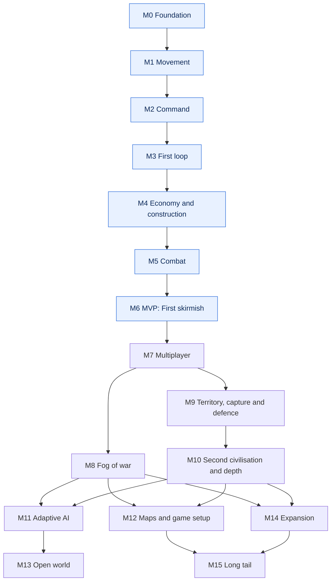

# Strategos roadmap — draft for approval

Drafted 2026-10-21 for the owner to approve feature by feature. After review it becomes
`docs/ROADMAP.md`, as [03-design-process.md](../03-design-process.md) describes.

**Inputs.** Owner decisions of 2026-10-20 ([research/README.md §1](../research/README.md)); the
mechanics catalog and its minimal core loop ([research/mechanics.md §4](../research/mechanics.md));
UX lessons and the borrow/avoid list ([research/prior-art.md §8 and §12](../research/prior-art.md));
engine facts, anti-patterns and planned spikes (research digest §3, §5, §7); the toolchain
([02-tooling.md](../02-tooling.md)); budgets and the risk register of
[01-feasibility.md](../01-feasibility.md), which this draft adopts rather than restates.

## Contents

1. [How to read this draft](#1-how-to-read-this-draft)
2. [The plan at a glance](#2-the-plan-at-a-glance)
3. [Milestones and feature cards](#3-milestones-and-feature-cards):
   [M0](#m0--foundation) · [M1](#m1--movement) · [M2](#m2--command) · [M3](#m3--first-loop) ·
   [M4](#m4--economy-and-construction) · [M5](#m5--combat) · [M6](#m6--mvp-first-skirmish) ·
   [M7](#m7--multiplayer) · [M8](#m8--fog-of-war) · [M9](#m9--territory-capture-and-defence) ·
   [M10](#m10--second-civilisation-and-depth) · [M11](#m11--adaptive-ai) ·
   [M12](#m12--maps-and-game-setup) · [M13](#m13--open-world) · [M14](#m14--expansion) ·
   [M15](#m15--long-tail)
4. [Decision points](#4-decision-points)
5. [How to approve](#5-how-to-approve)

---

## 1. How to read this draft

**Cards.** Every feature is a card with a stable ID, an area prefix and a number. Numbers run in
milestone order inside each area and are never reused.

| Prefix | Area | Prefix | Area |
|---|---|---|---|
| CORE | Simulation kernel: match, tick, commands, events, records, persistence | ECO | Resources, nodes, gathering, population |
| DATA | Templates, modifiers, content loading, balance sheet | BLD | Buildings: blueprints, construction, HP, garrison, walls |
| QA | Build, test harnesses, CI, playtest protocol, gates | PROD | Training queues, batches, rally points |
| PERF | Budgets, spikes, performance gates | TECH | Technologies and phases |
| UNIT | Unit records, bodies, behaviour, rosters | CMB | Combat, siege, capture, ranks |
| ORD | Orders and their semantics | TERR | Territory |
| PATH | Navigation and movement | FOW | Vision and fog of war |
| CAM | Commander camera and first person | NET | Networking and multiplayer |
| UI | Input, HUD, selection, menus | AI | AI opponents |
| MAP | Map packages, arenas, generation | MATCH | Match setup, rules, victory, lifecycle |
| CIV | Civilisations | ART · AUD | Art · audio |

**Fields of a card.**
- **Value:** what the player gets, in one or two sentences. Infrastructure cards name the
  player-facing effect they protect.
- **In scope / Out of scope:** the boundary; out-of-scope items name the card that owns them.
- **Acceptance:** numbered, testable criteria; each names the test level that proves it.
- **Tests:** the levels that must pass ([research/testing.md §2](../research/testing.md)):
  L1 core unit · L2 Minecraft-bootstrapped JUnit · L3 GameTest · L4 client scenario (opens a game
  window, so it runs only with the owner's consent) · L5 dedicated-server smoke · L6 performance ·
  L7 manual. L0 static analysis (format, compile, ErrorProne/NullAway, ArchUnit) runs on every
  change and is listed only where a card adds a rule.
- **Depends on:** cards and decision points (D-xx, §4) that must be done or decided first.
- **Size:** S up to 1 day, M up to 3 days, L up to 2 weeks. Nothing larger exists; bigger work is
  split. Milestone totals add upper bounds (S = 1, M = 3, L = 10 working days) and are not a
  calendar; calendar estimates live in [01-feasibility.md §6.5](../01-feasibility.md) and are
  re-estimated after M0.
- **Tier:** the catalog tier ([research/mechanics.md §4.3](../research/mechanics.md)): T0 core loop,
  T1 the 0 A.D. feel, T2 expansion, T3 later. In this roadmap the MVP is the T0 slice plus a way to
  destroy buildings; T1 items pulled into the MVP say so. Infrastructure takes the tier of the
  first gameplay it serves.
- **Status:** `proposed` everywhere in this draft. §5 explains how the owner changes it.

**Definition of Done** for every card: [03-design-process.md](../03-design-process.md#definition-of-done).
In short, behaviour is tested at the lowest level that can express it, the listed levels pass,
goldens and baselines change only with the owner's approval, and docs and the knowledge base are
updated in the same session.

**Engineering bar inside every card.** Rules live in the Minecraft-free `core`; content is data;
the server is authoritative and validates every command; hidden information never leaves the
server; clean-room rule ([research/README.md §8](../research/README.md)): no GPL or
all-rights-reserved code or assets, every number re-derived at Minecraft scale. Every Minecraft
and NeoForge name in the cards was checked in the decompiled 1.21.1 + NeoForge 21.1.262 sources.

---

## 2. The plan at a glance

### 2.1 Milestones

| Milestone | Goal | Cards | Upper bound (days) |
|---|---|---|---|
| [M0 · Foundation](#m0--foundation) | Build, every test harness, the kernel, a walking skeleton, spikes S1–S5 | 23 | 58 |
| [M1 · Movement](#m1--movement) | Hundreds of units cross real terrain on group orders, headless and inside budget | 20 | 88 |
| [M2 · Command](#m2--command) | RTS camera, box selection, mouse orders and first person, on a dedicated server | 11 | 38 |
| [M3 · First loop](#m3--first-loop) | Crude full match: gather, build, train, fight, destroy the enemy civic centre | 23 | 89 |
| [M4 · Economy and construction](#m4--economy-and-construction) | Four resources, deposits, fields, full building set, HP thresholds and repair | 18 | 49 |
| [M5 · Combat](#m5--combat) | Ranged and mounted units, counters, stances, focus fire, defensive arrows | 12 | 39 |
| [M6 · MVP: First skirmish](#m6--mvp-first-skirmish) | Phases and research, siege, conquest, save and pause, an AI with three levels | 20 | 76 |
| **MVP (M0–M6)** | **A solo skirmish against a scripted AI** | **127** | **437** |
| [M7 · Multiplayer](#m7--multiplayer) | 2–4 players on a dedicated server: lobby, teams, reconnects, bandwidth | 11 | 38 |
| [M8 · Fog of war](#m8--fog-of-war) | Server-enforced entity fog with explored state and last-seen buildings | 8 | 27 |
| [M9 · Territory, capture and defence](#m9--territory-capture-and-defence) | Territory, capture, garrisons, towers and palisades | 10 | 56 |
| [M10 · Second civilisation and depth](#m10--second-civilisation-and-depth) | Second civilisation, City phase, tech tree, ranks, healing, formations | 15 | 71 |
| [M11 · Adaptive AI](#m11--adaptive-ai) | Managers with one budget, expansion, attack plans, five levels | 7 | 40 |
| [M12 · Maps and game setup](#m12--maps-and-game-setup) | Seeded random maps, authoring tools, full setup screen, tutorial | 7 | 38 |
| [M13 · Open world](#m13--open-world) | Matches inside an ordinary survival world | 6 | 37 |
| [M14 · Expansion](#m14--expansion) | Trade, heroes, walls, artillery, naval play, more victory types and civilisations | 16 | 105 |
| [M15 · Long tail](#m15--long-tail) | Scenarios, replays, terrain secrecy, public content API, localisation | 8 | 52 |
| **All** | | **215** | **901** |

The day counts add each card's upper bound (S = 1, M = 3, L = 10) and overstate the work by design; they compare milestones, they don't schedule them.

### 2.2 Order and dependencies

The order follows four rules:
1. **Measure before building.** M0 replaces guessed budgets with numbers (spikes S1–S5) and
   builds every test harness before any gameplay.
2. **Retire the biggest risks first.** Pathfinding at scale is the hardest problem
   ([01-feasibility.md §3.1](../01-feasibility.md)), so M1 builds and proves movement headless,
   where the assistant can work without opening a game window. M2 then settles the camera, cursor
   and selection, which need the owner's hands and eyes.
3. **Play the whole loop early, then deepen it.** M3 is a crude but complete match — gather,
   build, train, fight, destroy the enemy civic centre — so "is this fun?" is answered before
   M4–M6 add the rest of the economy, combat, phases and a real opponent.
4. **The opponent grows with every system.** The AI player exists from M3 and learns each new
   system in the milestone that adds it (AI-01 … AI-05), instead of arriving at the end.

Post-MVP, the owner's stated next stage comes first (multiplayer), then fairness (fog of war),
then the 0 A.D. identity (territory and capture), content depth, AI depth, maps and the open
world. Where the graph below has no arrow between two milestones, their order is a
recommendation that a milestone review may change: M8 and M9 can swap, and M11–M14 can run in any
order their arrows allow. Cards of M0–M6 are detailed; from M7 on they are coarser by design and
are refined at the review that opens each milestone.

Arrows are hard dependencies derived from the cards (each arrow means some card needs a card of the earlier milestone), with redundant arrows removed. Highlighted: the MVP.

### 2.3 Risks and where they are retired

The register with likelihood, impact and mitigations is
[01-feasibility.md §4](../01-feasibility.md); this table maps its risks to the cards that retire
them.

| Risk (feasibility ID) | Measured or retired by | When |
|---|---|---|
| R1 server cost per unit | PERF-02 (S1), UNIT-05 level of detail, a perf gate in every milestone | M0, M4 |
| R2 client frame time with hundreds of humanoids | PERF-04 (S4), UNIT-03, ART-01 | M0, M2, M3 |
| R3 pathfinding: stuck units, jams, rebuilds under world edits | PATH-01 … PATH-10, PERF-05 | M1 |
| R4 camera and streaming on dedicated servers | CAM-01 spike, CAM-02 … CAM-04 | M2 |
| R5 client checks disturb the owner | QA-06 (S3) | M0 |
| R6 the AI opponent is not credible | AI-01 and QA-11 (bot and headless matches), AI-02 … AI-05, QA-12 | M3–M6 |
| R7 scope creep towards parity | tiers, the MVP gate QA-13, approval per card (§5) | always |
| R8 the owner's time runs out | a playable loop at M3; small milestones M2 and M5 | M3 |
| R9 AI-written code erodes the architecture | QA-01 gates, CORE-05 build rules, ADRs | M0 |
| R10 clean-room contamination | process rule from day one; behavioural notes only; provenance notes checked by QA-13 | always |
| R11 fog leaks | NET-01 single visibility-aware sender, FOW-02, FOW-05 | M1, M8 |
| R12 construction storms | PERF-02 includes a build-storm run; BLD-03 placement budget; PERF-06, PERF-07 | M0, M3, M4 |
| R13 Sodium or Iris break overlays or the camera | PERF-04 and CAM-01 under `-Pcompat`; a compat run in every client milestone | M0, M2 |
| R14 units or buildings duplicated or lost | CORE-06, CORE-07, MATCH-04 | M0, M6 |
| R15 determinism lost | CORE-05, PATH-03 (fixed-tick delivery) | M0, M1 |
| R16 wrong content pipeline | DATA-03 (with its ADR) | M1 |
| R17 balance never converges | DATA-04 balance sheet, QA-11, QA-12, QA-16 | M3–M10 |
| R18 art bottleneck | D-03, D-04, ART-01, ART-03 | M3, M6 |
| R19 force-loaded arena too costly | PERF-03 (S2) | M0 |
| R20 the ecosystem moves to 26.x | QA-14 decision gate | M7 |
| R21 other mods intrude into the arena | MATCH-01 match rules, compat runs | M3 |

### 2.4 Performance budgets

Provisional until S1–S4 report; PERF-01 adopts these targets from
[01-feasibility.md §5](../01-feasibility.md) and revises them once with measured numbers. All are
for the owner's M4 Pro.

| Budget | Target | Measured by |
|---|---|---|
| A · core systems | p50 ≤ 5 ms, p99 ≤ 10 ms per tick at 600 units | per-system timers (CORE-02) |
| B · Strategos-attributable server time (core, our entities' vanilla ticks, server-thread path work, replication) | p95 ≤ 17 ms per tick at 600 units | perf GameTests |
| C · whole server tick | p95 ≤ 23 ms, so a host twice as slow holds 20 TPS | `MinecraftServer#getTickTimesNanos` |
| D · pathfinding | ≤ 2 ms per tick on the server thread; a 100-unit order moving within 5 ticks p95 with 200 requests queued | path metrics (PATH-03) |
| E · network per client | ≤ 100 KB/s with 600 visible moving units | byte counters (NET-01) |
| F · client frame | p50 ≤ 16.7 ms, p99 ≤ 25 ms with 200 units on screen; our own drawing ≤ 3 ms; drawing units ≤ 6 ms | client timers, JFR |
| G · memory and saves | nav grid ≤ 32 MB for a 512² arena; autosave serialisation ≤ 100 ms | JMH, perf GameTests |

Every perf gate asserts the budgets at its milestone's target scale, and a stress run at twice
that scale must stay under 50 ms p95. Target scales: M1 300 moving units; M3 2 × 100 units and
20 buildings; M4 300 units and 60 buildings; M5 300 units fighting; M6 2 × 150 population and
60 buildings; M7 4 × 150 population and 120 buildings.

### 2.5 Engineering decisions the cards rely on

The research left ten contradictions for the design phase
([research/README.md §6](../research/README.md)). The architecture (04-architecture.md, in
progress) and the ADRs settle them; these cards produce or depend on each answer.

| Question | Settled by | Needed before |
|---|---|---|
| 1 · Authority: who owns position, HP, orders | PERF-02 (S1) ADR, implemented by CORE-06 | UNIT-01 |
| 2 · Stats: core modifier pipeline or vanilla attributes | architecture ADR; DATA-02 assumes the core pipeline is the single source and vanilla attributes only mirror what vanilla code reads | DATA-02 |
| 3 · Content: data-pack registries or a reload listener | DATA-03 ADR | DATA-03 |
| 4 · Determinism boundary | CORE-05; fixed-tick path delivery in PATH-03 | PATH-03 |
| 5 · Navigation representation | PATH-01 spike ADR | PATH-02 |
| 6 · Fog re-check cadence and leaks | CAM-01 ADR (cadence follows from the camera body), FOW-02, FOW-05 | M8 |
| 7 · Commander camera and input | CAM-01 spike ADR | CAM-02 |
| 8 · Budgets | PERF-01 | M0 exit |
| 9 · GameTest wiring | QA-01 (S5) ADR | QA-04 |
| 10 · Licensing of prior art | clean-room rule; D-07 for Strategos's own licence | first public release |

---

## 3. Milestones and feature cards

Spike results go to `docs/spikes/` and every lasting decision to an ADR in [docs/adr/](../adr/),
as [03-design-process.md](../03-design-process.md) requires. Each milestone gets its
implementation spec in `docs/milestones/` before its code starts.

### M0 · Foundation

**Goal.** Infrastructure only: the build and toolchain, every test harness, the simulation
kernel, a walking skeleton, and the M0 spikes S1–S5, so that every later feature can be proven
and every budget rests on a measurement.

**Demo.** From a clean clone, one command runs every automated test level and goes green; a
GameTest log shows one unit walking to a point given by a debug command; the spike reports state
how many units the server and the client can afford on the M4 Pro.

**Exit criteria.**
1. Every acceptance criterion of the approved M0 cards passes at its listed levels.
2. `verify` is green on a clean checkout on the M4 Pro (and on CI if QA-08 is approved). A
   deliberately empty GameTest set and a deliberately broken mod load both fail the build.
3. The walking-skeleton GameTest (ORD-01) passes 20 of 20 runs with different seeds; the skeleton
   match survives save and load with an equal state hash (CORE-07).
4. Kernel suites green at L1: determinism replay over 200 seeds (CORE-05), command validation
   (CORE-03), lifecycle (CORE-01).
5. Reports in `docs/spikes/` and ADRs for S1, S2 and S5; for S3 and S4 too if the owner consented,
   otherwise their ADRs record "pending consent" and the provisional values stay. The owner has
   approved the revised budget table (PERF-01) and has the numbers for D-01.
6. L7: the owner has watched the skeleton unit move on a dedicated server from two clients.

**Retires.** R5, R9, R15 and R19; measures R1, R2 and R12.

**Critical path.** QA-01 → QA-04 → QA-07 → PERF-02 → CORE-06 → UNIT-01 → ORD-01 (19 days by the card bounds).

[03-design-process.md](../03-design-process.md) pre-approves M0 as `approved-foundation`. The cards
are listed as `proposed` so the owner can check their scope; the review sets them to
`approved-foundation` unless the owner objects.

| Card | Title | Size | Tier |
|---|---|---|---|
| [QA-01](#qa-01--build-skeleton-and-static-gates) | Build skeleton and static gates | M | T0 |
| [QA-02](#qa-02--core-test-kit-l1) | Core test kit (L1) | S | T0 |
| [QA-03](#qa-03--minecraft-bootstrapped-unit-tests-l2) | Minecraft-bootstrapped unit tests (L2) | S | T0 |
| [QA-04](#qa-04--gametest-harness-l3) | GameTest harness (L3) | M | T0 |
| [QA-05](#qa-05--dedicated-server-smoke-test-l5) | Dedicated-server smoke test (L5) | S | T0 |
| [QA-06](#qa-06--client-scenario-harness-and-spike-s3-l4) | Client scenario harness and spike S3 (L4) | L | T0 |
| [QA-07](#qa-07--performance-harness-l6) | Performance harness (L6) | M | T0 |
| [QA-08](#qa-08--continuous-integration) | Continuous integration | S | T0 |
| [QA-09](#qa-09--manual-test-protocol-and-multi-client-launch-l7) | Manual test protocol and multi-client launch (L7) | S | T0 |
| [QA-10](#qa-10--developer-commands-and-diagnostics) | Developer commands and diagnostics | S | T0 |
| [PERF-01](#perf-01--performance-budgets) | Performance budgets | S | T0 |
| [PERF-02](#perf-02--spike-s1-server-cost-per-unit) | Spike S1: server cost per unit | M | T0 |
| [PERF-03](#perf-03--spike-s2-force-loaded-arena-cost) | Spike S2: force-loaded arena cost | M | T0 |
| [PERF-04](#perf-04--spike-s4-client-frame-time-with-many-units) | Spike S4: client frame time with many units | M | T0 |
| [CORE-01](#core-01--match-container) | Match container | M | T0 |
| [CORE-02](#core-02--tick-pipeline-and-scheduler) | Tick pipeline and scheduler | M | T0 |
| [CORE-03](#core-03--command-pipeline) | Command pipeline | M | T0 |
| [CORE-04](#core-04--match-event-bus) | Match event bus | S | T0 |
| [CORE-05](#core-05--determinism-kit) | Determinism kit | M | T0 |
| [CORE-06](#core-06--unit-records-and-body-seam) | Unit records and body seam | M | T0 |
| [CORE-07](#core-07--persistence-kernel) | Persistence kernel | M | T0 |
| [UNIT-01](#unit-01--unit-body-v0) | Unit body v0 | M | T0 |
| [ORD-01](#ord-01--walking-skeleton-a-debug-move-order) | Walking skeleton: a debug move order | S | T0 |

**Size.** 23 cards — 9 S, 13 M, 1 L — at most 58 working days by the card bounds.

#### QA-01 · Build skeleton and static gates
- **Value:** The mod loads cleanly on clients and dedicated servers, and every later feature lands
  on a build that rejects whole classes of bugs by itself.
- **In scope:** Gradle multi-project (`build-logic`, `core`, `mod`) with the pins of
  [02-tooling.md](../02-tooling.md) in a version catalog; `core` merged into the mod for dev runs
  and the jar; the daemon JVM pinned; Spotless with palantir-java-format, ErrorProne with NullAway
  in JSpecify mode, ArchUnit; aggregate tasks `verifyFast` and `verify`; spike S5 (wiring,
  configuration cache, where GameTests live).
- **Out of scope:** CI (QA-08); publishing.
- **Acceptance:**
  1. On a clean checkout `./gradlew verifyFast` passes, and a catalog check fails on any dynamic
     version or range (L0).
  2. A scripted check finds every `core` class exactly once in the built jar and loads it in client,
     server and GameTest runs (L0, L5).
  3. A `net.minecraft` import in `core` fails compilation; common code that references a client
     package fails `archTest`; a null-unsafe dereference fails NullAway (L0).
  4. The second `verifyFast` run reuses the configuration cache, or the S5 ADR records why it cannot.
  5. The S5 ADR settles research contradiction 9: a separate test mod, or source sets inside the
     `strategos` mod group.
- **Tests:** L0, L5 · **Depends on:** — · **Size:** M · **Tier:** T0
- **Status:** proposed

#### QA-02 · Core test kit (L1)
- **Value:** Game rules are checked in seconds on every change, so logic and balance edits are safe.
- **In scope:** JUnit 5.14.4 and AssertJ in `core`; a seeded invariant runner on
  `@ParameterizedTest` that prints the seed in every failure and reruns one seed from a property;
  state-hash and fixture builders.
- **Out of scope:** property-based testing libraries (jqwik ≥ 1.10 is banned by the tooling decision).
- **Acceptance:**
  1. `:core:test` finishes in under 10 s for the kernel suites (L1).
  2. A failing seeded test prints its seed, and `-Dstrategos.seed=<n>` reproduces it (L1).
  3. A sample invariant runs over 200 seeds in the default build (L1).
- **Tests:** L1 · **Depends on:** QA-01 · **Size:** S · **Tier:** T0
- **Status:** proposed

#### QA-03 · Minecraft-bootstrapped unit tests (L2)
- **Value:** Saves and network messages are checked against the real game classes, so they don't
  break silently between versions.
- **In scope:** ModDevGradle's unit-test integration with `testframework` 21.1.264; codec
  round-trip and encoded-size helpers; one test fork.
- **Out of scope:** anything that needs a world (GameTests).
- **Acceptance:**
  1. A codec round-trip test and a payload-size test run in `:mod:test` (L2).
  2. A payload over its size cap fails the helper with the actual and the allowed size (L2).
  3. Bootstrap time is measured and written to the testing notes (L2).
- **Tests:** L2 · **Depends on:** QA-01 · **Size:** S · **Tier:** T0
- **Status:** proposed

#### QA-04 · GameTest harness (L3)
- **Value:** Every in-world behaviour — walking, fighting, building — is proven in a real server
  world before it reaches the player.
- **In scope:** one generator with our own test annotation; arenas as SNBT files in the repository;
  a name filter (`-Pgametest.filter`); a JUnit XML report; retries implemented by our generator
  (1.21.1 swaps `attempts` and `requiredSuccesses`); batches `default`, `perf` and `slow`; the build
  fails on a missing or empty report.
- **Out of scope:** match fixtures (CORE-01); importing large terrain (MAP-01).
- **Acceptance:**
  1. A filter that matches no test fails the build (L3).
  2. A mod-loading error in the GameTest run fails the build although the server process exits 0 (L3).
  3. The JUnit XML lists every test with its duration and CI can parse it (L3).
  4. A test declared "2 successes out of 3 attempts" behaves as declared (L3).
- **Tests:** L3 · **Depends on:** QA-01 · **Size:** M · **Tier:** T0
- **Status:** proposed

#### QA-05 · Dedicated-server smoke test (L5)
- **Value:** The mod never crashes a dedicated server because of client-only code.
- **In scope:** `runServerSmoke`, which halts after server start and writes a marker; port 25599, so
  it never collides with the owner's dev server; fails without the marker or on a new crash report.
- **Out of scope:** gameplay on the server (GameTests).
- **Acceptance:**
  1. Green on a clean build in under 60 s (L5).
  2. A deliberate client-class reference in common code makes it fail (L5).
  3. A deliberate crash during start makes it fail although the process exits 0 (L5).
- **Tests:** L5 · **Depends on:** QA-01 · **Size:** S · **Tier:** T0
- **Status:** proposed

#### QA-06 · Client scenario harness and spike S3 (L4)
- **Value:** Camera, HUD and rendering changes are checked by machine with screenshots, without
  disturbing the owner's work.
- **In scope:** a dev-only `devtools` source set; a scenario runner (fresh seeded flat world, fixed
  options, scripted steps through our own APIs, framebuffer PNG plus JSON captured on
  `RenderFrameEvent.Post` with `Screenshot.takeScreenshot`, a watchdog); `scenarioDiff` (normalised
  mean squared error, masks, goldens per platform); spike S3 — focus stealing, typing capture,
  rendering while unfocused, covered or on another Space, the Retina framebuffer size,
  repeatability, and a Linux container route under Xvfb.
- **Out of scope:** an interactive dev bridge into a running client (later, if ever needed).
- **Acceptance:**
  1. The `smoke` scenario writes 3 PNGs and `result.json` and exits 0 within 3 minutes; a stalled
     scenario exits non-zero through the watchdog (L4).
  2. Ten consecutive runs differ by less than the threshold, or the variance is masked and
     documented (L4).
  3. The S3 report answers each question above, and its ADR sets the L4 policy: local runs with
     consent, container runs, or CI only.
  4. Goldens change only with the owner's approval; the harness README states the procedure.
- **Tests:** L4 (consent) · **Depends on:** QA-01 · **Size:** L · **Tier:** T0
- **Status:** proposed

#### QA-07 · Performance harness (L6)
- **Value:** Tick rate and frame rate stay stable as features grow, because every hot path has a
  measured baseline.
- **In scope:** a JMH source set in `core` run through `JavaExec` (no plugin); a `perf` GameTest
  batch with percentile statistics after a warm-up window; committed baselines per machine;
  `verifyPerf` fails on a regression above 15%.
- **Out of scope:** the budgets themselves (PERF-01).
- **Acceptance:**
  1. A sample benchmark writes JSON, and `verifyPerf` fails when a deliberate slowdown exceeds 15% (L6).
  2. A perf GameTest records server tick p50, p95 and p99 after warm-up and fails against a
     configured budget (L6).
  3. Perf tests run in their own invocation, never in a batch with functional tests (L6).
- **Tests:** L6 · **Depends on:** QA-02, QA-04 · **Size:** M · **Tier:** T0
- **Status:** proposed

#### QA-08 · Continuous integration
- **Value:** Every change is verified the same way on a clean machine, not only on the owner's Mac.
- **In scope:** one GitHub Actions Linux job: `check`, a datagen diff, GameTests, the server smoke
  test, client scenarios under Xvfb on pull requests and `main`; JUnit reports; artifacts kept for
  7 days; the basic cache provider; perf checked at 3× budget on shared runners. Needs the private
  GitHub repository, which the owner decides about.
- **Out of scope:** release publishing.
- **Acceptance:**
  1. A pull request shows per-test results from L1, L2, L3 and L5.
  2. The scenario step uploads PNGs and diffs; a changed golden fails the job (L4 on CI, no consent
     needed: no window opens on the owner's Mac).
  3. The whole job finishes in under 20 minutes.
- **Tests:** L1, L2, L3, L4, L5 · **Depends on:** QA-04, QA-05, QA-06 · **Size:** S · **Tier:** T0
- **Status:** proposed

#### QA-09 · Manual test protocol and multi-client launch (L7)
- **Value:** The owner can try every milestone under real multiplayer conditions with one command.
- **In scope:** launch scripts for a dedicated server plus two clients, with separate game
  directories and fixed usernames; a playtest checklist and report template in `docs/`; the bug
  severity scale P0–P3 that exit criteria refer to.
- **Out of scope:** automated multiplayer tests (QA-15).
- **Acceptance:**
  1. One documented command starts a server and two clients that connect to it (L7).
  2. The checklist and template exist and are used at the M0 exit (L7).
  3. P0–P3 are defined, with an example for each.
- **Tests:** L7 · **Depends on:** QA-05 · **Size:** S · **Tier:** T0
- **Status:** proposed

#### QA-10 · Developer commands and diagnostics
- **Value:** Problems are visible and reproducible in the game, which shortens every debugging session.
- **In scope:** a `/strategos` command tree with permission levels; logs tagged with match id and
  tick; an optional dev payload channel; a host for dev overlays that later cards fill (PATH-10).
- **Out of scope:** overlay content.
- **Acceptance:**
  1. Debug commands need permission level 2 and are hidden from players without it (L3).
  2. Every log line from match code carries the match id and tick (L3).
  3. A client that has not enabled a dev overlay receives no dev payload (L3, mock player).
- **Tests:** L3 · **Depends on:** QA-04 · **Size:** S · **Tier:** T0
- **Status:** proposed

#### PERF-01 · Performance budgets
- **Value:** The game holds 20 TPS and smooth frames at the promised army sizes, because each
  milestone is gated on fixed budgets.
- **In scope:** the definitions, measuring methods and targets of §2.4 (adopted from
  [01-feasibility.md §5](../01-feasibility.md)) and the target scale per milestone; one revision
  with S1–S4 numbers; settles research contradiction 8.
- **Out of scope:** the measurements (PERF-02 … PERF-04).
- **Acceptance:**
  1. The budget table states what each budget measures, how, and on which machine.
  2. Perf GameTests can assert every server budget; a synthetic overload test fails as expected (L6).
  3. The table is revised once with S1–S4 numbers and approved by the owner; any later change needs
     the owner's approval and an ADR.
- **Tests:** L6 · **Depends on:** QA-07 · **Size:** S · **Tier:** T0
- **Status:** proposed

#### PERF-02 · Spike S1: server cost per unit
- **Value:** The population cap and the unit design rest on measured numbers, not guesses.
- **In scope:** three throwaway unit bodies behind one interface — a stripped `PathfinderMob`, a
  kinematic puppet, a `LivingEntity`; 200, 500 and 1,000 units idle, moving and fighting, and moving
  while blocks are placed nearby at the planned construction budget (build storm: placements cost
  O(blocks × mobs) through `ServerLevel#sendBlockUpdated`); µs per unit per tick at p50 and p95,
  whole-tick time, JFR hot methods; with and without Lithium.
- **Out of scope:** production unit code (UNIT-01).
- **Acceptance:**
  1. A reproducible perf batch produces the full table (body × count × state) (L6).
  2. The S1 ADR picks a body, lists what each body loses (fluids, knockback, slabs and stairs,
     doors), and settles research contradiction 1: who owns position, HP and orders.
  3. The numbers feed PERF-01 and D-01; a best body above 15 µs per unit at 500 moving units lowers
     the recommended cap to 100 per player.
- **Tests:** L6 · **Depends on:** QA-04, QA-07 · **Size:** M · **Tier:** T0
- **Status:** proposed

#### PERF-03 · Spike S2: force-loaded arena cost
- **Value:** A match keeps simulating the whole arena without lag, even where the camera is not.
- **In scope:** pregenerated arenas of 24², 32² and 64² chunks; `TicketController` tickets with
  `ticking=false` and `ticking=true`; no player online; tick time, heap, autosave time.
- **Out of scope:** the arena importer (MAP-01).
- **Acceptance:**
  1. A results table per arena size and ticket mode (L6).
  2. Entities keep ticking for 10 minutes with no player online (L6).
  3. The S2 ADR picks the ticket mode and the largest arena per player count (input to D-17).
- **Tests:** L6 · **Depends on:** QA-05, QA-07 · **Size:** M · **Tier:** T0
- **Status:** proposed

#### PERF-04 · Spike S4: client frame time with many units
- **Value:** The screen stays smooth with whole armies in view.
- **In scope:** 200, 500 and 1,000 humanoid units under a fixed elevated camera; the vanilla
  humanoid with armour and held items against a minimal model; render distance 16 and 32; with and
  without Sodium (the `-Pcompat` profile).
- **Out of scope:** the unit look (ART-01).
- **Acceptance:**
  1. A results table with frame time p50 and p99 and the share of entities against terrain (L4/L7).
  2. The S4 ADR states how many visible units vanilla renderers fit within budget F, and whether
     level of detail or impostors are needed.
  3. The numbers feed D-01 and D-04.
- **Tests:** L4 (consent), L7 · **Depends on:** QA-06 · **Size:** M · **Tier:** T0
- **Status:** proposed

#### CORE-01 · Match container
- **Value:** Every match is self-contained — its own area, players and rules — so nothing leaks
  between matches or worlds, and tests can run many matches side by side.
- **In scope:** a match object with id, bounds in match-local coordinates, players and factions keyed
  by UUID plus Gaia, rules, tick counter and seed; a per-server registry with no static state; the
  lifecycle SETUP → RUNNING → PAUSED → ENDED → DISPOSED; GameTest fixtures that create a match
  inside a test region.
- **Out of scope:** match setup screens (MATCH-02); teams and diplomacy (MATCH-06).
- **Acceptance:**
  1. Two matches in one level run 1,000 ticks side by side with no shared mutable state (L3).
  2. Closing one singleplayer world and opening another leaves no match state behind (L3).
  3. ArchUnit forbids mutable static fields in gameplay packages, with an allow-list for registries (L0).
  4. Illegal lifecycle transitions are rejected (L1).
- **Tests:** L0, L1, L3 · **Depends on:** QA-02, QA-04 · **Size:** M · **Tier:** T0
- **Status:** proposed

#### CORE-02 · Tick pipeline and scheduler
- **Value:** Game logic runs in a fixed order every tick, so orders feel immediate and systems never
  fight over state.
- **In scope:** a per-match tick driven by the server tick; fixed phases (deliver async results →
  apply commands → systems → motion → finalise → remove destroyed); per-system cadence with
  staggered offsets; per-system timers feeding budget A; respects `/tick freeze` and `/tick step`
  (`TickRateManager#runsNormally`).
- **Out of scope:** level of detail for units (UNIT-05).
- **Acceptance:**
  1. A recorded trace shows the phase order of a test match (L1).
  2. A system with cadence 10 over 1,000 entities processes 100 per tick, never all at once (L1).
  3. With the server frozen the match does not advance; `/tick step 5` advances it exactly 5 ticks (L3).
  4. Timer overhead stays below 1% of the measured system time (L6).
- **Tests:** L1, L3, L6 · **Depends on:** CORE-01 · **Size:** M · **Tier:** T0
- **Status:** proposed

#### CORE-03 · Command pipeline
- **Value:** Every player and AI action is a server-validated command, so no client can move another
  player's units, and any match can be replayed.
- **In scope:** typed command records (sealed types, one handler each, no giant enum); issuer
  identity (player UUID or AI controller); validation of ownership, existence, match membership,
  rate and size, with reason codes; a queue applied at the next tick boundary in stable order; a
  per-match command log; sources: server commands, network payloads (NET-01), AI controllers.
- **Out of scope:** client-side prediction.
- **Acceptance:**
  1. Commands issued during tick t apply at the start of t+1 in stable order; replaying the log
     reproduces the state hash (L1).
  2. A command on another player's unit is rejected with a reason code and changes nothing (L1).
  3. The rate limit (40 commands per second per issuer) and size cap (300 unit ids per command) hold (L1).
  4. A server command enqueues through the same path as network commands (L3).
- **Tests:** L1, L3 · **Depends on:** CORE-02 · **Size:** M · **Tier:** T0
- **Status:** proposed

#### CORE-04 · Match event bus
- **Value:** Systems react to each other — a unit dies, a building completes — instantly and in the
  same order every time.
- **In scope:** a typed, synchronous per-match bus; deterministic dispatch order; a documented policy
  for events published while dispatching; internal traffic never goes through NeoForge's global bus.
- **Out of scope:** network events (NET-01).
- **Acceptance:**
  1. Dispatch order is identical across runs (L1).
  2. Nested publishes follow the policy without recursion overflow (L1).
  3. A JMH baseline for dispatch is recorded (L6).
- **Tests:** L1, L6 · **Depends on:** CORE-01 · **Size:** S · **Tier:** T0
- **Status:** proposed

#### CORE-05 · Determinism kit
- **Value:** Any bug seen in a match or a test can be replayed exactly, which makes fixes fast and
  balance tests trustworthy.
- **In scope:** per-match and per-system RNG streams from the match seed; stable entity ids; ordered
  iteration in rules code; a state hash; banned APIs in `core` rules (wall clock, `Math.random`,
  hash-order iteration); a documented determinism boundary — core rules are deterministic, vanilla
  physics is not — settling research contradiction 4.
- **Out of scope:** replays for players (MATCH-13).
- **Acceptance:**
  1. The same seed and command log give an identical state hash after 10,000 ticks, over 200 seeds (L1).
  2. A build rule fails on wall-clock or `Math.random` use in `core` outside the instrumentation
     package (L0).
  3. The architecture ADR states the boundary and how async results are delivered (fixed tick,
     PATH-03).
- **Tests:** L0, L1 · **Depends on:** CORE-03, CORE-04 · **Size:** M · **Tier:** T0
- **Status:** proposed

#### CORE-06 · Unit records and body seam
- **Value:** Units never duplicate or vanish when chunks reload, worlds are saved or the camera jumps
  away.
- **In scope:** an authoritative unit record (id, owner, template, position, health, order queue,
  state) as the S1 ADR decides; a body interface that the entity implements; materialise and
  dematerialise; the record–entity link by id.
- **Out of scope:** abstract travel outside loaded chunks (CORE-09).
- **Acceptance:**
  1. The record lifecycle — create, move, damage, remove — runs without Minecraft (L1).
  2. Unloading and reloading a unit's chunk leaves exactly one entity for the record, within 0.01 block
     and with unchanged health (L3).
  3. Removing the entity by a vanilla cause (`/kill`) updates the record by the ADR's rule; no
     dangling records (L3).
  4. Switching the body needs no change to `core` rules: ArchUnit proves `core` never references the
     body implementation (L0).
- **Tests:** L0, L1, L3 · **Depends on:** CORE-01, PERF-02 · **Size:** M · **Tier:** T0
- **Status:** proposed

#### CORE-07 · Persistence kernel
- **Value:** Saves never lose units, resources or progress, and old saves keep loading after updates.
- **In scope:** match state encoded with codecs into `SavedData`; a schema version in every blob;
  migrations on raw data before decoding; dirty tracking per subsystem; saving on autosave and world
  close; a folder of old-save fixtures.
- **Out of scope:** the player-facing save and resume flow (MATCH-04).
- **Acceptance:**
  1. Encoding and decoding a 500-unit fixture keeps the state hash (L1, L2).
  2. A version-1 fixture migrates to version 2 through a sample migration (L2).
  3. Save, dispose and load in the same level keep the state hash (L3).
  4. Main-thread serialisation of a 500-unit match stays within budget G (L6).
- **Tests:** L1, L2, L3, L6 · **Depends on:** CORE-06 · **Size:** M · **Tier:** T0
- **Status:** proposed

#### UNIT-01 · Unit body v0
- **Value:** Units appear in the world as real Minecraft entities that every client sees.
- **In scope:** one generic unit entity type per body family, as the S1 ADR decides; vanilla
  overheads off — no despawn (`setPersistenceRequired`, a no-op `checkDespawn`), no pushing or
  cramming (`isPushable` false, a no-op `pushEntities`), no step vibrations (`getMovementEmission`
  returns `NONE`), no loot pickup; `Attributes.STEP_HEIGHT` 1.0; control through
  `Mob#customServerAiStep` if the body is a mob; the template id synced to clients; a placeholder
  humanoid look.
- **Out of scope:** the look (ART-01); outlines and view tuning (UNIT-03); level of detail (UNIT-05).
- **Acceptance:**
  1. An idle unit never despawns over 6,000 ticks, is never pushed by a neighbour, and does not
     trigger a sculk sensor next to it (L3).
  2. A unit walks up a 1-block step without jumping (L3).
  3. The synced template id round-trips (L2).
  4. A dedicated server starts with the entity type registered (L5).
- **Tests:** L2, L3, L5 · **Depends on:** CORE-06 · **Size:** M · **Tier:** T0
- **Status:** proposed

#### ORD-01 · Walking skeleton: a debug move order
- **Value:** The first end-to-end proof: an order goes through the server, a unit walks in the world,
  and every client sees it.
- **In scope:** `/strategos debug spawn` and `/strategos debug move` → a move command → a core order
  → simple motion on a flat arena → arrival → idle.
- **Out of scope:** pathfinding (PATH cards); orders from the UI (UI-05).
- **Acceptance:**
  1. A GameTest spawns a unit and orders a move 20 blocks away; it arrives within 0.5 block in at most
     distance ÷ speed + 20 ticks; 20 of 20 seeded runs pass (L3).
  2. A target outside the match bounds is rejected with a reason and the unit stays (L3).
  3. The unit goes IDLE → WALKING → IDLE with a recorded event trace (L1).
  4. The owner sees the move on two clients of a dedicated server (L7).
- **Tests:** L1, L3, L7 · **Depends on:** CORE-03, UNIT-01, QA-10 · **Size:** S · **Tier:** T0
- **Status:** proposed

### M1 · Movement

**Goal.** Retire the largest risk first: hundreds of data-defined units cross real Minecraft terrain
on group orders, with no stuck units and inside the budgets. Everything here runs headless, so the
assistant can build and test it without opening a game window.

**Demo.** On the 384 × 384 proving ground, a GameTest orders 200 units across the river, through a
narrow pass and up ramps; all arrive with no stuck units, and the perf report shows the budgets
held. With the dev overlay on, the owner watches the paths in a normal client.

**Exit criteria.**
1. Every acceptance criterion of the approved M1 cards passes.
2. L3: 200 units ordered across the proving ground arrive with zero stuck units within 1.5× the
   ideal time; two groups of 50 pass head-on through a 6-block gap; a boxed-in unit recovers; a
   joining mock player receives the template set before any unit.
3. L6 (PERF-05): 300 units on random orders for 10 minutes keep budgets A–D, and no unit is stuck
   for longer than 10 s.
4. L1: identical paths and state hash for the same seed and commands, with path worker pools of
   1, 2 and 8 threads.
5. ADRs merged: navigation representation (PATH-01) and content loading (DATA-03).

**Retires.** R3, R15 and R16.

**Critical path.** PATH-01 → PATH-02 → PATH-03 → PATH-05 → PATH-06 → PATH-09 → PERF-05 (42 days by the card bounds).

| Card | Title | Size | Tier |
|---|---|---|---|
| [DATA-01](#data-01--template-engine) | Template engine | M | T0 |
| [DATA-02](#data-02--modifier-pipeline) | Modifier pipeline | M | T0 |
| [DATA-03](#data-03--content-loading-and-client-sync) | Content loading and client sync | M | T0 |
| [CORE-08](#core-08--spatial-index) | Spatial index | M | T0 |
| [NET-01](#net-01--payload-layer-and-interest-manager) | Payload layer and interest manager | M | T0 |
| [UNIT-02](#unit-02--unit-behaviour-state-machine) | Unit behaviour state machine | M | T0 |
| [ORD-02](#ord-02--order-queue-move-and-stop) | Order queue: move and stop | M | T0 |
| [ORD-03](#ord-03--group-destination-slots) | Group destination slots | M | T0 |
| [PATH-01](#path-01--navigation-representation-spike) | Navigation representation spike | M | T0 |
| [PATH-02](#path-02--navigation-grid) | Navigation grid | L | T0 |
| [PATH-03](#path-03--async-path-service) | Async path service | L | T0 |
| [PATH-04](#path-04--regions-and-reachability) | Regions and reachability | M | T0 |
| [PATH-05](#path-05--path-following) | Path following | M | T0 |
| [PATH-06](#path-06--local-avoidance) | Local avoidance | M | T0 |
| [PATH-07](#path-07--stuck-detection-and-recovery) | Stuck detection and recovery | M | T0 |
| [PATH-08](#path-08--hierarchical-long-range-planner) | Hierarchical long-range planner | L | T0 |
| [PATH-09](#path-09--group-movement-at-scale) | Group movement at scale | L | T0 |
| [PATH-10](#path-10--movement-debug-overlay) | Movement debug overlay | M | T0 |
| [MAP-01](#map-01--map-packages-arena-loading-and-the-proving-ground) | Map packages, arena loading and the proving ground | M | T0 |
| [PERF-05](#perf-05--crowd-soak-and-perf-gate) | Crowd soak and perf gate | M | T0 |

**Size.** 20 cards — 0 S, 16 M, 4 L — at most 88 working days by the card bounds.

#### DATA-01 · Template engine
- **Value:** Every unit, building and technology is defined in data with inheritance, so content and
  balance change without code.
- **In scope:** JSON templates with `parent` chains and mixin layers; merge operations (add,
  multiply, replace, disable, token add and remove); detection of cycles and missing parents;
  code-defined variants (foundation, placement preview, fog ghost); typed decoding with codecs;
  errors with file and JSON path; an immutable, hashable template set. Design borrowed from
  0 A.D. as behaviour only; no 0 A.D. file is read or copied.
- **Out of scope:** loading from data packs (DATA-03).
- **Acceptance:**
  1. A 3-level chain with 2 mixins resolves to the expected flattened template (golden JSON, L1).
  2. Each merge operation behaves as specified in a table-driven test, token removal included (L1).
  3. Cycles and unknown parents fail with `file: path: reason` (L1).
  4. Variant filters drop or override exactly the specified parts (L1).
  5. Resolving 500 templates takes under 200 ms (L6).
- **Tests:** L1, L6 · **Depends on:** QA-02 · **Size:** M · **Tier:** T0
- **Status:** proposed

#### DATA-02 · Modifier pipeline
- **Value:** Technologies, ranks, civilisation bonuses and AI handicaps stack predictably, and
  tooltips always show the true numbers.
- **In scope:** modifiers on value paths with add, multiply and replace; class-token filters such as
  `Infantry !Cavalry`; sources (technology, rank, civilisation, aura, match rule); a documented
  application order; cached results invalidated through the match event bus; a breakdown query for
  tooltips. With the architecture ADR this settles research contradiction 2: the pipeline is the only
  source of stats, and vanilla attributes only mirror values vanilla code reads (step height,
  movement speed).
- **Out of scope:** technologies themselves (TECH-01).
- **Acceptance:**
  1. Table-driven tests fix the order of add, multiply and replace (L1).
  2. Adding or removing one modifier invalidates exactly the affected cache entries (L1).
  3. The breakdown returns the base value, each modifier with its source, and the final value (L1).
  4. A cached lookup costs under 50 ns (L6).
- **Tests:** L1, L6 · **Depends on:** DATA-01, CORE-04 · **Size:** M · **Tier:** T0
- **Status:** proposed

#### DATA-03 · Content loading and client sync
- **Value:** Content and balance load from data packs, reload during development without a restart,
  and every client sees exactly the server's definitions.
- **In scope:** the content ADR (research contradiction 3, gap G6), prototyped with about 20
  templates both ways; templates loaded by a reload listener (`AddReloadListenerEvent`) with DATA-01
  inheritance, and data-pack registries only for stable ids if the ADR wants them; validation with
  file paths; an atomic swap of the template set; sync on `OnDatapackSyncEvent` (login and
  `/reload`) with a content hash. Entity types stay generic: a data pack can add units only with
  models the client already has.
- **Out of scope:** the public authoring guide (DATA-05).
- **Acceptance:**
  1. All bundled templates decode; a broken one fails loading with `file: path: reason` (L2).
  2. After `/reload` with a changed unit speed, existing units move at the new speed within one tick (L3).
  3. A joining mock player receives the template set, with a matching hash, before any unit is paired
     to it (L3).
  4. The sync payload for the MVP content stays under 256 KB (L2).
- **Tests:** L2, L3 · **Depends on:** DATA-01, NET-01 · **Size:** M · **Tier:** T0
- **Status:** proposed

#### CORE-08 · Spatial index
- **Value:** Units find nearby enemies, resources and dropsites instantly, even in large battles.
- **In scope:** a per-match uniform grid for units and buildings, updated incrementally; radius, box
  and nearest-k queries with class filters; results in id order.
- **Out of scope:** the resource node index (ECO-02).
- **Acceptance:**
  1. Query results equal brute force over 1,000 random seeds (L1).
  2. 1,000 radius-16 queries among 1,000 units take under 1 ms per tick (L6).
  3. Results come in id order (L1).
- **Tests:** L1, L6 · **Depends on:** CORE-01 · **Size:** M · **Tier:** T0
- **Status:** proposed

#### NET-01 · Payload layer and interest manager
- **Value:** The multiplayer foundation: every message is compact, validated and sent only to players
  allowed to see it, so fog of war will need no rewiring.
- **In scope:** payloads registered through `RegisterPayloadHandlersEvent` with a protocol version;
  `StreamCodec` records in one package; size caps; serverbound rate limits; one outbound sender that
  requires an audience (a player, a team, the viewers of an entity) and a visibility predicate,
  which defaults to "same match"; per-player byte counters.
- **Out of scope:** the multiplayer lobby and team rules (NET-02, NET-03).
- **Acceptance:**
  1. Every payload round-trips and stays within its cap (L2).
  2. ArchUnit forbids `PacketDistributor` calls outside the network package (L0).
  3. A mock player outside the match receives no match payload (L3).
  4. Byte counters are exported to perf tests (L6).
- **Tests:** L0, L2, L3, L6 · **Depends on:** CORE-03, QA-03 · **Size:** M · **Tier:** T0
- **Status:** proposed

#### UNIT-02 · Unit behaviour state machine
- **Value:** Units behave predictably: they finish tasks, react to new orders at once and never stall
  doing nothing.
- **In scope:** a hierarchical state machine in `core` — nested states, enter and leave hooks,
  inherited handlers, plain-data state for saves; a check cadence per transition; IDLE and WALKING
  now, with extension points that GATHER, BUILD and COMBAT use later.
- **Out of scope:** the states themselves beyond walking (ECO-05, BLD-03, CMB-02).
- **Acceptance:**
  1. Nested transitions and inherited handlers pass table-driven tests (L1).
  2. Machine state round-trips through the persistence codecs (L1).
  3. A static check proves every state has an exit path (L1).
- **Tests:** L1 · **Depends on:** CORE-04, CORE-06 · **Size:** M · **Tier:** T0
- **Status:** proposed

#### ORD-02 · Order queue: move and stop
- **Value:** Orders behave as in every classic RTS: a new order replaces the old one, Shift queues
  waypoints, Stop cancels.
- **In scope:** queue operations replace (the default), append (Shift), push-front (interrupts) and
  finish; move and stop orders; a context resolver for right-click that later cards extend; orders
  arrive through CORE-03 from server commands and payloads.
- **Out of scope:** markers and previews on screen (UI-05).
- **Acceptance:**
  1. Queue semantics pass table-driven tests (L1).
  2. Three queued waypoints are visited in order; Stop clears the queue (L3).
  3. An order sent as a mock player's payload is validated and applied on the next tick (L3).
- **Tests:** L1, L3 · **Depends on:** ORD-01, UNIT-02, NET-01 · **Size:** M · **Tier:** T0
- **Status:** proposed

#### ORD-03 · Group destination slots
- **Value:** A group spreads out sensibly at its destination instead of piling onto one block.
- **In scope:** a slot layout around the target point scaled to group size and unit footprints,
  snapped to standable cells in the target's region; facing and width parameters; assignment that
  minimises crossing paths.
- **Out of scope:** the on-screen preview (UI-05); formations that move as a body (ORD-06).
- **Acceptance:**
  1. Slots are at least 0.8 block apart, standable, reachable and deterministic (L1).
  2. 50 units end within 0.5 block of their slots and no two closer than 0.6 block (L3).
- **Tests:** L1, L3 · **Depends on:** ORD-02, PATH-04 · **Size:** M · **Tier:** T0
- **Status:** proposed

#### PATH-01 · Navigation representation spike
- **Value:** Movement rests on a terrain model proven against real Minecraft maps, so units handle
  hills, overhangs, bridges and walls.
- **In scope:** a terrain census of vanilla 512² samples and two hand-built arenas (columns with
  several standable surfaces, the Y range in use); JMH prototypes of a single-layer 2.5D grid, a
  layered 2.5D grid and a 3D band — bytes per cell, classification time per chunk, snapshot cost,
  A* against region-graph query time; latency of delivery at tick t+k for k = 1–4 under 200 requests.
- **Out of scope:** the production grid (PATH-02).
- **Acceptance:**
  1. A results table for every candidate (L6).
  2. The ADR picks the encoding, the search stack and the delivery delay, settling research
     contradictions 5 and 11 and gap G8, and states whether PATH-08 is needed at our arena sizes.
  3. The chosen encoding fits budget G (32 MB for 512²), or the ADR explains the excess.
- **Tests:** L6 · **Depends on:** QA-07 · **Size:** M · **Tier:** T0
- **Status:** proposed

#### PATH-02 · Navigation grid
- **Value:** Units understand Minecraft terrain: steps, slopes, water, fences, walls and bridges.
- **In scope:** cell classification per chunk on the server thread under a tick budget; a cost model
  (step up, drops of up to 3 blocks, shallow water, impassable deep water and lava, fences and
  walls, damaging blocks); immutable snapshots for workers; a block-change hook (a mixin on
  `LevelChunk#setBlockState`, which also catches direct chunk writes) that marks dirty regions;
  coalesced, budgeted reclassification that keeps serving the stale but walkable snapshot; prewarm of
  the whole arena at match start; capacity sized from the arena bounds.
- **Out of scope:** mobility classes beyond infantry (PATH-11); gates (PATH-12).
- **Acceptance:**
  1. Fixture columns — slab, stairs, snow layer, carpet, fence, wall, door, water 1 and 2 deep, lava,
     leaves — classify as the expected table (L1).
  2. Placing or removing a block updates the affected cells within 40 ticks without a full rebuild;
     units stop pathing through a new wall (L3).
  3. Prewarming a 512² arena takes under 30 s and never evicts a cell (L3).
  4. Server-thread classification stays within budget D (L6).
- **Tests:** L1, L3, L6 · **Depends on:** PATH-01, CORE-02 · **Size:** L · **Tier:** T0
- **Status:** proposed

#### PATH-03 · Async path service
- **Value:** Big group orders never freeze the game, and every unit starts moving within a quarter of
  a second.
- **In scope:** a worker pool over immutable snapshots; A* with the cost model and path smoothing;
  request sequence numbers that drop superseded results; a "busy" answer distinct from "no path";
  a node budget per request; delivery at a fixed tick t+k for determinism; metrics for latency,
  queue depth and compute time. The pool leaves cores for the client in singleplayer.
- **Out of scope:** the long-range layer (PATH-08); shared group paths (PATH-09).
- **Acceptance:**
  1. The same seed and commands give identical paths over 50 runs with pool sizes 1, 2 and 8 (L1).
  2. A new order 2 ticks after the first drops the first result (L3).
  3. A 100-unit order with 200 requests queued starts moving within 5 ticks at p95, with no A* on
     the server thread (L6).
- **Tests:** L1, L3, L6 · **Depends on:** PATH-02, CORE-05 · **Size:** L · **Tier:** T0
- **Status:** proposed

#### PATH-04 · Regions and reachability
- **Value:** Units never try to walk somewhere they cannot reach; an order on unreachable ground goes
  to the nearest reachable spot.
- **In scope:** chunk-aligned clusters split into connected regions; connected-component labels for
  constant-time reachability; nearest reachable goal; incremental update on block change.
- **Out of scope:** reachability per mobility class (PATH-11) and per team (PATH-12).
- **Acceptance:**
  1. Reachability equals a brute-force flood fill on 500 random grids (L1).
  2. An unreachable goal resolves to the nearest reachable cell while expanding under 1% of the node
     budget (L1).
  3. A wall that splits a region updates reachability within budget D (L3).
- **Tests:** L1, L3 · **Depends on:** PATH-02 · **Size:** M · **Tier:** T0
- **Status:** proposed

#### PATH-05 · Path following
- **Value:** Units walk their routes smoothly over steps and slopes and stop cleanly at the end.
- **In scope:** steering along smoothed paths through the body's move control; arrival with a settle
  distance; vanilla pushing stays off.
- **Out of scope:** avoidance between units (PATH-06); stuck recovery (PATH-07).
- **Acceptance:**
  1. A unit follows a path over ramps, 1-block steps and a bridge on the proving ground within
     0.5 block of its route (L3).
  2. 50 units ordered one by one across the proving ground all arrive within 2× the ideal time (L3).
  3. Steering costs under 5 µs per unit per tick (L6).
- **Tests:** L3, L6 · **Depends on:** PATH-03, PATH-04, UNIT-02 · **Size:** M · **Tier:** T0
- **Status:** proposed

#### PATH-06 · Local avoidance
- **Value:** Armies flow around each other without overlapping or jittering.
- **In scope:** velocity-obstacle avoidance on the horizontal plane, ported from RVO2 (Apache-2.0,
  notice kept in `NOTICE`), with neighbours from the spatial index; priorities (moving units yield to
  fighting ones, idle units step aside); settling on arrival.
- **Out of scope:** formations (ORD-06).
- **Acceptance:**
  1. Two groups of 50 pass head-on through a 6-block gap and both arrive (L3).
  2. In that test no two units stay closer than 0.4 block for more than 5 ticks (L3).
  3. Avoidance costs under 5 µs per unit per tick at 300 units (L6).
- **Tests:** L3, L6 · **Depends on:** PATH-05, CORE-08 · **Size:** M · **Tier:** T0
- **Status:** proposed

#### PATH-07 · Stuck detection and recovery
- **Value:** No unit stays stuck: a blocked unit finds its way or is moved, and the player never has
  to babysit it.
- **In scope:** detection of no progress; an escalation ladder — repath, side-step, snap to the
  nearest standable cell, and as the last resort a teleport to the last good cell; every step logged
  with its reason and counted in the overlay.
- **Out of scope:** recovery inside buildings under construction (BLD-04 moves units out first).
- **Acceptance:**
  1. A unit boxed in by placed blocks is free within 200 ticks, each step logged (L3).
  2. In the crowd soak, last-resort teleports stay under 1 per 1,000 orders (L6).
  3. No step moves a unit outside the match bounds or into a building (L3).
- **Tests:** L3, L6 · **Depends on:** PATH-05 · **Size:** M · **Tier:** T0
- **Status:** proposed

#### PATH-08 · Hierarchical long-range planner
- **Value:** Long orders across the map are planned quickly and take sensible routes.
- **In scope:** an abstract graph over region entrances in the HPA* style; abstract search that bounds
  low-level searches to a corridor; incremental updates on block change; refinement on the workers.
  Built only if the PATH-01 ADR shows that flat A* misses budget D at our arena sizes; otherwise the
  owner defers it.
- **Out of scope:** open-world scale (PATH-13).
- **Acceptance:**
  1. Path cost stays within 5% of full A* on the test maps (L1).
  2. A 384-block query expands at most 10% of the nodes of flat A* (L6).
  3. The abstract graph updates within budget after a wall is built (L3).
- **Tests:** L1, L3, L6 · **Depends on:** PATH-03, PATH-04 · **Size:** L · **Tier:** T0
- **Status:** proposed

#### PATH-09 · Group movement at scale
- **Value:** An order to 150 units is as responsive as an order to one.
- **In scope:** shared movement for many units with one goal — a leader path with slot offsets or a
  flow field over the corridor, as the PATH-01 ADR decides; a build budget per tick; individual paths
  for small groups.
- **Out of scope:** formations (ORD-06).
- **Acceptance:**
  1. An order to 150 units issues at most 10% of the path requests of individual planning (L3).
  2. 200 units cross the proving ground with zero stuck units within 1.5× the ideal time (L3).
  3. Group-path builds stay within budget D (L6).
- **Tests:** L3, L6 · **Depends on:** PATH-06, ORD-03 · **Size:** L · **Tier:** T0
- **Status:** proposed

#### PATH-10 · Movement debug overlay
- **Value:** Movement problems become visible on screen, so they get fixed before players meet them.
- **In scope:** a dev-only overlay through the QA-10 host — nav cells, regions, paths, group fields,
  stuck markers — and a text panel with queue depth, latency p95 and compute time; a toggle key.
- **Out of scope:** player-facing order markers (UI-05).
- **Acceptance:**
  1. Overlay goldens on the proving ground (L4).
  2. Players without the overlay enabled receive no overlay data (L3).
  3. Overlay code is client-only (L0, ArchUnit) and the server smoke test passes (L5).
- **Tests:** L0, L3, L4 (consent), L5 · **Depends on:** PATH-03, QA-10, NET-01 · **Size:** M · **Tier:** T0
- **Status:** proposed

#### MAP-01 · Map packages, arena loading and the proving ground
- **Value:** A standard battlefield that exercises every movement case, so pathing quality is
  measured, not guessed.
- **In scope:** a versioned map-package format (terrain, bounds, spawn points, test waypoints); an
  importer into a match region, which also works inside GameTests and so bypasses the 48-block limit
  of structure blocks; force-loading per the S2 ADR with a `TicketController`; prewarm hooks for the
  nav grid and later the node index; a hand-finished 384 × 384 proving ground with hills, ramps,
  1-block steps, cliffs, a river with fords and two bridges, forest, a narrow pass and a walled yard.
- **Out of scope:** the first skirmish map (MAP-02); generated maps (MAP-03).
- **Acceptance:**
  1. The proving ground imports into a match region in under 10 s and its prewarm completes (L3).
  2. Two imports give equal terrain hashes (L3).
  3. Its manifest lists the spawn points and waypoints that tests use (L1).
  4. Entities in the imported arena keep ticking with no player nearby (L3).
- **Tests:** L1, L3 · **Depends on:** CORE-01, PATH-02, PERF-03 · **Size:** M · **Tier:** T0
- **Status:** proposed

#### PERF-05 · Crowd soak and perf gate
- **Value:** Large armies keep moving smoothly in every build, because a long crowd test guards
  against regressions.
- **In scope:** a perf batch with 300 units on seeded random orders for 10 minutes on the proving
  ground; a histogram of stuck time; asserts for budgets A–D; a report artifact; a stress run at
  600 units.
- **Out of scope:** combat load (PERF-08).
- **Acceptance:**
  1. The soak runs from one command and writes a report with percentiles and the stuck histogram (L6).
  2. It fails when any unit is stuck longer than 10 s or a budget is broken (L6).
  3. A failing seed reproduces exactly (L6).
- **Tests:** L6 · **Depends on:** PATH-07, PATH-09, MAP-01, QA-07 · **Size:** M · **Tier:** T0
- **Status:** proposed

### M2 · Command

**Goal.** Retire the camera and selection risk: command the M1 armies from an AoE-style RTS camera
with box selection and mouse orders, in singleplayer and on a dedicated server, and drop into first
person and back.

**Demo.** On the proving ground on a dedicated server, the owner pans, zooms and rotates the camera,
box-selects 50 units, sees where each will stand before releasing the right click, Shift-queues two
waypoints across the river, puts the army on control group 1, then drops into first person, walks
among the soldiers and returns to the RTS view.

**Exit criteria.**
1. Every acceptance criterion of the approved M2 cards passes.
2. L1: camera, picking, selection and layout maths at every tested resolution, GUI scale and
   framebuffer scale.
3. L4 (consent): goldens for camera poses, selection outlines, order markers and the HUD, approved by
   the owner; the same scenarios pass once under `-Pcompat` (Sodium, Iris).
4. L7: 10 minutes of panning and 20 camera jumps on a dedicated server with no "moved too quickly"
   warning; the owner's verdict on the controls is "good" on the checklist. A negative verdict means
   another UX iteration before M3.
5. ADR merged: commander camera, body and input (CAM-01).

**Retires.** R4 and R13 for the camera.

**Critical path.** CAM-01 → CAM-02 (13 days by the card bounds).

| Card | Title | Size | Tier |
|---|---|---|---|
| [CAM-01](#cam-01--commander-camera-spike) | Commander camera spike | M | T0 |
| [CAM-02](#cam-02--rts-camera) | RTS camera | L | T0 |
| [CAM-03](#cam-03--commander-body-and-streaming) | Commander body and streaming | M | T0 |
| [CAM-04](#cam-04--free-cursor-and-world-picking) | Free cursor and world picking | M | T0 |
| [CAM-05](#cam-05--first-person-and-back) | First person and back | M | T0 |
| [UI-01](#ui-01--input-action-layer-and-key-bindings) | Input action layer and key bindings | M | T0 |
| [UI-02](#ui-02--hud-framework) | HUD framework | M | T0 |
| [UI-03](#ui-03--selection) | Selection | M | T0 |
| [UI-04](#ui-04--control-groups) | Control groups | S | T0 |
| [UI-05](#ui-05--order-feedback-and-destination-preview) | Order feedback and destination preview | M | T0 |
| [UNIT-03](#unit-03--unit-body-for-the-rts-view) | Unit body for the RTS view | M | T0 |

**Size.** 11 cards — 1 S, 9 M, 1 L — at most 38 working days by the card bounds.

#### CAM-01 · Commander camera spike
- **Value:** The RTS camera works the same in singleplayer and on dedicated servers, with no
  rubber-banding, and terrain is always loaded where the player looks.
- **In scope:** on a dedicated dev server with two clients and about 1,000 tracked dummy entities,
  compare three ways to carry the server-side player: (A) the body follows the camera, with jumps
  done by the server; (B) a client-only camera entity plus chunk tickets around the camera; (C) a
  server camera entity through `ServerPlayer#setCamera`. Measure "moved too quickly" warnings, ticks
  to full chunk coverage after a 300-block jump, `ChunkMap#move` cost, the fog re-check cadence for a
  stationary unit, the Shift conflict of (C) (holding Shift resets the camera), spectator side effects.
  Cursor: a released mouse with `InputEvent.MouseButton.Pre` cancelled, against a non-pausing
  screen. Projection: perspective against orthographic under Sodium and Iris.
- **Out of scope:** the production camera (CAM-02).
- **Acceptance:**
  1. A results table for A, B and C and both cursor variants, with client-side frame and input
     measurements from scenario runs (L4, L6, L7).
  2. The ADR picks body, cursor and projection, settles research contradiction 7 and gap G2, and states
     the fog re-check mechanism its choice implies (input to D-09 and FOW-02).
  3. The chosen variant pans at 10–60 blocks per second for 10 minutes on a dedicated server without
     one "moved too quickly" warning (L7).
- **Tests:** L4 (consent), L6, L7 · **Depends on:** QA-06, QA-09 · **Size:** M · **Tier:** T0
- **Status:** proposed

#### CAM-02 · RTS camera
- **Value:** Survey and steer the battle from above as in AoE, with smooth pan, zoom and rotation that
  never leaves the map.
- **In scope:** the projection of D-09 (perspective recommended); pitch 35–70°; rotation by keys and
  middle drag; zoom 8–80 blocks above the ground; pan by keys, screen edge and drag; height that
  follows the terrain; clamped to the match area; frame-rate-independent smoothing; view bobbing off;
  hotkeys to jump to the selection and to the civic centre; options for speeds and edge pan.
- **Out of scope:** an orthographic view (CAM-06); cinematic tools.
- **Acceptance:**
  1. Camera maths give the same pose after 1 s of input at 30, 60 and 144 fps (L1).
  2. The view never extends more than a fixed margin beyond the match bounds (L1).
  3. Goldens at fixed poses are approved (L4).
  4. The owner rates pan, zoom and rotation "good" on the checklist (L7).
- **Tests:** L1, L4 (consent), L7 · **Depends on:** CAM-01, UI-01, D-09 · **Size:** L · **Tier:** T0
- **Status:** proposed

#### CAM-03 · Commander body and streaming
- **Value:** Wherever the camera looks, terrain and units are loaded and current, in singleplayer and
  on servers.
- **In scope:** the server-side commander body chosen by the ADR (invisible, invulnerable,
  non-colliding, ignored by units); jumps requested by the client and performed by the server;
  view-distance guidance for servers; the normal player state restored when leaving the match.
- **Out of scope:** first person (CAM-05).
- **Acceptance:**
  1. A jump request moves the body within one tick and is clamped to the match bounds (L3).
  2. After a 300-block jump the view is fully streamed within 3 s (L6).
  3. Units never target, block or collide with the body (L3).
  4. Panning and jumps on a dedicated server cause no "moved too quickly" warning (L7).
- **Tests:** L3, L6, L7 · **Depends on:** CAM-01, CORE-03, NET-01 · **Size:** M · **Tier:** T0
- **Status:** proposed

#### CAM-04 · Free cursor and world picking
- **Value:** Point and click any unit or block as in a classic RTS, accurately on Retina screens.
- **In scope:** an RTS input mode with the cursor released (`MouseHandler#releaseMouse`) and vanilla
  attack and use suppressed by cancelling `InputEvent.MouseButton.Pre`; released again after any
  screen closes, because closing a screen grabs the mouse; a picking ray through the inverse
  projection and view; block and unit hits with priority rules; the cursor normalised by window size
  (`Window#getScreenWidth`), not framebuffer pixels; hover highlight.
- **Out of scope:** selection rules (UI-03).
- **Acceptance:**
  1. For known poses and cursor positions, picking returns the expected block or unit at GUI scales
     1–4 and framebuffer scales 1× and 2× (L1).
  2. A scenario clicks 10 known targets through the API and hits all 10 (L4).
  3. Opening and closing chat, inventory and the pause menu never leaves the cursor grabbed in RTS
     mode, and no click breaks a block or attacks (L7).
- **Tests:** L1, L4 (consent), L7 · **Depends on:** CAM-01, UI-01 · **Size:** M · **Tier:** T0
- **Status:** proposed

#### CAM-05 · First person and back
- **Value:** Step down into your town as a normal player, walk among your soldiers, then return to the
  RTS view.
- **In scope:** a toggle key; the avatar appears on the ground under the camera focus; avatar rules
  per D-08 (recommended for the MVP: an observer who walks, cannot be hurt, cannot attack and cannot
  break or place blocks in the match); units keep their orders; one first-person order, "move the
  selection to where I look"; returning restores the camera above the avatar.
- **Out of scope:** an avatar that fights (CMB-08).
- **Acceptance:**
  1. Toggling applies the avatar rules and restores the commander body on return (L3).
  2. Selection and control groups survive the round trip (L3).
  3. The avatar cannot leave the match bounds (L3).
  4. Switching back takes under 0.5 s; two minutes of walking among units cause no desync (L7).
- **Tests:** L3, L7 · **Depends on:** CAM-03, D-08 · **Size:** M · **Tier:** T0
- **Status:** proposed

#### UI-01 · Input action layer and key bindings
- **Value:** Every RTS control can be rebound in the standard Controls menu, with familiar RTS
  defaults that don't clash with Minecraft's keys.
- **In scope:** actions instead of raw keys; RTS and first-person contexts through our own
  `IKeyConflictContext`; defaults modelled on 0 A.D. and AoE in a documented table; Shift and Ctrl
  modifiers; mouse buttons; handlers only produce view-model commands, never game logic.
- **Out of scope:** the full hotkey set (UI-17).
- **Acceptance:**
  1. Mapping and context resolution pass unit tests (L1).
  2. Key mappings register without conflicts on a fresh profile (L2).
  3. Every action can be rebound in Controls and works in RTS mode; chat and inventory keys still
     work where expected (L7).
- **Tests:** L1, L2, L7 · **Depends on:** QA-03 · **Size:** M · **Tier:** T0
- **Status:** proposed

#### UI-02 · HUD framework
- **Value:** A clean RTS screen that stays readable at any resolution and GUI scale.
- **In scope:** HUD layers through `RegisterGuiLayersEvent`, drawn from immutable view-models; layout
  maths in pure code (anchors, scale, safe area); the vanilla hotbar, crosshair and hearts hidden in
  RTS mode by cancelling `RenderGuiLayerEvent.Pre`; theme tokens; a tooltip system; a per-frame cost
  timer.
- **Out of scope:** individual panels (UI-06 onwards).
- **Acceptance:**
  1. Layout tests at 1280 × 720, 1920 × 1080, 2560 × 1440 and 3456 × 2234 with GUI scales 1–4: no
     overlaps, everything inside the safe area (L1).
  2. HUD goldens are approved (L4).
  3. Drawing the HUD with 200 units selected costs under 0.5 ms per frame (L6).
- **Tests:** L1, L4 (consent), L6 · **Depends on:** UI-01, QA-06 · **Size:** M · **Tier:** T0
- **Status:** proposed

#### UI-03 · Selection
- **Value:** Grab exactly the units you want: click, drag a box, Shift to add, double-click for all
  of a type — anywhere on the map, never limited to a radius around an avatar.
- **In scope:** click select; box select of own units in screen space (buildings only when no unit is
  inside the box); Shift to add and remove; double-click or Ctrl-click for all of that type on
  screen; a select-all-of-type hotkey; single-select of enemies for inspection; the selection kept on
  the client while the server checks ownership on every command.
- **Out of scope:** control groups (UI-04); the selection panel (UI-06).
- **Acceptance:**
  1. Box selection over projected positions returns the expected ids in stable order for given poses,
     partly visible units included (L1).
  2. An enemy can be inspected but never mixed into a selection of own units (L1).
  3. Selecting 150 units takes one drag; double-click selects all of that type on screen (L7).
  4. The outline shows on selected units only (L4).
- **Tests:** L1, L4 (consent), L7 · **Depends on:** CAM-04, UI-02, UNIT-03 · **Size:** M · **Tier:** T0
- **Status:** proposed

#### UI-04 · Control groups
- **Value:** Keep armies on number keys and recall them instantly, as in every classic RTS.
- **In scope:** Ctrl+number assigns, the number selects, Shift+number adds, a double tap centres the
  camera; dead units pruned; groups kept for the session.
- **Out of scope:** saving groups with the match (MATCH-04).
- **Acceptance:**
  1. Group operations pass unit tests (L1).
  2. Dead or removed units disappear from groups (L1).
  3. Groups survive RTS and first-person toggles (L7).
- **Tests:** L1, L7 · **Depends on:** UI-03 · **Size:** S · **Tier:** T0
- **Status:** proposed

#### UI-05 · Order feedback and destination preview
- **Value:** Before releasing the click you see exactly where each unit will stand; after it, markers
  and lines show where everyone is going. Minecraft Legends had to patch exactly this in after launch.
- **In scope:** right-click issues the context order (move in M2); holding the right button previews
  the ORD-03 slots, and dragging sets facing and width; waypoint markers and path lines for the
  selection; acknowledgement feedback (sound and particles).
- **Out of scope:** the context resolver itself (ORD-02); attack markers (ORD-04).
- **Acceptance:**
  1. The preview positions equal the final slots the server assigns (screenshot plus JSON, L4).
  2. Markers appear at the clicked point and at queued waypoints (L4).
  3. Each click sends exactly one order payload, and Shift appends (L3).
  4. The owner finds the preview readable at every zoom level (L7).
- **Tests:** L3, L4 (consent), L7 · **Depends on:** ORD-03, UI-02, CAM-04 · **Size:** M · **Tier:** T0
- **Status:** proposed

#### UNIT-03 · Unit body for the RTS view
- **Value:** Units read well from high above: visible far away, outlined when selected, moving
  smoothly.
- **In scope:** tracking range and update interval for the RTS view; velocity updates off
  (`setShouldReceiveVelocityUpdates(false)`); render distance and culling box raised for the camera
  height (`shouldRenderAtSqrDistance`, `getBoundingBoxForCulling`); the selection outline in the
  owner's colour through client-side `isCurrentlyGlowing` and `getTeamColor` overrides (no
  scoreboard teams); all per the S1 and S4 ADRs.
- **Out of scope:** the look (ART-01).
- **Acceptance:**
  1. Bytes per second per moving unit are measured and fit budget E (L3).
  2. Units stay visible at the camera's maximum zoom-out (L4).
  3. A selected unit shows its outline in the owner's colour and no other unit does (L4).
- **Tests:** L3, L4 (consent) · **Depends on:** UNIT-01, PERF-02, PERF-04 · **Size:** M · **Tier:** T0
- **Status:** proposed

### M3 · First loop

**Goal.** Play the whole loop early, crude but complete: gather wood and food, build a house and a
barracks block by block, train workers and spearmen, fight, and destroy the opponent's civic centre
while a scripted bot does the same. This answers "is this fun?" before the systems are deepened.

**Demo.** Both sides start on the proving ground with a civic centre and five workers. The player
chops real trees log by log and picks berries, places a house and a barracks that rise block by
block, trains spearmen, and burns down the bot's civic centre with torches while the bot attacks
once. A headless bot-versus-bot run of the same setup ends with a winner.

**Exit criteria.**
1. Every acceptance criterion of the approved M3 cards passes.
2. L3: a worker gathers the expected wood in the expected time; k builders finish a house in the
   expected time; trained units spawn and walk out; 10 spearmen burn down a house in the expected
   time; the bot runs its build order and attacks.
3. QA-11: 10 seeded bot-versus-bot matches each end with a winner within 30 game minutes, with no
   exceptions and no stalled bot.
4. L6 (PERF-06): budgets hold at 2 × 100 units with 20 buildings and three constructions at once.
5. L7: the owner plays one full match and records a "would I play another?" verdict in STATE.md. A
   "no" sends pacing and readability back for tuning before M4 adds content.

**Retires.** R6 starts (the opponent exists and plays headless); R8 (something playable); R17
starts (balance sheet and headless matches).

**Critical path.** BLD-01 → BLD-02 → BLD-03 → AI-01 → QA-11 (29 days by the card bounds).

| Card | Title | Size | Tier |
|---|---|---|---|
| [DATA-04](#data-04--scale-profile-and-balance-sheet) | Scale profile and balance sheet | M | T0 |
| [ECO-01](#eco-01--resources-and-treasury) | Resources and treasury | M | T0 |
| [ECO-02](#eco-02--resource-node-index) | Resource node index | M | T0 |
| [ECO-03](#eco-03--woodcutting-on-real-trees) | Woodcutting on real trees | L | T0 |
| [ECO-04](#eco-04--berry-bushes) | Berry bushes | S | T0 |
| [ECO-05](#eco-05--gathering-and-dropsites) | Gathering and dropsites | L | T0 |
| [ECO-06](#eco-06--population-and-housing) | Population and housing | S | T0 |
| [UNIT-04](#unit-04--starting-units-and-the-worker-model) | Starting units and the worker model | S | T0 |
| [BLD-01](#bld-01--building-records-and-blueprints) | Building records and blueprints | M | T0 |
| [BLD-02](#bld-02--placement-mode-and-validators) | Placement mode and validators | M | T0 |
| [BLD-03](#bld-03--progressive-construction) | Progressive construction | L | T0 |
| [PROD-01](#prod-01--production-queue) | Production queue | M | T0 |
| [CMB-01](#cmb-01--damage-model) | Damage model | M | T0 |
| [CMB-02](#cmb-02--melee-combat) | Melee combat | M | T0 |
| [CMB-03](#cmb-03--attacking-buildings) | Attacking buildings | M | T0 |
| [ORD-04](#ord-04--attack-and-attack-move) | Attack and attack-move | M | T0 |
| [AI-01](#ai-01--ai-player-and-scripted-bot) | AI player and scripted bot | L | T0 |
| [MATCH-01](#match-01--scenarios-match-rules-and-a-first-victory) | Scenarios, match rules and a first victory | M | T0 |
| [UI-06](#ui-06--selection-panel-and-command-card) | Selection panel and command card | M | T0 |
| [UI-07](#ui-07--resource-bar-and-population) | Resource bar and population | M | T0 |
| [ART-01](#art-01--placeholder-look-units-and-starting-buildings) | Placeholder look: units and starting buildings | M | T0 |
| [QA-11](#qa-11--headless-match-runner) | Headless match runner | M | T0 |
| [PERF-06](#perf-06--first-loop-perf-gate) | First-loop perf gate | S | T0 |

**Size.** 23 cards — 4 S, 15 M, 4 L — at most 89 working days by the card bounds.

#### DATA-04 · Scale profile and balance sheet
- **Value:** Speeds, ranges and timings feel right at Minecraft's scale, and the owner can review every
  number of the game in one table.
- **In scope:** a scale profile in data (ratios for speed, range, vision and time applied to base
  values; starting ratios per D-11); every number re-derived for Strategos, never copied from 0 A.D.
  or AoE files (clean-room rule); a balance sheet generated from the data (Markdown and CSV) with
  every unit, building and technology after modifiers.
- **Out of scope:** balance tuning itself, which runs in every milestone.
- **Acceptance:**
  1. Changing a ratio changes every derived value consistently (L1).
  2. The balance sheet regenerates from data, and its diff shows every changed number (L1).
  3. A test fails when a template sets a derived value directly instead of through the profile (L1).
- **Tests:** L1 · **Depends on:** DATA-02, D-11 · **Size:** M · **Tier:** T0
- **Status:** proposed

#### ECO-01 · Resources and treasury
- **Value:** A clear economy in the AoE and 0 A.D. style: resources in a treasury, spent on units,
  buildings and research — not items in chests.
- **In scope:** the resource list in data (D-10 recommends food, wood, stone and iron); a per-player
  treasury in match state; costs, payment, refunds and the reason when something can't be paid;
  synced to its owner only (allies later).
- **Out of scope:** trade and tribute (ECO-13, MATCH-11); loot (CMB-13).
- **Acceptance:**
  1. Conservation holds over 200 seeded command streams: gathered − spent + refunded = balance (L1).
  2. A command that can't be paid is rejected with the missing amounts (L1).
  3. A mock enemy player never receives another player's treasury (L3).
- **Tests:** L1, L3 · **Depends on:** CORE-03, NET-01, D-10 · **Size:** M · **Tier:** T0
- **Status:** proposed

#### ECO-02 · Resource node index
- **Value:** Workers always find the nearest tree, bush or deposit quickly, even on a big map.
- **In scope:** a per-match index of nodes by type and chunk, built during prewarm and updated on
  change; work slots per node (trees 8 as a starting value); queries for the nearest available,
  reachable node.
- **Out of scope:** the node types themselves (ECO-03, ECO-04, ECO-07 … ECO-09).
- **Acceptance:**
  1. Nearest-node queries equal brute force on random maps (L1).
  2. Slot claims never exceed capacity with many workers competing, over seeded runs (L1).
  3. Building the index for the proving ground takes under 2 s during prewarm (L6).
- **Tests:** L1, L6 · **Depends on:** CORE-08, PATH-04, MAP-01 · **Size:** M · **Tier:** T0
- **Status:** proposed

#### ECO-03 · Woodcutting on real trees
- **Value:** Workers chop real Minecraft trees; logs disappear as the wood comes in, and the forest
  visibly recedes.
- **In scope:** trees detected as connected log structures with their leaves; the amount per tree from
  its log count; work slots at the trunk; logs removed from the top as the amount drains; the leaves
  of an exhausted tree removed by us, because match worlds run with random ticks off; 2 × 2 trees;
  nav-grid updates.
- **Out of scope:** replanting and regrowth.
- **Acceptance:**
  1. One worker gathers the expected wood from a tree in the expected time ±5% (balance-sheet rate, L3).
  2. Within 5 s of a tree running out, all its logs and leaves are gone, with `randomTickSpeed` 0 and
     with 3 (L3).
  3. A 2 × 2 tree accepts its full slot count (L3).
  4. Units walk through the clearing once the tree is gone (L3).
- **Tests:** L3 · **Depends on:** ECO-02, PATH-02 · **Size:** L · **Tier:** T0
- **Status:** proposed

#### ECO-04 · Berry bushes
- **Value:** An easy first food source near the town, as in every AoE opening.
- **In scope:** sweet berry bushes as food nodes with an amount and slow regrowth; harvest visuals that
  don't depend on random ticks.
- **Out of scope:** fields (ECO-09); hunting (ECO-10).
- **Acceptance:**
  1. Yield and regrowth match the balance sheet (L3).
  2. Bushes keep their state through save and load (L3).
- **Tests:** L3 · **Depends on:** ECO-02 · **Size:** S · **Tier:** T0
- **Status:** proposed

#### ECO-05 · Gathering and dropsites
- **Value:** Workers gather, carry and deliver on their own, and pick the next node when one runs out.
- **In scope:** GATHER states in the state machine (approach, gather, return, find next); carry
  capacity; rates by unit class and resource subtype through the modifier pipeline; the nearest
  dropsite that accepts the resource; automatic retargeting to a similar node nearby; an idle event
  when nothing is left; right-click on a node gathers.
- **Out of scope:** stone, deposits and fields (M4).
- **Acceptance:**
  1. Gather timing — rate, carry, walk — matches the formula over seeded runs (L1).
  2. A worker whose node runs out retargets to the nearest similar node within 2 s (L3).
  3. Workers deliver to the nearest dropsite that accepts the resource (L3).
  4. 30 workers on one forest never exceed any node's slots (L3).
  5. Turning soldier gathering on in data makes a spearman gather at its own rate (L3).
- **Tests:** L1, L3 · **Depends on:** ECO-01, ECO-02, UNIT-04, BLD-01 · **Size:** L · **Tier:** T0
- **Status:** proposed

#### ECO-06 · Population and housing
- **Value:** Houses raise the population cap, and running out of room is obvious.
- **In scope:** population cost per unit (siege 3); cap = min(sum of building bonuses, the match
  maximum of D-01); bonuses from the civic centre and houses; population reserved when training
  starts.
- **Out of scope:** housing technologies (TECH-05).
- **Acceptance:**
  1. Population invariants hold across seeded training and deaths (L1).
  2. Training waits at the cap and resumes when a house completes (L3).
  3. The cap never exceeds the match maximum (L1).
- **Tests:** L1, L3 · **Depends on:** ECO-01, BLD-01, D-01 · **Size:** S · **Tier:** T0
- **Status:** proposed

#### UNIT-04 · Starting units and the worker model
- **Value:** Workers gather and build, spearmen fight; who else may gather follows the worker model
  the owner picks.
- **In scope:** the worker template (gathers, builds, repairs; flees by default) and a first soldier,
  the spearman (melee, hack damage); gathering and building as class-token abilities in data, so D-02
  is a data choice (recommended for the MVP: workers only, AoE-style; citizen-soldiers later as a
  civilisation trait).
- **Out of scope:** archers, horsemen and counter bonuses (UNIT-07).
- **Acceptance:**
  1. Who can gather and build follows class tokens in data (L1).
  2. Both templates appear in the balance sheet (L1).
  3. A spawned worker and spearman carry their template's stats, read through the modifier
     pipeline (L3).
- **Tests:** L1, L3 · **Depends on:** UNIT-02, DATA-04, D-02 · **Size:** S · **Tier:** T0
- **Status:** proposed

#### BLD-01 · Building records and blueprints
- **Value:** Buildings are real structures with roles — dropsite, housing, training — that every
  player can see and select.
- **In scope:** vanilla `.nbt` structures parsed into our own immutable blueprint (the palettes of
  `StructureTemplate` are private); a building record (owner, template, footprint, health and
  components: dropsite, population, trainer); instant placement for scenarios; selecting buildings;
  the footprint in the nav grid; at 0 health the building collapses and is removed.
- **Out of scope:** construction (BLD-03); damage states (BLD-05).
- **Acceptance:**
  1. A blueprint round-trips: parsed, placed and read back equals the source (L2, L3).
  2. A pre-placed civic centre accepts every resource and grants population (L3).
  3. Units path around a building's footprint (L3).
- **Tests:** L2, L3 · **Depends on:** CORE-06, DATA-03, PATH-02 · **Size:** M · **Tier:** T0
- **Status:** proposed

#### BLD-02 · Placement mode and validators
- **Value:** See exactly where a building will stand and why a spot is refused, before paying.
- **In scope:** a ghost preview from the blueprint's preview variant; rotation; grid snapping;
  validators for match bounds, the maximum height difference over the footprint (flat sites only
  until BLD-04), overlap with buildings, nodes and impassable cells, distance to an own civic centre
  (stand-in for territory until TERR-02), and cost; per-cell colours with the failing reason; the
  server validates again.
- **Out of scope:** uneven ground (BLD-04); the full build menu (UI-09).
- **Acceptance:**
  1. Validators pass table-driven cases (L1).
  2. A placement the client accepts but the server rejects is refused with a reason (L3).
  3. Goldens for valid and invalid previews (L4).
- **Tests:** L1, L3, L4 (consent) · **Depends on:** BLD-01, CAM-04 · **Size:** M · **Tier:** T0
- **Status:** proposed

#### BLD-03 · Progressive construction
- **Value:** Buildings rise block by block; more builders finish faster, with diminishing returns.
- **In scope:** foundations paid on placement; units moved out of the footprint when the first builder
  arrives; a precomputed build order (bottom-up, supports before attached blocks, pairs together,
  block entities last); placement with `Block.UPDATE_CLIENTS | Block.UPDATE_KNOWN_SHAPE` and a final
  shape pass along the boundary; total build speed growing as builders^0.7 (a starting ratio); a
  global placement budget per tick; builder slots around the footprint; incremental nav updates;
  progress saved and resumed.
- **Out of scope:** uneven ground (BLD-04); repair (BLD-06).
- **Acceptance:**
  1. With 1, 2, 5 and 10 builders the build time is base ÷ k^0.7 ±5% (L1, L3).
  2. A finished building equals its blueprint block for block (L3).
  3. No unit is left inside a committed footprint (L3).
  4. Saving mid-build and loading resumes at the same block (L3).
- **Tests:** L1, L3 · **Depends on:** BLD-02, UNIT-04 · **Size:** L · **Tier:** T0
- **Status:** proposed

#### PROD-01 · Production queue
- **Value:** Buildings train units in a queue you can manage.
- **In scope:** one queue per building; cost paid when queued; population reserved when an item
  starts; cancel with a full refund; progress; spawning at a free standable spot by the door.
- **Out of scope:** batches (PROD-02); rally points (PROD-03).
- **Acceptance:**
  1. No resource is lost or duplicated under seeded add, cancel and complete streams (L1).
  2. A unit spawns next to the door on a standable cell, never inside a wall (L3).
  3. A full population cap pauses the head of the queue without losing progress (L3).
- **Tests:** L1, L3 · **Depends on:** BLD-01, ECO-06 · **Size:** M · **Tier:** T0
- **Status:** proposed

#### CMB-01 · Damage model
- **Value:** Combat outcomes are predictable and readable: damage types and armour matter, and no hit
  is silently lost.
- **In scope:** damage types hack, pierce, crush and fire; resistance as 0.9^level; bonus multipliers
  by class token; final damage computed in our rules and applied once through our own damage type;
  invulnerability frames neutralised for unit-on-unit hits (`LivingIncomingDamageEvent`,
  `DamageContainer#setPostAttackInvulnerabilityTicks(0)`); death and corpse cleanup.
- **Out of scope:** projectiles (CMB-04); capture (CMB-10).
- **Acceptance:**
  1. Formula tables for types, levels and bonuses pass (L1).
  2. Twenty attackers focusing one target deal at least 95% of the summed formula damage (L3).
  3. Vanilla armour and enchantments don't change our damage (L3).
  4. A dead unit's record and entity are gone and its owner is notified within one tick (L3).
- **Tests:** L1, L3 · **Depends on:** DATA-02, UNIT-02 · **Size:** M · **Tier:** T0
- **Status:** proposed

#### CMB-02 · Melee combat
- **Value:** Soldiers close in, strike on a steady rhythm and chase a fleeing target.
- **In scope:** approach, attack and chase states; wind-up and repeat timings; reach; engagement slots
  around a target so attackers don't crowd one spot.
- **Out of scope:** stances (CMB-05).
- **Acceptance:**
  1. Hits land at the wind-up time and repeat at the period ±1 tick (L1).
  2. Ten attackers around one target take distinct slots and all reach it (L3).
  3. A melee unit chases a fleeing target until its order ends or the target dies (L3).
- **Tests:** L1, L3 · **Depends on:** CMB-01, PATH-06 · **Size:** M · **Tier:** T0
- **Status:** proposed

#### CMB-03 · Attacking buildings
- **Value:** Soldiers can burn down buildings, slowly; buildings take real effort to destroy.
- **In scope:** the structure attack of D-12: infantry switch to a torch against buildings and deal
  fire damage at tuned rates; flame effects on hit blocks, never real fire blocks; building
  resistances from data; targeting rules and slots for buildings.
- **Out of scope:** siege (CMB-09); damage states with falling blocks (BLD-05).
- **Acceptance:**
  1. Ten spearmen burn down a house in the balance-sheet time ±10% (L3).
  2. No fire block appears and no vanilla fire spreads (L3).
  3. Units use torches only against buildings (L1).
- **Tests:** L1, L3 · **Depends on:** CMB-02, BLD-01, D-12 · **Size:** M · **Tier:** T0
- **Status:** proposed

#### ORD-04 · Attack and attack-move
- **Value:** Send armies to fight the way RTS players expect: attack a target, or attack-move through
  an area and fight whatever is met on the way.
- **In scope:** the attack order (right-click on an enemy unit or building); attack-move (a hotkey plus
  a click); context resolver additions; markers for both.
- **Out of scope:** focus fire, spreading targets and force attack (ORD-05).
- **Acceptance:**
  1. Right-click on an enemy issues attack; on the ground it issues move (L1).
  2. Attack-moving units engage enemies met on the way, then continue to the point (L3).
  3. Attacking a building makes melee units switch to torches (L3).
- **Tests:** L1, L3 · **Depends on:** ORD-02, CMB-02, UI-05 · **Size:** M · **Tier:** T0
- **Status:** proposed

#### AI-01 · AI player and scripted bot
- **Value:** An opponent that builds, trains and attacks, from the first playable build.
- **In scope:** the AI player as a server-side controller that only issues commands through CORE-03 and
  reads match state through a read-only view; a slow tick with an offset per player; a scripted bot
  with one build order in data (houses, barracks), workers split between wood and food by ratio,
  spearmen trained continuously, one attack wave at a set time with attack-move.
- **Out of scope:** the full economy (AI-02); tactics (AI-03); waves, defence and levels (AI-04, AI-05).
- **Acceptance:**
  1. ArchUnit forbids AI packages from calling match-state mutators (L0).
  2. In a seeded headless match the bot completes its build order and attacks at the set time (L3).
  3. The bot costs under 0.5 ms per AI tick (L6).
- **Tests:** L0, L3, L6 · **Depends on:** CORE-03, ORD-04, PROD-01, ECO-03, ECO-04, ECO-05, BLD-03 · **Size:** L · **Tier:** T0
- **Status:** proposed

#### MATCH-01 · Scenarios, match rules and a first victory
- **Value:** A match starts from a ready-made setup, plays under fair rules and ends with a clear
  victory or defeat.
- **In scope:** scenario definitions in data (map, players, factions, starting entities, victory rule);
  match rules per D-13 applied to the match world (`doMobSpawning`, `doWeatherCycle`, `doFireTick`
  and `mobGriefing` off, `randomTickSpeed` 0, daylight per D-13); the first victory rule: a player
  whose civic centre is destroyed loses; an end screen with winner and duration; resign.
- **Out of scope:** full conquest and statistics (MATCH-03); setup screens (MATCH-02).
- **Acceptance:**
  1. A scenario loads into a match with exactly the listed entities (L3).
  2. Destroying the last civic centre ends the match within one second (L3).
  3. No hostile mob spawns in the arena during a 30-minute match (L3).
  4. The end screen shows winner and duration (L4).
- **Tests:** L3, L4 (consent) · **Depends on:** CORE-01, DATA-03, MAP-01, D-13 · **Size:** M · **Tier:** T0
- **Status:** proposed

#### UI-06 · Selection panel and command card
- **Value:** See what you selected and act on it: train, build and stop buttons with costs.
- **In scope:** a selection panel with icons and counts by type, and details for one unit or building
  (health, carried resource, queue); a command card of context buttons from view-models (train,
  build, stop) with costs; production progress; the build page opens placement mode.
- **Out of scope:** hotkey grid, disabled reasons and breakdown tooltips (UI-08); the build menu
  (UI-09).
- **Acceptance:**
  1. Panel and card layouts pass layout tests at every resolution and GUI scale (L1).
  2. One click on "train" sends exactly one command; the queue display matches the server (L3).
  3. Goldens for a worker, a civic centre and a barracks selection (L4).
- **Tests:** L1, L3, L4 (consent) · **Depends on:** UI-03, PROD-01, BLD-02 · **Size:** M · **Tier:** T0
- **Status:** proposed

#### UI-07 · Resource bar and population
- **Value:** Know your economy at a glance.
- **In scope:** a resource bar with amounts and income per minute; population used and cap; a warning
  when the cap blocks training.
- **Out of scope:** idle-worker button and economy alerts (UI-10).
- **Acceptance:**
  1. Displayed amounts equal the server treasury after every change (L3).
  2. Income per minute matches the gathered amounts over a seeded minute (L1).
  3. Goldens (L4).
- **Tests:** L1, L3, L4 (consent) · **Depends on:** ECO-01, ECO-06, UI-02 · **Size:** M · **Tier:** T0
- **Status:** proposed

#### ART-01 · Placeholder look: units and starting buildings
- **Value:** Units and buildings look like Minecraft and show owner and role at a glance, so the
  first playtest judges the game, not the placeholders.
- **In scope:** per D-04: the vanilla humanoid model with armour and held-item layers; player colour
  through dyed leather pieces, banners on shields and the selection outline; role through tools and
  weapons; three placeholder blueprints (civic centre, house, barracks) built in creative mode from
  non-flammable blocks.
- **Out of scope:** the civilisation art pass (ART-03).
- **Acceptance:**
  1. Worker and spearman show role and player colour at 60 blocks (L4 goldens).
  2. The look works with and without Sodium (L4 under `-Pcompat`).
  3. The owner approves it as a placeholder (L7).
- **Tests:** L4 (consent), L7 · **Depends on:** UNIT-03, BLD-01, D-04 · **Size:** M · **Tier:** T0
- **Status:** proposed

#### QA-11 · Headless match runner
- **Value:** Every build plays full matches unattended, so crashes, stalls and absurd balance are
  caught before the owner sits down to play.
- **In scope:** bot-versus-bot matches on the GameTest server or a self-terminating server, with
  seeds, a game-time limit and back-to-back ticking; a report per match (winner, duration, phase
  times, stuck counts, exceptions, budget percentiles) and a summary.
- **Out of scope:** large soaks and balance matrices (QA-12, QA-16).
- **Acceptance:**
  1. Ten seeded matches run from one command and write a summary (L3).
  2. An exception, a stalled match or a broken budget fails the run (L3, L6).
  3. A failing seed replays the same match (L3).
- **Tests:** L3, L6 · **Depends on:** AI-01, MATCH-01 · **Size:** M · **Tier:** T0
- **Status:** proposed

#### PERF-06 · First-loop perf gate
- **Value:** The first playable build already holds its budgets, so performance never becomes a late
  surprise.
- **In scope:** a perf run with 2 × 100 units, 20 buildings and three constructions at once, plus a
  stress run at twice that.
- **Out of scope:** larger scales (PERF-07 onwards).
- **Acceptance:**
  1. Budgets A–C hold for 15 game minutes (L6).
  2. The report lists placement and nav-reclassification time (L6).
  3. The stress run stays under 50 ms p95 (L6).
- **Tests:** L6 · **Depends on:** BLD-03, ECO-05, PERF-05 · **Size:** S · **Tier:** T0
- **Status:** proposed

### M4 · Economy and construction

**Goal.** Deepen the loop's economy and building: four resources from real rock, deposits and fields;
the full starting building set on uneven ground; abstract HP with blocks that fall away at damage
thresholds and return on repair; protection against vanilla interference; batches, rally points and
a complete command card; an AI that runs the whole economy and builds its own base.

**Demo.** Workers mine a rock outcrop and an iron mine, farm fields that need reseeding and carry
everything to a storehouse and a farmstead. The player places a barracks on a slope; one builder
against five shows the speed difference. Enemy torches knock blocks off a house at each damage
threshold, and repair puts them back. An explosion and a piston leave the town untouched. The AI
lays out its own base next door.

**Exit criteria.**
1. Every acceptance criterion of the approved M4 cards passes.
2. L1: gather rates, field returns and depletion, damage-threshold mapping, batch timing and
   treasury conservation over 200 seeds.
3. L3: deposits yield exactly their amount; a foundation on a slope is prepared and completed;
   damage states and repair round-trip through save and load; every vanilla source in the protection
   table fails to change a building; a batch of 5 reaches its rally point.
4. QA-11: in 10 seeded headless matches the AI uses all four resources and completes its build order
   without idle workers for longer than 30 s.
5. L6 (PERF-07): 300 units and 60 buildings, five of them under construction, within budgets A–C.
6. L7: owner playtest; no P0/P1 open.

**Retires.** R12 for construction; R1 for idle and gathering units (level of detail).

**Critical path.** BLD-04 → BLD-08 → AI-02 (16 days by the card bounds).

| Card | Title | Size | Tier |
|---|---|---|---|
| [ECO-07](#eco-07--stone-from-real-rock) | Stone from real rock | M | T0 |
| [ECO-08](#eco-08--mines-and-quarries) | Mines and quarries | M | T0 |
| [ECO-09](#eco-09--fields) | Fields | M | T0 |
| [UNIT-05](#unit-05--unit-level-of-detail) | Unit level of detail | M | T0 |
| [BLD-04](#bld-04--foundations-on-uneven-ground) | Foundations on uneven ground | M | T0 |
| [BLD-05](#bld-05--abstract-hp-and-damage-states) | Abstract HP and damage states | M | T0 |
| [BLD-06](#bld-06--repair) | Repair | S | T0 |
| [BLD-07](#bld-07--building-protection) | Building protection | M | T0 |
| [BLD-08](#bld-08--starting-building-set) | Starting building set | M | T0 |
| [BLD-09](#bld-09--cancel-and-demolish) | Cancel and demolish | S | T0 |
| [PROD-02](#prod-02--batch-training) | Batch training | S | T0 |
| [PROD-03](#prod-03--rally-points) | Rally points | S | T0 |
| [UI-08](#ui-08--command-card-complete) | Command card complete | M | T0 |
| [UI-09](#ui-09--build-menu-and-placement-ux) | Build menu and placement UX | M | T0 |
| [UI-10](#ui-10--idle-workers-and-economy-notifications) | Idle workers and economy notifications | S | T0 |
| [AI-02](#ai-02--ai-economy-and-base-building) | AI economy and base building | L | T0 |
| [ART-02](#art-02--resource-and-deposit-visuals) | Resource and deposit visuals | M | T0 |
| [PERF-07](#perf-07--economy-and-construction-perf-gate) | Economy and construction perf gate | S | T0 |

**Size.** 18 cards — 6 S, 11 M, 1 L — at most 49 working days by the card bounds.

#### ECO-07 · Stone from real rock
- **Value:** Workers mine real rock outcrops block by block.
- **In scope:** outcrops of stone-family blocks marked by the map; an amount per block; exposed blocks
  mined from the top and outside in, never below the outcrop's base, so the walkable floor stays
  intact; nav updates.
- **Out of scope:** quarries (ECO-08).
- **Acceptance:**
  1. A fully mined outcrop leaves the floor at the outcrop's base level (L3).
  2. The gather rate matches the balance sheet ±5% (L3).
  3. No unit falls into a hole made by mining (L3).
- **Tests:** L3 · **Depends on:** ECO-05, PATH-02 · **Size:** M · **Tier:** T0
- **Status:** proposed

#### ECO-08 · Mines and quarries
- **Value:** Large stone quarries and iron mines are lasting, contested deposits with a visible amount
  left.
- **In scope:** deposit objects with an amount in two sizes, work slots per size, a look that shrinks
  in stages as the amount drains, the remaining amount shown on selection.
- **Out of scope:** the deposit art (ART-02).
- **Acceptance:**
  1. A deposit with N remaining yields exactly N, then is exhausted and frees its slots (L1, L3).
  2. The look changes at the documented thresholds (L3).
  3. Slot counts follow the size and the balance sheet (L3).
- **Tests:** L1, L3 · **Depends on:** ECO-05 · **Size:** M · **Tier:** T0
- **Status:** proposed

#### ECO-09 · Fields
- **Value:** Farms are the steady food source: up to five farmers, crops that visibly grow, and fields
  to reseed when they run out.
- **In scope:** the field as a deposit structure with a remaining amount (owner decision of
  2026-10-20); 5 work slots; diminishing returns per extra farmer (0.9 per farmer as the starting
  ratio); crop stages as the amount indicator; reseeding per D-14.
- **Out of scope:** corrals (ECO-12).
- **Acceptance:**
  1. Total yield for n farmers follows the diminishing-returns formula within 2% (L1, L3).
  2. With auto-reseed on, an exhausted field reseeds when the cost can be paid (L3).
  3. Crop visuals don't depend on random ticks (L3).
- **Tests:** L1, L3 · **Depends on:** ECO-05, BLD-01, D-14 · **Size:** M · **Tier:** T0
- **Status:** proposed

#### UNIT-05 · Unit level of detail
- **Value:** Idle and gathering units cost little, so more of the budget goes to the fight.
- **In scope:** thinking cadence by state (fighting or selected every 2–4 ticks, moving unseen every
  8–10, idle every 20); sleeping idle units that wake on damage, orders, effects or a block change
  beneath them; tier counts in the dev overlay.
- **Out of scope:** units outside loaded chunks (CORE-09).
- **Acceptance:**
  1. 300 idle units cost at most 30% of 300 moving units (L6).
  2. A sleeping unit wakes within one tick when hit, ordered, or when the block beneath it changes (L3).
  3. Damage timing is the same for sleeping and awake units (L3).
- **Tests:** L3, L6 · **Depends on:** UNIT-03, CORE-02 · **Size:** M · **Tier:** T0
- **Status:** proposed

#### BLD-04 · Foundations on uneven ground
- **Value:** Build where the map allows, not only on perfectly flat ground.
- **In scope:** validation of the footprint against `Heightmap.Types.MOTION_BLOCKING_NO_LEAVES` with a
  maximum height difference; terrain preparation as budgeted jobs (fill columns down to the ground,
  clear above, an optional one-block apron); the preparation shown on the foundation.
- **Out of scope:** walls drawn over terrain (BLD-13).
- **Acceptance:**
  1. A barracks on a 3-block slope is prepared and completed on a flat, supported footprint (L3).
  2. A site above the maximum height difference is refused with the reason (L1).
  3. Preparation stays within the global placement budget (L6).
- **Tests:** L1, L3, L6 · **Depends on:** BLD-03 · **Size:** M · **Tier:** T0
- **Status:** proposed

#### BLD-05 · Abstract HP and damage states
- **Value:** Damaged buildings visibly crumble — blocks fall away at damage thresholds — and look
  whole again after repair.
- **In scope:** abstract health (owner decision); thresholds (85%, 65% and 35% as starting values)
  that remove a deterministic set of non-structural blocks with falling-debris effects; collapse at 0;
  the state saved; nav updates.
- **Out of scope:** repair (BLD-06).
- **Acceptance:**
  1. At each threshold the configured blocks disappear, in the same order every time (L1, L3).
  2. Health back above a threshold returns exactly those blocks (L3).
  3. The state survives save and load (L3).
- **Tests:** L1, L3 · **Depends on:** BLD-03, CMB-03 · **Size:** M · **Tier:** T0
- **Status:** proposed

#### BLD-06 · Repair
- **Value:** Builders restore damaged buildings and their lost blocks.
- **In scope:** a repair order on own damaged buildings; a repair rate (half the build speed as the
  starting value); cost per D-15; blocks return as thresholds are crossed upward.
- **Out of scope:** healing units (CMB-12).
- **Acceptance:**
  1. Repair time with k builders matches the formula ±5% (L3).
  2. Costs follow D-15 (L1).
  3. Repair never exceeds maximum health (L1).
- **Tests:** L1, L3 · **Depends on:** BLD-05, D-15 · **Size:** S · **Tier:** T0
- **Status:** proposed

#### BLD-07 · Building protection
- **Value:** Buildings change only through the game's rules; no explosion, piston, mob or stray fire
  can wreck them.
- **In scope:** a rules table — cancel, or convert into building damage — for player breaking and
  placing (`BlockEvent.BreakEvent`, `BlockEvent.EntityPlaceEvent`), explosions
  (`ExplosionEvent.Detonate`, pruning its affected blocks), pistons (`PistonEvent.Pre`), mob
  griefing (`EntityMobGriefingEvent`, `LivingDestroyBlockEvent`) and fluids
  (`BlockEvent.FluidPlaceBlockEvent`); fire, which posts no event, is handled by non-flammable
  palettes and `doFireTick` off; a block-to-building index for O(1) lookups.
- **Out of scope:** survival players in open-world mode (MATCH-09).
- **Acceptance:**
  1. One GameTest per source in the table shows it cannot remove or change a building block (L3).
  2. Blocks placed by builders are recognised; foreign blocks in a footprint are rejected (L3).
  3. The index lookup costs O(1) per event (L1).
- **Tests:** L1, L3 · **Depends on:** BLD-01 · **Size:** M · **Tier:** T0
- **Status:** proposed

#### BLD-08 · Starting building set
- **Value:** A complete village: civic centre, houses, storehouse, farmstead, fields and barracks.
- **In scope:** templates and rules for the civic centre (dropsite for everything, +20 population,
  trains workers), house (population per civilisation data), storehouse (wood, stone, iron),
  farmstead (food; field reseeding), field, barracks (trains the roster); limits (one civic centre
  until Town); costs and build times from the balance sheet.
- **Out of scope:** the arsenal (CMB-09); towers (BLD-12).
- **Acceptance:**
  1. Every building's roles work end to end — dropsite, population, training (L3).
  2. Building limits are enforced (L1).
  3. Every template loads and appears in the balance sheet (L2).
- **Tests:** L1, L2, L3 · **Depends on:** BLD-04, BLD-05, ECO-09, PROD-01 · **Size:** M · **Tier:** T0
- **Status:** proposed

#### BLD-09 · Cancel and demolish
- **Value:** Undo a misplaced foundation and clear space when the town needs it.
- **In scope:** cancelling a foundation with a refund scaled by progress; demolishing an own finished
  building (no refund) after confirmation; its population and dropsite effects removed.
- **Out of scope:** deleting units.
- **Acceptance:**
  1. Cancelling at x% progress refunds the documented amount (L1).
  2. Demolishing removes every block and effect, and the population cap is recalculated (L3).
- **Tests:** L1, L3 · **Depends on:** BLD-03 · **Size:** S · **Tier:** T0
- **Status:** proposed

#### PROD-02 · Batch training
- **Value:** Train five at a time for less total time.
- **In scope:** batch time = unit time × n^0.8 (the exponent per building in data); Shift-click queues
  a batch of 5.
- **Out of scope:** batch technologies (TECH-05).
- **Acceptance:**
  1. A batch of 5 completes in unit time × 5^0.8 ±1 tick (L1, L3).
  2. All 5 spawn and walk out (L3).
- **Tests:** L1, L3 · **Depends on:** PROD-01 · **Size:** S · **Tier:** T0
- **Status:** proposed

#### PROD-03 · Rally points
- **Value:** New units go straight where they are needed: to a spot, to work, or to a building.
- **In scope:** rally on the ground (move), on a resource (start gathering), on a building (walk to it;
  garrison later); the marker shown for the selected building; saved with the match.
- **Out of scope:** garrison on rally (BLD-10).
- **Acceptance:**
  1. Workers rallied to a tree start gathering on arrival (L3).
  2. The rally point survives save and load (L3).
  3. The marker shows for the selected building (L4).
- **Tests:** L3, L4 (consent) · **Depends on:** PROD-01, ECO-05 · **Size:** S · **Tier:** T0
- **Status:** proposed

#### UI-08 · Command card complete
- **Value:** Every action at your fingertips, with grid hotkeys and the exact reason when something
  is unavailable.
- **In scope:** grid hotkeys; costs; disabled reasons (resources, population, phase, limit); tooltips
  with the modifier breakdown of DATA-02; a production queue display with cancel.
- **Out of scope:** the research panel (UI-13).
- **Acceptance:**
  1. Hotkey assignment and layout pass tests (L1).
  2. A disabled button names the missing resource or requirement exactly (L1).
  3. Tooltip numbers equal the server's breakdown (L1).
  4. Goldens for the civic centre and barracks cards (L4).
- **Tests:** L1, L4 (consent) · **Depends on:** UI-06, DATA-02 · **Size:** M · **Tier:** T0
- **Status:** proposed

#### UI-09 · Build menu and placement UX
- **Value:** Build quickly: a clear build menu, hotkeys, and Shift to place several buildings in a row.
- **In scope:** the worker's build page with costs and requirements; Shift-placing several
  foundations queued for the same builders; cancelling placement; foundation progress on screen.
- **Out of scope:** walls (BLD-13).
- **Acceptance:**
  1. Layout and hotkey tests pass (L1).
  2. Shift places several foundations and the builders take them in order (L3).
  3. Goldens (L4).
- **Tests:** L1, L3, L4 (consent) · **Depends on:** UI-08, BLD-04 · **Size:** M · **Tier:** T0
- **Status:** proposed

#### UI-10 · Idle workers and economy notifications
- **Value:** Never forget an idle worker or wonder why training stopped.
- **In scope:** an idle-worker button and key that cycle through idle workers; notifications for "not
  enough resources", "population capped" and "deposit exhausted".
- **Out of scope:** the general alert feed (UI-12).
- **Acceptance:**
  1. The idle button cycles through every idle worker in stable order (L1).
  2. Each notification fires once per cause, not once per tick (L1).
  3. Goldens (L4).
- **Tests:** L1, L4 (consent) · **Depends on:** UI-07, ECO-05 · **Size:** S · **Tier:** T0
- **Status:** proposed

#### AI-02 · AI economy and base building
- **Value:** The AI builds a real economy and lays out its own base, so its armies come from its own
  work.
- **In scope:** worker ratios for four resources; reassignment when nodes run out; houses before the
  cap; dropsites near resources; fields; a placement planner that uses the same validators as the
  player; build orders in data.
- **Out of scope:** tactics (AI-03); waves and defence (AI-04).
- **Acceptance:**
  1. In 10 seeded 15-minute runs the AI completes its build order without blocked or abandoned
     foundations (L3).
  2. No AI worker idles longer than 30 s, and resource shares stay within 10% of the targets after
     minute 3 (L3).
  3. The AI never walls off its own units or nodes (reachability check, L3).
  4. Planning stays within the AI budget (L6).
- **Tests:** L3, L6 · **Depends on:** AI-01, BLD-08, ECO-08, ECO-09 · **Size:** L · **Tier:** T0
- **Status:** proposed

#### ART-02 · Resource and deposit visuals
- **Value:** Every resource reads well from the camera: what it is and how much is left.
- **In scope:** per D-04: quarries and iron mines with depletion stages, field crop stages, berry
  bushes, outcrops; selection markers on nodes; vanilla blocks or our own textures only.
- **Out of scope:** civilisation art (ART-03).
- **Acceptance:**
  1. Every node type and stage is recognisable at 60 blocks (L4 goldens).
  2. The owner approves the look (L7).
- **Tests:** L4 (consent), L7 · **Depends on:** ECO-08, ECO-09, D-04 · **Size:** M · **Tier:** T0
- **Status:** proposed

#### PERF-07 · Economy and construction perf gate
- **Value:** A busy town never lags.
- **In scope:** a perf run with 150 workers on trees, rock, mines and fields, 150 other units, 60
  buildings with five under construction and two being repaired; a stress run at twice that.
- **Out of scope:** combat load (PERF-08).
- **Acceptance:**
  1. Budgets A–C hold for 15 game minutes (L6).
  2. The report lists node-index, dropsite-query, placement and reclassification times (L6).
  3. The stress run stays under 50 ms p95 (L6).
- **Tests:** L6 · **Depends on:** BLD-08, UNIT-05, PERF-06 · **Size:** S · **Tier:** T0
- **Status:** proposed

### M5 · Combat

**Goal.** Deepen combat into readable counters: ranged units with real projectiles, mounted units,
stances, focus fire, defensive arrows from the civic centre and clear feedback, with the AI fighting
by the same rules.

**Demo.** "Battle at the ford": 60 against 60 — spearmen, archers and horsemen — on the proving
ground. The AI attacks in two waves; attack-move, focus fire and stances decide the fight; horsemen
raid archers until spearmen arrive; the civic centre's arrows break a raid.

**Exit criteria.**
1. Every acceptance criterion of the approved M5 cards passes.
2. L3 seeded duels at equal cost: spearmen beat horsemen, horsemen beat archers, archers beat
   spearmen when they start at range — each in at least 16 of 20 runs.
3. L3: ranged damage matches the formula within 10% over 500 shots, misses included; stances behave
   as their table says.
4. L6 (PERF-08): 300 units fighting for 5 minutes within budgets A–C and E.
5. L7: the owner wins and loses the battle at least once and rates combat readability "good".

**Retires.** R2 and R13 under combat load; R6 for tactics.

**Critical path.** CMB-04 → CMB-05 → UNIT-07 → AI-03 (19 days by the card bounds).

| Card | Title | Size | Tier |
|---|---|---|---|
| [CMB-04](#cmb-04--ranged-combat-and-projectiles) | Ranged combat and projectiles | L | T0 |
| [CMB-05](#cmb-05--stances-targeting-chase-and-flee) | Stances, targeting, chase and flee | M | T0 |
| [CMB-06](#cmb-06--combat-readability) | Combat readability | M | T0 |
| [CMB-07](#cmb-07--civic-centre-arrows) | Civic centre arrows | M | T0 |
| [CMB-08](#cmb-08--first-person-combat) | First-person combat | M | T0 |
| [ORD-05](#ord-05--focus-fire-and-force-attack) | Focus fire and force attack | M | T0 |
| [PATH-11](#path-11--mobility-classes-and-footprints) | Mobility classes and footprints | M | T0 |
| [UNIT-06](#unit-06--mounted-units) | Mounted units | M | T0 |
| [UNIT-07](#unit-07--combat-roster) | Combat roster | M | T0 |
| [AI-03](#ai-03--ai-battle-tactics) | AI battle tactics | M | T0 |
| [AUD-01](#aud-01--command-and-combat-audio) | Command and combat audio | S | T0 |
| [PERF-08](#perf-08--battle-perf-gate) | Battle perf gate | S | T0 |

**Size.** 12 cards — 2 S, 9 M, 1 L — at most 39 working days by the card bounds.

#### CMB-04 · Ranged combat and projectiles
- **Value:** Arrows fly, lead their targets and can miss, without lagging the server.
- **In scope:** analytic projectiles — flight time, aim at the target's predicted position, spread
  that grows with distance, the hit resolved at the landing point; no projectile entities; one
  compact launch payload to viewers for the visuals.
- **Out of scope:** splash damage and minimum range (CMB-15); elevation (CMB-16).
- **Acceptance:**
  1. Damage against a stationary target matches the formula within 10% over 500 shots, misses
     included (L3).
  2. Spread grows linearly with distance (statistical test, L1).
  3. Moving targets are hit less often than stationary ones at long range (L3).
  4. Launch payloads fit budget E with 300 units fighting (L6).
- **Tests:** L1, L3, L6 · **Depends on:** CMB-01, NET-01 · **Size:** L · **Tier:** T0
- **Status:** proposed

#### CMB-05 · Stances, targeting, chase and flee
- **Value:** Units fight on their own the way you told them: hold the line, defend an area, or charge.
- **In scope:** stances aggressive (default), defensive, stand ground and passive (workers flee);
  automatic targeting by class preference through the spatial index on a cadence; chase and leash
  (a chase ends when the target leaves vision; defensive units return to their spot).
- **Out of scope:** formations (ORD-06).
- **Acceptance:**
  1. A stance table drives seeded scenarios: each stance engages, holds, returns or flees as
     specified (L3).
  2. Target preferences per class are followed (L1).
  3. A chase stops when the target leaves vision, even under an explicit order (L3).
- **Tests:** L1, L3 · **Depends on:** CMB-02, CMB-04, CORE-08 · **Size:** M · **Tier:** T0
- **Status:** proposed

#### CMB-06 · Combat readability
- **Value:** You always see who is winning: health bars, hits, deaths, and who attacks whom.
- **In scope:** health bars for selected and damaged units and buildings; a hit flash; death
  animation; attack lines for the selection; an under-attack flash on units.
- **Out of scope:** alerts (UI-12).
- **Acceptance:**
  1. Goldens for health bars at three zoom levels (L4).
  2. Health-bar data reaches only players allowed to see the unit (L3).
  3. Drawing 300 health bars costs under 1 ms per frame (L6).
- **Tests:** L3, L4 (consent), L6 · **Depends on:** CMB-01, UI-02 · **Size:** M · **Tier:** T0
- **Status:** proposed

#### CMB-07 · Civic centre arrows
- **Value:** Your civic centre defends itself, so an early raid is not instantly fatal.
- **In scope:** the civic centre shoots arrows at enemies in range (count, interval and damage from
  data) with the projectiles of CMB-04 and target preferences.
- **Out of scope:** arrows that grow with garrison (BLD-11); towers (BLD-12).
- **Acceptance:**
  1. Arrow count and damage per second match the balance sheet ±10% (L3).
  2. Only enemies are targeted (L3).
- **Tests:** L3 · **Depends on:** CMB-04, BLD-08 · **Size:** M · **Tier:** T0
- **Status:** proposed

#### CMB-08 · First-person combat
- **Value:** In first person you can fight beside your soldiers, if the owner chooses that model in D-08.
- **In scope:** the avatar's vanilla attacks routed into core damage; units may target the avatar;
  death and respawn at the civic centre after a delay; no block editing in the match. If D-08 keeps
  the observer avatar, this card is deferred.
- **Out of scope:** the avatar as a hero with auras (CMB-14).
- **Acceptance:**
  1. A player's sword hit on an enemy unit applies core damage once, with no lost focus damage (L3).
  2. A killed avatar respawns at its civic centre after the configured delay (L3).
  3. The avatar still cannot break or place blocks in the match (L3).
  4. The owner fights beside the army for 5 minutes in a playtest without desync (L7).
- **Tests:** L3, L7 · **Depends on:** CAM-05, CMB-01, D-08 · **Size:** M · **Tier:** T0
- **Status:** proposed

#### ORD-05 · Focus fire and force attack
- **Value:** Fine control of a fight: focus one target, spread fire, or attack anything on command.
- **In scope:** for group attack orders, spreading targets against focusing them (a modifier key);
  force attack on any entity or building, including own ones; target priority markers.
- **Out of scope:** patrol and guard (ORD-07).
- **Acceptance:**
  1. A focus order makes every ranged unit in range shoot the target (L3).
  2. A spread order splits attackers across targets within one per target of the even split (L1).
  3. Force attack works on an own building (L3).
- **Tests:** L1, L3 · **Depends on:** ORD-04, CMB-05 · **Size:** M · **Tier:** T0
- **Status:** proposed

#### PATH-11 · Mobility classes and footprints
- **Value:** Horsemen and later siege engines path through gaps that fit them and avoid those that
  don't.
- **In scope:** mobility classes (infantry, large) with footprints in the nav grid and in regions;
  clearance per class; an avoidance radius per class.
- **Out of scope:** water (PATH-14).
- **Acceptance:**
  1. A 1-block gap is open to infantry and closed to large units (L1).
  2. Reachability per class equals a flood fill (L1).
  3. 30 horsemen cross the proving ground with no stuck unit (L3).
- **Tests:** L1, L3 · **Depends on:** PATH-06, PATH-09 · **Size:** M · **Tier:** T0
- **Status:** proposed

#### UNIT-06 · Mounted units
- **Value:** Cavalry looks and moves like riders on horses, yet costs about as much as one foot soldier.
- **In scope:** one entity per mounted unit with a composed renderer: a horse body built from the
  vanilla mesh (`HorseModel.createBodyMesh`) in our own model class plus a humanoid rider; the large
  mobility class; gallop and attack animations; no passenger entities.
- **Out of scope:** the cavalry roster (UNIT-07).
- **Acceptance:**
  1. A mounted unit is one entity on the server (L3).
  2. Rider and horse render together at every zoom level (L4).
  3. Server cost per mounted unit stays within 20% of a foot unit (L6).
- **Tests:** L3, L4 (consent), L6 · **Depends on:** UNIT-03, PATH-11 · **Size:** M · **Tier:** T0
- **Status:** proposed

#### UNIT-07 · Combat roster
- **Value:** Three soldiers with clear roles and counters: spearmen stop horsemen, horsemen run down
  archers, archers shoot spearmen before they close in.
- **In scope:** the spearman of UNIT-04 gains its bonus against cavalry (×2.5 as a starting ratio);
  new templates for the archer (ranged, using the vanilla bow) and the horseman (fast melee cavalry);
  stats from the balance sheet; silhouettes readable from the camera through held items and shields.
- **Out of scope:** siege (CMB-09); civilisation-specific units (CIV-02).
- **Acceptance:**
  1. Each counter holds in seeded duels at equal cost in at least 16 of 20 runs (L3).
  2. Every unit has a matchup it wins and one it loses in the duel matrix (L3).
  3. Each role is recognisable from its silhouette at 60 blocks (L7).
- **Tests:** L3, L7 · **Depends on:** CMB-04, CMB-05, UNIT-06, DATA-04 · **Size:** M · **Tier:** T0
- **Status:** proposed

#### AI-03 · AI battle tactics
- **Value:** An opponent that fights sensibly: it focuses weak targets, keeps archers behind spearmen
  and retreats when outnumbered.
- **In scope:** composition from the counters; focus on wounded or high-value targets; ranged units
  kept behind melee; retreat below a strength ratio; quality knobs per difficulty.
- **Out of scope:** attack planning across the map (AI-12).
- **Acceptance:**
  1. In the battle scenario the AI focuses fire and retreats when below its ratio (L3).
  2. Against a horseman-heavy army the AI shifts its training towards spearmen within 2 minutes (L3).
  3. Tactics cost under 0.5 ms per AI tick (L6).
- **Tests:** L3, L6 · **Depends on:** AI-02, UNIT-07, ORD-05 · **Size:** M · **Tier:** T0
- **Status:** proposed

#### AUD-01 · Command and combat audio
- **Value:** Orders and fights sound right, so you notice action off-screen.
- **In scope:** vanilla sound events for order acknowledgements, hits, deaths, bow shots and torches;
  attenuation that suits the camera height; volume categories.
- **Out of scope:** alert sounds (AUD-02); music (AUD-03).
- **Acceptance:**
  1. Each order and combat event maps to its sound (L1).
  2. Sounds are sent only to players in the match (later: only those who see the source) (L3).
  3. The owner's checklist passes (L7).
- **Tests:** L1, L3, L7 · **Depends on:** ORD-04, CMB-04 · **Size:** S · **Tier:** T0
- **Status:** proposed

#### PERF-08 · Battle perf gate
- **Value:** Big battles stay smooth on the server, the network and the screen.
- **In scope:** a perf run with 300 units fighting — melee, archers, horsemen — plus the civic centre's
  arrows; a stress run at 600.
- **Out of scope:** multiplayer bandwidth (PERF-10).
- **Acceptance:**
  1. Budgets A–C and E hold for 5 minutes of fighting (L6).
  2. The report lists cost per combat system — targeting, projectiles, damage (L6).
  3. The stress run stays under 50 ms p95 (L6).
- **Tests:** L6 · **Depends on:** UNIT-07, CMB-07, PERF-07 · **Size:** S · **Tier:** T0
- **Status:** proposed

### M6 · MVP: First skirmish

**Goal.** The first complete game: a solo skirmish against a scripted AI — gather, build, train,
fight, advance from Village to Town, win by conquest — started from the main menu, with save, resume
and pause. This is the MVP the owner asked for.

**Demo.** From the title screen: Skirmish → first map → Normal AI. In a 20–30-minute match the player
grows the economy, reaches Town, researches, trains rams at the arsenal and razes the enemy civic
centre after holding off two telegraphed waves; the victory screen shows the statistics. Saving
mid-match, quitting and resuming continues exactly where it stopped.

**Exit criteria.**
1. Every acceptance criterion of the approved M6 cards passes; `verify`, `verifyClient` (goldens
   approved by the owner) and `verifyPerf` are green.
2. QA-12: 20 seeded AI-versus-AI matches end by conquest within 60 game minutes, with no exception,
   no stalled AI and stuck-unit escalations below the PERF-05 threshold.
3. L3: conquest ends the match; save and resume keep the state hash; pause freezes the simulation
   while camera and UI keep working.
4. L6 (PERF-09): 2 × 150 population and 60 buildings with both sides active, within every budget.
5. L7 (QA-13): the owner plays one match per difficulty — one of them against a dedicated server —
   wins on Easy, finds Hard a challenge and files a playtest report; no P0/P1 open.
6. L5 and a run of the production jar pass.

**Retires.** R6; R14 for the player-facing save; R7 at the MVP gate.

**Critical path.** TECH-01 → TECH-02 → CMB-09 → ART-03 (19 days by the card bounds).

| Card | Title | Size | Tier |
|---|---|---|---|
| [TECH-01](#tech-01--research-system) | Research system | M | T0 |
| [TECH-02](#tech-02--phases-village-to-town) | Phases: Village to Town | M | T0 |
| [TECH-03](#tech-03--starting-technologies) | Starting technologies | S | T0 |
| [CMB-09](#cmb-09--siege-ram-and-the-arsenal) | Siege ram and the arsenal | M | T1 |
| [MATCH-02](#match-02--skirmish-setup-and-launch) | Skirmish setup and launch | L | T0 |
| [MATCH-03](#match-03--conquest-defeat-and-statistics) | Conquest, defeat and statistics | M | T0 |
| [MATCH-04](#match-04--save-and-resume) | Save and resume | M | T0 |
| [MATCH-05](#match-05--pause-and-game-speed) | Pause and game speed | S | T0 |
| [MAP-02](#map-02--first-skirmish-map) | First skirmish map | M | T0 |
| [AI-04](#ai-04--ai-openings-waves-and-defence) | AI openings, waves and defence | L | T0 |
| [AI-05](#ai-05--ai-phases-research-and-difficulty-levels) | AI phases, research and difficulty levels | M | T0 |
| [UI-11](#ui-11--minimap) | Minimap | L | T1 |
| [UI-12](#ui-12--alerts-and-notifications) | Alerts and notifications | M | T0 |
| [UI-13](#ui-13--research-and-phase-ui) | Research and phase UI | M | T0 |
| [UI-14](#ui-14--first-match-hints-and-controls-help) | First-match hints and controls help | M | T0 |
| [AUD-02](#aud-02--alert-and-feedback-audio) | Alert and feedback audio | S | T0 |
| [ART-03](#art-03--civilisation-1-art-pass) | Civilisation 1 art pass | L | T0 |
| [QA-12](#qa-12--ai-versus-ai-soak) | AI-versus-AI soak | S | T0 |
| [QA-13](#qa-13--mvp-release-candidate-gate) | MVP release-candidate gate | S | T0 |
| [PERF-09](#perf-09--mvp-perf-gate) | MVP perf gate | S | T0 |

**Size.** 20 cards — 6 S, 10 M, 4 L — at most 76 working days by the card bounds.

#### TECH-01 · Research system
- **Value:** Research upgrades in your buildings, as in 0 A.D. and AoE.
- **In scope:** technologies in data — cost, time, requirements combined with all/any, the building
  that researches them, supersede chains; research queued in buildings beside training; effects
  applied as DATA-02 modifiers on completion; once per player.
- **Out of scope:** the full tree (TECH-05).
- **Acceptance:**
  1. Requirement evaluation passes table-driven tests (L1).
  2. A completed technology changes the affected stats at once, and tooltips show the change (L3).
  3. A technology can't be researched twice or in two buildings at once (L1).
- **Tests:** L1, L3 · **Depends on:** DATA-02, PROD-01 · **Size:** M · **Tier:** T0
- **Status:** proposed

#### TECH-02 · Phases: Village to Town
- **Value:** Advancing to Town is a decision — boom or rush — and a moment that unlocks new buildings,
  units and technologies.
- **In scope:** phases as technologies with the names of D-05; Town requirements (resources plus a
  number of Village buildings, scaled in the balance sheet); unlocks (the arsenal and the ram per
  D-12, Town technologies); phase bonuses as modifiers; a notification to every player.
- **Out of scope:** the City phase (TECH-04).
- **Acceptance:**
  1. Phase requirements pass table-driven tests (L1).
  2. Reaching Town unlocks exactly the listed items (L3).
  3. Every player gets the notification (L3).
- **Tests:** L1, L3 · **Depends on:** TECH-01, BLD-08, D-05 · **Size:** M · **Tier:** T0
- **Status:** proposed

#### TECH-03 · Starting technologies
- **Value:** Early research choices: a faster economy now or a stronger army later.
- **In scope:** two economy technologies (wood gathering +25%, carry capacity +5 as starting values)
  and one Town military technology; their balance-sheet entries.
- **Out of scope:** the full tree (TECH-05).
- **Acceptance:**
  1. Each technology's effect, measured in a GameTest, equals its modifier (L3).
  2. The balance sheet lists all three (L1).
- **Tests:** L1, L3 · **Depends on:** TECH-01 · **Size:** S · **Tier:** T0
- **Status:** proposed

#### CMB-09 · Siege ram and the arsenal
- **Value:** The decisive answer to buildings: slow and tough, devastating to structures, helpless
  against soldiers.
- **In scope:** per D-12: the arsenal (a Town building) trains rams; rams deal crush damage, can't
  attack units or fields, cost 3 population and use the large mobility class; soldiers counter them
  in melee. Catapult-style artillery is T2 (CMB-15).
- **Out of scope:** capture (CMB-10).
- **Acceptance:**
  1. Two rams raze a civic centre in the balance-sheet time ±10% (L3).
  2. Rams never attack units (L1).
  3. Rams pass only gaps that fit their footprint (L3).
- **Tests:** L1, L3 · **Depends on:** CMB-03, UNIT-06, PATH-11, TECH-02, D-12 · **Size:** M · **Tier:** T1 (pulled into the MVP by D-12)
- **Status:** proposed

#### MATCH-02 · Skirmish setup and launch
- **Value:** Start a skirmish from the main menu in a few clicks.
- **In scope:** a "Skirmish" entry on the title screen (`ScreenEvent.Init.Post`); a setup screen with
  map, civilisation, AI difficulty, starting resources and population cap; a new world created from
  the map package, with the match starting on load after prewarm.
- **Out of scope:** the multiplayer lobby (NET-02); the full option set (MATCH-08).
- **Acceptance:**
  1. From the title screen to a running match takes at most 5 clicks (L7).
  2. The created world contains the map, the match rules and the chosen settings (L3, through the
     same setup pipeline headless).
  3. Setup-screen goldens are approved (L4).
- **Tests:** L3, L4 (consent), L7 · **Depends on:** MAP-01, MATCH-01, UI-02 · **Size:** L · **Tier:** T0
- **Status:** proposed

#### MATCH-03 · Conquest, defeat and statistics
- **Value:** A clear ending: destroy everything the enemy has, or make them resign, and see how the
  match went.
- **In scope:** conquest: a player with no conquest-critical entities (units and buildings, except
  fields and decorations) is defeated; the option "civic centres only"; resign; an end screen with
  resources gathered, units trained and lost, buildings, and a timeline of phases; restart.
- **Out of scope:** other victory types (MATCH-10); allied victory (MATCH-06).
- **Acceptance:**
  1. Defeat triggers within one second of the last conquest-critical entity dying (L3).
  2. "Civic centres only" ends the match when the last one falls (L3).
  3. End-screen statistics equal the match counters (L3, L4).
- **Tests:** L3, L4 (consent) · **Depends on:** MATCH-01, BLD-08 · **Size:** M · **Tier:** T0
- **Status:** proposed

#### MATCH-04 · Save and resume
- **Value:** Stop at any time and continue later exactly where you were.
- **In scope:** match state saved with the world (CORE-07); resume restores orders, queues, research,
  AI plans, camera pose and control groups.
- **Out of scope:** replays (MATCH-13).
- **Acceptance:**
  1. Save at minute 10, load: the state hash is equal (L3).
  2. Units resume their orders and the AI continues its plan (L3).
  3. Camera pose and control groups are restored (L7).
- **Tests:** L3, L7 · **Depends on:** CORE-07, MATCH-02 · **Size:** M · **Tier:** T0
- **Status:** proposed

#### MATCH-05 · Pause and game speed
- **Value:** Pause a solo game to think, and play slower or faster.
- **In scope:** in singleplayer, pause freezes units, production, research and the AI while camera,
  selection and UI keep working (tick freeze exempts players, and match logic checks
  `TickRateManager#runsNormally`); orders given while paused apply on resume; speeds per D-18.
- **Out of scope:** pause in multiplayer.
- **Acceptance:**
  1. A paused and resumed run reaches the same state hash after N match ticks as an unpaused run (L3).
  2. Orders given during pause apply on resume (L3).
  3. Budgets A–C hold at the fastest offered speed (L6).
- **Tests:** L3, L6 · **Depends on:** CORE-02, D-18 · **Size:** S · **Tier:** T0
- **Status:** proposed

#### MAP-02 · First skirmish map
- **Value:** A balanced, good-looking 1v1 map for the first matches.
- **In scope:** a hand-built map at the size of D-17 (384 × 384 recommended); two mirrored starts with
  equal resources within walking distance (trees, outcrops, mines, bushes, room for fields); a
  contested middle; terrain variety that exercises pathing.
- **Out of scope:** generated maps (MAP-03).
- **Acceptance:**
  1. A checker over the map package finds resource totals per start within 5% and dropsite walking
     distances within 10% (L1).
  2. Every start reaches every other for every mobility class (L3).
  3. In QA-12's 20 matches neither start wins more than 60% (L3).
- **Tests:** L1, L3 · **Depends on:** MAP-01, ECO-02, D-17 · **Size:** M · **Tier:** T0
- **Status:** proposed

#### AI-04 · AI openings, waves and defence
- **Value:** An opponent with a plan: different openings, waves you can see coming, and a base it
  defends.
- **In scope:** two or three openings in data; timed waves sized by difficulty, telegraphed before
  they leave (units gathering at a visible point, a horn, a minimap ping, at least 30 s of warning on
  Easy and Normal); defence that pulls soldiers to an attacked base and retreats damaged units;
  target priorities (army, then economy, then civic centre); rebuilding lost buildings.
- **Out of scope:** adaptive attack planning (AI-12).
- **Acceptance:**
  1. Every wave on Easy and Normal is announced at least 30 s before it leaves (L3).
  2. When its base is attacked the AI commits defenders within 10 s (L3).
  3. Waves reach the player's base on the MVP map without stuck units (L3).
  4. Different seeds pick different openings (L3).
- **Tests:** L3 · **Depends on:** AI-03, MAP-02 · **Size:** L · **Tier:** T0
- **Status:** proposed

#### AI-05 · AI phases, research and difficulty levels
- **Value:** An AI that advances and researches, with three difficulty levels that feel different and
  never cheat.
- **In scope:** phase-up and research in the build orders; levels Easy, Normal and Hard through
  timings, wave sizes, reaction delays and decision quality; no resource bonuses per D-19.
- **Out of scope:** the five-level ladder (AI-15).
- **Acceptance:**
  1. Normal reaches Town at the documented time ±2 minutes in 10 seeded runs (L3).
  2. In AI-versus-AI, Hard beats Normal in at least 70% and Normal beats Easy in at least 80% of 20
     runs (L3, QA-12).
  3. No level receives resource or rate bonuses (L1).
- **Tests:** L1, L3 · **Depends on:** AI-04, TECH-02, D-19 · **Size:** M · **Tier:** T0
- **Status:** proposed

#### UI-11 · Minimap
- **Value:** See the whole map, jump anywhere and give orders from the minimap.
- **In scope:** per D-16: a terrain image from map colours (`BlockState#getMapColor`) updated on block
  changes; units and buildings as dots in player colours; the camera frame; click to jump, right-click
  to order; alert pings.
- **Out of scope:** fog and explored areas (UI-16); army data over the network for multiplayer
  (NET-04).
- **Acceptance:**
  1. The minimap of the MVP map equals its golden (L4).
  2. A click jumps the camera within one frame, and a right-click issues a move to that point (L3, L4).
  3. Construction appears on the minimap within 1 s (L4).
  4. Drawing it costs under 0.5 ms per frame (L6).
- **Tests:** L3, L4 (consent), L6 · **Depends on:** UI-02, CAM-03, D-16 · **Size:** L · **Tier:** T1 (pulled into the MVP by D-16)
- **Status:** proposed

#### UI-12 · Alerts and notifications
- **Value:** Never miss what matters: attacks, finished research, a new phase.
- **In scope:** a notification feed with priorities and rate limits; an under-attack alert with a
  jump-to key; research and phase completion; the economy notifications of UI-10 in the same feed.
- **Out of scope:** multiplayer pings (UI-15).
- **Acceptance:**
  1. A sustained attack raises one alert, not one per hit (L1).
  2. The jump key centres the camera on the latest alert (L7).
  3. Goldens (L4).
- **Tests:** L1, L4 (consent), L7 · **Depends on:** UI-10, MATCH-01 · **Size:** M · **Tier:** T0
- **Status:** proposed

#### UI-13 · Research and phase UI
- **Value:** Plan your phase-up: see what Town needs and what each technology does.
- **In scope:** research buttons in the buildings' command cards; progress; a phase-up panel with a
  checklist of requirements.
- **Out of scope:** the tree screen (TECH-05).
- **Acceptance:**
  1. The checklist mirrors the server's evaluation (L1).
  2. Research progress on screen survives save and load (L3).
  3. Goldens (L4).
- **Tests:** L1, L3, L4 (consent) · **Depends on:** UI-08, TECH-02 · **Size:** M · **Tier:** T0
- **Status:** proposed

#### UI-14 · First-match hints and controls help
- **Value:** A new player learns the controls by playing, without a manual.
- **In scope:** contextual hints triggered by the situation (first selection, first idle worker, first
  time near the population cap), each dismissible and shown once per profile; an overlay with the
  current key bindings.
- **Out of scope:** the guided tutorial (UI-18).
- **Acceptance:**
  1. Each hint fires once per profile under its condition (L1).
  2. The overlay shows the player's current bindings, rebinds included (L1, L4).
  3. With a fresh profile the owner gets through the first 5 minutes using only the hints (L7).
- **Tests:** L1, L4 (consent), L7 · **Depends on:** UI-12 · **Size:** M · **Tier:** T0
- **Status:** proposed

#### AUD-02 · Alert and feedback audio
- **Value:** Hear an attack, a finished research or a completed building without looking.
- **In scope:** sounds for under attack, phase complete, research complete, training complete and
  building complete, using vanilla sound events; rate limits; volume categories.
- **Out of scope:** music (AUD-03).
- **Acceptance:**
  1. Each alert maps to one sound and respects the rate limit (L1).
  2. The owner's checklist passes (L7).
- **Tests:** L1, L7 · **Depends on:** UI-12 · **Size:** S · **Tier:** T0
- **Status:** proposed

#### ART-03 · Civilisation 1 art pass
- **Value:** The first civilisation looks like a people, not a placeholder, while staying Minecraft.
- **In scope:** per D-03 and D-04: unit skins and banners; blueprints for the starting set and the
  arsenal with damage-stage block sets and a construction look; icons for units, buildings,
  technologies and resources, rendered from our models and items or drawn at 16 × 16.
- **Out of scope:** the second civilisation (ART-04).
- **Acceptance:**
  1. Every blueprint passes the construction and damage-state GameTests (L3).
  2. Every command-card entry has an icon (L2 completeness check).
  3. Silhouettes are distinct at 60 blocks (L4 goldens), and the owner approves the look (L7).
- **Tests:** L2, L3, L4 (consent), L7 · **Depends on:** BLD-08, CMB-09, UI-08, D-03, D-04 · **Size:** L · **Tier:** T0
- **Status:** proposed

#### QA-12 · AI-versus-AI soak
- **Value:** Each release candidate has played dozens of full matches unattended.
- **In scope:** QA-11 at MVP scale: 20 seeds per run, both difficulty pairings, a game-time limit of
  60 minutes, a summary with win rates per start and per level.
- **Out of scope:** the balance matrix across civilisations (QA-16).
- **Acceptance:**
  1. The soak runs from one command and fails on exceptions, stalls or broken budgets (L3, L6).
  2. The summary reports win rates per start position and per difficulty pairing (L3).
- **Tests:** L3, L6 · **Depends on:** QA-11, AI-05, MATCH-03 · **Size:** S · **Tier:** T0
- **Status:** proposed

#### QA-13 · MVP release-candidate gate
- **Value:** The MVP the owner plays is complete, stable and honest about its origins.
- **In scope:** a checklist: every level green, goldens approved, perf gates, three owner playtests
  with reports, no P0/P1 open, the production jar on a client and a dedicated server, README credits
  that name 0 A.D. and Age of Empires only as inspiration (naming policy), a provenance note per
  subsystem (clean-room rule).
- **Out of scope:** public release (D-21).
- **Acceptance:**
  1. The checklist is complete and signed off by the owner (L7).
  2. The production jar starts on a client and a dedicated server (L5, L7).
  3. Name, logo and primary tags contain no "Age of Empires", "AoE" or "0 A.D." (review).
- **Tests:** L5, L7 · **Depends on:** QA-12, QA-09, PERF-09 · **Size:** S · **Tier:** T0
- **Status:** proposed

#### PERF-09 · MVP perf gate
- **Value:** The MVP plays smoothly from the first minute to the last.
- **In scope:** a perf run at MVP scale (2 × 150 population, 60 buildings, AI active) over 30 game
  minutes, plus the stress run at twice that; saved as the MVP baseline.
- **Out of scope:** multiplayer scale (PERF-10).
- **Acceptance:**
  1. Budgets A–G hold (L6).
  2. Autosave serialisation stays within budget G (L6).
  3. The report is archived as the MVP baseline (L6).
- **Tests:** L6 · **Depends on:** PERF-08, QA-12 · **Size:** S · **Tier:** T0
- **Status:** proposed

### M7 · Multiplayer

**Goal.** The owner's next stage: 2–4 players on a dedicated server, against each other or together
against AIs, with teams, a lobby, reconnects and bandwidth inside the budget. It opens with the 26.x
platform gate that [02-tooling.md](../02-tooling.md) schedules after the first playable milestone.

**Demo.** On a dedicated server the owner and two dev clients plus one AI play 2 v 2 to an allied
victory; one client disconnects mid-match and rejoins with full control.

**Exit criteria.**
1. Every acceptance criterion of the approved M7 cards passes.
2. L3 with mock players: commands validated per player; private state (treasury, queues, research)
   never reaches an opponent; allies receive exactly what the sharing rules allow.
3. L6 (PERF-10): 4 × 150 population with four mock players for 20 minutes, within budgets A–C and E
   for every client.
4. L7: a session on a dedicated server with two clients, a reconnect included, per the QA-09
   protocol; no P0/P1 open.
5. The 26.x decision is recorded in an ADR (QA-14).

**Retires.** R20 (decision gate); R11 is prepared (team-aware interest).

**Critical path.** MATCH-06 → NET-02 → QA-15 → PERF-10 (17 days by the card bounds).

| Card | Title | Size | Tier |
|---|---|---|---|
| [QA-14](#qa-14--26x-platform-decision-gate) | 26.x platform decision gate | M | T1 |
| [NET-02](#net-02--match-lobby-on-a-dedicated-server) | Match lobby on a dedicated server | L | T1 |
| [NET-03](#net-03--per-player-state-and-team-aware-interest) | Per-player state and team-aware interest | M | T1 |
| [NET-04](#net-04--bandwidth-budget-and-army-channel) | Bandwidth budget and army channel | M | T1 |
| [NET-05](#net-05--reconnect-and-rejoin) | Reconnect and rejoin | M | T1 |
| [NET-06](#net-06--command-validation-hardening) | Command validation hardening | M | T1 |
| [MATCH-06](#match-06--teams-and-diplomacy) | Teams and diplomacy | M | T1 |
| [UI-15](#ui-15--multiplayer-hud-and-pings) | Multiplayer HUD and pings | M | T1 |
| [AI-06](#ai-06--ai-in-team-games) | AI in team games | M | T1 |
| [QA-15](#qa-15--multiplayer-test-kit) | Multiplayer test kit | M | T1 |
| [PERF-10](#perf-10--multiplayer-perf-and-bandwidth-gate) | Multiplayer perf and bandwidth gate | S | T1 |

**Size.** 11 cards — 1 S, 9 M, 1 L — at most 38 working days by the card bounds.

#### QA-14 · 26.x platform decision gate
- **Value:** Strategos stays on the Minecraft version players actually use.
- **In scope:** the gate of [02-tooling.md](../02-tooling.md): a time-boxed port spike of `mod` to the
  leading 26.x line; a check of the listed triggers; a decision to stay, port or keep two branches.
- **Out of scope:** the port itself.
- **Acceptance:**
  1. A spike report with the measured port effort per area: rendering, GUI, input, persistence.
  2. An ADR with the decision and the next review date.
  3. The spike branch builds and its GameTests pass (L0, L3); the spike needed no change in `core`,
     or the report lists each one.
- **Tests:** L0, L3 (on the spike branch) · **Depends on:** QA-13 · **Size:** M · **Tier:** T1
- **Status:** proposed

#### NET-02 · Match lobby on a dedicated server
- **Value:** Friends join one server and set up a match together.
- **In scope:** per D-20: a lobby in the match world with slots (human, AI, closed), civilisation,
  team and colour; a ready check; the host or an operator starts; joining a running match is refused
  (spectators come in NET-07).
- **Out of scope:** matchmaking across servers.
- **Acceptance:**
  1. With four mock players, slots, teams and ready states sync to everyone (L3).
  2. Starting puts every player into RTS mode in the match within 10 s (L7).
  3. Players outside the lobby can't issue match commands (L3).
  4. Lobby-screen goldens are approved (L4).
- **Tests:** L3, L4 (consent), L7 · **Depends on:** MATCH-02, MATCH-06, NET-01, D-20 · **Size:** L · **Tier:** T1
- **Status:** proposed

#### NET-03 · Per-player state and team-aware interest
- **Value:** Each player sees their own economy and queues, allies see what allies should, and
  nothing else leaks.
- **In scope:** audiences by player, team and viewers in the interest manager; treasury, queues and
  research to their owner only; team-shared pings and markers; per-player filtered attachments
  (`AttachmentType.Builder#sync` with a per-player predicate, which needs NeoForge ≥ 21.1.264 for the
  initial sync).
- **Out of scope:** vision (FOW-02).
- **Acceptance:**
  1. A mock opponent never receives another player's treasury, queues or research (L3).
  2. Allies receive the shared data of the rules table and nothing more (L3).
  3. The initial sync on join respects the filter (L3).
- **Tests:** L3 · **Depends on:** NET-01, MATCH-06 · **Size:** M · **Tier:** T1
- **Status:** proposed

#### NET-04 · Bandwidth budget and army channel
- **Value:** Smooth games over home internet with whole armies on the move.
- **In scope:** tracking settings per entity type tuned with measurements; a batched army payload at
  1–2 Hz with coarse positions for minimaps; budget E enforced in perf tests; a custom delta channel
  only if budget E is broken.
- **Out of scope:** fog filtering of the army channel (FOW-05).
- **Acceptance:**
  1. At 4 × 150 population each client's average traffic fits budget E (L6).
  2. The army payload stays under its cap at full population (L2).
  3. Minimap positions of visible units lag by at most 1 s (L3).
- **Tests:** L2, L3, L6 · **Depends on:** NET-03, PERF-01 · **Size:** M · **Tier:** T1
- **Status:** proposed

#### NET-05 · Reconnect and rejoin
- **Value:** A dropped connection doesn't end your game.
- **In scope:** identity by UUID; a disconnected player's units finish their orders and then idle;
  rejoining restores control, camera pose and groups; after a server-set timeout the faction is
  defeated or handed to the AI.
- **Out of scope:** joining as a new player mid-match.
- **Acceptance:**
  1. A mock player who disconnects and returns within 5 minutes regains the same faction (L3).
  2. Units keep executing their orders while the owner is away (L3).
  3. After the timeout the faction is handled as configured (L3).
  4. In a real two-client session a client that drops its connection rejoins mid-fight (L7).
- **Tests:** L3, L7 · **Depends on:** NET-02, CORE-07 · **Size:** M · **Tier:** T1
- **Status:** proposed

#### NET-06 · Command validation hardening
- **Value:** A modified client cannot cheat with forged or flooded commands.
- **In scope:** fuzzing of every serverbound payload (random and malformed); field-level validation
  (ids, positions in bounds, ownership, requirements); rate limits; an audit log of rejections; a
  kick policy.
- **Out of scope:** anti-cheat beyond our own payloads.
- **Acceptance:**
  1. 100,000 fuzzed payloads cause no exception and no state change (L2, L3).
  2. Every rejection logs a reason code (L3).
  3. Exceeding the rate limit triggers the configured policy (L3).
- **Tests:** L2, L3 · **Depends on:** CORE-03, NET-02 · **Size:** M · **Tier:** T1
- **Status:** proposed

#### MATCH-06 · Teams and diplomacy
- **Value:** Play with friends against others: teams, allied victory, no friendly fire.
- **In scope:** our own team and diplomacy registry (ally and enemy, locked teams); allied victory;
  no damage between allies; ally colours. Scoreboard teams only colour player names and never contain
  units, because their membership is sent to every client and would leak units through fog.
- **Out of scope:** neutral relations and tribute (MATCH-11).
- **Acceptance:**
  1. Allied units never damage each other (L3).
  2. Allied victory ends the match when every enemy is defeated (L3).
  3. No unit is ever added to a scoreboard team (L3).
- **Tests:** L3 · **Depends on:** MATCH-03, CORE-01 · **Size:** M · **Tier:** T1
- **Status:** proposed

#### UI-15 · Multiplayer HUD and pings
- **Value:** Coordinate with allies: see who is playing and point at places on the map.
- **In scope:** a player list with colours, teams and status; flares to allies on the minimap and in
  the world; diplomacy shown in the HUD.
- **Out of scope:** voice and text chat beyond vanilla.
- **Acceptance:**
  1. A flare reaches allies only (L3).
  2. Goldens (L4).
  3. The owner's two-client session uses flares successfully (L7).
- **Tests:** L3, L4 (consent), L7 · **Depends on:** UI-11, NET-02 · **Size:** M · **Tier:** T1
- **Status:** proposed

#### AI-06 · AI in team games
- **Value:** AI allies and opponents behave sensibly in team games.
- **In scope:** the AI respects alliances, helps defend an allied base when its army is idle, and
  times its waves with allied AIs.
- **Out of scope:** AI coordination with human allies by pings.
- **Acceptance:**
  1. The AI never targets allies (L3).
  2. With an idle army the AI joins the defence of an allied base within 30 s (L3).
- **Tests:** L3 · **Depends on:** AI-05, MATCH-06 · **Size:** M · **Tier:** T1
- **Status:** proposed

#### QA-15 · Multiplayer test kit
- **Value:** Multiplayer behaviour is tested on every change, not only in sessions with friends.
- **In scope:** GameTest helpers for N mock players (factions, commands, captured outbound payloads);
  the two-client protocol of QA-09 extended for teams and reconnects.
- **Out of scope:** load tests with real clients.
- **Acceptance:**
  1. A test with four mock players runs in under 30 s (L3).
  2. Captured payloads can be asserted per player (L3).
  3. The extended protocol is used at the M7 exit (L7).
- **Tests:** L3, L7 · **Depends on:** QA-04, NET-02 · **Size:** M · **Tier:** T1
- **Status:** proposed

#### PERF-10 · Multiplayer perf and bandwidth gate
- **Value:** Four-player matches stay smooth for every player.
- **In scope:** a perf run with 4 × 150 population, 120 buildings and four mock players for 20 minutes;
  bytes per client; a stress run at twice the units.
- **Out of scope:** fog cost (FOW-01, FOW-02).
- **Acceptance:**
  1. Budgets A–C and E hold for every client (L6).
  2. The report is archived as the multiplayer baseline (L6).
- **Tests:** L6 · **Depends on:** NET-04, QA-15, PERF-09 · **Size:** S · **Tier:** T1
- **Status:** proposed

### M8 · Fog of war

**Goal.** Entity-level fog of war with unexplored, explored and visible states, enforced on the server
so a hidden unit is never sent to a client; scouting starts to matter.

**Demo.** A match starts in black. Scouts reveal the terrain; enemy units vanish into fog and are
absent from the client's entity list; last-seen enemy buildings stay as ghosts; the minimap shows the
explored area.

**Exit criteria.**
1. Every acceptance criterion of the approved M8 cards passes.
2. L3: an enemy outside vision is never paired to the viewer; pairing and unpairing follow vision
   within 10 ticks; one leak test per outbound channel passes.
3. L6: vision and re-evaluation at 4 × 150 population fit budget A.
4. L4 goldens under Sodium and Iris; L7 owner playtest in a two-client session.

**Retires.** R11.

**Critical path.** FOW-01 → FOW-02 → FOW-03 → FOW-04 (19 days by the card bounds).

| Card | Title | Size | Tier |
|---|---|---|---|
| [FOW-01](#fow-01--vision-grid) | Vision grid | M | T1 |
| [FOW-02](#fow-02--server-side-entity-gating) | Server-side entity gating | L | T1 |
| [FOW-03](#fow-03--explored-state-and-last-seen-buildings) | Explored state and last-seen buildings | M | T1 |
| [FOW-04](#fow-04--fog-rendering) | Fog rendering | M | T1 |
| [FOW-05](#fow-05--leak-audit-and-guards) | Leak audit and guards | M | T1 |
| [UI-16](#ui-16--minimap-fog-and-explored-areas) | Minimap fog and explored areas | S | T1 |
| [AI-07](#ai-07--fog-fair-ai-and-scouting) | Fog-fair AI and scouting | M | T1 |
| [MATCH-07](#match-07--visibility-options) | Visibility options | S | T1 |

**Size.** 8 cards — 2 S, 5 M, 1 L — at most 27 working days by the card bounds.

#### FOW-01 · Vision grid
- **Value:** What your units and buildings see is what you know.
- **In scope:** visibility counts per team on a grid of 4 × 4-block cells as the starting choice;
  vision ranges from data; incremental updates on a cadence (every 10 ticks to start); an explored
  bitmap.
- **Out of scope:** hiding terrain (FOW-06).
- **Acceptance:**
  1. Visibility equals brute force on random layouts (L1).
  2. Explored cells never revert to unexplored (L1).
  3. Updates at 4 × 150 fit budget A (L6).
- **Tests:** L1, L6 · **Depends on:** CORE-08, MATCH-06 · **Size:** M · **Tier:** T1
- **Status:** proposed

#### FOW-02 · Server-side entity gating
- **Value:** Hidden enemies are not just invisible: their data never reaches your client, so no
  modified client can reveal them.
- **In scope:** `Entity#broadcastToPlayer` overridden in our units and buildings with a constant-time
  lookup into the viewer team's grid; forced re-evaluation when vision changes — per player through
  `ServerChunkCache#move(ServerPlayer)` or per entity through an accessor on `ChunkMap`'s tracked
  entities, as the camera ADR implies; tracker updates are never cancelled, because cancelling them
  also skips unpairing.
- **Out of scope:** vanilla entities we don't own.
- **Acceptance:**
  1. An enemy outside vision is never paired to a mock viewer: no spawn packet (L3).
  2. Entering vision pairs within 10 ticks; leaving it unpairs within 10 ticks (L3).
  3. The mixin inventory contains no cancellation of tracker updates (L0).
  4. Re-evaluation at 4 × 150 fits budget A (L6).
- **Tests:** L0, L3, L6 · **Depends on:** FOW-01, NET-03, CAM-01 · **Size:** L · **Tier:** T1
- **Status:** proposed

#### FOW-03 · Explored state and last-seen buildings
- **Value:** You remember what you scouted: explored terrain stays dimly visible, and enemy buildings
  stay as you last saw them.
- **In scope:** explored state per team; ghost records of enemy buildings with their last-seen state
  (health, owner); ghosts update when seen again, and a destroyed building stays a ghost until
  re-scouted; saved with the match.
- **Out of scope:** last-seen units.
- **Acceptance:**
  1. A building destroyed in fog stays a ghost until re-scouted (L3).
  2. Ghost data contains only last-seen information (L3).
  3. Explored state survives save and load (L3).
- **Tests:** L3 · **Depends on:** FOW-02 · **Size:** M · **Tier:** T1
- **Status:** proposed

#### FOW-04 · Fog rendering
- **Value:** Fog looks like fog: black where unexplored, dimmed where explored, clear where you see.
- **In scope:** client-side darkening drawn with vanilla render types (no custom shaders, which Iris
  ignores), soft edges, compatible with Sodium and Iris; within budget F.
- **Out of scope:** hiding terrain from the client (FOW-06).
- **Acceptance:**
  1. Goldens for unexplored, explored and visible areas (L4).
  2. Works under Sodium and under Iris with a shader pack (L4 under `-Pcompat`, L7).
  3. Fog drawing fits budget F (L6).
- **Tests:** L4 (consent), L6, L7 · **Depends on:** FOW-03, UI-02 · **Size:** M · **Tier:** T1
- **Status:** proposed

#### FOW-05 · Leak audit and guards
- **Value:** Fog can't be cheated through sounds, particles, health bars or pings.
- **In scope:** an audit of every outbound channel — sounds, particles, projectile launches, health
  bars, selection details, the army channel, pings, block-breaking progress, scoreboard teams; guards
  in the interest manager; one test per channel. Terrain and block changes in fog remain a known leak
  until FOW-06.
- **Out of scope:** terrain secrecy (FOW-06).
- **Acceptance:**
  1. Each channel has a mock-player test showing no data about fogged entities is sent (L3).
  2. The audit table is in the docs, with the accepted terrain leak stated (review).
  3. A new payload type without an audience rule fails ArchUnit (L0).
- **Tests:** L0, L3 · **Depends on:** FOW-02 · **Size:** M · **Tier:** T1
- **Status:** proposed

#### UI-16 · Minimap fog and explored areas
- **Value:** The minimap shows what you know, and no more.
- **In scope:** fog, explored and visible states on the minimap; enemy dots only where visible; ghost
  icons.
- **Out of scope:** the terrain image itself (UI-11).
- **Acceptance:**
  1. Goldens (L4).
  2. No enemy dot data exists on the client for fogged units (L3).
- **Tests:** L3, L4 (consent) · **Depends on:** UI-11, FOW-03 · **Size:** S · **Tier:** T1
- **Status:** proposed

#### AI-07 · Fog-fair AI and scouting
- **Value:** The AI plays by the same information you have.
- **In scope:** per D-19, the AI perceives only its own vision at every level except one labelled top
  level; scouting with fast units early; memory of last-seen enemy buildings.
- **Out of scope:** adaptive attack planning (AI-12).
- **Acceptance:**
  1. A fog-fair AI never targets an enemy it has not seen (L3).
  2. The AI scouts every start within the first 5 minutes (L3).
  3. Fog-fair Normal still beats Easy in at least 70% of 20 runs (L3).
- **Tests:** L3 · **Depends on:** AI-05, FOW-01, D-19 · **Size:** M · **Tier:** T1
- **Status:** proposed

#### MATCH-07 · Visibility options
- **Value:** Choose how much of the map you know at the start.
- **In scope:** setup options: normal fog, explored at start, revealed map.
- **Out of scope:** the full setup screen (MATCH-08).
- **Acceptance:**
  1. Each option initialises the grids correctly (L3).
  2. A revealed map turns gating off (L3).
- **Tests:** L3 · **Depends on:** FOW-03, MATCH-02 · **Size:** S · **Tier:** T1
- **Status:** proposed

### M9 · Territory, capture and defence

**Goal.** The 0 A.D. identity: territory that limits building, buildings you capture instead of
raze, garrisons that protect workers and add arrows, towers and palisades.

**Demo.** Territory borders show on the ground and the minimap, and building outside them is
refused. Twenty infantry capture an enemy barracks. Workers garrison the civic centre during a raid
and its arrows grow. A sentry tower and a palisade with a gate hold a chokepoint.

**Exit criteria.**
1. Every acceptance criterion of the approved M9 cards passes.
2. L1: territory influence and capture maths, including the rule that a building changes owner only
   when its owner's capture points reach zero.
3. L3: garrison round-trip keeps every unit's state; gates open for allies only.
4. L6: territory recomputation never blocks a tick.
5. L7 owner playtest.

**Retires.** No risk from the register; this milestone adds the 0 A.D. identity.

**Critical path.** TERR-01 → CMB-10 → AI-08 (23 days by the card bounds).

| Card | Title | Size | Tier |
|---|---|---|---|
| [TERR-01](#terr-01--territory-influence-grid) | Territory influence grid | L | T1 |
| [TERR-02](#terr-02--territory-build-rules) | Territory build rules | M | T1 |
| [TERR-03](#terr-03--borders-on-terrain-and-minimap) | Borders on terrain and minimap | M | T1 |
| [CMB-10](#cmb-10--capturing-buildings) | Capturing buildings | L | T1 |
| [BLD-10](#bld-10--garrison) | Garrison | L | T1 |
| [BLD-11](#bld-11--garrison-boosted-building-arrows) | Garrison-boosted building arrows | S | T1 |
| [BLD-12](#bld-12--sentry-and-defence-towers) | Sentry and defence towers | M | T1 |
| [BLD-13](#bld-13--palisades-and-gates) | Palisades and gates | L | T1 |
| [PATH-12](#path-12--gates-and-doors-in-navigation) | Gates and doors in navigation | M | T1 |
| [AI-08](#ai-08--ai-uses-territory-capture-and-garrison) | AI uses territory, capture and garrison | M | T1 |

**Size.** 10 cards — 1 S, 5 M, 4 L — at most 56 working days by the card bounds.

#### TERR-01 · Territory influence grid
- **Value:** Your settlement claims land around it, and the map shows who owns what.
- **In scope:** territory tiles of 8 × 8 blocks; influence per building (weight, radius, root flag)
  with linear falloff; ownership by the highest summed weight; connectivity to roots; recomputed off
  the server thread when buildings change; a compact sync.
- **Out of scope:** decay (TERR-04).
- **Acceptance:**
  1. Ownership and connectivity equal a reference implementation on random layouts (L1).
  2. Recomputation after a civic centre completes takes under 200 ms off-thread on a 384² map and never
     blocks a tick (L6).
  3. An update payload stays under 8 KB (L2).
- **Tests:** L1, L2, L6 · **Depends on:** BLD-08, CORE-02 · **Size:** L · **Tier:** T1
- **Status:** proposed

#### TERR-02 · Territory build rules
- **Value:** Expansion is a strategic choice: you build in your territory, and new civic centres claim
  more.
- **In scope:** buildings only in own territory; civic centres also in neutral territory, a second one
  from Town on; replaces the distance-to-civic-centre stand-in of BLD-02.
- **Out of scope:** decay of unconnected buildings (TERR-04).
- **Acceptance:**
  1. A placement outside own territory is refused with the reason (L3).
  2. A second civic centre can be placed in neutral territory after Town (L3).
  3. AI placement respects the rules (L3).
- **Tests:** L3 · **Depends on:** TERR-01, BLD-02, AI-02 · **Size:** M · **Tier:** T1
- **Status:** proposed

#### TERR-03 · Borders on terrain and minimap
- **Value:** Borders are visible where they matter, on the ground and on the minimap.
- **In scope:** border lines baked into terrain sections through `AddSectionGeometryEvent` (data
  copied on the main thread, because the renderers run on chunk-build threads); minimap borders; ally
  and enemy colours.
- **Out of scope:** territory effects on gameplay beyond building (TERR-04).
- **Acceptance:**
  1. Goldens (L4).
  2. A border change rebuilds only the affected sections (L6).
  3. Works under Sodium (L4 under `-Pcompat`).
- **Tests:** L4 (consent), L6 · **Depends on:** TERR-01, UI-11 · **Size:** M · **Tier:** T1
- **Status:** proposed

#### CMB-10 · Capturing buildings
- **Value:** Take enemy buildings instead of razing them, as in 0 A.D.
- **In scope:** capture points split by player; capture strength per unit; owner regeneration plus
  garrison; ownership changes only when the owner's points reach zero, then goes to the player with
  the most points; damage speeds capture (the effect divided by 0.1 + 0.9 × health fraction); a
  capture bar; a force-capture key; fields and walls can't be captured; queues refunded on capture.
  Numbers re-derived at our scale.
- **Out of scope:** decay by territory (TERR-04).
- **Acceptance:**
  1. Capture maths reproduce worked examples at our scale (L1).
  2. A building changes owner only at zero owner points, never on a majority (L1, L3).
  3. A captured barracks trains for its new owner (L3).
- **Tests:** L1, L3 · **Depends on:** CMB-03, TERR-01, MATCH-06 · **Size:** L · **Tier:** T1
- **Status:** proposed

#### BLD-10 · Garrison
- **Value:** Shelter workers and soldiers in buildings, to protect them and strengthen defences.
- **In scope:** a garrison order; garrisoned units removed from the world and stored in the building
  record; capacity and allowed classes; ungarrison at the door; ejection below 10% health; healing
  inside; garrisoned units count for capture regeneration; rally points can garrison.
- **Out of scope:** units standing on walls (later, with BLD-14).
- **Acceptance:**
  1. Garrisoning and ungarrisoning keep ids, health, rank and queued orders (L3).
  2. Capacity and class rules hold (L1).
  3. Units are ejected when the building drops below 10% health (L3).
  4. Garrisoned units cost no entity tick (L6).
- **Tests:** L1, L3, L6 · **Depends on:** BLD-08, CORE-06 · **Size:** L · **Tier:** T1
- **Status:** proposed

#### BLD-11 · Garrison-boosted building arrows
- **Value:** Garrisoning soldiers turns a civic centre or tower into a real defence.
- **In scope:** one extra arrow per garrisoned soldier (from data) for civic centres and towers.
- **Out of scope:** towers themselves (BLD-12).
- **Acceptance:**
  1. Arrow count follows the garrison (L3).
  2. Damage per second matches the balance sheet (L3).
- **Tests:** L3 · **Depends on:** BLD-10, CMB-07 · **Size:** S · **Tier:** T1
- **Status:** proposed

#### BLD-12 · Sentry and defence towers
- **Value:** Hold chokepoints and protect your economy with towers.
- **In scope:** a sentry tower in Village and a defence tower in Town with an upgrade path; arrows;
  garrison.
- **Out of scope:** walls (BLD-13, BLD-14).
- **Acceptance:**
  1. Tower damage and garrison follow the data (L3).
  2. Upgrading keeps the garrison and the health ratio (L3).
  3. Tower blueprints pass the construction and damage-state tests (L3).
- **Tests:** L3 · **Depends on:** BLD-11, TECH-02 · **Size:** M · **Tier:** T1
- **Status:** proposed

#### BLD-13 · Palisades and gates
- **Value:** Wall off chokepoints with wooden palisades and let your own units through the gates.
- **In scope:** palisade segments drawn by click and drag along the terrain; gates that open for the
  owner and allies; palisades can't be captured; construction per segment.
- **Out of scope:** stone walls (BLD-14).
- **Acceptance:**
  1. A drawn line becomes continuous segments that follow the terrain (L3).
  2. Gates open for allies and stay shut for enemies (L3).
  3. Enemies path around a palisade or attack it (L3).
- **Tests:** L3 · **Depends on:** BLD-04, PATH-12 · **Size:** L · **Tier:** T1
- **Status:** proposed

#### PATH-12 · Gates and doors in navigation
- **Value:** Units pass their own gates without stopping and treat enemy gates as walls.
- **In scope:** gate cells passable for owner and allies only; door states; reachability per team.
- **Out of scope:** walls themselves (BLD-13).
- **Acceptance:**
  1. Reachability per team respects gates (L1).
  2. Units pass their own gates without stopping (L3).
- **Tests:** L1, L3 · **Depends on:** PATH-04, MATCH-06 · **Size:** M · **Tier:** T1
- **Status:** proposed

#### AI-08 · AI uses territory, capture and garrison
- **Value:** The AI defends and attacks with the new systems instead of ignoring them.
- **In scope:** the AI places within territory, captures weakly defended buildings and garrisons
  workers when raided.
- **Out of scope:** expansion planning (AI-11).
- **Acceptance:**
  1. The AI garrisons workers within 10 s of a raid (L3).
  2. The AI captures an undefended building in a seeded scenario (L3).
  3. No AI placement fails for territory reasons (L3).
- **Tests:** L3 · **Depends on:** AI-05, CMB-10, BLD-10, TERR-02 · **Size:** M · **Tier:** T1
- **Status:** proposed

### M10 · Second civilisation and depth

**Goal.** A second civilisation proves the data model; the City phase, a fuller technology tree,
promotion, healing, loot, formations, hunting and the full hotkey set deepen the game.

**Demo.** The two civilisations of D-03 meet on the MVP map with different rosters, bonuses and
architecture. Veteran units show their rank; healers mend troops at a temple; armies march in box and
line formations; the City phase unlocks its technologies.

**Exit criteria.**
1. Every acceptance criterion of the approved M10 cards passes.
2. QA-16: each civilisation wins 40–60% of mirrored AI-versus-AI matches over 20 seeds per pairing.
3. L3: one generated GameTest per technology proves its effect.
4. L7 owner playtest with both civilisations.

**Retires.** R17 for two civilisations; R18 for the second art set.

**Critical path.** CIV-01 → CIV-02 → ART-04 (23 days by the card bounds).

| Card | Title | Size | Tier |
|---|---|---|---|
| [CIV-01](#civ-01--civilisation-framework) | Civilisation framework | M | T1 |
| [CIV-02](#civ-02--civilisation-2-roster-and-bonuses) | Civilisation 2: roster and bonuses | L | T1 |
| [ART-04](#art-04--civilisation-2-art-set) | Civilisation 2 art set | L | T1 |
| [TECH-04](#tech-04--city-phase) | City phase | M | T1 |
| [TECH-05](#tech-05--technology-tree-and-tree-screen) | Technology tree and tree screen | L | T1 |
| [CMB-11](#cmb-11--promotion-and-ranks) | Promotion and ranks | M | T1 |
| [CMB-12](#cmb-12--healing) | Healing | M | T1 |
| [CMB-13](#cmb-13--loot) | Loot | S | T1 |
| [ORD-06](#ord-06--formations-move-only) | Formations (move only) | L | T1 |
| [ORD-07](#ord-07--patrol-and-guard) | Patrol and guard | M | T1 |
| [ECO-10](#eco-10--hunting-and-herds) | Hunting and herds | M | T1 |
| [UI-17](#ui-17--full-hotkeys-and-idle-unit-cycling) | Full hotkeys and idle-unit cycling | M | T1 |
| [CAM-06](#cam-06--orthographic-view-optional) | Orthographic view (optional) | M | T2 |
| [AI-09](#ai-09--ai-uses-the-new-content) | AI uses the new content | M | T1 |
| [QA-16](#qa-16--balance-matrix) | Balance matrix | M | T1 |

**Size.** 15 cards — 1 S, 10 M, 4 L — at most 71 working days by the card bounds.

#### CIV-01 · Civilisation framework
- **Value:** Civilisations differ in data — rosters, buildings, bonuses — so adding one needs no code.
- **In scope:** civilisation definitions in data (roster, buildings, technologies, bonuses as
  modifiers, starting entities, names, house size, optional citizen-soldiers per D-02); civilisation
  choice in setup; placeholder entries in trainer lists that resolve per civilisation.
- **Out of scope:** the second civilisation's content (CIV-02).
- **Acceptance:**
  1. Civilisation data loads and validates (L2).
  2. Changing a player's civilisation changes roster and buildings in the match (L3).
  3. Bonuses appear in tooltips through the modifier breakdown (L1).
- **Tests:** L1, L2, L3 · **Depends on:** DATA-03, MATCH-02 · **Size:** M · **Tier:** T1
- **Status:** proposed

#### CIV-02 · Civilisation 2: roster and bonuses
- **Value:** A second people that plays differently, not just in another colour.
- **In scope:** per D-03: at least two unique units, two or three bonuses, a house variant and phase
  display names; balance-sheet entries.
- **Out of scope:** its art (ART-04).
- **Acceptance:**
  1. Every unit and building passes the existing GameTests (L3).
  2. QA-16 win rates fall within 40–60% (L3).
  3. The balance sheet has a complete section for it (L1).
- **Tests:** L1, L3 · **Depends on:** CIV-01, D-03 · **Size:** L · **Tier:** T1
- **Status:** proposed

#### ART-04 · Civilisation 2 art set
- **Value:** The second civilisation is recognisable at a glance.
- **In scope:** skins, banners, blueprints for its starting and City buildings, icons; per D-04.
- **Out of scope:** further civilisations (ART-05).
- **Acceptance:**
  1. Blueprints pass the construction and damage-state tests (L3).
  2. Goldens (L4), and the owner approves the look (L7).
- **Tests:** L3, L4 (consent), L7 · **Depends on:** CIV-02, ART-03 · **Size:** L · **Tier:** T1
- **Status:** proposed

#### TECH-04 · City phase
- **Value:** A late-game goal with its own power spike.
- **In scope:** City requirements and unlocks; phase bonuses (larger territory radius for civic
  centres, stronger building arrows) as modifiers.
- **Out of scope:** heroes (CMB-14).
- **Acceptance:**
  1. Requirements and unlocks pass table tests and a GameTest (L1, L3).
  2. The territory radius bonus applies on completion (L3).
- **Tests:** L1, L3 · **Depends on:** TECH-02, TERR-01 · **Size:** M · **Tier:** T1
- **Status:** proposed

#### TECH-05 · Technology tree and tree screen
- **Value:** Real strategic choices across three phases.
- **In scope:** about 30 technologies in data across economy, military and buildings; paired
  technologies (choose one of two); a technology-tree screen.
- **Out of scope:** civilisation-unique mechanics (CIV-04).
- **Acceptance:**
  1. A generated GameTest per technology proves its effect (L3).
  2. Paired technologies exclude each other (L1).
  3. Tree-screen goldens (L4).
- **Tests:** L1, L3, L4 (consent) · **Depends on:** TECH-04, UI-13 · **Size:** L · **Tier:** T1
- **Status:** proposed

#### CMB-11 · Promotion and ranks
- **Value:** Veterans matter: units that survive fights get stronger and show it.
- **In scope:** experience from damage dealt, scaled by the target's value; thresholds per class;
  ranks as modifier sets, with compounding decided explicitly in the card's ADR; a visible insignia.
- **Out of scope:** heroes (CMB-14).
- **Acceptance:**
  1. Experience and thresholds pass table tests (L1).
  2. Rank modifiers apply, compounding as documented (L1).
  3. Insignia are visible at 40 blocks (L4).
- **Tests:** L1, L4 (consent) · **Depends on:** CMB-01, DATA-02 · **Size:** M · **Tier:** T1
- **Status:** proposed

#### CMB-12 · Healing
- **Value:** Keep an army alive between fights.
- **In scope:** a healer unit trained at a temple; heal rate and range; garrison healing in the civic
  centre and temple; siege and buildings are repaired, not healed.
- **Out of scope:** auras (CMB-14).
- **Acceptance:**
  1. Heal rates match the data (L3).
  2. Healers pick the most wounded unit nearby (L1).
  3. Siege engines and buildings can't be healed (L1).
- **Tests:** L1, L3 · **Depends on:** CMB-05, BLD-10 · **Size:** M · **Tier:** T1
- **Status:** proposed

#### CMB-13 · Loot
- **Value:** Winning a fight pays.
- **In scope:** the killer's owner receives the victim's loot from data plus what it was carrying.
- **Out of scope:** treasures (ECO-11).
- **Acceptance:**
  1. Loot per kill equals the data (L3).
  2. Treasury conservation holds with loot as its own source (L1).
- **Tests:** L1, L3 · **Depends on:** CMB-01, ECO-01 · **Size:** S · **Tier:** T1
- **Status:** proposed

#### ORD-06 · Formations (move only)
- **Value:** Move armies in tidy box or line formations.
- **In scope:** a formation controller as a server-side object, not an entity; box and line; slots by
  class; the formation moves at its slowest member's speed; members fight individually, and the
  formation dissolves on gather or attack orders.
- **Out of scope:** special formations (ORD-08).
- **Acceptance:**
  1. A formation of 40 keeps slot error under 1 block while moving on flat ground (L3).
  2. Formation speed equals its slowest member's (L1).
  3. An attack order breaks the formation (L3).
- **Tests:** L1, L3 · **Depends on:** ORD-03, PATH-09 · **Size:** L · **Tier:** T1
- **Status:** proposed

#### ORD-07 · Patrol and guard
- **Value:** Standing orders that keep working while you look elsewhere.
- **In scope:** patrol between points with attack-move behaviour; guard a unit or building (follow and
  defend).
- **Out of scope:** formations (ORD-06).
- **Acceptance:**
  1. A patrol loops and engages enemies it meets (L3).
  2. A guard follows its charge and defends it (L3).
- **Tests:** L3 · **Depends on:** ORD-04 · **Size:** M · **Tier:** T1
- **Status:** proposed

#### ECO-10 · Hunting and herds
- **Value:** Hunting is an early, fast food source and a reason to scout.
- **In scope:** fauna units with vanilla-style animal models (pigs, sheep, cows, goats) that are killed
  and then gathered; horsemen hunt; animals flee by their stance.
- **Out of scope:** corrals and herding (ECO-12).
- **Acceptance:**
  1. Hunt yield and timing match the data (L3).
  2. Animals flee as their stance says (L3).
  3. Fauna fit the unit budgets (L6).
- **Tests:** L3, L6 · **Depends on:** ECO-05, UNIT-06 · **Size:** M · **Tier:** T1
- **Status:** proposed

#### UI-17 · Full hotkeys and idle-unit cycling
- **Value:** Experienced players can play at speed from the keyboard.
- **In scope:** the full hotkey set (queue, stop, back to work, garrison, delete, cycle idle soldiers,
  select all soldiers or all workers, camera bookmarks).
- **Out of scope:** controller support.
- **Acceptance:**
  1. Every command-card action has a hotkey (L1 completeness check).
  2. Idle-soldier and idle-worker cycling work (L7).
  3. The in-game key reference matches the bindings (L1).
- **Tests:** L1, L7 · **Depends on:** UI-08 · **Size:** M · **Tier:** T1
- **Status:** proposed

#### CAM-06 · Orthographic view (optional)
- **Value:** The classic flat RTS look for players who prefer it.
- **In scope:** per D-09: an orthographic projection through a mixin on
  `GameRenderer#getProjectionMatrix` and a bypass of `Frustum#offsetToFullyIncludeCameraCube`, which
  otherwise loops forever; an option toggle; Sodium and Iris checks with a fallback to perspective.
- **Out of scope:** changes to picking beyond the projection.
- **Acceptance:**
  1. Switching projection never freezes the game (L4).
  2. Picking stays accurate in orthographic view (L1).
  3. Under Sodium and Iris it works or falls back cleanly (L4 under `-Pcompat`, L7).
- **Tests:** L1, L4 (consent), L7 · **Depends on:** CAM-02, D-09 · **Size:** M · **Tier:** T2
- **Status:** proposed

#### AI-09 · AI uses the new content
- **Value:** The AI plays both civilisations and the late game well.
- **In scope:** rosters per civilisation, the City phase, healers, rank-aware retreats, formations for
  marches.
- **Out of scope:** the manager architecture (AI-10).
- **Acceptance:**
  1. The AI reaches City with both civilisations in seeded runs (L3).
  2. The AI trains at least one unique unit of each civilisation (L3).
- **Tests:** L3 · **Depends on:** AI-08, CIV-02, TECH-04 · **Size:** M · **Tier:** T1
- **Status:** proposed

#### QA-16 · Balance matrix
- **Value:** Civilisations and difficulty levels stay fair as content grows.
- **In scope:** AI-versus-AI matrices by civilisation pairing and difficulty over seeds; win rates,
  match length and phase times; a diff of the balance sheet between runs.
- **Out of scope:** human playtests.
- **Acceptance:**
  1. The matrix runs from one command (L3, L6).
  2. The report flags pairings outside 40–60% (L3).
  3. Results reproduce from their seeds (L3).
- **Tests:** L3, L6 · **Depends on:** QA-12, CIV-02 · **Size:** M · **Tier:** T1
- **Status:** proposed

### M11 · Adaptive AI

**Goal.** An AI that plans instead of following a script: managers that share one budget, expansion,
defence and attack plans, personalities and five difficulty levels, fair up to the top level. The
structure is inspired by 0 A.D.'s Petra, as design notes only, and avoids its known weakness of
separate budgets per queue.

**Demo.** AI-versus-AI on random seeds shows different openings and expansions; an attack plan
gathers, telegraphs, strikes and retreats when it is losing; the owner plays the top level and loses.

**Exit criteria.**
1. Every acceptance criterion of the approved M11 cards passes.
2. QA-12 with 50 seeds: no stalled AI, no exceptions.
3. QA-16: each difficulty level beats the one below in at least 70% of 20 runs.
4. L6 (PERF-11): AI time within its share of budget A with three AIs at full population.
5. L7: the owner plays two levels and files a playtest report.

**Retires.** R6 in full.

**Critical path.** AI-10 → AI-11 → AI-14 → AI-15 (26 days by the card bounds).

| Card | Title | Size | Tier |
|---|---|---|---|
| [AI-10](#ai-10--ai-architecture-managers-and-one-budget) | AI architecture: managers and one budget | L | T2 |
| [AI-11](#ai-11--expansion-and-multi-base-economy) | Expansion and multi-base economy | L | T2 |
| [AI-12](#ai-12--attack-planning) | Attack planning | L | T2 |
| [AI-13](#ai-13--defence-manager) | Defence manager | M | T2 |
| [AI-14](#ai-14--personalities-and-openings) | Personalities and openings | M | T2 |
| [AI-15](#ai-15--difficulty-ladder) | Difficulty ladder | M | T2 |
| [PERF-11](#perf-11--ai-cpu-budget-gate) | AI CPU budget gate | S | T2 |

**Size.** 7 cards — 1 S, 3 M, 3 L — at most 40 working days by the card bounds.

#### AI-10 · AI architecture: managers and one budget
- **Value:** An AI that weighs economy, army and defence against each other instead of running a fixed
  script.
- **In scope:** managers (headquarters, economy and bases, military, defence) sharing one central
  budget and priority queue; a blackboard for perception; offsets per player; time-sliced work.
- **Out of scope:** individual managers' logic (AI-11 … AI-13).
- **Acceptance:**
  1. The budget never overspends or deadlocks over seeded runs (L1).
  2. Managers talk only through the blackboard and commands (L0, ArchUnit).
  3. Seeded matches run with the new architecture and the AI tick fits its budget (L3, PERF-11).
- **Tests:** L0, L1, L3 · **Depends on:** AI-09 · **Size:** L · **Tier:** T2
- **Status:** proposed

#### AI-11 · Expansion and multi-base economy
- **Value:** The AI grows like a player: new bases, new fields, new dropsites.
- **In scope:** choosing new civic-centre sites by resources and territory; a base manager per civic
  centre; field and dropsite management.
- **Out of scope:** naval expansion.
- **Acceptance:**
  1. On a 384² map the AI founds a second base by the documented time in 10 seeds (L3).
  2. No base starves of workers (L3).
- **Tests:** L3 · **Depends on:** AI-10, TERR-02 · **Size:** L · **Tier:** T2
- **Status:** proposed

#### AI-12 · Attack planning
- **Value:** Attacks that adapt to what the AI has seen of you.
- **In scope:** plan types (rush, raid, attack, all-in); composition against the scouted enemy; a
  staging point; telegraphing; retreat thresholds; uses only fog-fair knowledge.
- **Out of scope:** naval and amphibious attacks.
- **Acceptance:**
  1. Each plan type triggers in a seeded scenario (L3).
  2. The composition counters the enemy's scouted majority class (L1).
  3. The attack retreats when its strength ratio drops below the threshold (L3).
- **Tests:** L1, L3 · **Depends on:** AI-10, AI-07 · **Size:** L · **Tier:** T2
- **Status:** proposed

#### AI-13 · Defence manager
- **Value:** An AI base that defends itself sensibly.
- **In scope:** threat assessment; defenders committed by a ratio to the threat; garrisoning; counter-
  attacks.
- **Out of scope:** walls and towers placement beyond the build order.
- **Acceptance:**
  1. Defenders are committed by the configured ratio (L3).
  2. Workers garrison during raids (L3).
- **Tests:** L3 · **Depends on:** AI-10, BLD-10 · **Size:** M · **Tier:** T2
- **Status:** proposed

#### AI-14 · Personalities and openings
- **Value:** Every AI match feels different.
- **In scope:** personalities (balanced, aggressive, defensive, economic) and build-order openings in
  data; a choice per match seed.
- **Out of scope:** learning from past matches.
- **Acceptance:**
  1. Each personality produces measurably different timings across seeds (L3).
  2. Openings load from data and fail validation with clear errors (L2).
- **Tests:** L2, L3 · **Depends on:** AI-11, AI-12 · **Size:** M · **Tier:** T2
- **Status:** proposed

#### AI-15 · Difficulty ladder
- **Value:** A level for every player, from first-timer to veteran.
- **In scope:** five levels by reaction time, planning depth and timings; economic modifiers only at
  the labelled top level, shown in setup (D-19).
- **Out of scope:** dynamic difficulty.
- **Acceptance:**
  1. Each level beats the one below in at least 70% of 20 seeds (L3, QA-16).
  2. Any handicap is shown in the setup screen (L4).
- **Tests:** L3, L4 (consent) · **Depends on:** AI-14, QA-16 · **Size:** M · **Tier:** T2
- **Status:** proposed

#### PERF-11 · AI CPU budget gate
- **Value:** A smarter AI never costs frame rate or tick rate.
- **In scope:** a perf run with three AI players at full population; AI time per tick percentiles.
- **Out of scope:** AI quality.
- **Acceptance:**
  1. Total AI time stays under 1 ms p95 per tick, within budget A (L6).
  2. No single AI tick exceeds 5 ms (L6).
- **Tests:** L6 · **Depends on:** AI-10, QA-07 · **Size:** S · **Tier:** T2
- **Status:** proposed

### M12 · Maps and game setup

**Goal.** Replayability: seeded random maps for bounded arenas, tools to author maps, the full setup
screen and a guided tutorial.

**Demo.** A four-player "River" map is generated from a seed; the setup screen offers size,
resources, population cap, victory and visibility; a new player completes the tutorial.

**Exit criteria.**
1. Every acceptance criterion of the approved M12 cards passes.
2. L1: 100 seeds per map script pass the fairness checks.
3. L6 (PERF-12): a 512² four-player generated map within every budget.
4. L7: a fresh player finishes the tutorial in under 20 minutes.

**Retires.** No risk from the register; this milestone adds replayability.

**Critical path.** MAP-03 → MAP-04 → PERF-12 (21 days by the card bounds).

| Card | Title | Size | Tier |
|---|---|---|---|
| [MAP-03](#map-03--random-map-generator-framework) | Random map generator framework | L | T2 |
| [MAP-04](#map-04--map-scripts) | Map scripts | L | T2 |
| [MAP-05](#map-05--map-authoring-tools) | Map authoring tools | M | T1 |
| [ECO-11](#eco-11--treasures) | Treasures | S | T1 |
| [MATCH-08](#match-08--full-setup-screen) | Full setup screen | M | T1 |
| [UI-18](#ui-18--guided-tutorial) | Guided tutorial | L | T1 |
| [PERF-12](#perf-12--large-map-gate) | Large-map gate | S | T2 |

**Size.** 7 cards — 2 S, 2 M, 3 L — at most 38 working days by the card bounds.

#### MAP-03 · Random map generator framework
- **Value:** A new, fair map every match.
- **In scope:** per D-06: our own seeded generator for bounded arenas — height field, biome palettes
  of vanilla blocks, player placement patterns (circle, river, lines), resources balanced per start,
  validation of reachability and fairness; output as a map package.
- **Out of scope:** open-world maps (MAP-06).
- **Acceptance:**
  1. The same seed gives the same map-package hash (L1).
  2. Every generated map passes the fairness checks: resources within 5% per start, every start
     reachable (L1, L3).
  3. A 384² map generates in under 60 s (L6).
- **Tests:** L1, L3, L6 · **Depends on:** MAP-01, D-06 · **Size:** L · **Tier:** T2
- **Status:** proposed

#### MAP-04 · Map scripts
- **Value:** Distinct map types that call for different strategies.
- **In scope:** four or five scripts (for example Mainland, River, Highlands, Forest, Lakes) at 256²,
  384² and 512².
- **Out of scope:** water maps that need ships (PATH-14, UNIT-08).
- **Acceptance:**
  1. 100 seeds per script pass the fairness checks (L1).
  2. In AI-versus-AI runs no start wins more than 60% on any script (L3).
- **Tests:** L1, L3 · **Depends on:** MAP-03 · **Size:** L · **Tier:** T2
- **Status:** proposed

#### MAP-05 · Map authoring tools
- **Value:** The owner and the community can build arenas in creative mode and share them.
- **In scope:** commands to mark bounds, starts and resource nodes in a creative world and export a
  map package; a validation report.
- **Out of scope:** an in-game map editor.
- **Acceptance:**
  1. A map built in creative exports and imports identically (L3).
  2. Validation reports unreachable starts and imbalance (L1).
- **Tests:** L1, L3 · **Depends on:** MAP-01 · **Size:** M · **Tier:** T1
- **Status:** proposed

#### ECO-11 · Treasures
- **Value:** Rewards for scouting: resource piles to grab before the enemy does.
- **In scope:** collectable resource piles placed by maps, collected on contact by a worker.
- **Out of scope:** relics (MATCH-10).
- **Acceptance:**
  1. Treasure yields match the data (L3).
  2. A treasure is collected exactly once (L1).
- **Tests:** L1, L3 · **Depends on:** ECO-01, MAP-03 · **Size:** S · **Tier:** T1
- **Status:** proposed

#### MATCH-08 · Full setup screen
- **Value:** Set up exactly the match you want.
- **In scope:** map type and size, seed, starting resources, population cap, victory condition, teams,
  visibility, AI levels and personalities, civilisations; presets per profile.
- **Out of scope:** the multiplayer lobby's slot logic (NET-02).
- **Acceptance:**
  1. Every option reaches the match rules (L3).
  2. Presets save and load per profile (L1).
  3. Goldens (L4).
- **Tests:** L1, L3, L4 (consent) · **Depends on:** MATCH-02, CIV-01, MATCH-07 · **Size:** M · **Tier:** T1
- **Status:** proposed

#### UI-18 · Guided tutorial
- **Value:** A new player learns the game by playing it, as Minecraft Legends' reviewers wished for.
- **In scope:** a scripted tutorial match covering camera, selection, economy, building, training and
  fighting; the hint system of UI-14; pause-friendly; skip on every step.
- **Out of scope:** campaigns (MATCH-12).
- **Acceptance:**
  1. A scripted headless run completes every step (L3).
  2. A fresh player finishes it in under 20 minutes (L7).
- **Tests:** L3, L7 · **Depends on:** UI-14, MATCH-02, MAP-05 · **Size:** L · **Tier:** T1
- **Status:** proposed

#### PERF-12 · Large-map gate
- **Value:** Bigger maps for four players without lag.
- **In scope:** a perf run on a 512² generated map with 4 × 150 population; prewarm time; memory.
- **Out of scope:** open-world scale (PERF-13).
- **Acceptance:**
  1. Budgets A–G hold (L6).
  2. Prewarm finishes in under 60 s (L6).
- **Tests:** L6 · **Depends on:** MAP-04, PERF-10 · **Size:** S · **Tier:** T2
- **Status:** proposed

### M13 · Open world

**Goal.** Play Strategos in an ordinary survival world: claim an area, keep armies simulating
off-screen, and coexist with survival players — without breaking the arena design that came first.

**Demo.** In a normal survival world the owner claims a valley and plays against the AI; an army
marches beyond the loaded chunks and appears when it arrives; a survival player visits the town.

**Exit criteria.**
1. Every acceptance criterion of the approved M13 cards passes.
2. L3: armies crossing unloaded chunks arrive on time with no duplicates.
3. L6 (PERF-13): one match area and two survival players within every budget.
4. L7 owner session in a survival world.

**Retires.** No risk from the register; the arena-first design is what keeps this milestone small.

**Critical path.** MAP-06 → MATCH-09 (13 days by the card bounds).

| Card | Title | Size | Tier |
|---|---|---|---|
| [MAP-06](#map-06--open-world-match-areas) | Open-world match areas | L | T2 |
| [CORE-09](#core-09--virtualised-units-and-abstract-travel) | Virtualised units and abstract travel | L | T2 |
| [PATH-13](#path-13--on-demand-navigation-for-open-worlds) | On-demand navigation for open worlds | L | T2 |
| [MATCH-09](#match-09--coexistence-with-survival-play) | Coexistence with survival play | M | T2 |
| [AI-16](#ai-16--ai-on-natural-terrain) | AI on natural terrain | M | T2 |
| [PERF-13](#perf-13--open-world-perf-gate) | Open-world perf gate | S | T2 |

**Size.** 6 cards — 1 S, 2 M, 3 L — at most 37 working days by the card bounds.

#### MAP-06 · Open-world match areas
- **Value:** Turn any part of your survival world into a battlefield.
- **In scope:** claiming a match area in an existing world (bounds, pregeneration of missing chunks,
  the ticket policy of the S2 ADR scaled to the area); several areas per world; releasing an area.
- **Out of scope:** generating new terrain.
- **Acceptance:**
  1. Claiming pregenerates and prewarms the area (L3).
  2. Two areas in one world run independently (L3).
  3. Releasing an area restores normal rules (L3).
- **Tests:** L3 · **Depends on:** CORE-01, MATCH-01, MAP-01 · **Size:** L · **Tier:** T2
- **Status:** proposed

#### CORE-09 · Virtualised units and abstract travel
- **Value:** Armies and traders keep moving even where no chunk is loaded.
- **In scope:** units outside loaded chunks continue as records moving along coarse paths at their
  speed and materialise on arrival; follow tickets for a capped number of groups (a custom
  `TicketType` with a lifespan, re-placed while they move).
- **Out of scope:** combat between virtual units.
- **Acceptance:**
  1. A group marching through unloaded chunks arrives within 10% of the time its coarse path predicts (L3).
  2. Materialising never duplicates a unit (L3).
  3. The cap on ticketed groups holds (L1).
- **Tests:** L1, L3 · **Depends on:** CORE-06, PATH-08 · **Size:** L · **Tier:** T2
- **Status:** proposed

#### PATH-13 · On-demand navigation for open worlds
- **Value:** Units path well in natural terrain without loading the world around them.
- **In scope:** a nav grid built on demand around activity, with capacity sized from the loaded area
  and least-recently-used eviction; never loads chunks; coarse paths for virtual units.
- **Out of scope:** arena prewarm (PATH-02).
- **Acceptance:**
  1. Pathing never causes a chunk load (L3).
  2. Memory stays within budget G (L6).
  3. Inside loaded areas paths match arena behaviour (L3).
- **Tests:** L3, L6 · **Depends on:** PATH-02, PATH-08 · **Size:** L · **Tier:** T2
- **Status:** proposed

#### MATCH-09 · Coexistence with survival play
- **Value:** Commanders and survival players share one world fairly.
- **In scope:** rules for survival players in and near a match area (the vanilla survival rules of D-08), vanilla mobs
  inside the area, protection of match buildings, interaction rules between units and survival
  players.
- **Out of scope:** bounded arenas (MATCH-01 rules stay).
- **Acceptance:**
  1. Survival players can't alter match buildings (L3).
  2. Vanilla mobs inside the area follow the match rules (L3).
  3. Commander and survival player see consistent states (L7).
- **Tests:** L3, L7 · **Depends on:** MAP-06, BLD-07, D-08 · **Size:** M · **Tier:** T2
- **Status:** proposed

#### AI-16 · AI on natural terrain
- **Value:** The AI builds a working town wherever it starts.
- **In scope:** base-site selection and building placement on unprepared terrain; layouts that keep
  paths open.
- **Out of scope:** terraforming.
- **Acceptance:**
  1. The AI builds a working base on 10 random vanilla seeds (L3).
  2. No AI foundation is blocked by terrain (L3).
- **Tests:** L3 · **Depends on:** AI-11, MAP-06 · **Size:** M · **Tier:** T2
- **Status:** proposed

#### PERF-13 · Open-world perf gate
- **Value:** Strategos never slows down a survival server.
- **In scope:** a perf run in a survival world with one match area and two survival players.
- **Out of scope:** several match areas at once.
- **Acceptance:**
  1. Budgets A–C hold (L6).
  2. Chunk loading stays within the area policy (L6).
- **Tests:** L6 · **Depends on:** CORE-09, PATH-13 · **Size:** S · **Tier:** T2
- **Status:** proposed

### M14 · Expansion

**Goal.** The deeper 0 A.D. and AoE feature set (catalog T2): trade, heroes, walls, artillery, naval
play, more victory types and two more civilisations. Each card is approved on its own; the
milestone needs no fixed order beyond the listed dependencies.

**Demo.** Trade carts run between markets; a hero's aura turns a fight; catapults break a stone wall;
a naval skirmish on a lake map; a wonder victory.

**Exit criteria.**
1. Every acceptance criterion of the approved M14 cards passes.
2. QA-16 with four civilisations: every pairing within 40–60%.
3. L6 gates of earlier milestones still pass.
4. L7 owner playtests per approved feature.

**Retires.** No risk from the register; each card carries its own.

**Critical path.** PATH-14 → UNIT-08 → ECO-15 (21 days by the card bounds).

| Card | Title | Size | Tier |
|---|---|---|---|
| [ECO-12](#eco-12--corrals-and-domestic-animals) | Corrals and domestic animals | M | T2 |
| [ECO-13](#eco-13--trade-routes) | Trade routes | L | T2 |
| [ECO-14](#eco-14--barter) | Barter | S | T2 |
| [ECO-15](#eco-15--fishing) | Fishing | S | T2 |
| [CMB-14](#cmb-14--heroes-and-auras) | Heroes and auras | L | T2 |
| [CMB-15](#cmb-15--catapults-and-splash-damage) | Catapults and splash damage | L | T2 |
| [CMB-16](#cmb-16--elevation-range-bonus) | Elevation range bonus | S | T2 |
| [BLD-14](#bld-14--stone-walls-and-gates) | Stone walls and gates | L | T2 |
| [TERR-04](#terr-04--territory-decay) | Territory decay | M | T2 |
| [MATCH-10](#match-10--wonder-regicide-and-relic-victories) | Wonder, regicide and relic victories | L | T2 |
| [MATCH-11](#match-11--neutral-diplomacy-tribute-and-shared-vision) | Neutral diplomacy, tribute and shared vision | M | T2 |
| [ORD-08](#ord-08--special-formations) | Special formations | M | T2 |
| [PATH-14](#path-14--water-navigation) | Water navigation | L | T2 |
| [UNIT-08](#unit-08--ships-and-docks) | Ships and docks | L | T2 |
| [CIV-03](#civ-03--civilisations-3-and-4) | Civilisations 3 and 4 | L | T2 |
| [ART-05](#art-05--civilisations-3-and-4-art) | Civilisations 3 and 4 art | L | T2 |

**Size.** 16 cards — 3 S, 4 M, 9 L — at most 105 working days by the card bounds.

#### ECO-12 · Corrals and domestic animals
- **Value:** A renewable meat economy for civilisations that herd.
- **In scope:** a corral that trains domestic animals for food; slaughtering by workers or horsemen.
- **Out of scope:** herding wild animals.
- **Acceptance:**
  1. Training and yields match the data (L3).
  2. Animals stay inside their match area (L3).
- **Tests:** L3 · **Depends on:** ECO-10, BLD-08 · **Size:** M · **Tier:** T2
- **Status:** proposed

#### ECO-13 · Trade routes
- **Value:** Long, risky trade routes that pay more the farther they reach.
- **In scope:** markets; traders walking between own or allied markets; gain growing faster than
  linearly with straight-line distance (formula re-derived at our scale); an international bonus;
  raids on traders.
- **Out of scope:** naval trade.
- **Acceptance:**
  1. Gain per trip follows the formula over test distances (L1).
  2. Traders run their route unattended until stopped or killed (L3).
- **Tests:** L1, L3 · **Depends on:** ECO-05, MATCH-06, PATH-09 · **Size:** L · **Tier:** T2
- **Status:** proposed

#### ECO-14 · Barter
- **Value:** Turn surplus into what you need, at a price.
- **In scope:** the market exchanges resources at prices that move with each deal and recover over
  time.
- **Out of scope:** trading between players (MATCH-11).
- **Acceptance:**
  1. Prices move and recover as specified (L1).
  2. Treasury conservation holds with barter (L1).
- **Tests:** L1 · **Depends on:** ECO-13 · **Size:** S · **Tier:** T2
- **Status:** proposed

#### ECO-15 · Fishing
- **Value:** Water maps get an economy of their own.
- **In scope:** fish deposits gathered by fishing boats; a dock as dropsite.
- **Out of scope:** warships (UNIT-08).
- **Acceptance:**
  1. Fishing yields match the data (L3).
  2. Boats return to the nearest dock (L3).
- **Tests:** L3 · **Depends on:** UNIT-08 · **Size:** S · **Tier:** T2
- **Status:** proposed

#### CMB-14 · Heroes and auras
- **Value:** Unique leaders who change how a fight goes.
- **In scope:** heroes (one alive at a time, each once per match) with auras as range-based modifier
  sources evaluated on a slower cadence; the commander-hero option of D-08.
- **Out of scope:** regicide (MATCH-10).
- **Acceptance:**
  1. Auras apply and expire with range exactly as specified (L1, L3).
  2. Aura evaluation fits budget A at full population (L6).
- **Tests:** L1, L3, L6 · **Depends on:** DATA-02, CMB-11 · **Size:** L · **Tier:** T2
- **Status:** proposed

#### CMB-15 · Catapults and splash damage
- **Value:** Artillery that breaks walls and punishes clumped armies.
- **In scope:** catapults with packing and unpacking, minimum range, splash damage with falloff and a
  friendly-fire flag.
- **Out of scope:** naval artillery.
- **Acceptance:**
  1. Splash falloff follows the formula (L1).
  2. A packed catapult can't fire, and an unpacked one can't move (L3).
- **Tests:** L1, L3 · **Depends on:** CMB-04, CMB-09 · **Size:** L · **Tier:** T2
- **Status:** proposed

#### CMB-16 · Elevation range bonus
- **Value:** High ground matters for archers.
- **In scope:** ranged reach grows with height difference.
- **Out of scope:** line-of-sight blocking by terrain.
- **Acceptance:**
  1. Range by height follows the formula (L1).
  2. A GameTest on a hill shows the longer reach (L3).
- **Tests:** L1, L3 · **Depends on:** CMB-04 · **Size:** S · **Tier:** T2
- **Status:** proposed

#### BLD-14 · Stone walls and gates
- **Value:** Real fortifications for the late game.
- **In scope:** stone wall segments with towers and gates (Town phase); units can stand on walls;
  resistant to everything but siege.
- **Out of scope:** walls in open-world mode.
- **Acceptance:**
  1. Drawn walls follow terrain as continuous segments with gates (L3).
  2. Only siege damages walls meaningfully (L3).
- **Tests:** L3 · **Depends on:** BLD-13, CMB-15 · **Size:** L · **Tier:** T2
- **Status:** proposed

#### TERR-04 · Territory decay
- **Value:** Buildings cut off from your territory slowly change hands.
- **In scope:** buildings in neutral, enemy or unconnected territory lose capture points to their
  neighbours; garrisons slow it.
- **Out of scope:** fields and walls, which are never captured.
- **Acceptance:**
  1. Decay rates follow the data (L1).
  2. A cut-off building changes hands in the expected time (L3).
- **Tests:** L1, L3 · **Depends on:** TERR-01, CMB-10 · **Size:** M · **Tier:** T2
- **Status:** proposed

#### MATCH-10 · Wonder, regicide and relic victories
- **Value:** Other ways to win than conquest.
- **In scope:** wonder (build and hold for a set time), regicide (protect your hero), relics (hold them
  all for a set time); chosen in setup.
- **Out of scope:** scenario-specific goals (MATCH-12).
- **Acceptance:**
  1. Each condition ends the match exactly as specified (L3).
  2. Countdown timers are visible to every player (L4).
- **Tests:** L3, L4 (consent) · **Depends on:** MATCH-03, CMB-14 · **Size:** L · **Tier:** T2
- **Status:** proposed

#### MATCH-11 · Neutral diplomacy, tribute and shared vision
- **Value:** Richer politics in team games.
- **In scope:** neutral relations; tribute of any resource; shared vision for allies through a
  technology.
- **Out of scope:** trade between players' markets (ECO-13).
- **Acceptance:**
  1. Tribute moves resources exactly and conservation holds (L1).
  2. Shared vision reveals allies' sight only after the technology (L3).
- **Tests:** L1, L3 · **Depends on:** MATCH-06, FOW-01 · **Size:** M · **Tier:** T2
- **Status:** proposed

#### ORD-08 · Special formations
- **Value:** Formations with tactical meaning, if playtests ask for them.
- **In scope:** further formations (for example staggered and flank); formations stay movement-only
  unless an ADR decides otherwise.
- **Out of scope:** formation combat bonuses.
- **Acceptance:**
  1. Each formation keeps its slot error under 1 block on flat ground (L3).
- **Tests:** L3 · **Depends on:** ORD-06 · **Size:** M · **Tier:** T2
- **Status:** proposed

#### PATH-14 · Water navigation
- **Value:** Ships sail and land troops where the shore allows.
- **In scope:** a water mobility class; shore cells for docks and landings; transport loading and
  unloading points.
- **Out of scope:** the ships themselves (UNIT-08).
- **Acceptance:**
  1. Water reachability equals a flood fill (L1).
  2. A ship paths around islands to a landing point (L3).
- **Tests:** L1, L3 · **Depends on:** PATH-11 · **Size:** L · **Tier:** T2
- **Status:** proposed

#### UNIT-08 · Ships and docks
- **Value:** Naval skirmishes and transports on water maps.
- **In scope:** a dock; fishing boats, a transport and a warship; loading and unloading units.
- **Out of scope:** naval trade.
- **Acceptance:**
  1. A transport loads, crosses and unloads 10 units (L3).
  2. Warships fight with the ranged rules of CMB-04 (L3).
- **Tests:** L3 · **Depends on:** PATH-14, CMB-04, BLD-08 · **Size:** L · **Tier:** T2
- **Status:** proposed

#### CIV-03 · Civilisations 3 and 4
- **Value:** More peoples to play, each with its own style.
- **In scope:** two civilisations chosen by the owner, with rosters, bonuses and buildings in data.
- **Out of scope:** their art (ART-05).
- **Acceptance:**
  1. Every unit and building passes the existing GameTests (L3).
  2. QA-16 pairings fall within 40–60% (L3).
- **Tests:** L3 · **Depends on:** CIV-02 · **Size:** L · **Tier:** T2
- **Status:** proposed

#### ART-05 · Civilisations 3 and 4 art
- **Value:** The new civilisations are recognisable at a glance.
- **In scope:** skins, banners, blueprints and icons for both.
- **Out of scope:** animations beyond the shared unit set.
- **Acceptance:**
  1. Blueprints pass the construction and damage-state tests (L3).
  2. Goldens (L4), and the owner approves the look (L7).
- **Tests:** L3, L4 (consent), L7 · **Depends on:** CIV-03, ART-04 · **Size:** L · **Tier:** T2
- **Status:** proposed

### M15 · Long tail

**Goal.** The catalog's T3 items, each chosen on its own merits once the game stands: scenarios and
campaigns, replays, terrain secrecy, civilisation-unique mechanics, a public content API,
localisation and accessibility, spectators, original music.

**Demo.** A short scenario with objectives; a replay of a finished match; a third-party data pack
adds a unit.

**Exit criteria.**
1. Every acceptance criterion of the approved M15 cards passes.
2. L6 gates of earlier milestones still pass.

**Retires.** No risk from the register; each card carries its own.

**Critical path.** MATCH-12 (10 days by the card bounds).

| Card | Title | Size | Tier |
|---|---|---|---|
| [MATCH-12](#match-12--scenarios-and-campaigns) | Scenarios and campaigns | L | T3 |
| [MATCH-13](#match-13--replays) | Replays | L | T3 |
| [FOW-06](#fow-06--terrain-secrecy) | Terrain secrecy | L | T3 |
| [CIV-04](#civ-04--civilisation-unique-mechanics-and-mercenaries) | Civilisation-unique mechanics and mercenaries | L | T3 |
| [DATA-05](#data-05--public-content-api-and-authoring-guide) | Public content API and authoring guide | M | T3 |
| [UI-19](#ui-19--localisation-and-accessibility) | Localisation and accessibility | M | T3 |
| [NET-07](#net-07--spectators-and-observers) | Spectators and observers | M | T3 |
| [AUD-03](#aud-03--original-music-and-sound-cues) | Original music and sound cues | M | T3 |

**Size.** 8 cards — 0 S, 4 M, 4 L — at most 52 working days by the card bounds.

#### MATCH-12 · Scenarios and campaigns
- **Value:** Story-driven matches with goals beyond conquest.
- **In scope:** a trigger and objective system in data (events, conditions, actions); a scenario
  format; a campaign as an ordered list of scenarios.
- **Out of scope:** cutscenes.
- **Acceptance:**
  1. A sample scenario's triggers fire in order in a scripted run (L3).
  2. Scenario data validates with clear errors (L2).
- **Tests:** L2, L3 · **Depends on:** MATCH-03, UI-18 · **Size:** L · **Tier:** T3
- **Status:** proposed

#### MATCH-13 · Replays
- **Value:** Watch a finished match again and learn from it.
- **In scope:** recording the command log and periodic state snapshots; playback with seeking from the
  nearest snapshot; the determinism boundary of CORE-05 decides how much is re-simulated and how
  much is replayed from snapshots.
- **Out of scope:** live spectating (NET-07).
- **Acceptance:**
  1. Playing back a recorded match reaches the recorded state hashes at every snapshot (L3).
  2. Seeking to any minute takes under 5 s (L6).
- **Tests:** L3, L6 · **Depends on:** CORE-05, CORE-07 · **Size:** L · **Tier:** T3
- **Status:** proposed

#### FOW-06 · Terrain secrecy
- **Value:** Competitive fog: terrain and buildings in fog are hidden from modified clients too.
- **In scope:** gating of chunk and block-change packets per player, with match-start terrain
  snapshots for fogged areas; mixins kept minimal and tested against Moonrise and Sodium.
- **Out of scope:** open-world match areas (MAP-06).
- **Acceptance:**
  1. A mock player receives no block change from a fogged column (L3).
  2. A rejoining player receives the snapshot, not the live terrain, in fogged areas (L3).
  3. Gating fits budget A at 4 × 150 population (L6).
- **Tests:** L3, L6 · **Depends on:** FOW-05 · **Size:** L · **Tier:** T3
- **Status:** proposed

#### CIV-04 · Civilisation-unique mechanics and mercenaries
- **Value:** Civilisations with signature mechanics, in the AoE IV spirit.
- **In scope:** options such as landmarks that advance the phase, sacred sites, and mercenaries paid
  in a premium resource; each mechanic as data plus the smallest code that enables it.
- **Out of scope:** civilisations beyond the four of M14.
- **Acceptance:**
  1. Each mechanic has GameTests for its rules (L3).
  2. QA-16 pairings stay within 40–60% (L3).
- **Tests:** L3 · **Depends on:** CIV-03, TECH-05 · **Size:** L · **Tier:** T3
- **Status:** proposed

#### DATA-05 · Public content API and authoring guide
- **Value:** Others can add units, buildings, civilisations and maps with data packs.
- **In scope:** a documented, versioned template schema; validation messages for authors; an
  authoring guide with examples; schema stability rules.
- **Out of scope:** a Java API for other mods.
- **Acceptance:**
  1. A sample external data pack adds a unit that loads and plays (L2, L3).
  2. Schema changes are versioned with migrations (L2).
- **Tests:** L2, L3 · **Depends on:** DATA-03, CIV-01 · **Size:** M · **Tier:** T3
- **Status:** proposed

#### UI-19 · Localisation and accessibility
- **Value:** Players in other languages, and colour-blind players, can play comfortably.
- **In scope:** every string in language files; colour-blind palettes for player colours; UI scale
  options.
- **Out of scope:** voice.
- **Acceptance:**
  1. A completeness check finds no hard-coded string (L2).
  2. Player colours stay distinct under the colour-blind palettes (L1).
- **Tests:** L1, L2 · **Depends on:** UI-17 · **Size:** M · **Tier:** T3
- **Status:** proposed

#### NET-07 · Spectators and observers
- **Value:** Friends can watch a match live.
- **In scope:** observer slots that see everything (or one team's view) without affecting play.
- **Out of scope:** broadcasting tools.
- **Acceptance:**
  1. Observers can't issue match commands (L3).
  2. A team observer receives only that team's visible data (L3).
- **Tests:** L3 · **Depends on:** NET-02, FOW-02 · **Size:** M · **Tier:** T3
- **Status:** proposed

#### AUD-03 · Original music and sound cues
- **Value:** A soundscape of its own.
- **In scope:** original music per phase and original cues for key events; no copied assets.
- **Out of scope:** voice acting.
- **Acceptance:**
  1. Each phase has its own track and plays on cue (L7).
  2. A provenance note exists for every asset (review).
- **Tests:** L7 · **Depends on:** AUD-02 · **Size:** M · **Tier:** T3
- **Status:** proposed

---

## 4. Decision points

Product decisions only the owner can make. Each has options, a recommendation and the milestone
that needs the answer; cards that depend on an open decision can't start. The first seven were
named by the owner; the rest came up while drafting.

| ID | Decision | Needed by | Recommendation in one line |
|---|---|---|---|
| D-01 | Population cap per player | M3 | 150 by default, 50–200 in setup; 100 if S1 says so |
| D-02 | Worker model | M3 | AoE-style workers in the MVP; citizen-soldiers later as a civilisation trait |
| D-03 | Civilisation themes and the first two | M4 | Historical antiquity in Minecraft materials: Romans and Gauls |
| D-04 | Art direction | M3 | Vanilla-faithful; custom models only where vanilla has none |
| D-05 | Phase names | M6 | Village → Town → City; Minecraft materials for equipment upgrades |
| D-06 | Map generation | M12 | Hand-built packages for the MVP; our own seeded generator later |
| D-07 | Licence | first public release | MPL-2.0 for code, assets all rights reserved with modpack permission |
| D-08 | First-person avatar | M2 | An observer in the MVP; fighting avatar optional (CMB-08) |
| D-09 | Camera projection | M2 | Perspective; orthographic optional later |
| D-10 | Resource set and names | M3 | Food, wood, stone, iron |
| D-11 | Pacing and scale | M3 | 20–30-minute 1 v 1; player-speed infantry |
| D-12 | How buildings fall in the MVP | M3 | Torches at tuned rates plus the ram in Town |
| D-13 | Vanilla rules inside a match | M3 | A controlled arena; "Minecraft twists" as options later |
| D-14 | Field lifecycle | M4 | Auto-reseed for wood, toggled at the farmstead |
| D-15 | Repair cost | M4 | Free, at half the build speed |
| D-16 | Minimap in the MVP | M6 | Yes, a basic one |
| D-17 | Arena size | M6 | 384² for 1 v 1; 512² for four players after PERF-12 |
| D-18 | Pause and game speed | M6 | Pause and 0.5×–1.5× in singleplayer |
| D-19 | AI fairness | M6 | No cheating below a labelled top level |
| D-20 | Multiplayer hosting | M7 | Dedicated servers first, one match per server |
| D-21 | Public release and name | M8 | Public alpha after M8; keep the name Strategos after the checks |

### D-01 · Population cap per player

**Question.** The default and the range of the population cap per player.

| Option | For | Against |
|---|---|---|
| 100 | Safest for the server and the client; quick matches | Battles feel small to 0 A.D. and AoE players |
| 150 | Reign of Nether's tested default; 2 × 150 = 300 units fits the provisional budgets | Unmeasured on our stack until S1 and S4 |
| 200 | The AoE standard | 4 × 200 = 800 units likely breaks budget F on the client |
| 300 | The 0 A.D. default | Far beyond anything measured in Minecraft |

**Recommendation.** 150 by default, 50–200 in setup in steps of 25; siege costs 3 population, every
other unit 1. If S1 shows the best unit body above 15 µs per unit at 500 moving units, or S4 shows
200 armoured humanoids above 6 ms per frame, the default drops to 100. Above 200 only after a perf
gate at that scale passes.

**Needed by:** M3 (ECO-06), confirmed with the M0 spike numbers. **Affects:** ECO-06, PERF-01,
AI-05, MATCH-08.

**Owner decision:** pending

### D-02 · Worker model

**Question.** Who gathers and builds: 0 A.D.-style citizen-soldiers (soldiers gather and build at
lower rates beside civilians) or AoE-style villagers (only workers gather, soldiers only fight)?

| Option | For | Against |
|---|---|---|
| Citizen-soldiers (0 A.D.) | 0 A.D.'s identity; sharp tension between economy and army; workers can defend | The AI must juggle soldiers between work and war; harder to read and balance; the population cap bounds the unit count either way, so it saves no performance |
| Villagers (AoE) | Clear roles; a simpler AI economy; easier balance; familiar to most RTS players | Less 0 A.D.; idle armies between fights |
| Per civilisation, in data | Both styles as an asymmetry between civilisations | Needs both AI behaviours eventually |

**Recommendation.** Villagers for the MVP, built so that gathering and building are class-token
abilities in data (UNIT-04). Citizen-soldiers then become a civilisation trait in M10 (CIV-01) at the
cost of data and AI work, not a rewrite. This keeps the MVP's highest risk — the AI — as small as
possible. (01-feasibility.md recommends the same.)

**Needed by:** M3 (UNIT-04). **Affects:** UNIT-04, ECO-05, AI-01, AI-02, CIV-01.

**Owner decision:** pending

### D-03 · Civilisation themes and the first two civilisations

**Question.** What kind of civilisations Strategos has, and which two come first.

| Option | For | Against |
|---|---|---|
| Historical antiquity (0 A.D.'s spirit) | Matches the 0 A.D. core the mechanics follow; rare in Minecraft, so a distinct identity; public-domain history to design from | Needs custom armour textures and a few weapon models (javelins, slings) |
| Historical medieval (AoE II's spirit) | Vanilla armour, shields, bows, crossbows and stone castles fit almost for free | Closer to existing AoE-like mods; strong "Age of Empires" associations |
| Minecraft-native factions (villagers, illagers, piglins) | Vanilla models and lore; zero history research | Reign of Nether already owns this look; history-based mechanics (phases, civic centres) fit less well |
| Invented cultures tied to biomes | Native look; biome palettes give architecture for free; freedom to invent | Less evocative; more writing; no history to lean on |

**Recommendation.** Historical antiquity, built from Minecraft materials. First two: **Romans**
(stone, terracotta and red banners; disciplined heavy infantry, engineering and siege, large houses)
and **Gauls** (timber, hay-bale thatch and green banners; mobile warbands and cavalry, cheaper wooden
buildings, small houses). They contrast strongly in roster, palette and play, and both are
public-domain history. If the owner prefers the vanilla medieval look, Franks and Norse are the
cheapest alternative pair. The MVP ships the first civilisation on both sides (a mirror match); if
the theme is still open at M4, the MVP uses a neutral style and ART-03 waits.

**Needed by:** M4 (the building set and its blueprints), M10 for the second civilisation.
**Affects:** ART-03, ART-04, CIV-01, CIV-02.

**Owner decision:** pending

### D-04 · Art direction

**Question.** How Strategos looks.

| Option | For | Against |
|---|---|---|
| Vanilla-faithful | Vanilla humanoid and horse models, armour and held items; resource-pack friendly; Sodium's fast path for vanilla models; the cheapest for one person | Limited silhouettes; siege and deposits have no vanilla model |
| Stylised custom models (Blockbench, later GeckoLib) | Distinct look | Art capacity the project doesn't have; GeckoLib only after a benchmark (02-tooling.md) |
| Vanilla-faithful with custom models only where needed | Readable and cheap; custom work limited to siege, deposits and a few weapons | Needs a style guide to stay consistent |

**Recommendation.** The third option. Rules: 16 × 16 texel density and the vanilla palette; player
colour through dyed leather, banners and the selection outline; role readable from the held item and
shield at 60 blocks; vanilla render types only, no custom shaders; every asset original, never copied
(clean-room rule). A one-page style guide comes with ART-01.

**Needed by:** M3 (ART-01). **Affects:** ART-01 … ART-05, UNIT-06.

**Owner decision:** pending

### D-05 · Phase names

**Question.** What the ages are called.

| Option | For | Against |
|---|---|---|
| Village → Town → City (0 A.D.) | Culture-neutral; describes the settlement growing; matches territory growth | Less dramatic |
| Dark → Feudal → Castle → Imperial (AoE) | Familiar to AoE players | Medieval-specific; four ages; strong AoE association |
| Wood → Stone → Iron → Diamond ages | Instantly readable to Minecraft players | Odd for a civilisation ("Wood Age Romans"); suggests tool tiers, not societies |
| Per civilisation | Flavour | Harder to read across civilisations |

**Recommendation.** Village → Town → City as the shared phases, with optional display names per
civilisation in data. Minecraft's material tiers go to equipment technologies instead ("Iron
weapons"), where they read naturally.

**Needed by:** M6 (TECH-02). **Affects:** TECH-02, TECH-04, UI-13.

**Owner decision:** pending

### D-06 · Map generation approach

**Question.** Where arenas come from.

| Option | For | Against |
|---|---|---|
| Hand-built map packages only | Full control over balance and pathing; simplest | Few maps; replayability depends on authoring time |
| Vanilla world generation inside bounds, then post-processing | Endless variety for free | Unfair starts, hard to validate; caves and cliffs break pathing |
| Our own seeded generator (0 A.D.-style map scripts) | Fair, validated maps with placement patterns | A real project (MAP-03, MAP-04) |
| Prefab tiles | Fast authoring | Visible repetition |

**Recommendation.** Hand-built map packages for the MVP and all tests (MAP-01, MAP-02), then our own
seeded generator in M12, which validates fairness and reachability before a match starts. Vanilla
generation stays for a later "wild" map type and for open-world mode.

**Needed by:** M12 (MAP-03); the MVP assumes hand-built maps. **Affects:** MAP-01 … MAP-05.

**Owner decision:** pending

### D-07 · Licence

**Question.** Under which terms Strategos's code and assets are published, if ever.

| Option | For | Against |
|---|---|---|
| MIT or Apache-2.0 | Maximum reuse; simplest | Anyone may ship closed forks |
| MPL-2.0 | Changes to Strategos files stay open; add-ons and modpacks of any licence can use it; no GPL-with-Minecraft question | Less familiar to some players |
| LGPL-3.0 | Common in Minecraft libraries | Relinking terms fit Java mods awkwardly |
| GPL-3.0 | Strong copyleft | The FSF reads a GPL plug-in in a proprietary host as a problem; it would not make GPL code reusable anyway ([research/mechanics.md §3](../research/mechanics.md)) |
| All rights reserved | Full control | No contributions, no forks; less trust from players |

**Recommendation.** Code under MPL-2.0; assets all rights reserved with explicit permission for
modpacks (or CC BY-NC-SA 4.0 if the owner wants remixing). The clean-room rule keeps every option
open, and the RVO2 and Camera Lib notices go into `NOTICE` either way. The repository stays private
until the owner decides.

**Needed by:** the first public release (D-21). **Affects:** QA-13, `NOTICE`, README.

**Owner decision:** pending

### D-08 · First-person avatar

**Question.** What the player is when dropping into first person.

| Option | For | Against |
|---|---|---|
| Observer | Immersion without balance problems; no death or respawn rules | "Walk as a normal player" without being able to fight |
| Fighting avatar (vanilla combat routed into core damage, respawn at the civic centre) | Minecraft-native; fun | Balance, death rules, and units must react to a player |
| Commander hero (a strong unit with auras) | Ties into heroes | Needs heroes and auras (CMB-14) |
| Vanilla survival rules | Natural in an open world | Breaks a bounded arena's balance |

**Recommendation.** An observer in the MVP (CAM-05). The fighting avatar is a separate card in M5
(CMB-08) the owner can approve or defer; the commander hero comes with heroes in M14; vanilla
survival rules only in open-world mode (MATCH-09).

**Needed by:** M2 (CAM-05). **Affects:** CAM-05, CMB-08, CMB-14, MATCH-09.

**Owner decision:** pending

### D-09 · Camera projection

**Question.** Perspective or orthographic RTS view.

| Option | For | Against |
|---|---|---|
| Perspective at 35–70° pitch | No projection mixin, no frustum bypass; safest with Sodium and Iris | Less of the classic flat RTS look |
| Orthographic | Classic RTS look; even scale across the screen | A projection mixin and a bypass of a frustum loop that otherwise freezes the game; untested with Sodium on 1.21.1 |
| Perspective, orthographic as an option | Both audiences | Two paths to test |

**Recommendation.** Perspective as the only view through the MVP; an orthographic option (CAM-06)
in M10 only if the owner wants it after the M2 playtest and it passes the Sodium and Iris checks.
The CAM-01 spike measures both first.

**Needed by:** M2 (CAM-02). **Affects:** CAM-01, CAM-02, CAM-06.

**Owner decision:** pending

### D-10 · Resource set and names

**Question.** Which resources, under which names.

| Option | For | Against |
|---|---|---|
| Food, wood, stone, metal (0 A.D.) | Generic | "Metal" means little in Minecraft |
| Food, wood, stone, gold (AoE) | Familiar to AoE players | Gold is a weak, decorative material in Minecraft |
| Food, wood, stone, iron | Iron is what Minecraft players make weapons and armour from, so the military resource reads naturally | Departs from both inspirations |

**Recommendation.** Food, wood, stone, iron. The list is data (ECO-01), so a fifth resource such as
gold for trade or relics can come later.

**Needed by:** M3 (ECO-01). **Affects:** ECO-01, ECO-08, DATA-04, every cost.

**Owner decision:** pending

### D-11 · Pacing and scale profile

**Question.** How long a match lasts and how fast things happen at Minecraft's scale.

| Option | For | Against |
|---|---|---|
| 0 A.D. pacing scaled (35–45 minutes) | Faithful | Long for Minecraft sessions |
| Faster pacing (20–30 minutes for a 1 v 1) | Fits play sessions and the playtest loop | Less room for a long economy game |
| Slower | Builders' delight | Waiting kills the fun |

**Recommendation.** 20–30 minutes for a 1 v 1 on the MVP map. Starting ratios for DATA-04: infantry
walks about 4.3 blocks per second (0.45 × 0 A.D.'s speed, the same as a player); ranges and vision at
0.4 of 0 A.D. in metres, so fights fit the camera's view; training, building and research times at
0.8. Playtests tune all of it.

**Needed by:** M3 (DATA-04). **Affects:** DATA-04, every template.

**Owner decision:** pending

### D-12 · How buildings fall in the MVP

**Question.** With 0 A.D.'s armour values soldiers barely scratch buildings, and the MVP has no
capture yet ([research/second-pass/mechanics.md §4.1](../research/second-pass/mechanics.md)). How does
a player destroy a town?

| Option | For | Against |
|---|---|---|
| Soldiers damage buildings at tuned rates | Smallest scope | Buildings feel flimsy; no role for siege |
| Torches at tuned rates plus a ram in Town | Readable, Minecraft-native visuals (AoE IV-style torches, no real fire); the ram gives the Town phase a decisive unlock | One more unit and the arsenal building |
| Capture in the MVP | 0 A.D.'s own answer | A T1 system pulled forward; no destruction |
| A ram only | Siege matters | No answer to buildings before Town |

**Recommendation.** Torches at tuned rates (CMB-03) plus the ram at the arsenal in Town (CMB-09);
capture follows in M9 as the 0 A.D. alternative. The fallback, if MVP scope must shrink, is torches
only, with a defence tower as the Town unlock instead (01-feasibility.md's choice).

**Needed by:** M3 (CMB-03). **Affects:** CMB-03, CMB-09, TECH-02, BLD-05.

**Owner decision:** pending

### D-13 · Vanilla rules inside a match

**Question.** Which vanilla systems run inside a match arena.

| Option | For | Against |
|---|---|---|
| Vanilla as is | Minecraft feel | Hostile mobs, weather, fire spread, crop growth and leaf decay interfere with play and with tests |
| A controlled arena | Fair and deterministic; random ticks off means crops and leaves change only through our rules | Less "Minecraft" |
| Controlled, with optional twists | Night raids by monsters or weather as match options | More rules to test |

**Recommendation.** A controlled arena by default — no hostile mob spawning, no weather, no fire
spread, no mob griefing, random ticks off, fixed daytime for readability — with "Minecraft twists"
(night raids, a day–night cycle with effects) as optional match rules after the MVP.

**Needed by:** M3 (MATCH-01). **Affects:** MATCH-01, ECO-03, ECO-09, BLD-07.

**Owner decision:** pending

### D-14 · Field lifecycle

**Question.** The owner decided that fields hold a remaining amount. What happens when one runs out?
(01-feasibility.md §6.2 assumes infinite fields; this roadmap follows the owner's decision.)

| Option | For | Against |
|---|---|---|
| Manual reseed | Simple | Tedious micromanagement |
| Auto-reseed for a wood cost, toggled at the farmstead (AoE II-style) | A steady economy with a cost; no tedium | One more rule to show in the UI |
| Free regrowth | No tedium | The amount loses its meaning |

**Recommendation.** Auto-reseed for wood, toggled at the farmstead; manual reseed always possible.

**Needed by:** M4 (ECO-09). **Affects:** ECO-09, BLD-08, AI-02.

**Owner decision:** pending

### D-15 · Repair cost

**Question.** Does repairing cost resources?

| Option | For | Against |
|---|---|---|
| Free, at half the build speed (0 A.D.) | Simple; defence is rewarded | Turtling gets cheap |
| A share of the build cost (AoE II) | Repair is a decision | More bookkeeping and UI |

**Recommendation.** Free at half the build speed for the MVP; revisit after playtests.

**Needed by:** M4 (BLD-06). **Affects:** BLD-06, AI-04.

**Owner decision:** pending

### D-16 · Minimap in the MVP

**Question.** The catalog puts the minimap in T1. Does the MVP get one?

| Option | For | Against |
|---|---|---|
| Not in the MVP | Smaller scope | Navigating a 384² arena with only the camera is painful |
| A basic minimap: terrain, dots, camera frame, click to jump, right-click to order | Basic RTS orientation | One L-sized card more |

**Recommendation.** A basic minimap in the MVP (UI-11); fog and explored areas follow in M8 (UI-16).

**Needed by:** M6 (UI-11). **Affects:** UI-11, UI-16.

**Owner decision:** pending

### D-17 · Arena size

**Question.** How big the arenas are.

| Option | For | Against |
|---|---|---|
| 256² (256 chunks) | Cheapest to keep loaded; quick fights | Crossing takes about 60 s; cramped for a 1 v 1 economy |
| 384² (576 chunks) | Crossing takes about 90 s at infantry speed, close to a small 0 A.D. or AoE 1 v 1 map | Must pass S2 |
| 512² (1,024 chunks) | Room for four players | S2 and memory must allow it |

**Recommendation.** 384² for the 1 v 1 MVP and the proving ground; 512² for four players once the
large-map gate (PERF-12) passes; 256² for small tests. S2 sets the final numbers.

**Needed by:** M6 (MAP-02); MAP-01 already uses 384². **Affects:** MAP-01, MAP-02, MAP-04, PERF-12.

**Owner decision:** pending

### D-18 · Pause and game speed

**Question.** Can a solo player pause and change speed?

| Option | For | Against |
|---|---|---|
| No pause | Same as multiplayer | Minecraft Legends was criticised for exactly this |
| Pause only | Breathing room | — |
| Pause and speeds | Learning and relaxed play | 2× halves the time each tick has |

**Recommendation.** Pause plus 0.5×, 1× and 1.5× in singleplayer; 2× only if the budgets hold at
40 ticks per second. No pause in multiplayer at first; a vote pause later.

**Needed by:** M6 (MATCH-05). **Affects:** MATCH-05, PERF-09.

**Owner decision:** pending

### D-19 · AI fairness and difficulty

**Question.** What the AI may know and receive.

| Option | For | Against |
|---|---|---|
| Omniscient AI with handicaps (Petra's way) | Strong AI cheaply | Players feel cheated; Petra's Hard levels gather 25–56% faster |
| Fog-fair AI | Honest | Needs scouting and memory (AI-07) |
| Resource bonuses for higher levels | Easy difficulty scaling | Same objection as above |

**Recommendation.** The AI only issues commands at every level and never writes game state. Levels
differ by timing, reaction and decision quality. From M8 the AI sees only its own vision at every
level except one labelled top level, and only that level may get economic modifiers, which the setup
screen shows.

**Needed by:** M6 (AI-05); M8 for fog. **Affects:** AI-05, AI-07, AI-15.

**Owner decision:** pending

### D-20 · Multiplayer hosting

**Question.** How multiplayer matches are hosted.

| Option | For | Against |
|---|---|---|
| Dedicated servers only | One code path; real movement checks | Friends need a server |
| Dedicated servers plus Open to LAN | Easy play with friends | The host's client shares the JVM, which hides bugs; must still be tested on dedicated servers |
| Several matches per server | Community servers | Lobby and resource management |

**Recommendation.** Dedicated servers first-class; Open to LAN supported but every test runs on a
dedicated server; one match per server in M7; several matches per server later (the match container
of CORE-01 already allows it).

**Needed by:** M7 (NET-02). **Affects:** NET-02, NET-05, QA-15.

**Owner decision:** pending

### D-21 · Public release and name

**Question.** When Strategos goes public, and under which name.

| Option | For | Against |
|---|---|---|
| Public alpha after the MVP (M6) | Early feedback | Solo only; first impressions without multiplayer |
| After multiplayer (M7) | What Minecraft players expect | No fog: multiplayer without scouting |
| After fog of war (M8) | Fair multiplayer | Later feedback |

**Recommendation.** Private playtests with friends from M6; a public alpha on Modrinth and
CurseForge after M8, once the licence (D-07) is chosen and CurseForge and trademark checks for
"Strategos" are done. "Age of Empires", "AoE" and "0 A.D." stay out of the name, logo and primary
tags; the README credits them as inspiration only.

**Needed by:** M8. **Affects:** QA-13, D-07.

**Owner decision:** pending

---

## 5. How to approve

1. **Cards.** Change the `Status` line of each card from `proposed` to `approved`, `rejected` or
   `deferred` (optionally with a target, for example `deferred (M10)`), or edit the card and set
   `changed`, which comes back to the owner before approval. Notes go under the card as a quoted line
   starting with `Owner:`. M0 can be set to `approved-foundation` in one edit, as
   [03-design-process.md](../03-design-process.md) foresees.
2. **Decisions.** Replace `pending` under each decision point with the choice, or with "as
   recommended". A card whose decision is pending can't start.
3. **Backlog.** Approved cards enter the backlog in milestone order, and inside a milestone in
   dependency order, critical path first. A milestone starts once its spec in `docs/milestones/` is
   written and ends when its exit criteria pass and the owner has played its demo.
4. **Changes.** When a card is rejected or deferred, the assistant lists the cards that depend on it
   and proposes changes before work continues. IDs are never renumbered or reused: a new card takes
   the next free number in its area, and a rejected card keeps its ID.
5. **After approval** the assistant moves cards through `specified`, `in_progress` and `done`;
   `accepted` follows when the owner has played the milestone demo (lifecycle in
   [03-design-process.md](../03-design-process.md)).
