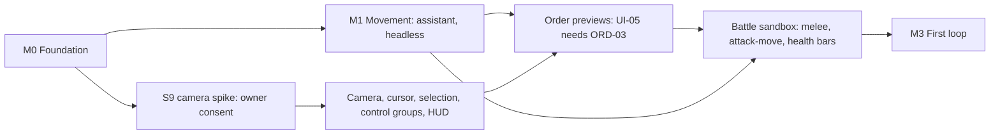
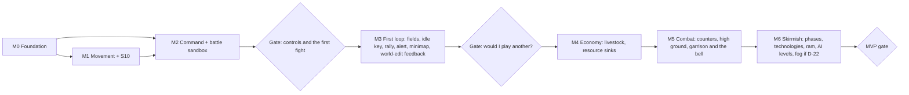

# Roadmap review: game design

*Reviewed 2026-10-21 from the game designer's seat (0 A.D., AoE II, AoE IV). Subject:
[roadmap-draft.md](roadmap-draft.md), checked against the final architecture
[04-architecture.md](../04-architecture.md) with its [ADRs](../adr/README.md), and against
[01-feasibility.md](../01-feasibility.md). Clean-room: only the behavioural notes in
[research/](../research/) were used. Every Minecraft and NeoForge name below was checked in the
decompiled 1.21.1 + NeoForge 21.1.262 sources. Change requests are numbered DR-01 to DR-38 and
listed in full in §9. Severity: **must** means the roadmap should not be approved without it,
**should** is a strong recommendation the owner may decline, **could** is a cheap improvement or an
option worth offering.*

## Contents

1. [Verdict](#1-verdict)
2. [Is something fun and playable early?](#2-is-something-fun-and-playable-early)
3. [Is the core loop complete, and in the right order?](#3-is-the-core-loop-complete-and-in-the-right-order)
4. [Missing and mis-prioritised mechanics](#4-missing-and-mis-prioritised-mechanics)
5. [What makes it feel like 0 A.D. and AoE](#5-what-makes-it-feel-like-0-ad-and-aoe)
6. [Minecraft opportunities](#6-minecraft-opportunities)
7. [The owner's decision points](#7-the-owners-decision-points)
8. [Alignment with the final architecture](#8-alignment-with-the-final-architecture)
9. [Change requests](#9-change-requests)
10. [The MVP after the changes](#10-the-mvp-after-the-changes)

---

## 1. Verdict

**What works.** The draft is a sound engineering plan:
- risk first, with budgets measured before they are trusted and movement proven headless;
- an opponent that grows with every system (AI-01 to AI-05) instead of arriving at the end;
- Minecraft Legends' lessons built in early: spread-destination previews, control groups,
  telegraphed waves, pause in singleplayer;
- a good mix of sources: torches and a Town-phase ram (AoE IV), finite fields with reseeding (AoE II
  and the owner's decision), Village → Town and batch training (0 A.D.);
- testable acceptance criteria on every card, at the lowest level that can express them.

**What doesn't, as a game plan.**
1. **Fun comes late.** The owner plays nothing for 14–20 weeks, and the first match comes at weeks
   19–27 by the feasibility's own estimate. The feasibility's answer to R8 (the owner's time and
   motivation, critical impact) is "something playable every 4–6 weeks". The draft's answer is "a
   playable loop at M3".
2. **The M3 gate would judge missing pieces, not the loop.** M3's only food is berry bushes, so the
   economy stalls. The first match has no health bars, no idle-worker key, no rally points and no
   minimap, and the bot's attack comes unannounced. A "no" at that gate would be a verdict on
   missing feedback.
3. **The MVP reads as a slim, generic AoE-like.** The mechanics catalog names territory, capture,
   fog of war and an AI as what makes it feel like 0 A.D.; the MVP has only the AI. It also lacks
   the raid answer both games share, garrisoning the town centre, and it plays on a revealed map,
   so nothing is ever explored.
4. **Minecraft's own strengths wait for T2 or are missing.** Height has no effect until M14.
   Chopping and building are silent, because the block writer is silent by design. Animals arrive
   in M10 and M14. Equipment upgrades are invisible, although vanilla armour tiers would show them
   for free.

Several M0–M2 cards also predate the final architecture and specify designs the ADRs decided
against: a `Mob` body (ADR-0011 chose a kinematic `LivingEntity` view, which S1 confirms) and a
released mouse (ADR-0017 chose a cursor-owning screen). Spike S10, which ADR-0011 waits for, has
no card.

**The changes that matter most**
- **DR-01:** a battle sandbox in M2, so the first fight comes a milestone earlier.
- **DR-07:** the owner-facing camera work runs beside the headless pathfinding.
- **DR-02, DR-03, DR-08, DR-09:** a fair M3 match: fields, an idle-worker key, rally points, an
  under-attack alert, a basic minimap and an announced attack.
- **DR-04:** reframe D-08. As the architecture implements it, an invulnerable observer is a free
  scout and a wall.
- **DR-05, DR-06:** rebase the M0–M2 cards on the ADRs, and add spike S10.
- **DR-10, DR-13, DR-17:** garrison and the town bell, high ground, and solo fog give the MVP the
  feel of both games.
- **DR-14, DR-15, DR-16:** Minecraft feedback: the sound and crack of chopping and building, trees
  without floating canopies, and upgrades you can see.

Without the solo fog, the MVP's card-bound total stays at 436 days against the draft's 437, with
the civilisation art pass moved after the MVP gate (§10).

---

## 2. Is something fun and playable early?

| End of | What the owner can play | Cumulative upper bound (days) | Cumulative weeks ([feasibility §6.5](../01-feasibility.md)) |
|---|---|---|---|
| M0 | Nothing: a GameTest log and spike reports | 58 | 4–6 |
| M1 | Nothing: a headless crossing and a dev overlay | 146 | 10–14 |
| M2 | A camera toy: select and move units, with no opponent and nothing at stake | 184 | 14–20 |
| M3 | The first match | 273 | 19–27 |
| M4 | Economy depth | 322 | 25–35 |
| M5 | "Battle at the ford" | 361 | 29–41 |
| M6 | The MVP skirmish | 437 | 35–49 |

- The feasibility's mitigation of R8 is "something playable every 4–6 weeks", and its failure-mode
  table (§8) says "play something every two weeks". The draft's is "a playable loop at M3".
- M1 needs almost no owner time; it is headless by design. M2 needs the owner's consent, hands and
  eyes. Run in sequence, they leave the owner idle for 6–8 weeks and then make the assistant wait
  on playtests.
- The first fun in any RTS is selecting an army and watching it fight. Melee combat is core code,
  testable headless at L1, and every card it needs (DATA-02, UNIT-02, PATH-06, UI-02, UI-05) is in
  M1 or M2.

Proposed shape (DR-01, DR-07):

The table the roadmap's §2 should carry instead of R8's one line (DR-07):

| End of | The owner plays |
|---|---|
| M1 | Pan over the proving ground and move armies with the mouse (camera track) |
| M2 | A 30 v 30 spear fight, commanded with box select, attack-move and control groups |
| M3 | A full crude match against the bot, with fields, an idle-worker key and an announced attack |
| M4 | A town economy: four resources with sinks, livestock, slopes, damage and repair |
| M5 | Battle at the ford, with counters, high ground, raids and the town bell |
| M6 | The MVP skirmish from the title screen |

---

## 3. Is the core loop complete, and in the right order?

The order gather → build → train → fight → advance → conquer is right. Its completeness is not.
The feasibility (§6.1) names five things without which the game "stops feeling like either game".
The arena makes three more acute: food that lasts a match, an answer to raids, and exploration.

| Element | M3 | M4 | M5 | M6 (MVP) | Change |
|---|---|---|---|---|---|
| Multi-resource trade-offs | Food and wood | Four resources, but nothing guarantees stone and iron buy anything | Iron buys soldiers if priced so | Yes | DR-12 |
| Housing pressure | Yes | Yes | Yes | Yes | – |
| Counter triangle | No: spearmen only | No | Yes | Yes | – |
| Phase-up decision, boom or rush | No | No | No | Yes, but nothing checks that both paths can win | DR-20 |
| Attacks you can see coming | No: one unannounced attack | No | No | Yes (AI-04) | DR-09 |
| Food that lasts a match | No: berry bushes only | Yes: fields | Yes | Yes | DR-02 |
| An answer to raids | – | – | No: horsemen raid, workers can only flee | Civic-centre arrows only | DR-10 |
| Exploration | No: the map is revealed until M8 | No | No | No | DR-17 |

**The food stall.** In the catalog's 0 A.D. reference a fruit bush regrows 1 food per 6 s, and one
gatherer picks 1 food per second, so five bushes regrow less than a single worker gathers.
Training costs food in both games, while real forests make wood plentiful. M3's own exit criterion (10 bot
matches end within 30 minutes with no stalled bot) and the owner's verdict match would both run
into it. Fields are T0 in the catalog's minimal loop and 0 A.D.'s food from the first minute.

**Two ordering problems.**
- Fighting comes too late to be the first fun (§2).
- Economy depth arrives before anything consumes it. M4 adds stone and iron, but nothing in the
  cards guarantees they buy anything before M5's soldiers and M6's technologies (DR-12).

---

## 4. Missing and mis-prioritised mechanics

| Mechanic | Draft | Proposed | Why | CR |
|---|---|---|---|---|
| Melee, attack-move, health bars | M3 and M5 | M2 | The first fun, a milestone earlier | DR-01 |
| Fields | M4 | M3, manual reseed | Food that lasts | DR-02 |
| Idle-worker key, rally points | M4 | M3 | A fair first match | DR-03 |
| Under-attack alert | M6 | M3 | The bot's attack must be noticed | DR-03 |
| Minimap | M6, one L card | Basic in M3, full in M6 | Orientation on 384² | DR-08 |
| Announced attacks | M6 | M3, for the bot's single attack | Fairness in the first match | DR-09 |
| Garrison and the town bell | M9 | M5 | Raids arrive in M5 | DR-10 |
| Livestock | Hunting M10, corrals M14 | Start animals in M4 | The classic opening food | DR-11 |
| High ground | M14 | M5 | Minecraft's terrain should matter | DR-13 |
| Economy technologies | 2 | One per resource line, plus 2 military | A boom needs something to buy | DR-16 |
| Abilities | No card, although architecture §7.6 defines them | M10 card | Healing and heroes need them | DR-21 |
| Exploration | M8 | Solo-grade in the MVP, if D-22 says so | Scouting has to mean something | DR-17 |
| Defence tower | M9 | Town unlock in M6 | A defensive phase-up path | DR-30 |

**Rightly late:** formations (M10), walls (M9, M14), trade and barter (M14), heroes (M14), naval
play (M14) and random maps (M12). None of them is one of the eight elements of §3, and each is
expensive.

---

## 5. What makes it feel like 0 A.D. and AoE

**What the MVP player will see**

| Visible in the MVP | Source |
|---|---|
| Worker-only economy, finite fields with reseeding, a town centre that shoots, torches against buildings, a Town-phase ram | AoE II and AoE IV |
| Village → Town, batch training, n^0.7 builders, 0.9^level resistances, templates and modifiers | 0 A.D., but mostly invisible maths |
| Territory, capture, citizen-soldiers, formations | 0 A.D.'s visible signatures, all after the MVP (M9, M10) |

So the MVP will play like a slim AoE II in Minecraft. That is a reasonable MVP, but it should be
the owner's explicit choice (decision D-23, DR-18), and the roadmap needs pillars to rank cards
against it.

**Proposed design pillars**
1. **The land is the economy.** Matches reshape the arena: forests recede, hills are quarried,
   fields are laid out and towns rise block by block, and the player hears and sees every edit
   (DR-14, DR-15).
2. **Readable from above, real from below.** At the default camera height a player can tell the
   owner, role, task, load, health and upgrade tier of every unit. First person shows the same
   world up close (DR-04, DR-16, DR-27).
3. **Classic RTS hands.** AoE and 0 A.D. muscle memory works on day one: box select, control groups,
   Shift queues, the idle-worker key, rally points and order previews (DR-03).
4. **Few decisions, all real.** Boom or rush, counters, high ground, when to ring the bell, when to
   phase up. Headless matches verify that each choice can win (DR-10, DR-13, DR-20).
5. **An honest opponent.** The AI issues the same commands, announces its attacks and never cheats
   below its labelled top level (DR-09, D-19).

**D-23 options, for the record:**
- (a) accept an AoE-leaning MVP, with DR-10 and DR-17 adding the feel both games share
  (recommended);
- (b) citizen-soldiers through data (D-02's alternative), at the cost of a harder AI economy;
- (c) territory-lite in M6: TERR-01 and TERR-02 with borders on the minimap only, about 13 days;
- (d) capture in M6: CMB-10 without decay or team rules, about 10 days.

---

## 6. Minecraft opportunities

| Opportunity | Where | Cost | CR |
|---|---|---|---|
| Hear and see every edit: the crack overlay while working, break particles and sounds, place sounds as buildings rise | AUD-04, new, M3 | M | DR-14, should |
| Trees that thin naturally: leaves go when vanilla would decay them | ECO-03 | S | DR-15, should |
| High ground | CMB-16, moved to M5 | S | DR-13, should |
| Upgrades you can see: stone → iron weapons, leather → chainmail | TECH-03, TECH-05 | S on top of TECH-03 | DR-16, should |
| Sheep, pigs and chickens at the start | ECO-16, new, M4 | M, plus a fauna archetype | DR-11, should |
| The town bell | BLD-15, new, M5 | M | DR-10, should |
| Workers that show their tool and load | ART-01, ECO-05, UI-07 | S | DR-27, should |
| Vanilla's village styles as civilisation palettes | D-03 | Decision | DR-24, should |
| A raid bar and horn for waves; campfire muster camps | AI-04 | S | DR-28, could |
| Day and night, night raiders, weather | D-13, a card in M10 | M–L | DR-29, could |
| Wood burns, stone needs siege; a TNT sapper | D-12, CMB-03 | S | DR-31, could |
| Workers in the villager look, with task outfits | D-04 | M | DR-32, could |
| Beacons as sacred sites, the beam tinted by the owner | MATCH-14, new | M | DR-33, could |
| A commander and a first-person captain sharing one faction | MATCH-06 | M | DR-34, could |
| First person with a purpose | CAM-05 | S | DR-35, could |
| Terrain features with a job on the first map | MAP-02 | S | DR-38, could |

**Redstone.** No redstone mechanic seems worth its cost in a controlled arena: first-person
players are in adventure mode and cannot build, and pistons are cancelled inside match regions
(architecture §11.9). A TNT sapper (DR-31) is the one idea from that family worth offering.

**Constraints from the architecture that shape these ideas**
- The block writer is silent: flags 2 and 16, and `destroyBlock` is never called (§10.5).
  Feedback for world edits must be fx events.
- Fx leave only through the fog-aware sender with audiences (rule B6, §10.5), so a crack or a sound
  reaches only players whose faction sees the cell.
- World time belongs to a level and is synchronised to every player in it
  (`MinecraftServer#synchronizeTime`). Daylight is a world-wide gamerule, set once in arena worlds
  (§3.2).
- Units are kinematic `LivingEntity` views on three entity types. A model archetype other than
  humanoid, horse and rider, or ram needs Java: a new entity type, or a renderer that dispatches by
  archetype (§6.1, §8.8).
- Equipment comes from the client's template copy and the rank in the spawn data (§6.2).

---

## 7. The owner's decision points

**What works.** Each decision has options with arguments for and against, a recommendation, the
milestone that needs it and the cards it affects. Most recommendations are the ones I would make.

**What needs fixing**
1. **D-08 would approve an exploit (must, DR-04).** In the final architecture a first-person
   player is a vision source (§10.2) and an obstacle that units steer around (§9.5). The
   recommended observer cannot be hurt, so it is an unkillable scout once fog exists, and a wall
   that can hold an enemy column at a gate, against the AI already.
2. **No cost per option (DR-23).** "For" and "against" can't be weighed against time without the
   cards each option adds or removes.
3. **Interlocked decisions are split (DR-23).**
   - Theme: D-03, D-04, D-05 and D-10.
   - Raids: D-02 and garrison (DR-10).
   - Avatar and vision: D-08 and D-22.
   - World rules: D-13 and D-17.

   Decided separately, they give inconsistent combinations, such as an antiquity theme with
   vanilla-only armour.
4. **D-03 compares flavour, not art cost (DR-24).** It also undersells biome cultures, which
   vanilla's village styles largely supply.
5. **D-13 treats Minecraft's systems only as interference (DR-29).**
6. **D-19's wording clashes with architecture §14 (DR-36):** difficulty from "handicap modifiers"
   against AI-05's "no resource or rate bonuses".
7. **Two decisions are missing:** D-22, exploration in the MVP (DR-17), and D-23, the MVP's
   identity (DR-18).
8. **Two entries are stale.** D-14 says the feasibility assumes infinite fields; it no longer
   does (DR-05). D-16 is needed by M3 once the minimap is split (DR-08).

**Proposed decision calendar (DR-23)**

| Decide before | Decisions |
|---|---|
| M0 exit, with the spike numbers | D-01 |
| M2 start | D-08 (reframed), D-09 (after S9) |
| M3 start | D-02, D-04, D-10, D-11, D-12, D-13, D-16, D-23 |
| M4 start | D-03, together with a confirmed D-04; D-14, D-15 |
| M6 start | D-05, D-17, D-18, D-19, D-22 |
| M7 start | D-20 |
| The first public release | D-07, D-21 |
| M12 | D-06 |

---

## 8. Alignment with the final architecture

| Card | Draft | Final architecture | Change |
|---|---|---|---|
| UNIT-01 | `Mob`-style stripping: `setPersistenceRequired`, a no-op `checkDespawn`, `Mob#customServerAiStep`, `Attributes.STEP_HEIGHT` 1.0 | ADR-0011 (pending S1 and S10): `UnitEntity extends LivingEntity`, `noSave`, `MobCategory.MISC`, no vanilla AI; step-ups and falls in core motion (§6.1, §6.2, §6.6) | Rewrite In scope. "Never despawns" becomes "never written to chunk storage, re-created from core state on restart" (L3). The step test becomes a core motion test, with S10 for the look |
| PERF-02, CORE-06 | S1's ADR settles who owns position, HP and orders | ADR-0008 (accepted): the core owns all match state. S1 only confirms the body | Drop the authority clause; point CORE-06 at ADR-0008 |
| DATA-03 | The content ADR, prototyped with about 20 templates both ways | ADR-0012 (accepted): a reload listener with core-side inheritance. S12 confirms it (§19.2) | Replace the comparison with S12's exit: every error names the file and JSON path; `/reload` ≤ 2 s |
| PATH-01 | Prototypes of a single-layer grid, a layered grid and a 3D band | ADR-0015 (pending S8 and S7): layered 2.5D surfaces are chosen; S8 is the census and encoding check | Narrow to S8: ≥ 99.9 % of columns with ≤ 4 surfaces, page build ≤ 0.5 ms, nav ≤ 32 MB at 512². Size S |
| PATH-03 | Delivery at a fixed tick t+k | S7: `STRICT` against `ADAPTIVE`, `k`, admission budget W counted in work (§9.6) | Name S7; add `ADAPTIVE` delivery and work-counted admission |
| CORE-05 | Determinism kit | S6 canary: equal hashes with 0, 1 and 4 threads, on macOS and Linux (§16.4) | Add S6 |
| CAM-01 | Compare bodies A, B and C and two cursor variants | S9 tests ADR-0017's choice (spectator body at the camera eye, `RtsScreen`, perspective) against two fallbacks fixed in advance (§13.1) | Rename it S9 and measure the decided design and its fallbacks |
| CAM-02 | Zoom 8–80 blocks | Rig height 8–64 blocks, default 24 (§13.2) | Align, or let S9 set the range |
| CAM-04, UI-01 | A released mouse, `InputEvent.MouseButton.Pre` cancelled, re-released after screens close | A non-pausing `RtsScreen` owns all input; key mappings with an RTS-only conflict context; F1, F2, F3 and F11 forwarded (§13.1, §13.3) | Rewrite In scope; the released mouse is the rejected alternative |
| UI-03 | Double-click or Ctrl-click selects all of a type | macOS turns Ctrl + left click into a right click, so defaults never use it (§13.3) | Double-click only |
| ORD-01 | Saved and loaded with an equal hash (M0 exit) | The skeleton is also replayed to the same hash (§1.5, §5.5) | Add an L1 replay criterion |
| NET-04 | Bandwidth measured | S11 opens M7 (§19.2) | Name S11 |
| — | No card | S10, kinematic fidelity, in M1 (§19.2) | New card UNIT-09 (DR-06) |
| — | No card | Abilities (§7.6) | New card UNIT-10 (DR-21) |
| AI-05, D-19 | No level gets resource or rate bonuses | Difficulty from handicap modifiers (§14) | State the rule for penalties and bonuses (DR-36) |
| D-14 | "01-feasibility.md §6.2 assumes infinite fields" | Feasibility §6.2 now has finite fields | Delete the remark |
| §2.5 table | "04-architecture.md, in progress" | Final. ADR-0005, 0007–0009, 0012, 0013 and 0015–0017, plus 0019 for budgets, settle the ten questions | Point each row at its ADR |

---

## 9. Change requests

| ID | Severity | Target | Change |
|---|---|---|---|
| DR-01 | must | M2: CMB-01, CMB-02, ORD-04, CMB-06, AUD-01 | Battle sandbox in M2 |
| DR-02 | must | M3: ECO-09, new ECO-17 | Food that lasts a match: fields in M3 |
| DR-03 | must | M3: UI-10, PROD-03, UI-12, new UI-21 | Feedback a first match needs |
| DR-04 | must | D-08, CAM-05 | Observer rules without the scout and wall exploits |
| DR-05 | must | M0–M2 cards, §2.5, D-14 | Rebase the cards on the ADRs |
| DR-06 | must | M1: new UNIT-09 | A card for spike S10 |
| DR-07 | should | §2.2, §2.3, M1 → M2 | Two tracks after M0; a playable-checkpoint table |
| DR-08 | should | UI-11, new UI-20, D-16 | Split the minimap |
| DR-09 | should | AI-01 | Announce the M3 bot's attack |
| DR-10 | should | M5: new BLD-15, BLD-11 | Garrison and the town bell in the MVP |
| DR-11 | should | M4: new ECO-16; ECO-10, ECO-12 | Livestock at the start |
| DR-12 | should | BLD-08, ECO-07, ECO-08, DATA-04, TECH-02 | Every resource arrives with its sinks |
| DR-13 | should | CMB-16 | High ground in M5 |
| DR-14 | should | M3: new AUD-04 | World-edit feedback |
| DR-15 | should | ECO-03, ADR-0021 | No floating canopies |
| DR-16 | should | TECH-03, TECH-05, D-05 | Economy technologies and visible equipment tiers |
| DR-17 | should | New D-22; FOW-01, MATCH-07, new FOW-07 and AI-17 | Exploration in the MVP |
| DR-18 | should | §1–2, new D-23 | Design pillars and the MVP's identity |
| DR-19 | should | QA-11, QA-12, QA-16, M3 and M6 exits, D-11, DATA-04 | One pacing target, RTS telemetry, L1 runs |
| DR-20 | should | AI-04, QA-12, TECH-02 | Boom or rush, verified |
| DR-21 | should | M10: new UNIT-10 | An abilities card |
| DR-22 | should | ART-03, M6, QA-13 | Art pass after the MVP gate |
| DR-23 | should | §4 | Card delta per option, bundles, a decision calendar |
| DR-24 | should | D-03 | Art cost per theme; biome cultures |
| DR-25 | should | QA-09; M2, M3, M5 and M6 exits | Scored feel playtests |
| DR-26 | should | DATA-04 | Explicit balance overrides |
| DR-27 | should | ART-01, ECO-05, UI-07 | Economy readability |
| DR-28 | could | AI-04 | Raid bar, horn and campfire camps |
| DR-29 | could | D-13, a card in M10 | Minecraft twists as costed options |
| DR-30 | could | M6: new BLD-16 | A defence tower in Town |
| DR-31 | could | D-12, CMB-03 | Material matters; field rams and a TNT sapper |
| DR-32 | could | D-04, ART-01 | Villager-look workers; a building scale guide |
| DR-33 | could | New MATCH-14 | Beacons as sacred sites |
| DR-34 | could | MATCH-06 | A shared faction for co-op |
| DR-35 | could | CAM-05 | First person with a purpose |
| DR-36 | could | D-19, AI-05 | Penalties and bonuses, stated precisely |
| DR-37 | could | QA-11 | Watch AI matches as an observer |
| DR-38 | could | MAP-02 | Terrain with a job |

New card IDs take the next free number in their area, as §5 of the draft requires: ECO-16 and
ECO-17, UI-20 and UI-21, CMB-17, BLD-15 and BLD-16, UNIT-09 and UNIT-10, FOW-07, AI-17, AUD-04
and MATCH-14.

### DR-01 · must · Battle sandbox in M2

**Change.**
- Move CMB-01 (damage model), CMB-02 (melee) and ORD-04 (attack and attack-move) from M3 to M2.
  - CMB-02 gains a default aggressive behaviour: units retaliate, and idle units attack enemies
    that come into range. The other stances stay in CMB-05.
  - ORD-04's torch criterion moves to CMB-03.
- Split CMB-06. Health bars with the vanilla hit flash and death (S) move to M2. Attack lines, the
  under-attack flash and the 300-bar cost gate stay in M5 as CMB-17 (S).
- Move AUD-01 (order, hit and death sounds) to M2. Bow-shot sounds join CMB-04.
- New M2 demo: the owner commands 30 spearmen against 30 on the proving ground, with box select,
  attack-move and control groups.

**Acceptance (M2 exit).** A 2 × 100 melee soak holds budgets A–C (L6). On the QA-09 checklist the
owner rates "commanding a fight" at least 3 of 5 (L7).

**Why.** As drafted the owner plays nothing for 14–20 weeks, and R8 has critical impact. Selecting
an army and watching it fight is the first fun of every RTS. Melee is core code, testable headless,
and its dependencies are all in M1 and M2. M3 keeps its size (§10).

### DR-02 · must · Food that lasts a match: fields in M3

**Change.** Move ECO-09 to M3: a finite amount, 5 slots, 0.9 diminishing returns, manual reseed
only, with the civic centre as the dropsite. Auto-reseed toggled at the farmstead (D-14) becomes
ECO-17 (S) in M4. If the owner declines, the fallback is berry regrowth tuned so that the M3 map's
bushes cover the bot's food demand, flagged as temporary in the balance sheet.

**Acceptance (M3 exit).** In QA-11's ten matches, no AI training queue waits for food for more than
60 s after minute 5 (L3).

**Why.** Five berry bushes regrow less food than one worker gathers (§3), so M3's exit criterion
and the owner's verdict match both run into a food stall. Fields are T0 in the catalog's minimal
loop.

### DR-03 · must · The feedback a first match needs

**Change.**
- Move UI-10 (idle-worker key and economy notifications) and PROD-03 (rally points, gather on
  arrival) from M4 to M3.
- Split UI-12. An under-attack alert with a sound and a jump-to key (S) moves to M3. The prioritised
  feed with research and phase notices stays in M6 as UI-21 (S).
- If DR-01 is declined, move CMB-06's health bars to M3 instead.

**Why.** M3's verdict decides whether M4 adds content or pacing gets retuned (feasibility §8,
gate 3). Without these cards, trained workers stand at the door, idle workers go unnoticed on a 384²
map, and the bot's attack lands unseen, so the owner would be judging missing UI. All the cards are
S-sized, and what they depend on (PROD-01, ECO-05, UI-07, MATCH-01) is in M3.

### DR-04 · must · Observer rules without the scout and wall exploits

**Change.**
- Add to the observer's "Against" in D-08: in the final architecture a first-person player is a
  vision source (§10.2) and a non-reactive ORCA agent that units steer around (§9.5).
- Recommend these observer rules:
  - the observer adds no vision of its own and sees what its faction sees;
  - units ignore it for avoidance and pass through it;
  - it may stand only in explored cells.
- A fighting avatar (CMB-08) stays a vision source and an obstacle, because it can die.

**Acceptance (CAM-05).** An observer standing in a 1-block gap delays an enemy column by less than
1 s (L3). An observer adds no visible or explored cell (L1).

**Why.** As implemented, the recommended observer is an unkillable scout once fog exists, and a
wall that can hold an enemy column at a gate, against the AI already. D-08 is needed by M2, so the
owner would approve the exploit without seeing it.

### DR-05 · must · Rebase the cards on the ADRs

**Change.** Apply the table in §8.
- UNIT-01 follows ADR-0011, and PERF-02 and CORE-06 point at ADR-0008.
- The spike cards confirm decisions instead of choosing between candidates: DATA-03 through S12,
  PATH-01 through S8 (S instead of M), PATH-03 through S7, CORE-05 adds S6, CAM-01 becomes S9 and
  NET-04 names S11.
- CAM-04 and UI-01 move to the cursor-owning `RtsScreen`.
- CAM-02's zoom follows the rig. UI-03 drops Ctrl-click.
- ORD-01 adds an L1 replay to the same hash.
- §2.5 points each question at its ADR, and D-14 drops its stale remark.

**Why.** Milestone specs are written from the cards. Several cards specify designs the ADRs
decided against, and narrowing the spike cards shortens the road to the first playable build.

### DR-06 · must · A card for spike S10

**Change.** Add UNIT-09, "Spike S10: kinematic fidelity" (M, M1).
- Units walk on slabs, stairs, snow, carpets, paths, farmland and shallow water, and down drops.
  Player melee and arrows reach the core, and units avoid players.
- Owner consent is needed for screenshots, but not for pose traces.
- Exit, per architecture §19.2: floor error ≤ 1/16 block and no visible pops at steps.
- Outcome: ADR-0011 is accepted, or `PHYSICS` bodies are built for the templates that fail.

**Why.** ADR-0011 waits for S1 and S10, but only S1 has a card. S10 decides whether units look
right on the ground. That is the first thing the owner sees in M2 and in first person (architecture
risk R1: kinematic movement may look wrong on partial blocks, so units "float or sink"), and every
later card builds on that body.

### DR-07 · should · Two tracks after M0, and a playable-checkpoint table

**Change.**
- After M0, the assistant's headless M1 runs beside the owner-facing M2 cards that don't need it:
  - S9 (CAM-01), CAM-02, CAM-04, UI-01, UI-02 and UNIT-03 start right after M0;
  - CAM-03 starts after NET-01, UI-03 and UI-04 after UNIT-03, UI-05 after ORD-03, and the battle
    cards of DR-01 after PATH-06.
- R7's "at most one system in progress" counts per track.
- Add the table of §2, "what the owner plays at the end of each milestone", to the roadmap's §2,
  and point R8 at it.

**Why.** M1 needs almost no owner time, and M2 needs the owner's consent, hands and eyes. In
sequence, the owner's 12–15 hours a week sit idle for 6–8 weeks, and then the assistant waits on
playtests. The dependencies allow the overlap, and it brings the first hands-on session about one
milestone earlier.

### DR-08 · should · Split the minimap

**Change.**
- UI-11 becomes the basic minimap (M, M3): a terrain image from map colours, unit and building dots
  in player colours, the camera frame and click to jump.
- New UI-20 (M, M6) adds right-click orders, alert pings, construction shown within 1 s and the
  0.5 ms cost gate.
- D-16 becomes "needed by M3".

**Why.** On a 384² arena the M3 verdict match needs orientation, to find the bot's base and see
its attack coming. One L card in M6 comes too late for the gate that matters.

### DR-09 · should · Announce the M3 bot's attack

**Change.** The M3 bot announces its single attack with a notice, a countdown and a horn at least
30 s before the wave leaves, from a muster point the player can see. AI-04 keeps waves, defence and
difficulty.

**Acceptance (AI-01).** The attack is announced at least 30 s before it leaves (L3).

**Why.** An unannounced attack in the owner's first match reads as unfair (Minecraft Legends'
lesson 5) and would colour the M3 verdict. The notice is cheap.

### DR-10 · should · Garrison and the town bell in the MVP

**Change.**
- New BLD-15 (M, M5):
  - workers and soldiers garrison the civic centre, by the class rules in data, and later houses
    and towers if data allows;
  - garrisoned units have no body (`BodyMode.NONE`) and leave at the door;
  - a "Ring the bell" button on the civic centre's card sends every worker within 64 blocks to the
    nearest building with room, as a push-front order;
  - "All clear" finishes those orders, so each worker resumes what it was doing (the queue
    semantics of architecture §7.4).
- BLD-11 (one arrow per garrisoned unit) moves to M5 and depends on BLD-15.
- Healing inside, ejection below 10 %, capture regeneration and rally-to-garrison stay in BLD-10,
  in M9.
- AI-04's defence uses the bell.

**Acceptance.**
- After the bell, every worker within 64 blocks is inside within 10 s (L3).
- After "All clear", each worker is back on its previous node within 5 s (L3).
- Garrisoned units keep their handle, HP and orders (L3), and cost no entity tick (L6).
- The civic centre fires base + garrisoned arrows (L3).

**Why.** M5 brings horsemen raids; its own demo has one. In both AoE II and 0 A.D. the answer to a
raid is to garrison the town centre, and with AoE-style workers (D-02) a raided player can
otherwise only watch them flee. Minecraft already teaches the gesture: when a bell rings, vanilla
villagers hide (`BellBlockEntity` sets `MemoryModuleType.HEARD_BELL_TIME`, which drives
`ReactToBell`), and `SoundEvents.BELL_BLOCK` is the natural cue. The body seam already has `NONE`.

### DR-11 · should · Livestock at the start

**Change.**
- New ECO-16 (M, M4): a few domestic animals per start (sheep, pigs, chickens).
  - A worker kills an animal and then gathers it in place.
  - The animals never flee and cost no population.
  - Yields come from the balance sheet; the catalog's 0 A.D. reference runs from chicken 40 to
    cow 300.
- ECO-10 becomes "Wild herds and hunting" (fleeing herds, cavalry hunting, M10). Corrals stay in
  ECO-12 (M14).
- The animals need a fauna model archetype.
  - Vanilla `PigModel`, `CowModel` and `ChickenModel` are generic over `Entity`, so they can draw
    our `LivingEntity` body as they are.
  - `SheepModel` is bound to `Sheep`. Its `createBodyLayer()` goes into our own model class, the
    way the architecture reuses the horse mesh.
- ADR-0011 and the §2.5 inventory gain either a fauna entity type or a renderer that dispatches by
  archetype.

**Why.** It is the classic opening food of AoE II and 0 A.D., and the most Minecraft-native
resource there is. It is also the first gathering that isn't "click a node and wait".

### DR-12 · should · Every resource arrives with its sinks

**Change.**
- In M4, stone pays for buildings, for example the barracks and the civic centre.
- Iron pays for at least one item available in M4: an iron-costing barracks upgrade or soldier.
- The Town phase (TECH-02) costs stone or iron.

**Acceptance (DATA-04).** An L1 balance-sheet check: every resource that can be gathered in a
milestone's content appears in the cost of at least two items available in that milestone.

**Why.** M4 adds stone and iron, but nothing in the cards guarantees they buy anything before M5's
soldiers and M6's technologies. The M4 playtest would show idle stockpiles, and the "multi-resource
trade-off" of feasibility §6.1 would not exist.

### DR-13 · should · High ground in M5

**Change.** Move CMB-16 to M5 and make it a modifier source with two data knobs: a range bonus by
height difference (0 A.D.) and a damage bonus from above (AoE II). The balance sheet picks the
starting values.

**Acceptance.** Archers on a 6-block hill beat equal archers below in at least 16 of 20 seeded duels
(L3). The bonus appears in the tooltip breakdown (L1).

**Why.** Real 3D terrain is Strategos's most distinctive asset, and the core already knows every
floor height, so the card is S-sized. The catalog ranks it T2 only because 0 A.D.'s maps are flat
by comparison. Without it, the hills of the proving ground and of MAP-02 carry no strategic value in
the MVP.

### DR-14 · should · World-edit feedback

**Change.** New AUD-04 (M, M3), all through fx events from the fog-aware sender:
- the block a worker is working shows the vanilla crack overlay (client side,
  `ClientLevel#destroyBlockProgress`);
- a removed log or stone block plays its break particles (`ClientLevel#addDestroyBlockEffect`) and
  its `SoundType` break sound;
- every block a building gains plays its place sound.

**Acceptance.** Fx reach only viewers whose faction sees the cell (L3). A golden shows a log at a
crack stage (L4). The owner's checklist passes (L7).

**Why.** The block writer is silent by design (architecture §10.5). As drafted, chopping, mining
and the block-by-block rise of a building, the spectacle this mod is built around, happen with no
sound, cracks or particles.

### DR-15 · should · No floating canopies

**Change.**
- When a log is removed, the writer also removes, under its budget, the leaves of that tree that
  are no longer within six leaf steps of a remaining log. That is vanilla's own decay rule
  (`LeavesBlock.DECAY_DISTANCE` is 7).
- The core computes it, because the writer's flags suppress vanilla's distance updates.
- This replaces removing all leaves only when the tree is exhausted, so it needs a short ADR that
  amends ADR-0021.

**Acceptance (ECO-03).** At every stage of felling, with `randomTickSpeed` 0, no leaf that vanilla
would decay remains for more than 5 s (L3).

**Why.** Logs go top-down. Once the trunk drops below the canopy, the leaves float above a stump
until the tree runs out. The owner will see that visual bug in the first minute of M3.

### DR-16 · should · Economy technologies and visible equipment tiers

**Change.**
- Expand TECH-03 (S → M) to:
  - one gathering technology per resource line: wood at the storehouse, farming at the farmstead,
    and mining for stone and iron;
  - carry capacity;
  - two military technologies whose effect shows as equipment tiers with vanilla items and armour
    layers: stone → iron weapons, leather → chainmail armour (vanilla `ArmorMaterials` has
    `LEATHER`, `CHAIN`, `IRON` and `DIAMOND`).
- TECH-05 carries the full lines.
- Equipment comes from the template and the rank in spawn data (architecture §6.2), so the tier
  needs one of two routes:
  - a faction-level tier in a payload the unit renderer reads (preferred, because it needs no
    re-pairing);
  - a field in spawn data, with a re-pair when research completes.
- Enemies may see the tier; that is intended information.

**Acceptance.** Within 1 s of research, every affected unit shows its new held item or armour to
the players who see it (L3). The balance sheet lists every tier (L1).

**Why.** The feasibility's MVP has about five technologies. With three, the storehouse and the
farmstead have nothing to research, and a boom has nothing to buy. D-05 already proposes material
tiers for equipment, and Minecraft makes them readable from the camera for free.

### DR-17 · should · Exploration in the MVP

**Change.** Add decision D-22, "Exploration in the MVP", with four options:
- (a) a revealed map, as drafted;
- (b) a shroud only: unexplored terrain is black, explored terrain stays visible, units are never
  hidden;
- (c) solo-grade fog (recommended);
- (d) the full M8 set.

Option (c) brings into the MVP:
- FOW-01 per faction, without its MATCH-06 dependency; team vision returns in M8;
- new FOW-07 (M):
  - explored state;
  - a client-side shroud drawn with vanilla render types;
  - enemy bodies gated by the existing `FogGate` and refreshed through the public
    `ServerChunkCache#move(viewer)`, the architecture's fallback without access transformers, which
    is cheap with one human viewer;
- new AI-17 (S): the AI reads only its own vision (its `AiView` already filters by visibility)
  and knows the start positions;
- MATCH-07: revealed, explored or fogged as setup options;
- a horseman joins the starting units as a scout.

M8 keeps team vision, targeted re-tracking, mirages, the leak audit and AI scouting.

**Why.** The catalog names fog one of the four systems that make it feel like 0 A.D., and the
feasibility (§3.5) calls client-side fog acceptable for solo play. Without exploration, scouting,
finding livestock, surprise attacks and tower vision mean nothing in the MVP. The architecture
built the seam for exactly this.

### DR-18 · should · Design pillars and the MVP's identity

**Change.** Add the five pillars of §5 near the top of the roadmap, so every card's Value line can
cite one. Add decision D-23, "The MVP's identity", with options (a) to (d) of §5. Recommendation:
(a).

**Why.** The catalog says territory, capture, fog and an AI make it 0 A.D. rather than a generic
RTS, and the MVP has only the AI. The owner should approve that trade-off knowingly. Pillars let
every later card be ranked against it.

### DR-19 · should · One pacing target, RTS telemetry, L1 runs

**Change.**
- **Pacing.** M3 keeps "every match within 30 minutes". M6 becomes "median 20–35 minutes, every
  match within 45" (architecture §14), replacing 60 minutes in the M6 exit and in QA-12.
- **Timing targets.** DATA-04's balance sheet carries starting targets for the Normal opening
  (first house, barracks, first attack, Town), to be tuned in playtests.
- **Telemetry.** QA-11 and QA-12 report, per match: time to Town, first contact, army value over
  time, idle-worker seconds, banked resources and units lost.
- **Speed.** QA-11, QA-12 and QA-16 also run at L1 on `SimHarness` (architecture §14, §16.2), so
  a 100-seed sweep takes seconds; L3 confirms a sample.

**Why.** The documents disagree (30, 45 and 60 minutes), and a 60-minute cap passes matches twice
D-11's length. R17 (balance never converges) needs a fast, quantified loop, and the architecture
already runs whole AI matches in plain JUnit.

### DR-20 · should · Boom or rush, verified

**Change.** QA-12 checks that each AI opening (rush, boom, balanced) wins 30–70 % against each of
the others at equal difficulty over 20 seeds. TECH-02's Town cost and unlocks are tuned until it
holds.

**Why.** The feasibility lists the phase-up decision among the five things without which it "stops
feeling like either game". A dominant opening removes it, and nothing in the draft would notice.

### DR-21 · should · An abilities card

**Change.** New UNIT-10, "Abilities" (M, M10), for architecture §7.6:
- `AbilityDef` in templates, the `UseAbility` command, cooldowns, costs and autocast;
- the effect primitives, and command-card buttons;
- one showcase unit ability.

CMB-12 (healing) and CMB-14 (heroes) depend on it, and CIV-02's unique units may use it.

**Why.** The architecture defines abilities, but no card builds them, so CMB-12 or CMB-14 would
build them on the side. Once they exist, AoE IV-style unit abilities are the cheapest asymmetry
between civilisations.

### DR-22 · should · Art pass after the MVP gate

**Change.** Take ART-03 out of M6's exit. The MVP ships with the ART-01 and ART-02 placeholders, and
ART-03 runs after the M6 fun verdict: as the first card after the MVP gate, or beside M7. M6's
critical path becomes TECH-01 → TECH-02 → CMB-09.

**Why.** M6 tuning changes footprints, roles and silhouettes, and art locked before the loop is
proven fun gets redone. The draft already lets ART-03 wait while D-03 is open.

### DR-23 · should · Card delta per option, bundles, a decision calendar

**Change.**
- Each option of each decision states its card delta. For example, D-12's "capture in the MVP"
  adds CMB-10 (L) to M3.
- Interlocked decisions are presented together: the theme, the raids, the avatar and vision, and
  the world rules (§7).
- The list is ordered as a decision calendar by the milestone that needs each answer (§7).

**Why.** The owner approves scope through these decisions. Arguments without the card cost can't
be weighed against time, and bundles decided separately give inconsistent combinations.

### DR-24 · should · Art cost per theme; biome cultures

**Change.** Add an art-cost row to D-03: the custom textures and models each theme needs for the MVP
and for M10. Restate the biome option:
- vanilla's five village styles (plains, desert, savanna, snowy, taiga) give ready architecture
  palettes;
- its seven villager biome types give outfits;
- biome-matched maps follow, without custom armour.

Antiquity needs custom armour and weapon art for two civilisations (R18). Keep the recommendation if
the owner prefers antiquity, but state its cost.

**Why.** D-03 decides the largest asset bill of the project, and its table compares flavour, not
cost.

### DR-25 · should · Scored feel playtests

**Change.**
- QA-09's playtest template gets a fixed questionnaire scored 1–5: control feel, readability at
  the default camera height, waiting, decisions that mattered, the opponent's fairness and threat,
  and Minecraft feel. It ends with "would I play another?" and a reason.
- The M2, M3, M5 and M6 gates compare scores across milestones and fail on any score of 2 or less.
- The M6 exit adds two private playtesters besides the owner.

**Why.** Each gate is one person's "good" or "yes". Scores make regressions visible and show the
M3 retuning where to look (feasibility §8: pacing and readability).

### DR-26 · should · Explicit balance overrides

**Change.** Replace DATA-04's acceptance 3 with: "a template may override a derived value only with
an explicit override marker and a reason; the balance sheet lists every override".

**Why.** Balance needs exceptions, such as a long-range unit or a fast scout. An absolute ban
pushes designers to fake ratios.

### DR-27 · should · Economy readability

**Change.**
- Working workers hold their task tool (axe, pickaxe, hoe, hammer).
- They show their carried load as a held item (log, berries, cobblestone, raw iron), from the
  carried-resource byte the architecture already syncs.
- UI-07's resource bar shows workers per resource and the idle count.

**Acceptance.** Role and load are recognisable at 60 blocks (L4 golden). The counts equal the core's
counters (L1).

**Why.** AoE players read their economy from what the workers carry. The data already exists, and
modern AoE II and AoE IV show workers per resource on the bar.

### DR-28 · could · Raid bar, horn and campfire camps

**Change.**
- Present incoming waves as vanilla raids do: vanilla's `Raid` uses a red, notched
  (`BossEvent.BossBarOverlay.NOTCHED_10`) `ServerBossEvent` and `SoundEvents.RAID_HORN`.
- Our GUI layer draws the bar from a notice payload, so it stays inside the fog-aware sender.
- The AI musters at a camp marked with campfires and banners.

**Why.** Minecraft players already read a raid bar and a horn as "an attack is coming", and
MineColonies telegraphs raids with campfires.

### DR-29 · could · Minecraft twists as costed options

**Change.** Reframe D-13 as "which Minecraft systems become mechanics", with costed options:
- day and night: night shrinks vision, and torches and campfires on buildings become vision
  sources;
- hostile mobs at night as Gaia raiders;
- weather that shortens archer range.

State the constraint: world time is per level and synchronised to every player in it, and daylight
is a world-wide gamerule (architecture §3.2). A visible night is therefore world-wide, which is fine
with one match per world (D-20), unless it is drawn as a client-side tint. Nominate the first twist
as a card in M10.

**Why.** The draft frames vanilla systems only as interference. The owner should see which of them
could become signature mechanics, and what they cost.

### DR-30 · could · A defence tower in Town

**Change.** New BLD-16, "Defence tower" (M, M6), as a second Town unlock beside the ram. It shoots
with CMB-07's arrows and costs stone. Garrison and upgrades stay in BLD-12 (M9).

**Why.** It gives the phase-up a defensive "boom behind towers" path and gives stone a sink. The
feasibility's MVP had it.

### DR-31 · could · Material matters; field rams and a TNT sapper

**Change.** Set building resistances by blueprint material class: wood burns faster than stone, and
stone needs the ram. Add two options to D-12:
- AoE IV's field-built rams: infantry assemble one through `UseAbility` with a `Spawn` effect;
- a TNT sapper whose blast the core resolves as crush damage, with explosion particles as fx and
  never a real `PrimedTnt`.

**Acceptance (CMB-03).** Torches destroy a wooden house at least twice as fast per HP as a stone
storehouse (L3).

**Why.** Material is what a Minecraft player reads first, and it ties D-12 to D-03's palettes.

### DR-32 · could · Villager-look workers; a building scale guide

**Change.**
- Offer in D-04: workers in the vanilla villager look. `VillagerModel` is generic over `Entity`,
  and `VillagerProfessionLayer` accepts any `LivingEntity` that implements `VillagerDataHolder`,
  so outfits can show the current task. The risks: a look closer to Reign of Nether's villagers,
  and two model styles side by side.
- The ART-01 style guide fixes footprint, height and block-count ranges per building class, so
  buildings read at camera heights of 24–64 blocks and rise at a steady, visible rate.

**Why.** The villager look is instantly readable to Minecraft players, and building scale drives
both readability and how construction feels.

### DR-33 · could · Beacons as sacred sites

**Change.** New MATCH-14 (M, M12 or M14): neutral capture points that generate resources or count
toward a hold-to-win condition, as AoE IV's sacred sites do. Each is a beacon on its base, placed
by the map. Ownership shows as the beam's colour, through faction-stained glass above the beacon:
vanilla `StainedGlassBlock` implements `BeaconBeamBlock`, which tints the beam.

**Why.** A fast game mode, with a visual every Minecraft player knows that can be seen across the
whole arena.

### DR-34 · could · A shared faction for co-op

**Change.** In MATCH-06, two humans may control one faction, as in AoE II's co-op mode: one commands
from the camera while the other fights or scouts in first person. Architecture §7.3 already accepts
commands for units of an ally that granted control.

**Why.** A mixed RTS and first-person team is something only Strategos can offer, and it suits a
server shared with friends.

### DR-35 · could · First person with a purpose

**Change.** CAM-05 gains:
- "follow me" for the selection;
- "attack what I look at";
- ringing the town bell by using the bell block in the civic centre (seen as
  `PlayerInteractEvent.RightClickBlock`);
- inspecting units and buildings by looking at them.

**Why.** The owner asked to walk as a normal player. An observer with nothing to do will be tried
once and dropped.

### DR-36 · could · Penalties and bonuses, stated precisely

**Change.** D-19 and AI-05 state the rule: open handicaps (penalties, shown in setup) are allowed at
every level; bonuses only at the labelled top level.

**Why.** Architecture §14 builds difficulty from "handicap modifiers", while AI-05 forbids
"resource or rate bonuses". Penalties make Easy easy without making the AI play badly.

### DR-37 · could · Watch AI matches as an observer

**Change.** Any QA-11 or QA-12 seed can be opened in a client as an observer, through
`/strategos skirmish <map> observe`. `FogGate` already shows observers everything.

**Why.** An AI's fun is judged by watching it play, not by reading summaries.

### DR-38 · could · Terrain with a job

**Change.** MAP-02's manifest documents the terrain's jobs, and the map checker verifies them:
- a hill over the contested middle, higher than DR-13's threshold;
- a forest line between the bases, with gaps;
- two fords;
- a contested iron deposit.

**Why.** Hand-built maps should create decisions, not only exercise pathing.

---

## 10. The MVP after the changes

**Card moves**

| Card | From | To | CR |
|---|---|---|---|
| CMB-01, CMB-02, ORD-04 | M3 | M2 | DR-01 |
| CMB-06, health bars and hit and death feedback (S) | M5 | M2 | DR-01 |
| AUD-01 | M5 | M2 | DR-01 |
| UNIT-09, spike S10 (new) | – | M1 | DR-06 |
| ECO-09, manual reseed | M4 | M3 | DR-02 |
| UI-10, PROD-03, UI-12 (S) | M4, M6 | M3 | DR-03 |
| UI-11, basic (M) | M6 | M3 | DR-08 |
| AUD-04, world-edit feedback (new) | – | M3 | DR-14 |
| ECO-16, livestock (new); ECO-17, auto-reseed (new) | – | M4 | DR-11, DR-02 |
| BLD-15, garrison and bell (new); BLD-11 | M9 | M5 | DR-10 |
| CMB-16 | M14 | M5 | DR-13 |
| CMB-17, the rest of CMB-06 (new) | – | M5 | DR-01 |
| UI-20, UI-21 (new) | – | M6 | DR-08, DR-03 |
| ART-03 | M6 | After the MVP gate | DR-22 |
| FOW-01, MATCH-07; FOW-07 and AI-17 (new) | M8 | MVP, only with D-22 (c) | DR-17 |
| UNIT-10, abilities (new) | – | M10 | DR-21 |

**Card-bound days** (S = 1, M = 3, L = 10, as in the draft; upper bounds, not a calendar)

| Milestone | Draft | After | Main differences |
|---|---|---|---|
| M0 | 58 | 58 | – |
| M1 | 88 | 89 | + UNIT-09; PATH-01 narrowed to S |
| M2 | 38 | 49 | + CMB-01, CMB-02, ORD-04, CMB-06 (S), AUD-01 |
| M3 | 89 | 92 | − three combat cards; + ECO-09, UI-10, PROD-03, UI-12 (S), UI-11 (M), AUD-04 |
| M4 | 49 | 48 | − ECO-09, UI-10, PROD-03; + ECO-16, ECO-17 |
| M5 | 39 | 41 | − CMB-06, AUD-01; + CMB-17, BLD-15, BLD-11, CMB-16 |
| M6 | 76 | 59 | − ART-03, UI-11 (L), UI-12 (M); + UI-20, UI-21; TECH-03 S → M |
| **MVP** | **437** | **436** | 446 with ART-03 kept in M6; 444 with D-22 (c) |

Every move keeps the draft's dependencies: each moved card's prerequisites are in its new milestone
or earlier. Four dependencies change on purpose:
- AUD-01 drops CMB-04, because bow-shot sounds move to CMB-04;
- FOW-01 drops MATCH-06, for per-faction vision;
- MATCH-07 depends on FOW-07 instead of FOW-03;
- BLD-11 depends on BLD-15 instead of BLD-10.

