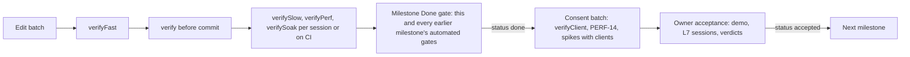

# Roadmap draft review: QA and test strategy

Written 2026-10-21 by the QA lead of the design round. It reviews
[roadmap-draft.md](roadmap-draft.md) against the final architecture
([04-architecture.md](../04-architecture.md), ADR-0001 to ADR-0021 in [adr/](../adr/README.md)) and
the feasibility assessment ([01-feasibility.md](../01-feasibility.md)).

**Method.**
- All 215 cards and their 628 acceptance criteria (ACs) were read and checked against the ADRs,
  04-architecture §1.5 (build plan), §16 (testing seams), §17 (budgets), §19.2 (spikes) and
  feasibility §5–§6.
- Every engine behaviour that decides whether a test is valid was checked in the decompiled
  Minecraft 1.21.1 + NeoForge 21.1.262 sources. File and line references below point into that tree.
- False-failure rates of the win-rate gates are exact binomial probabilities.

Each change request (CR) has an ID (`QAR-nn`), a severity, a target, the request and the reason.
- **must**: the AC contradicts an accepted ADR or verified engine behaviour; or it cannot be tested
  as written, passes without our code, or fails by design; or a test the architecture requires is
  missing; or a client window is used without consent being marked; or an exit cannot be passed
  without the owner.
- **should**: it adds a missing gate, threshold or fixture, or makes a test cheaper or more precise.
- **could**: a refinement.

---

## 1. Verdict

The card format is sound. ACs are numbered and tied to test levels, scope boundaries are explicit,
M0 builds every harness before gameplay, every milestone up to M7 has a perf gate, and the harness
guards (empty test set, broken mod load) are already ACs. The draft is not ready to become
ROADMAP.md for five reasons:

1. **It predates the final architecture.** About 30 cards contradict accepted ADRs (§3.1). For
   example, CAM-04 builds the rejected cursor design, UNIT-01 the rejected `Mob` body, PATH-03 the
   wrong thread counts and UNIT-05 a rejected observation-based level of detail. Seven
   architecture spikes (S6–S12) are missing or re-decide settled questions.
2. **Several criteria cannot work as written.**
   - Five L3 ACs pass even with our code absent, because the GameTest server switches off the
     mechanisms they guard against.
   - Map-scale tests lose their chunks, and their chunk tickets leak into later batches.
   - Negative fog tests pass without fog code.
   - Budget E cannot be measured with mock players at all (§3.4).
3. **Win-rate gates fail by design.** With 20 seeds, a perfectly fair map fails MAP-02 26 % of the
   time, and M14's six civilisation pairings fail 84 % of the time (§3.6).
4. **No milestone M0–M14 can be declared done without the owner.** Exits mix automated checks,
   consent-gated client runs and owner verdicts. Eleven client checks that open a window are not
   marked as needing consent (§3.9, §3.10).
5. **Regression gates, fixtures and budgets are incomplete.**
   - No cumulative regression rule exists before M14.
   - Golden journals, corrupted-save fixtures and seed sets are not planned.
   - Budget C uses the instrument ADR-0019 rejects.
   - Budget F (client frame) has no gate after M0, and D, E and G have none in most milestones.

**113 change requests: 50 must, 57 should, 6 could.** The musts are mostly rewordings of existing
cards. The new cards are CORE-10, QA-17, QA-18, UNIT-09, NET-08, NET-09 and PERF-14 to PERF-18
(§5).

| Focus question | Answer | Main gaps | CRs |
|---|---|---|---|
| Numbered, testable ACs at the right levels? | Mostly: 607 of 628 ACs name a level | 21 ACs have no level. About 30 cards contradict ADRs. About 20 ACs have the wrong level (L3 for client state, L1 for block-state classification, plain L6 for client frame cost). Vacuous and statistically unsound gates | QAR-01–03, 11, 14, 17, per-card CRs |
| Budgets per milestone, enforced by tests? | Partly | C has the wrong instrument. E cannot be measured headless. F has no gate after S4. D is asserted only in M1, G only in M6 and M12. Gates below 600 units have about 2× slack. M8–M10 and M14 have no gate | QAR-06–10, 19, 45, 106, 111 |
| Regression gates, fixtures, test data? | Partly | No cumulative rule before M14. No golden journals, corrupted saves or seed sets. Retries allowed silently. No wall-time budgets per aggregate | QAR-12, 13, 18, 20, 21 |
| Client checks marked as needing consent? | Mostly: 53 ACs cite L4 | 11 checks that open a window or need a GPU are unmarked: QA-01 AC2, CORE-01 AC2, CAM-03 AC2, five frame-cost ACs, PERF-09 and PERF-12 for F, the production jar on a client. The missing S10 and S11 also need consent. CI is assumed for absolute frame times it cannot measure | QAR-10, 22, 28, 30, 68, 96 |
| Each milestone exit testable without the owner? | No | Exits mix Done and Acceptance. Hidden owner work: a hand-finished proving ground, blueprints built in creative mode, a hand-built map, a "fresh player" | QAR-04, 05, 24, 37, 48, 67 |

---

## 2. What to keep

- The card fields: value, scope, out of scope, numbered ACs, test levels, dependencies, size, tier
  and status. The AC rule (§1 of the draft) only needs the tightening in QAR-02.
- Measuring before building. M0 runs S1, S2 and S5 headless, and S3 and S4 wait for consent
  without blocking.
- One perf gate card per milestone up to M7, each with a target scale and a stress run at twice
  that scale.
- Bot-versus-bot from M3 (QA-11), soaks (QA-12) and a balance matrix (QA-16). The data is right;
  only the statistics need fixing (QAR-11).
- The MVP gate (QA-13), with provenance and naming checks for the clean-room rule.

---

## 3. Findings

### 3.1 The draft contradicts accepted ADRs

The draft was written at 05:33; the architecture and ADRs were finalised at 07:22. Where they
disagree the ADR wins (04-architecture, preamble), so these cards would build or test the wrong
thing.

| Card | Draft | Accepted design | CR |
|---|---|---|---|
| §2.5, PERF-02, PERF-03, PATH-01, DATA-03, CAM-01, CORE-05, CORE-06 | A spike's ADR "settles research contradiction n" | ADR-0008 to ADR-0021 settle all ten; spikes confirm ADRs against exit criteria | QAR-01 |
| §2.4 budget C | Measured by `MinecraftServer#getTickTimesNanos` | MSPT plus between-tick task time (ADR-0019; §4.7) | QAR-06 |
| CORE-01 | `SETUP → RUNNING → PAUSED → ENDED → DISPOSED` | `CREATED → PREPARING → READY → RUNNING ⇄ PAUSED → ENDED → DISPOSED`, plus `FAULTED` (ADR-0010) | QAR-30 |
| CORE-02 | Six phases | Nine fixed phases (ADR-0009) | QAR-31 |
| CORE-03 | 40 commands/s, 300 ids | Six caps at the gateway and in the core (ADR-0014) | QAR-32 |
| CORE-07 | Dirty tracking per subsystem | One self-contained blob per match with an epoch (ADR-0018) | QAR-36 |
| UNIT-01 | `setPersistenceRequired`, `customServerAiStep`, `STEP_HEIGHT` | Kinematic `LivingEntity`, `noSave`, `MISC` (ADR-0011) | QAR-34 |
| PERF-03 | 24², 32², 64² chunks; picks a ticket mode | 256, 576, 1,024 chunks; `ticking=false` decided (ADR-0010) | QAR-35 |
| PATH-01 | Compares three encodings; measures t+k delivery | Layered surfaces decided; S8 confirms; delivery is S7 (ADR-0015) | QAR-55 |
| PATH-03, M1 exit 4 | 1, 2 and 8 threads | 0, 1 and 4 threads; `STRICT` and `ADAPTIVE` (ADR-0015) | QAR-49 |
| PATH-07 | Teleport to the last good cell; free within 200 ticks | Ladder 40/100/200/400/600 ticks: a nudge of at most 4 blocks, then the order fails (§9.5) | QAR-52 |
| ORD-03 | 50 units within 0.5 block of their slots | 1.5 blocks in groups, 0.5 alone (ADR-0015) | QAR-54 |
| CAM-01 | Re-decides the body, including `setCamera` | Player-follows-camera spectator; S9 confirms; fallbacks fixed (ADR-0017) | QAR-66 |
| CAM-02 | Zoom 8–80 blocks | 8–64 blocks (ADR-0017) | QAR-71 |
| CAM-04 | Released mouse, `InputEvent.MouseButton.Pre` cancelled | `RtsScreen` owns all input (ADR-0017) | QAR-65 |
| UI-03 | Ctrl + click selects by type | On macOS Ctrl + click is a right click (MouseHandler.java:59–68) | QAR-73 |
| UNIT-03 | Units visible at maximum zoom | Beyond tracking range units are markers from `unit_summary` (§13.2, §12.4) | QAR-70 |
| UNIT-05 | Cadence for "selected" and "moving unseen" units | Level of detail by activity, never by observation (ADR-0011, §6.5) | QAR-85 |
| CMB-01 | i-frames neutralised for unit-on-unit hits; ≥ 95 % of focused damage | Unit-on-unit damage resolved in the core; `hurt` never called (ADR-0011) | QAR-78 |
| MATCH-01 | Gamerules applied to "the match world" | Only arena worlds, once, through `ArenaWorld` (ADR-0010) | QAR-77 |
| UI-11 | A click jumps the camera "within one frame" | Every jump is a server teleport (ADR-0017) | QAR-91 |
| NET-03 | Per-player attachment sync | Strategos does not use attachment sync for fogged data (§12.6) | QAR-99 |
| FOW-01, FOW-02 | Vision every 10 ticks; unpair within 10 ticks | Vision every tick; 10 ticks of hysteresis plus a 5-tick pass (ADR-0016) | QAR-104 |
| FOW-05 | Audience rule checked by ArchUnit | L2 test of declared audiences (ADR-0016) | QAR-105 |
| TERR-01 | Recompute off the server thread | `WORLD` phase under a per-tick budget (§10.6) | QAR-107 |
| M2 exit 4 | Zero "moved too quickly" warnings | At most one harmless echo per jump is expected (ADR-0017) | QAR-67 |
| QA-11, QA-12 | Matches end within 30 or 60 game minutes | 45 minutes (§14, feasibility §6.3) | QAR-95 |
| Missing in the draft | — | Fault containment (M0), quarantine (M0), engine-surface inventory test (M0), S6 (M0), cross-level replay and golden journals (M1), arena world preset (M1), S10 (M1), chunk-sent re-pair (M2), `unit_summary` (M2), production journal ring (M6), commander hardening (M7), S11 (M7) | QAR-27–29, 50, 51, 61, 68, 70, 94, 97, 98 |

### 3.2 Spikes

| Spike | Confirms | In the draft | CR |
|---|---|---|---|
| S1 server cost per body | ADR-0011, ADR-0019, D-01 | PERF-02, but it "decides authority" | QAR-38 |
| S2 force-loaded arena | ADR-0010 sizes, D-17 | PERF-03, with the wrong sizes and a vacuous liveness check | QAR-35 |
| S3 client harness | L4 policy | QA-06 | — |
| S4 client frame | ADR-0019 budget F, D-01 | PERF-04, labelled "L4/L7" | QAR-39 |
| S5 build wiring | ADR-0003, ADR-0007 | QA-01 | QAR-28 |
| S6 determinism canary | ADR-0009 | Missing | QAR-29 |
| S7 path service under load | ADR-0015 delivery mode, k, W | Partly inside PATH-01 | QAR-50, QAR-57 |
| S8 terrain census and encoding | ADR-0015 encoding; whether PATH-08 is needed | PATH-01, which re-decides | QAR-50, QAR-55 |
| S9 commander camera | ADR-0017 | CAM-01, which re-decides | QAR-66 |
| S10 kinematic fidelity | ADR-0011 | Missing | QAR-50 (new UNIT-09) |
| S11 bandwidth | Tier-4 reserve | Missing | QAR-98 |
| S12 content cycle | ADR-0012 | DATA-03: "prototype both ways" | QAR-59 |

### 3.3 Acceptance-criteria hygiene

- **21 ACs have no level**: QA-01 AC4–5, QA-06 AC4, QA-08 AC3, QA-09 AC3, PERF-01 AC1 and AC3,
  PERF-02 AC2–3, PERF-03 AC3, PERF-04 AC2–3, CORE-05 AC3, PATH-01 AC2–3, CAM-01 AC2, QA-13 AC3,
  QA-14 AC1–2, FOW-05 AC2 and AUD-03 AC2. Most are spike outputs or documents. QAR-02 adds two
  verdict types for them: R (a report in `docs/spikes/` compared with a stated exit criterion)
  and D (a document check).
- **Undefined terms in thresholds**: stuck, stall, desync, ideal time, expected, a winner, "good",
  "readable", "recognisable", "a challenge" (QAR-03). The first six get numeric definitions; the
  rest belong to owner acceptance.
- **Levels that cannot run the AC:**
  - L3 for client state: CORE-01 AC2, CAM-05 AC2 (and UI-04 AC3 leaves the same state to an L7
    session).
  - L1 for block-state classification, which needs Minecraft: PATH-02 AC1.
  - L2 for a client event: UI-01 AC2. L2 runs as `Dist.DEDICATED_SERVER`, so `RegisterKeyMappingsEvent`
    never fires (testing.md §5).
  - L6 for a binary property: BLD-10 AC4.
  - Plain L6 for client frame cost: QAR-10 lists the seven ACs.
- **Time budgets used as functional thresholds**: "within budget D" in PATH-04 AC3 and PATH-02 AC4
  is a per-tick time budget and means nothing inside a functional GameTest.
- **Tolerances that hide bugs**: CMB-01 AC2's "≥ 95 % of focused damage" for a deterministic core
  computation, and CMB-02 AC1's ±1 tick in L1. Deterministic L1 checks are exact.

### 3.4 GameTest environment traps (verified)

| Trap | Source | Affected ACs | CR |
|---|---|---|---|
| The GameTest server turns off mob spawning, weather, random ticks and fire tick | GameTestServer.java:65–68 | MATCH-01 AC3, CMB-03 AC2, ECO-04 regrowth (its random-tick independence), ECO-09 AC3, the BLD-07 fire row: they pass with our code absent | QAR-14 |
| The runner force-loads only the test structure's bounding box | StructureUtils.java:126, 167–168 | Every map-scale test that imports the 384² proving ground | QAR-15 |
| At batch end the runner releases only vanilla forced chunks; NeoForge `TicketController` tickets live in separate trackers and survive | GameTestRunner.java:102–103; ForcedChunksSavedData.java:45–46 | Later batches, perf baselines included, inherit our loaded chunks | QAR-15 |
| Any forced chunk keeps a level's entities ticking | ServerLevel.java:390–395; ForcedChunkManager.java:68–71 | "Keeps ticking with no player online" (MAP-01 AC4, PERF-03 AC2) is vacuous inside a GameTest | QAR-15, QAR-35 |
| Tests in a batch run concurrently in one world | testing.md §6.1 | Perf tests measure each other; `/tick freeze`, `/tick step` and `/reload` change every concurrent test | QAR-16 |
| A player gets the next chunk batch only after acknowledging the previous one (`maxUnacknowledgedBatches` starts at 1) | PlayerChunkSender.java:33–34, 51, 113–120 | A mock that never acknowledges receives one batch, so fill time (CAM-03 AC2), pairing outside that batch and bandwidth cannot be measured | QAR-09, QAR-68 |
| Pairing needs range, `broadcastToPlayer` and a tracked chunk that is not pending | ChunkMap.java:245–248, 1327–1345 | "Never paired" fog tests pass when the chunk is merely pending | QAR-17 |
| Vanilla's mock player has an `EmbeddedChannel` with no `PacketEncoder`; JFR's packet event fires only in `PacketEncoder`; testframework's `GameTestPlayer` records payload objects | GameTestHelper.java:291–311; Connection.java:549–557; PacketEncoder.java:35; testing.md §6.3 | No byte counts for vanilla traffic, so budget E is unmeasurable headless | QAR-09 |
| Usable: the dedicated-server "moved too quickly" check runs for mock players too | ServerGamePacketListenerImpl.java:872–925 | M2's panning criterion can get a headless proxy | QAR-67 |
| Usable: captured clientbound packets can be encoded with `GameProtocols.CLIENTBOUND_TEMPLATE` (GameProtocols.java:93), bound through `RegistryFriendlyByteBuf.decorator` | ProtocolInfo.java (`Unbound#bind`) | Byte-accurate counting without a client | QAR-09 |

### 3.5 Performance budgets

**Definitions** (QAR-06). The draft's table must match ADR-0019:
- **C** is MSPT plus between-tick task time.
- **D** is ≤ 2 ms p99.
- **F** also includes client tick ≤ 1 ms, render distance 16, and Sodium on and off.
- **G** also includes core state ≤ 64 MB per 384² match.
- **B** is measured as an A/B pair: the same arena with and without the match.
- **The stress run** at twice the target scale asserts C p95 ≤ 50 ms after 200 warm-up ticks.

04-architecture §17.3 says something else (the perf batch runs at 2× and asserts the budgets
there). The ADR wins and the architecture needs a fix (QAR-111).

**Enforcement gaps.**
- E is first asserted in M5 and cannot be measured until QA-18 exists (QAR-09).
- F has no gate after S4; seven client-cost ACs are labelled as unattended L6 (QAR-10).
- D is asserted only in M1, and G only in M6 and M12.
- Gates below 600 units assert 600-unit budgets. At 300 units the expected tick is about 15 ms p95
  (feasibility §5.2), so a doubling of per-unit cost passes until M7 (QAR-08).
- M8, M9, M10 and M14 add hot systems with no gate (QAR-106).
- On the owner's working Mac, background load makes percentiles noisy. Runs need a validity check
  and a variance floor before a gate is trusted (QAR-19).

**Proposed budget matrix** (QAR-07; the PERF-01 deliverable). Every gate uses one perf test per
batch and a 200-tick warm-up, and runs a stress pass at 2× scale with C p95 ≤ 50 ms. Below 600
units, the unit-driven buckets are also compared with the previous baseline per unit (+15 % at
most).

| Milestone | Gate | Scale | Window | Server budgets (headless) | Client F (consent) |
|---|---|---|---|---|---|
| M0 | PERF-01 self-test; S1, S2, S4 | Spike scales | — | Harness self-test; spikes report | S4 |
| M1 | PERF-05 | 300 moving | 10 min | A, B, C, D; G for nav at 384² (512² from S8); E reported once QA-18 lands | — |
| M2 | PERF-14 (new) | 200 on screen | 2 min scripted | C with one panning commander (`ChunkMap#move` ≤ 0.5 ms, S9) | F |
| M3 | PERF-06 | 2 × 100, 20 buildings, 3 under construction | 15 min | A–E; G if an autosave falls in the window | PERF-14 re-run |
| M4 | PERF-07 | 300, 60 buildings, 5 under construction, 2 under repair | 15 min | A–E, G | — |
| M5 | PERF-08 | 300 fighting | 5 min | A–E | PERF-14 battle scene |
| M6 | PERF-09 | 2 × 150, 60 buildings, AI | 30 min | A–E, G; per-tick C ≤ 23 ms ÷ fastest game speed | PERF-14 |
| M7 | PERF-10 | 4 × 150, 120 buildings, 4 mock players | 20 min | A–E per client | S11 real clients |
| M8 | PERF-15 (new) | 4 × 150 with fog, fog-edge skirmish | 20 min | A–E | PERF-14 fog scene |
| M9 | PERF-16 (new) | 4 × 150, territory churn, 40 garrisoned | 15 min | A–C, E | — |
| M10 | PERF-17 (new) | 2 civilisations, formations of 40, fauna | 15 min | A–E | PERF-14 |
| M11 | PERF-11 | 3 AIs at full population | 15 min | AI ≤ 1 ms p95, no AI tick > 5 ms | — |
| M12 | PERF-12 | 512², 4 × 150 | 20 min | A–E, G | PERF-14 |
| M13 | PERF-13 | 1 area, 2 survival mock players | 15 min | A–C, chunk policy | — |
| M14 | PERF-18 (new) | Catapult splash, ships, traders | 15 min | A–E | — |

### 3.6 Win-rate gates

Seeded runs make each commit repeatable. But every unrelated change reshuffles match outcomes, so a
gate with a high false-failure rate flips like a flaky test, and ADR-0006 treats a flaky test as a
bug. Whole AI-versus-AI matches run in L1 against fakes in seconds (04-architecture §14), so 200
seeds are affordable there.

| Gate as drafted | Seeds | Fails although the property holds | Proposed L1 gate on 200 fixed seeds | False failures | Power |
|---|---|---|---|---|---|
| MAP-02 AC3, MAP-04 AC2: no start wins more than 60 % | 20 | 26 % for a perfectly fair map | Fail if either start wins ≥ 121 | 0.4 % | 92 % against a 65 % start advantage |
| QA-16, CIV-02–04, M10 and M14 exits: each pairing within 40–60 % | 20 per pairing | 26 % per pairing; 60 % with 3 pairings, 84 % with 6 | Fail outside 80–120 wins | 0.4 % (2.2 % with 6 pairings) | 92 % against 65/35 |
| AI-05 AC2, AI-07 AC3, AI-15 AC1, M11 exit 3: ≥ 70 % wins | 20 | 8.7 % if the stronger AI truly wins 80 %; 21 % at 75 % | ≥ 124 wins (62 %, a margin below 70 %) | 0.6 % at a true 70 % | 97 % against a true 55 % |
| UNIT-07 AC1, M5 exit 2: counter wins ≥ 16 of 20 | 20 | 4.3 % per counter at a true 90 %; 12 % for 3 counters | ≥ 170 wins (85 %) | 0.03 % at a true 92 % | ~100 % against a true 75 % |

The 20-seed L3 runs stay as smoke tests (no exceptions, no stalls, the match finishes) without
win-rate thresholds (QAR-11).

### 3.7 Regression gates

| Aggregate | Contents | When | Wall-time budget |
|---|---|---|---|
| `verifyFast` | L0, fast L1 | Every edit batch | ≤ 1 min |
| `verify` | L0–L3 default batch, L5 smoke, `verifyHarness` | Before every commit | ≤ 5 min, of which L3 ≤ 3 min (ADR-0006, feasibility §5.6) |
| `verifySlow` | Map-scale GameTests, L1 `@Tag("slow")`, QA-11, PERF-05 crowd soak | Once per working session that touched the area; on CI | Reported per run |
| `verifyPerf` | JMH, perf GameTests in solo batches | Hot-path changes; milestone exit; CI at 3× | Reported per run |
| `verifySoak` | QA-12, QA-16 at L3 | Milestone exit; CI | Reported per run |
| `verifyClient` | L4 scenarios and diffs, PERF-14 | Consent batch or CI (goldens only) | ≤ 3 min per scenario |

**The cumulative rule (QAR-12):** a milestone's Done gate re-runs the gates of every earlier
milestone. It covers functional suites, golden journals, perf budgets and baselines, and soaks.
Today only M14 and M15 say so.

### 3.8 Fixtures and test data

Planned in the draft: SNBT arenas (QA-04), an old-save folder (CORE-07), scenario goldens (QA-06),
perf baselines (QA-07), the balance-sheet diff (DATA-04), the proving ground (MAP-01). Missing
items are marked *new* (QAR-13; catalogue card QA-17).

| Fixture | Location | Introduced | Rule for changes |
|---|---|---|---|
| SNBT test arenas with an explicit floor layer | `mod/src/gametest/structures` | M0, QA-04 | Review |
| *New:* voxel fixtures (ASCII terrain) and test template sets | `core/testFixtures` | M1 | Free; no JUnit or AssertJ dependency |
| *New:* golden journals with checkpoint hashes | `core/src/test/resources/journals` | M1 | Re-baseline only with a written reason |
| Save fixtures, JSON (L1) and NBT (L2), one per released schema | core and mod test resources | M0, CORE-07; rule from M6 | Never deleted |
| *New:* corrupted-save fixtures for both quarantine paths | gametest resources | M0, CORE-10 | Append-only |
| *New:* crash-between-saves fixture (world and core out of step) | gametest resources | M6, MATCH-04 | Append-only |
| Map packages with terrain hashes (proving ground, skirmish map) | `data/strategos/…/maps` | M1, M6 | Hash change needs review |
| *New:* S8 census inputs: seeds, regions, biomes | `docs/spikes` and fixture list | M1 | Versioned |
| *New:* tree species (2 × 2 and touching canopies), outcrops, blueprints | SNBT and `.nbt` | M3, M4 | Lint at L2 |
| *New:* fixed seed sets for soaks, duels, fairness and balance | `core/src/test/resources/seeds` | M3 | Changes reviewed; never drawn ad hoc |
| Balance sheet, committed (Markdown and CSV) | data or docs | M3, DATA-04 | Diffs approved like goldens |
| Scenario goldens per platform (macOS, linux-llvmpipe) | `mod/src/scenario/golden` | M0, QA-06 | Owner approval |
| Perf and JMH baselines per machine id | perf baselines folder | M0, QA-07 | Owner approval and an ADR |
| *New:* vanilla 1.21.1 default key table | core.client test resources | M2, UI-01 | Regenerated per Minecraft version |
| *New:* fuzz corpus and crash inputs | `mod/src/test/resources/fuzz` | M7, NET-06 | Append-only |
| Engine-surface inventory | 04-architecture §2.5 | M0 | Architecture change |

### 3.9 Client checks and consent

These checks open a game window or need a real GPU, but the draft does not mark them as needing
consent:

| Card and AC | Draft label | Needs | Owner-free part |
|---|---|---|---|
| QA-01 AC2 ("loads … in client runs") | L0, L5 | A window | Jar contents, L5, GameTests; the client load moves to QA-06 |
| CORE-01 AC2 (close one world, open another) | L3 | A client JVM | Rule B8 plus an L2 test of the server holder |
| CAM-03 AC2 (fill ≤ 3 s after a jump) | L6 | A real client, or a mock that acknowledges batches | QA-18 mock in L3 |
| UI-02 AC3, CMB-06 AC3, UI-11 AC4, FOW-04 AC3, TERR-03 AC2 | L6 | Real GPU frame time | L1 JMH of view-models and extraction |
| PERF-09 AC1, PERF-12 AC1 (budget F inside "A–G") | L6 | Real GPU | A–E and G headless |
| QA-13 AC2, M6 exit 6 (production jar on a client) | L5, L7 | A window | mc-runtime-test on CI (D-23) |
| S10 screenshots (new UNIT-09) | — | A window | Pose traces in L3 |
| S11 real clients (NET-04) | — | Two clients | QA-18 mock byte counts |
| CAM-01 AC3, M2 exit 4 (panning on a dedicated server) | L7 | Scripted two-client run | L3 mock commander (QAR-67) |

**Policy** (QAR-22, QAR-23):
- L4 runs are batched per card or per milestone and asked for once, listing the scenarios.
- "Pending consent" never blocks Done, but it blocks Accepted.
- CI under Xvfb and llvmpipe can replace consent for golden images. It cannot measure absolute
  frame time, because llvmpipe renders on the CPU, so budget F always needs consent on the M4 Pro.
- Whether CI exists at all is a new owner decision, D-23.

### 3.10 Milestone exits without the owner

| Milestone | Owner or consent inside the exit today | After the CRs |
|---|---|---|
| M0 | Exit 6: the owner watches two clients; S3 and S4 | Done is owner-free: an L3 test with two mock players plus an L5 skeleton run. S3 and S4 never block |
| M1 | PATH-10 goldens; a "hand-finished" proving ground | Owner-free: the goldens join M2's consent batch; the proving ground is generated by code (QAR-24) |
| M2 | S9 with two clients, goldens, `-Pcompat`, the owner's verdict, L7 panning | Done needs consent but no owner judgement: L1 and L3 proxies plus a consent batch. The verdict moves to Acceptance |
| M3 | The owner's match and verdict; client goldens; blueprints "built in creative mode" | Done owner-free apart from the consent batch; blueprints come from code; the verdict moves to Acceptance |
| M4, M5 | L7 playtests | Owner-free Done; the playtests move to Acceptance |
| M6 | `verifyClient`; QA-13 sessions; production jar on a client; a hand-built map | CI or consent for client checks; the sessions move to Acceptance; the map is an owner task with a date |
| M7 | Two-client L7 session; S11 real clients | Mock-player L3 tests and QA-18; the session moves to Acceptance |
| M8 | L4 goldens under Sodium and Iris; L7 | Consent batch; the playtest moves to Acceptance |
| M9–M11, M13, M14 | L7 playtests | The playtests move to Acceptance |
| M12 | "A fresh player finishes the tutorial": a third person | Name the playtester; the Done proxy is a scripted tutorial run in L3 |
| M15 | None | — |

### 3.11 Sizes

| Card | Draft | Proposed | Reason |
|---|---|---|---|
| QA-08 | S | M | Xvfb scenarios, reports, artifacts, perf at 3×, mc-runtime-test, the Linux canary |
| CAM-01 | M | L | Three bodies, two cursors, two projections, LAN and latency, compatibility runs |
| CORE-10 (new) | — | M | Fault containment and quarantine |
| QA-17 (new) | — | S | Fixture catalogue |
| QA-18 (new) | — | M | Byte counting and chunk acknowledgements |
| UNIT-09 (new, S10) | — | M | Kinematic fidelity spike |
| NET-08 (new) | — | M | Commander hardening |
| NET-09 (new) | — | M | Unit summaries and far markers |
| PERF-14 to PERF-18 (new) | — | S each | Client frame gate; M8, M9, M10 and M14 gates |

By card bounds:
- M0 grows by 4 days (58 → 62), M1 by 6 (88 → 94) and M2 by 11 (38 → 49).
- The MVP grows from 437 to about 460 days.

Offsets:
- S3, S4 and QA-06 leave the M0 Done path.
- PATH-08 stays conditional.
- Generating the proving ground and the placeholder blueprints in code removes owner hours from
  M1 and M3.

---

## 4. Change requests

### 4.1 The whole draft

| ID | Sev | Target | Request | Reason |
|---|---|---|---|---|
| QAR-01 | must | §2.5; PERF-02, PERF-03, QA-01, CORE-05, CORE-06, PATH-01, DATA-03, CAM-01 | Base the draft on the accepted ADRs. Replace "the Sx ADR decides" or "settles research contradiction n" with "Sx confirms ADR-NNNN against its exit criterion, or triggers its pre-agreed fallback". Point the §2.5 table at ADR-0007 to ADR-0021 and the confirming spike | ADR-0008 to ADR-0021 already settle all ten contradictions. An AC that "decides" has no pass/fail verdict and reopens settled design |
| QAR-02 | must | §1 "Fields of a card"; the 21 ACs listed in §3.3 | Rule: each AC names exactly one verdict level, L0–L7, R (a report against a stated exit criterion) or D (a document check). Consent is written on the AC. No "(review)", no "L4/L7" pairs, no AC without a level | 21 of 628 ACs cannot be assigned to a runner; spike outputs need a verdict type |
| QAR-03 | must | §1 and every AC that uses these terms | Define: stuck = no progress toward the current waypoint for ≥ 40 ticks (the first ladder rung); stall = no AI command for 2 game minutes (§14); desync = a mock viewer's received pose or HP differs from core state for > 10 ticks; ideal time = shortest nav-grid path ÷ template speed; expected = the balance-sheet value within the AC's tolerance; winner = decided by the victory rule. "Good", "readable", "recognisable" and "a challenge" move to Acceptance | Undefined terms make ACs unenforceable, and different tests will pick different thresholds |
| QAR-04 | must | Exit criteria of M0–M14 | Split each exit into a Done gate (automated; consent items named) and Acceptance (demo, L7 sessions, verdicts). Move M0 exit 6, the verdict of M2 exit 4, M3 exit 5, M4 exit 6, M5 exit 5, M6 exit 5, M7 exit 4, the L7 part of M8 exit 4, M9 exit 5, M10 exit 4, M11 exit 5, M12 exit 4, M13 exit 4 and M14 exit 4 into Acceptance | No milestone from M0 to M14 can be declared done without the owner, yet 03-design-process already separates `done` from `accepted` |
| QAR-05 | must | §1 Tests field; ADR-0006 Definition of Done | Resolve with a superseding ADR. Networking changes need L3 mock players and L5 before merge, and L7 at milestone exit, instead of "L7 R before merge". Build and tooling changes need L4 only once QA-06 exists, through consent or CI. Until then the roadmap says which Definition of Done it follows | ADR-0006 requires an owner session before every networking merge, and a client window for every build change, though QA-01 comes before the L4 harness. NET-01 already omits L7 |
| QAR-06 | must | §2.4 budget table | Match ADR-0019. C = MSPT plus between-tick task time. D ≤ 2 ms p99. F adds client tick ≤ 1 ms, render distance 16, Sodium on and off. G adds core state ≤ 64 MB per 384² match. B is measured A/B. Stress pass: C p95 ≤ 50 ms at 2× scale, after 200 warm-up ticks, over a minimum window per gate | The draft's C instrument is the one ADR-0019 and §4.7 say misses packet handlers and `ChunkMap#move`. D, F and G are incomplete |
| QAR-07 | must | PERF-01; §2.4 | PERF-01 delivers the per-milestone budget matrix of §3.5. D is asserted in every server gate from M1, E in every gate once QA-18 exists, G whenever the window includes an autosave | E is first asserted in M5, D only in M1, G only in M6 and M12 |
| QAR-08 | should | §2.4; QA-07; PERF-05 to PERF-09 | Below 600 units, assert scale-normalised targets for the unit-driven buckets, or fail when p95 per unit grows more than 15 % over the previous milestone's baseline | 600-unit budgets asserted at 300 units leave about 2× slack (feasibility §5.2 expects about 15 ms p95 at 300) |
| QAR-09 | must | Budget E: NET-01 AC4, UNIT-03 AC1, CMB-04 AC4, PERF-08, PERF-10, NET-04; new QA-18 (M1) | Add QA-18 in M1. It counts vanilla bytes by encoding captured clientbound packets with `GameProtocols.CLIENTBOUND_TEMPLATE` bound through `RegistryFriendlyByteBuf.decorator` (bundles unbundled first). Mock viewers acknowledge chunk batches with `ServerboundChunkBatchReceivedPacket`; if testframework's `GameTestPlayer` does not, our own helper does (testing.md §6.3: writing our own keeps LGPL code out). The count is validated once against JFR `minecraft.PacketSent` from a real client (consent). Every E gate depends on QA-18 | Mock players have no `PacketEncoder` (GameTestHelper.java:291–311; Connection.java:549–557), and the JFR packet event fires only there (PacketEncoder.java:35). A mock that never acknowledges a batch gets one batch only (PlayerChunkSender.java:33–34, 113–120), so units elsewhere never pair and traffic is undercounted |
| QAR-10 | must | Budget F: PERF-04 AC1, UI-02 AC3, CMB-06 AC3, UI-11 AC4, FOW-04 AC3, TERR-03 AC2, PERF-09 AC1, PERF-12 AC1; new PERF-14 | Mark every client frame-cost AC "L6 client (consent)". State that CI with llvmpipe cannot check absolute frame budgets. Add L1 JMH proxies for view-model building, `HudLayout` and frame extraction. Add PERF-14, a scripted client frame gate, run with consent at the M2, M3, M5, M6, M8 and M12 exits. PERF-09 and PERF-12 assert A–E and G headless, and F through PERF-14 | Seven client-cost ACs are labelled as unattended L6; budget F has no gate after S4 |
| QAR-11 | must | MAP-02 AC3, MAP-04 AC2, AI-05 AC2, AI-07 AC3, AI-15 AC1, UNIT-07 AC1, CIV-02 AC2, CIV-03 AC2, CIV-04 AC2, QA-16, M5 exit 2, M10 exit 2, M11 exit 3, M14 exit 2 | Run win-rate and counter gates in L1 (AI-versus-AI with fakes, §14) on ≥ 200 fixed seeds, with the bounds of §3.6. The 20-seed L3 runs stay as smoke tests with no win-rate threshold | With 20 seeds a fair map fails 26 % of the time, and six balanced pairings fail 84 % of the time. At 200 seeds: 0.4 % false failures and 92 % power |
| QAR-12 | must | §2.2 or §5; every Done gate from M1 | Add a cumulative regression rule: a milestone's Done gate re-runs every earlier milestone's automated gates, golden journals, perf gates and soaks | Only M14 and M15 say this; a later milestone could regress M1's crowd soak and still exit |
| QAR-13 | must | M0; every card that adds test data | Add QA-17, a fixture and test-data catalogue, and a "Fixtures" field on cards. It covers the items marked *new* in §3.8: golden journals, corrupted saves, one fixture per released schema, seed sets, census inputs, fuzz corpora | ADR-0006, ADR-0009 and ADR-0018 require fixtures that no card plans |
| QAR-14 | must | QA-04; MATCH-01 AC3, CMB-03 AC2, ECO-04 regrowth, ECO-09 AC3, BLD-07 fire row | Every test of a guard against a vanilla mechanism first enables that mechanism in the test level, and shows it working on a control case outside the match. The QA-04 README lists the GameTest server's defaults | GameTestServer.java:65–68 turns off mob spawning, weather, random ticks and fire tick, so these ACs pass with our code absent. ECO-03 AC2 (random tick speed 0 and 3) is the right pattern |
| QAR-15 | must | QA-04; MAP-01 AC1 and AC4; PERF-03 AC2; PERF-05; PATH-09; QA-11; QA-12 | Map-scale GameTests place their own `TicketController` tickets over the imported region and release them at teardown. A batch-end check asserts that no Strategos ticket, match, body or writer job is left. "Keeps ticking with no player online" moves to a self-terminating dedicated server (L5) on the arena preset | The runner loads only the structure's chunks (StructureUtils.java:167–168) and releases only vanilla forced chunks (GameTestRunner.java:102–103), so our tickets leak into later batches. Any forced chunk keeps the level ticking (ServerLevel.java:390–395), so the liveness ACs are vacuous |
| QAR-16 | must | QA-04; QA-07 AC3; PERF cards; CORE-02 AC3; DATA-03 AC2; MATCH-05 | Each perf test gets its own batch. Tests that change server-wide state (tick freeze, step or rate, `/reload`, gamerules, time) run in solo batches, and the generator rejects them in shared batches | Tests in a batch run concurrently in one world: perf tests would measure each other, and a freeze or reload affects every concurrent test |
| QAR-17 | must | NET-01 AC3, FOW-02 AC1, FOW-05 AC1, UI-16 AC2, NET-03 AC1, MATCH-06 AC3, AUD-01 AC2, CMB-06 AC2 | Every "receives nothing" or "never paired" test also asserts a positive control in the same setup: the viewer is in range, its chunk is tracked and not pending, and a visible control unit IS paired or an allowed payload IS received | Pairing needs a tracked, non-pending chunk (ChunkMap.java:245–248, 1327–1345). With a mock viewer most chunks stay pending, so negative fog tests pass without fog code |
| QAR-18 | should | QA-04 AC4 | Default every test to 1 attempt. Attempts > 1 need an owner-approved reason in the annotation, and the report lists every retried test | Retries are how flaky tests get a green build; ADR-0006 forbids that |
| QAR-19 | should | QA-07 | Perf validity: record system CPU outside our process, and mark a run invalid (a distinct exit code, neither pass nor fail) above 25 %. Enable a gate only after 5 runs of one commit show a p95 coefficient of variation ≤ 5 %. Pin heap and GC flags. Key baselines by machine id | Gates run on the owner's working Mac; noise produces false failures that teach everyone to ignore the gate |
| QAR-20 | should | §1; QA-01; QA-04 | Define the aggregates and wall-time budgets of §3.7. Tag long L1 runs `@Tag("slow")`. QA-04 reports L3 wall time on every run | The L3 target is 3 minutes (ADR-0006), but QA-11 alone is 10 × 30 game minutes |
| QAR-21 | should | QA-01, QA-04, QA-05, QA-07 | Keep the harness self-tests permanently in a `verifyHarness` aggregate inside `verify`: an empty filter fails, a broken load fails, a missing smoke marker fails, each ArchUnit rule B1–B13 fails on a violating fixture class, a deliberate JMH slowdown fails | Written once as M0 ACs, a later build change could disable a guard silently |
| QAR-22 | should | §1; §4 new D-22; 03-design-process | Consent policy as in §3.9: batched requests, an optional standing consent window (D-22), "pending consent" blocks Accepted but not Done, and the consent register goes into each milestone spec | 53 ACs cite L4; asking per run makes consent a bottleneck mid-card |
| QAR-23 | should | §4 new D-23 | Add decision D-23: CI on a private GitHub repository. List what depends on it: L4 goldens without consent, mc-runtime-test, the Linux half of S6, the slow-host calibration | Several owner-free fallbacks silently assume CI that the owner has not approved |
| QAR-24 | should | MAP-01, ART-01, MAP-02, ART-03, ART-04, ART-05, UI-14 AC3, UI-18 AC2, M12 exit 4 | Generate the proving ground and the placeholder blueprints from seeded, diffable sources (code or SNBT) with terrain hashes. List hand-finishing, the skirmish map and the art sets as named owner tasks per milestone. Name the "fresh player" (a friend playtester), with a scripted tutorial run (L3) as the Done proxy | "Hand-finished", "built in creative mode" and "a fresh player" need a person in a client, which contradicts M1's headless goal and cannot be satisfied by the owner in M12 |
| QAR-25 | could | §2.3; every "Retires" line | Prefix risk IDs by their source document (F-R11, A-R11) | R11 means "fog leaks" in feasibility but "double bookkeeping" in 04-architecture §19.1; ADR-0005 and ADR-0006 cite the architecture's numbers |

### 4.2 M0 · Foundation

| ID | Sev | Target | Request | Reason |
|---|---|---|---|---|
| QAR-26 | must | M0 critical path; CORE-06, UNIT-01, ORD-01 | Walking skeleton first. CORE-06 and UNIT-01 depend on ADR-0008 and ADR-0011, not on PERF-02. S1 runs in parallel and can only lower the cap or move a template to the `PHYSICS` fallback behind the seam. ORD-01 runs end to end within 10 working days on thin first versions of CORE-01 to CORE-03 | §1.5 and the architecture's risk R11 set a two-week tripwire; the draft puts ORD-01 last on a 19-day path behind the perf harness and S1 |
| QAR-27 | must | New card CORE-10 (§5) | Add CORE-10 "Fault containment and save quarantine" (M), with the ACs of §5 | ADR-0009 and §4.8 require an M0 fault-injection GameTest, and ADR-0018 requires L3 tests on corrupted fixtures; no card has either |
| QAR-28 | must | QA-01 | Add the engine-surface inventory test (B12, L2, empty in M0), the jar check for B11, and a self-test per ArchUnit rule. AC2 becomes L5 + GameTest + jar contents, and the client load moves to QA-06 (consent or CI). AC5 confirms ADR-0007 or adopts its fallback | ADR-0020 puts the inventory test in M0; AC2 opens a client window without consent |
| QAR-29 | must | CORE-05 | Add S6: the same match twice per run with identical hashes at every checkpoint, and on Linux once CI exists. Ban the full B4 list, with a self-test per banned API. Add the in-memory journal and `ReplayRunner`, which reports the first divergent tick (L1). Drop AC3, which ADR-0009 already settles | ADR-0009 and §16.4 put S6 and the journal in M0; the draft bans only the wall clock and `Math.random` |
| QAR-30 | must | CORE-01 | Use the ADR-0010 lifecycle, with `FAULTED`. AC1: 50 matches in one batch for 1,000 ticks, no shared state. AC2 becomes rule B8 plus an L2 test that `StrategosServer` clears on `ServerStoppedEvent`, plus one L4 scenario (consent) | The draft's lifecycle lacks `PREPARING`, `READY` and `FAULTED`, and L3 cannot close a singleplayer world |
| QAR-31 | must | CORE-02 | Use ADR-0009's nine phases. Add: a fake clock that reports 10× slower phases gives the same state hash (L1); every input type has one handler and every output type one applier (L1, L2). AC3 runs in a solo batch | The six-phase pipeline is not the accepted one, and the clock test is the only proof that a slow host never changes outcomes |
| QAR-32 | must | CORE-03 | Use ADR-0014's caps: ≤ 32 commands and 4 KiB per batch; ≤ 300 handles per command; 40 commands/s with bursts of 80; 3,000 handles/s; ≤ 256 commands per match per tick. Add: one feedback record per command (L1); the same `UNKNOWN_TARGET` for hidden and missing targets (L1) | AC3 covers two of six caps, and distinct rejection reasons would leak through fog later |
| QAR-33 | must | CORE-06 | Rewrite AC2 and AC3 for `noSave()` bodies (L3): a body discarded by another cause is re-materialised next tick with the same handle, its pose within 1/16 block and HP unchanged; `UNLOADED_TO_CHUNK` leaves the unit bodiless; `/kill` is lethal core damage; `/tp` is overwritten by the next pose. After a restart exactly one body exists per unit (L5 restart round trip) | GameTest chunks are force-loaded by the runner, so chunk unloading cannot be staged there; §6.4 defines the removal reasons |
| QAR-34 | must | UNIT-01 | Remove the `Mob` APIs. An L2 test checks ADR-0011's type: `noSave` (so `getEncodeId` is null), `MISC`, `noSummon`, `fireImmune`, tracking range 10, update interval 3, velocity updates off. AC2 becomes an L1 up-step test (≤ 1 block, smoothed over 2 ticks) plus L3 "body Y equals the core floor ± 1/16". Add L3 packet discipline on captured packets: no `SetEntityData` every tick, and no teleport packets from `onGround` flips | ADR-0011 chose a kinematic `LivingEntity`; `setPersistenceRequired` is `Mob`-only (Mob.java:1206). Packet discipline keeps budget E |
| QAR-35 | must | PERF-03 | Use ADR-0010's sizes (256, 576 and 1,024 chunks) and §19.2's exit (≤ 4 ms MSPT idle at 576 chunks, autosave ≤ 100 ms, a 384² import ≤ 30 s). Add `tickChunks` and `NaturalSpawner.createState` time with 600 bodies. AC2 runs on a self-terminating dedicated server with only our tickets. AC3 confirms `ticking=false` | The draft's sizes match no other document, and AC2 is vacuous in a GameTest |
| QAR-36 | should | CORE-07 | One blob per match with an epoch (ADR-0018). `JsonOps` in L1, `NbtOps` in L2. Rule: every released schema gets a fixture. Path quiescing moves to PATH-03 and quarantine to CORE-10 | Per-subsystem dirtiness belongs to proposal C's rejected nine-file design |
| QAR-37 | should | ORD-01 | AC1 means 20 seeded instances in one batch. Add "the journal replays in L1 to the same hash". AC4 moves to Acceptance; its Done proxy is an L3 test where two mock players both receive the spawn and the moves | Keeps M0 Done owner-free, and adds the replay §1.5 defines for the skeleton |
| QAR-38 | should | PERF-02 | Use ADR-0011's exit: a kinematic body ≤ 4 µs per tick beyond the core at 500 moving bodies, and the best body ≤ 15 µs. Add §19.2's extras: a 300-body melee blob, a build storm at 64 placements per tick, `MISC` against other categories, time inside and outside MSPT, Lithium on and off | The card measures the right bodies but against no criterion |
| QAR-39 | should | PERF-04 | AC1 is L4 (consent) only. Exit: ≤ 6 ms for 200 armoured humanoids with Sodium, client tick ≤ 1 ms. Render distance 16 and 24 (feasibility §5.6). State that CI cannot replace this run | "L4/L7" mixes two runners, and the spike needs a numeric verdict |
| QAR-40 | should | QA-02 | Deliver `SimHarness`, the fakes and the per-tick invariants of §16.2. A Gradle check keeps `core/testFixtures` free of JUnit and AssertJ | "One scenario, two runners" (ADR-0006) needs fixtures that load inside GameTests |
| QAR-41 | could | QA-03 | AC3 becomes a budget (`:mod:test` ≤ 60 s) or an R verdict | A measurement without a threshold is not an AC |
| QAR-42 | should | QA-04 | Add a per-test timeout, a 10-minute task timeout, an L3 wall-time report against 3 minutes, solo and global batches (QAR-16), ticket hygiene (QAR-15), and the journal-export hook used in M1 | Keeps L3 fast and isolated as the suite grows |
| QAR-43 | should | QA-05 | L5 as ADR-0006 and §16.1 define it: boot, then a headless match (M0: the skeleton on the `generated` source; M1: the proving-ground package; M3: 600 ticks of AI versus AI), then halt. Add a restart round trip: run 1 saves on stop, run 2 loads, and its hash equals an uninterrupted L1 replay | A boot-only smoke misses dedicated-server failures in match code; the restart run is the only automated test of real save files |
| QAR-44 | should | QA-06 | Add joining a dedicated dev server (`--quickPlayMultiplayer`), driving `RtsScreen` through our API, and a verdict on the Linux container route. Installing a container runtime is the owner's decision; container runs open no window | S9, CAM-04 and UI-03 need scripted two-client runs; gap G4 names the container fallback |
| QAR-45 | should | QA-07 | Add the 200-tick warm-up and a minimum window, between-tick timers (C), the A/B method (B), one perf test per batch, JMH `-prof gc` with 0 B/op for `@HotPath` kernels, and the QAR-19 validity rules | §17.3 requires these; without them B and C are not measured as defined |
| QAR-46 | should | QA-08 | Resize S → M. Add a release job with mc-runtime-test on the production jar, the Linux run of S6, and the measured CI-to-M4 Pro speed ratio, so that CI doubles as the slow host for budget C | One day is not enough for this scope; the additions automate three owner-dependent checks |
| QAR-47 | could | QA-09 | AC3 gets a D verdict; the checklist defines QAR-03's desync proxy | AC3 has no level; "desync" is used in CAM-05 and CMB-08 without a definition |
| QAR-48 | should | M0 exit criteria | Exit 3 adds cross-level replay of the skeleton. Exit 4 adds S6. New items: 50 parallel matches, fault injection, both quarantine paths, the inventory test, the harness self-tests, the measured L3 wall time. Exit 6 moves to Acceptance. S3 and S4 never block Done | Aligns the gate with §1.5 and makes M0 owner-free |

### 4.3 M1 · Movement

| ID | Sev | Target | Request | Reason |
|---|---|---|---|---|
| QAR-49 | must | PATH-03 AC1; M1 exit 4 | Use 0, 1 and 4 threads, in `STRICT` and in `ADAPTIVE` with journaled delivery | ADR-0015 makes `pathThreads = 0` the inline reference; the default pool is clamped to at most 4 threads |
| QAR-50 | must | M1; PATH-01 (S8), PATH-03 (S7), DATA-03 (S12); new UNIT-09 (S10) | Make the four M1 spikes explicit, with §19.2's exit criteria and the ADR status changes they trigger: ADR-0015 after S7 and S8, ADR-0012 after S12, ADR-0011 after S1 and S10. S10 is the new card UNIT-09: pose traces in L3 without consent, screenshots in L4 with consent | ADR-0011 and ADR-0015 are "Proposed - pending" these spikes; S10 has no card |
| QAR-51 | must | M1 (extend CORE-05 or add a CORE card); M1 exit | Add the binary journal in dev and test runs; the cross-level check (every behaviour GameTest exports its journal, and an L1 test replays it to the same hash); and golden journals that fail until re-baselined with a reason | ADR-0006, ADR-0009 and §16.4 schedule these for M1; they are the main guard against nondeterminism leaking through adapters |
| QAR-52 | must | PATH-07 | Use §9.5's ladder: repath at 40 ticks, nearest free surface at 100, a partial path that ignores units at 200, a deterministic nudge of at most 4 blocks at 400, failed order with a notice at 600. AC1: an enclosed unit's order fails at tick 600, and no step leaves the bounds or enters a footprint. AC2 says "nudges" | The draft's teleport and "free within 200 ticks" contradict the accepted ladder |
| QAR-53 | must | M1 exit 2–3; PATH-05 AC2; PATH-09 AC2; PERF-05 AC2 | Use QAR-03's "stuck" and "ideal time". Functional movement GameTests fail on any rung above repath (feasibility §3.1). The soak fails on any failed order, more than 1 nudge per 1,000 orders, or a unit stuck longer than 400 ticks (the harness invariant). This replaces "10 s" | The draft says 10 s, the harness 400 ticks and the ladder 600 ticks: three thresholds for one property |
| QAR-54 | must | ORD-03 AC2 | Groups settle within 1.5 blocks of their slots, single units within 0.5 (ADR-0015). Keep "no two closer than 0.6 block" at rest | As written the test fails against the accepted arrival rule |
| QAR-55 | should | PATH-01 | Scope S8 only. Exit: ≥ 99.9 % of columns need ≤ 4 surfaces; a page builds in ≤ 0.5 ms; nav ≤ 32 MB at 512². The census is reproducible: seeds and regions listed, one command, a self-terminating server | Confirms ADR-0015; delivery latency belongs to S7; a census nobody can rerun cannot guard the layer cap later |
| QAR-56 | should | PATH-02 | AC1 splits into L2 (`BlockClassTable` over every registered block state) and L1 (pages from synthetic slices). AC3 runs in a solo perf batch on generated 512² terrain. AC4 becomes "page capture and publication ≤ 0.4 ms p95, ≤ 4 pages per tick". Add: writes flagged `OWN_WRITE` never dirty a page (L3) | L1 cannot load block states. Budget D covers admission, delivery and joins, not capture. `OWN_WRITE` is why construction costs no reclassification |
| QAR-57 | should | PATH-03 | Add provisional steering (every ordered unit moves on the tick its order applies, L1), `BUSY` beyond 2,048 outstanding requests (deterministic and distinct from `NO_PATH`, L1), and admission by summed expansion caps W (L1). AC2 moves to L1. AC3's "starts moving" means "follows its path result" | These are ADR-0015's testable rules; AC3 is ambiguous once provisional steering exists |
| QAR-58 | should | PATH-04 AC3 | "Components equal a flood fill within 40 ticks of the wall (L3)" | A per-tick time budget is not a functional threshold |
| QAR-59 | should | DATA-03 | ADR-0012 is accepted; S12 confirms it (every error names its file and JSON path; `/reload` ≤ 2 s). Add: a reload with errors keeps the previous set (L3); removing a template in use is refused (L3); unknown keys are reported (L1); a hash mismatch triggers a resend (L3); the id table is append-only (L1). AC2 applies as a journaled `ContentSwap` at the next tick boundary, replays in L1, and runs solo | Covers §8.6–8.7's failure paths; `/reload` is server-wide |
| QAR-60 | should | NET-01 | Add the L2 audience-declaration test (ADR-0016). Add bounded decoding, counted violations and a disconnect above 100 violations a minute (L3). AC4's counters come from QA-18 | ArchUnit B6 checks the sender, not the audiences |
| QAR-61 | should | MAP-01 | Include the `strategos:arena` preset and `ArenaWorld`: the preset decodes and is in `#minecraft:normal` (L2); a dedicated server with `level-type=strategos:arena` applies the arena rules once and records it (L5). Align AC1 with S2 (≤ 30 s) and say whether it is game ticks or wall time. AC4 moves to L5 (QAR-15) | The preset lands in M1 (§2.5) but has no card; AC1's 10 s contradicts S2's 30 s |
| QAR-62 | should | M1 exit | Add a `-Pcompat` server run (Lithium) of the movement GameTests, and update the inventory for `LevelChunkMixin`, the ticket controller, the data map and the preset | ADR-0020 runs the compatibility profile in every milestone that adds a hook; M1 adds the first mixin |
| QAR-63 | should | PATH-10 | Its L4 goldens join M2's consent batch and never block M1 Done | M1 is the headless milestone |
| QAR-64 | could | DATA-02 | Add a permutation test (the result does not depend on the order modifiers were added in, 200 seeds, L1), and a `TOKENS` test on a production list (L1) | Canonical order is ADR-0013's determinism rule |

### 4.4 M2 · Command

| ID | Sev | Target | Request | Reason |
|---|---|---|---|---|
| QAR-65 | must | CAM-04 | Rewrite to ADR-0017. A non-pausing full-window `RtsScreen` owns input and vanilla bindings are inert. Escape cancels, else pauses. The screen reopens after chat or the pause menu (`ScreenEvent.Closing`), and F1, F2, F3 and F11 are forwarded. AC3 becomes a scripted L4 run (consent) asserting the grab state and that no attack or use packet is sent. Add "no default binding uses Ctrl + click" (L1) | The card builds the rejected cursor design |
| QAR-66 | must | CAM-01 (S9) | Confirm ADR-0017 with S9's exit criteria: zero snap-backs while panning except at most one echo per jump; fill ≤ 3 s; picks within 1 block at GUI scale 2 on Retina; `ChunkMap#move` ≤ 0.5 ms per panning commander per tick; the same under Sodium and Iris. Run it as a scripted dedicated-server and two-client scenario (consent), with a dev-only latency injector. Resize M → L | The criteria come from the ADR, and the scope exceeds three days |
| QAR-67 | must | M2 exit 4 | "No server position correction while panning; at most one echo warning per jump." Add an L3 Done proxy: a mock commander drives `handleMovePlayer` at 8 blocks per tick for 12,000 ticks with 20 jumps, and receives no `ClientboundPlayerPositionPacket` except the jump teleports | ADR-0017 expects an echo warning per jump, so "zero warnings" fails by design. The server check runs for mock players (ServerGamePacketListenerImpl.java:918–919) |
| QAR-68 | must | CAM-03 | Add the chunk-sent re-pair (ADR-0016, M2): after a 300-block jump, the bodies in each newly sent chunk are paired within one tick of `ChunkWatchEvent.Sent` (L3 with QA-18's acknowledging mock). The body is ADR-0017's spectator commander. Add `camera_jump` limits: 4/s, inside the space + 32 blocks, commanders only (L3). AC2 needs QA-18 or L4 (consent) | §1.6 closes C's pairing gap with this re-pair, but no card builds it. A non-acknowledging mock receives one chunk batch, so AC2's L6 cannot work |
| QAR-69 | must | CAM-05 AC2; UI-04 AC3 | Test selection and control-group survival in L1 (the client model across a mode switch) and L4 (consent). Add server checks: the drop point is inside the space, explored and standable; a 5 s cooldown (L3) | Selection and groups are client state (§5.1); a GameTest cannot see them |
| QAR-70 | must | UNIT-03 AC2; new NET-09 | AC2: "every unit in view is drawn as a body inside tracking range, or as a marker from `unit_summary` beyond it". Add NET-09: `unit_summary` at 2 Hz (about 6 B per unit) and far markers, with frame size (L1), audience (L3) and markers (L4, consent) | At 64 blocks of height the far ground is about 166 blocks away, beyond the 160-block tracking range (§13.2); summaries land in M2 (§12.2) without a card |
| QAR-71 | should | CAM-02 | Height 8–64 blocks; AC4 moves to Acceptance | ADR-0017's limits |
| QAR-72 | should | UI-01 AC2 | An L1 check of our default bindings against a committed vanilla 1.21.1 default-key table, plus L4 (consent) | L2 runs as a dedicated server, so client events never fire (testing.md §5) |
| QAR-73 | should | UI-03 | Drop Ctrl + click. AC3 becomes a scripted L4 run (consent). Add "at most 300 units" (L1) | macOS turns Ctrl + click into a right click (MouseHandler.java:59–68) |
| QAR-74 | should | UI-05 | AC1: L1 (one slot function on both sides) plus L3 (server slots equal the client prediction); L4 only confirms drawing. AC3 splits into L1 (one command per click) and L3 (`QUEUE` applied) | The equality is data and needs no window |

### 4.5 M3 · First loop

| ID | Sev | Target | Request | Reason |
|---|---|---|---|---|
| QAR-75 | must | AI-01; M3 exit 3 | Either the bot attacks in repeated waves until there is a winner, or the exit accepts "a winner, or the time limit with a deterministic tie-break". Stall is defined as in QAR-03 | AI-01 attacks once, yet 10 of 10 matches must end with a winner within 30 minutes |
| QAR-76 | must | QA-11 | Run it in a solo invocation inside `verifySlow`; assert budgets only in a perf variant; add the L1 AI-versus-AI run (§14) as the per-commit guard; a failing seed's journal replays in L1 | 10 × 30 game minutes cannot fit a 3-minute L3 suite, and QA-07 AC3 forbids mixing perf with functional tests |
| QAR-77 | must | MATCH-01 | Gamerules change only in arena worlds through `ArenaWorld`. AC3: with mob spawning enabled in the test level, no hostile mob spawns inside the region (`MobSpawnEvent.PositionCheck` denied) while a control outside the region spawns (L3). AC4 adds an L3 check of the `match_event` content | AC3 is vacuous (GameTestServer.java:65), and the scope contradicts ADR-0010 |
| QAR-78 | must | CMB-01 | AC2 becomes exact in L1: 20 attackers deal 100 % of the formula. L3 covers vanilla sources routed into the core (melee to hack, arrows to pierce, explosions to crush, `/kill` to lethal) and death through `die` and `tickDeath`. Invulnerability handling moves to CMB-08 | Unit-on-unit damage never calls `hurt` (ADR-0011); a 95 % tolerance would hide a damage loss |
| QAR-79 | should | ECO-03 | Add: leaves shared with a live neighbouring tree stay (feasibility §3.6); tree fixtures per species, 2 × 2 trees included; top-down log order tested in L1 on synthetic slices | Feasibility lists the touching-canopy case, and species shapes are the main source of node bugs |
| QAR-80 | should | ECO-01; QA-02 | Use §11.1's invariant (starting + gathered + refunded = stock + spent), checked every tick in every L1 harness run and GameTest | The draft's formula omits starting resources and later sources (loot, tribute, barter) |
| QAR-81 | should | BLD-03 | Add the writer ACs: ≤ 64 placements per tick across matches; each site flushes at most every 4 ticks (L3). Add decoupling: one seeded match with writer budgets 64 and 8 ends with identical core hashes (L3) | ADR-0021 says only the picture may lag; this proves it |
| QAR-82 | should | BLD-01; ART-01 | Add a blueprint lint (L2): no flammable block, required markers present, damage ranks respect supports, the two lowest outer-ring layers are never ranked | Fire removes blocks without an event (fact 25); the lint is the only automated fire guard |
| QAR-83 | should | UI-06 AC2; UI-07 AC1 | L1 for the client side (one command per click; the view-model equals the model); L3 for the server side (the `faction_state` a mock player receives equals the server's state) | L3 cannot observe what a client displays |
| QAR-84 | should | Definition of Done; M3 payloads | Every new payload gets an L2 round trip, a size cap and an audience declaration, and an L3 audience test with mock players. M3 adds `unit_hud`, `faction_state`, `building_state`, `fx`, `match_event` and `match_control` | Six payloads land in M3 without card-level tests |

### 4.6 M4 · Economy and construction

| ID | Sev | Target | Request | Reason |
|---|---|---|---|---|
| QAR-85 | must | UNIT-05 | Tiers by activity (ACTIVE, MOVING, WORKING, IDLE); remove "selected" and "unseen". Add: the same seeded match with and without a connected viewer gives identical hashes (L3). AC2 and AC3 move to L1 | ADR-0011 and §6.5 reject observation-based level of detail, because outcomes would depend on who watches |
| QAR-86 | must | BLD-07 | Each source test first enables its mechanism. Add crop growth (`CropGrowEvent.Pre`), natural spawns (`MobSpawnEvent.PositionCheck`), and the `LevelChunkMixin` backstop: a direct `LevelChunk#setBlockState` write to a protected position is restored by the end of the tick (L3). Fire is covered by QAR-82's lint | §11.9 lists these protections; without the mechanisms enabled the tests are vacuous |
| QAR-87 | should | BLD-05; BLD-06 | Restore a stage 2 % above its threshold (hysteresis). Add feasibility's case: damage to 30 % removes the expected blocks, and repair restores them | Without hysteresis, a building at a threshold flickers on every hit and every repair tick |
| QAR-88 | should | ECO-09 AC3 | Run with random tick speed 3 and a first-person mock player beside the field; crop age changes only through the core | Random ticks follow non-spectator players, and the GameTest world has none |

### 4.7 M5 · Combat

| ID | Sev | Target | Request | Reason |
|---|---|---|---|---|
| QAR-89 | should | AUD-01 | Add: unit bodies never play server-side sounds, so `PlayLevelSoundEvent.AtEntity` never fires for them (L3); all unit sounds leave as `fx` with spatial audiences | ADR-0016's leak policy: positional sounds ignore fog |
| QAR-90 | should | CMB-08 | Add: 20 units hitting one vanilla mob deal 100 % of the formula, through `bypasses_cooldown` and zeroed post-attack invulnerability (L3). AC4 moves to Acceptance | This is where the invulnerability fix applies (§6.7) |

### 4.8 M6 · MVP

| ID | Sev | Target | Request | Reason |
|---|---|---|---|---|
| QAR-91 | must | UI-11 AC1–AC3; UI-12 AC2 | AC2: a click sends `camera_jump`, the server teleports within one tick of receipt (L3), and the minimap-to-world mapping is exact (L1). AC1 becomes an L1 hash of the minimap pixel array; L4 only confirms drawing. AC3 uses "at most once a second per changed chunk" (L1). UI-12 AC2 becomes L1 + L3 | Jumps are server teleports (ADR-0017), so "within one frame" cannot hold; the image needs no window to verify |
| QAR-92 | should | MATCH-04 | AC1: after a reload at minute 10, the hash at minute 15 equals that of an uninterrupted run (L3), plus the L5 restart round trip. Add `WorldReconciler` on a crash-between-saves fixture (L3). Singleplayer matches resume `PAUSED`. Camera pose and groups are tested in L1 + L4 | ADR-0018's bit-identical continuation and the reconciler are untested |
| QAR-93 | should | MATCH-05 AC3 | Assert C p95 ≤ 23 ms ÷ the fastest offered speed (≤ 15.3 ms at 1.5×) at MVP scale | A GameTest runs ticks back to back, so per-tick cost does not change with speed; as written the AC equals the 1× check |
| QAR-94 | should | MATCH-04 or a new M6 card | Add the 10-minute production journal ring and `/strategos journal save`, with an L1 replay of a saved ring to the same hash | ADR-0009 schedules it for M6; it turns owner-found bugs into JUnit reproductions |
| QAR-95 | should | QA-12; M3 exit 3; M6 exit 2 | Align the "ends within" limits (30, 45 and 60 game minutes); put QA-12 in `verifySoak` with a stated wall time; add its L1 variant | Three limits for one property |
| QAR-96 | should | QA-13; M6 exit 6 | AC3 becomes an L0 lint over mod id, display name, tags, README title and `NOTICE`, with the RVO2 notice present. The client production-jar start runs as mc-runtime-test on CI (D-23) or as L4 (consent). Feasibility §6.3's automated criteria become the MVP regression suite | Makes the MVP gate checkable without a manual review step |

### 4.9 M7 · Multiplayer

| ID | Sev | Target | Request | Reason |
|---|---|---|---|---|
| QAR-97 | must | New card NET-08 (§5) | Add commander hardening with modified-client tests: `ServerPlayerMixin`, `ServerGamePacketListenerImplMixin`, the `CommanderGuard` clamp, `-Pcompat` and the inventory update | ADR-0016, ADR-0017, ADR-0020 and §12.6 require it before any multiplayer play; no card exists |
| QAR-98 | must | NET-04 (S11) | NET-04 runs S11 (≤ 100 KB/s per client): 4 mock players with QA-18 counting, plus two real clients with consent; 600 units moving and fighting; a 40 blocks/s pan with terrain reported separately; a fog-edge skirmish; a construction storm. Add per-channel byte budgets with deferral, and state the windows for average, peak and per-tick | S11 decides the tier-4 reserve; "fits budget E" needs a window |
| QAR-99 | should | NET-03 | Drop AC3, or replace it with "no Strategos attachment type syncs to clients (L2 inventory)" | §12.6: fogged data never travels by attachment sync |
| QAR-100 | should | NET-02 AC2; NET-05 AC4 | NET-02 AC2 becomes L3: mock players enter the commander state and receive `match_join` within 10 s. NET-05 AC4 moves to Acceptance or a scripted two-client L4 run | Owner-free where possible |
| QAR-101 | should | NET-06 | Keep a seeded fuzz corpus in the repository, and keep every crashing input as a regression fixture. AC1 reads "no exception and no state change except through accepted commands" | Fuzz findings must not be lost, and valid random commands may legitimately change state |
| QAR-102 | should | QA-14 | Trigger it as ADR-0001 says: at the end of the first playable milestone or in 2027-Q2, whichever comes first | At 8–11 months to the MVP, 2027-Q2 arrives before M7 |
| QAR-103 | should | QA-15 | Build on QA-18: N acknowledging, byte-counting mock players and hostile-packet helpers | Avoids building the network test tooling twice |

### 4.10 M8 · Fog of war

| ID | Sev | Target | Request | Reason |
|---|---|---|---|---|
| QAR-104 | must | FOW-01; FOW-02 AC2; M8 exit 2 | Vision updates every tick. A unit entering vision is paired within 6 ticks; one leaving vision is unpaired within 15 ticks (10 ticks of hysteresis plus the 5-tick pass) | As written the unpairing test fails against ADR-0016's hysteresis |
| QAR-105 | should | FOW-05 | AC3 uses the L2 audience test, not ArchUnit. Add to the audit: enemy commanders and first-person bodies, the `PlayLevelSoundEvent.AtEntity` backstop, and the documented entity-id side channel | Matches the accepted leak policy (§10.5) |
| QAR-106 | should | M8, M9, M10, M14 | Add PERF-15 to PERF-18 (§3.5, §5), each asserting A–E at its target scale, plus the stress pass | These milestones add hot systems with no gate |

### 4.11 M9–M15

| ID | Sev | Target | Request | Reason |
|---|---|---|---|---|
| QAR-107 | should | TERR-01 | Run territory in the `WORLD` phase under a per-tick budget (§10.6), or deliver it as a deterministic job like paths. Add "identical results with 0, 1 and 4 threads" (L1) | "Off the server thread" is not in the architecture and would be a new determinism risk |
| QAR-108 | could | BLD-10 AC4 | "Garrisoned units have no body (`BodyMode.NONE`)" (L3) | A binary property; a perf run is the wrong instrument |
| QAR-109 | could | MATCH-09 AC3 | L3 proxy: a survival mock player and a commander mock player receive the same building states | Owner-free and precise |
| QAR-110 | should | ORD-02, PROD-01, ECO-05, ECO-08, BLD-02, CMB-02 | Copy the architecture's limits into the ACs: order queue ≤ 16; production queue ≤ 5; retarget within 24 blocks, else idle with a notice; deposit stages at 75, 50, 25 and 0 %; placement spread ≤ 2 blocks, on explored ground, civic centres ≥ 64 blocks apart; exact timing in L1 | The thresholds exist in the architecture but not in the tests that should hold them |

### 4.12 Architecture follow-ups

The roadmap cannot be consistent until these documents are corrected.

| ID | Sev | Target | Request | Reason |
|---|---|---|---|---|
| QAR-111 | must | 04-architecture §17.3 and the L6 row of §16.1 | Follow ADR-0019: budgets are asserted at the target scale, and the 2× run asserts only C p95 ≤ 50 ms | The architecture runs the perf batch at 2× against the budgets, which contradicts its own ADR |
| QAR-112 | must | 04-architecture §3.4 | Replace "GameTest matches place no tickets" with QAR-15's rule for map-scale tests | The runner only loads the structure's chunks |
| QAR-113 | should | 04-architecture §12.5 | Replace "L6 … JFR PacketSent" with QA-18's encoder count; JFR applies only to real connections (L4, L7) | No `PacketEncoder` runs in GameTests |

---

## 5. New cards

IDs take the next free number in each area, as §5 of the draft requires.

**CORE-10 · Fault containment and save quarantine** (M0, M, T0; depends on CORE-01, CORE-07, QA-04)
1. An exception thrown inside one match's step during a two-match GameTest moves that match to
   `FAULTED`. Its snapshot, journal and fault report are written under
   `strategos/faults/<match>-<tick>/`, and the other match keeps stepping (L3, with
   `faults.rethrow` off).
2. Exceptions in a `UnitEntity` override, a payload handler and a protection handler are contained
   the same way (L3).
3. `FogGate` hides when its lookup throws (L1).
4. A blob that fails to decode is kept byte for byte and written back unchanged, and the match is
   `FAULTED` with the error (L3, corrupted fixture).
5. A file that vanilla cannot read is copied to `<name>.dat.corrupt-<epoch>`, the match is
   `FAULTED`, and nothing is registered under that name (L3, corrupted fixture).

**QA-17 · Fixture and test-data catalogue** (M0, S)
1. The catalogue (in 05-testing.md) lists every fixture kind with its location, generator and
   change rule (D).
2. A build check fails when a referenced fixture is missing or a released-schema fixture is
   deleted (L0).
3. Tests draw seeds only from committed seed sets (L0 lint).

**QA-18 · Network test kit** (M1, M; depends on QA-03, QA-04)
1. Bytes counted by encoding captured clientbound packets with
   `GameProtocols.CLIENTBOUND_TEMPLATE` match a real connection's JFR `minecraft.PacketSent` total
   within 5 % on one scripted scene. Verdict R, run once with consent.
2. A mock viewer acknowledges chunk batches, and every chunk in its view distance becomes tracked
   (L3).
3. Byte counters per player and per packet type, ours and vanilla's, are exported to perf runs
   (L6).
4. Helpers capture packets per player and type for assertions (L3).

**UNIT-09 · Spike S10: kinematic fidelity** (M1, M; depends on UNIT-01, PATH-05)
1. Pose traces over slabs, stairs, snow, carpets, paths, farmland, shallow water and drops show a
   floor error ≤ 1/16 block (L3).
2. Player melee and arrows on a unit arrive as journaled `ExternalDamage` (L3).
3. Units walk around a first-person mock player (L3).
4. Screenshots at steps show no visible pops (L4, consent). The report sets ADR-0011 to Accepted,
   or names the templates that get `PHYSICS` bodies (R).

**NET-08 · Commander hardening** (M7, M; depends on NET-02, QA-15)
1. A teleport-to-entity packet from a match member is dropped (L3).
2. A commander's attack on a unit body never changes the camera (L3).
3. Enemy commanders are never paired with each other, and enemy first-person bodies in fogged
   cells are never paired, each test with a positive control (L3).
4. A commander body outside the match space plus margin is moved back within one tick (L3).
5. The inventory lists both mixins, and the movement and fog GameTests pass under `-Pcompat` (L2,
   L3).

**NET-09 · Map-wide unit summaries and far markers** (M2, M; depends on NET-01, UNIT-03)
1. A summary frame costs about 6 B per unit, and 600 units fit its cap (L1, L2).
2. A mock player receives summaries at 2 Hz for its own units only, with a positive control (L3).
3. Units beyond tracking range are drawn as markers at maximum zoom (L4, consent).

**PERF-14 · Client frame gate** (M2, S; re-run at the M3, M5, M6, M8 and M12 exits)
1. A scripted scene with 200 units on screen, at render distance 16, with Sodium on and off, gives
   frame p50 ≤ 16.7 ms and p99 ≤ 25 ms, our drawing ≤ 3 ms, units ≤ 6 ms and client tick ≤ 1 ms
   (L6 client, consent).
2. Results are archived per machine, and the owner approves the baselines (R).

**PERF-15 to PERF-18 · Gates for M8, M9, M10 and M14** (S each). The scenes are listed in §3.5.
Each asserts A–E at its target scale and C p95 ≤ 50 ms at twice that scale.
