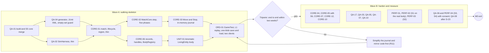
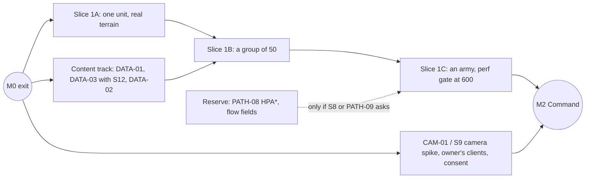

# Roadmap review: tech lead

*Design round of 2026-10-21. A review of [roadmap-draft.md](roadmap-draft.md) against the final
architecture [04-architecture.md](../04-architecture.md) (cited as "04 §n"), its ADRs
([adr/](../adr/README.md)) and the feasibility assessment [01-feasibility.md](../01-feasibility.md).
The lens: alignment with the architecture, dependency order, risk-first ordering, where the
spikes sit, realistic sizes, vertical slices, and whether M0 is the right foundation and nothing
more. The draft predates the final architecture (its §2.5 calls 04 "in progress"), so most
findings align it rather than dispute it. Day figures are the draft's card-bound upper bounds
(S = 1, M = 3, L = 10) and are estimates. Every Minecraft and NeoForge name used here was checked
in the decompiled 1.21.1 + NeoForge 21.1.262 tree (Appendix A). Clean-room: only our documents
and the decompiled vanilla and NeoForge sources were read.*

---

## Verdict

**Approve the draft's shape after the must-changes below.** Its spine is right: M0 → M6 to a solo
skirmish, a crude full loop in M3 before the systems deepen, an AI that learns each system in the
milestone that adds it, a perf gate in every milestone, testable acceptance criteria on every
card, and 21 decision points with options. What it lacks is the final architecture.

The 73 change requests split 34 must, 35 should and 4 could. Most musts are mechanical: card text
that re-opens an accepted ADR, or describes a mechanism from proposal B or C that the synthesis
did not adopt. Five changes are structural; the first three are musts and the last two shoulds:

1. **M0 builds the walking skeleton first,** with the architecture's two-week tripwire (04 §1.5,
   risk R11) as a checkpoint. Spike S1 leaves the skeleton's critical path and measures the
   shipping body afterwards (TL-08, TL-09).
2. **Seven pieces of the architecture get cards:** fault containment, save quarantine, the
   ArchUnit set with the engine-surface inventory, the binary journal with the cross-level replay
   check, the block writer, the arena world, and commander hardening; also spike S10 and tier-2
   replication (§1.2).
3. **M1 is cut into three vertical slices** (one unit, a group of 50, an army), each with a demo,
   instead of nineteen cards that first meet in the final soak (TL-23).
4. **Tests move down to L1.** Deterministic formulas are checked exactly in the core harness, and
   AI-versus-AI matches run there too; L3 keeps one integration test per feature (TL-04, TL-05).
5. **The camera spike S9 runs alongside M1,** with the owner's clients, while the assistant builds
   movement headless. That moves the controls verdict forward by about a milestone (TL-39).

Size: the MVP grows from 127 to 139 cards, while its card-day bound drops slightly, from 437 to
about 431. Missing architecture work replaces conditional work, chiefly HPA* (§6). Appendix B
indexes every request.

---

## 1. Alignment with the final architecture

### 1.1 Three kinds of divergence

| Kind | Examples | Requests |
|---|---|---|
| A card re-decides what an ADR settled | CORE-06 "as the S1 ADR decides" (ADR-0008); PERF-02 "settles contradiction 1"; QA-01.5 (ADR-0007); DATA-03 "prototyped both ways" (ADR-0012); PATH-01 three-way comparison (ADR-0015); CAM-01.2 (ADR-0017); FOW-02 "as the camera ADR implies" (ADR-0016) | TL-01, TL-09, TL-16, TL-26, TL-34, TL-40, TL-67 |
| A card describes a mechanism the synthesis rejected | UNIT-01 stripped `Mob`; PATH-05 "the body's move control"; CMB-01 invulnerability-frame workaround for unit-on-unit hits; CAM-04 released mouse; NET-03 attachment sync; UNIT-05 LOD by selection and visibility; BLD-04 vanilla heightmap; MATCH-01 gamerules per match; PATH-07 teleport | TL-10, TL-29, TL-50, TL-42, TL-64, TL-55, TL-56, TL-52, TL-30 |
| The architecture needs it, no card builds it | see §1.2 | TL-14 … TL-17, TL-24, TL-25, TL-31, TL-32, TL-44, TL-63 |

### 1.2 Architecture pieces with no card

| Piece | Where 04 puts it | Proposed card |
|---|---|---|
| Fault containment: `FaultBarrier`, `FAULTED`, L3 fault injection | M0 (§4.8, ADR-0009) | CORE-10 (TL-14) |
| Save quarantine and the registry blob | M0 (§5.6, ADR-0018) | CORE-12 (TL-15) |
| Every ArchUnit rule B1–B13 and the engine-surface inventory test | M0 (§1.5, §2.4, ADR-0020) | QA-17 (TL-16) |
| One scenario, two runners: `SimHarness`, fakes, scenarios in `core/testFixtures` | M0 (§16.2–16.3, ADR-0006) | QA-02 rewritten (TL-17) |
| The two-week walking-skeleton tripwire | M0 (§1.5, R11) | M0 checkpoint (TL-08) |
| Binary journal and the cross-level replay check | M1 (§5.5, §16.4) | CORE-11 (TL-25) |
| Spike S10, kinematic fidelity, which ADR-0011 waits on | M1 (§19.2) | UNIT-09 (TL-24) |
| The `strategos:arena` world preset, `ArenaWorld`, the ticket controller | M1 (§1.5, §3.2, ADR-0010) | MAP-07 (TL-31) |
| The single budgeted block writer (rule B7) | M1 for the importer, M3 for construction (§3.3, §11.7, ADR-0021) | BLD-15 (TL-32) |
| Tier-2 replication: `unit_summary`, far-unit markers, `ui_query`, `unit_detail` | M2 (§12.2–12.4) | NET-08 (TL-44) |
| The chunk-sent re-pair after camera jumps | M2 (§10.4) | CAM-03 (TL-45) |
| Commander hardening: two mixins and `CommanderGuard` | M7, before multiplayer play (§12.6) | NET-09 (TL-63) |

### 1.3 Change requests

**TL-01 · must · §2.5 "Engineering decisions the cards rely on".** Rewrite the table against the
final architecture. Every research contradiction is settled: authority by ADR-0008, stats by
ADR-0013, content by ADR-0012, determinism by ADR-0009 and ADR-0015, navigation by ADR-0015 (S8
confirms), fog cadence by ADR-0016, camera by ADR-0017 (S9 confirms or switches to a pre-decided
fallback), budgets by ADR-0019 (PERF-01 revises), GameTest wiring by ADR-0007 (S5 confirms),
licensing by ADR-0005. Cards implement or confirm; none settles or picks. Carry the wording into
QA-01.5, PERF-02.2, PERF-03.3, CORE-05.3, DATA-02, DATA-03, PATH-01.2 and CAM-01.2.
*Why:* as written, eight cards would re-open accepted decisions and write duplicate ADRs, against
the ADR rule that an accepted decision is only superseded.

**TL-02 · must · §2.4 budget table.** Use ADR-0019's definitions:
- A is `MatchCore.step` plus our adapter appliers, from `PhaseTimers`;
- B is A plus vanilla work on our bodies, server-thread job work, replication and our
  between-tick handlers, measured on the same arena with and without the match;
- C is MSPT from `getTickTimesNanos` plus between-tick task time;
- G adds core state ≤ 64 MB per 384² match.

*Why:* `getTickTimesNanos` covers `tickServer` only. Packet handlers, and the `ChunkMap#move` that
every accepted movement packet triggers, are invisible to it, so a C gate on MSPT alone passes
while panning commanders lag the server.

**TL-03 · should · §2.3 risk table.** Map the architecture's register (04 §19.1) as well, or merge
the two registers into one numbering. Add the retirements that have no card today: arch R1 → S10,
R4 → S7, R5 → S8, R9 → S11, R11 → the M0 tripwire, R12 → S12, R13 → NET-09, R14 →
`WorldReconciler` in MATCH-04. *Why:* the registers number risks differently (feasibility R11 is
fog leaks, architecture R11 is velocity), and eight architecture risks have no retiring card (§7).

**TL-04 · should · the Tests field of every card.** Derive each card's levels from ADR-0006's
Definition of Done by change type, and say so in §1: L0 and L5 run on every change, and L5 is
required for adapter, data, networking, client and build changes. Move deterministic formula and
timing checks out of L3 tolerance bands into exact L1 `SimHarness` tests, and keep one L3
integration test per feature. Examples: ECO-03.1, ECO-05.1, ECO-08.1, BLD-03.1, BLD-06.1,
PROD-02.1, CMB-01.2, CMB-04.1, CMB-07.1, TECH-03.1. *Why:* the core is deterministic, so bands
such as "±5 %" or "at least 95 %" can only hide bugs. 161 of 215 cards list L3, against
ADR-0006's target of an L3 suite under 3 minutes.

**TL-05 · should · QA-11, QA-12, QA-16, AI-01 … AI-05, AI-07, TECH-05, M10 exit 3.** Run
AI-versus-AI matches and per-technology checks mainly in L1 (`SimHarness` with fakes, 04 §14).
Keep a small seeded L3 sample in the `slow` batch and the full L3 set nightly. *Why:* a
60-game-minute match is 72,000 ticks, and map-scale GameTests run solo (04 §16.5). Twenty L3
matches take hours *(estimate)*, too slow to gate a change or to fit QA-08's 20-minute CI job.

**TL-06 · should · UI-02.3, CMB-06.3, UI-11.4, FOW-04.3, TERR-03.2.** Re-level client cost
criteria to L4 frame timers (with consent), or to an L1 JMH bench of view-model building and
frame extraction. *Why:* L6 means the server perf batch and core JMH. No unattended client perf
run exists, so these criteria can't run as written.

**TL-07 · should · DATA-04, D-11 (clean-room).** State that template base values are Strategos's
own numbers in game units. They are authored from relationships in the behavioural notes, for
example "cavalry about 1.5× infantry speed", and the scale profile only converts units. Drop
D-11's "0.4 of 0 A.D. in metres" and DATA-04 acceptance 3, and record a provenance note per value.
*Why:* ADR-0005 rejects copying 0 A.D. template values as a starting point, and scaling them by a
ratio is the same copy in disguise.

---

## 2. M0: the right foundation, in the wrong order

### 2.1 Scope

M0 has nearly the right breadth, but it builds its parts in the wrong order. Four foundations are
missing, two items arrive early, and five cards re-open settled decisions.

| Verdict | Cards |
|---|---|
| **Keep** as foundation | QA-01, QA-03, QA-04, QA-05, QA-07, QA-09, CORE-01 … CORE-07, UNIT-01, ORD-01, PERF-01 … PERF-03 |
| **Add** (the architecture puts them in M0) | CORE-10 fault containment; CORE-12 quarantine; QA-17 ArchUnit B1–B13 with the inventory test; the full `SimHarness` in QA-02; the journal and `ReplayRunner` with the skeleton's L1 replay; S6; the tripwire |
| **Move out** (not foundation yet) | QA-06's diff, goldens and container route go to QA-18 at M2; QA-10's dev payloads go to M1 (rule B6); S2's import timing goes to MAP-01 |
| **Non-blocking** | PERF-04 (S4) and QA-06 (S3) with consent; QA-08 once D-23 is decided |
| **Fix** (they re-open ADRs) | CORE-06, UNIT-01, PERF-02, PERF-03, QA-01.5, CORE-05.3 |

### 2.2 Proposed order

The draft's critical path is QA-01 → QA-04 → QA-07 → PERF-02 → CORE-06 → UNIT-01 → ORD-01 (19
days). It puts a spike and the perf harness in front of the first end-to-end proof. ADR-0008
already fixes authority, so the skeleton needs nothing from S1. The proposed path is QA-01 →
QA-04 → CORE-01 → CORE-02 → CORE-03 → ORD-01, with CORE-06 → UNIT-01 in parallel: 16 days by
the card bounds, and a thin cut of it must be end to end within two weeks of M0 work.

### 2.3 Change requests

**TL-08 · must · M0 structure, §2.2 rule 1, the M0 critical path.** Build the walking skeleton
first.
- **Wave A** contains thin cuts of QA-01 (S5 wiring), QA-02, QA-04, CORE-01/02/03, CORE-06 and
  UNIT-01, a one-blob save and load, QA-09, and ORD-01 with an L1 replay of its journal.
- **The tripwire** is an explicit checkpoint: end to end within two weeks of M0 work, or the
  journal and mirror code are simplified before anything else is built.
- **Wave B** hardens and measures (diagram above).

Replace the critical path as in §2.2, and reword §2.2's rule 1 to "skeleton first, then measure
on it". *Why:* the draft builds the skeleton last and never states the tripwire that 04 §1.5 and
risk R11 depend on.

**TL-09 · must · CORE-06, PERF-02.**
- **CORE-06** implements ADR-0008: a core record with generation handles; `noSave` bodies that
  only `BodyRegistry` creates; `/kill` turned into lethal core damage by the `hurt` override; a
  body discarded by another mod re-materialised next tick. Drop "as the S1 ADR decides" and the
  dependency on PERF-02.
- **PERF-02** depends on UNIT-01 and runs S1 as 04 §19.2 defines it. It compares the production
  kinematic `LivingEntity` with throwaway stripped `PathfinderMob` and physics `LivingEntity`
  bodies at 200, 500 and 1,000, idle, moving and fighting. It adds a 300-body physics melee blob,
  a build storm at 64 placements per tick, `MISC` against other categories, time inside and
  outside MSPT, and runs with and without Lithium.
- **Exit:** a kinematic body costs ≤ 4 µs beyond the core; the best body costs ≤ 15 µs at 500
  moving, or the default cap drops to 100 (D-01). The result updates ADR-0011.

*Why:* S1 confirms ADR-0011 or triggers its fallbacks; it does not decide authority. D-01 needs
the cost of the body that ships.

**TL-10 · must · UNIT-01.** Rewrite to ADR-0011:
- `UnitEntity extends LivingEntity implements IEntityWithComplexSpawn`, registered as
  `strategos:unit_humanoid`;
- built with `MobCategory.MISC`, `noSave`, `noSummon`, `fireImmune` and
  `setShouldReceiveVelocityUpdates(false)`, tracking range 10 and interval 3;
- the `KINEMATIC` tick skips `super.tick()`; pushing off; `getMovementEmission` returns `NONE`;
  `onGround` stays constant; two synced bytes; the template index travels in the spawn data.

Remove `setPersistenceRequired` and `Mob#customServerAiStep`, both `Mob`-only (Mob.java:1206,
818), and `STEP_HEIGHT`. Replace acceptance 2, "walks up a 1-block step", with three tests:
- L2: the entity-type settings;
- L3: a body is never written to chunk storage, and a chunk unload and reload leaves exactly one
  body;
- L3: a pose set in `LevelTickEvent.Pre` reaches a mock player in the same tick.

*Why:* the draft describes proposal B's stripped mob. M0 moves units in straight lines on flat
ground (04 §4.4); steps come with the surface grid and S10 in M1.

**TL-11 · must · CORE-01.** Add:
- the lifecycle CREATED → PREPARING → READY → RUNNING ⇄ PAUSED → ENDED → DISPOSED, with FAULTED
  (04 §3.5);
- `MatchSpace` in match-local coordinates;
- `MatchRegionIndex`, which routes chunks to matches in O(1) and rejects overlaps within 2 blocks;
- the `StrategosServer` holder, created on `ServerAboutToStartEvent` and dropped on
  `ServerStoppedEvent`;
- `strategos_registry`;
- `/strategos match create` over a region of the current level, for the L7 skeleton.

Replace acceptance 2, which closes and opens a singleplayer world and cannot run in a GameTest,
with an L3 holder-lifecycle test plus ArchUnit B8. The world switch moves to QA-09's manual
protocol. *Why:* alignment with ADR-0010.

**TL-12 · must · CORE-02.** Build:
- the driving port `MatchCore.step(TickInputs) → TickOutputs`, with sealed `InputEvent` and
  `OutputEvent` lists;
- the nine fixed phases P0–P8. M0 implements INGEST, COMMANDS, UNIT_AI (IDLE, WALKING), MOVEMENT
  on flat ground and FINAL; the others are empty slots;
- stepping in `LevelTickEvent.Pre` in `MatchId` order, only while `runsNormally()`;
- tests that every input type has exactly one INGEST handler and every output type one applier.

*Why:* the port is the central seam of ADR-0008 and ADR-0009, and the draft's phase list differs
from 04 §4.4.

**TL-13 · must · CORE-03, CORE-05, ORD-01, M0 exit 3.** Replace the "per-match command log" with
ADR-0009's input journal: every `InputEvent`, in the canonical order (received tick, player slot,
client sequence), kept in memory, with `ReplayRunner` naming the first divergent tick.
- **CORE-05** adds the stateless counter-based `Rng.u64(seed, stream, tick, key, salt)`, `DetMath`
  over `StrictMath`, and the full rule B4: `Set.of`, `Map.of`, the `toSet`, `toMap` and
  `groupingBy` collectors, object-keyed fastutil hash maps, and threads.
- **S6** runs the same match twice per run, on macOS and then on Linux once D-23 allows.
- **ORD-01 and M0 exit 3** add: the skeleton GameTest's journal replays in L1 to the same hash.
- **Gateway checks move.** Bounded decoding and token buckets go to NET-01; CORE-03 keeps semantic
  validation at the tick boundary (ADR-0014).

*Why:* commands alone cannot replay a match once world changes and job deliveries enter as
inputs.

**TL-14 · must · new card CORE-10 · Fault containment (M0, M).** A `FaultBarrier` wraps:
- the per-match work in `LevelTickEvent`;
- the output appliers;
- payload handlers routed to a match;
- `UnitEntity`'s server overrides;
- the protection handlers.

A fault moves the match to `FAULTED` and writes the snapshot, journal and a report under
`strategos/faults/`. Dev and GameTest runs rethrow (`faults.rethrow`). Acceptance: an L3 fault
injected into one match of a two-match run; the other match continues and the faulted one is
recorded. *Why:* 04 §4.8 and ADR-0009 place this in M0. An exception in our
`LevelTickEvent.Pre` handler stops the whole server (04 §4.1), and no draft card handles it.

**TL-15 · must · CORE-07 and new card CORE-12 · Save quarantine (M0, M).**
- **CORE-07** saves one self-contained `strategos_match_<id>` blob plus `strategos_registry`
  (ADR-0018), with codecs in core and `"v"` plus migrations on DFU `Dynamic`. The nav grid is not
  saved. Drop "dirty tracking per subsystem".
- **CORE-12:** our deserializer never throws. An unreadable file is copied to
  `<name>.dat.corrupt-<epoch>`, the match is `FAULTED`, and nothing is registered under that name.
  L3 tests load corrupted fixtures.

*Why:* vanilla's `DimensionDataStorage` turns a read error into an empty object that overwrites
the file at the next save. The full kernel is two cards' worth of work.

**TL-16 · must · QA-01 and new card QA-17 · Static gates (M0, M).**
- **QA-01** keeps the build, the pins, the core merge and S5. Acceptance 5 becomes "S5 confirms
  ADR-0007, or switches to its fallback, a separate test mod".
- **QA-17** adds every ArchUnit rule of 04 §2.4 that can be written before the code exists: the
  `@CoreApi` hexagon, client isolation, one sender, one block writer, no static mutable state,
  `@HotPath`, mixins only route, dev code never ships.
- **QA-17** also adds ADR-0020's engine-surface inventory test, starting with an empty inventory.
  The jar check proves that no `gametest`, `devtools` or `testFixtures` class ships.

*Why:* 04 §1.5 places all of this in M0. Rules written before the code are cheap; retrofitted
ones are not.

**TL-17 · must · QA-02.** Make QA-02 the core harness of 04 §16.2–16.3: `SimHarness`,
`FakeWorld`, `FakeBodies`, `FakeNet`, an inline `JobExecutor`, a fixed `Clock`, invariant
checkers and `VoxelFixtures`. Scenario definitions live in `core/testFixtures` with no JUnit or
AssertJ dependency, and QA-04's generator runs the same scenarios as GameTests. Size S → M.
*Why:* "one scenario, two runners" is an ADR-0006 rule and the main reason state lives in the
core. No draft card builds it, and a one-day card can't.

**TL-18 · should · QA-06, new card QA-18, QA-08.** Split QA-06:
- **QA-06** (M0, M, consent): S3 plus a minimal scenario runner (PNG, JSON, watchdog) that
  PERF-04 uses;
- **QA-18** (start of M2, M): `scenarioDiff`, masks, per-platform goldens and the Linux container
  route.

QA-08's golden step follows QA-18. *Why:* no client feature exists before M2, and an L-sized card
in M0 competes with the skeleton for the tripwire window.

**TL-19 · should · QA-10.** Keep the command tree, permissions and log tagging in M0. Move the
dev payload channel and acceptance 3 to M1, with NET-01: `debug_subscribe` and `debug_feed` are
M1 payloads. *Why:* rule B6 lets only `NetGateway` send, and `NetGateway` arrives with NET-01.

**TL-20 · should · PERF-03.** Measure 256, 576 and 1,024 chunks, the 256², 384² and 512² arenas
of ADR-0010, instead of 24², 32² and 64² chunks. ADR-0010 already chose `ticking=false`, so
`ticking=true` is measured only for the record. Add `tickChunks` and `NaturalSpawner.createState`
time with 600 bodies. Exit: ≤ 4 ms MSPT idle at 576 chunks, autosave ≤ 100 ms. The 384² import
time (≤ 30 s) moves to MAP-01. *Why:* 64² chunks is a 1,024² arena that no stage plans.

**TL-21 · should · PERF-01.** Turn PERF-01 from defining budgets into enforcing and revising
them:
- assertions in the L6 batch for A, B (the with/without-match method), C (with between-tick
  handler timers), D and G;
- JFR allocation profiling on;
- ADR-0019 revised once with the S1, S2 and S4 numbers and approved by the owner.

*Why:* ADR-0019 already defines A–G. B and C need measurement machinery that no card builds.

**TL-22 · should · PERF-04.** Depend on UNIT-01, so that S4 measures the shipping `UnitRenderer`.
If the owner has not consented by M0 exit, run S4 together with CAM-01. *Why:* the spike should
measure the real renderer, and a consent-gated spike must not block M2.

---

## 3. M1: three vertical slices

### 3.1 The slices

As drafted, M1 is one horizontal layer: 20 cards and 88 card-days, with every movement card
integrating only at PERF-05, at the end of a 42-day critical path. Design rule 8 forbids that
kind of integration, and feasibility R8 asks for something to watch every 4–6 weeks.

| Slice | Cards | Demo and exit checks |
|---|---|---|
| **1A One unit across real terrain** | PATH-01 (S8), PATH-02, PATH-15, PATH-03, PATH-05, UNIT-09 (S10), MAP-07, BLD-15, MAP-01, CORE-11 | A GameTest walks one unit across the imported proving ground (ramps, steps, a bridge, a ford); its journal replays in L1 to the same hash; the S8 and S10 reports; the owner sees it on a dedicated server |
| **1B A group of 50** | CORE-08, NET-01, UNIT-02, ORD-02, ORD-03, PATH-04, PATH-06, PATH-16 (S7) | 50 units ordered through a mock player's payload arrive; two groups of 50 pass head-on through a 6-block gap; identical hashes with 0, 1 and 4 path threads; the template set reaches a joining player before any unit; the S7 and S12 reports |
| **1C An army** | PATH-07, PATH-09, PATH-10, PERF-05 | 200 units cross with zero stuck within 1.5× the ideal time; the soak at 600 holds budgets A, B and D; the owner watches the overlay |
| Content track, alongside | DATA-01, DATA-02, DATA-03 | Needed by 1B (template sync, speeds from templates) |

### 3.2 Change requests

**TL-23 · must · M1 structure.** Cut M1 into the three slices above, each with a demo and exit
checks, and run DATA-01/02/03 as a parallel track that slice 1B needs. *Why:* see §3.1.

**TL-24 · must · new card UNIT-09 · Spike S10: kinematic fidelity (M1 slice 1A, M).** Test slabs,
stairs, snow, carpets, paths, farmland, shallow water and drops; check that player melee and
arrows reach the core and that units avoid players. Pose traces run in L3 with no consent;
screenshots run in L4 with consent. Exit: floor error ≤ 1/16 block and no visible pops at steps.
The result updates ADR-0011. *Why:* ADR-0011 is proposed pending S1 and S10, and without an S10
card the body decision could never be accepted.

**TL-25 · must · new card CORE-11 · Binary journal and cross-level replay (M1, M).**
- the binary journal, in segments of 1,200 ticks that each start with a snapshot;
- every behaviour GameTest exports its journal, and an L1 test replays it to the same hash;
- `/strategos journal save`;
- golden journals, re-baselined only with a reason.

*Why:* 04 §5.5 and §16.4 and ADR-0006 rely on this check to catch nondeterminism leaking through
the adapters.

**TL-26 · should · PATH-01.** Re-scope PATH-01 to S8 confirming ADR-0015's layered grid:
- a terrain census on vanilla 512² samples from several biomes, and on hand-built bridges and
  walls;
- surfaces per column, bytes and build time per page, A* against HPA* expansions.

Drop the single-layer and 3D-band prototypes; the delivery-latency study (S7) moves to PATH-16.
Exit: ≥ 99.9 % of columns need ≤ 4 surfaces; a page builds in ≤ 0.5 ms; nav fits 32 MB at 512².
*Why:* ADR-0015 already rejected the other two representations, and S8's exit is what accepts it.

**TL-27 · must · PATH-02 and new card PATH-15.** Follow 04 §9.2, which classifies terrain off
the server thread.
- **PATH-02** (M, pure; L1 and JMH): `BlockClassTable` including the `strategos:nav_class` data
  map, `VoxelSlice`, `PageBuilder`, layered surfaces and connectivity.
- **PATH-15** (M, live; L3 and L6): main-thread section capture; page builds as pure jobs;
  journaled slices; `LevelChunkMixin` → `BlockChangeRouter` with a `MatchRegionIndex` lookup,
  recording a `WorldChange` only when the class changed; rebuilds after 4 quiet ticks, within 40
  ticks and at most 4 pages per tick; prewarming 512² in ≤ 30 s; page hashes for resume; the
  inventory entry; the router's cost per block change outside matches.

*Why:* the draft classifies "on the server thread under a tick budget", which 04 replaced with
snapshot copies and worker jobs (fact 11; a 0.4 ms page budget). As one L-sized card it is XL.

**TL-28 · must · PATH-03 and new card PATH-16.**
- **PATH-03** (M): the `PathService` API; A* over surfaces with the cost model; a 20,000-expansion
  cap with `PARTIAL`; string pulling; no search for moves of ≤ 24 blocks; provisional steering;
  `STRICT` delivery at `t+k` with `pathThreads=0`.
- **PATH-16** (M): the worker pool; `ADAPTIVE` delivery with a journaled `JobDelivery`; admission
  by summed expansion caps W; `BUSY` beyond 2,048 requests; quiesce at save; S7.
- **Tests:** the hash test uses 0, 1 and 4 threads, not 1, 2 and 8. Budget D is measured as
  path-result latency, not as when motion starts.

*Why:* alignment with ADR-0015, and the card is XL as written. Provisional steering moves every
unit on the first tick, so "starts moving within 5 ticks" cannot fail. ADR-0019's budget D has the
same wording; flag it for PERF-01's revision.

**TL-29 · must · PATH-05.** Path following is the core `MotionSystem` integrating on the surface
grid:
- up-steps ≤ 1.0, smoothed over 2 ticks;
- drops ≤ 3 blocks;
- a turn-rate limit;
- shallow water slows; hazards are impassable; falls.

The body only mirrors poses. Remove "through the body's move control". *Why:* `KINEMATIC` bodies
(ADR-0011) have no `MoveControl`, which is a `Mob` concept from proposal B.

**TL-30 · must · PATH-07, M1 exit 3, PERF-05.2.** Use the ladder of 04 §9.5:

| Ticks with no progress | Step |
|---|---|
| 40 | repath |
| 100 | step to the nearest free surface |
| 200 | a partial path that ignores units |
| 400 | a deterministic nudge of ≤ 4 blocks along the path |
| 600 | fail the order with a notice |

There is no teleport. Acceptance 1: a boxed-in unit climbs the rungs in order and, if no exit
exists, its order fails at 600 ticks with a notice. Acceptance 2: fewer than 1 nudge per 1,000
orders. Replace "stuck > 10 s" with the invariant "no unit stuck > 400 ticks" (04 §16.2).
*Why:* under the architecture's ladder, "free within 200 ticks" cannot pass, and the teleport
contradicts the ladder.

**TL-31 · must · MAP-01 and new card MAP-07 · Arena world (M1, M).**
- **MAP-07:**
  - the `strategos:arena` world preset in `#minecraft:normal` (void flat, biome
    `strategos:arena`);
  - `ArenaWorld`, which applies the D-13 gamerules once and records that it did;
  - `level-type=strategos:arena` for dedicated servers;
  - slots 2,048 blocks apart and `ArenaPolicy`;
  - the `strategos:match` ticket controller with its `LoadingValidationCallback`.
- **MAP-01:** the importer writes through BLD-15 at 8,192 blocks per tick while no match runs,
  waits for lighting, and gets `/strategos map export`. Acceptance 1 becomes "≤ 30 s" (S2's exit),
  not 10 s.
- **The proving ground** comes from a deterministic devtools script that emits both the L1
  `VoxelFixture` and the L3 map package. Hand-finishing by the owner is optional.

*Why:* 04 §1.5 and ADR-0010 put the preset, the importer and the tickets in M1, and the draft has
no preset. A hand-built 384² proving ground costs owner hours and cannot be reproduced in L1.

**TL-32 · must · new card BLD-15 · Block writer (M1, M).** The one writer of ADR-0021 and rule
B7:
- 64 placements per tick across all matches, with flags 2 and 16 (`UPDATE_CLIENTS`,
  `UPDATE_KNOWN_SHAPE`);
- sites served round-robin, each flushing in bursts at most every 4 ticks;
- priorities: node removals, construction, damage stages, cosmetics, then import;
- an `OWN_WRITE` flag, `ProtectedBlockIndex` filling and the boundary shape pass.

It lands in M1 because `MapImporter` must write through it; BLD-03 then shrinks from L to M.
Acceptance: the budget is never exceeded, and our own writes trigger zero page rebuilds (L3);
placement cost is measured in L6. *Why:* B7 lets only `BlockWriter` call `Level#setBlock`. In the
draft the writer is implicit inside BLD-03, while MAP-01, ECO-03 and BLD-05 also write blocks.

**TL-33 · should · NET-01.** Specify `NetGateway.send(Audience, payload)`:
- **Audiences:** `Player`, `Faction`, `TrackersOf`, `SeesCell` and `Match`, with per-payload
  audience declarations checked in L2.
- **Codecs:** `WireCodec` in `core.protocol` with L1 size tests, adapted by `ByteBufWire`.
- **Sending:** payloads coalesced per player per tick; bounded decoding and token buckets.
- **Visibility:** a `FogGate` stub behind `UnitEntity#broadcastToPlayer`, false for another match
  and true for the same match; interest sets from `startSeenByPlayer` and `stopSeenByPlayer`.
- **M1 payloads:** `commands`, `template_set`, `match_join`, `match_state`, `feedback`.

Say "faction", not "team". *Why:* ADR-0016; this seam lets fog fill in later without rewiring.

**TL-34 · should · DATA-03.** ADR-0012 is accepted, so drop "prototyped both ways" and registries
for ids. Add:
- `TemplateLint` and a SHA-256 set version;
- the append-only `TemplateIdTable`, with a hash check and resend;
- `ContentSwap` as a journaled input at the tick boundary;
- refusing a reload that removes a template in use;
- registration of the `strategos:nav_class` data map;
- S12: `/reload` ≤ 2 s, and every error names its file and JSON path.

Size M → L. *Why:* this avoids prototyping a rejected path, and the full card is more than three
days.

**TL-35 · should · DATA-02.** Vanilla attributes are never a source and are not mirrored for
`KINEMATIC` bodies (ADR-0013). Add stages, priority, `TOKENS`, clamping, `StatsChanged` on the
match bus, and an L1 test that results don't depend on insertion order (canonical source-id
order). *Why:* floating-point sums and products depend on their order, and the draft's mirroring
sentence describes proposal B.

**TL-36 · should · PATH-08, PATH-09.** List PATH-08 (HPA*) and flow fields as reserve cards
outside M1's totals and critical path:
- HPA* is triggered when S8 or the 384² and 512² crossings miss budget D;
- flow fields are triggered when PATH-09 shows the shared path is not enough.

PATH-09 becomes the shared group path with join paths of ≤ 2,000 expansions and slot offsets,
sized M instead of L. *Why:* 04 §1.5 defers both behind the `PathService` API, and counting them
puts 17 card-days of conditional work into M1.

**TL-37 · should · PERF-05, M1 exits 3–5.** Gate budgets A, B and D at 600 moving units, the
design scale, with a stress run at 1,200. Exit 4 uses 0, 1 and 4 path threads. Exit 5 becomes
"ADR-0015 accepted with the S7 and S8 numbers; ADR-0012 confirmed by S12; ADR-0011 updated with
S10". *Why:* UnitAI and movement carry 2.8 ms of the 6.6 ms of phase targets at 600 units
(04 §4.4). At 300 units, thresholds set for 600 leave 2× slack in the costliest systems.

**TL-38 · could · DATA-02 timing.** Move DATA-02 to M3, and introduce only the `StatService` read
API over base values with DATA-01 in M1. *Why:* no M1–M5 card applies a modifier; the first
sources are TECH-01 and AI-05 in M6. M1 sheds a card and no caller changes.

---

## 4. Spikes: where each belongs

| Spike | Draft | Architecture (04 §19.2) | Proposed |
|---|---|---|---|
| S1 body cost | PERF-02, M0, on the skeleton's critical path, before CORE-06 | M0 | M0 wave B, after UNIT-01, on the production body (TL-09) |
| S2 arena cost | PERF-03, M0; sizes 24², 32², 64² chunks; ticket mode open | M0; 256, 576, 1,024 chunks; 384² import | M0 wave B; import timing in MAP-01 (TL-20) |
| S3 client harness | QA-06, M0, L | M0, consent | QA-06 in M0 with consent; goldens in QA-18 at M2 (TL-18) |
| S4 client frame | PERF-04, M0, consent | M0, consent | M0 if consented, else beside CAM-01; never blocking (TL-22) |
| S5 build wiring | QA-01, M0 | M0, first | M0 wave A, first (TL-16) |
| S6 determinism canary | missing | M0 (CORE-05), extended in M1 | CORE-05 in M0; Linux once D-23 allows; CORE-11 in M1 (TL-13, TL-25) |
| S7 path service under load | inside PATH-01, as a prototype | M1 (PATH-03) | PATH-16 in slice 1B, on the real service (TL-28) |
| S8 terrain census | PATH-01, a three-way comparison | M1 start | PATH-01 at the start of slice 1A, confirming the layered grid (TL-26) |
| S9 camera | CAM-01, M2 start, wrong variants | M2 start | CAM-01 right after M0, beside slice 1A, with ADR-0017's variants (TL-39, TL-40) |
| S10 kinematic fidelity | missing | M1 | UNIT-09, end of slice 1A (TL-24) |
| S11 bandwidth | implicit in NET-04 | M7 start | NET-04, named, at M7 start (TL-65) |
| S12 content cycle | DATA-03, "both ways" | M1 (DATA-03) | DATA-03 in the content track, confirming targets (TL-34) |
| Build storm (feasibility R12) | in PERF-02 | in S1 | kept in S1 |
| World creation from the title screen | missing | – | MATCH-14 before MATCH-02 (TL-60) |

---

## 5. M2 to M8

### 5.1 M2 · Command

**TL-39 · should · CAM-01 schedule.** Run CAM-01 (S9) right after M0 exit, beside M1 slice 1A,
with the owner's clients and consent. The production camera cards stay in M2. Update the spike
order in 04 §19.2. *Why:* the camera is the second-largest risk (architecture R6, feasibility R4)
and needs the owner's hands, while M1 is headless work for the assistant. Nothing in M1 depends
on S9, and it moves decision gate 2, the controls verdict, forward by about a milestone. This
starts no second system: the spike is time-boxed, and CAM-02 onward wait for M2.

**TL-40 · must · CAM-01 scope.** Compare ADR-0017's three body strategies:
1. the player follows the camera;
2. a client camera entity, with the server body teleported to the focus at most 5 times a second,
   plus the chunk-sent re-pair;
3. a body parked at the arena centre with a view distance of about 18.

Drop:
- `ServerPlayer#setCamera`, which drags the player every tick and resets on Shift, the queue key;
- "chunk tickets around the camera": entity tracking follows the player body, not tickets;
- the orthographic projection, which belongs to CAM-06.

Run on a LAN and with internet-like latency, with both cursor variants and under Sodium and Iris.
Exit criteria come from 04 §19.2, and the result updates ADR-0017. *Why:* as drafted, S9 would not
test the two fallbacks the architecture relies on.

**TL-41 · must · M2 exit 4, CAM-01.3, CAM-03.4.** Replace "no 'moved too quickly' warning" with:
- zero snap-backs while panning;
- at most the known one-off warning per jump;
- full coverage ≤ 3 s after a 300-block jump.

*Why:* ADR-0017 documents that the client's echo of a jump teleport can log one harmless warning,
so with 20 jumps the drafted criterion can never pass.

**TL-42 · must · CAM-04.** Replace the released mouse with a cancelled `InputEvent.MouseButton.Pre`
by ADR-0017's non-pausing full-window `RtsScreen`:
- every vanilla binding is inert; F1, F2, F3 and F11 are forwarded;
- chat opens; Escape cancels or pauses; the screen reopens on `ScreenEvent.Closing`;
- picking uses the `RenderLevelStageEvent` matrices, with the cursor normalised by
  `Window#getScreenWidth/Height`;
- units are hit by AABB rays against the client unit index, buildings through the footprint index.

*Why:* the drafted approach is the alternative ADR-0017 rejected.

**TL-43 · must · UI-03.** Drop "Ctrl-click for all of that type"; use double-click (04 §13.3).
*Why:* on macOS, vanilla turns Ctrl + left click into a right click before any handler or screen
sees it (MouseHandler.java:59–68). On the owner's Mac it would issue an order.

**TL-44 · must · new card NET-08 · Tier-2 replication and selection details (M2, M).**
- `ReplicationService` in core, with per-faction interest;
- `unit_summary` at 2 Hz (about 6 B per unit) and far-unit markers beyond tracking range;
- `ui_query` and `unit_detail`;
- `ClientMatchModel`;
- an L1 proof that no frame carries a hidden handle.

*Why:* 04 §12.2–12.4 land these in M2. UNIT-03.2, "units stay visible at maximum zoom-out",
cannot pass without markers, because bodies are tracked to 10 chunks only.

**TL-45 · should · CAM-02, CAM-03.**
- **CAM-02:** camera height 8–64 blocks (ADR-0017; S9 sets the final limit). The rig's position is
  applied in `PlayerTickEvent.Pre` and its angles in `ViewportEvent.ComputeCameraAngles`, with no
  camera mixin. Jumps go through `camera_jump`.
- **CAM-03:** the commander is a vanilla spectator at the camera eye. Pans are capped at 8 blocks
  per tick. The server answers `camera_jump` with a teleport in every mode. Add the chunk-sent
  re-pair (`ChunkWatchEvent.Sent` → `ServerChunkCache#move(viewer)` on the next tick), and turn
  `spectatorsGenerateChunks` off in arena worlds.

*Why:* 04 §13.1–13.2 and §10.4. At a height of 80 blocks the view reaches past the tracking range.

**TL-46 · should · UNIT-03.** Move the entity-type settings (range, interval, velocity updates) to
UNIT-01, where the type is registered. UNIT-03 keeps:
- the `UnitRenderer` (`LivingEntityRenderer` with `HumanoidModel`, armour and held-item layers);
- outlines through `isCurrentlyGlowing` and `getTeamColor`;
- a fixed 192-block render distance and the culling box.

Depend on PERF-04's ADR status, not on its result. *Why:* entity types are fixed at startup
(fact 23), and a consent-gated spike must not block M2.

**TL-47 · should · UI-05.** Define how the preview equals the server's slots: the shared
slot-layout code in core runs on the client against a terrain view built from loaded chunks with
the same `BlockClassTable`. Acceptance:
- L1: the client and server code give equal slots for equal inputs;
- L3: on the proving ground, the server's slots equal the client's prediction, with a documented
  tolerance where the client lacks reachability data.

*Why:* the client has neither the surface grid nor the component labels, so acceptance 1 cannot
be tested as written.

### 5.2 M3 · First loop

**TL-48 · should · M3 internal order.** Run M3 as four slices, each ending with a build the owner
can play:
1. **economy:** ECO-01 … ECO-05, with a civic centre placed instantly;
2. **building and training:** BLD-02, BLD-03, ECO-06, PROD-01;
3. **fighting and victory:** CMB-01 … CMB-03, ORD-04, MATCH-01;
4. **the opponent:** AI-17, QA-11, PERF-06.

*Why:* M3 answers "is it fun?". Slices give feedback before all its cards meet.

**TL-49 · must · ECO-03, ECO-07, BLD-01, BLD-03, BLD-05.** Replace "nav updates" with: the core
updates its own overlay and surface data when it commits a footprint, places stages or depletes a
node, and the writer's `OWN_WRITE` edits are never reclassified. *Why:* 04 §9.7 and ADR-0021:
construction and damage cost no navigation work.

**TL-50 · must · CMB-01.** Unit-versus-unit damage is resolved entirely in the core:
- `LivingEntity#hurt` is never called for it, and HP is never mirrored into vanilla health;
- trackers get feedback through `broadcastDamageEvent` and `swing`, and HP through `unit_hud`;
- at death the adapter sets vanilla health to 0, calls `die()` and drives `tickDeath()`.

Move the `LivingIncomingDamageEvent` handler and the `bypasses_cooldown` damage types to CMB-08.
Acceptance 2 becomes an exact L1 check, plus an L3 check that vanilla `hurt` is never called and
vanilla health stays full until death. *Why:* ADR-0011; the drafted invulnerability-frame
workaround is proposal B's mechanism.

**TL-51 · should · ECO-02, ECO-03, ECO-07.** Discover nodes at prepare by a deterministic flood
fill over a material channel from the `strategos:resource_yield` data map, L1-tested on synthetic
slices. Its defaults cover `#minecraft:logs`, `#minecraft:leaves`,
`#minecraft:base_stone_overworld` and `#c:ores`, and map manifests may override them. *Why:*
04 §11.3; other mods' blocks then work with no code.

**TL-52 · must · MATCH-01.** Separate world policy from match rules:
- **Arena-world gamerules** are applied once by `ArenaWorld` (MAP-07) and never in any other
  world.
- **`MatchRules`** belong to MATCH-01 (population cap, starting resources, victory, `revealMap`)
  and change only through journaled `RuleChange` inputs.
- **Worlds that aren't arenas** rely on the protection events.

*Why:* 04 §3.2 and §15.4. Gamerules are world-wide, so a match that changed them would alter the
owner's own worlds.

**TL-53 · should · AI-01 and new card AI-17.**
- **AI-01** (M): `ComputerPlayer` inside the core step (phase P2, every 20 ticks, offset by slot),
  `AiView`, `CommandSink`, and an `AiBudget` in evaluation units. L1 decision tests on synthetic
  states. It depends only on CORE-03.
- **AI-17** (M): the scripted `StrategyScript` bot, with an L1 headless match and an L3 sample.

*Why:* this takes the framework off M3's critical path (BLD-03 → AI-01 → QA-11) and matches
04 §14.

**TL-54 · should · BLD-01, ART-01.** Generate test blueprints in code (devtools, structure NBT),
so construction GameTests never wait for creative-mode art; ART-01 replaces them with
owner-built blueprints later. *Why:* tests must not depend on owner hours or on D-04.

### 5.3 M4–M6

**TL-55 · must · UNIT-05.** Base tiers on activity only:
- ACTIVE (fighting, or ordered within the last 40 ticks): every 2 ticks;
- MOVING: every 4 ticks;
- WORKING: every 10 ticks;
- IDLE: every 20 ticks;
- ABSTRACT: no body.

Remove "selected" and "moving unseen", and the dependency on UNIT-03. *Why:* 04 §6.5: LOD never
depends on observation. Selection is client state and "unseen" depends on who watches, so
outcomes would change with the observers and replays would break.

**TL-56 · must · BLD-04.** Validate footprints with `PlacementRules` against the core surface grid
(a floor-height spread of at most 2 blocks, levelled by the foundation), not against
`Heightmap.Types.MOTION_BLOCKING_NO_LEAVES`. *Why:* the core is Minecraft-free and deterministic.
A vanilla heightmap is not a journaled input, and it disagrees with the surface grid on leaves and
partial blocks.

**TL-57 · should · BLD-05, BLD-07.**
- **BLD-05:** damage ranks come from a hash of the blueprint id and the block index, under the
  support graph; the two lowest layers of the footprint's outer ring are never removed; repair
  has 2 % hysteresis.
- **BLD-07:** add the `LevelChunkMixin` catch-all that restores, at the end of the tick, a
  protected block changed without the writer's flag. Deny `CropGrowEvent.Pre` inside fields and
  `MobSpawnEvent.PositionCheck` inside match regions.

*Why:* 04 §11.8–11.9.

**TL-58 · should · MATCH-04, MATCH-05, UI-11.** Pull three cards forward:
- **MATCH-04** (save and resume) into M4, with `WorldReconciler`, resume as `PAUSED` and the
  production journal ring. It depends on CORE-07 and the M3–M4 systems, not on MATCH-02. Camera
  pose and control groups stay client-side.
- **MATCH-05** (pause, S) into M3, with `match_control`.
- **UI-11** (the minimap) into M4.

*Why:* it de-bundles the MVP milestone, proves persistence while building and node state is fresh
(R14), and gives the M4 and M5 playtests on a 384² arena orientation and a pause.

**TL-59 · should · MATCH-05.** Pause is the match's `PAUSED` state: the core isn't stepped and the
inbox keeps buffering. Game speed uses `ServerTickRateManager#setTickRate` in singleplayer. Don't
use tick freeze. *Why:* tick freeze is server-wide (`ServerLevel#tickRateManager` returns the
server's manager), so it freezes every match and every non-player entity. The per-match state
also serves a later vote pause.

**TL-60 · should · MATCH-02 and new card MATCH-14 · Arena world from the title screen (S).** A
skirmish is a new match in a fresh slot of the arena world, which is created once from the
`strategos:arena` preset when it is missing; it is not a new world per map package. MATCH-14
proves, before MATCH-02 starts, that a preset world can be created programmatically
(`WorldOpenFlows#createFreshLevel`). *Why:* ADR-0010 rejects a world per match, and creating a
preset world from code is unverified and sits on the MVP path.

**TL-61 · should · ART-03.** Start ART-03 in M4 as a parallel track once D-03 and D-04 are
decided, and take it off M6's critical path. The MVP exit requires completeness (icons,
blueprints, damage stages), not a finished art pass. *Why:* feasibility §6.2 and §6.4 put
placeholder art in the MVP, and art is a capacity risk the assistant can't absorb at the end.

**TL-62 · should · CMB-08, AUD-01.**
- **CMB-08** includes the Strategos damage types (`unit_hack`, `unit_pierce`, `unit_crush`, tagged
  `minecraft:bypasses_cooldown`) and the `LivingIncomingDamageEvent` handler for players and mobs
  as targets.
- **AUD-01** plays unit sounds only as `fx` events with spatial audiences, never through a
  server-side `playSound`.

*Why:* 04 §6.7 and §10.5: server-side entity sounds ignore fog.

### 5.4 M7–M8

**TL-63 · must · new card NET-09 · Commander hardening (M7, before multiplayer play, M).**
- `ServerGamePacketListenerImplMixin` drops `handleTeleportToEntityPacket` for match members.
- `ServerPlayerMixin` makes `attack` a no-op for commanders, and hides enemy commanders and fogged
  first-person bodies in `broadcastToPlayer`.
- `CommanderGuard` clamps commander bodies after every accepted move.
- Each hook gets its inventory entry.
- L3 mock players send each hostile packet.

*Why:* 04 §12.6 and ADR-0016 and ADR-0017. A vanilla spectator can spectate an entity by attacking
it (ServerPlayer.java:1767) and teleport to any entity (ServerGamePacketListenerImpl.java:1204).
NET-06 covers only our own payloads.

**TL-64 · must · NET-03.** Remove the per-player filtered attachments
(`AttachmentType.Builder#sync`). Per-player and per-faction state leaves only through `NetGateway`,
with `Player` and `Faction` audiences from `ReplicationService`. *Why:* rule B6 and ADR-0016 allow
one sender, and 04 §12.6 states that Strategos does not rely on attachment sync.

**TL-65 · should · NET-04.** Tie NET-04 to two things:
- **S11:** 4 mock players and 600 units, a pan at 40 blocks/s, a skirmish on a fog edge and a
  construction storm, with an exit of ≤ 100 KB/s per client;
- **per-channel byte budgets** with deferral.

The army channel is M2's `unit_summary`. Streamed tier-4 entity types come only if S11 fails, and
are chosen per match at its start. *Why:* 04 §12.3–12.5.

**TL-66 · should · QA-14.** Trigger the 26.x gate as ADR-0001 says: at the end of the first
playable milestone or in 2027-Q2, whichever comes first. Run it as a time-boxed spike on a branch,
which may run beside M5 or M6, instead of after QA-13 in M7. *Why:* with the MVP at 8–11 months
from October 2026 (feasibility §1.1), 2027-Q2 most likely comes before M7.

**TL-67 · must · FOW-01, FOW-02, M8 exit 2.**
- **Vision** updates incrementally every tick (stamp and unstamp), and a `VisibilityIndex` reveals
  a unit at once and hides it after 10 ticks unseen.
- **Re-tracking** is forced every 5 ticks through a targeted `TrackedEntity#updatePlayer` and the
  two access-transformer lines (ADR-0016), with `ServerChunkCache#move(viewer)` as the fallback.
- **The gate** covers unit bodies only, because buildings are blocks.
- **Latencies:** reveal within 6 ticks, hide within 15.

Remove the dependency on CAM-01. *Why:* ADR-0016 is accepted, and "every 10 ticks" and "as the
camera ADR implies" re-open it. "Unpair within 10 ticks" also conflicts with the 10-tick
hysteresis.

### 5.5 Later milestones

**TL-68 · could · MATCH-13.** Build replays on the existing input journal (segments and snapshots
from M1, the production ring from M6). The card becomes full-match journal retention plus a
playback UI; drop "command log". *Why:* commands alone don't reproduce a match, and the recording
system already exists.

**TL-69 · could · TERR-01.** Run the off-thread recompute as a pure job with deterministic
delivery, as paths do, or in the WORLD phase under a work cap. *Why:* determinism (ADR-0009,
04 §10.6).

**TL-70 · could · QA-05.** From M3 on, extend the L5 smoke test to a headless match on a map
package, with 600 ticks of AI versus AI (04 §16.1). *Why:* the dedicated server then proves
gameplay, not only start-up.

---

## 6. Decisions and sizes

**TL-71 · should · D-09, D-13, D-14.**
- **D-09:** drop "The CAM-01 spike measures both first"; S9 tests perspective, and orthographic is
  CAM-06.
- **D-13:** needed by M1, because MAP-07 applies the arena gamerules on first load.
- **D-14:** drop the note that feasibility §6.2 assumes infinite fields; it now says finite.

*Why:* alignment with ADR-0017, ADR-0010 and the current feasibility text.

**TL-72 · should · new decision points D-22, D-23.**
- **D-22, the L4 policy:** consent per run, standing consent with conditions, a Linux container
  under Xvfb, or CI only. Needed by M0.
- **D-23, CI hosting and the private GitHub repository.** Needed by M0, for QA-08 and S6's Linux
  run.

*Why:* 43 cards and 45 acceptance criteria use L4 (consent), and S6 needs Linux. Both are owner
decisions that gate M0's exit and every client card.

**TL-73 · should · sizes and totals.** Apply the size changes below and recompute card counts,
totals and critical paths. *Why:* several L cards bundle two or three deliverables and are XL in
practice. The draft's totals understate M0 and count conditional work in M1.

| Card | Draft | Proposed | Reason |
|---|---|---|---|
| QA-01 | M | M + QA-17 (M) | static gates and the inventory test are their own deliverable |
| QA-02 | S | M | the full harness with fakes and two runners |
| QA-06 | L | M + QA-18 (M, M2) | S3 now; goldens with the first client feature |
| CORE-07 | M | M + CORE-12 (M) | quarantine and corrupted-fixture tests |
| PATH-02 | L | M + PATH-15 (M) | pure page model; live capture and rebuild |
| PATH-03 | L | M + PATH-16 (M) | synchronous search first; the async service with S7 second |
| PATH-08 | L | reserve | triggered by S8 or the crossings |
| PATH-09 | L | M | shared group path only; flow fields in reserve |
| DATA-03 | M | L | lint, hash, id table, `ContentSwap`, S12 |
| MAP-01 | M | M + MAP-07 (M) | the arena world is its own deliverable |
| BLD-03 | L | M | the writer moves to BLD-15 |
| AI-01 | L | M + AI-17 (M) | framework and bot |

| Milestone | Draft cards / card-days | Proposed *(estimate)* | Main changes |
|---|---|---|---|
| M0 | 23 / 58 | 26 / 62 | + CORE-10, CORE-12, QA-17; QA-02 S → M; QA-06 L → M |
| M1 | 20 / 88 | 25 / 82 | + UNIT-09, CORE-11, BLD-15, MAP-07, PATH-15, PATH-16; PATH-08 to reserve; PATH-09 L → M; DATA-03 M → L |
| M2 | 11 / 38 | 13 / 44 | + NET-08, QA-18; CAM-01 runs early |
| M3 | 23 / 89 | 25 / 79 | BLD-03 L → M; + AI-17; + MATCH-05 |
| M4 | 18 / 49 | 20 / 62 | + MATCH-04, UI-11 |
| M5 | 12 / 39 | 12 / 39 | – |
| M6 | 20 / 76 | 18 / 63 | − MATCH-04, MATCH-05, UI-11; + MATCH-14; ART-03 starts in M4 |
| **MVP** | **127 / 437** | **139 / 431** | Missing architecture work in; conditional work out |
| M7 | 11 / 38 | 12 / 41 | + NET-09 |

---

## 7. Risk coverage after the changes

The architecture's register (04 §19.1) mapped to the cards that retire each risk.

| Risk (architecture) | Retired by | When |
|---|---|---|
| R1 kinematic movement looks wrong | UNIT-09 (S10) | M1 slice 1A |
| R2 per-body server cost | PERF-02 (S1) | M0 |
| R3 hidden nondeterminism | CORE-05 (S6), CORE-11, QA-17 (B4) | M0, M1 |
| R4 path work stalls the tick | PATH-16 (S7) | M1 slice 1B |
| R5 layered surfaces miss real terrain | PATH-01 (S8) | M1 slice 1A |
| R6 camera on a dedicated server | CAM-01 (S9) | right after M0 |
| R7 forced re-tracking wrong or slow | FOW-02, FOW-05 | M8 |
| R8 client frame time | PERF-04 (S4) | M0, or with CAM-01 |
| R9 bandwidth with four clients | NET-04 (S11) | M7 |
| R10 slow map import | PERF-03 (S2), MAP-01 | M0, M1 |
| R11 double bookkeeping slows delivery | the M0 tripwire | M0 |
| R12 template system too complex | DATA-03 (S12) | M1 |
| R13 vanilla spectator powers | NET-09 | M7 |
| R14 world and core diverge after a crash | MATCH-04 with `WorldReconciler` | M4 |
| R15 Sodium or Iris break overlays | `-Pcompat` runs | every client milestone |
| R16 clean-room contamination | QA-13 provenance check; TL-07 | always |
| R17 players want their own world | M13 | M13 |
| R18 the 26.x port costs more | QA-14 | by 2027-Q2 |

---

## 8. What to keep

- The card format: value, scope, acceptance per test level, dependencies, size, tier, stable IDs
  that are never reused.
- Pathfinding first and headless in M1, the camera with the owner in M2, the crude full loop in
  M3 with decision gate 3 after it.
- An AI that grows every milestone (AI-01 … AI-05) instead of arriving at the end.
- A perf gate in every milestone with a 2× stress run, and target scales that match 04 §17.1.
- The MVP scope of feasibility §6, with the ram (D-12) and the minimap (D-16) pulled in
  deliberately.
- Multiplayer (M7) before fog (M8), as the owner's next stage asks; the fog seam from NET-01.
- QA-09's multi-client protocol and P0–P3 severities; QA-13's clean-room and naming checks.
- Twenty-one decision points with options, a recommendation and a "needed by" milestone.
- Open world in M13, kept possible by seams rather than built early.

---

## Appendix A. API names checked

Every name below was found in the decompiled Minecraft 1.21.1 + NeoForge 21.1.262 tree with the
stated signature or behaviour. The other names this review uses were checked there too:
`ViewportEvent.ComputeCameraAngles`, `PlayerTickEvent.Pre`, `LevelTickEvent.Pre`,
`RenderLevelStageEvent#getProjectionMatrix`, `ScreenEvent.Closing`, `Window#getScreenWidth`,
`Entity#isCurrentlyGlowing`, `getTeamColor`, `shouldRenderAtSqrDistance`, `startSeenByPlayer`,
`stopSeenByPlayer`, `playSound`, `getMovementEmission`, `ServerLevel#broadcastDamageEvent`,
`LivingEntity#hurt`, `swing`, `die`, `tickDeath`, `MobCategory.MISC`,
`EntityType.Builder#fireImmune`, `IEntityWithComplexSpawn`, `LivingEntityRenderer` and
`HumanoidModel` bounded by `LivingEntity`, `DimensionDataStorage#computeIfAbsent`,
`ServerAboutToStartEvent`, `ServerStoppedEvent`, `RegisterGameTestsEvent`,
`GlobalTestReporter.replaceWith`, `StructureTemplate#fillFromWorld`,
`Level#setBlock(BlockPos, BlockState, int)` (Level.java:228), `Block.UPDATE_CLIENTS` = 2,
`Block.UPDATE_KNOWN_SHAPE` = 16, `LivingIncomingDamageEvent#getContainer`,
`LoadingValidationCallback`, the `spectatorsGenerateChunks` gamerule,
`PacketDistributor#sendToPlayer`, `MinecraftServer#getTickTimesNanos`, `ChunkMap#move` and
`PalettedContainer#copy`.

| Name | Location | Used in |
|---|---|---|
| `Mob#setPersistenceRequired` exists only on `Mob`, not on `LivingEntity`; `Mob#customServerAiStep`, called from final `serverAiStep` | `world/entity/Mob.java:1206, 818, 773` | TL-10 |
| `Entity#checkDespawn` is empty | `world/entity/Entity.java:3555` | TL-10 |
| `EntityType.Builder#noSave`, `noSummon`, `clientTrackingRange`, `updateInterval`, `setShouldReceiveVelocityUpdates` | `world/entity/EntityType.java:1339, 1334, 1359, 1364, 1384` | TL-10, TL-46 |
| `LivingEntity#getDimensions(Pose)` final, `getDefaultDimensions` overridable | `world/entity/LivingEntity.java:3423, 3427` | TL-10 |
| `Entity#broadcastToPlayer(ServerPlayer)`; `ServerPlayer#broadcastToPlayer` | `Entity.java:3021`; `server/level/ServerPlayer.java:957` | TL-33, TL-63, TL-67 |
| macOS: Ctrl + left click becomes a right click in `MouseHandler#onPress`, before screens and NeoForge hooks | `client/MouseHandler.java:52–68` | TL-43 |
| `ServerPlayer#attack` calls `setCamera(target)` for spectators | `ServerPlayer.java:1767–1769` | TL-40, TL-63 |
| `ServerGamePacketListenerImpl#handleTeleportToEntityPacket` | `server/network/ServerGamePacketListenerImpl.java:1204` | TL-63 |
| `AttachmentType.Builder#sync(BiPredicate<IAttachmentHolder, ServerPlayer>, StreamCodec)` | `neoforge/attachment/AttachmentType.java:273` | TL-64 |
| `Heightmap.Types.MOTION_BLOCKING_NO_LEAVES` | `world/level/levelgen/Heightmap.java:145` | TL-56 |
| `ServerLevel#tickRateManager` returns the server's manager; `TickRateManager#isEntityFrozen` exempts players; `ServerTickRateManager#setFrozen`, `setTickRate` | `server/level/ServerLevel.java:1361`; `world/TickRateManager.java:63`; `server/ServerTickRateManager.java:27, 110` | TL-59 |
| Client pause skips `level.tickEntities()` and the level tick | `client/Minecraft.java:1234–1238, 1857–1868, 1880–1892` | TL-59 |
| `WorldOpenFlows#createFreshLevel(String, LevelSettings, WorldOptions, Function<RegistryAccess, WorldDimensions>, Screen)` | `client/gui/screens/worldselection/WorldOpenFlows.java:79` | TL-60 |
| `ChunkWatchEvent.Sent`; `ServerChunkCache#move(ServerPlayer)`; `ChunkMap$TrackedEntity` (package-private), `updatePlayer` | `neoforge/event/level/ChunkWatchEvent.java:96`; `ServerChunkCache.java:464`; `ChunkMap.java:1278, 1327` | TL-45, TL-67 |
| `LevelChunk#setBlockState(BlockPos, BlockState, boolean)` | `world/level/chunk/LevelChunk.java:239` | TL-27, TL-57 |
| `TicketController#forceChunk(ServerLevel, UUID, int, int, boolean, boolean)` | `neoforge/common/world/chunk/TicketController.java:67` | TL-20, TL-31 |
| `GameTestHelper#getBounds()` returns an `AABB` | `gametest/framework/GameTestHelper.java:916` | TL-11 |
| `DamageContainer#setPostAttackInvulnerabilityTicks`; `LivingIncomingDamageEvent` | `neoforge/common/damagesource/DamageContainer.java:130`; `neoforge/event/entity/living/LivingIncomingDamageEvent.java` | TL-50, TL-62 |
| `CropGrowEvent.Pre`; `MobSpawnEvent.PositionCheck` | `neoforge/event/level/block/CropGrowEvent.java:30`; `neoforge/event/entity/living/MobSpawnEvent.java:236` | TL-57 |
| Cards found correct: `HorseModel.createBodyMesh(CubeDeformation)` (UNIT-06), `ScreenEvent.Init.Post` (MATCH-02), `Screenshot.takeScreenshot(RenderTarget)` and `RenderFrameEvent.Post` (QA-06), `TicketType.create(String, Comparator, int)` (CORE-09) | `client/model/HorseModel.java:72`; `neoforge/client/event/ScreenEvent.java:139`; `client/Screenshot.java:92`; `neoforge/client/event/RenderFrameEvent.java:52`; `server/level/TicketType.java:25` | – |

## Appendix B. Index of change requests

| ID | Sev | Target |
|---|---|---|
| TL-01 | must | §2.5 engineering decisions |
| TL-02 | must | §2.4 budget definitions |
| TL-03 | should | §2.3 risk mapping |
| TL-04 | should | Tests field of every card |
| TL-05 | should | AI-versus-AI and per-tech tests in L1 |
| TL-06 | should | Client cost criteria levels |
| TL-07 | should | DATA-04, D-11 clean-room |
| TL-08 | must | M0 order and tripwire |
| TL-09 | must | CORE-06, PERF-02 |
| TL-10 | must | UNIT-01 |
| TL-11 | must | CORE-01 |
| TL-12 | must | CORE-02 |
| TL-13 | must | CORE-03, CORE-05, ORD-01, M0 exit 3 |
| TL-14 | must | new CORE-10 fault containment |
| TL-15 | must | CORE-07, new CORE-12 quarantine |
| TL-16 | must | QA-01, new QA-17 static gates |
| TL-17 | must | QA-02 harness |
| TL-18 | should | QA-06 split, new QA-18, QA-08 |
| TL-19 | should | QA-10 |
| TL-20 | should | PERF-03 |
| TL-21 | should | PERF-01 |
| TL-22 | should | PERF-04 |
| TL-23 | must | M1 slices |
| TL-24 | must | new UNIT-09 S10 |
| TL-25 | must | new CORE-11 journal and cross-level replay |
| TL-26 | should | PATH-01 |
| TL-27 | must | PATH-02, new PATH-15 |
| TL-28 | must | PATH-03, new PATH-16 |
| TL-29 | must | PATH-05 |
| TL-30 | must | PATH-07, M1 exit 3, PERF-05.2 |
| TL-31 | must | MAP-01, new MAP-07 |
| TL-32 | must | new BLD-15 block writer |
| TL-33 | should | NET-01 |
| TL-34 | should | DATA-03 |
| TL-35 | should | DATA-02 |
| TL-36 | should | PATH-08, PATH-09 |
| TL-37 | should | PERF-05, M1 exits 3–5 |
| TL-38 | could | DATA-02 timing |
| TL-39 | should | CAM-01 schedule |
| TL-40 | must | CAM-01 scope |
| TL-41 | must | M2 exit 4, CAM-01.3, CAM-03.4 |
| TL-42 | must | CAM-04 |
| TL-43 | must | UI-03 |
| TL-44 | must | new NET-08 tier-2 replication |
| TL-45 | should | CAM-02, CAM-03 |
| TL-46 | should | UNIT-03 |
| TL-47 | should | UI-05 |
| TL-48 | should | M3 internal order |
| TL-49 | must | ECO-03, ECO-07, BLD-01, BLD-03, BLD-05 |
| TL-50 | must | CMB-01 |
| TL-51 | should | ECO-02, ECO-03, ECO-07 |
| TL-52 | must | MATCH-01 |
| TL-53 | should | AI-01, new AI-17 |
| TL-54 | should | BLD-01, ART-01 |
| TL-55 | must | UNIT-05 |
| TL-56 | must | BLD-04 |
| TL-57 | should | BLD-05, BLD-07 |
| TL-58 | should | MATCH-04, MATCH-05, UI-11 |
| TL-59 | should | MATCH-05 |
| TL-60 | should | MATCH-02, new MATCH-14 |
| TL-61 | should | ART-03 |
| TL-62 | should | CMB-08, AUD-01 |
| TL-63 | must | new NET-09 commander hardening |
| TL-64 | must | NET-03 |
| TL-65 | should | NET-04 |
| TL-66 | should | QA-14 |
| TL-67 | must | FOW-01, FOW-02, M8 exit 2 |
| TL-68 | could | MATCH-13 |
| TL-69 | could | TERR-01 |
| TL-70 | could | QA-05 |
| TL-71 | should | D-09, D-13, D-14 |
| TL-72 | should | new D-22, D-23 |
| TL-73 | should | Sizes and totals |
