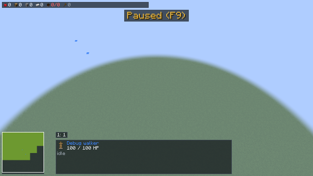
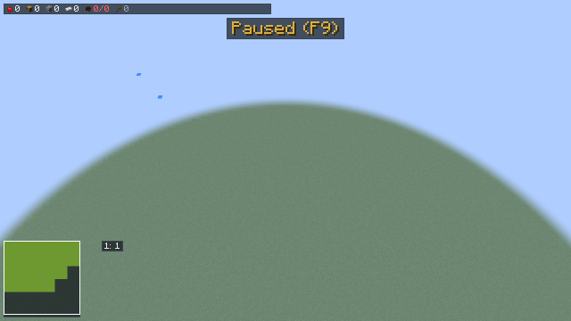
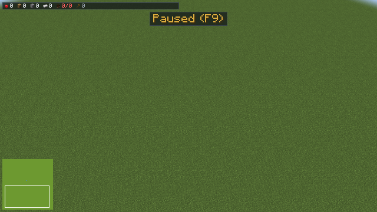

# Reconnect camera and groups

Automated cloud L4 evidence from [44918194693](https://github.com/o-e-lytvynskyi/strategos/actions/runs/44918194693), candidate 1cb19efd.

Save and Quit/reopen automatically reclaims the same UUID seat under a fresh epoch. The camera returns to focus (-36, -28), yaw 0 and height 60, and group 1 retains its owned handle. Selection/private details reset. A distinct world deliberately reuses the match id and unit handle; its groups stay empty and its camera starts fresh.

The 640 x 360 frames are exact cloud comparison candidates. The scene requires a complete received viewport and rendered sections; spectator chunk generation stays disabled. See evidence.json for checks and image hashes. Normal/altered-golden verification follows adoption of these inspected frames. This is not human/native multiplayer or art acceptance.
