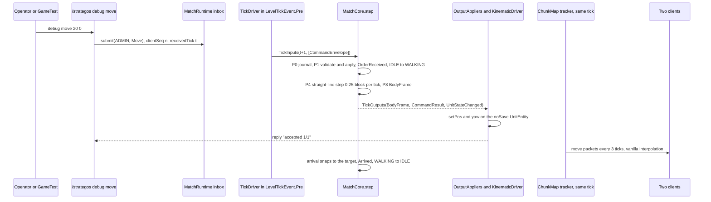
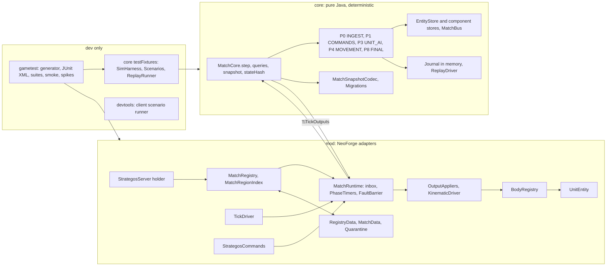
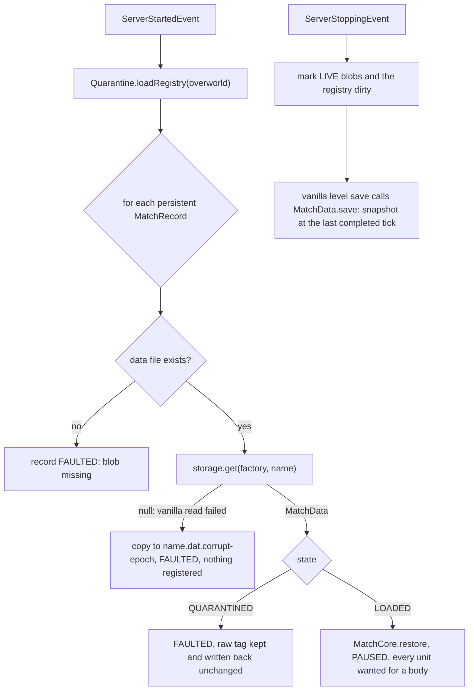
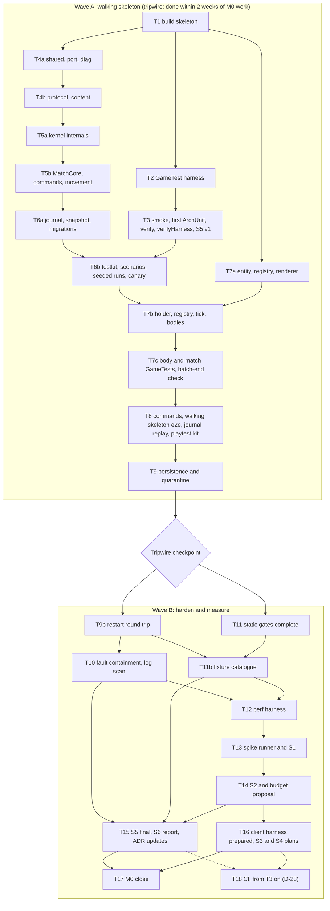

# M0 — Foundation: implementation spec

*Written 2026-10-21 by the tech lead for the implementing agents, in parallel with the final
roadmap, and reconciled the same day with the final M0 cards in
[roadmap/M0-foundation.md](../roadmap/M0-foundation.md) and the M0 table of
[ROADMAP.md](../ROADMAP.md) (follow-up 9 of [design/roadmap-changes.md](../design/roadmap-changes.md)
§6), then updated for the owner's approval of the roadmap. Status: **specified**; ROADMAP.md lists
each of the 26 M0 cards as `specified`, because this spec exists (lifecycle in
[03-design-process.md](../03-design-process.md)), and the decisions M0 needs, D-01, D-22 and D-23,
were taken as recommended on 2026-10-21. Sources: [04-architecture.md](../04-architecture.md)
(cited as "04 §n"), the ADRs in [adr/](../adr/README.md), [02-tooling.md](../02-tooling.md),
[05-testing.md](../05-testing.md), [research/testing.md](../research/testing.md) §3–§13, the final
M0 cards (acceptance criteria cited as "QA-05.4": criterion 4 of QA-05), the
[roadmap draft](../design/roadmap-draft.md) M0 cards and the
[tech-lead review](../design/roadmap-review-techlead.md) (TL-nn). Every Minecraft, NeoForge, MDG
and FML name in this spec was checked on 2026-10-21 in the decompiled Minecraft 1.21.1 +
NeoForge 21.1.262 tree and, for MDG 2.0.148, FML 4.0.45 and bus 8.0.5, in their jars with
`javap` (Appendix A); the names the reconciliation and the owner's approval added were checked the
same way. Clean-room:
only our documents and the decompiled vanilla and NeoForge sources were read.*

---

## 0. Read this first

### 0.1 Authority

1. [04-architecture.md](../04-architecture.md) and the ADRs decide *what*; this spec decides *how
   M0 builds it*. Where this spec deliberately cuts or defers an architecture item, §1.5 says so
   and why. Any other disagreement is a bug in this spec: follow the architecture and note the
   conflict in [STATE.md](../STATE.md).
2. The final M0 cards define scope and acceptance; [ROADMAP.md](../ROADMAP.md) is the source of
   truth for their status, sizes and dependencies. §1.4 traces every card to the tasks that build
   it and the checks that prove each acceptance criterion. Where the roadmap draft and the
   architecture differed, the architecture won, and the final cards adopted that; where this spec
   implements a final card differently from its wording, §1.6 says how and why.
3. The build files in §4 are the final M0 content. Tasks (§9) introduce them in steps; a block
   marked "[T*n*]" arrives with task T*n*.

### 0.2 Working rules for every task

- **Clean-room** (ADR-0005). Never open Reign of Nether, MineColonies, Structurize, BlockUI,
  Ancient Warfare 2, Villager Recruits or 0 A.D. sources, not even on the web. M0 adapts no
  third-party code, so no `NOTICE` file is created.
- **Verify engine APIs before use.** After T1 the project's own decompiled sources live in
  `mod/build/moddev/artifacts/neoforge-21.1.264-sources.jar` (use exactly the `-sources.jar`,
  not `client-extra…resources`). Grep every class, method, field and event there before relying
  on it; Appendix A lists the ones this spec already checked.
- **Runs.** Run only tasks that end on their own: builds, `:core:test`, `:core:soak`,
  `:mod:test`, `runGameTestServer`, `runGameTestSlow`, `runGameTestPerf`, `runServerSmoke`,
  `runServerSmokeRestart`, the `verifyHarness` runs, `runSpike`. Never start `runClient`,
  `runClientJoin`, `runClient2`, `runServer` or `scripts/playtest.sh`: the owner starts
  interactive sessions. `runScenario` opens a client window, which takes keyboard focus, so it
  runs only in the owner's consent batch (§7.7).
- **One Gradle build at a time** in the repository. Tasks marked ∥ in §9 touch disjoint files
  could run in parallel, but the strategos-dev skill allows one session at a time (its lock), so
  they run in sequence; ∥ only means their order is free.
- **Commits.** Commit and push to the private GitHub repository after each green task, without
  asking (owner, 2026-10-21); English messages, no assistant traces.
- **Language.** Code, comments, docs and test names in English; chat with the owner in Russian.
- **Done means** (ADR-0006 as amended by ADR-0022, as ROADMAP.md states): the task's
  verification command is green, `./gradlew spotlessApply` leaves no diff, no ErrorProne or
  NullAway findings, the task checkbox in §9 is ticked, STATE.md says where M0 stands, and any
  new pitfall is written to
  `/Users/oleksandrlytvynskyi/work/pet_projects/.claude/kb/minecraft-mod.md` in the same session.

### 0.3 Code conventions

| Topic | Rule |
|---|---|
| Java | 21, records and sealed types for data, `switch` pattern matching over sealed types with no `default` (the compiler proves exhaustiveness) |
| Packages | `dev.strategos.core..` (core), `dev.strategos.mod..` (mod), `dev.strategos.gametest..`, `dev.strategos.devtools..`, `dev.strategos.arch..` (ADR-0002) |
| Nullness | Every `main` package has `package-info.java` with `@org.jspecify.annotations.NullMarked`; nullable values are `@Nullable` (JSpecify, type-use position: `int @Nullable []`, `@Nullable UnitView`). Never `javax.annotation.*` in our code |
| State | No static mutable state in `main` (B8). Registration objects (`DeferredRegister`, `DeferredHolder`), codecs, loggers and immutable constants may be `static final` |
| Determinism | In `core.shared`, `core.protocol`, `core.content`, `core.sim..`: no wall clock, no `Random`, no transcendental `Math`, no hash-ordered collections, no threads (B4, §7.1) |
| Enums | No mutable fields (ErrorProne `ImmutableEnumChecker`); tables live in `switch` methods |
| Records | No array components (ErrorProne `ArrayRecordComponent`); use a final class with defensive copies |
| Imports | Do not import nested `Builder` types (`BadImport`); write `BodyFrame.Builder` |
| Event handlers | In `main`: `public static` methods, registered explicitly by `Strategos` with `IEventBus#addListener(Class, Consumer)` (no annotation scanning); mod-bus handlers of one class may stay package-private. In `gametest` and `devtools`: `@EventBusSubscriber` with package-private `@SubscribeEvent static` methods (ErrorProne's `UnusedMethod` ignores non-private ones) |
| Logging | slf4j `LoggerFactory`; match code logs through `core.diag.MatchLog`, which prefixes `[m<id> t<tick>] ` |
| Units of measure | Positions in blocks (`double`), match-local X and Z in `[0, size)`, absolute Y; time in ticks; speeds in blocks per tick; yaw in degrees, Minecraft convention (0 faces +Z, 90 faces −X) |
| Tests | L1 names `<Subject>Test`, methods describe behaviour (`rejectsMoveOfAnotherFactionsUnit`); GameTest names are `<suite>.<method_in_snake_case>` |

### 0.4 How a task is finished

0. **Bootstrap (T1, T2).** `verify`, L3 and L5 are what T1–T3 build, so ADR-0006's
   build-and-tooling row and ADR-0022's L5 rule cannot hold yet. T1 is done on
   `./gradlew verifyFast :mod:test`, T2 on `./gradlew verifyFast :mod:runGameTestServer`; T3's
   first green `verify` re-proves both. From T3 on, every task runs `verify`.
1. Implement the files the task lists, nothing else.
2. `./gradlew spotlessApply`, then the task's verification command. Fix until green.
3. Run the task's negative checks, if any, and record their outcome where the task says.
4. Record progress as the strategos-dev skill §5 says: tick the task in §9.3, set the card
   statuses, update the worklog and STATE.md (date, task, result, numbers), write new pitfalls to
   the knowledge base.

---

## 1. Goal, demo and scope

### 1.1 Goal

Infrastructure that every later feature stands on, proven end to end by one unit that walks:
- the build and toolchain with every pin, and the quality gates;
- every automated test harness, each with an external verdict (report guard, marker file,
  watchdog);
- the deterministic kernel and the persistence and fault-containment kernels;
- the thinnest adapters that put a core unit into a real world as a kinematic body;
- the walking skeleton ORD-01;
- the headless spikes S1, S2, S5 and S6 with numbers in `docs/spikes/`; S3 and S4 prepared;
- the playtest protocol and the one-command multiplayer launch, whose first use at the M0
  acceptance confirms ADR-0022, the Definition-of-Done amendments accepted with the roadmap
  approval (QA-09); and CI in a private GitHub repository with one Linux job, as
  [D-23](../roadmap/M0-foundation.md#d-23--ci-and-the-private-github-repository) decided, set up
  right after T3, once `verify` exists (the private repository exists and commits are allowed since 2026-10-21) (QA-08, never blocking Done).

### 1.2 The walking skeleton (ORD-01)



The same scenario runs as an L1 `SimHarness` test and as 20 seeded GameTests; each GameTest
exports its journal, which `:core:replayJournals` replays in plain JUnit to the same hash.

### 1.3 Demo script (L7, the owner)

One documented command starts everything (QA-09.1): `scripts/playtest.sh` (T8), run by the
owner. It runs `./gradlew :mod:classes :mod:createLaunchScripts` (MDG writes one `run<Name>.sh`
per run under `mod/build/moddev/`, among them `runServer.sh`, `runClientJoin.sh` and
`runClient2.sh`), writes `mod/run/server/server.properties` with `level-type=minecraft\:flat` and
`online-mode=false` if it does not exist yet (the dev clients use offline names), starts the
dedicated server in the foreground of its terminal and, once the fresh server log shows `Done (`,
starts the two clients. MDG's launch scripts forward no arguments (Appendix A), so the Quick Play
join lives in runs of its own: `clientJoin` for Dev1 and `client2` for Dev2. The plain `client`
run (`runClient`) is a normal Dev1 client that opens the title screen and joins nothing.

1. In the server console of the script's terminal (a dedicated server in `mod/run/server`):
   `op Dev1`.
2. Dev1 (`clientJoin`) and Dev2 (`client2`) join `localhost:25565` by Quick Play.
3. As Dev1: `/strategos match create 64 64`, then `/strategos debug spawn 3`, then
   `/strategos debug move ~20 ~`. Both clients see three humanoids walk 20 blocks and stop.
4. `/strategos hash` prints tick and state hash. `/strategos debug replay` prints
   "replay OK" with the same hash.
5. Stop the server (`stop`), start it again with `mod/build/moddev/runServer.sh` in the same
   terminal, rejoin from each client's multiplayer screen. `/strategos match list` shows the match
   `PAUSED` with the same tick; `/strategos hash` prints the same hash as before the stop.
   `/strategos match resume m1`, then `/strategos debug move ~-10 ~`: the units walk back.
6. `/tick freeze` stops the units; `/tick step 5` moves them exactly five ticks;
   `/tick unfreeze` resumes.
7. Dev1 disconnects, creates a singleplayer world with cheats on, runs
   `/strategos match create 32 32` and `/strategos debug spawn 3`, saves and quits to the title
   screen and creates a second world: `/strategos match list` shows no match and no unit stands
   there (no state carried over, rule B8; CORE-01.5). The same steps run as the L4 consent
   scenario `world_switch` (§7.7).
8. The owner fills the questionnaire and the report template of `docs/testing/playtest.md`
   (QA-09.3).

### 1.4 Cards, tasks and checks (traceability)

The 26 cards of [roadmap/M0-foundation.md](../roadmap/M0-foundation.md#cards), in its order, with
the IDs, sizes and dependencies of that file and of the M0 table of ROADMAP.md: 6 S and 20 M, at
most 66 card-days, each with the status `specified`. Each acceptance criterion, by its number on
the card, names the check that proves it and the check's level; "§1.6 row n" marks a criterion
this spec implements differently from the card's wording, for the reason given there. Consent
items (QA-06, PERF-04, CORE-01.5) and the CI card (QA-08) never block Done (§10).

| Card | Title | Size | Depends on | Tasks | Acceptance criterion → check (level) |
|---|---|---|---|---|---|
| **Wave A** | | | | | |
| QA-01 | Build skeleton, pins, core merge and spike S5 | M | — | T1, T2, T3, T6b, T7c, T15 | 1 warm `verifyFast` within 1 minute, S5 check 13 (§1.6 row 24), and `checkVersionCatalog`, S5 check 10 (L0) · 2 `checkJarContents` (L0) · 3 smoke step 1 (L5) · 4 `buildtests.*` (L3) · 5 S5 check 11 (L0) · 6 S5 check 2 (R) · 7 the S5 report and ADR-0007's status (R) |
| QA-02 | Core test kit: SimHarness, fakes and shared scenarios | M | QA-01 | T5b, T6b | 1 the `:core:test` time recorded by T6b (L1) · 2 T6b's failing-seed check (L1) · 3 `Invariants` after every `SimHarness` step; `InvariantsTest`, `SeededInvariantTest` (L1) · 4 `checkTestFixturesDeps` (L0) |
| QA-04 | GameTest harness (L3) | M | QA-01 | T2, T3, T7c, T8 | 1 `runGameTestEmptyFilter` in `verifyHarness`; S5 check 5 (L3) · 2 `runGameTestBrokenLoad` in `verifyHarness`; S5 check 6 (L3) · 3 the JUnit XML and the guard's wall-time line; S5 check 8 (L3) · 4 `runGameTestRetry` and `runGameTestRetryNoReason` in `verifyHarness`; S5 checks 7 and 15 (L3) · 5 `runGameTestSharedBatch` in `verifyHarness`; S5 check 16 (L3) · 6 `runGameTestTicketLeak` in `verifyHarness`; S5 check 17 (L3; §1.6 row 25) · 7 `scenarios.*` against their L1 twins (L3) |
| CORE-01 | Match container, lifecycle and region index | M | QA-02, QA-04 | T5a, T7b, T7c, T8, T9, T9b, T16 | 1 `isolation.match_00` … `_49` (L3) · 2 `MatchLifecycleTest` (L1) · 3 `MatchSpaceTest`, `MatchRegionIndexTest` (L2; §1.6 row 26) · 4 `matchtests.holder_bound_to_server` (L3) and the smoke's holder checks (L5; §1.6 row 27); rule B8 (L0) · 5 the `world_switch` scenario (L4, consent) and demo step 7 (L7) |
| CORE-02 | Driving port and the nine-phase tick pipeline | M | CORE-01 | T4a, T5a, T5b, T7b, T8, T12 | 1 `PhaseOrderTest` (L1) · 2 `InputEventCoverageTest` (L1) · 3 `OutputAppliersCoverageTest` (L2) · 4 `ClockIndependenceTest` (L1) · 5 `StaggerTest` (L1) · 6 `TickGateTest` (L2) · 7 demo step 6 (L7) · 8 `PhaseTimersBench.overhead` (L6) |
| CORE-03 | Command pipeline and in-memory journal | M | CORE-02 | T4b, T5b, T6a, T8 | 1 `CommandOrderingTest` (L1) · 2 `MoveRuleTest` (L1) · 3 `UnitSetTest`, `CommandOrderingTest` (L1) · 4 `CommandOrderingTest`, `MoveRuleTest` (L1; §1.6 row 28) · 5 `JournalTest` (L1) · 6 `commandtests.debug_commands_use_the_command_path` (L3) |
| CORE-06 | Unit records, handles and the body registry | M | CORE-01 | T1, T5a, T7b, T7c, T9b, T11 | 1 `EntityStoreTest`, `HandleTest` (L1) · 2 `bodytests.discarded_body_rematerialises` (L3) · 3 `bodytests.unloaded_body_stays_bodiless` (L3); a real unload in the restart round trip (L5) and demo step 5 (L7) · 4 `bodytests.teleport_overwritten_by_next_pose`, `bodytests.vanilla_kill_ignored` (L3) · 5 rule B1, `coreDependsOnlyOnAllowedLibraries` (L0) |
| UNIT-01 | Unit body v0: a kinematic LivingEntity view | M | CORE-06 | T7a, T7b, T7c | 1 `UnitEntityTypeTest` (L2; §1.6 row 29) · 2 `bodytests.no_vibrations_no_push`, with its controls (L3) · 3 `UnitSpawnDataTest` (L2) · 4 smoke step 1 (L5) · 5 NET-01's packet tests (L3, M1; §1.5) |
| QA-09 | Launch scripts, playtest protocol and the Done ADR | S | QA-01 | T1, T8, T9, T17 | 1 `scripts/playtest.sh` with the Quick Play runs `clientJoin` and `client2`, and demo §1.3 (L7) · 2 checklist, questionnaire and template in `docs/testing/playtest.md` (D) · 3 the M0 acceptance session, recorded in STATE.md by T17 (L7) · 4 the severity scale and the desync proxy in `playtest.md` (D) · 5 the M0 acceptance session, the first use of `scripts/playtest.sh` and `playtest.md`, confirms ADR-0022 (accepted with the roadmap on 2026-10-21); T17 records it (D) |
| ORD-01 | Walking skeleton: a debug move order end to end | S | CORE-03, UNIT-01 | T5b, T6b, T8, T9 | 1 `scenarios.walking_skeleton_seed_00` … `_19` in batch `skeleton` (L3) · 2 `scenarios.out_of_bounds` (L3) · 3 `WalkingSkeletonTest`, `UnitAiTransitionsTest` (L1) · 4 `:core:replayJournals` (L1) · 5 `persistencetests.save_restore_same_hash` (L3; §1.6 row 30) · 6 demo §1.3 (L7) |
| **Wave B** | | | | | |
| QA-03 | Minecraft-bootstrapped unit tests (L2) | S | QA-01 | T1, T7a, T9, T15 | 1 `UnitSpawnDataTest`, `CodecSizesTest` (L2) · 2 `CodecSizesTest` (L2) · 3 the `:mod:test` time, S5 check 13 (L2) |
| QA-05 | Server smoke (L5): boot, a headless match, a restart round trip | M | QA-01, ORD-01, CORE-07 | T3, T8, T9b, T13 | 1 the `runServerSmoke` time, S5 check 13 (L5) · 2 `clientRef`, S5 check 9 (L5) · 3 `runServerSmokeNoMarker` in `verifyHarness`; S5 check 9 (L5) · 4 `runServerSmokeRestart` (L5) |
| QA-06 | Client scenario runner and spike S3 (consent) | M | QA-01, [D-22](../roadmap/M0-foundation.md#d-22--client-run-l4-consent-policy) | T16 | 1 the `smoke` and `stall` scenarios (L4, consent) · 2 the production-jar client check (L4, consent; on CI in T18; §1.6 row 31) · 3 the S3 report (R) |
| QA-07 | Performance harness (L6) | M | QA-02, QA-04 | T12 | 1 `:core:jmh`, and `jmhSelftest` in `verifyHarness` (L6) · 2 `perftests.*` (L6) · 3 T12's `-Pperf.fakeForeignLoad` run (L6; §1.6 row 32) · 4 `jmhSelftest`'s allocating kernel (L6) |
| QA-08 | Continuous integration | M | QA-04, QA-05, [D-23](../roadmap/M0-foundation.md#d-23--ci-and-the-private-github-repository) | T18 | 1 a pull request's checks (R) · 2 the job time (R) · 3 `DeterminismCanaryTest` on Linux against the macOS golden (L1, on CI) · 4 the release job (R) |
| QA-10 | Developer commands and log tagging | S | QA-04 | T4a, T8, T10, T11 | 1 `commandtests.root_requires_permission_2` (L3) · 2 the GameTest guard's log scan (L3), with `MatchLogTest` (L1) and rule `simLogsOnlyThroughMatchLog` (L0) |
| QA-17 | Static gates, engine-surface inventory and fixture catalogue | M | QA-01 | T3, T11, T11b | 1 every rule on its violating fixture (L0) · 2 `checkJarContents` (L0) · 3 `EngineSurfaceInventoryTest` and its negative cases (L2) · 4 the catalogue of §7.10 in `05-testing.md` (D) · 5 `checkFixtures`, proved by `checkFixturesSelftest` (L0) |
| PERF-01 | Budget matrix and enforcement | S | QA-07 | T6b, T12, T14 | 1 `perftests.walk_600_budget_a`, `perftests.snapshot_500_budget_g` and T12's overload run (L6), with `BudgetCheckTest` (L1) · 2 the [budget matrix](../roadmap/M0-foundation.md#budget-matrix-per-milestone-delivered-and-kept-by-perf-01), checked by T14 against the ADR-0019 revision (D) · 3 the revision approved by the owner (D) |
| PERF-02 | Spike S1: server cost per body | M | UNIT-01, QA-07 | T13 | 1 `runSpike -Pspike=s1` (L6; §1.6 row 33) · 2 the S1 report, ADR-0011's numbers and S1's verdict on [D-01](../roadmap/M0-foundation.md#d-01--population-cap-per-player)'s default of 150 (R) |
| PERF-03 | Spike S2: force-loaded arena cost | M | QA-05, QA-07 | T13, T14 | 1 the S2 table (L6) · 2 S2 step 6 on the self-terminating spike server (L5) · 3 the S2 report (R) |
| PERF-04 | Spike S4: client frame time with many units (consent) | M | QA-06, UNIT-01 | T16 | 1 the `s4_units` scenario (L4, consent; §1.6 row 34) · 2 the S4 report (R) |
| CORE-04 | Match event bus | S | CORE-02 | T5a, T12 | 1 `MatchBusTest` (L1) · 2 `MatchBusTest` (L1) · 3 `MatchBusBench` in the owner-approved baseline (L6) |
| CORE-05 | Determinism kit and spike S6 | M | CORE-03, CORE-04 | T4a, T5b, T6a, T6b, T11, T11b, T15, T18 | 1 `SeededReplaySoakTest` (L1) · 2 B4's violating fixtures, one per banned API (L0) · 3 `ReplayRunnerTest` (L1) · 4 `DeterminismCanaryTest` (L1) · 5 the S6 report (R); the Linux half in T18 |
| CORE-07 | Persistence kernel: one blob per match | M | CORE-06 | T6a, T6b, T9, T11b, T12 | 1 `SnapshotRoundTripTest` (L1) · 2 `MatchSnapshotNbtTest` (L2) · 3 `MatchSnapshotJsonFixtureTest` (L1) · 4 `MatchSnapshotFixtureTest` (L2) · 5 `persistencetests.save_restore_same_hash` (L3; §1.6 row 30) · 6 `perftests.snapshot_500_budget_g` (L6) |
| CORE-10 | Fault containment | M | CORE-02, QA-04 | T7b, T10 | 1 `faulttests.fault_contained_other_match_continues` (L3) · 2 `faulttests.unit_entity_override_fault_contained`, `faulttests.output_applier_fault_contained` (L3) · 3 `faulttests.rethrow_after_record` (L3) |
| CORE-12 | Save quarantine | M | CORE-07, CORE-10 | T9, T11b | 1 `persistencetests.corrupt_content_quarantined` (L3) · 2 `persistencetests.unreadable_file_quarantined` (L3) · 3 `CorruptCorpusTest` (L2) |

### 1.5 Moved out of M0, with the reason

Each item is not needed for the walking skeleton, the gates, the harnesses or the four headless
spikes, so it moves to the milestone that first needs it.

| Item | Where 04 puts it | Moves to | Why |
|---|---|---|---|
| `ModConfigSpec` files `strategos-server.toml`, `strategos-client.toml` | §2.5 inventory | M1, with the first real tunable (path threads) | M0's only switch, `faults.rethrow`, is a dev/test system property (`strategos.faults.rethrow`, default `false`) |
| `CorePorts.jobs` (`JobExecutor`) and `CorePorts.journal` (`JournalSink`) | §4.3 | M1 (path jobs; binary journal on disk) | M0 has no async jobs; its journal lives in memory inside the core. M0's `CorePorts` is `(MetricsSink metrics, Clock clock)` |
| `FakeWorld`, `FakeNet`, `VoxelFixtures`, inline `JobExecutor` | §16.2 | M1, with the ports they fake | Nothing in M0 emits world effects, frames or jobs; a fake for a port that does not exist is speculation |
| Two synced bytes on `UnitEntity` (carried resource, action pose) | §6.2 | With their first users: the action pose, the combat byte, to M2, with the damage model (CMB-01); the carried resource to M3, with gathering (ECO-05) | No consumer in M0 |
| `net.neoforged:testframework` mock players and the "pose reaches a mock player in the same tick" test (TL-10) | §16.1 | M1 (NET-01) | Needs packet capture; M0 relies on the verified order (MinecraftServer.java:1049–1058, ServerLevel.java:382 before 403) and the L7 demo. The catalog pins it now |
| 0/1/4-thread hash equality (S6) | §16.4 | M1 | No worker threads in M0 |
| `scenarioDiff`, goldens, the Linux container route | QA-06 | QA-18 at M2 start (TL-18) | No client feature before M2 |
| `/strategos perf dump` CSV and JFR custom events | §15 | M1, with the debug overlay | Spikes read `PhaseTimers` directly; JFR's own sampling attributes vanilla time |
| Engine-surface checks for payloads and data registrations | B12 | M1, with the first payload and data map | M0 registers neither; the M0 inventory test covers entity types, `SavedData` names, commands, and the absence of mixins and access transformers |
| `ExternalDamage`; `/kill` turned into lethal core damage (TL-09) | §6.7 | M2, with the damage model (CMB-01) | M0 has no health. `UnitEntity#hurt` returns `false` for every source, so `/kill` and vanilla damage leave units untouched; a discarded body is re-materialised |
| `RuleChange` input and `/strategos match config` | §4.6 | When a rule must change mid-match | No M0 rule needs it |
| Datagen (`runData`), generated resources | – | M1 | No generated data in M0 |
| `PHYSICS` and `NONE` body modes | §6.3 | `PHYSICS`: reserve; `NONE`: M5, with the garrison (BLD-16) | Only `KINEMATIC` exists; spawn data carries the mode byte |
| S2's 384² import timing | §19.2 | MAP-01 (M1) | Needs the map importer |
| Per-template body sizes, template copy on the client | §6.1, §8.7 | M1 (templates) | M0 has one code-defined template |

QA-08 (continuous integration) and the Linux half of S6 are not moved out: they are M0 work.
[D-23](../roadmap/M0-foundation.md#d-23--ci-and-the-private-github-repository), decided on
2026-10-21, puts them in a private GitHub repository with one GitHub Actions Linux job. T18 builds
them right after T3, once `verify` exists (the private repository exists and commits are allowed since 2026-10-21), and they never block Done.

### 1.6 Differences resolved

This spec was written in parallel with the final cards. **A** lists what the roadmap draft's M0
cards said and how this spec resolved it from the architecture; the final cards adopted every
row, and rows 2, 10 and 22 now give the final cards' resolution. **B** (rows 24–37, numbered on
from A) lists where this spec implements a final card differently from its wording; §1.4 marks
each one that touches an acceptance criterion. **C** lists what the reconciliation with the final
cards changed here. **D** (rows 38 on) lists what implementing the tasks found wrong in this spec;
the text each row names is corrected as well.

**A. Roadmap draft → architecture** (criterion numbers are the draft's)

| # | Draft card says | Resolved as (architecture) |
|---|---|---|
| 1 | CORE-01 lifecycle SETUP → RUNNING → PAUSED → ENDED → DISPOSED | CREATED → PREPARING → READY → RUNNING ⇄ PAUSED → ENDED → DISPOSED, with FAULTED (04 §3.5); M0 passes PREPARING and READY in one call |
| 2 | CORE-01.2: close one singleplayer world and open another, in L3 | A GameTest cannot restart its server. Final CORE-01.4–CORE-01.7: the holder checks of row 27 below (L3 .4, L5 .6), the L4 consent scenario `world_switch` (.5, T16), rule B8 (.7, L0) and step 7 of the L7 demo |
| 3 | CORE-01.3: ArchUnit allow-list "for registries" | B8 allows exactly two holders, `StrategosServer` and `StrategosClient`; registration objects are `static final` non-collection fields, which B8 permits |
| 4 | CORE-02 phases "deliver → commands → systems → motion → finalise → remove" | Nine fixed phases P0–P8 (04 §4.4); M0 implements INGEST, COMMANDS, UNIT_AI, MOVEMENT, FINAL; the rest are empty slots |
| 5 | CORE-02.3: freeze and step in L3 | `GameTestTicker` runs only while `runsNormally()` (MinecraftServer.java:1069–1070), so a frozen GameTest server stalls its own tests: tested in L2 against `TickRateManager` and in L7 step 6 |
| 6 | CORE-03 "per-match command log" | ADR-0009's input journal: every `InputEvent` in canonical order (TL-13) |
| 7 | CORE-03.3: 40 commands per second rate limit in the core | Token buckets belong to the gateway (NET-01, M1). The core keeps its work cap (≤ 256 commands per tick, FIFO carry-over) and `UnitSet` ≤ 300 |
| 8 | CORE-05.3 "the ADR states the boundary"; "per-system RNG streams" | ADR-0009 already states it; stateless `Rng.u64(seed, stream, tick, key, salt)` |
| 9 | CORE-06 "as the S1 ADR decides", depends on PERF-02 | ADR-0008 and ADR-0011 decided; S1 measures the production body afterwards (TL-09) |
| 10 | CORE-06.2: unload and reload a unit's chunk in L3 | GameTest chunks are force-loaded. Final CORE-06.2 and CORE-06.3: L3 removes a body with `UNLOADED_TO_CHUNK` (the unit stays bodiless and alive, 04 §6.4) and with `discard()` (one body comes back next tick); a real unload is checked by the L5 restart round trip (T9b) and the L7 demo |
| 11 | CORE-06.3: `/kill` updates the record | No damage model in M0 (§1.5); L3 checks `/kill` leaves the unit and its body intact |
| 12 | CORE-07 "dirty tracking per subsystem" | One blob per match with one dirty flag (ADR-0018) |
| 13 | UNIT-01: `setPersistenceRequired`, `customServerAiStep`, `STEP_HEIGHT`, a 1-block step | `Mob`-only APIs (Mob.java:1206, 818); M0 is a kinematic `LivingEntity` on flat ground; steps arrive with the surface grid and S10 (M1) |
| 14 | UNIT-01 "one generic type per body family, as the S1 ADR decides" | `strategos:unit_humanoid` only (ADR-0011); mounts M5, large units M6 |
| 15 | PERF-02 "settles contradiction 1" | Confirms ADR-0011; authority is ADR-0008 |
| 16 | PERF-03: 24², 32², 64² chunks; ticket mode open | 256, 576, 1,024 chunks (ADR-0010 sizes); `ticking=false` decided, `ticking=true` measured for the record; import timing to MAP-01 |
| 17 | QA-01.5: the S5 ADR settles contradiction 9 | S5 confirms ADR-0007 or switches to its fallback (a separate test mod) |
| 18 | QA-06 as an L-sized harness with diff and goldens | Minimal runner now, compiled and wired; diff and goldens in QA-18 (M2) |
| 19 | QA-10 dev payload channel | M1 (rule B6: only `NetGateway` sends, and it arrives with NET-01) |
| 20 | PERF-01 "defines the budgets" | ADR-0019 defines A–G; M0 enforces A and G in L6 and proposes the revision for the owner |
| 21 | ORD-01.1 "arrives within 0.5 block" | Kinematic arrival snaps exactly onto the target (error 0) |
| 22 | M0 exit 5 "ADRs for S1, S2 and S5" | No spike ADRs: S5 changes ADR-0007's status, S1 adds numbers to ADR-0011, S1 and S2 feed the ADR-0019 revision (accepted ADRs are not rewritten; 0007, 0011 and 0019 are Proposed). M0 writes no new ADR: QA-09's Definition-of-Done amendments are ADR-0022, accepted with the roadmap approval on 2026-10-21, which the M0 acceptance confirms (QA-09.5, T17) |
| 23 | Critical path QA-01 → QA-04 → QA-07 → PERF-02 → … → ORD-01 | Skeleton first (wave A, T1–T9), then measure (wave B), with the two-week tripwire (04 §1.5, R11; TL-08) |

**B. Final card → this spec**

| # | Final card says | This spec, and why |
|---|---|---|
| 24 | QA-01.1: `verifyFast` passes within 1 minute on a clean checkout | The first build of a checkout downloads and decompiles NeoForge (about 2 minutes, T1), so S5 times the warm `verifyFast` of the clean checkout against the minute |
| 25 | QA-04.6: a map-scale test that leaks a ticket fails the batch-end check | M0 has no map-scale test: the ticket helper `GameTestTickets` and the batch-end check exist (T7c), and the `ticketLeak` self-test proves the check (S5 check 17, and `runGameTestTicketLeak` in every `verifyHarness`) |
| 26 | CORE-01.3 in L1 | `MatchSpace` and `MatchRegionIndex` are adapter types in `mod` (04 §2.3) over `BlockPos`, `ChunkPos` and `AABB`, so their tests are plain JUnit in `:mod:test` (L2) and need no world |
| 27 | CORE-01.4 and CORE-01.6 (the card's split, adopted 2026-10-21): the holder test, which the draft put in L2 | L2 boots no server, and the lifecycle events carry one (`ServerLifecycleEvent#getServer`): the holder is checked where a server exists, in L3 (`matchtests.holder_bound_to_server`) and in L5, where the smoke driver sees it after `ServerAboutToStartEvent` and gone after `ServerStoppedEvent` (T9b); rule B8 stays L0 |
| 28 | CORE-03.4: a hidden and a missing target get the same `UNKNOWN_TARGET` (L1) | M0 has no fog, so every live unit is visible: L1 covers missing and dead (stale-generation) handles, which share `Ownership`'s one `UNKNOWN_TARGET` branch; the hidden case enters that branch with the vision grid (FOW-01) and is tested there. The reason carries 04 §7.3's name, `UNKNOWN_TARGET` |
| 29 | UNIT-01.1: `noSave`, so `getEncodeId` is null (L2) | L2 checks the type flag `!canSerialize()`, which is what makes `getEncodeId` null (Entity.java:1914); `getEncodeId` itself is asserted on a live body in L3 (`bodytests.body_never_saved`) |
| 30 | ORD-01.5 and CORE-07.5: save, dispose and load in the same level | The "dispose" step is `MatchRegistry#unload` (runtime and bodies dropped, record and blob kept, as a server stop does); `dispose` deletes the blob by design, so nothing could load after it |
| 31 | QA-06.2: the client loads the production jar (L4, consent) | The scenario runner runs from the source sets, never from the jar: with consent, the built jar is started in a separate NeoForge 21.1.264 client profile and must reach the title screen with Strategos in the mod list (the S3 plan, §8.6); T18's release job automates it with mc-runtime-test |
| 32 | QA-07: a run above 25 % foreign CPU load is marked invalid with a distinct exit code | Gradle stops a failed build with one exit code, so an invalid run writes the verdict `invalid` into its perf JSON and stops with a message that starts with `INVALID`, distinct from a budget failure; the perf test itself never fails on an invalid run |
| 33 | PERF-02.1: a reproducible perf batch | S1 runs on the self-terminating spike server (§8.3), not in the GameTest perf batch: it needs areas beyond 48 blocks, no concurrent tests and real tick pacing |
| 34 | PERF-04: armour and held-item layers on and off | The shipping renderer has no layers and `UnitEntity` carries no equipment until ART-01 (M3, D-04): M0's S4 measures the bare shipping renderer and says so; the layered pass follows ART-01, in PERF-14's re-run |
| 35 | CORE-01: players and factions keyed by UUID, plus Gaia | M0 seats no player in a match (every M0 command is `ADMIN`), so `MatchConfig` carries only the faction count; the UUID-keyed roster arrives with the first card that binds a player to a slot (04 §3.5 "Start"; NET-01's gateway, 04 §7.3), Gaia with the first neutral entity |
| 36 | QA-02: `@Tag("slow")` and `verifySlow` arrive with the first map-scale test, in M1 | `@Tag("slow")` does: M1 registers `:core:slowTest` (L1 tests tagged slow, then excluded from `:core:test`) with the first such test and adds it to `verifySlow`. `verifySlow` itself exists from M0 (T7c), because the GameTest batch `slow` (QA-04) leaves `verify`, whose L3 part is the default batch (the baseline table): M0's 6,000-tick body test runs in `runGameTestSlow`. M0's one long L1 run, the 200 × 10,000 soak, stays inside `verify` as QA-02 says, and `verifySoak` runs it too (S5 records its time) |
| 37 | QA-10: a host for dev overlays that PATH-10 fills | M0 builds no overlay host: with no overlay and no dev payload channel (NET-01) it would draw nothing and no test could prove it, so PATH-10 builds the host with its first overlay. QA-10's criteria do not depend on it |

**C. Reconciled with the final cards** (follow-up 9 of
[design/roadmap-changes.md §6](../design/roadmap-changes.md#6-follow-ups-outside-this-tasks-files))

- QA-05 is size M: boot (T3), a headless match (T8) and the restart round trip with the holder
  checks (T9b, new).
- QA-08 is size M and depends on
  [D-23](../roadmap/M0-foundation.md#d-23--ci-and-the-private-github-repository), decided as
  recommended on 2026-10-21: it is an M0 card (T18, new) in a private GitHub repository with one
  Linux job, set up right after T3, once `verify` exists (the private repository exists and commits are allowed since 2026-10-21), and
  never blocking Done; S6's Linux half goes with it.
- QA-17 also holds the fixture catalogue: §7.10 in `05-testing.md`, `checkFixtures` and the
  committed seed sets (T11b, new; T6b).
- QA-09 writes no ADR: ADR-0022, which amends ADR-0006's Definition of Done, was accepted with the
  roadmap approval, and the first use of QA-09's scripts and protocol, at the M0 acceptance,
  confirms it (T17). QA-09 builds the questionnaire, the desync proxy and the one-command launch
  with its own Quick Play run, `clientJoin`, so the plain `runClient` opens the title screen (T8).
- CORE-01's world switch is an L4 consent scenario (`world_switch`, T16) as well as demo step 7.
- The aggregates of the cards' baseline table (QA-01, QA-07, QA-17) are defined in §4.8 and §7.9:
  `verifyHarness` runs every harness self-test and guard negative as an automated check,
  `verifySlow` the GameTest batch `slow` and, from M1, the slow-tagged L1 tests (§1.6 row 36),
  `verifySoak` the soak runs; `verify` keeps the L3 default batches and the L1 soak (QA-02) and
  leaves the batch `slow` to `verifySlow`.
- The other criteria the final cards added are checked as §1.4 shows: `verifyHarness` (T3, T7c,
  T11b, T12); retries with a reason, solo batches, the batch-end check and the L3 wall time (T2, T7c);
  50 parallel matches in one batch (T8); the slow-clock test, one feedback record per command and
  `UNKNOWN_TARGET` (T5b); bodiless units after an unload and `/tp` (T7b, T7c); faults in a
  `UnitEntity` override and an output applier, rethrow after the record, and the log scan (T7b,
  T10); per-tick invariants and the `testFixtures` check (T6b); the v1 JSON fixture and the
  corrupted corpus (T6b, T9); the foreign-load and allocation checks (T12); the skeleton's bound of
  distance ÷ speed + 1 ticks.

Additions that 04 §1.5 does not name, each the smallest piece the named items need:
- **`SpawnUnits`**, an admin-only command next to `Move` and `Stop`: units must enter the core
  as a journaled, validated input for `/strategos debug spawn` and the tests to replay (04 §7.1
  lets server commands and GameTests issue the same records); 04 §15.3's `/strategos spawn`
  grows from it.
- **`TemplateSet.builtin()`**, one code-defined template (speed, body type): the stand-in that
  M1's template pipeline replaces; no JSON, inheritance or reload listener in M0.
- **`CommandResult`, `UnitCreated`, `UnitStateChanged`** as output events: the feedback record of
  04 §7.3, the body request of 04 §6.4, and the trace ORD-01.3 asks for.
- **`MatchLifecycle` in core**, so the transition table is an L1 test (CORE-01.2).
- **`ReplayDriver` in core `main`** beside `ReplayRunner` in the test kit, so
  `/strategos debug replay` works in dev runs without shipping test code (B11).

**D. Found in implementation**

| # | This spec said | The implementation, and why |
|---|---|---|
| 38 | §4.8 (T1): the root `build.gradle` applies only `base` | It also declares `strategos.java-conventions` with `apply false`. `core` and `mod` apply different plugin sets (`mod` adds ModDevGradle), so each project got its own class loader and its own copy of Spotless, and Spotless's shared build service failed: "Cannot set the value of task ':mod:spotlessJava' property 'taskService'". Declared in the root, the convention plugins and their Spotless and ErrorProne load once, in the parent class loader, as Gradle's message advises |
| 39 | §4.7 (T1): `testLogging { exceptionFormat 'full' }` | `exceptionFormat = TestExceptionFormat.FULL`: Gradle 9 deprecates setting a property with the space syntax, and Gradle 10 removes it; the build runs without deprecation warnings |
| 40 | §4.8 (T1): `checkVersionCatalog` flags `+`, `*.+`, `latest.*` and ranges, tested on the whole captured value | Gradle 9.2.1 treats any selector ending in `+` as a prefix match (`DefaultVersionSelectorScheme#isSubVersion`), so `2+` is dynamic too; and a catalog value may be a `group:name:version` or `id:version` string, whose version the old test never saw. The check now tests the part after the last `:` with Gradle's rules: ends with `+`, starts with `latest.`, or holds a range character |
| 41 | §7.4 (T2): a test with a reason "retries as declared" through `TestFunction.maxAttempts` | On the 1.21.1 GameTest server no retry ever ran. `GameTestServer#startTests` builds its `MultipleTestTracker` once, from the first attempt of every test, and `GameTestRunner#rerunTest` never tells it of the copy (`copyReset`): after a first failure the tracker sees every test done, so the server halts before the rerun and exits with that failure. The harness adds `RerunTracking`, a `GameTestListener` attached to every test in `ServerTickEvent.Pre` before the tests' first tick; on `testAddedForRerun` it follows the copy and puts it in the tracker's place, so the server waits and counts only final outcomes. It reads the private fields `GameTestServer#testTracker` and `MultipleTestTracker#tests`, dev-only code with no mixin or access transformer (ADR-0020), and fails naming a field an update removes |
| 42 | §4.10 F (T3; T13, T16): the `prepare*` `Sync` tasks wipe their game directory before every run | They stayed UP-TO-DATE after a run: Gradle did not see what the forked server wrote into the synced directory, so the next run started with the last run's world, logs and crash reports, and the smoke guard failed a healthy run on an old crash report. Each `prepare*` task now has `outputs.upToDateWhen { false }`, so the `Sync` runs and wipes every time |
| 43 | §9.2 T18: T18 brings `jmhSpeedRatio` (§4.9) and runs `verify verifySlow verifySoak`, with actions pinned by tag | T18 starts right after T3, when neither JMH (T12), `verifySoak` (T6b) nor `verifySlow` (T7c) exists: its first job runs `verify`, and `jmhSpeedRatio` joins with T12's perf step, as the later jobs do. Each action is pinned to the commit of its tag, with the tag in a comment, so a moved tag cannot change the build. `--max-workers=2` fits the private repository's runner (2 cores, 7 GB) with one server JVM per GameTest and smoke run |
| 44 | §9.2 T5a: T5a brings §5.6 without `MatchState`, and `MatchLifecycle` | `MatchSystem#run` and `Scheduler#runPhase` take a `MatchState`, the scheduler reads its tick, and `AiStateStore` holds `UnitState` (§5.5). So T5a brings `MatchState` with only its tick, which T5b completes, and `UnitState`. Stores and hashes keep `UnitState` and the order kind as explicit codes (`UnitState#code()`), never as ordinals: ErrorProne's `EnumOrdinal` flags ordinals, and reordering constants must not change a hash or a save |

---

## 2. Design of the M0 slice

### 2.1 Components



### 2.2 One server tick in M0

1. `ServerTickEvent.Pre`: `TickDriver` resets the global spawn budget (64 bodies per tick).
2. `LevelTickEvent.Pre` for each `ServerLevel` (MinecraftServer.java:1049): if
   `level.tickRateManager().runsNormally()`, for every match of that level in `MatchId` order,
   inside `FaultBarrier`:
   - `RUNNING`: drain the inbox into `TickInputs(tick+1, events)`, `core.step(...)`, apply the
     outputs (replies, body requests, poses), materialise wanted bodies, mark the blob dirty,
     record adapter time in `PhaseTimers`;
   - `PAUSED`: materialise wanted bodies only (a restored match shows its units);
   - `FAULTED` and others: nothing; bodies stand still.
3. `ServerLevel#tick`: the tracker (`ChunkMap#tick`, ServerChunkCache.java:325) ships the poses
   written in step 2, then the entity loop runs `UnitEntity#tick`, which does nothing on the
   server.
4. GameTests run their per-tick checks (`GameTestTicker`, MinecraftServer.java:1070), after the
   match stepped.
5. Autosave (every 6,000 ticks, inside `tickServer`) serialises dirty blobs on the main thread;
   NeoForge writes the files on an IO worker (SavedData.java:45).

### 2.3 Persistence and quarantine



`MatchData.load` never throws (guard 1); an unreadable file never reaches it (guard 2). Vanilla
would otherwise create an empty object that overwrites the file at the next save
(DimensionDataStorage.java:43–76).

### 2.4 Faults

- `FaultBarrier.run(runtime, where, work)` catches `RuntimeException`, `StackOverflowError` and
  `AssertionError` from match code: the per-match tick (which applies the outputs) and
  `UnitEntity`'s server overrides (M0: `hurt`, through `BodyEvents.onHurt`). The match moves to
  `FAULTED`, a report is written once to `<server dir>/strategos/faults/<match>-<tick>/`
  (`fault.txt`, `snapshot.json`, `journal.json`), players standing in the match space get a
  notice, and the server keeps running.
- The policy per match is `CONTAIN` or `RETHROW`. The default comes from the system property
  `strategos.faults.rethrow`: `true` in the client, server and GameTest dev runs, `false`
  otherwise (production). A rethrown fault crashes the GameTest server, which exits 1, so a
  faulting GameTest is loud. The fault-injection GameTest sets `CONTAIN` on its two matches.

---

## 3. File tree at the end of M0

Paths are relative to the repository root. `(Tn)` names the task that creates the file.

```text
strategos/
├── .gitattributes                                   (design commit; checked in T1)
├── .gitignore                                       (design commit; checked in T1)
├── .github/workflows/verify.yml, release.yml         (T18, after the owner's go-ahead, D-23)
├── build.gradle                                     (T1; verify, verifyHarness T3; soak, verifySoak T6b;
│                                                     verifySlow, ticket-leak run T7c; replay T8;
│                                                     restart T9b; checkFixtures T11b; perf T12)
├── settings.gradle                                  (T1)
├── gradle.properties                                (T1)
├── gradlew, gradlew.bat                             (T1, copied from the 1.21.1 MDK)
├── released-fixtures.txt                            (T11b; append-only list of released-schema fixtures)
├── scripts/playtest.sh                              (T8; the owner's one-command launch)
├── gradle/
│   ├── libs.versions.toml                           (T1)
│   ├── gradle-daemon-jvm.properties                 (T1, written by updateDaemonJvm)
│   ├── selftest/fixtures/                           (T11b; broken inputs for checkFixturesSelftest)
│   └── wrapper/gradle-wrapper.jar, gradle-wrapper.properties   (T1, from the MDK)
├── build-logic/
│   ├── settings.gradle                              (T1)
│   ├── build.gradle                                 (T1)
│   └── src/main/groovy/
│       ├── strategos.java-conventions.gradle        (T1)
│       └── strategos.core-conventions.gradle        (T1; jmh T12)
├── perf/baseline-m4pro.json                         (T12 writes a candidate; committed only after the owner approves)
├── core/
│   ├── build.gradle                                 (T1; soak, checkTestFixturesDeps T6b; replayJournals T8;
│   │                                                 jmhCompare, jmhSelftest T12; jmhSpeedRatio T18)
│   └── src/
│       ├── main/java/dev/strategos/core/
│       │   ├── shared/      package-info, CoreApi, HotPath, Handle, MatchId, FactionSlot, PlayerSlot,
│       │   │                TemplateId, Vec2d, DetMath, Rng, Hasher, Hashable, Hex64          (T1 Handle; T4a rest)
│       │   ├── port/        package-info, Clock, MetricsSink                                       (T4a)
│       │   ├── diag/        package-info, RingHistogram, PhaseTimers, PhaseStat, MatchLog          (T4a)
│       │   ├── protocol/    package-info, Command, Move, Stop, SpawnUnits, QueueMode, UnitSet,
│       │   │                CommandKind, CommandKinds, RejectReason, CommandOutcome                 (T4b)
│       │   ├── content/     package-info, UnitTemplate, TemplateSet                                (T4b)
│       │   └── sim/         package-info, Phase, Cadence, Stagger, MatchSystem, Scheduler,
│       │       │            BusMessage, OrderReceived, StopOrdered, Arrived, MatchBus,
│       │       │            EntityStore, EntitySlots, IdentityStore, MotionStore, OrderStore,
│       │       │            AiStateStore, MatchLifecycle, Streams                                  (T5a)
│       │       │            MatchCore, CorePorts, MatchConfig, MatchBounds, MatchRules,
│       │       │            TickInputs, TickOutputs, BodyFrame, InputEvent, CommandEnvelope,
│       │       │            OutputEvent, CommandResult, MatchEvent, UnitCreated, UnitStateChanged,
│       │       │            UnitState, MatchQueries, UnitView, MatchSnapshot, UnitRecord,
│       │       │            MatchState, StateHasher, IngestSystem, FinalSystem, MatchCoreImpl,
│       │       │            QueriesImpl                                                            (T5b)
│       │       ├── command/ package-info, CommandRule, CommandRules, CommandSystem, Ownership,
│       │       │            MoveRule, StopRule, SpawnUnitsRule                                     (T5b)
│       │       ├── unitai/  package-info, UnitAiSystem                                             (T5b)
│       │       ├── move/    package-info, MovementSystem                                           (T5b)
│       │       ├── journal/ package-info, Journal, JournalWriter, JournalExport, JournalCodec,
│       │       │            ReplayDriver, ReplayResult                                             (T6a)
│       │       └── persist/ package-info, SchemaVersion, MigrationStep, Migrations,
│       │                    MatchSnapshotCodec                                                     (T6a)
│       ├── test/java/dev/strategos/core/            L1 tests of §7.2 (T1, T4a–T6b, T8, T11); the
│       │                                            violating fixtures in <rule's package>/archfixture/ (T11)
│       ├── test/resources/golden/s6-canary.json     (T6b)
│       ├── test/resources/fixtures/match_v1.json, match_v1.expected.json                          (T6b)
│       ├── testFixtures/java/dev/strategos/core/testkit/
│       │                    package-info, TestKit (T1), SimHarness, FakeBodies, Invariants, InvariantViolation,
│       │                    ManualClock, FixedClock, RecordingMetrics, ThrowingMetrics, Scenario,
│       │                    ScenarioContext, ScenarioFailure, ScenarioReport, Scenarios,
│       │                    RandomCommands, ReplayRunner, JournalFiles, Seeds, Percentiles,
│       │                    BudgetCheck                         (T5b: SimHarness core, clocks, RecordingMetrics; T6b: the rest)
│       ├── testFixtures/resources/seeds/            m0-200.txt, skeleton-20.txt, isolation-50.txt, canary.txt (T6b)
│       └── jmh/
│           ├── java/dev/strategos/core/bench/       MatchBusBench, MovementBench, StateHashBench,
│           │                                        PhaseTimersBench, SnapshotCodecBench            (T12)
│           └── resources/selftest/                  baseline.json, slow-result.json, alloc-result.json (T12)
├── mod/
│   ├── build.gradle                                 (T1; T2, T3, T7c, T8, T9b, T10, T12, T13, T16, T18 add blocks)
│   └── src/
│       ├── main/
│       │   ├── java/dev/strategos/mod/
│       │   │   ├── package-info, Strategos                                                         (T1)
│       │   │   ├── StrategosServer, StrategosSettings                                              (T7b)
│       │   │   ├── registry/        package-info, ModEntityTypes                                   (T7a)
│       │   │   ├── entity/          package-info, UnitEntity, UnitSpawnData                        (T7a)
│       │   │   ├── platform/        package-info, Ids                                              (T7a)
│       │   │   ├── client/          package-info, StrategosClient, UnitRenderer                    (T7a)
│       │   │   ├── server/match/    package-info, MatchSpace, MatchOptions, MatchSource,
│       │   │   │                    FaultPolicy, MatchRecord, MatchRegistry, MatchRuntime,
│       │   │   │                    MatchRegionIndex, MatchException                               (T7b; T9 MatchRecord)
│       │   │   ├── server/tick/     package-info, TickDriver, InputCollector, OutputAppliers,
│       │   │   │                    FaultBarrier, MatchFaultException                              (T7b)
│       │   │   │                    FaultReport                                                    (T10)
│       │   │   ├── server/body/     package-info, BodyRegistry, KinematicDriver, SpawnBudget,
│       │   │   │                    BodyEvents                                                     (T7b)
│       │   │   ├── server/persist/  package-info, RegistryData, MatchData, NbtBridge, Quarantine   (T9)
│       │   │   └── server/command/  package-info, StrategosCommands                                (T8)
│       │   ├── templates/META-INF/neoforge.mods.toml                                               (T1)
│       │   └── resources/assets/strategos/lang/en_us.json                                          (T7a)
│       ├── test/
│       │   ├── java/dev/strategos/mod/              L2 tests of §7.3 (T1, T7a, T7b, T9, T11)
│       │   └── resources/engine-surface.json        (T11)
│       │       resources/fixtures/match_v1.nbt, match_v1.expected.json                            (T9)
│       ├── gametest/
│       │   ├── README.md                                (T2; GameTest server defaults, the control rule)
│       │   ├── java/dev/strategos/gametest/
│       │   │   ├── package-info, GameTestBootstrap, StrategosGameTests, StrategosTest, Suites,
│       │   │   │   JUnitXmlReporter, TeeReporter, RerunTracking                                    (T2)
│       │   │   ├── MatchFixture, GameTestTickets, BatchEndCheck                                    (T7c)
│       │   │   ├── RuntimeScenarioContext, ScenarioGameTests                                       (T8)
│       │   │   ├── suites/ BuildTests, SelfTests, RetryNoReasonSelfTest, SharedBatchSelfTest (T2);
│       │   │   │           BodyTests, MatchTests, TicketLeakSelfTest (T7c); CommandTests (T8);
│       │   │   │           PersistenceTests (T9); FaultTests (T10); PerfTests (T12)
│       │   │   ├── selftest/SelfTestHooks                                                          (T3)
│       │   │   ├── smoke/SmokeDriver                                                               (T3; match in T8; restart run T9b)
│       │   │   └── spike/  SpikeRegistry, SpikeMob, SpikePhysicsBody, SpikeArena, SpikeDriver,
│       │   │               TickSampler, SpikeReport, S1BodyCost                                    (T13)
│       │   │               S2ArenaCost                                                             (T14)
│       │   ├── resources/fixtures/corrupt/              (T9; the corrupted-save corpus, append-only)
│       │   ├── structures/arena_flat_32.snbt, arena_flat_48.snbt                                   (T2, generated)
│       │   ├── smoke-gamedir/server.properties                                                     (T3)
│       │   └── spike-gamedir/server.properties                                                     (T13)
│       ├── devtools/
│       │   ├── java/dev/strategos/devtools/         package-info, ScenarioRunner, ClientScenario,
│       │   │                                        ClientScenarios, SmokeScenario, StallScenario,
│       │   │                                        WorldSwitchScenario, UnitsFrameTimeScenario,
│       │   │                                        FrameTimer, ScenarioOutput                     (T16)
│       │   └── scenario-gamedir/options.txt                                                        (T16)
│       └── archTest/java/                           dev/strategos/arch/ ArchClasses, ModArchitectureTest
│                                                    (T3; full T11); violating fixtures and same-named
│                                                    stubs of the types the rules name (T3 for B5, B11; T11)
└── docs/
    ├── adr/0022-definition-of-done-amendments.md    (Accepted with the roadmap approval, 2026-10-21; the M0 acceptance confirms it, T17)
    ├── milestones/M0-foundation.md                  (this file)
    ├── spikes/S5-build-wiring.md (T3, final T15), S6-determinism-canary.md (T15),
    │          S1-server-cost-per-body.md (T13), S2-force-loaded-arena.md (T14),
    │          S3-client-scenario-harness.md, S4-client-frame-time.md (T16, "pending consent"),
    │          data/ (raw CSV and JSON copied from build output)
    └── testing/playtest.md                          (T8; persistence steps T9)
```

Documents updated in place (only by the tasks named): `docs/STATE.md`, `docs/worklog.md` and this
spec's §9.3 (every task); `docs/ROADMAP.md` and `docs/roadmap/M0-foundation.md` (a card's status
when its first task starts and when it is done, as the strategos-dev skill §5 says);
`docs/05-testing.md` (T11b the fixture catalogue, T17), `docs/adr/README.md` (T3, T15),
`docs/adr/0007-gametest-wiring.md` (T3, T15), `docs/adr/0011-unit-entity-and-body-seam.md` (T13),
`docs/adr/0019-performance-budgets.md` (T14), `docs/04-architecture.md` §1.4 row 9 and §2.5 (T15,
T11), the knowledge base (any task). ADR-0022 is only read: no task edits it, and T17 records its
confirmation in STATE.md.

---

## 4. Build files

### 4.1 `settings.gradle` [T1]

```groovy
pluginManagement {
    includeBuild 'build-logic'
    repositories {
        gradlePluginPortal()
    }
}

plugins {
    // Keep equal to [versions] foojay in gradle/libs.versions.toml; :checkVersionCatalog compares them.
    id 'org.gradle.toolchains.foojay-resolver-convention' version '1.0.0'
}

rootProject.name = 'strategos'
include 'core', 'mod'
```

### 4.2 `gradle/libs.versions.toml` [T1]

Every pin of [02-tooling.md](../02-tooling.md) and of the dev-only profiles
([research/libraries.md](../research/libraries.md), verified 2026-10-20). No dynamic versions,
ranges or rich constraints: `:checkVersionCatalog` fails on them.

```toml
[versions]
# Toolchain. settings.gradle repeats foojay because settings plugins cannot read the catalog.
foojay = "1.0.0"
moddev = "2.0.148"
neoforge = "21.1.264"
parchment-minecraft = "1.21.1"
parchment-mappings = "2024.11.17"
# Libraries Minecraft 1.21.1 ships; core compiles against exactly these.
fastutil = "8.5.12"
dfu = "8.0.16"
gson = "2.10.1"
slf4j = "2.0.9"
jspecify = "1.0.1"
# Quality gates.
spotless = "8.10.4"
palantir = "2.102.0"
errorprone-gradle = "5.1.1"
error-prone = "2.50.0"
nullaway = "0.14.2"
archunit = "1.5.1"
# Tests.
junit = "5.14.4"
assertj = "3.27.7"
testframework = "21.1.264"   # used from M1 (NET-01 mock players); keep in lockstep with neoforge
jmh = "1.37"
# Dev-only runtime mods (never shipped; Modrinth Maven).
spark = "1.10.124-neoforge-1.21.1"
sodium = "mc1.21.1-0.8.13-neoforge"
iris = "1.8.14-beta.1+1.21.1-neoforge"
lithium = "mc1.21.1-0.15.4-neoforge"
modernfix = "5.27.26+mc1.21.1"
ferritecore = "7.0.3-neoforge"
entityculling = "eieYbWYb"   # Entity Culling 1.11.3 for NeoForge, as a Modrinth version id
immediatelyfast = "1.6.15+1.21.1-neoforge"

[libraries]
fastutil = { module = "it.unimi.dsi:fastutil", version.ref = "fastutil" }
dfu = { module = "com.mojang:datafixerupper", version.ref = "dfu" }
gson = { module = "com.google.code.gson:gson", version.ref = "gson" }
slf4j-api = { module = "org.slf4j:slf4j-api", version.ref = "slf4j" }
jspecify = { module = "org.jspecify:jspecify", version.ref = "jspecify" }
spotless-gradle-plugin = { module = "com.diffplug.spotless:spotless-plugin-gradle", version.ref = "spotless" }
errorprone-gradle-plugin = { module = "net.ltgt.gradle:gradle-errorprone-plugin", version.ref = "errorprone-gradle" }
error-prone-core = { module = "com.google.errorprone:error_prone_core", version.ref = "error-prone" }
nullaway = { module = "com.uber.nullaway:nullaway", version.ref = "nullaway" }
archunit = { module = "com.tngtech.archunit:archunit", version.ref = "archunit" }
junit-bom = { module = "org.junit:junit-bom", version.ref = "junit" }
junit-jupiter = { module = "org.junit.jupiter:junit-jupiter" }
junit-platform-launcher = { module = "org.junit.platform:junit-platform-launcher" }
assertj = { module = "org.assertj:assertj-core", version.ref = "assertj" }
testframework = { module = "net.neoforged:testframework", version.ref = "testframework" }
jmh-core = { module = "org.openjdk.jmh:jmh-core", version.ref = "jmh" }
jmh-generator = { module = "org.openjdk.jmh:jmh-generator-annprocess", version.ref = "jmh" }
spark = { module = "maven.modrinth:spark", version.ref = "spark" }
compat-sodium = { module = "maven.modrinth:sodium", version.ref = "sodium" }
compat-iris = { module = "maven.modrinth:iris", version.ref = "iris" }
compat-lithium = { module = "maven.modrinth:lithium", version.ref = "lithium" }
compat-modernfix = { module = "maven.modrinth:modernfix", version.ref = "modernfix" }
compat-ferritecore = { module = "maven.modrinth:ferrite-core", version.ref = "ferritecore" }
compat-entityculling = { module = "maven.modrinth:entityculling", version.ref = "entityculling" }
compat-immediatelyfast = { module = "maven.modrinth:immediatelyfast", version.ref = "immediatelyfast" }

[plugins]
moddev = { id = "net.neoforged.moddev", version.ref = "moddev" }
```

The aliases avoid a name that is both a leaf and a group (`error-prone` and `errorprone-gradle`
are distinct prefixes), so every accessor is unambiguous.

### 4.3 `gradle.properties` [T1]

```properties
# The daemon runs on the JDK of gradle/gradle-daemon-jvm.properties (21).
# The --add-exports let palantir-java-format (Spotless runs it inside the daemon) use javac internals on JDK 16+.
org.gradle.jvmargs=-Xmx2g -XX:+UseParallelGC -Dfile.encoding=UTF-8 \
  --add-exports=jdk.compiler/com.sun.tools.javac.api=ALL-UNNAMED \
  --add-exports=jdk.compiler/com.sun.tools.javac.code=ALL-UNNAMED \
  --add-exports=jdk.compiler/com.sun.tools.javac.file=ALL-UNNAMED \
  --add-exports=jdk.compiler/com.sun.tools.javac.parser=ALL-UNNAMED \
  --add-exports=jdk.compiler/com.sun.tools.javac.tree=ALL-UNNAMED \
  --add-exports=jdk.compiler/com.sun.tools.javac.util=ALL-UNNAMED
org.gradle.daemon=true
org.gradle.parallel=true
org.gradle.caching=true
org.gradle.configuration-cache=true

mod_id=strategos
mod_name=Strategos
mod_license=All Rights Reserved
mod_version=0.0.1
mod_group_id=dev.strategos
minecraft_version=1.21.1
minecraft_version_range=[1.21.1]
loader_version_range=[4,)

# Machine id of the committed JMH baseline (perf/baseline-<id>.json).
perf.machine=m4pro
```

The NeoForge version lives only in the catalog; `generateModMetadata` reads it from there.

### 4.4 `gradle/gradle-daemon-jvm.properties` [T1]

Generated, not hand-written: run `./gradlew updateDaemonJvm --jvm-version=21 --jvm-vendor=adoptium`
once and commit the result (it holds `toolchainVersion=21`, the vendor and per-platform download
URLs resolved through foojay). If the task fails, write the minimal file below; Gradle then uses
the Temurin 21 already provisioned in `~/.gradle/jdks`:

```properties
toolchainVersion=21
```

Check: `./gradlew --version` reports the daemon JVM as 21.

### 4.5 Wrapper [T1]

Take `gradlew`, `gradlew.bat`, `gradle/wrapper/gradle-wrapper.jar` and
`gradle/wrapper/gradle-wrapper.properties` from the official 1.21.1 MDK, at the commit the
toolchain check built on 2026-10-20:

```
git clone https://github.com/NeoForgeMDKs/MDK-1.21.1-ModDevGradle <session temp dir>/mdk
git -C <session temp dir>/mdk checkout 00b49d3f81a257858ca425792d59b9e5ca0f7e56   # 2026-10-18
shasum -a 256 <session temp dir>/mdk/gradle/wrapper/gradle-wrapper.jar
# must print 7d3a4ac4de1c32b59bc6a4eb8ecb8e612ccd0cf1ae1e99f66902da64df296172
```

Copy the four files into the repository; run nothing from the clone. The properties keep
`distributionUrl=https\://services.gradle.org/distributions/gradle-9.2.1-bin.zip`; add
`distributionSha256Sum=72f44c9f8ebcb1af43838f45ee5c4aa9c5444898b3468ab3f4af7b6076c5bc3f`
(the published `gradle-9.2.1-bin.zip.sha256`, checked on 2026-10-21).

### 4.6 `.gitignore` and `.gitattributes` [T1]

Both files were committed with the design on 2026-10-21 and match these blocks, including the
two lines for the assistant's sessions (`/.session.lock`, `/.claude/settings.local.json`); T1
checks them and leaves them unchanged.

```gitignore
.gradle/
build/
!gradle/wrapper/gradle-wrapper.jar
.kotlin/
.idea/
*.iml
*.ipr
*.iws
out/
.vscode/
.DS_Store
# Dev run directories owned by the owner's sessions (mod/run/client, mod/run/server, ...)
run/
# The strategos-dev skill's session lock
/.session.lock
# Personal Claude Code settings; the shared allowlist is .claude/settings.json
/.claude/settings.local.json
```

```gitattributes
* text=auto eol=lf
*.bat text eol=crlf
*.jar binary
*.nbt binary
*.png binary
*.dat binary
```

### 4.7 `build-logic` [T1; jmh block T12]

`build-logic/settings.gradle`:

```groovy
dependencyResolutionManagement {
    repositories {
        gradlePluginPortal()
        mavenCentral()
    }
    versionCatalogs {
        libs { from(files('../gradle/libs.versions.toml')) }
    }
}
rootProject.name = 'build-logic'
```

`build-logic/build.gradle`:

```groovy
plugins {
    id 'groovy-gradle-plugin'
}

dependencies {
    implementation libs.spotless.gradle.plugin
    implementation libs.errorprone.gradle.plugin
}
```

`build-logic/src/main/groovy/strategos.java-conventions.gradle` (applied by `core` and `mod`):

```groovy
import net.ltgt.gradle.errorprone.CheckSeverity

plugins {
    id 'java'
    id 'com.diffplug.spotless'
    id 'net.ltgt.errorprone'
}

def libs = extensions.getByType(VersionCatalogsExtension).named('libs')

java {
    toolchain.languageVersion = JavaLanguageVersion.of(21)
}

repositories {
    mavenCentral()
}

dependencies {
    errorprone libs.findLibrary('error-prone-core').get()
    errorprone libs.findLibrary('nullaway').get()
}

// JSpecify annotations on every source set (Minecraft 1.21.1 does not ship them; compile only).
sourceSets.configureEach { ss ->
    dependencies.add(ss.compileOnlyConfigurationName, libs.findLibrary('jspecify').get())
}

tasks.withType(JavaCompile).configureEach { t ->
    t.options.encoding = 'UTF-8'
    t.options.release = 21
    // NullAway's JSpecify mode on JDK 21.0.8+; redundant with net.ltgt.errorprone >= 4.4 but harmless.
    t.options.compilerArgs += ['-XDaddTypeAnnotationsToSymbol=true']
    boolean main = t.name == 'compileJava'
    if (main) {
        // Shipped code: every ErrorProne warning is an error.
        t.options.compilerArgs += ['-Werror']
    }
    t.options.errorprone {
        disableWarningsInGeneratedCode = true
        excludedPaths = '.*/(build/generated|mixin)/.*'
        check('NullAway', main ? CheckSeverity.ERROR : CheckSeverity.OFF)
        option('NullAway:OnlyNullMarked', 'true')
        option('NullAway:JSpecifyMode', 'true')
    }
}

spotless {
    java {
        target 'src/*/java/**/*.java'
        palantirJavaFormat(libs.findVersion('palantir').get().requiredVersion)
        formatAnnotations()
        trimTrailingWhitespace()
        endWithNewline()
    }
}

tasks.withType(Test).configureEach { t ->
    t.useJUnitPlatform()
    t.testLogging {
        events 'failed'
        exceptionFormat = org.gradle.api.tasks.testing.logging.TestExceptionFormat.FULL
    }
    // Forward -Dstrategos.* from the Gradle command line to the test JVM:
    // strategos.seed=<n> reruns one seed; strategos.golden.update and strategos.fixtures.update rewrite goldens.
    t.systemProperties(providers.systemPropertiesPrefixedBy('strategos.').get())
}
```

If a default-on ErrorProne check fires on idiomatic code in `main`, disable that one check here
with a comment and record it in the S5 report; never disable NullAway or lower `-Werror`.

`build-logic/src/main/groovy/strategos.core-conventions.gradle` (applied by `core`):

```groovy
plugins {
    id 'strategos.java-conventions'
    id 'java-library'
    id 'java-test-fixtures'
}

def libs = extensions.getByType(VersionCatalogsExtension).named('libs')

// One bucket for the libraries Minecraft ships: compile-only for main and testFixtures,
// on the runtime classpath of tests and benchmarks.
def mcShipped = configurations.create('mcShipped') {
    canBeConsumed = false
    canBeResolved = false
}
configurations.named('compileOnly') { extendsFrom mcShipped }
configurations.named('testFixturesCompileOnly') { extendsFrom mcShipped }
configurations.named('testImplementation') { extendsFrom mcShipped }

// [T12] Plugin-free JMH (me.champeau.jmh 0.7.3 predates Gradle 9 support).
sourceSets {
    jmh
}
configurations.named('jmhImplementation') { extendsFrom mcShipped }
dependencies {
    jmhImplementation sourceSets.main.output
    jmhImplementation libs.findLibrary('jmh-core').get()
    jmhAnnotationProcessor libs.findLibrary('jmh-generator').get()
}
def jmhResult = layout.buildDirectory.file('reports/jmh/result.json').get().asFile
tasks.register('jmh', JavaExec) {
    group = 'verification'
    description = 'Runs the JMH benchmarks (-Pjmh.include=<regex>); writes build/reports/jmh/result.json.'
    classpath = sourceSets.jmh.runtimeClasspath
    mainClass = 'org.openjdk.jmh.Main'
    args providers.gradleProperty('jmh.include').getOrElse('.*'),
         '-f', '2', '-wi', '3', '-w', '1s', '-i', '5', '-r', '1s',
         '-prof', 'gc',                                    // gc.alloc.rate.norm for the @HotPath check (QA-07.4)
         '-jvmArgsAppend', '-Xms1g -Xmx1g -XX:+UseG1GC',   // heap and GC pinned in every fork (QA-07)
         '-rf', 'json', '-rff', jmhResult.absolutePath
    outputs.file(jmhResult)
    outputs.upToDateWhen { false }
    doFirst { jmhResult.parentFile.mkdirs() }
}
```

In T1 the JMH block is absent; T12 adds it.

### 4.8 Root `build.gradle` [T1; aggregates grow in T3, T6b, T7c, T8, T9b, T11b, T12]

```groovy
plugins {
    id 'base'
    // Loads the convention plugins (and Spotless, ErrorProne) once, in the root class loader: core and mod
    // apply different plugin sets, so each would otherwise load its own copy of Spotless, whose shared build
    // service then fails with "Cannot set the value of task ':mod:spotlessJava' property 'taskService'" (§1.6 row 38).
    id 'strategos.java-conventions' apply false
}

def catalogFile = file('gradle/libs.versions.toml')
def settingsFile = file('settings.gradle')
def catalogMarker = layout.buildDirectory.file('checks/version-catalog.ok')

tasks.register('checkVersionCatalog') {
    group = 'verification'
    description = 'Fails on a dynamic version, a range or a rich constraint in the catalog, and on a foojay pin that differs from settings.gradle.'
    inputs.files(catalogFile, settingsFile)
    outputs.file(catalogMarker)
    doLast {
        def problems = []
        catalogFile.readLines().eachWithIndex { String line, int i ->
            def text = line.trim()
            if (text.isEmpty() || text.startsWith('#')) return
            if (text =~ /\b(strictly|require|prefer|reject|rejectAll)\b/) {
                problems << "line ${i + 1}: rich version constraint: ${text}"
            }
            (text =~ /(?:^[\w.-]+|version)\s*=\s*"([^"]*)"/).each { m ->
                String v = m[1]
                // Gradle's rules (DefaultVersionSelectorScheme): any selector ending in '+' is a prefix match, and a
                // 'group:name:version' or 'id:version' string carries its version after the last ':' (§1.6 row 40).
                String ver = v.substring(v.lastIndexOf(':') + 1)
                boolean dynamic = ver.endsWith('+') || ver.startsWith('latest.') || ver.contains('[') ||
                        ver.contains(']') || ver.contains('(') || ver.contains(')') || ver.contains(',')
                if (dynamic) problems << "line ${i + 1}: dynamic version or range '${v}'"
            }
        }
        def inCatalog = (catalogFile.text =~ /(?m)^foojay\s*=\s*"([^"]+)"/)
        def inSettings = (settingsFile.text =~ /foojay-resolver-convention'\s+version\s+'([^']+)'/)
        if (!inCatalog.find() || !inSettings.find() || inCatalog.group(1) != inSettings.group(1)) {
            problems << 'foojay version in settings.gradle must equal [versions] foojay in the catalog'
        }
        if (problems) throw new GradleException('Version catalog problems:\n  ' + problems.join('\n  '))
        catalogMarker.get().asFile.text = 'ok\n'
    }
}

// [T11b] QA-17.5: every fixture a test names exists, no released-schema fixture is deleted, and tests
// take seeds only from the committed sets (Seeds.set("<name>")). A static method keeps the
// configuration cache happy: the task actions call it and capture only files.
class FixtureCheck {
    static final List<String> ROOTS = ['core/src/test', 'core/src/testFixtures', 'mod/src/test', 'mod/src/gametest']

    static List<String> problems(File repo, File released) {
        def problems = []
        def resourceDirs = ROOTS.collect { new File(repo, "${it}/resources") }
        def arenas = new File(repo, 'mod/src/gametest/structures')
        ROOTS.collect { new File(repo, "${it}/java") }.findAll { it.isDirectory() }.each { File dir ->
            dir.eachFileRecurse(groovy.io.FileType.FILES) { File f ->
                if (!f.name.endsWith('.java')) return
                f.readLines().eachWithIndex { String line, int i ->
                    def at = "${repo.toPath().relativize(f.toPath())}:${i + 1}"
                    (line =~ /"((?:fixtures|golden)\/[^"]+)"/).each { m ->
                        if (!resourceDirs.any { new File(it, m[1]).exists() }) problems << "${at}: missing fixture ${m[1]}"
                    }
                    (line =~ /Seeds\.(?:set|first)\("([^"]+)"\)/).each { m ->
                        if (!resourceDirs.any { new File(it, "seeds/${m[1]}.txt").isFile() }) problems << "${at}: missing fixture seeds/${m[1]}.txt"
                    }
                    (line =~ /arena\s*=\s*"([^"]+)"/).each { m ->
                        if (!new File(arenas, "${m[1]}.snbt").isFile()) problems << "${at}: missing fixture arena ${m[1]}"
                    }
                    if (line =~ /\b(seed|withSeed|walkingSkeleton|canary|patrol|gameTest|options)\(\s*-?\d+L?\s*[,)]/) {
                        problems << "${at}: literal seed; take it from a committed set with Seeds.set(\"<name>\")"
                    }
                }
            }
        }
        if (released.isFile()) {
            released.readLines()*.trim().findAll { it && !it.startsWith('#') }.each { String p ->
                if (!new File(repo, p).isFile()) problems << "released-schema fixture deleted: ${p}"
            }
        }
        problems
    }
}

def fixturesMarker = layout.buildDirectory.file('checks/fixtures.ok')
tasks.register('checkFixtures') {
    group = 'verification'
    description = 'Fails on a missing referenced fixture, a deleted released-schema fixture or a literal seed in a test (QA-17.5).'
    def repo = rootDir
    def released = file('released-fixtures.txt')
    inputs.files(fileTree(dir: rootDir, includes: FixtureCheck.ROOTS.collect { "${it}/**".toString() }), released)
    outputs.file(fixturesMarker)
    doLast {
        def problems = FixtureCheck.problems(repo, released)
        if (problems) throw new GradleException('Fixture problems:\n  ' + problems.join('\n  '))
        fixturesMarker.get().asFile.text = 'ok\n'
    }
}

// [T11b] verifyHarness: the fixture check must catch each broken input of gradle/selftest/fixtures/
// (a test naming a missing fixture and passing a literal seed; a released list naming a deleted file).
def fixturesSelftestRepo = file('gradle/selftest/fixtures')
tasks.register('checkFixturesSelftest') {
    group = 'verification'
    description = 'Proves checkFixtures bites: a missing fixture, a deleted released-schema fixture, a literal seed.'
    doLast {
        def found = FixtureCheck.problems(fixturesSelftestRepo, new File(fixturesSelftestRepo, 'released-fixtures.txt'))
        ['missing fixture', 'released-schema fixture deleted', 'literal seed'].each { String kind ->
            if (!found.any { it.contains(kind) }) throw new GradleException("checkFixtures no longer catches: ${kind}")
        }
    }
}

tasks.register('verifyFast') {
    group = 'verification'
    description = 'L0 + L1: catalog, fixtures, formatting, ErrorProne and NullAway, ArchUnit, jar check, core tests.'
    dependsOn 'checkVersionCatalog', 'checkFixtures', ':core:check',     // 'checkFixtures' from T11b
            ':mod:spotlessCheck', ':mod:compileJava', ':mod:compileTestJava',
            ':mod:compileGametestJava', ':mod:compileDevtoolsJava',
            ':mod:archTest', ':mod:checkJarContents'
}

// [T3] The harness self-tests, kept for good as automated checks (QA-01, QA-04, QA-05, QA-07, QA-17):
// every guard must fail on its broken input, and every GameTest self-test must end with its designed
// verdict. ':mod:runGameTestTicketLeak' joins in T7c, 'checkFixturesSelftest' in T11b, ':core:jmhSelftest' in T12.
tasks.register('verifyHarness') {
    group = 'verification'
    description = 'Proves the guards bite: empty GameTest filter, broken mod load, missing smoke marker, retry semantics, retry without a reason, solo test in a shared batch, leaked ticket, every ArchUnit rule on its violating fixture, JMH slowdown and allocating kernel, fixture checks.'
    dependsOn ':mod:runGameTestEmptyFilter', ':mod:runGameTestBrokenLoad', ':mod:runServerSmokeNoMarker',
            ':mod:runGameTestRetry', ':mod:runGameTestRetryNoReason', ':mod:runGameTestSharedBatch',
            ':mod:runGameTestTicketLeak', ':mod:archTest', ':core:test', 'checkFixturesSelftest', ':core:jmhSelftest'
}

// [T3] the commit gate: 5 minutes, of which L3 3; ':core:soak' joins in T6b, ':core:replayJournals' in T8,
// the restart round trip in T9b.
tasks.register('verify') {
    group = 'verification'
    description = 'verifyFast + verifyHarness + L2 + core soak + L3 GameTests without the slow batch (report guard) + L5 smoke and restart round trip (marker guards) + GameTest journal replay.'
    dependsOn 'verifyFast', 'verifyHarness', ':mod:check', ':core:soak',
            ':mod:runGameTestServer', ':mod:runServerSmoke', ':mod:runServerSmokeRestart', ':core:replayJournals'
}

// [T7c] Per working session that touched its area, at the milestone exit and on CI; no budget, the time
// is reported per run. The L1 tests tagged slow (':core:slowTest', registered with the first of them in M1,
// QA-02), map-scale GameTests and PERF-05's crowd soak (M1) and QA-11's L3 sample (M3) join it.
tasks.register('verifySlow') {
    group = 'verification'
    description = 'The GameTest batch slow, in a run of its own.'
    dependsOn ':mod:runGameTestSlow'
}

// [T6b] The soak runs, at the milestone exit and on CI; no budget, the time is reported per run. M0's
// one soak also runs inside verify (QA-02); QA-12's (M6) and QA-16's (M10) L3 samples join only here.
tasks.register('verifySoak') {
    group = 'verification'
    description = 'The soak runs: the seeded determinism soak, 200 seeds x 10,000 ticks.'
    dependsOn ':core:soak'
}

// [T16] L4: opens a game window; only with the owner's consent.
tasks.register('verifyClient') {
    group = 'verification'
    description = 'L4 client scenarios; ask the owner first.'
    dependsOn ':mod:runScenario'
}

// [T12] L6.
tasks.register('verifyPerf') {
    group = 'verification'
    description = 'L6: JMH with the 15 % regression gate, then the perf GameTest batch alone.'
    dependsOn ':core:jmh', ':core:jmhCompare', ':mod:runGameTestPerf'
}
```

### 4.9 `core/build.gradle` [T1; blocks from T6b, T8, T12, T18]

```groovy
plugins {
    id 'strategos.core-conventions'
}

repositories {
    maven {
        name = 'Mojang'
        url = 'https://libraries.minecraft.net'
        content { includeGroup 'com.mojang' }
    }
}

dependencies {
    // Exactly what Minecraft 1.21.1 ships; provided by the game at runtime, never packaged.
    // DFU brings gson 2.10.1, guava 32.1.2-jre and jsr305 3.0.2 transitively: they are on the
    // compile classpath, and ArchUnit rule B1 bans their use in core code.
    mcShipped libs.fastutil
    mcShipped libs.dfu
    mcShipped libs.gson
    mcShipped libs.slf4j.api

    testImplementation platform(libs.junit.bom)
    testImplementation libs.junit.jupiter
    testImplementation libs.assertj
    testImplementation libs.archunit
    testRuntimeOnly libs.junit.platform.launcher
}

tasks.named('test', Test) {
    useJUnitPlatform { excludeTags 'soak', 'replay' }
    timeout = java.time.Duration.ofMinutes(5)
}

// [T6b] long seeded determinism runs; part of verify and of verifySoak, not verifyFast.
tasks.register('soak', Test) {
    group = 'verification'
    description = 'Seeded determinism soak: 200 seeds x 10,000 ticks.'
    testClassesDirs = sourceSets.test.output.classesDirs
    classpath = sourceSets.test.runtimeClasspath
    useJUnitPlatform { includeTags 'soak' }
    timeout = java.time.Duration.ofMinutes(10)
}

// [T6b] QA-02.4: the test kit also loads inside GameTests, so it must never depend on JUnit or AssertJ.
def fixtureDeps = configurations.named('testFixturesRuntimeClasspath').flatMap { it.incoming.artifacts.resolvedArtifacts }
        .map { set -> set.collect { it.id.componentIdentifier.displayName } }
tasks.register('checkTestFixturesDeps') {
    group = 'verification'
    description = 'Fails when core/testFixtures depends on JUnit or AssertJ.'
    inputs.property('dependencies', fixtureDeps)
    doLast {
        def banned = fixtureDeps.get().findAll { it.startsWith('org.junit') || it.startsWith('org.assertj') }
        if (banned) throw new GradleException("core/testFixtures must not depend on JUnit or AssertJ: ${banned}")
    }
}
tasks.named('check') { dependsOn 'checkTestFixturesDeps' }

// [T8] cross-level check: replay the journals the GameTests exported.
def journalsDir = rootProject.file('mod/build/gametest/journals')
tasks.register('replayJournals', Test) {
    group = 'verification'
    description = 'Replays every GameTest journal in plain JUnit and compares the state hash.'
    dependsOn ':mod:runGameTestServer'
    testClassesDirs = sourceSets.test.output.classesDirs
    classpath = sourceSets.test.runtimeClasspath
    useJUnitPlatform { includeTags 'replay' }
    systemProperty 'strategos.journals.dir', journalsDir.absolutePath
    outputs.upToDateWhen { false }
    doFirst {
        def found = journalsDir.listFiles({ File f -> f.name.endsWith('.json') } as FileFilter)
        if (found == null || found.length == 0) throw new GradleException("No GameTest journals in ${journalsDir}")
    }
}

// [T12] JMH regression gate against the owner-approved baseline of this machine, plus the
// allocation check of the @HotPath kernels. A static method keeps the configuration cache happy.
class JmhGate {
    static final double LIMIT = 1.15d                 // 15 % (QA-07.1)
    static final double MAX_KERNEL_BYTES = 1.0d        // a non-allocating kernel reports a fraction of a byte per op

    static List<String> problems(File result, File baseline, List<String> kernels) {
        def slurper = new groovy.json.JsonSlurper()
        def key = { r -> r.benchmark + (r.params ? r.params.toString() : '') }
        def base = slurper.parse(baseline).collectEntries { [(key(it)): it] }
        def problems = []
        slurper.parse(result).each { r ->
            def b = base[key(r)]
            if (b != null) {
                double now = r.primaryMetric.score as double
                double was = b.primaryMetric.score as double
                boolean lowerIsBetter = r.mode in ['avgt', 'sample', 'ss']
                boolean worse = lowerIsBetter ? now > was * LIMIT : now < was / LIMIT
                if (worse) problems << String.format('%s: %.3f -> %.3f %s, a regression above 15 %%', key(r), was, now, r.primaryMetric.scoreUnit)
            }
            if (kernels.any { r.benchmark.endsWith(it) }) {   // QA-07.4: 0 B/op for @HotPath kernels
                def norm = r.secondaryMetrics?.find { k, v -> k.endsWith('gc.alloc.rate.norm') }?.value
                if (norm == null) problems << "${key(r)}: no gc.alloc.rate.norm; run JMH with -prof gc"
                else if ((norm.score as double) > MAX_KERNEL_BYTES) problems << String.format('%s: a @HotPath kernel allocates %.1f B/op', key(r), norm.score as double)
            }
        }
        problems
    }
}

// The benchmarks of @HotPath kernels; each must report no allocation per operation.
def hotPathKernels = ['StateHashBench.hash600']
// -Pjmh.result and -Pjmh.baseline are paths relative to the repository root.
def jmhResultFile = rootProject.file(providers.gradleProperty('jmh.result')
        .getOrElse(layout.buildDirectory.file('reports/jmh/result.json').get().asFile.path))
def jmhBaselineFile = rootProject.file(providers.gradleProperty('jmh.baseline')
        .getOrElse("perf/baseline-${providers.gradleProperty('perf.machine').getOrElse('m4pro')}.json"))
tasks.register('jmhCompare') {
    group = 'verification'
    description = 'Fails when a JMH score regresses by more than 15 % against the approved baseline, or a @HotPath kernel allocates.'
    mustRunAfter 'jmh'
    doLast {
        if (!jmhBaselineFile.isFile()) {
            throw new GradleException("No approved JMH baseline at ${jmhBaselineFile}. Show ${jmhResultFile} to the owner; copy it there only after approval.")
        }
        if (!jmhResultFile.isFile()) throw new GradleException("No JMH result at ${jmhResultFile}; run :core:jmh first.")
        def problems = JmhGate.problems(jmhResultFile, jmhBaselineFile, hotPathKernels)
        if (problems) throw new GradleException('JMH gate:\n  ' + problems.join('\n  '))
    }
}

// [T12] verifyHarness: the gate must catch a 30 % slowdown and an allocating kernel in the fixed
// self-test files, without timing noise (QA-07.1, QA-07.4).
def jmhSelftestDir = file('src/jmh/resources/selftest')
tasks.register('jmhSelftest') {
    group = 'verification'
    description = 'Proves the JMH gate bites: a 30 % slowdown and an allocating @HotPath kernel.'
    doLast {
        def baseline = new File(jmhSelftestDir, 'baseline.json')
        def slow = JmhGate.problems(new File(jmhSelftestDir, 'slow-result.json'), baseline, [])
        def alloc = JmhGate.problems(new File(jmhSelftestDir, 'alloc-result.json'), baseline, ['Selftest.kernel'])
        if (!slow.any { it.contains('regression') }) throw new GradleException('The JMH gate no longer catches a 30 % slowdown')
        if (!alloc.any { it.contains('allocates') }) throw new GradleException('The JMH gate no longer catches an allocating @HotPath kernel')
    }
}

// [T18] CI only: the CI-to-M4 Pro speed ratio, the geometric mean over every benchmark both files
// share; CI's slow-host factor for budget C (QA-08).
def m4proBaseline = rootProject.file('perf/baseline-m4pro.json')
def speedRatioFile = layout.buildDirectory.file('reports/perf/speed-ratio.json').get().asFile
tasks.register('jmhSpeedRatio') {
    group = 'verification'
    description = 'Writes the ratio of this machine\'s JMH scores to the approved M4 Pro baseline.'
    mustRunAfter 'jmh'
    doLast {
        def slurper = new groovy.json.JsonSlurper()
        def key = { r -> r.benchmark + (r.params ? r.params.toString() : '') }
        def base = slurper.parse(m4proBaseline).collectEntries { [(key(it)): it.primaryMetric.score as double] }
        def logs = slurper.parse(jmhResultFile).findAll { base[key(it)] }
                .collect { Math.log((it.primaryMetric.score as double) / base[key(it)]) }
        if (logs.isEmpty()) throw new GradleException("No benchmark shared with ${m4proBaseline}")
        speedRatioFile.parentFile.mkdirs()
        speedRatioFile.text = groovy.json.JsonOutput.toJson([ratio: Math.exp(logs.sum() / logs.size()), benchmarks: logs.size()])
    }
}
```

### 4.10 `mod/build.gradle`

Blocks A–G together form the file. Closures executed at run time capture only `File` objects
and strings, never `project`, so the configuration cache can store them (S5 checks this).

**A. Plugins, coordinates, source sets, repositories [T1]**

```groovy
import java.time.Duration

plugins {
    id 'strategos.java-conventions'
    id 'java-library'
    alias(libs.plugins.moddev)
}

evaluationDependsOn(':core')
def core = project(':core')

version = providers.gradleProperty('mod_version').get()
group = providers.gradleProperty('mod_group_id').get()
base { archivesName = 'strategos' }

sourceSets {
    gametest   // L3 GameTests, smoke and spike drivers: dev only, never in the jar
    devtools   // L4 client scenario harness: dev only
    archTest   // L0 ArchUnit rules on plain JVM, no Minecraft on the classpath
}

repositories {
    maven {
        name = 'Modrinth'
        url = 'https://api.modrinth.com/maven'
        content { includeGroup 'maven.modrinth' }
    }
}

def localRuntime = configurations.create('localRuntime') {
    canBeConsumed = false
    canBeResolved = false
    description = 'Dev-only runtime mods (spark, compat profiles); never published or shipped.'
}
configurations.named('runtimeClasspath') { extendsFrom localRuntime }
```

**B. NeoForge, the mod group, unit tests and runs [T1; runs grow in T2, T3, T7c, T8, T9b, T12, T13, T16]**

```groovy
neoForge {
    version = libs.versions.neoforge.get()
    parchment {
        minecraftVersion = libs.versions.parchment.minecraft.get()
        mappingsVersion = libs.versions.parchment.mappings.get()
    }
    addModdingDependenciesTo sourceSets.gametest
    addModdingDependenciesTo sourceSets.devtools

    mods {
        strategos {
            sourceSet sourceSets.main
            sourceSet core.sourceSets.main            // core is part of the mod module in every run
            sourceSet core.sourceSets.testFixtures    // dev runs only: scenarios for GameTests
            sourceSet sourceSets.gametest             // dev runs only
            sourceSet sourceSets.devtools             // dev runs only
        }
    }

    unitTest {
        enable()
        testedMod = mods.strategos
    }

    runs {
        configureEach {
            systemProperty 'neoforge.enabledGameTestNamespaces', 'strategos'
            systemProperty 'strategos.gametest.structures', file('src/gametest/structures').absolutePath
            logLevel = org.slf4j.event.Level.INFO
        }
        client {
            client()
            gameDirectory = file('run/client')
            // A plain client: it opens the title screen and joins nothing (clientJoin does, for QA-09.1).
            programArguments.addAll('--username', 'Dev1')
            jvmArgument('-Xmx4G')
            systemProperty 'strategos.faults.rethrow', 'true'
        }
        client2 {
            client()
            gameDirectory = file('run/client2')
            // The second client of the multiplayer launch (QA-09.1): joins the dev server by Quick Play.
            programArguments.addAll('--username', 'Dev2', '--quickPlayMultiplayer', 'localhost:25565')
            jvmArgument('-Xmx3G')
            systemProperty 'strategos.faults.rethrow', 'true'
        }
        // [T8] Dev1 for the one-command multiplayer launch (QA-09.1): joins the dev server by Quick Play.
        // It shares client's game directory, so Dev1 keeps one set of options and worlds.
        clientJoin {
            client()
            gameDirectory = file('run/client')
            programArguments.addAll('--username', 'Dev1', '--quickPlayMultiplayer', 'localhost:25565')
            jvmArgument('-Xmx4G')
            systemProperty 'strategos.faults.rethrow', 'true'
        }
        server {
            server()
            gameDirectory = file('run/server')
            programArgument('--nogui')
            jvmArgument('-Xmx3G')
            systemProperty 'strategos.faults.rethrow', 'true'
        }
        // [T2]
        gameTestServer {
            type = 'gameTestServer'
            gameDirectory = file('build/gametest')
            systemProperty 'strategos.gametest.report', file('build/test-results/gametest/TEST-gametest.xml').absolutePath
            systemProperty 'strategos.gametest.filter', providers.gradleProperty('gametest.filter').getOrElse('')
            systemProperty 'strategos.gametest.journals', file('build/gametest/journals').absolutePath
            systemProperty 'strategos.selftest', providers.gradleProperty('strategos.selftest').getOrElse('')
            systemProperty 'strategos.faults.rethrow', 'true'
        }
        // [T7c] verifySlow: the GameTest batch slow alone, which every other run leaves out (§7.4)
        gameTestSlow {
            type = 'gameTestServer'
            gameDirectory = file('build/gametest-slow')
            systemProperty 'strategos.gametest.report', file('build/test-results/gametest-slow/TEST-gametest-slow.xml').absolutePath
            systemProperty 'strategos.gametest.slow', 'true'
            systemProperty 'strategos.faults.rethrow', 'true'
        }
        // [T3]
        serverSmoke {
            server()
            disableIdeRun()
            gameDirectory = file('build/server-smoke')
            programArgument('--nogui')
            systemProperty 'strategos.smoke', 'true'
            systemProperty 'strategos.smoke.marker', file('build/server-smoke/smoke-result.json').absolutePath
            systemProperty 'strategos.selftest', providers.gradleProperty('strategos.selftest').getOrElse('')
        }
        // [T9b] run 2 of the restart round trip: run 1's game directory, never wiped (QA-05.4)
        serverSmokeRestart {
            server()
            disableIdeRun()
            gameDirectory = file('build/server-smoke')
            programArgument('--nogui')
            systemProperty 'strategos.smoke', 'restart'
            systemProperty 'strategos.smoke.marker', file('build/server-smoke/smoke-restart.json').absolutePath
        }
        // [T3] verifyHarness: each of these must fail the guard it targets; the inverted guards of block F pass then
        gameTestEmptyFilter {
            type = 'gameTestServer'
            disableIdeRun()
            gameDirectory = file('build/harness/empty-filter')
            systemProperty 'strategos.gametest.report', file('build/harness/empty-filter/TEST-gametest.xml').absolutePath
            systemProperty 'strategos.gametest.filter', '^nomatch$'
        }
        gameTestBrokenLoad {
            type = 'gameTestServer'
            disableIdeRun()
            gameDirectory = file('build/harness/broken-load')
            systemProperty 'strategos.gametest.report', file('build/harness/broken-load/TEST-gametest.xml').absolutePath
            systemProperty 'strategos.selftest', 'failModLoad'
        }
        // [T3] verifyHarness: the GameTest self-tests of §7.4, one run each; block F checks each designed verdict
        gameTestRetry {
            type = 'gameTestServer'
            disableIdeRun()
            gameDirectory = file('build/harness/retry')
            systemProperty 'strategos.gametest.report', file('build/harness/retry/TEST-gametest.xml').absolutePath
            systemProperty 'strategos.selftest', 'retry'
        }
        gameTestRetryNoReason {
            type = 'gameTestServer'
            disableIdeRun()
            gameDirectory = file('build/harness/retry-no-reason')
            systemProperty 'strategos.gametest.report', file('build/harness/retry-no-reason/TEST-gametest.xml').absolutePath
            systemProperty 'strategos.selftest', 'retryNoReason'
        }
        gameTestSharedBatch {
            type = 'gameTestServer'
            disableIdeRun()
            gameDirectory = file('build/harness/shared-batch')
            systemProperty 'strategos.gametest.report', file('build/harness/shared-batch/TEST-gametest.xml').absolutePath
            systemProperty 'strategos.selftest', 'sharedBatch'
        }
        // [T7c]
        gameTestTicketLeak {
            type = 'gameTestServer'
            disableIdeRun()
            gameDirectory = file('build/harness/ticket-leak')
            systemProperty 'strategos.gametest.report', file('build/harness/ticket-leak/TEST-gametest.xml').absolutePath
            systemProperty 'strategos.selftest', 'ticketLeak'
        }
        serverSmokeNoMarker {
            server()
            disableIdeRun()
            gameDirectory = file('build/harness/smoke-crash')
            programArgument('--nogui')
            systemProperty 'strategos.smoke', 'true'
            systemProperty 'strategos.smoke.marker', file('build/harness/smoke-crash/smoke-result.json').absolutePath
            systemProperty 'strategos.selftest', 'crashOnStart'
        }
        // [T12]
        gameTestPerf {
            type = 'gameTestServer'
            gameDirectory = file('build/gametest-perf')
            jvmArguments.addAll('-Xms3G', '-Xmx3G', '-XX:+UseG1GC')     // heap and GC pinned (QA-07)
            // JFR allocation profiling on (PERF-01): the profile settings sample allocations.
            jvmArgument("-XX:StartFlightRecording=filename=${file('build/gametest-perf/perf.jfr').absolutePath},settings=profile,dumponexit=true")
            systemProperty 'strategos.gametest.report', file('build/test-results/gametest-perf/TEST-gametest-perf.xml').absolutePath
            systemProperty 'strategos.gametest.perf', 'true'
            systemProperty 'strategos.gametest.filter', '^perftests\\.'
            systemProperty 'strategos.perf.out', file('build/reports/perf').absolutePath
            systemProperty 'strategos.perf.ciFactor', providers.gradleProperty('perf.ciFactor').getOrElse('1')
            // gates that fail on a breach; the others only report (QA-07: enabled after 5 stable runs)
            systemProperty 'strategos.perf.gates', providers.gradleProperty('perf.gates').getOrElse('a,g')
            // dev only: replaces the measured foreign CPU load, for the invalid-run check (QA-07.3)
            systemProperty 'strategos.perf.fakeForeignLoad', providers.gradleProperty('perf.fakeForeignLoad').getOrElse('')
            systemProperty 'strategos.faults.rethrow', 'true'
        }
        // [T13]
        spike {
            server()
            disableIdeRun()
            gameDirectory = file('build/spike')
            programArgument('--nogui')
            jvmArguments.addAll('-Xms4G', '-Xmx4G')
            systemProperty 'strategos.spike', providers.gradleProperty('spike').getOrElse('')
            systemProperty 'strategos.spike.out', file('build/spike/out').absolutePath
            systemProperty 'strategos.neoforge.version', libs.versions.neoforge.get()
            if (providers.gradleProperty('spike.jfr').isPresent()) {
                jvmArgument("-XX:StartFlightRecording=filename=${file('build/spike/out/spike.jfr').absolutePath},settings=profile,dumponexit=true")
            }
        }
        // [T16] opens a game window: owner's consent only
        scenario {
            client()
            disableIdeRun()
            gameDirectory = file('build/scenario')
            programArguments.addAll('--username', 'ScenarioBot', '--width', '1280', '--height', '720')
            jvmArgument('-Xmx3G')
            systemProperty 'strategos.scenario', providers.gradleProperty('scenario').getOrElse('smoke')
            systemProperty 'strategos.scenario.out', file('build/scenario/out').absolutePath
            systemProperty 'strategos.scenario.timeoutSeconds', providers.gradleProperty('scenario.timeoutSeconds').getOrElse('180')
            systemProperty 'strategos.s4.count', providers.gradleProperty('s4.count').getOrElse('200')
            systemProperty 'strategos.s4.renderDistance', providers.gradleProperty('s4.renderDistance').getOrElse('16')
        }
    }
}
```

**C. Dependencies [T1; profiles T13/T16]**

```groovy
dependencies {
    // Compile classpath and IDE; at runtime core arrives through the mod group, not this jar.
    implementation core

    testImplementation testFixtures(core)
    testImplementation platform(libs.junit.bom)
    testImplementation libs.junit.jupiter
    testImplementation libs.assertj
    testRuntimeOnly libs.junit.platform.launcher

    gametestImplementation sourceSets.main.output
    gametestImplementation core
    gametestImplementation testFixtures(core)

    devtoolsImplementation sourceSets.main.output
    devtoolsImplementation core

    archTestImplementation platform(libs.junit.bom)
    archTestImplementation libs.junit.jupiter
    archTestImplementation libs.archunit
    archTestRuntimeOnly libs.junit.platform.launcher

    // Dev-only profiles: ./gradlew <run> -Pspark | -Pcompat (client set) | -Pcompat.server (server set)
    if (providers.gradleProperty('spark').isPresent()) {
        localRuntime libs.spark
    }
    if (providers.gradleProperty('compat').isPresent()) {
        localRuntime libs.compat.sodium
        localRuntime libs.compat.iris
        localRuntime libs.compat.lithium
        localRuntime libs.compat.modernfix
        localRuntime libs.compat.ferritecore
        localRuntime libs.compat.entityculling
        localRuntime libs.compat.immediatelyfast
    } else if (providers.gradleProperty('compat.server').isPresent()) {
        localRuntime libs.compat.lithium
        localRuntime libs.compat.modernfix
        localRuntime libs.compat.ferritecore
    }
}

tasks.named('test', Test) {
    maxParallelForks = 1                    // each fork would bootstrap the game again
    timeout = Duration.ofMinutes(5)
    systemProperty 'strategos.repoRoot', rootDir.absolutePath
}
```

**D. Metadata and the jar [T1]**

```groovy
def generateModMetadata = tasks.register('generateModMetadata', ProcessResources) {
    def props = [
            minecraft_version_range: providers.gradleProperty('minecraft_version_range').get(),
            neo_version            : libs.versions.neoforge.get(),
            loader_version_range   : providers.gradleProperty('loader_version_range').get(),
            mod_id                 : providers.gradleProperty('mod_id').get(),
            mod_name               : providers.gradleProperty('mod_name').get(),
            mod_license            : providers.gradleProperty('mod_license').get(),
            mod_version            : providers.gradleProperty('mod_version').get(),
    ]
    inputs.properties props
    expand props
    from 'src/main/templates'
    into layout.buildDirectory.dir('generated/sources/modMetadata')
}
sourceSets.main.resources.srcDir generateModMetadata
neoForge.ideSyncTask generateModMetadata

tasks.named('jar', Jar) {
    from core.sourceSets.main.output        // one jar, one module (ADR-0003)
    duplicatesStrategy = DuplicatesStrategy.FAIL
    manifest {
        attributes('Implementation-Title': 'Strategos', 'Implementation-Version': project.version)
    }
}
```

**E. Static checks [T1; the first ArchUnit rules arrive in T3, the full set in T11]**

In T1 the `archTest` source set is empty, so `:mod:archTest` reports NO-SOURCE.

```groovy
def jarArchive = tasks.named('jar', Jar).flatMap { it.archiveFile }
def coreClassDirs = core.sourceSets.main.output.classesDirs
tasks.register('checkJarContents') {
    group = 'verification'
    description = 'Every core class exactly once in the mod jar; no dev-only class; no module-info.'
    inputs.file(jarArchive)
    inputs.files(coreClassDirs)
    doLast {
        def jarFile = jarArchive.get().asFile
        def names = new java.util.zip.ZipFile(jarFile).withCloseable { z -> Collections.list(z.entries()).collect { it.name } }
        def counts = names.countBy { it }
        coreClassDirs.files.each { File dir ->
            if (!dir.isDirectory()) return
            dir.eachFileRecurse(groovy.io.FileType.FILES) { File f ->
                if (!f.name.endsWith('.class')) return
                def rel = dir.toPath().relativize(f.toPath()).toString().replace('\\', '/')
                if (counts[rel] != 1) throw new GradleException("core class ${rel} occurs ${counts[rel] ?: 0} times in ${jarFile.name}")
            }
        }
        def forbidden = names.findAll {
            it.startsWith('dev/strategos/gametest/') || it.startsWith('dev/strategos/devtools/') ||
                    it.startsWith('dev/strategos/core/testkit/') || it.startsWith('dev/strategos/arch/') ||
                    it.endsWith('module-info.class')
        }
        if (forbidden) throw new GradleException("Dev-only classes or module-info in the jar: ${forbidden.take(10)}")
        if (!names.contains('META-INF/neoforge.mods.toml')) throw new GradleException('META-INF/neoforge.mods.toml missing from the jar')
    }
}

def archClasses = files(sourceSets.main.output.classesDirs, core.sourceSets.main.output.classesDirs)
def archTest = tasks.register('archTest', Test) {
    group = 'verification'
    description = 'ArchUnit rules over the shipped classes of mod and core (plain JVM).'
    testClassesDirs = sourceSets.archTest.output.classesDirs
    classpath = sourceSets.archTest.runtimeClasspath
    inputs.files(archClasses)
    systemProperty 'strategos.arch.classes', archClasses.asPath
}
tasks.named('check') { dependsOn archTest, 'checkJarContents' }
```

**F. Run guards and game directories [T2 GameTest; T3 smoke and `verifyHarness`; T7c batch-end failures, the slow run and the ticket-leak run; T9b restart run; T10 log scan; T12 perf; T13 spike; T16 scenario; T18 smoke JUnit]**

```groovy
def gameTestGuard = { String runTask, File report, File world, File journals, File log ->
    tasks.matching { it.name == runTask }.configureEach {
        timeout = Duration.ofMinutes(10)
        doFirst {
            world.deleteDir()
            if (journals != null) journals.deleteDir()
            report.delete()
            report.parentFile.mkdirs()
        }
        doLast { task ->
            // The 1.21.1 GameTest server very likely exits 0 on an empty test set or a mod-loading error.
            if (!report.isFile()) throw new GradleException("GameTest report missing: ${report} (empty test set or mod-loading error?)")
            def xml = new groovy.xml.XmlSlurper().parse(report)
            def cases = xml.depthFirst().findAll { it.name() == 'testcase' }
            if (cases.isEmpty()) throw new GradleException("GameTest report has no <testcase>: ${report}")
            // [T2] QA-04.3: the run's wall time on every run, against the 3-minute L3 budget for the functional
            // run; the slow and perf runs only report theirs (verifySlow, verifyPerf).
            def budget = runTask == 'runGameTestServer' ? 'budget 180 s' : 'reported per run'
            task.logger.lifecycle("L3 wall time ${xml.testsuite.@time} s (${budget}): ${report.name}")
            // [T7c] QA-04.6: the batch-end check reports a leak as a failed case although the server exits 0.
            def failed = cases.findAll { !it.failure.isEmpty() }.collect { "${it.@classname}.${it.@name}" }
            if (failed) throw new GradleException("GameTest failures in ${report.name}: ${failed}")
            // [T10] QA-10.2: every line that match code logs carries "[m<id> t<tick>] ". MDG's file
            // pattern is "[time] [thread/LEVEL] [logger/marker]: message".
            def matchCode = ~/\] \[(dev\.strategos\.core\.sim\.[\w.$]+|dev\.strategos\.mod\.server\.(?:tick|body)\.[\w.$]+|dev\.strategos\.mod\.server\.match\.MatchRuntime)\/[^\]]*\]: (.*)$/
            def untagged = !log.isFile() ? [] : log.readLines().findAll { String line ->
                def m = line =~ matchCode
                m.find() && !(m.group(2) ==~ /\[m\d+ t\d+\] .*/)
            }
            if (untagged) throw new GradleException("Match log lines without [m<id> t<tick>]: ${untagged.take(5)}")
        }
    }
}
gameTestGuard('runGameTestServer', file('build/test-results/gametest/TEST-gametest.xml'),
        file('build/gametest/world'), file('build/gametest/journals'), file('build/gametest/logs/latest.log'))
gameTestGuard('runGameTestPerf', file('build/test-results/gametest-perf/TEST-gametest-perf.xml'),
        file('build/gametest-perf/world'), null, file('build/gametest-perf/logs/latest.log'))
// [T7c] verifySlow; after the functional run, so the measured L3 wall time stays clean.
gameTestGuard('runGameTestSlow', file('build/test-results/gametest-slow/TEST-gametest-slow.xml'),
        file('build/gametest-slow/world'), null, file('build/gametest-slow/logs/latest.log'))
tasks.matching { it.name == 'runGameTestSlow' }.configureEach { mustRunAfter 'runGameTestServer' }

// [T12] QA-07.3: a run above 25 % foreign CPU load is invalid, neither pass nor fail. Gradle can only
// stop the build, so the message starts with INVALID, distinct from a budget failure (§1.6 row 32).
def perfOut = file('build/reports/perf')
tasks.matching { it.name == 'runGameTestPerf' }.configureEach {
    // org.gradle.parallel would otherwise run the perf batch beside JMH and spoil both measurements.
    mustRunAfter ':core:jmh', ':core:jmhCompare'
    doFirst { perfOut.deleteDir(); perfOut.mkdirs() }
    doLast {
        def results = (perfOut.listFiles({ File f -> f.name.endsWith('.json') } as FileFilter) ?: []) as List
        def invalid = results.collect { new groovy.json.JsonSlurper().parse(it) }.findAll { it.verdict == 'invalid' }
        if (invalid) throw new GradleException("INVALID run, not a regression: foreign CPU load ${invalid*.foreignCpu} above 0.25; rerun on a quiet machine")
    }
}

def prepareServerSmoke = tasks.register('prepareServerSmoke', Sync) {
    from 'src/gametest/smoke-gamedir'
    into layout.buildDirectory.dir('server-smoke')     // wipes world, logs and crash reports every run
    // Never up to date: Gradle does not see what the forked server wrote there (§1.6 row 42).
    outputs.upToDateWhen { false }
}
neoForge.runs.serverSmoke.taskBefore prepareServerSmoke
def smokeDir = file('build/server-smoke')
def smokeJUnitDir = file('build/test-results/smoke')
// A crashed dedicated dev server very likely exits 0: the marker is the verdict.
def smokeGuard = { String runTask, String markerName ->
    tasks.matching { it.name == runTask }.configureEach {
        timeout = Duration.ofMinutes(5)
        doLast {
            def marker = new File(smokeDir, markerName)
            def crashes = new File(smokeDir, 'crash-reports').listFiles()
            String problem = null
            if (crashes != null && crashes.length > 0) problem = "Server smoke crashed: ${crashes*.name}"
            else if (!marker.isFile()) problem = "Server smoke marker missing: ${marker}"
            else if (new groovy.json.JsonSlurper().parse(marker).ok != true) problem = "Server smoke failed: ${marker.text}"
            // [T18] one JUnit case per smoke run, so CI lists L5 beside L1–L3 (QA-08.1).
            smokeJUnitDir.mkdirs()
            def failure = problem == null ? '' : "<failure message=\"${groovy.xml.XmlUtil.escapeXml(problem)}\"/>"
            new File(smokeJUnitDir, "TEST-${runTask}.xml").text =
                    "<testsuite name=\"strategos.smoke\" tests=\"1\" failures=\"${problem == null ? 0 : 1}\">" +
                    "<testcase classname=\"smoke\" name=\"${runTask}\">${failure}</testcase></testsuite>\n"
            if (problem != null) throw new GradleException(problem)
        }
    }
}
smokeGuard('runServerSmoke', 'smoke-result.json')
// [T9b] Run 2 of the restart round trip: after run 1, in its game directory, which nothing wipes in between.
smokeGuard('runServerSmokeRestart', 'smoke-restart.json')
tasks.matching { it.name == 'runServerSmokeRestart' }.configureEach {
    dependsOn 'runServerSmoke'
    doFirst { new File(smokeDir, 'smoke-restart.json').delete() }
}

// [T3] verifyHarness. These runs feed a guard its broken input and pass only when that guard would
// have failed, so a guard that stops biting fails the build (QA-04.1, QA-04.2, QA-04.4, QA-04.5,
// QA-05.3). A generator rejection leaves no report either: the server never starts (§7.4).
def expectNoReport = { String runTask, File dir, String what, String named ->
    tasks.matching { it.name == runTask }.configureEach {
        ignoreExitValue = true                          // RunGameTask extends JavaExec
        timeout = Duration.ofMinutes(5)
        mustRunAfter 'runGameTestServer'                // keeps the measured L3 wall time clean
        doFirst { dir.deleteDir(); dir.mkdirs() }
        doLast {
            def report = new File(dir, 'TEST-gametest.xml')
            boolean caught = !report.isFile() ||
                    new groovy.xml.XmlSlurper().parse(report).depthFirst().findAll { it.name() == 'testcase' }.isEmpty()
            if (!caught) throw new GradleException("verifyHarness: ${runTask} wrote a report; the GameTest guard no longer catches ${what}")
            // A rejection must also name the rejected test in the log.
            def log = new File(dir, 'logs/latest.log')
            if (named != null && !(log.isFile() && log.text.contains(named))) {
                throw new GradleException("verifyHarness: ${runTask} did not name ${named}; the generator no longer rejects ${what}")
            }
        }
    }
}
expectNoReport('runGameTestEmptyFilter', file('build/harness/empty-filter'), 'an empty test set', null)
expectNoReport('runGameTestBrokenLoad', file('build/harness/broken-load'), 'a mod-loading error', null)
expectNoReport('runGameTestRetryNoReason', file('build/harness/retry-no-reason'), 'a retry without a reason',
        'retrynoreasonselftest.no_reason')
expectNoReport('runGameTestSharedBatch', file('build/harness/shared-batch'), 'a solo test in a shared batch',
        'sharedbatchselftest.')

// [T3] verifyHarness. The self-tests that report pass only when their report shows the designed verdicts:
// the retry semantics with the retry list (QA-04.4) and, from T7c, the batch-end check (QA-04.6).
def expectVerdicts = { String runTask, File dir, List<String> passed, List<String> failed, String retried ->
    tasks.matching { it.name == runTask }.configureEach {
        ignoreExitValue = true                          // a failed required test makes the server exit non-zero
        timeout = Duration.ofMinutes(5)
        mustRunAfter 'runGameTestServer'
        doFirst { dir.deleteDir(); dir.mkdirs() }
        doLast {
            def report = new File(dir, 'TEST-gametest.xml')
            if (!report.isFile()) throw new GradleException("verifyHarness: ${runTask} wrote no report: ${report}")
            def xml = new groovy.xml.XmlSlurper().parse(report)
            def ok = xml.depthFirst().findAll { it.name() == 'testcase' }
                    .collectEntries { [("${it.@classname}.${it.@name}".toString()): it.failure.isEmpty()] }
            def wrong = passed.findAll { ok[it] != true }.collect { "${it} should pass" } +
                    failed.findAll { ok[it] != false }.collect { "${it} should fail" }
            def listed = xml.depthFirst().findAll { it.name() == 'property' && it.@name == 'retried' }
                    .collect { it.@value.toString() }
            if (retried != null && !listed.any { it.startsWith("${retried}: ") && it.contains(' attempts; ') && !it.endsWith('; ') }) {
                wrong << "${retried} listed as retried with its reason"
            }
            if (wrong) throw new GradleException("verifyHarness: ${runTask} no longer shows its designed verdicts: ${wrong}")
        }
    }
}
expectVerdicts('runGameTestRetry', file('build/harness/retry'),
        ['selftests.two_of_three'], ['selftests.exhausted'], 'selftests.two_of_three')
// [T7c]
expectVerdicts('runGameTestTicketLeak', file('build/harness/ticket-leak'),
        ['ticketleakselftest.leaks_one_ticket'], ['batchend.selftest'], null)

def prepareSmokeNoMarker = tasks.register('prepareServerSmokeNoMarker', Sync) {
    from 'src/gametest/smoke-gamedir'
    into layout.buildDirectory.dir('harness/smoke-crash')
    outputs.upToDateWhen { false }                      // as prepareServerSmoke
}
neoForge.runs.serverSmokeNoMarker.taskBefore prepareSmokeNoMarker
def smokeCrashDir = file('build/harness/smoke-crash')
tasks.matching { it.name == 'runServerSmokeNoMarker' }.configureEach {
    ignoreExitValue = true
    timeout = Duration.ofMinutes(5)
    mustRunAfter 'runServerSmoke', 'runServerSmokeRestart'     // they share port 25599; the second from T9b
    doLast {
        def marker = new File(smokeCrashDir, 'smoke-result.json')
        if (marker.isFile() && new groovy.json.JsonSlurper().parse(marker).ok == true) {
            throw new GradleException('verifyHarness: a crash on start left an ok smoke marker; the smoke guard no longer bites')
        }
    }
}

def prepareSpike = tasks.register('prepareSpike', Sync) {
    from 'src/gametest/spike-gamedir'
    into layout.buildDirectory.dir('spike')
    outputs.upToDateWhen { false }                      // as prepareServerSmoke
}
neoForge.runs.spike.taskBefore prepareSpike
def spikeId = providers.gradleProperty('spike').getOrElse('')
def spikeOut = file('build/spike/out')
tasks.matching { it.name == 'runSpike' }.configureEach {
    timeout = Duration.ofMinutes(45)
    doFirst {
        if (!(spikeId in ['s1', 's2'])) throw new GradleException('Use -Pspike=s1 or -Pspike=s2')
    }
    doLast {
        def done = new File(spikeOut, "${spikeId}/DONE")
        if (!done.isFile()) throw new GradleException("Spike ${spikeId} did not finish: ${done} missing")
    }
}

def prepareScenario = tasks.register('prepareScenario', Sync) {
    from 'src/devtools/scenario-gamedir'
    into layout.buildDirectory.dir('scenario')
    outputs.upToDateWhen { false }                      // as prepareServerSmoke
}
neoForge.runs.scenario.taskBefore prepareScenario
def scenarioOut = file('build/scenario/out')
tasks.matching { it.name == 'runScenario' }.configureEach {
    timeout = Duration.ofMinutes(5)
    doLast {
        def result = new File(scenarioOut, 'result.json')
        if (!result.isFile() || new groovy.json.JsonSlurper().parse(result).ok != true) {
            throw new GradleException("Scenario failed or wrote no result: ${result}")
        }
    }
}
```

**G. Arena generator [T2]**

```groovy
tasks.register('generateArenas') {
    group = 'strategos'
    description = 'Regenerates the flat SNBT test arenas in src/gametest/structures; commit the output.'
    def outDir = file('src/gametest/structures')
    outputs.dir(outDir)
    doLast {
        outDir.mkdirs()
        [32, 48].each { int n ->
            def rows = []
            for (int z = 0; z < n; z++) {
                for (int x = 0; x < n; x++) rows << "        {pos: [${x}, 0, ${z}], state: \"minecraft:smooth_stone\"}"
            }
            new File(outDir, "arena_flat_${n}.snbt").text =
                    "{\n    DataVersion: 3955,\n    size: [${n}, 4, ${n}],\n    data: [\n" + rows.join(',\n') +
                    "\n    ],\n    entities: [],\n    palette: [\n        \"minecraft:smooth_stone\"\n    ]\n}\n"
        }
    }
}
```

The format is the packed structure SNBT that `NbtUtils.snbtToStructure` reads
(NbtUtils.java:434–533): string palette, `data` entries with string states. `DataVersion` 3955
is the 1.21.1 world version (version.json). The floor is layer 0; units stand at `minY + 1`;
three layers of headroom stay air.

### 4.11 `mod/src/main/templates/META-INF/neoforge.mods.toml` [T1]

```toml
modLoader="javafml"
loaderVersion="${loader_version_range}"
license="${mod_license}"

[[mods]]
modId="${mod_id}"
version="${mod_version}"
displayName="${mod_name}"
description='''
A real-time strategy layer for Minecraft: command a faction, gather, build and fight.
'''

[[dependencies.${mod_id}]]
    modId="neoforge"
    type="required"
    versionRange="[${neo_version},)"
    ordering="NONE"
    side="BOTH"

[[dependencies.${mod_id}]]
    modId="minecraft"
    type="required"
    versionRange="${minecraft_version_range}"
    ordering="NONE"
    side="BOTH"
```

No `[[mixins]]` and no `[[accessTransformers]]` entry in M0 (ADR-0020); the inventory test
checks their absence.

### 4.12 Game directories

`mod/src/gametest/smoke-gamedir/server.properties` [T3]; the spike copy [T13] differs only in
`server-port=25598` and `motd=strategos spike`:

```properties
level-type=minecraft\:flat
server-port=25599
online-mode=false
motd=strategos smoke
spawn-protection=0
view-distance=4
simulation-distance=4
max-players=4
generate-structures=false
spawn-monsters=false
spawn-animals=false
spawn-npcs=false
enable-command-block=false
pvp=false
```

`mod/src/devtools/scenario-gamedir/options.txt` [T16] holds the keys of
[research/testing.md §7.2](../research/testing.md): `onboardAccessibility:false`,
`tutorialStep:none`, `pauseOnLostFocus:false`, `skipMultiplayerWarning:true`,
`joinedFirstServer:true`, `renderClouds:"false"`, `renderDistance:5`, `simulationDistance:5`,
`particles:2`, `bobView:false`, `fov:0.0`, `guiScale:2`, `maxFps:60`, `enableVsync:false`,
`narrator:0`, `hideSplashTexts:true`, `realmsNotifications:false`,
`showAutosaveIndicator:false`, `soundCategory_master:0.0`.

---

## 5. Core design (`dev.strategos.core`)

### 5.1 Packages and allowed dependencies

| Package | May depend on (inside core) | M0 contents |
|---|---|---|
| `shared` | – | ids, handles, deterministic maths, RNG, hashing, `@CoreApi`, `@HotPath` |
| `port` | – | `Clock`, `MetricsSink` (primitive signatures only) |
| `diag` | `shared`, `port` | histograms, `PhaseTimers`, `MatchLog` |
| `protocol` | `shared` | the `Command` records, `UnitSet`, kinds and codecs, reasons |
| `content` | `shared` | `UnitTemplate`, `TemplateSet` |
| `sim` and `sim.*` | `shared`, `port`, `diag`, `protocol`, `content` | the match kernel |
| `client` | `shared`, `protocol`, `content` | none in M0 (M2) |
| `testkit` (testFixtures) | all of core `main` | harness, fakes, scenarios |

`shared`, `port`, `diag`, `protocol` and `content` never depend on `sim`; `sim` and `client` never
depend on each other (B3). Allowed libraries: the JDK, fastutil, DFU (`com.mojang.serialization`,
`com.mojang.datafixers`), Gson, slf4j-api, JSpecify (B1). Every type that `mod` uses from
`sim..` or `diag` carries `@CoreApi` (B2); nested types carry it too.

### 5.2 `shared`

```java
@Retention(RUNTIME) @Target(TYPE) @Documented public @interface CoreApi {}
@Retention(RUNTIME) @Target(TYPE) @Documented public @interface HotPath {}   // rule B9 applies

/** Dense entity handles: (generation << 20) | index. Generation 0 is never issued, so 0 is NONE. */
public final class Handle {
    public static final int NONE = 0;
    public static final int INDEX_BITS = 20;
    public static final int MAX_INDEX = (1 << INDEX_BITS) - 1;            // 1,048,575
    public static final int MAX_GENERATION = (1 << (32 - INDEX_BITS)) - 1; // 4,095
    public static int of(int index, int generation);   // throws IllegalArgumentException out of range
    public static int index(int handle);               // handle & MAX_INDEX
    public static int generation(int handle);          // handle >>> INDEX_BITS
    public static int nextGeneration(int generation);  // 1..4095, wraps 4095 -> 1
    public static String toString(int handle);         // "#<index>.<generation>"
}

public record MatchId(int value) { /* value >= 1; toString "m"+value; static final Codec<MatchId> CODEC */ }
public record FactionSlot(int value) { /* 0..15; CODEC */ }
public record PlayerSlot(int value) {                  // -1 = ADMIN (server commands, tests), 0..15 = players
    public static final PlayerSlot ADMIN = new PlayerSlot(-1);
    public boolean isAdmin();
    public boolean controls(FactionSlot faction);     // ADMIN, or value == faction.value() (M0: one slot per faction)
    public static final Codec<PlayerSlot> CODEC;
}
public record TemplateId(String value) { /* [a-z0-9_.-]+:[a-z0-9_./-]+ ; CODEC */ }
public record Vec2d(double x, double z) { public double distanceTo(Vec2d o); public static final Codec<Vec2d> CODEC; }

/** Deterministic maths: StrictMath for transcendental functions; Math.sqrt is correctly rounded. */
public final class DetMath {
    public static double sin(double a); cos; atan2(double y, double x);
    public static double sqrt(double v);
    public static double length(double dx, double dz);        // sqrt(dx*dx + dz*dz), never Math.hypot
    public static float yawDegrees(double dx, double dz);     // (float) wrap(atan2(dz, dx) * 180 / PI - 90), in [-180, 180)
    public static double wrapDegrees(double d);
}

/** Stateless counter-based randomness (ADR-0009): no state to save, no draw shifts another. */
public final class Rng {
    public static final long GOLDEN_GAMMA = 0x9E3779B97F4A7C15L;
    public static long mix64(long z);   // SplitMix64 finaliser: (z^(z>>>30))*0xBF58476D1CE4E5B9L; (z^(z>>>27))*0x94D049BB133111EBL; z^(z>>>31)
    public static long u64(long seed, int stream, long tick, long key, long salt);
        // z = mix64(seed + GOLDEN_GAMMA * (stream + 1L)); z = mix64(z ^ tick);
        // z = mix64(z ^ (key * GOLDEN_GAMMA)); return mix64(z ^ (salt + 0x632BE59BD9B4E019L));
    public static double unit(long seed, int stream, long tick, long key, long salt);   // (u64 >>> 11) * 0x1.0p-53, in [0, 1)
    public static int below(long seed, int stream, long tick, long key, long salt, int bound); // (int) (((u64 >>> 32) * bound) >>> 32)
}

/** Order-sensitive 64-bit hash for state hashes. */
public final class Hasher {
    public Hasher(long seed);                       // h = Rng.mix64(seed ^ 0x5354524154454753L)
    public Hasher putLong(long v);                  // h = Rng.mix64(h ^ Rng.mix64(v + Rng.GOLDEN_GAMMA))
    public Hasher putInt(int v); putBoolean(boolean v); putByte(byte v);
    public Hasher putDouble(double v);              // putLong(Double.doubleToLongBits(v)): canonical NaN
    public Hasher putFloat(float v);                // putInt(Float.floatToIntBits(v))
    public Hasher putString(String s);              // length, then every char
    public long finish();                           // Rng.mix64(h)
}
public interface Hashable { void hashInto(Hasher h); }

/** 64-bit values (seeds, hashes) as 16 lowercase hex digits, exact in JSON and NBT alike. */
public final class Hex64 { public static String format(long v); public static long parse(String s); public static final Codec<Long> CODEC; }
```

### 5.3 `port` and `diag`

```java
@FunctionalInterface public interface Clock { long nanoTime(); }

public interface MetricsSink {
    void onPhase(long tick, int phaseOrdinal);      // at the start of every phase, in order
    void onTick(long tick, long[] phaseNanos);      // once, at the end of FINAL; the array is reused, copy to keep
    static MetricsSink none();                      // a stateless no-op instance
}
```

A throwing `MetricsSink` is the fault-injection seam: it raises an exception inside
`MatchCore.step` without any test-only code in core.

```java
public final class RingHistogram {                 // fixed window of the last N samples
    public RingHistogram(int capacity);
    public void record(long value); public int count(); public long last(); public long max();
    public long percentile(double q);               // nearest rank over a sorted copy; cold path
}

@CoreApi public final class PhaseTimers {          // reads time only through Clock
    public PhaseTimers(List<String> phaseNames, Clock clock, int window);   // window 600 ticks
    public void beginTick(); public void beginPhase(int ordinal); public void endPhase(int ordinal); public long endTick();
    public void recordAdapter(long nanos);          // the mod's appliers and materialisation, part of budget A
    public long lastStepNanos(); public long lastAdapterNanos(); public long lastTotalNanos();
    public long[] lastPhaseNanos();                 // copy
    public List<PhaseStat> stats();                 // one per phase, then "step", "adapter", "total"
}
@CoreApi public record PhaseStat(String name, int samples, long p50, long p95, long p99, long max) {}

@CoreApi public final class MatchLog {
    public static String prefix(MatchId id, long tick);     // "[m7 t1234] "
    public MatchLog(org.slf4j.Logger log, MatchId id);
    public void debug(long tick, String format, Object... args); info(...); warn(...);
    public void error(long tick, String message, Throwable t);
}
```

### 5.4 `protocol` and `content`

```java
public sealed interface Command extends Hashable permits Move, Stop, SpawnUnits {}

public record Move(UnitSet units, Vec2d target, QueueMode mode, int formation) implements Command {
    public static Move replace(UnitSet units, Vec2d target);   // mode REPLACE, formation 0
}
public record Stop(UnitSet units) implements Command {}
/** Admin only: what /strategos debug spawn and the tests use. Positions come from Rng inside the core. */
public record SpawnUnits(TemplateId template, FactionSlot faction, Vec2d center, int count, double spread) implements Command {}

public enum QueueMode { REPLACE, QUEUE, PUSH_FRONT }        // M0 accepts REPLACE only

/** Immutable sorted set of distinct unit handles, at most 300 (0 A.D.'s selection limit). */
public final class UnitSet implements Hashable {
    public static final int MAX_SIZE = 300;
    public static UnitSet of(int... handles);      // sorts, drops duplicates; more than 300 -> IllegalArgumentException
    public int size(); public int get(int i); public boolean contains(int handle); public int[] toArray();
    public static final Codec<UnitSet> CODEC;      // int list; the 300 cap is enforced on decode too
}

public record CommandKind<C extends Command>(String id, Class<C> type, MapCodec<C> codec, boolean adminOnly) {}

public final class CommandKinds {                  // immutable; one instance per catalogue
    public static final CommandKind<Move> MOVE;            // "strategos:move"
    public static final CommandKind<Stop> STOP;            // "strategos:stop"
    public static final CommandKind<SpawnUnits> SPAWN_UNITS; // "strategos:spawn_units", adminOnly
    public static final CommandKinds DEFAULT;              // [MOVE, STOP, SPAWN_UNITS]
    public List<CommandKind<?>> all();
    public @Nullable CommandKind<?> byId(String id);
    public CommandKind<?> of(Command command);     // by record class; throws on an unregistered type
    public Codec<Command> codec();                 // dispatch on field "kind"; an unknown id fails naming it
}

public enum RejectReason { UNKNOWN_TARGET, NOT_OWNER, OUT_OF_BOUNDS, UNSUPPORTED, UNKNOWN_TEMPLATE, UNIT_CAP, NOT_PERMITTED, INVALID_ARGUMENT }
public enum CommandOutcome { ACCEPTED, PARTIAL, REJECTED }
```

A hidden unit and a missing one get the same reason, `UNKNOWN_TARGET` (04 §7.3), so commands
cannot probe the fog: a handle never issued, a dead one with a stale generation and, once a vision
grid exists (FOW-01), one the issuer's faction cannot see all take `Ownership`'s single
`UNKNOWN_TARGET` branch (CORE-03.4). In M0 every unit is visible, so another faction's unit gets
`NOT_OWNER`.

```java
public record UnitTemplate(TemplateId id, int netIndex, String bodyType, double walkSpeed, float width, float height) {}

public final class TemplateSet {                   // immutable; M1's TemplateCompiler produces the same type
    public static final TemplateId DEBUG_WALKER = new TemplateId("strategos:unit/debug_walker");
    public static TemplateSet builtin();           // M0: one template: DEBUG_WALKER, netIndex 0,
                                                   // body "strategos:unit_humanoid", walkSpeed 0.25 block/tick (exact in binary), 0.6 x 1.8
    public @Nullable UnitTemplate byId(TemplateId id);
    public UnitTemplate byIndex(int netIndex);
    public List<UnitTemplate> all();               // netIndex order
    public long hash();                            // Hasher over every field, in order
}
```

Movement reads `walkSpeed` from the template in exactly one place (`MovementSystem`); M1's
modifier pipeline replaces that read with `StatService` (ADR-0013).

### 5.5 `sim`: the driving port and its records

```java
@CoreApi public interface MatchCore {
    TickOutputs step(TickInputs in);       // in.tick() must equal queries().tick() + 1, else IllegalArgumentException
    MatchQueries queries();
    MatchSnapshot snapshot();              // at the last completed tick
    long stateHash();                      // StateHasher over the whole state; the match id is excluded
    Journal journal();                     // read-only view of the in-memory journal
    PhaseTimers timers();
    static MatchCore create(MatchConfig config, TemplateSet templates, CorePorts ports);
    static MatchCore restore(MatchSnapshot snapshot, TemplateSet templates, CorePorts ports);
        // throws IllegalArgumentException naming the first unit whose template the set lacks;
        // a different template-set hash is allowed and logged
}
@CoreApi public record CorePorts(MetricsSink metrics, Clock clock) {      // M1 adds jobs and journal (§1.5)
    public static CorePorts of(Clock clock);       // MetricsSink.none()
}
@CoreApi public record MatchConfig(MatchId id, long seed, MatchBounds bounds, int factions, MatchRules rules) {}  // factions 1..16; CODEC
@CoreApi public record MatchBounds(int sizeX, int sizeZ, int minY, int maxY, double flatFloorY) {
    // 1 <= size <= 2048; maxY > minY; maxY - minY <= 512; minY <= flatFloorY <= maxY. CODEC.
    // flatFloorY is M0's stand-in for terrain; M1 removes it with a snapshot migration.
    public boolean contains(double x, double z);   // 0 <= x < sizeX && 0 <= z < sizeZ
    public Vec2d clamp(Vec2d p, double margin);
}
@CoreApi public record MatchRules(int commandsPerTick, int unitCap) {    // CODEC
    public static final MatchRules DEFAULTS = new MatchRules(256, 4096);
}
@CoreApi public enum MatchLifecycle {
    CREATED, PREPARING, READY, RUNNING, PAUSED, ENDED, FAULTED, DISPOSED;
    public boolean canTransitionTo(MatchLifecycle next);   // a switch, no fields
    public MatchLifecycle transition(MatchLifecycle next); // returns next or throws IllegalStateException("m? CREATED -> ENDED")
}
```

| From | Allowed next |
|---|---|
| CREATED | PREPARING, FAULTED, DISPOSED |
| PREPARING | READY, FAULTED |
| READY | RUNNING, FAULTED |
| RUNNING | PAUSED, ENDED, FAULTED |
| PAUSED | RUNNING, ENDED, FAULTED |
| ENDED | DISPOSED |
| FAULTED | DISPOSED |
| DISPOSED | – |

```java
@CoreApi public record TickInputs(long tick, List<InputEvent> events) { /* List.copyOf; static empty(long tick) */ }
@CoreApi public record TickOutputs(long tick, BodyFrame bodies, List<OutputEvent> events) {}

@CoreApi public sealed interface InputEvent permits CommandEnvelope {}   // M1+ add WorldChange, TerrainPage, ...
@CoreApi public record CommandEnvelope(PlayerSlot issuer, int clientSeq, long receivedTick, Command command)
        implements InputEvent, Hashable {
    public static final Comparator<CommandEnvelope> CANONICAL;   // receivedTick, then issuer.value(), then clientSeq
    public static final Codec<CommandEnvelope> CODEC;
}

@CoreApi public sealed interface OutputEvent permits CommandResult, MatchEvent {}
@CoreApi public record CommandResult(PlayerSlot issuer, int clientSeq, String kind, CommandOutcome outcome,
        int accepted, int rejected, @Nullable RejectReason firstReason) implements OutputEvent {}
@CoreApi public sealed interface MatchEvent extends OutputEvent permits UnitCreated, UnitStateChanged {}
@CoreApi public record UnitCreated(int handle, int templateIndex, FactionSlot faction, double x, double y, double z, float yaw) implements MatchEvent {}
@CoreApi public record UnitStateChanged(int handle, UnitState from, UnitState to) implements MatchEvent {}
@CoreApi public enum UnitState { IDLE, WALKING }    // M1's HFSM keeps these as top-level states

/** Packed poses of the bodies that moved this tick, in handle-index order. Immutable. */
@CoreApi @HotPath public final class BodyFrame {
    public static final BodyFrame EMPTY;
    public int count(); public int handle(int i); public double x(int i); public double y(int i); public double z(int i);
    public float yaw(int i); public byte pose(int i);     // pose 0 = standing (the only M0 pose)
    public static Builder builder(int expected);
    public static final class Builder { public void add(int handle, double x, double y, double z, float yaw, byte pose); public BodyFrame build(); }
}

@CoreApi public interface MatchQueries {
    long tick(); MatchConfig config(); TemplateSet templates();
    int unitCount(); boolean isAlive(int handle);
    @Nullable UnitView unit(int handle);
    int[] unitHandles();                          // sorted copy; cold path
    int[] unitHandlesOf(FactionSlot faction);
}
@CoreApi public record UnitView(int handle, TemplateId template, int templateIndex, FactionSlot faction,
        double x, double y, double z, float yaw, UnitState state, @Nullable Vec2d target) {}

@CoreApi public record MatchSnapshot(MatchConfig config, long tick, long templateSetHash,
        EntitySlots slots, List<UnitRecord> units, List<CommandEnvelope> pendingCommands) {}
        // the schema version is not a field: MatchSnapshotCodec writes and migrates "v" (§5.8)
@CoreApi public final class EntitySlots {         // not a record: array state, defensive copies, value equality
    public EntitySlots(int[] generations, int[] freeIndices);   // generations up to the high-water index; free indices sorted
    public int[] generations(); public int[] freeIndices();
}
@CoreApi public record UnitRecord(int handle, TemplateId template, FactionSlot faction, double x, double y, double z,
        float yaw, UnitState state, @Nullable Vec2d target) {}   // templates by string id, never by net index
```

### 5.6 `sim`: kernel internals (not `@CoreApi`)

```java
public enum Phase { INGEST, COMMANDS, AI, UNIT_AI, MOVEMENT, COMBAT, ECONOMY, WORLD, FINAL;
    public static List<String> names(); }

public record Cadence(int period, int offset) {        // period >= 1, 0 <= offset < period
    public static final Cadence EVERY_TICK = new Cadence(1, 0);
    public boolean runsAt(long tick);                  // Math.floorMod(tick - offset, period) == 0
}
public final class Stagger { public static boolean selects(long tick, int index, int period); }  // floorMod(tick + index, period) == 0

public interface MatchSystem {
    Phase phase();
    default Cadence cadence() { return Cadence.EVERY_TICK; }
    default boolean heavy() { return false; }
    void run(MatchState state);
}
public final class Scheduler {
    public void register(MatchSystem system);         // rejects a second heavy system with the same phase and cadence (period > 1)
    public void runPhase(Phase phase, MatchState state);   // registration order; skips systems whose cadence does not run this tick
    public List<MatchSystem> systemsOf(Phase phase);
}

public sealed interface BusMessage permits OrderReceived, StopOrdered, Arrived {}
public record OrderReceived(int handle) implements BusMessage {}
public record StopOrdered(int handle) implements BusMessage {}
public record Arrived(int handle) implements BusMessage {}

/** Typed synchronous per-match bus. Handlers run in registration order for the exact message class.
    A message published while a handler runs is queued and delivered, FIFO, after that handler returns. */
public final class MatchBus {
    public <M extends BusMessage> void subscribe(Class<M> type, Consumer<? super M> handler);  // LinkedHashMap of lists
    public void publish(BusMessage message);
    public boolean idle();                             // no dispatch running, queue empty (asserted in FINAL)
}

/** Dense handles (20-bit index, 12-bit generation); freed indices are reused lowest first. */
@HotPath public final class EntityStore {
    public int create();                               // lowest free index (IntRBTreeSet), else highWater++
    public void destroy(int handle);                   // bumps the generation of that index, frees it
    public boolean isAlive(int handle);
    public int aliveCount(); public int highWater();
    public boolean aliveAt(int index); public int handleAt(int index);   // Handle.NONE when dead
    public EntitySlots slots();
    public static EntityStore restore(EntitySlots slots, int[] aliveHandles);
}
// Struct-of-arrays component stores indexed by handle index; each has ensureCapacity(int):
public final class IdentityStore { templateIndex(i) / faction(i) and setters }
public final class MotionStore   { x(i), y(i), z(i), yaw(i), set(i, x, y, z, yaw) }
public final class OrderStore    { kind(i) (0 NONE, 1 MOVE), targetX(i), targetZ(i), setMove(i, x, z), clear(i) }
public final class AiStateStore  { state(i) (UnitState ordinal), set(i, state) }

public final class MatchState {   // everything a snapshot holds plus per-tick scratch; no Minecraft reference
    long tick; MatchConfig config; TemplateSet templates; EntityStore entities;
    IdentityStore identity; MotionStore motion; OrderStore orders; AiStateStore ai;
    MatchBus bus; ArrayDeque<CommandEnvelope> pendingCommands;
    List<OutputEvent> outputs;      // cleared at tick start
    BodyFrame.Builder frame;        // new each tick
    MatchLog log;
    // public accessor methods (tick(), config(), entities(), motion(), bus(), outputs(), ...) because the
    // systems live in sim.* subpackages; MatchState is not @CoreApi, so mod cannot reach it (B2)
}

public final class Streams { public static final int SPAWN = 1; }   // Rng stream ids, one per purpose

/** Hash of the whole state, in fixed order: tick; seed and bounds; per index up to highWater:
    generation and liveness, and for live units template index, faction, x, y, z, yaw, state, order;
    then every pending command. The match id is excluded so L1 twins of a GameTest match agree. */
@HotPath public final class StateHasher { public static long hash(MatchState s); }

final class IngestSystem implements MatchSystem {      // P0
    // 1. sorts CommandEnvelopes by CANONICAL (stable); 2. records the canonical TickInputs in the journal;
    // 3. routes each event to its single handler (CommandEnvelope -> CommandSystem.enqueue)
    static List<Class<? extends InputEvent>> handledTypes();   // [CommandEnvelope.class]; checked against the sealed list in L1
}
final class FinalSystem implements MatchSystem {       // P8
    // builds TickOutputs(tick, frame.build(), copy of outputs); every journal.checkpointEvery() ticks records
    // (tick, StateHasher.hash); rebases the journal past its limit; calls metrics.onTick; asserts bus.idle()
}
final class MatchCoreImpl implements MatchCore {...}   // registers systems in phase order:
                                                       // IngestSystem, CommandSystem, UnitAiSystem, MovementSystem, FinalSystem
final class QueriesImpl implements MatchQueries {...}
```

The step (`MatchCoreImpl#step`):

```text
require in.tick == tick + 1;  tick = in.tick;  outputs.clear();  frame = BodyFrame.builder(n)
timers.beginTick()
for phase in Phase.values():                       // fixed order; empty phases cost one loop iteration
    metrics.onPhase(tick, phase.ordinal());  timers.beginPhase(i)
    scheduler.runPhase(phase, state)              // INGEST receives `in` through the state's input slot
    timers.endPhase(i)
timers.endTick()
return the TickOutputs FinalSystem built
```

### 5.7 `sim.command`, `sim.unitai`, `sim.move`

```java
public interface CommandRule<C extends Command> {
    CommandKind<C> kind();
    CommandResult apply(CommandEnvelope envelope, C command, MatchState state);   // validates and applies in one pass
}
public final class CommandRules {
    public static CommandRules m0();                  // MoveRule, StopRule, SpawnUnitsRule
    public CommandRules register(CommandRule<?> rule); // a second rule for a kind throws
    public CommandResult apply(CommandEnvelope envelope, MatchState state);
    public void verifyCovers(CommandKinds kinds);     // every kind has exactly one rule; called at core creation
}
public final class CommandSystem implements MatchSystem {   // P1
    public void enqueue(CommandEnvelope e);           // into state.pendingCommands (FIFO)
    // run: applies at most config.rules().commandsPerTick() envelopes from the head; the rest wait for the next tick
    //      (they are part of the snapshot); appends one CommandResult per envelope to state.outputs
}
final class Ownership {
    static @Nullable RejectReason check(PlayerSlot issuer, int handle, MatchState s);  // UNKNOWN_TARGET, NOT_OWNER or null
}
```

| Rule | Whole-command rejections | Per-unit checks | Effect for each accepted unit |
|---|---|---|---|
| `MoveRule` | target outside bounds: `OUT_OF_BOUNDS`; mode ≠ REPLACE or formation ≠ 0: `UNSUPPORTED` | `Ownership.check` | order := MOVE to target; publish `OrderReceived(handle)` |
| `StopRule` | – | `Ownership.check` | order := NONE; publish `StopOrdered(handle)` |
| `SpawnUnitsRule` | issuer not ADMIN: `NOT_PERMITTED`; template unknown: `UNKNOWN_TEMPLATE`; count outside 1..300 or spread outside 0..64: `INVALID_ARGUMENT`; centre outside bounds: `OUT_OF_BOUNDS`; alive + count > unitCap: `UNIT_CAP` | – | create entity; position i: angle = 2π·`Rng.unit(seed, SPAWN, tick, key, 2i)`, r = spread·√`Rng.unit(…, 2i+1)`, `key = issuer << 32 ^ clientSeq`, clamped 0.5 inside the bounds; y = flatFloorY; yaw 0; state IDLE; output `UnitCreated` |

Outcome: `ACCEPTED` if every unit was accepted, `PARTIAL` if some, `REJECTED` if none or on a
whole-command rejection; `firstReason` is the first rejection met in handle order.

```java
public final class UnitAiSystem implements MatchSystem {   // P3, runs nothing per tick in M0; transitions are bus-driven
    // OrderReceived: IDLE -> WALKING (+ UnitStateChanged); WALKING stays WALKING with no event
    // StopOrdered:   WALKING -> IDLE (+ event); IDLE: no event
    // Arrived:       order := NONE; WALKING -> IDLE (+ event)
}

@HotPath public final class MovementSystem implements MatchSystem {   // P4
    // for index in 0..highWater-1: live, WALKING, order MOVE:
    //   speed = templates.byIndex(templateIndex).walkSpeed()
    //   dx = tx - x; dz = tz - z; d = DetMath.length(dx, dz)
    //   if d <= speed: x = tx; z = tz; if d > 0: yaw = yawDegrees(dx, dz); frame.add(...); bus.publish(Arrived)
    //   else:          x += dx / d * speed; z += dz / d * speed; yaw = yawDegrees(dx, dz); frame.add(...)
}
```

The unit moves in P4 of the tick its Move is applied and lands exactly on the target after
⌈distance / speed⌉ steps; with the debug walker's 0.25 block per tick, an axis-aligned 20-block
move takes exactly 80 steps (every position is exact in binary). Y never changes in M0.

### 5.8 `sim.journal` and `sim.persist`

```java
@CoreApi public final class Journal {             // read-only view; the core writes through JournalWriter
    public static final int DEFAULT_CHECKPOINT_EVERY = 20;
    public static final int DEFAULT_MAX_TICKS = 72_000;   // one hour, then the core re-bases on a fresh snapshot
    public MatchSnapshot start(); public long startTick(); public long lastTick();
    public List<TickInputs> nonEmptyTicks();       // empty ticks are implicit
    public int checkpointEvery(); public long[] checkpointTicks(); public long[] checkpointHashes();
}
public final class JournalWriter {                // public but not @CoreApi: only the core uses it (B2 keeps mod out)
    public JournalWriter(MatchSnapshot start, int checkpointEvery, int maxTicks);
    public Journal view();
    public void record(TickInputs canonical); public void checkpoint(long tick, long hash);
    public boolean needsRebase(); public void rebase(MatchSnapshot start);
}
@CoreApi public record JournalExport(Journal journal, long liveTick, long liveHash) {}
@CoreApi public final class JournalCodec {
    public static final Codec<JournalExport> CODEC;   // {"v":1, start, ticks:[{tick, events}], checkpoints:[[tick, hex]], liveTick, liveHash}
}
@CoreApi public final class ReplayDriver {
    public static ReplayResult replay(Journal journal, TemplateSet templates);
        // MatchCore.restore(start, templates, CorePorts.of(() -> 0L)); steps every tick up to lastTick
        // (empty TickInputs where nothing was recorded); compares every checkpoint
}
@CoreApi public record ReplayResult(long finalTick, long finalHash, boolean matches,
        long firstDivergentCheckpoint /* -1 when none */, long expectedHash, long actualHash) {}

@CoreApi public final class SchemaVersion { public static final int CURRENT = 1; }
public interface MigrationStep { int from(); <T> Dynamic<T> apply(Dynamic<T> input); }   // from -> from + 1
@CoreApi public final class Migrations {
    public static Migrations production();         // M0: no steps
    public Migrations(List<MigrationStep> steps);  // tests use test-only chains
    public <T> DataResult<Dynamic<T>> migrate(Dynamic<T> input, int target);
        // reads "v"; missing, above target, or a gap in the chain -> error naming the versions; rewrites "v" after each step
}
@CoreApi public final class MatchSnapshotCodec {
    public static final Codec<MatchSnapshot> CODEC;                 // fields without "v"
    public static <T> T encode(DynamicOps<T> ops, MatchSnapshot s); // adds "v": CURRENT; an encode error is a bug -> IllegalStateException
    public static <T> DataResult<MatchSnapshot> decode(Dynamic<T> raw, Migrations migrations);
}
```

Seeds and hashes travel as `Hex64` strings; ticks as longs; `EntitySlots` arrays as
`Codec.INT_STREAM` (an `IntArrayTag` in NBT). The same codecs serve NBT (mod, `NbtOps`) and JSON
(L1, `JsonOps`).

### 5.9 `testkit` (core `testFixtures`, no JUnit or AssertJ)

```java
public final class SimHarness implements ScenarioContext {
    public static Builder builder();   // size(sizeX, sizeZ) default 32x32; yBand(minY, maxY, floorY) default (0, 16, 1.0);
                                       // bounds(MatchBounds); seed(long) default 42; factions(int) default 2;
                                       // rules(MatchRules); templates(TemplateSet) default builtin(); clock(Clock); metrics(MetricsSink); id(MatchId)
    public static SimHarness restore(MatchSnapshot snapshot, TemplateSet templates);
    public MatchCore core(); public MatchQueries queries(); public FakeBodies bodies();
    public int submit(PlayerSlot issuer, Command command);   // stamps receivedTick = tick(); clientSeq from a harness counter
    public int[] spawn(FactionSlot faction, Vec2d center, int count, double spread);   // ADMIN SpawnUnits + one step; the new handles
    public TickOutputs step(); public void runTicks(int n); public boolean runUntil(BooleanSupplier done, int maxTicks);
        // every step runs this harness's Invariants and throws InvariantViolation("seed=<n> tick=<t>: ...") on the
        // first violation, so the invariants hold after every tick of every harness run (QA-02.3)
    public <E extends OutputEvent> List<E> events(Class<E> type);   // everything since build
    public List<CommandResult> results(); public List<UnitStateChanged> stateChanges();
    public long tick(); public long stateHash();
    public ReplayResult replay();                     // ReplayDriver over core().journal()
    public List<String> invariantViolations(); public void assertInvariants();   // the last check; throws InvariantViolation (an AssertionError)
    public static ScenarioReport run(Scenario scenario);   // builds a harness from the scenario and runs it to isDone or timeout
}
public final class FakeBodies { public void accept(TickOutputs out); public @Nullable Pose pose(int handle); public int count();
    public record Pose(double x, double y, double z, float yaw, long tick) {} }
public final class Invariants {                      // one per harness: it remembers each unit's progress
    public static final int MAX_ORDERS = 16;         // ADR-0014's queue limit
    public static final int STUCK_TICKS = 400;
    public List<String> check(MatchQueries q, long tick);
        // every unit inside the match space; WALKING only with a target; order queue length <= 16 (M0 has one
        // order slot, so 0 or 1, from UnitView#target; ORD-02's queue makes it bite); no WALKING unit without
        // progress toward its target for more than 400 ticks; alive units <= the unit cap. Later cards add theirs.
}
public final class ManualClock implements Clock { public void advance(long nanos); }
public final class FixedClock implements Clock { public FixedClock(long nanos); }
public final class RecordingMetrics implements MetricsSink { public List<Integer> phasesOf(long tick); }
public final class ThrowingMetrics implements MetricsSink { public ThrowingMetrics(long failAtTick); }
        // onTick throws IllegalStateException("injected fault at tick N")

public interface Scenario {
    String id();                                     // lower_snake, unique
    int sizeX(); int sizeZ(); long seed(); int timeoutTicks();
    void setup(ScenarioContext ctx);                 // at match tick 0; submissions apply at tick 1
    default void onTick(ScenarioContext ctx) {}      // after every step. L3 may also call it at tick 0 and more than once per
                                                     // tick: act on state ("Move not sent yet and the unit exists"), never on call counts
    boolean isDone(ScenarioContext ctx);
    void verify(ScenarioContext ctx);                // throws ScenarioFailure with a message
}
public interface ScenarioContext {
    long tick(); MatchQueries queries();
    int submit(PlayerSlot issuer, Command command);
    List<CommandResult> results(); List<UnitStateChanged> stateChanges();
    long stateHash();
}
public final class Scenarios {
    public static List<Scenario> all();              // walking_skeleton, out_of_bounds, stop_mid_walk
    public static Scenario walkingSkeleton(long seed);
        // 32x32; start (4.5 + seed % 5, 8.5 + 2 * (seed % 7)); spawn 1 unit (spread 0) in setup;
        // at tick 1 Move it 20 blocks along +X (ADMIN); done when IDLE again;
        // verify: exact arrival; the Move applies at tick 2 and the unit is IDLE on the target at tick 81 (80 steps);
        //         80 ticks after the submission at tick 1, within ORD-01.1's bound distance / speed + 1 = 81 ticks;
        //         trace exactly [IDLE->WALKING, WALKING->IDLE]
    public static Scenario outOfBounds();            // Move to (40, 16) -> REJECTED OUT_OF_BOUNDS; unit unmoved for 40 ticks
    public static Scenario stopMidWalk();            // Stop at tick 30 -> IDLE; position frozen for 20 ticks
    public static Scenario patrol(long seed, int units, int sizeX, int sizeZ, int ticks);
        // spawn units; every IDLE unit gets a Move to the far end; runs a fixed number of ticks
    public static Scenario canary(long seed);        // S6: 64x64, 2 factions x 30 units, RandomCommands every 10 ticks, 2,000 ticks
}
public record ScenarioReport(String id, boolean passed, long ticks, long finalHash, @Nullable String failure) {}
public final class ScenarioFailure extends AssertionError {}
public final class RandomCommands {                  // seeded through Rng, never java.util.Random
    public static List<Command> next(long seed, long tick, MatchQueries q, FactionSlot faction);
        // 0-2 commands: mostly valid Move/Stop for own units; about 10 % invalid (other faction's units, targets out of bounds)
}
public final class ReplayRunner {
    public static ReplayReport check(Journal journal, TemplateSet templates, long expectedFinalHash);
    public record ReplayReport(boolean ok, String message, ReplayResult result) {}   // message names the first divergent checkpoint
}
public final class JournalFiles { public static void write(Path file, JournalExport export); public static JournalExport read(Path file); }
public final class Seeds {                          // tests draw seeds only from committed sets (QA-17.5)
    public static LongStream set(String name);     // core/src/testFixtures/resources/seeds/<name>.txt, one seed per line;
                                                   // -Dstrategos.seed=<n> -> that seed only
    public static long first(String name);
}   // M0 sets: m0-200 (200 seeds: invariants, replays, soak), skeleton-20 (0..19), isolation-50, canary (7)
public final class Percentiles { public static long percentile(long[] samples, double q); }
public record BudgetCheck(String name, long p50Limit, long p99Limit) { public List<String> violations(long[] samples); }
```

The same `Scenario` objects run in L1 (`SimHarness.run`) and as GameTests (§7.4). Both runners
stop at the first tick where `isDone` is true and report the state hash of that tick, so an L3
run and its L1 twin must report equal hashes.

---

## 6. Mod design (`dev.strategos.mod`)

### 6.1 Packages

| Package | M0 classes | Responsibility |
|---|---|---|
| (root) | `Strategos`, `StrategosServer`, `StrategosSettings` | `@Mod` entry; the per-server holder; dev and test switches |
| `registry` | `ModEntityTypes` | Registration only |
| `entity` | `UnitEntity`, `UnitSpawnData` | The common unit body |
| `platform` | `Ids` | `ResourceLocation` creation (renamed `Identifier` in 1.21.11) |
| `client` | `StrategosClient`, `UnitRenderer` | Client entry and the placeholder humanoid renderer |
| `server.match` | `MatchSpace`, `MatchOptions`, `MatchSource`, `FaultPolicy`, `MatchRecord`, `MatchRegistry`, `MatchRuntime`, `MatchRegionIndex`, `MatchException` | Match lifecycle and routing |
| `server.tick` | `TickDriver`, `InputCollector`, `OutputAppliers`, `FaultBarrier`, `FaultReport`, `MatchFaultException` | Stepping, applying, containing |
| `server.body` | `BodyRegistry`, `KinematicDriver`, `SpawnBudget`, `BodyEvents` | Entities as views |
| `server.persist` | `RegistryData`, `MatchData`, `NbtBridge`, `Quarantine` | `SavedData` glue over the core codecs |
| `server.command` | `StrategosCommands` | `/strategos` |

### 6.2 Entry, holder and settings

```java
@Mod(Strategos.MOD_ID)
public final class Strategos {
    public static final String MOD_ID = "strategos";
    public Strategos(IEventBus modBus) {                                         // FML injects the mod bus
        ModEntityTypes.register(modBus);                                         // [T7a]
        IEventBus game = NeoForge.EVENT_BUS;                                     // [T7b] onwards:
        game.addListener(ServerAboutToStartEvent.class, StrategosServer::onAboutToStart);
        game.addListener(ServerStartedEvent.class, StrategosServer::onStarted);
        game.addListener(ServerStoppingEvent.class, StrategosServer::onStopping);
        game.addListener(ServerStoppedEvent.class, StrategosServer::onStopped);
        game.addListener(ServerTickEvent.Pre.class, TickDriver::onServerTickPre);
        game.addListener(LevelTickEvent.Pre.class, TickDriver::onLevelTickPre);
        game.addListener(EntityJoinLevelEvent.class, BodyEvents::onJoin);
        game.addListener(EntityLeaveLevelEvent.class, BodyEvents::onLeave);
        game.addListener(RegisterCommandsEvent.class, StrategosCommands::onRegister);   // [T8]
    }
}
```

The constructor never references `dev.strategos.mod.client`; the client entry is a separate
`@Mod(value = MOD_ID, dist = Dist.CLIENT)` class (FML 4.0.45 `@Mod` has `dist()`).

```java
public final class StrategosServer {               // rule B8 exception 1 of 2
    private static @Nullable StrategosServer current;
    public static StrategosServer get();           // IllegalStateException("no Strategos server") when absent
    public static @Nullable StrategosServer getOrNull();
    public MinecraftServer server(); public MatchRegistry matches(); public StrategosSettings settings();
    public FaultBarrier faults(); public SpawnBudget spawnBudget();
    public static void onAboutToStart(ServerAboutToStartEvent e);   // current = new holder (levels do not exist yet)
    public static void onStarted(ServerStartedEvent e);             // matches().loadPersisted()            [T9]
    public static void onStopping(ServerStoppingEvent e);           // matches().prepareSave()              [T9]
    public static void onStopped(ServerStoppedEvent e);             // matches().shutdown(); current = null
}

public record StrategosSettings(boolean faultsRethrow, int spawnsPerTick, Path faultDir) {
    public static StrategosSettings fromSystemProperties(Path serverDir);
        // strategos.faults.rethrow (default false), spawnsPerTick 64, faultDir = serverDir/strategos/faults
}
```

`ServerStoppingEvent` fires after the run loop and before `stopServer()` saves the levels
(MinecraftServer.java:730), so a blob marked dirty there is written in the same shutdown.

### 6.3 Registry and entity

```java
public final class ModEntityTypes {
    public static final DeferredRegister<EntityType<?>> ENTITY_TYPES = DeferredRegister.create(Registries.ENTITY_TYPE, Strategos.MOD_ID);
    public static final DeferredHolder<EntityType<?>, EntityType<UnitEntity>> UNIT_HUMANOID = ENTITY_TYPES.register("unit_humanoid",
            () -> EntityType.Builder.<UnitEntity>of(UnitEntity::new, MobCategory.MISC)
                    .sized(0.6F, 1.8F)
                    .noSummon()
                    .noSave()
                    .fireImmune()
                    .clientTrackingRange(10)
                    .updateInterval(3)
                    .setShouldReceiveVelocityUpdates(false)
                    .build("strategos:unit_humanoid"));   // noSave: build() skips the datafixer lookup
    public static void register(IEventBus modBus);      // ENTITY_TYPES.register(modBus); addListener(EntityAttributeCreationEvent.class, ...)
    static void onAttributes(EntityAttributeCreationEvent e);   // e.put(UNIT_HUMANOID.get(), LivingEntity.createLivingAttributes().build())
}
```

`MobCategory.MISC` skips `NaturalSpawner.createState`'s per-entity work (NaturalSpawner.java:74),
and `DefaultAttributes.validate()` skips `MISC` types, so a missing attribute registration would
only show as a crash on creation: L2 asserts `DefaultAttributes.hasSupplier(UNIT_HUMANOID.get())`.

```java
/** The body of one core unit. A view: never saved, created only by BodyRegistry, posed by KinematicDriver. */
public final class UnitEntity extends LivingEntity implements IEntityWithComplexSpawn {
    public UnitEntity(EntityType<? extends UnitEntity> type, Level level);
    public void bind(UnitSpawnData data);           // server, before addFreshEntity
    public boolean isBound(); public @Nullable UnitSpawnData spawnData();
    public void markRemovedByRegistry(); public boolean removedByRegistry();
    public void applyPose(double x, double y, double z, float yaw);   // setPos, setYRot, setYHeadRot, setYBodyRot

    @Override public void tick() {                  // client: vanilla tick (interpolation, walk animation)
        if (level().isClientSide()) super.tick();   // server, KINEMATIC: nothing; the core owns the pose
    }
    @Override public boolean isPushable() { return false; }
    @Override protected void pushEntities() {}                       // both sides (client would query players)
    @Override protected Entity.MovementEmission getMovementEmission() { return Entity.MovementEmission.NONE; }
    @Override protected boolean shouldDropLoot() { return false; }
    @Override protected boolean canRide(Entity vehicle) { return false; }
    @Override public boolean canUsePortal(boolean allowPassengers) { return false; }
    @Override public boolean canChangeDimensions(Level from, Level to) { return false; }
    @Override public boolean hurt(DamageSource source, float amount) {        // M0: no damage model (§1.5)
        if (!level().isClientSide()) BodyEvents.onHurt(this, source, amount);  // [T7b] inside the match's FaultBarrier
        return false;                                                         // CMB-01 (M2) routes it into the core
    }
    @Override public void knockback(double strength, double x, double z) {}
    @Override public Iterable<ItemStack> getArmorSlots() { return List.of(); }
    @Override public ItemStack getItemBySlot(EquipmentSlot slot) { return ItemStack.EMPTY; }
    @Override public void setItemSlot(EquipmentSlot slot, ItemStack stack) {}
    @Override public HumanoidArm getMainArm() { return HumanoidArm.RIGHT; }
    @Override public void writeSpawnData(RegistryFriendlyByteBuf buf);   // UnitSpawnData.STREAM_CODEC
    @Override public void readSpawnData(RegistryFriendlyByteBuf buf);
}

public record UnitSpawnData(int matchId, int handle, int templateIndex, int faction, byte bodyMode) {
    public static final byte KINEMATIC = 0;
    public static final StreamCodec<ByteBuf, UnitSpawnData> STREAM_CODEC;   // StreamCodec.composite: 4 x VAR_INT + BYTE; <= 16 bytes
}
```

`BodyRegistry` calls `setOnGround(true)` before `addFreshEntity`: `ServerEntity` records the
flag on creation and sends a teleport packet on every flip (ServerEntity.java:82, 150), and a
kinematic body never moves through physics, so the flag stays constant. `Entity#save` returns
`false` for a `noSave` type (Entity.java:1709–1716), so bodies never reach chunk storage.

`Ids.id(String path)` returns `ResourceLocation.fromNamespaceAndPath("strategos", path)`.
`assets/strategos/lang/en_us.json` holds `"entity.strategos.unit_humanoid": "Unit"`.

### 6.4 Match runtime and registry

```java
public record MatchSpace(ResourceKey<Level> level, BlockPos origin, int sizeX, int sizeZ, int minY, int maxY) {
    public static MatchSpace fromBounds(ResourceKey<Level> level, AABB bounds);   // GameTest bounds: whole structure
    public static MatchSpace fromBounds(ResourceKey<Level> level, AABB bounds, int offsetX, int offsetZ, int sizeX, int sizeZ);
    public static MatchSpace centredOn(ResourceKey<Level> level, BlockPos centre, int sizeX, int sizeZ, int below, int above);
    public double worldX(double localX); public double worldZ(double localZ);
    public double localX(double worldX); public double localZ(double worldZ);
    public boolean contains(BlockPos pos); public boolean overlaps(MatchSpace other, int margin);
    public ChunkPos minChunk(); public ChunkPos maxChunk();
    public MatchBounds toBounds(double flatFloorY);
    public static final Codec<MatchSpace> CODEC;    // ResourceKey.codec(Registries.DIMENSION), BlockPos.CODEC
}
public enum MatchSource { GENERATED, GAMETEST }
public enum FaultPolicy { RETHROW, CONTAIN }
public record MatchOptions(@Nullable Long seed, int factions, boolean persistent, MatchSource source,
        @Nullable FaultPolicy faultPolicy, MetricsSink metrics, double flatFloorY) {
    public static MatchOptions generated(double flatFloorY);              // persistent, random seed, 2 factions
    public static MatchOptions gameTest(long seed, double flatFloorY);   // not persistent, fixed seed, 2 factions
    // withPersistent(boolean), withFaultPolicy(FaultPolicy), withMetrics(MetricsSink), withSeed(long)
}
public record MatchRecord(MatchId id, MatchSpace space, long seed, MatchLifecycle lifecycle, MatchSource source,
        long lastEpoch, Optional<String> faultMessage) { public static final Codec<MatchRecord> CODEC; }   // [T9]

public final class MatchRegistry {
    public MatchRuntime create(ServerLevel level, MatchSpace space, MatchOptions options);
        // MatchException if: a size outside 8..512, a Y band above 128, a band outside the
        // level's build height, or overlap with another match within 2 blocks (MatchRegionIndex).
        // Allocates the id, builds MatchConfig, MatchCore.create(config, TemplateSet.builtin(),
        // new CorePorts(options.metrics(), System::nanoTime)); CREATED -> PREPARING -> READY -> RUNNING;
        // persistent: writes the MatchRecord and registers a LIVE MatchData under its name.   [T9]
    public @Nullable MatchRuntime get(MatchId id);
    public List<MatchRuntime> all();                         // id order
    public List<MatchRuntime> activeIn(ServerLevel level);   // RUNNING and PAUSED, id order
    public @Nullable MatchRuntime at(ServerLevel level, BlockPos pos);
    public void pause(MatchId id); public void resume(MatchId id);
    public void dispose(MatchId id);       // RUNNING/PAUSED -> ENDED -> DISPOSED, FAULTED -> DISPOSED; bodies discarded;
                                           // region entry, record and blob file removed
    public void disposeAll(ServerLevel level, MatchSource source);   // GameTest @AfterBatch cleanup
    public void unload(MatchId id);        // test hook: drop runtime and bodies, keep record and blob, as a server stop does
    public MatchRuntime restore(ServerLevel level, MatchRecord record, MatchData data);   // PAUSED, or FAULTED with the reason [T9]
    public void loadPersisted(); public void prepareSave(); public void shutdown();   // StrategosServer only
}

public final class MatchRuntime {
    public MatchId id(); public MatchSpace space(); public MatchLifecycle lifecycle(); public MatchSource source();
    public @Nullable MatchCore core();      // null only for a FAULTED match that never restored
    public BodyRegistry bodies(); public FaultPolicy faultPolicy(); public boolean persistent();
    public @Nullable String faultMessage();
    public int submit(PlayerSlot issuer, Command command);
        // CommandEnvelope(issuer, nextClientSeq++, core.queries().tick(), command) into the inbox; applies next step;
        // MatchException when the match is not RUNNING or PAUSED
    public int submit(PlayerSlot issuer, Command command, Consumer<CommandResult> reply);
    public void addListener(Consumer<TickOutputs> listener);   // tests and debug only
    public void tick(ServerLevel level);    // TickDriver only: collect, step, apply, materialise, dirty, listeners
    public void materialiseOnly(ServerLevel level);   // TickDriver only, for PAUSED
    void transition(MatchLifecycle next);   // MatchRegistry only
    public void fault(Throwable t, String where);     // FaultBarrier only: FAULTED, records the message
}

public final class MatchRegionIndex {       // per level; chunk -> match ids (Long2ObjectOpenHashMap<int[]>), O(1) routing
    public void add(MatchId id, MatchSpace space); public void remove(MatchId id);
    public @Nullable MatchId at(BlockPos pos);
    public @Nullable MatchId overlapping(MatchSpace space, int margin);
}
public final class MatchException extends RuntimeException { public MatchException(String reason); }
```

Seeds: `MatchOptions.seed` when given, else `level.getRandom().nextLong()` (adapter code; the core
only ever sees the seed). The flat floor: GameTests use `bounds.minY + 1` (the arena's floor
layer is at `minY`); `/strategos match create` uses the block Y of the command source's feet.

### 6.5 Tick driver, appliers and fault barrier

```java
public final class TickDriver {
    public static void onServerTickPre(ServerTickEvent.Pre e);   // spawnBudget.reset(settings.spawnsPerTick())
    public static void onLevelTickPre(LevelTickEvent.Pre e);
        // if (!(e.getLevel() instanceof ServerLevel level)) return; holder null -> return;
        // if (!shouldStep(level.tickRateManager())) return;
        // for rt in matches().activeIn(level): faults().run(rt, "tick", RUNNING ? () -> rt.tick(level) : () -> rt.materialiseOnly(level))
    public static boolean shouldStep(TickRateManager rates) { return rates.runsNormally(); }
}
public final class InputCollector { public static TickInputs collect(long tick, List<CommandEnvelope> inbox); }   // copies, clears; the core canonicalises
public final class OutputAppliers {
    public static void apply(MatchRuntime rt, ServerLevel level, TickOutputs out);
        // exhaustive switch over OutputEvent: CommandResult -> the reply registered for (issuer, clientSeq), else debug log;
        // UnitCreated -> bodies.want(handle); UnitStateChanged -> debug log; then KinematicDriver.apply(space, bodies, out.bodies())
    public static List<Class<? extends OutputEvent>> handledTypes();   // [CommandResult, UnitCreated, UnitStateChanged]; L2 checks it
}
public final class FaultBarrier {
    public void run(MatchRuntime rt, String where, Runnable work);
        // catch (RuntimeException | StackOverflowError | AssertionError t):
        //   first fault of this match: rt.fault(t, where); FaultReport.write(...) [T10]; log once with MatchLog;
        //   [T10] every player standing in the match space (level.players(), space.contains(player.blockPosition()))
        //   gets sendSystemMessage(Component.literal("Match m<id> stopped after an error; report in strategos/faults/"))
        //   policy RETHROW (options, else settings.faultsRethrow()) -> throw new MatchFaultException(rt.id(), where, t)
}
final class FaultReport { static @Nullable Path write(Path faultDir, MatchRuntime rt, Throwable t, String where); }   // [T10]
    // <faultDir>/<matchId>-<tick>/fault.txt (where, tick, lifecycle, stack trace, JVM and mod versions),
    // snapshot.json (MatchSnapshotCodec via JsonOps, pretty-printed by Gson), journal.json (JournalCodec);
    // each write guarded: a failure becomes <name>-error.txt, never an exception
public final class MatchFaultException extends RuntimeException {}
```

### 6.6 Bodies

```java
public final class BodyRegistry {           // one per MatchRuntime: the only creator of bodies
    public BodyRegistry(MatchId id, MatchSpace space);   // methods below are public because MatchRuntime,
                                                         // OutputAppliers and BodyEvents live in other packages
    public @Nullable UnitEntity get(int handle); public int count(); public int wantedCount();
    public void want(int handle);           // IntRBTreeSet: spawn order is handle order
    public void materialise(ServerLevel level, MatchQueries q, SpawnBudget budget);
        // first each parked handle: dead -> drop; position not entity-ticking -> wanted again (its chunk really
        // unloaded, so the body comes back with the chunk); then each wanted handle, ascending: dead -> drop;
        // world position not entity-ticking
        // (level.isPositionEntityTicking(BlockPos.containing(x, y, z))) -> keep for later; budget exhausted -> stop;
        // else create UNIT_HUMANOID, bind(spawn data), moveTo(x, y, z, yaw, 0), setYHeadRot, setYBodyRot,
        // setOnGround(true), level.addFreshEntity(body) -> registered
    public void onLeft(UnitEntity body);    // removedByRegistry -> ignore; else unregister, and if the unit lives, by
                                            // getRemovalReason(): UNLOADED_TO_CHUNK -> parked, bodiless and not logged
                                            // (04 §6.4; vanilla sets it only when the chunk's entities unload,
                                            // PersistentEntitySectionManager.java:224–241); any other reason -> wanted
                                            // again, so back next tick, and logged once per handle
    public void discardAll();               // markRemovedByRegistry then discard() every body
}
@HotPath public final class KinematicDriver {
    public static void apply(MatchSpace space, BodyRegistry bodies, BodyFrame frame);   // applyPose(world coordinates)
}
public final class SpawnBudget { public void reset(int perTick); public boolean tryTake(); public int remaining(); }   // 64 per server tick, all matches
public final class BodyEvents {
    public static void onJoin(EntityJoinLevelEvent e);   // server side: an unbound UnitEntity is refused (setCanceled(true)) and logged
    public static void onLeave(EntityLeaveLevelEvent e); // server side: route UnitEntity to its match's BodyRegistry.onLeft, inside FaultBarrier;
                                                         // no such match (spike bodies use id 0): ignore; ignore everything once
                                                         // server.isRunning() is false (MinecraftServer.java:656: shutdown unloads every body)
    public static void onHurt(UnitEntity body, DamageSource source, float amount);   // [T7b] from UnitEntity#hurt, inside the
                                                         // match's FaultBarrier: logs "ignored <amount> <source.getMsgId()>" at
                                                         // debug through MatchLog; CMB-01 (M2) turns it into core damage
}
```

### 6.7 Persistence and quarantine [T9]

```java
public final class RegistryData extends SavedData {          // overworld, "strategos_registry"
    public static final String NAME = "strategos_registry";
    public static SavedData.Factory<RegistryData> factory();  // new SavedData.Factory<>(RegistryData::new, RegistryData::load)
    public static RegistryData load(CompoundTag tag, HolderLookup.Provider registries);   // never throws:
        // decode failure -> a quarantined instance that keeps the raw tag and refuses new persistent matches
    public @Nullable String quarantineReason();
    public MatchId allocateId(); public long epoch(); public long nextEpoch();
    public Collection<MatchRecord> records(); public @Nullable MatchRecord record(MatchId id);
    public void put(MatchRecord record); public void remove(MatchId id);
    @Override public CompoundTag save(CompoundTag tag, HolderLookup.Provider registries);   // {v: 1, epoch, nextId, records: [...]}
}

public final class MatchData extends SavedData {             // hosting level, "strategos_match_<id>"
    public enum State { LIVE, LOADED, QUARANTINED, DISPOSED }
    public static String name(MatchId id);
    public static SavedData.Factory<MatchData> factory(MatchId id);
    public static MatchData live(MatchId id, Supplier<MatchSnapshot> snapshot, LongSupplier epoch);
    public static MatchData load(MatchId id, CompoundTag tag);   // never throws: LOADED, or QUARANTINED keeping the raw tag
    public State state(); public @Nullable MatchSnapshot loadedSnapshot(); public @Nullable String quarantineReason();
    public void attach(Supplier<MatchSnapshot> snapshot);    // LOADED -> LIVE once the match is restored
    public void dispose();                                   // DISPOSED, never dirty again
    @Override public CompoundTag save(CompoundTag tag, HolderLookup.Provider registries);
        // LIVE: {v: 1, epoch, snapshot: MatchSnapshotCodec.encode(NbtOps.INSTANCE, supplier.get())};
        // LOADED: the decoded snapshot re-encoded; QUARANTINED: a copy of the raw tag; DISPOSED: empty
}

public final class NbtBridge {
    public static <T> Tag encode(Codec<T> codec, T value);
    public static <T> DataResult<T> decode(Codec<T> codec, Tag tag);
    public static Dynamic<Tag> dynamic(Tag tag);              // new Dynamic<>(NbtOps.INSTANCE, tag)
}

public final class Quarantine {
    public static Path dataFile(ServerLevel level, String name);
        // DimensionType.getStorageFolder(level.dimension(), server.getWorldPath(LevelResource.ROOT)).resolve("data/" + name + ".dat")
    public static LoadResult loadMatch(ServerLevel level, MatchId id, long epoch);
    public static RegistryData loadRegistry(ServerLevel overworld, long fallbackEpoch);
    public sealed interface LoadResult permits Loaded, CorruptFile, Missing {}
    public record Loaded(MatchData data) implements LoadResult {}
    public record CorruptFile(Path copy, String reason) implements LoadResult {}   // file kept, copy at <name>.dat.corrupt-<epoch>
    public record Missing() implements LoadResult {}
}
```

`loadMatch`: if the file is missing → `Missing`. Otherwise `storage.get(factory, name)`; `null`
while the file exists means vanilla's read failed and cached `null` (DimensionDataStorage.java:
43–77): copy the file to `<name>.dat.corrupt-<epoch>`, return `CorruptFile`, and never call
`computeIfAbsent` or `set` for that name. Dispose marks the `MatchData` `DISPOSED` and deletes
its file; the cached object is never dirty again, so nothing rewrites it.

Saving: `MatchRuntime.tick` marks a LIVE blob dirty every step (a flag only). Vanilla autosave
(every 6,000 ticks) and the shutdown save call `MatchData.save`, which encodes the current core
snapshot on the main thread at a tick boundary; NeoForge writes the file on its IO worker. The
registry blob is marked dirty on every lifecycle change and on `ServerStoppingEvent`, with
`epoch` incremented; a blob whose epoch differs from its record is still loaded (the blob wins)
and the mismatch is logged. Restored matches start `PAUSED` with every live unit wanted for a
body; their journal starts at the restored snapshot.

### 6.8 Commands [T8]

All under `/strategos`, which `.requires(source -> source.hasPermission(2))`, so players
without permission neither run nor see it. `[id]` is optional; without it the match containing
the source position is used. Output is `Component.literal` text.

| Command | Effect |
|---|---|
| `match create [<sizeX> <sizeZ>]` | `MatchRegistry.create` centred on the source block (default 64 × 64, Y band feet − 8 … feet + 24, floor = feet Y), persistent; prints `m<id>` |
| `match list` | One line per match: id, lifecycle, level, origin, size, tick, units, bodies |
| `match pause [id]`, `match resume [id]`, `match dispose [id]` | Lifecycle through the registry |
| `debug spawn [<count>] [<faction>]` | ADMIN `SpawnUnits(DEBUG_WALKER, faction (0), source position local, count (1), spread 2 if count > 1)`; replies with the result |
| `debug move <x z> [<handle>]` | `ColumnPosArgument` (block centre); ADMIN `Move.replace` of the handle, or of the first 300 units of the match; replies "accepted 3/3" or the reason |
| `debug stop [<handle>]` | ADMIN `Stop` |
| `debug replay [id]` | `ReplayDriver.replay(core.journal(), templates)`; prints "replay OK at tick N, hash H" or the first divergent checkpoint |
| `hash [id]` | Prints tick and `Hex64` state hash |

`public static void onRegister(RegisterCommandsEvent e)` delegates to
`public static void register(CommandDispatcher<CommandSourceStack>)`, which builds the tree, so tests can
build it on any dispatcher.

### 6.9 Client [T7a]

```java
@Mod(value = Strategos.MOD_ID, dist = Dist.CLIENT)
public final class StrategosClient {               // rule B8 exception 2 of 2 (holds no state in M0)
    public StrategosClient(IEventBus modBus) {
        modBus.addListener(EntityRenderersEvent.RegisterRenderers.class,
                e -> e.registerEntityRenderer(ModEntityTypes.UNIT_HUMANOID.get(), UnitRenderer::new));
    }
}
public final class UnitRenderer extends LivingEntityRenderer<UnitEntity, PlayerModel<UnitEntity>> {
    private static final ResourceLocation TEXTURE = ResourceLocation.withDefaultNamespace("textures/entity/player/wide/steve.png");
    public UnitRenderer(EntityRendererProvider.Context ctx) { super(ctx, new PlayerModel<>(ctx.bakeLayer(ModelLayers.PLAYER), false), 0.5F); }
    @Override public ResourceLocation getTextureLocation(UnitEntity entity) { return TEXTURE; }
}
```

The texture is referenced from the vanilla resources at run time, never copied (ADR-0005).

### 6.10 Engine-surface inventory in M0 (ADR-0020) [T11]

`mod/src/test/resources/engine-surface.json`, compared with the code by `EngineSurfaceInventoryTest`:

```json
{
  "milestone": "M0",
  "entityTypes": ["strategos:unit_humanoid"],
  "savedData": ["strategos_registry", "strategos_match_<id>"],
  "commands": ["strategos"],
  "mixinConfigs": [],
  "accessTransformers": [],
  "payloads": [],
  "dataMaps": [],
  "worldgen": [],
  "ticketControllers": [],
  "reloadListeners": [],
  "configs": []
}
```

Dev-only registrations of the `gametest` source set happen only in their own runs: the spike
entity types and ticket controller when `strategos.spike` is set, the GameTest ticket controller
`strategos:gametest_tickets` only on the GameTest server (`GameTestHooks.isGametestServer()`), so
they never appear in L2 or in production.

---

## 7. Test harnesses and tests per level

Every assertion below names its card. A test that cannot be written as specified is a spec bug:
stop and note it in STATE.md rather than weaken the assertion.

### 7.1 L0 static

| Gate | Where | Fails when |
|---|---|---|
| Spotless (palantir-java-format 2.102.0) | `spotlessCheck` in core and mod (part of `check`) | any file not formatted |
| ErrorProne 2.50.0 | every `JavaCompile`; `-Werror` on `compileJava` | any warning in shipped code |
| NullAway 0.14.2, JSpecify mode, `OnlyNullMarked` | `compileJava` of core and mod | a null-unsafe dereference in a `@NullMarked` package |
| `checkVersionCatalog` | root | a dynamic version, range or rich constraint; foojay mismatch (QA-01.1) |
| `checkJarContents` | mod | a core class missing or duplicated, a dev-only class or `module-info` in the jar (QA-01.2, B11) |
| ArchUnit, core rules | `:core:test`, `dev.strategos.core.arch.CoreArchitectureTest` | see below |
| ArchUnit, mod rules | `:mod:archTest`, `dev.strategos.arch.ModArchitectureTest` | see below |
| Engine-surface inventory | `:mod:test`, `EngineSurfaceInventoryTest` (L2) | code and `engine-surface.json` differ (B12) |

`CoreArchitectureTest` imports `dev.strategos.core` with `ImportOption.DoNotIncludeTests` and
excludes `..testkit..`. `ModArchitectureTest` imports the class directories passed in
`strategos.arch.classes` (`ArchClasses.load()` fails with a clear message when the property is
missing). Minecraft is not on the archTest classpath, so mod rules match Minecraft types by name
(`resolveMissingDependenciesFromClassPath` stays at its default; missing classes become stubs).
Rules whose subject set is empty in M0 call `.allowEmptyShould(true)` and say so in a comment.

| Rule | Test method | Rule text (ArchUnit) |
|---|---|---|
| B1 | `coreDependsOnlyOnAllowedLibraries` | classes in `dev.strategos.core..` only depend on `dev.strategos.core..`, `java..`, `com.mojang.serialization..`, `com.mojang.datafixers..`, `it.unimi.dsi.fastutil..`, `com.google.gson..`, `org.slf4j..`, `org.jspecify..` (no Guava, jsr305, Minecraft, NeoForge) |
| B3 | `simAndClientDoNotDependOnEachOther` | no class in `core.sim..` depends on `core.client..` and vice versa (empty in M0) |
| B3+ | `lowerLayersDoNotDependOnSim` | `core.shared..`, `core.port..`, `core.diag..`, `core.protocol..`, `core.content..` do not depend on `core.sim..` |
| B3+ | `coreSlicesAreFreeOfCycles` | `slices().matching("dev.strategos.core.(*)..")` free of cycles |
| B4a | `noWallClockInDeterministicCode` | `core.shared/protocol/content/sim/diag..` do not call `System.currentTimeMillis`, `System.nanoTime`, do not depend on `java.time..` |
| B4b | `noUnseededRandomness` | the deterministic packages (shared, protocol, content, sim) do not depend on `java.util.Random`, `ThreadLocalRandom`, `SplittableRandom`, `java.security.SecureRandom`, nor call `Math.random` |
| B4c | `noTranscendentalMathOutsideDetMath` | no call to `java.lang.Math` `sin cos tan asin acos atan atan2 exp log log10 log1p expm1 pow cbrt hypot sinh cosh tanh` |
| B4d | `noHashOrderedCollections` | no dependency on `HashMap`, `HashSet`, `IdentityHashMap`, `WeakHashMap`, `Hashtable`, `ConcurrentHashMap` (exact classes: `LinkedHashMap` and `LinkedHashSet` stay allowed); no call to `Set.of`, `Set.copyOf`, `Map.of`, `Map.ofEntries`, `Map.copyOf`, `Collectors.toSet`, `toUnmodifiableSet`, `toMap`, `toUnmodifiableMap`, `groupingBy`, `groupingByConcurrent`, `toConcurrentMap`, `System.identityHashCode`; no fastutil class whose simple name matches `(Object\|Reference)(2\w+)?(Open\|OpenCustom)Hash(Map\|Set)` |
| B4e | `noThreadsOrParallelStreams` | no dependency on `java.lang.Thread`, `java.util.concurrent.Executor*`, `ForkJoinPool`, `CompletableFuture`; no call to `parallel`/`parallelStream` |
| B8 | `noStaticMutableState` | in `dev.strategos.core..` (no testkit): every non-synthetic static field is final, and none has an array, `java.util.Collection`, `java.util.Map`, `java.util.concurrent.atomic..` or `it.unimi.dsi.fastutil..` type |
| B9 | `hotPathsDoNotStreamOrBox` | `@HotPath` classes do not depend on `java.util.stream..` and do not call `valueOf` or `*Value()` on `Integer Long Double Float Short Byte Character Boolean` |
| B13 | `everyPackageIsNullMarked` | every class resides in a package whose `package-info` is annotated `org.jspecify.annotations.NullMarked` |
| QA-10 | `simLogsOnlyThroughMatchLog` | `core.sim..` does not depend on `org.slf4j.LoggerFactory` |
| B2 | `modUsesOnlyCoreApi` | a `dev.strategos.mod..` class depends on a `dev.strategos.core..` class only if it resides in `core.shared/protocol/content/port..`, or it (or its enclosing class) is annotated `@CoreApi`; `mod.client..` may also use `core.client..` |
| B5 | `commonCodeNeverTouchesClientClasses` | classes outside `dev.strategos.mod.client..` do not depend on `net.minecraft.client..`, `com.mojang.blaze3d..`, `net.neoforged.neoforge.client..` |
| B5+ | `commonCodeNeverReferencesModClient` | classes outside `mod.client..` do not depend on `mod.client..` |
| B6 | `onlyNetGatewaySends` | no class other than `mod.server.net.NetGateway` depends on `net.neoforged.neoforge.network.PacketDistributor` or calls a method named `send` on `net.minecraft.network.Connection`, `…ServerCommonPacketListenerImpl`, `…ServerGamePacketListenerImpl`, or `broadcast`/`broadcastAndSend` on `net.minecraft.server.level.ServerChunkCache`, or `broadcast*` on `net.minecraft.server.players.PlayerList` |
| B7 | `onlyBlockWriterWritesBlocks` | no class other than `mod.server.world.BlockWriter` calls `setBlock`, `setBlockAndUpdate`, `removeBlock` or `destroyBlock` on a `net.minecraft..` owner, or `setBlockState` on `net.minecraft.world.level.chunk..` (Level.java:228–347, LevelChunk.java:239) |
| B8 | `noStaticMutableStateExceptHolders` | as the core rule, for `dev.strategos.mod..`, except fields of `StrategosServer` and `StrategosClient` |
| B4 (mod) | `threadsOnlyInServerJobs` | outside `mod.server.jobs..` no dependency on `Thread`, executors, `ForkJoinPool` (empty in M0) |
| B9 | `hotPathsDoNotStreamOrBox` | as the core rule, for mod `@HotPath` classes |
| B10 | `mixinsOnlyRoute` | classes in `mod.mixin..` only depend on `java..`, `org.spongepowered..`, `com.llamalad7.mixinextras..`, `net.minecraft..`, `net.neoforged..` and `BlockChangeRouter`, `FogGate`, `CommanderGuard` (empty in M0) |
| B11 | `mainNeverDependsOnDevCode` | no class depends on `dev.strategos.gametest..`, `dev.strategos.devtools..`, `dev.strategos.core.testkit..`, `dev.strategos.arch..` |
| B13 | `everyPackageIsNullMarked` | as the core rule, for mod |

T3 adds B5 and B11 (the two that guard dedicated servers and the jar); T11 adds the rest.
B4 covers `core.shared` as well as the `sim`, `content` and `protocol` packages that 04 §2.4
names, because `Rng`, `DetMath` and `Hasher` live there; the wall-clock part also covers
`core.diag`, which reads time only through `Clock` (04 §2.2).

**Violating fixtures** (QA-17.1, CORE-05.2; part of `verifyHarness`). Every rule method checks the
code base and then evaluates the same rule on its own fixture classes, failing unless the rule
reports a violation (`ArchRule#evaluate(JavaClasses).hasViolation()`). A fixture lives in a package
the rule selects, so the production import never sees it: core fixtures under
`core/src/test/java/dev/strategos/core/<package>/archfixture/` (excluded by `DoNotIncludeTests`),
mod fixtures in the `archTest` source set under `dev/strategos/mod/archfixture/` (and
`mod/mixin/archfixture/` for B10). Minecraft, NeoForge and mod `main` are not on the archTest
classpath and ArchUnit matches types by name, so a mod fixture uses a same-named stub declared in
`archTest` (for example `net.minecraft.client.Minecraft` for B5). B4 has one fixture per banned
API: `System.currentTimeMillis`, `System.nanoTime`, `java.time.Instant.now`, `Math.random`,
`java.util.Random`, `ThreadLocalRandom`, `SplittableRandom`, `SecureRandom`, `Math.sin` (standing
for the transcendental list), `HashMap`, `HashSet`, `IdentityHashMap`, `Set.of`, `Map.of`,
`Map.ofEntries`, `Collectors.toSet`, `toMap`, `groupingBy`, `Object2IntOpenHashMap`, `Thread`,
`Executors`, `parallelStream`. T3 brings the fixtures of B5 and B11, T11 the rest.

### 7.2 L1 core (`./gradlew :core:test`, target under 10 s; `:core:soak`; `:core:replayJournals`)

| Test class | Methods and what each asserts | Card |
|---|---|---|
| `shared.HandleTest` | round trip of `(0, 1)` and `(MAX_INDEX, MAX_GENERATION)`; generation wraps 4095 → 1; `of` never returns `NONE`; out-of-range index or generation throws | CORE-06 |
| `shared.RngTest` | golden values for three input tuples (a regression pin computed once); equal inputs equal outputs; any changed argument changes the output; `unit` in [0, 1); `below` in range; chi-square over 10,000 draws in 10 buckets below 21.67 (p = 0.01) | CORE-05 |
| `shared.DetMathTest` | `yawDegrees` gives 0 for +Z, 90 for −X, −180 for −Z, −90 for +X; `atan2` bit-equal to `StrictMath.atan2`; `length` equals `sqrt(dx²+dz²)` | CORE-05 |
| `shared.HasherTest` | order sensitivity; `NaN` canonical; `-0.0` and `0.0` differ; golden value | CORE-05 |
| `shared.IdsTest` | `MatchId`, `FactionSlot`, `PlayerSlot`, `TemplateId` validation; `PlayerSlot.controls`; `JsonOps` round trips; `Hex64` round trip for 0, −1, `Long.MIN_VALUE` | CORE-03 |
| `protocol.UnitSetTest` | sorts and dedups; 301 handles throw; equality by content; codec round trip; decoding 301 handles fails | CORE-03 |
| `protocol.CommandCodecTest` | every kind round-trips through `CommandKinds.DEFAULT.codec()` with `JsonOps`; an unknown `kind` fails with a message containing it | CORE-07 |
| `protocol.CommandKindsTest` | ids unique; every permitted subclass of `Command` (`getPermittedSubclasses`) has exactly one kind; `of` resolves each record type | CORE-03 |
| `content.TemplateSetTest` | builtin holds `strategos:unit/debug_walker`, net index 0, speed 0.25; `hash()` equals its golden value | CORE-05 |
| `diag.RingHistogramTest` | p50, p95, p99 and max of 1..100; wrap-around keeps the last N | QA-07 |
| `diag.PhaseTimersTest` | with `ManualClock`, phase durations land in the right slots; adapter time adds to total; `stats()` lists phases, step, adapter, total | CORE-02 |
| `diag.MatchLogTest` | `prefix(new MatchId(7), 1234)` is `"[m7 t1234] "` | QA-10 |
| `sim.MatchLifecycleTest` | all 64 (from, to) pairs: the 15 of §5.5 succeed, every other throws with both names in the message | CORE-01 |
| `sim.CadenceTest`, `sim.StaggerTest` | `Cadence(10, 3)` runs on ticks 3, 13, 23; `Stagger` over 1,000 indices and period 10 selects exactly 100 per tick and each index once in 10 ticks | CORE-02 |
| `sim.SchedulerTest` | systems of a phase run in registration order; phases run P0 to P8; a second heavy system with the same phase and cadence (period > 1) is rejected | CORE-02 |
| `sim.MatchBusTest` | handlers in registration order; a message published inside a handler is delivered after it returns, FIFO (recorded order); a 10,000-deep nested chain completes without `StackOverflowError`; two runs produce the same dispatch log | CORE-04 |
| `sim.EntityStoreTest` | sequential creation; destroy bumps the generation; the lowest free index is reused first; a stale handle is not alive; `slots()` and `restore` round trip; growth past the initial capacity | CORE-06 |
| `sim.StateHasherTest` | equal states, equal hashes; a one-bit position change, a yaw change, a state change, a pending command each change it; two harnesses with different match ids and equal content hash equal | CORE-05 |
| `sim.MatchCoreTest` | after `create`, tick 0 and no units; a step with the wrong tick throws; empty steps advance the tick | CORE-02 |
| `sim.PhaseOrderTest` | `RecordingMetrics` sees phases 0..8 in order on every tick (the recorded trace of CORE-02.1) | CORE-02 |
| `sim.ClockIndependenceTest` | two harnesses with equal seeds and inputs, one on a `Clock` that advances 1 ms per read and one 10 ms per read (every phase looks 10× slower), have equal state hashes after each of 1,000 ticks (CORE-02.4) | CORE-02 |
| `sim.InputEventCoverageTest` | every permitted subtype of `InputEvent` appears exactly once in `IngestSystem.handledTypes()` | CORE-02 |
| `sim.command.MoveRuleTest` | own units accepted; another faction's unit `NOT_OWNER` and nothing changes (CORE-03.2); a handle never issued and a dead one with a stale generation both get `UNKNOWN_TARGET`, with identical results (CORE-03.4); mixed set `PARTIAL` with counts; target outside bounds `REJECTED OUT_OF_BOUNDS`, unit unmoved; `QUEUE`, `PUSH_FRONT` or formation ≠ 0 `UNSUPPORTED`; ADMIN moves any unit | CORE-03 |
| `sim.command.StopRuleTest` | a walking unit stops: IDLE, position frozen; ownership as Move | CORE-03 |
| `sim.command.SpawnUnitsRuleTest` | non-ADMIN `NOT_PERMITTED`; unknown template; count 0 and 301; spread 65; centre outside; unit cap; positions for a fixed seed equal their golden list, lie inside bounds at `flatFloorY` | CORE-03 |
| `sim.command.CommandOrderingTest` | commands submitted in reverse order during tick t apply at t+1 in canonical order (CORE-03.1); 300 commands in one tick: 256 apply now, 44 next tick, FIFO kept (CORE-03.3); every envelope gets exactly one `CommandResult`, matched by issuer and client sequence, the 44 carried over included (CORE-03.4); pending commands survive `snapshot` and `restore` and apply identically | CORE-03 |
| `sim.command.CommandRulesCoverageTest` | `CommandRules.m0()` covers `CommandKinds.DEFAULT` exactly; a duplicate registration throws | CORE-03 |
| `sim.unitai.UnitAiTransitionsTest` | IDLE + Move → WALKING with one event; WALKING + Move → WALKING, no event; arrival → IDLE with one event; WALKING + Stop → IDLE; IDLE + Stop → no event | ORD-01 |
| `sim.move.MovementTest` | axis-aligned 20 blocks at 0.25: exactly 80 steps, exact arrival; a diagonal move snaps exactly onto the target; a zero-length move arrives on the tick it applies; yaw convention; `BodyFrame` holds only moved units, in handle order | ORD-01 |
| `sim.journal.JournalTest` | only non-empty ticks are stored; checkpoints every 20 ticks; past `maxTicks` the journal re-bases and still replays; over a 200-tick seeded run with commands submitted in reverse order, every envelope appears exactly once, in `CommandEnvelope.CANONICAL` order within its tick (CORE-03.5) | CORE-05, CORE-03 |
| `sim.journal.ReplayDriverTest` | a 2,000-tick random run replays to the same final hash and checkpoints; removing one recorded command reports the first divergent checkpoint | CORE-05 |
| `sim.journal.JournalCodecTest` | a `JournalExport` round-trips through `JsonOps`; the decoded journal replays to `liveHash` | CORE-05 |
| `sim.persist.SnapshotRoundTripTest` | a 500-unit snapshot survives `JsonOps` encode and decode with an equal hash; the restored core and the original, fed the same 200 ticks of inputs, keep equal hashes every tick (CORE-07.1, L1) | CORE-07 |
| `sim.persist.MigrationsTest` | missing `"v"` fails; `"v"` above target fails naming both; a test-only chain 1 → 2 → 3 applies in order on a JSON `Dynamic` and rewrites `"v"`; a gap fails | CORE-07 |
| `sim.persist.MatchSnapshotJsonFixtureTest` | the committed `fixtures/match_v1.json` (the canary at tick 500 through `JsonOps`) decodes to the hash in `match_v1.expected.json`, and a test-only step migrates it to version 2 (CORE-07.3). `-Dstrategos.fixtures.update=true` writes both files once; they are released-schema fixtures, never deleted | CORE-07 |
| `testkit.ScenarioTest` | `@ParameterizedTest` over `Scenarios.all()`: each passes and reports a hash | QA-02 |
| `testkit.WalkingSkeletonTest` | for the seeds of `skeleton-20` (0..19): trace `[IDLE→WALKING, WALKING→IDLE]`, exact arrival at tick 81 (ORD-01.3, L1) | ORD-01 |
| `testkit.InvariantsTest` | the invariants catch each seeded defect, fed through a hand-built `MatchQueries`: a unit outside the match space, a WALKING unit without a target, a WALKING unit with no progress for 401 ticks, alive units above the cap; a harness whose step breaks an invariant throws `InvariantViolation` naming seed and tick (QA-02.3) | QA-02 |
| `sim.SeededInvariantTest` | `@ParameterizedTest` over `Seeds.set("m0-200")`, 1,000 ticks of `RandomCommands` each: the harness checks the invariants after every tick; every assertion message starts with `seed=<n>`; `-Dstrategos.seed=<n>` runs that seed only (QA-02.2, QA-02.3) | QA-02 |
| `sim.SeededReplayTest` | the 200 seeds of `m0-200` × 2,000 ticks: replay equals live at every checkpoint | CORE-05 |
| `sim.SeededReplaySoakTest` (`@Tag("soak")`) | the 200 seeds of `m0-200` × 10,000 ticks (CORE-05.1); run by `:core:soak`, in `verify` and `verifySoak` | CORE-05 |
| `testkit.ReplayRunnerTest` | a live run re-recorded into a `JournalWriter` with a checkpoint every tick; dropping the command recorded at tick 137 makes `ReplayRunner.check` fail and name tick 137, the first divergent tick (CORE-05.3) | CORE-05 |
| `sim.DeterminismCanaryTest` (S6) | `Scenarios.canary(Seeds.first("canary"))` twice in one JVM: identical checkpoint hashes every 100 ticks; equal to `golden/s6-canary.json`; `-Dstrategos.golden.update=true` rewrites `src/test/resources/golden/s6-canary.json` (the test JVM runs in `core/`; commit the change with a reason). On CI the same test proves Linux against the macOS golden (QA-08.3) | CORE-05 |
| `testkit.BudgetCheckTest` | a synthetic sample above the p50 or p99 limit fails with both numbers; one below passes (PERF-01.1 logic) | PERF-01 |
| `sim.GameTestJournalReplayTest` (`@Tag("replay")`) | for every JSON file in `strategos.journals.dir`: `ReplayRunner.check(journal, builtin, liveHash)` is OK (ORD-01.4) | CORE-05, ORD-01 |
| `arch.CoreArchitectureTest` | §7.1: each rule on the code base and on its violating fixtures, B4 once per banned API | QA-17, CORE-05 |

### 7.3 L2 Minecraft-bootstrapped JUnit (`./gradlew :mod:test`)

MDG's `unitTest` runs these inside the game's module layer with Dist `DEDICATED_SERVER`
([research/testing.md §5](../research/testing.md)); no server or world exists. One fork; the S5
report records the bootstrap time and the `:mod:test` time against its 60 s (QA-03.3).

| Test class | Asserts | Card |
|---|---|---|
| `ModLoadsTest` | `ModList.get().isLoaded("strategos")`; `FMLEnvironment.dist` is `DEDICATED_SERVER` | QA-03 |
| `entity.UnitEntityTypeTest` | `UNIT_HUMANOID`: category `MISC`, `!canSerialize()` (so `getEncodeId` is null), `!canSummon()`, `fireImmune()`, `clientTrackingRange()` 10, `updateInterval()` 3, `!trackDeltas()`, 0.6 × 1.8; `DefaultAttributes.hasSupplier` (UNIT-01.1; §1.6 row 29) | UNIT-01 |
| `entity.UnitSpawnDataTest` | round trip through `FriendlyByteBuf(Unpooled.buffer())`, no bytes left; at most 16 bytes (via `CodecSizes`) | UNIT-01 |
| `testing.CodecSizesTest` | `CodecSizes.assertEncodedSize(codec, value, max)` passes at the cap and fails above it with "UnitSpawnData encoded to N bytes, cap M" (QA-03.2) | QA-03 |
| `server.persist.MatchSnapshotNbtTest` | a 500-unit `SimHarness` snapshot → `NbtOps` → `NbtIo.writeCompressed` to a temp file → `readCompressed` → decode: equal hash (CORE-07.2) | CORE-07 |
| `server.persist.MatchSnapshotFixtureTest` | `fixtures/match_v1.nbt` decodes to the hash in `match_v1.expected.json`; a test-only migration 1 → 2 runs on the NBT `Dynamic` (CORE-07.4). `-Dstrategos.fixtures.update=true` writes the fixture once, from the canary (`Seeds.first("canary")`) at tick 500 | CORE-07 |
| `server.persist.MatchDataTest` | LIVE `save` → `load` → LOADED with an equal snapshot; a tag with wrong types → QUARANTINED, no exception, `save` returns a tag equal to the input (guard 1); DISPOSED is never dirty | CORE-12 |
| `server.persist.CorruptCorpusTest` | for every `.nbt` file of the corrupted corpus `mod/src/gametest/resources/fixtures/corrupt/` (read through `strategos.repoRoot`; each file is in `SavedData`'s on-disk form, gzip NBT `{DataVersion, data}`, DimensionDataStorage.java:65–76): `MatchData.load` of its `data` compound never throws, gives QUARANTINED with a reason, and `save` returns that tag unchanged (CORE-12.3). `-Dstrategos.fixtures.update=true` adds missing corpus files from `match_v1.nbt` by named mutations (wrong types, missing snapshot, `"v"` 99, negative size, oversized slot arrays) plus two unreadable files (`truncated.dat`, `garbage.dat`) for guard 2; existing files are never rewritten (append-only) | CORE-12 |
| `server.persist.RegistryDataTest` | records round-trip; ids are monotonic; `nextEpoch` increments; a corrupt tag → quarantined, raw tag preserved, `put` refused | CORE-12 |
| `server.match.MatchSpaceTest` | `fromBounds` of an `AABB` (origin, sizes, Y band); `centredOn`; `overlaps` with a 2-block margin (gap 1 overlaps, gap 2 does not); local ↔ world conversion; codec round trip (CORE-01.3; §1.6 row 26) | CORE-01 |
| `server.match.MatchRegionIndexTest` | `at(pos)` finds the match through its chunk; spaces sharing a chunk both route; with margin 2 a gap of 1 block between two boxes counts as overlapping and a gap of 2 does not (boxes are half-open); `remove` (CORE-01.3) | CORE-01 |
| `server.tick.TickGateTest` | `TickDriver.shouldStep(new TickRateManager())` true; after `setFrozen(true)` and `tick()` false; `setFrozenTicksToRun(5)` gives exactly 5 true results across 6 `tick()` calls (CORE-02.6; the dedicated server is CORE-02.7, demo step 6) | CORE-02 |
| `server.tick.OutputAppliersCoverageTest` | the leaf types of the sealed `OutputEvent` hierarchy equal `OutputAppliers.handledTypes()` | CORE-02 |
| `EngineSurfaceInventoryTest` | entity types in namespace `strategos` equal the inventory; no `META-INF/accesstransformer.cfg` resource; `neoforge.mods.toml` has no `[[mixins]]` or `[[accessTransformers]]`; `RegistryData.NAME` and `MatchData.name` match `savedData`; a dispatcher filled by `StrategosCommands.register` has exactly the root `strategos`; every inventory id occurs in `docs/04-architecture.md` §2.5 (read through `strategos.repoRoot`). The comparison is one function (`testing/EngineSurface.diff(expected, actual)`), and the test also feeds it three made-up surfaces that must each be reported: an unlisted entity type, a `[[mixins]]` entry and an access-transformer line (QA-17.3) | QA-17 |

### 7.4 L3 GameTests (`./gradlew :mod:runGameTestServer`)

**Harness** (`dev.strategos.gametest`, [T2]):

```java
@Retention(RUNTIME) @Target(METHOD)
public @interface StrategosTest {
    String arena() default "arena_flat_32";   // template strategos:<arena>, SNBT in src/gametest/structures
    String batch() default "default";         // default | slow | skeleton | isolation | perf_walk | perf_snapshot | selftest
    int timeoutTicks() default 200;
    long setupTicks() default 0;
    boolean required() default true;
    int attempts() default 1;                 // passed to TestFunction.maxAttempts
    int successes() default 1;                // passed to TestFunction.requiredSuccesses (1.21.1's annotation swap avoided)
    String retryReason() default "";          // owner-approved reason, required when attempts > 1 (QA-04.4)
    boolean solo() default false;             // changes server-wide state (tick rate, /reload, gamerules, time): runs alone (QA-04.5)
}

@EventBusSubscriber(modid = Strategos.MOD_ID)   // FML 4.0.45 infers the mod bus for RegisterGameTestsEvent
public final class GameTestBootstrap {
    @SubscribeEvent
    static void onRegisterGameTests(RegisterGameTestsEvent event) {
        String dir = System.getProperty("strategos.gametest.structures");
        if (dir != null) StructureUtils.testStructuresDir = dir;            // SNBT arenas straight from git
        String report = System.getProperty("strategos.gametest.report");
        if (report != null && GameTestHooks.isGametestServer()) {
            GlobalTestReporter.replaceWith(new TeeReporter(new LogTestReporter(), new JUnitXmlReporter(Path.of(report))));
        }
        event.register(StrategosGameTests.class);   // the generator and the @AfterBatch hooks
    }
    @SubscribeEvent
    static void onRegisterTickets(RegisterTicketControllersEvent event) {   // [T7c] mod bus, inferred like the above
        if (GameTestHooks.isGametestServer()) event.register(GameTestTickets.CONTROLLER);
    }
}

public final class StrategosGameTests {
    @GameTestGenerator
    public static Collection<TestFunction> all();
        // suites = Suites.forRun(perf, selftest) + ScenarioGameTests.functions() (functional runs only);
        // name = suite simple name lower-cased + "." + method name in snake_case;
        // new TestFunction(t.batch(), name, "strategos:" + t.arena(), Rotation.NONE, t.timeoutTicks(), t.setupTicks(),
        //                  t.required(), false, t.attempts(), t.successes(), false, helper -> invoke(method, helper));
        // invoke counts the attempt for the report, unwraps InvocationTargetException and rethrows the cause, so GameTest
        // assertions keep their type;
        // rejected, with an ERROR naming the test and then an IllegalStateException that fails the run: attempts() > 1
        // without a retryReason() (QA-04.4); a solo() test, or any test of a batch named perf_*, that shares its batch
        // with another test (QA-04.5);
        // [T7c] batch slow: kept only when strategos.gametest.slow is true (runGameTestSlow, in verifySlow), which
        // keeps nothing else; every other run drops it;
        // filter: Pattern.compile(strategos.gametest.filter).matcher(name).find(); sorted by name;
        // an empty result logs ERROR "filter '<f>' matched no GameTest" (the report guard then fails the build)
    @AfterBatch(batch = "default") public static void afterDefault(ServerLevel level);   // [T7c] MatchFixture.disposeAll(level),
                                                                                        // then BatchEndCheck.verify(level, "default")
    @AfterBatch(batch = "slow") ...; skeleton ...; isolation ...; perf_walk ...; perf_snapshot ...; selftest ... (the same two calls)
}

public final class Suites {   // gametest code: static lists are fine here
    static List<Class<?>> forRun(boolean perf, String selftest);
        // perf -> [PerfTests]; "retry" -> [SelfTests]; "retryNoReason" -> [RetryNoReasonSelfTest];
        // "sharedBatch" -> [SharedBatchSelfTest]; "ticketLeak" -> [TicketLeakSelfTest] (T7c);
        // otherwise [BuildTests, BodyTests, MatchTests, CommandTests, PersistenceTests, FaultTests]
}

public final class JUnitXmlReporter implements TestReporter {
    // onTestSuccess / onTestFailed record name, suite, run time (GameTestInfo#getRunTime, ms), error and required flag;
    // a flaky test reports only its final outcome (ReportGameListener.java:61–100), so attempts come from the generator's count;
    // finish() writes <testsuites><testsuite name="strategos.gametest" tests failures skipped time timestamp>, whose time is the
    // run's wall time from the reporter's creation to finish() (QA-04.3); <properties> with one <property name="retried"
    // value="<test>: <n> attempts; <retryReason>"/> per test that ran more than once, also logged (QA-04.4);
    // <testcase classname="<suite>" name="<case>" time="s.sss"> with <failure type message>stack</failure> for required
    // failures and <skipped message="optional test failed: ..."/> for optional ones, plus the cases of recordFailure;
    // written to a temp file, then moved
    public static void recordFailure(String suite, String name, String message);   // [T7c] the batch-end check's cases;
                                                                                    // GameTestBootstrap keeps the one instance
}
public final class TeeReporter implements TestReporter { /* forwards to every delegate, finish() included */ }
@EventBusSubscriber(modid = Strategos.MOD_ID)
public final class RerunTracking implements GameTestListener {   // §1.6 row 41: 1.21.1's server tracker ignores reruns
    @SubscribeEvent static void onServerTickPre(ServerTickEvent.Pre event);   // once, on the GameTest server, before
                                                                                // the tests' first tick: a listener on every test
    public void testAddedForRerun(GameTestInfo oldTest, GameTestInfo newTest, GameTestRunner runner);
        // follows the copy and puts it in oldTest's place in the server's tracker
}

public final class MatchFixture {                                    // [T7c]
    public static MatchRuntime create(GameTestHelper h, MatchOptions options);   // whole test bounds
    public static MatchRuntime create(GameTestHelper h, int offsetX, int offsetZ, int sizeX, int sizeZ, MatchOptions options);
    public static MatchOptions options(long seed, GameTestHelper h); // gameTest(seed, bounds.minY + 1)
    public static void disposeAll(ServerLevel level);                // every GAMETEST match of the level
}
public final class GameTestTickets {                                 // [T7c] map-scale tests force chunks only through this
    public static final TicketController CONTROLLER = new TicketController(Ids.id("gametest_tickets"));
    public static void force(ServerLevel level, ChunkPos chunk);     // CONTROLLER.forceChunk(level, OWNER, x, z, true, false); remembered
    public static void release(ServerLevel level, ChunkPos chunk);
    public static List<ChunkPos> held(ServerLevel level);
    public static void releaseAll(ServerLevel level);
}
public final class BatchEndCheck {                                   // [T7c] QA-04.6, after each batch's cleanup
    public static void verify(ServerLevel level, String batch);
        // leftovers: tickets still held through GameTestTickets, GAMETEST matches still registered for the level, and
        // UnitEntity bodies still in it (level.getEntities(EntityTypeTest.forClass(UnitEntity.class), e -> true)); any
        // leftover -> an ERROR log and JUnitXmlReporter.recordFailure("batchend", batch, <leftovers>), then releaseAll so
        // the next batch starts clean. The hook runs before vanilla releases its own forced chunks (GameTestRunner.java:100–103)
}
public final class RuntimeScenarioContext implements ScenarioContext { /* over a MatchRuntime; results via addListener */ }  // [T8]
public final class ScenarioGameTests {                               // [T8]
    static List<TestFunction> functions();
        // "scenarios.<id>" for Scenarios.all() (batch default); "scenarios.walking_skeleton_seed_00".."_19" for the seeds of
        // skeleton-20 (batch skeleton: ORD-01.1's 20 instances in one batch); "isolation.match_00".."_49" (batch isolation,
        // timeout 1,100): Scenarios.patrol(seed, 10, 32, 32, 1000) for the seeds of isolation-50, 50 matches side by side
        // (CORE-01.1). GameTestBatchFactory splits a batch of more than 50 tests (GameTestBatchFactory.java:15, 26), so each
        // family keeps a batch of its own
    static void run(GameTestHelper h, Scenario scenario);
        // match in the test bounds; setup; helper.onEachTick: onTick, then on the first isDone tick:
        // verify; L1 twin (SimHarness from the live MatchConfig, minus the id) must report the same hash;
        // export JournalFiles.write(<journals>/<test name>.json, live journal, tick, hash); succeed
}
```

The runner places each test's arena on a grid with 5 blocks between columns and 6 between rows
(StructureGridSpawner.java:12–13) and clears a margin around it (StructureUtils.java:171), so
neighbouring matches never overlap within the 2-block margin. Tests of one batch run concurrently
in one level; each owns its match.

The journals directory (`strategos.gametest.journals`, wiped before every run) is the per-test
artifact hook of QA-04: a test writes `<journals>/<test name>.<ext>`, as `ScenarioGameTests` does
with its journal; CORE-11 (M1) exports its binary journals the same way.

**Suites** (names as they appear in the report):

| Test | Asserts | Card |
|---|---|---|
| `buildtests.core_in_mod_module` | `Handle.class.getModule() == Strategos.class.getModule()` and it is named: core runs inside the mod module in dev | QA-01, S5 |
| `buildtests.testfixtures_in_mod_module` | `TestKit.class.getModule() == Strategos.class.getModule()` (`TestKit` is the test kit's marker class, from T1) | QA-01, S5 |
| `scenarios.walking_skeleton_seed_00` … `_19` (batch `skeleton`) | the scenario's verify: exact arrival 80 ticks after the order, within distance ÷ speed + 1; the body stands on the target (world coordinates within 1e-9); L1 twin hash equal; journal exported (ORD-01.1: 20 of 20 in one batch) | ORD-01 |
| `scenarios.walking_skeleton`, `scenarios.out_of_bounds`, `scenarios.stop_mid_walk` | each scenario in L3 with its twin (QA-04.7); out of bounds: `REJECTED OUT_OF_BOUNDS`, unit and body unmoved for 40 ticks (ORD-01.2) | ORD-01, QA-04 |
| `isolation.match_00` … `_49` (batch `isolation`, timeout 1,100) | 50 matches, one per test and arena, run 1,000 ticks side by side in one batch; each final hash equals its L1 twin run alone, so no state is shared (CORE-01.1) | CORE-01 |
| `bodytests.materialises_one_body_per_unit` | 10 units → 10 bound bodies within 2 ticks, one per handle, poses equal core poses | CORE-06 |
| `bodytests.body_never_saved` | `body.getEncodeId() == null` and `body.save(new CompoundTag())` is false | UNIT-01 |
| `bodytests.discarded_body_rematerialises` | `body.discard()` → next tick exactly one body for that handle, a new entity id, its pose within 1/16 block of the core pose, one log line (CORE-06.2) | CORE-06 |
| `bodytests.unloaded_body_stays_bodiless` | `body.remove(RemovalReason.UNLOADED_TO_CHUNK)` on a walking unit → for the next 20 ticks no body for that handle (the arena stays entity-ticking, so the unit stays parked), the unit alive and still walking in the core, nothing logged (CORE-06.3); a real unload is the restart round trip's | CORE-06 |
| `bodytests.stray_body_refused` | an unbound `UnitEntity` passed to `addFreshEntity` is not in the level | CORE-06 |
| `bodytests.teleport_overwritten_by_next_pose` | `/tp <body uuid> <x+5> <y> <z>` through `performPrefixedCommand` (`Entity#getStringUUID`) on a walking unit's body → after the next step the body stands on the core pose (CORE-06.4) | CORE-06 |
| `bodytests.no_vibrations_no_push` | controls first, as the README requires: a vanilla `Pig` walking past a second sensor (`getNavigation().moveTo`) makes it leave `INACTIVE`, and two pigs spawned on one point stand apart within 40 ticks; then a sculk sensor 1 block from a unit's path stays `INACTIVE` (`SculkSensorBlock.getPhase`); two units on one point keep their exact core positions; `hurt(generic, 5)` returns false and changes nothing (UNIT-01.2) | UNIT-01 |
| `bodytests.vanilla_kill_ignored` | `body.kill()` → body still there next tick, unit alive (M0 semantics, §1.5; CORE-06.4) | CORE-06 |
| `bodytests.idle_body_persists_6000_ticks` (batch `slow`, timeout 6,100; in `runGameTestSlow`, `verifySlow`) | the same body entity exists after 6,000 ticks | UNIT-01 |
| `matchtests.holder_bound_to_server` | `StrategosServer.get().server() == helper.getLevel().getServer()`; the match is listed while running; after `dispose` no runtime, no record, no `UnitEntity` in the bounds (CORE-01.4; the smoke's checks are CORE-01.6) | CORE-01 |
| `matchtests.overlap_rejected` | a match within 2 blocks of another throws `MatchException` naming it | CORE-01 |
| `matchtests.pause_freezes_resume_continues` | after `pause`, tick and body positions stay fixed for 20 ticks; after `resume` they advance | CORE-01 |
| `commandtests.root_requires_permission_2` | the dispatcher's `strategos` node: `canUse` false at permission 0, true at 2 (QA-10.1) | QA-10 |
| `commandtests.debug_commands_use_the_command_path` | `performPrefixedCommand` of `strategos debug spawn 3` then `strategos debug move …` from a source inside the match: `CommandResult` ACCEPTED 3/3, units walk (CORE-03.6) | CORE-03 |
| `commandtests.match_create_list_dispose` | `strategos match create 16 16` inside the bounds creates a match; `list` shows it; `dispose` removes it. T8 creates it non-persistent; T9 makes `match create` persistent and extends the test: record and blob file exist, and are gone after `dispose` | CORE-01 |
| `persistencetests.save_restore_same_hash` | persistent match, 5 units walking, 30 ticks; `tag = data.save(new CompoundTag(), registries)`; `unload`; `restore(level, record, MatchData.load(id, tag))` → PAUSED, equal tick and hash; `resume`, 20 ticks: 5 bodies, units reach their targets (CORE-07.5, ORD-01.5; §1.6 row 30) | CORE-07, ORD-01 |
| `persistencetests.corrupt_content_quarantined` | the corpus file `wrong_types.nbt` copied as the blob of a fresh id → `Loaded(QUARANTINED)` → `restore` gives FAULTED with the reason; after `storage.save()` the file bytes are unchanged (guard 1, CORE-12.1) | CORE-12 |
| `persistencetests.unreadable_file_quarantined` | the corpus file `garbage.dat` as the blob → `CorruptFile`; `<name>.dat.corrupt-<epoch>` has identical bytes; the original is untouched; `storage.get` returns null and no object was registered (guard 2, CORE-12.2) | CORE-12 |
| `faulttests.fault_contained_other_match_continues` | two `CONTAIN` matches; A's `ThrowingMetrics` fails at tick 50; by tick 60 A is FAULTED with `fault.txt`, `snapshot.json`, `journal.json` written, its bodies unmoved; B reached tick 60 and its units moved (04 §4.8; CORE-10.1) | CORE-10 |
| `faulttests.unit_entity_override_fault_contained` | two `CONTAIN` matches; a body of A is hurt with a `DamageSource` subclass (built on `generic().typeHolder()`) whose `getMsgId()` throws → A is FAULTED with its three files, B keeps stepping (CORE-10.2) | CORE-10 |
| `faulttests.output_applier_fault_contained` | the same with a command whose reply consumer throws, so the fault rises inside `OutputAppliers.apply` (CORE-10.2) | CORE-10 |
| `faulttests.rethrow_after_record` | on a `RETHROW` match, `faults().run(rt, "test", throwing work)` throws `MatchFaultException`, and the three files already exist and the match is FAULTED: a rethrown fault fails its test after the record (CORE-10.3) | CORE-10 |
| `selftests.two_of_three` (only `-Pstrategos.selftest=retry`; attempts 3, successes 2, a `retryReason`) | fails on its first attempt, passes on the next two → reported passed and listed as retried with its reason (QA-04.4) | QA-04 |
| `selftests.exhausted` (same run; attempts 2, successes 2, a `retryReason`) | fails first → exhausted → reported failed | QA-04 |
| `retrynoreasonselftest.no_reason` (only `-Pstrategos.selftest=retryNoReason`; attempts 2, no reason) | rejected by the generator: the run fails naming the test (QA-04.4) | QA-04 |
| `sharedbatchselftest.*` (only `-Pstrategos.selftest=sharedBatch`) | a `solo` test and a plain test in batch `selftest`: rejected by the generator, naming both (QA-04.5) | QA-04 |
| `ticketleakselftest.leaks_one_ticket` (only `-Pstrategos.selftest=ticketLeak`) | forces one chunk through `GameTestTickets` and passes without releasing it → the batch-end check records `batchend.selftest`, and the guard fails the run naming the chunk (QA-04.6) | QA-04 |

Every self-test above also runs in `verifyHarness`, one run each (`runGameTestRetry`,
`runGameTestRetryNoReason`, `runGameTestSharedBatch`, `runGameTestTicketLeak`), whose inverted guard
passes only on the designed verdict (§4.10 F). A generator rejection throws during registration,
which the server's `Main` runs before any server exists, and is logged there ("Failed to start the
minecraft server", server/Main.java:193, 309–310): such a run writes no report, and its log names
the rejected test.

Expected wall time of the functional suite (`runGameTestServer`: every batch but `slow`): under
3 minutes ([01-feasibility.md §5.6](../01-feasibility.md)); the guard prints it on every run
(QA-04.3), and S5 records it. The batch `slow` runs alone in `runGameTestSlow` (`verifySlow`), whose
time is reported, not budgeted.

### 7.5 L5 server smoke (`./gradlew :mod:runServerSmoke`, `:mod:runServerSmokeRestart`)

`SmokeDriver` (`dev.strategos.gametest.smoke`, `@EventBusSubscriber`) acts only when
`strategos.smoke` is `true` (run 1) or `restart` (run 2, T9b). Its server-event listeners use
`@SubscribeEvent(priority = EventPriority.LOWEST)`, so they run after the holder's own listeners.
Run 1, on `ServerStartedEvent`:

1. checks that `strategos` is loaded and `Handle.class.getModule() == Strategos.class.getModule()`
   [T3]; from T7b also `StrategosServer.getOrNull() != null` and that `strategos:unit_humanoid` is
   registered; [T9b] a `ServerAboutToStartEvent` listener has recorded `holderAtAboutToStart`
   (the holder exists from that event, CORE-01.6);
2. [T8] creates a 16 × 16 match (non-persistent in T8, persistent from T9b) centred on
   `overworld.getSharedSpawnPos()` (floor from `getHeight(Heightmap.Types.MOTION_BLOCKING_NO_LEAVES, x, z)`;
   the 3 × 3 spawn chunks are entity-ticking with the default `spawnChunkRadius` 2,
   ServerLevel.java:1390–1404), spawns 8 units around local (4, 8) with spread 2 and orders all of
   them to local (12.5, 8.5);
3. counts `ServerTickEvent.Post`; after 100 ticks checks that every unit stands on the target,
   8 bodies exist, and the match is RUNNING; [T9b] then orders them back to local (4.5, 8.5) and
   lets 20 more ticks pass, so the save catches them walking;
4. writes `smoke-result.json` (`{"ok": true, "ticks", "units", "bodies", "tick", "hash", "mspt_p50_ms"}`,
   or `"ok": false` with the reason), [T9b] exports the live journal to `journal-run1.json`
   (`JournalCodec` through `JsonOps`), and calls `server.halt(false)` (never `true`: the handler
   runs on the server thread). A 600-tick deadline writes `ok: false` and halts. The stop saves
   the persistent match (`ServerStoppingEvent`, then the level save, §2.3);
5. [T9b] a `ServerStoppedEvent` listener rewrites the marker with `holderClearedOnStop`, and with
   `ok: false` if the holder survived the stop (CORE-01.6).

Run 2 [T9b] starts in run 1's game directory, which nothing wipes in between. On
`ServerStartedEvent`, after `loadPersisted`:

1. finds the match restored `PAUSED` at run 1's `tick`, with run 1's `hash`;
2. resumes it; once every live unit has a body, checks that the level holds exactly one
   `UnitEntity` per unit handle and no other (`getEntities(EntityTypeTest.forClass(UnitEntity.class), e -> true)`;
   QA-05.4, and the real chunk unload of CORE-06.3);
3. after 60 more ticks compares the live hash with an uninterrupted replay: `MatchCore.restore`
   of `journal-run1.json`'s start snapshot, stepped through run 1's recorded inputs and then run
   2's journal (empty ticks where nothing was recorded) to the same tick; this is core code, the
   L1 replay run inside the L5 run (QA-05.4);
4. writes `smoke-restart.json` and halts.

The Gradle guards (§4.10 F) require each marker with `ok: true` and no crash report. Port 25599,
flat world, wiped by `prepareServerSmoke` before run 1 only. Target: run 1 under 60 s (QA-05.1);
S5 records both runs.

`SelfTestHooks` (`dev.strategos.gametest.selftest`) reads `strategos.selftest`:
- `failModLoad`: throws from an `FMLCommonSetupEvent` listener → a mod-loading error;
- `crashOnStart`: throws from a `ServerStartedEvent` listener;
- `clientRef`: calls `net.minecraft.client.Minecraft.getInstance()` from a `ServerStartedEvent`
  listener → `NoClassDefFoundError` on the server dist.

### 7.6 L6 performance (`./gradlew verifyPerf`)

| Benchmark (`core/src/jmh`, `@BenchmarkMode(AverageTime)`, µs) | Measures | Card |
|---|---|---|
| `MatchBusBench.publish1000` | 1,000 publishes to two subscribers, with nesting | CORE-04.3 |
| `MovementBench.step600` | one `MatchCore.step` with 600 walking units (`SpawnUnits` then a Move per unit) | budget A guide |
| `StateHashBench.hash600` | `stateHash()` with 600 units; a `@HotPath` kernel, so `jmhCompare` also requires no allocation per operation (QA-07.4) | CORE-05 |
| `PhaseTimersBench.overhead` | nine begin/end pairs; reported as a share of `step600` (CORE-02.8: below 1 %) | CORE-02 |
| `SnapshotCodecBench.encode500` | `MatchSnapshotCodec.encode(JsonOps)` of 500 units (a proxy; NBT is measured in L3) | budget G guide |

`core/src/jmh/resources/selftest/baseline.json` and `slow-result.json` hold one fake result
(`dev.strategos.core.bench.Selftest.op`, `avgt`, score 100 and 130): `./gradlew :core:jmhCompare
-Pjmh.result=core/src/jmh/resources/selftest/slow-result.json
-Pjmh.baseline=core/src/jmh/resources/selftest/baseline.json` must fail (QA-07.1) without timing
noise. `alloc-result.json` holds `Selftest.kernel` reporting 48 B/op in `gc.alloc.rate.norm`.
`:core:jmhSelftest`, part of `verifyHarness`, proves both failures on every `verify` (QA-07.1,
QA-07.4). The first real result becomes `perf/baseline-m4pro.json` only after the owner approves
it; until then `jmhCompare` fails with "No approved JMH baseline", which is the honest state.

Perf GameTests (`runGameTestPerf`, a separate invocation and game directory, one test per batch,
which the generator enforces for `perf_*` batches, QA-04.5). Each samples the foreign CPU load
every 20 ticks of its window from `com.sun.management.OperatingSystemMXBean`
(`getCpuLoad() - getProcessCpuLoad()`, floored at 0; `strategos.perf.fakeForeignLoad` replaces the
measurement) and writes its JSON with `p50`, `p95`, `p99`, `max`, `foreignCpu` and a `verdict`:
`pass`, `fail`, `report-only` (a gate not listed in `strategos.perf.gates`) or `invalid` (mean
foreign load above 0.25: the test then asserts nothing, and the guard stops the build with
`INVALID`, §1.6 row 32).

| Test | Method | Gate |
|---|---|---|
| `perftests.walk_600_budget_a` (batch `perf_walk`, `arena_flat_48`, timeout 1,200) | 600 units (2 × 300) walk between two waypoints, re-ordered every 120 ticks; after 200 warm-up ticks, 600 samples of `timers().lastTotalNanos()`; also MSPT from `getTickTimesNanos()` | budget A: p50 ≤ 5 ms, p99 ≤ 10 ms, × `strategos.perf.ciFactor`; p50, p95 and p99 written to `build/reports/perf/walk_600.json` (QA-07.2, PERF-01.1) |
| `perftests.snapshot_500_budget_g` (batch `perf_snapshot`) | 500 units; ten timed `MatchData.save(new CompoundTag(), registries)` calls | budget G: median ≤ 100 ms; numbers to `snapshot_500.json` (PERF-01.1, CORE-07.6) |

Checks of the harness itself (T12, recorded in STATE.md): `-Pperf.ciFactor=0.001` is a synthetic
overload, and the run fails naming budget A with the measured and the allowed value (PERF-01.1,
QA-07.2); `-Pperf.fakeForeignLoad=0.3` ends `INVALID`, not as a budget failure (QA-07.3). A gate
is enabled, so listed in the default of `perf.gates`, only after five runs of one tree show a p95
coefficient of variation ≤ 5 %; T12 records the five runs, and a gate above it stays
report-only until it settles. The JFR recording of every run (`build/gametest-perf/perf.jfr`,
the `profile` settings) samples allocations for attribution (PERF-01).

### 7.7 L4 client scenario (prepared; run only with the owner's consent)

`dev.strategos.devtools` [T16], every class `@EventBusSubscriber(modid, value = Dist.CLIENT)` or
called only from one:
- `ScenarioRunner`: a state machine on `ClientTickEvent.Post` (wait for `TitleScreen` with no
  overlay → `createWorldOpenFlows().createFreshLevel(...)` with a flat preset, creative, peaceful,
  seed 42 → wait for level, player, no screen and `levelRenderer.hasRenderedAllSections()` →
  scenario setup on the integrated server via `server.execute` → scripted steps → captures);
  capture on `RenderFrameEvent.Post` with `Screenshot.takeScreenshot(getMainRenderTarget())` and
  `NativeImage#writeToFile(Path)`, synchronous; a watchdog (`strategos.scenario.timeoutSeconds`,
  default 180) exits 1; success calls `Minecraft#stop()`.
- `SmokeScenario` (`smoke`, S3): a match with 5 units at the player, camera fixed by `tp` and
  spectator mode, three PNGs at ticks 20, 40, 60, and `result.json` with framebuffer size, GUI
  scale, GL renderer, camera pose and `ok` (QA-06.1).
- `StallScenario` (`stall`, QA-06.1): enters a world and never finishes; run with
  `-Pscenario.timeoutSeconds=20`, the watchdog must end it with exit 1, so `runScenario` fails, as
  expected.
- `WorldSwitchScenario` (`world_switch`, CORE-01.5): world A; on its integrated server a persistent
  16 × 16 match at the player with 3 units through `SpawnUnits`; waits for 3 bodies and records the
  holder instance; leaves with the vanilla Save and Quit sequence of `PauseScreen`
  (`ClientLevel#disconnect()`, `Minecraft#disconnect(new GenericMessageScreen(...))`,
  `Minecraft#setScreen(new TitleScreen())`), queued with `Minecraft#tell` so that it runs outside the
  client tick (`disconnect` waits for the integrated server to stop); creates world B with another
  name and seed; on its server asserts a new holder instance, no match in `matches().all()` and no
  `UnitEntity` in the level; `result.json` with `ok`.
- `UnitsFrameTimeScenario` (`s4_units`, S4): `strategos.s4.count` units (200, 500, 1,000) under a
  camera 30 blocks up at 50° pitch, at render distance `strategos.s4.renderDistance` (16 or 24, set
  with `Options#renderDistance().set`); 600 frames timed by `FrameTimer` between
  `RenderFrameEvent.Pre` and `Post`, and the client tick between `ClientTickEvent.Pre` and `Post`;
  the same 600 frames first with no units, so the entity share of the frame is
  (p50 with units − p50 without) ÷ p50 with units; frame p50, p99 and max, client tick p50 and p99
  and the entity share to `result.json`; one PNG (PERF-04.1; the armour pass waits for ART-01,
  §1.6 row 34).

`scenarioDiff`, goldens and the Linux container route are QA-18 (M2).

**M0's consent batch** (one request: [D-22](../roadmap/M0-foundation.md#d-22--client-run-l4-consent-policy),
decided on 2026-10-21, batches consent per card or milestone): S3 (`smoke` ten times, `stall` once,
the container verdict), S4 (`s4_units` at 200, 500 and 1,000 units, with and without Sodium,
render distance 16 and 24), `world_switch` (CORE-01.5) and the production-jar client check
(QA-06.2, §1.6 row 31). None of it blocks Done.

### 7.8 L7 manual

`docs/testing/playtest.md` [T8, T9] holds (QA-09):
- the demo script of §1.3 and the one launch command, `scripts/playtest.sh`;
- a checklist and a report template;
- the fixed questionnaire, each item scored 1–5 or "n/a" with a line of reason: control feel,
  readability at the default camera height, waiting, decisions that mattered, the opponent's
  fairness and threat, Minecraft feel; then "would I play another?" with a reason (QA-09.2);
- the bug severity scale (P0 data loss or crash, P1 broken feature, P2 wrong but usable, P3
  cosmetic, one example each) (QA-09.4);
- the desync proxy (QA-09.4): ROADMAP.md's desync is a viewer's pose or HP differing from core
  state for more than 10 ticks; by eye, the same unit stands visibly apart on the two clients for
  more than half a second, or `/strategos match list` shows bodies ≠ units for longer; example: a
  unit still on Dev2's screen while it walks on Dev1's.

The owner fills the questionnaire and the template at the M0 acceptance (demo step 8); T17 records
the result in STATE.md (QA-09.3).

`scripts/playtest.sh` [T8], the one documented command of QA-09.1 (`sh -n` checks its syntax;
dev servers accept the EULA by themselves, Eula.java:20):

```sh
#!/bin/sh
# Starts the dev server and two clients that join it by Quick Play (QA-09.1): runClientJoin (Dev1) and
# runClient2 (Dev2); the plain runClient opens the title screen and is not used here. The owner runs
# this; the assistant never does, because a client window takes keyboard focus.
set -eu
cd "$(dirname "$0")/.."
./gradlew :mod:classes :mod:createLaunchScripts
mkdir -p mod/run/server mod/run/client mod/run/client2
[ -f mod/run/server/server.properties ] ||
    printf 'level-type=minecraft\\:flat\nonline-mode=false\n' > mod/run/server/server.properties
rm -f mod/run/server/logs/latest.log
(
    waited=0
    until grep -q 'Done (' mod/run/server/logs/latest.log 2>/dev/null; do
        waited=$((waited + 1))
        [ "$waited" -le 300 ] || exit 1
        sleep 1
    done
    mod/build/moddev/runClientJoin.sh > mod/run/client/console.log 2>&1 &
    mod/build/moddev/runClient2.sh > mod/run/client2/console.log 2>&1 &
) &
exec mod/build/moddev/runServer.sh   # foreground: this console takes `op Dev1` and `stop`
```

### 7.9 Aggregates

| Task | Contains | When the assistant runs it | Wall-time budget |
|---|---|---|---|
| `verifyFast` | `checkVersionCatalog`, `checkFixtures`, `:core:check` (Spotless, compile, L1 incl. core ArchUnit, `checkTestFixturesDeps`), `:mod:spotlessCheck`, mod compiles of all source sets, `:mod:archTest`, `:mod:checkJarContents` | after every edit batch | 1 minute, warm (QA-01.1) |
| `verifyHarness` | the harness self-tests and guard negatives as automated checks, each run with its inverted guard: an empty GameTest set (`:mod:runGameTestEmptyFilter`) and a broken mod load (`:mod:runGameTestBrokenLoad`) must leave no report; a crash on start must leave no ok smoke marker (`:mod:runServerSmokeNoMarker`); the retry semantics: a retry with a reason passes and is listed, an exhausted one fails (`:mod:runGameTestRetry`), a retry without a reason and a solo test in a shared batch are rejected naming the test (`:mod:runGameTestRetryNoReason`, `:mod:runGameTestSharedBatch`); a leaked ticket fails the batch-end check (`:mod:runGameTestTicketLeak`); `:mod:archTest` and `:core:test` (every rule on its violating fixture), `checkFixturesSelftest`, `:core:jmhSelftest` | inside `verify` | inside `verify`'s 5 minutes |
| `verify` | `verifyFast`, `verifyHarness`, `:mod:check` (L2), `:core:soak`, `:mod:runGameTestServer` + guard (every batch but `slow`), `:mod:runServerSmoke` and `:mod:runServerSmokeRestart` + guards, `:core:replayJournals` | before declaring a task done | 5 minutes, of which L3 3 minutes |
| `verifySlow` | `:mod:runGameTestSlow` + guard (the GameTest batch `slow`, alone); `:core:slowTest` (L1 `@Tag("slow")`) joins with the first such test in M1 (QA-02, §1.6 row 36) | once per working session that touched its area (in M0, bodies), T7c, M0 close, CI | none: reported per run |
| `verifySoak` | the soak runs: `:core:soak` (200 seeds × 10,000 ticks), which also runs inside `verify` (QA-02); QA-12's (M6) and QA-16's (M10) L3 samples join it | T6b, M0 close, CI | none: reported per run |
| `verifyPerf` | `:core:jmh`, `:core:jmhCompare`, `:mod:runGameTestPerf` + guards | hot-path changes, T12, M0 close | none: reported per run |
| `verifyClient` | `:mod:runScenario` | only with the owner's consent | 3 minutes per scenario |

`verifyHarness` adds seven short server runs to `verify`. The six GameTest ones start after
`runGameTestServer`, so the measured L3 wall time stays clean, and may run side by side: a GameTest
server binds no port (only `DedicatedServer#initServer` does, DedicatedServer.java:159). The smoke
one waits for the two smoke runs, which share its port 25599. S5 records the time `verifyHarness`
costs against the 5-minute budget of `verify`, and the times of `verifySlow` and `verifySoak`.

### 7.10 Fixture catalogue (QA-17)

T11b copies this table into `docs/05-testing.md` as its fixture-catalogue section (QA-17.4);
later cards add rows with their fixtures. `checkFixtures` fails on a missing referenced fixture,
on a released-schema fixture missing from disk (the list is `released-fixtures.txt`, append-only)
and on a literal seed in a test (QA-17.5).

| Kind | Location | Generator | Change rule |
|---|---|---|---|
| SNBT arenas | `mod/src/gametest/structures/arena_flat_<n>.snbt` | `:mod:generateArenas` | regenerate and commit; a new size is a new file |
| Scenario definitions | `core/src/testFixtures/.../testkit/Scenarios.java` | code | reviewed like code; GameTest names follow the scenario ids |
| Seed sets | `core/src/testFixtures/resources/seeds/<name>.txt` | written by hand | append-only; a test that needs other seeds adds a set. A harness built without a seed uses the test kit's default, 42 |
| S6 canary golden | `core/src/test/resources/golden/s6-canary.json` | `-Dstrategos.golden.update=true` | rewritten only with a recorded reason (R12) |
| Save fixtures, one per released schema | `core/src/test/resources/fixtures/match_v<n>.json`, `mod/src/test/resources/fixtures/match_v<n>.nbt`, each with `match_v<n>.expected.json` | `-Dstrategos.fixtures.update=true`, once per schema | never changed or deleted; listed in `released-fixtures.txt` |
| Corrupted saves | `mod/src/gametest/resources/fixtures/corrupt/` | `CorruptCorpusTest` with `-Dstrategos.fixtures.update=true` | append-only; listed in `released-fixtures.txt` |
| Engine-surface inventory | `mod/src/test/resources/engine-surface.json` | written by hand | changes with the code it lists, reviewed (ADR-0020) |
| ArchUnit violating fixtures and stubs | `core/src/test/java/.../archfixture/`, `mod/src/archTest/java/` | written by hand | one per rule and per banned API; a new rule brings its fixture |
| JMH self-test results | `core/src/jmh/resources/selftest/` | written by hand | fixed |
| Harness self-test inputs | `gradle/selftest/fixtures/` | written by hand | fixed |
| JMH baseline | `perf/baseline-<machine>.json` | `:core:jmh`, copied after the owner approves | only with the owner's approval |
| GameTest journals, perf and smoke results | `mod/build/gametest/journals/`, `mod/build/reports/perf/`, `mod/build/server-smoke/` | every run | build output, never committed |

---

## 8. Spikes

Every spike writes a report to `docs/spikes/` with this outline: question and exit criterion;
setup (machine, macOS, JDK, NeoForge, the exact command lines, the date; "uncommitted working
tree" while there is no commit); method; results table; analysis against the exit criterion;
what it decides (ADR, D-items, budgets); raw data (copied to `docs/spikes/data/`); follow-ups.

### 8.1 S5: build wiring (T3 first version, T15 final) — confirms ADR-0007 and executes ADR-0003

| # | Check | How | Expected |
|---|---|---|---|
| 1 | Clean build and `verify` | `./gradlew clean verify`, then again warm | green; record both wall times |
| 2 | Configuration cache | `./gradlew verifyFast` twice | the second run prints "Reusing configuration cache." (QA-01.6); otherwise record the offending task and fix it or mark it `notCompatibleWithConfigurationCache` with the reason |
| 3 | Core merged in dev | `buildtests.core_in_mod_module`, `buildtests.testfixtures_in_mod_module`, smoke step 1 | pass on the GameTest server and on a dedicated server |
| 4 | Core merged in the jar | `:mod:checkJarContents` | pass |
| 5 | Empty test set | `./gradlew :mod:runGameTestServer -Pgametest.filter='^nomatch$'` | the build FAILS with "GameTest report missing"; record the JVM exit code (0 expected) (QA-04.1) |
| 6 | Broken mod load | `./gradlew :mod:runGameTestServer -Pstrategos.selftest=failModLoad` | FAILS with "report missing" (QA-04.2) |
| 7 | Retry semantics | `./gradlew :mod:runGameTestServer -Pstrategos.selftest=retry` | the report lists `selftests.two_of_three` passed and `selftests.exhausted` failed (the task fails, as designed), and its `retried` properties name `selftests.two_of_three` with its reason (QA-04.4) |
| 8 | JUnit XML | parse the report of run 1 | every test with a duration, and the run's wall time as the suite's `time`, which the guard prints; valid XML (QA-04.3) |
| 9 | Smoke negatives | `./gradlew :mod:runServerSmoke -Pstrategos.selftest=crashOnStart`, then `=clientRef` | both FAIL (QA-05.2, QA-05.3) |
| 10 | Catalog negative | temporarily set `palantir = "2.+"`, run `checkVersionCatalog`, revert | FAILS naming the line (QA-01.1) |
| 11 | Compile probes | temporarily add `core/src/main/java/dev/strategos/core/shared/ProbeMc.java` importing `net.minecraft.world.level.Level`, then `ProbeNull.java` dereferencing a `@Nullable` field; `./gradlew :core:compileJava` each time; delete the probe | each FAILS (QA-01.5) |
| 12 | ArchUnit probe | temporarily add `mod/src/main/java/dev/strategos/mod/ProbeClient.java` referencing `net.minecraft.client.Minecraft`; `./gradlew :mod:archTest`; delete | FAILS (B5 on real code; its permanent fixture is QA-17.1's) |
| 13 | Timings | from the runs above | against their budgets: warm `verifyFast` on the clean checkout ≤ 1 minute (QA-01.1, §1.6 row 24); L2 bootstrap and `:mod:test` ≤ 60 s (QA-03.3); L3 wall time ≤ 3 minutes as the guard prints it (QA-04.3); smoke run 1 < 60 s (QA-05.1) and the restart run; `verifyHarness` and `:core:soak` (also `verifySoak`'s time); `verifySlow`, reported; cold and warm `verify` ≤ 5 minutes |
| 14 | Workspace clean | after the probes | no probe file left; `./gradlew verify` green again |
| 15 | Retry without a reason | `./gradlew :mod:runGameTestServer -Pstrategos.selftest=retryNoReason` | FAILS; the log names `retrynoreasonselftest.no_reason` and the missing `retryReason` (QA-04.4) |
| 16 | Solo test in a shared batch | `./gradlew :mod:runGameTestServer -Pstrategos.selftest=sharedBatch` | FAILS; the log names the solo test and its batch (QA-04.5) |
| 17 | Leaked ticket (after T7c) | `./gradlew :mod:runGameTestServer -Pstrategos.selftest=ticketLeak` | FAILS with `batchend.selftest`, naming the chunk; a run after it starts clean (QA-04.6) |

Checks 5–7, check 9's `crashOnStart` and checks 15–17 are not only one-time: `verifyHarness`
repeats each on every `verify` through its inverted guard (§7.9), so a guard that stops biting
fails the build.

Outcome: ADR-0007 status `Accepted` with the evidence (or its fallback, a separate
`strategos_gametest` mod, §11 R1), `docs/adr/README.md` updated, and 04 §1.4 row 9 pointing to
the report. Times go to 05-testing.md in T17.

### 8.2 S6: determinism canary (T6b code, T15 report) — confirms ADR-0009

1. `DeterminismCanaryTest`: the canary twice in one JVM gives identical hashes at every
   checkpoint; the hashes equal the committed golden.
2. `SeededReplayTest` (200 × 2,000) and `SeededReplaySoakTest` (200 × 10,000): replay equals live.
3. Cross-level: every walking-skeleton GameTest exports its journal and `:core:replayJournals`
   replays it to the live hash; every scenario GameTest equals its L1 twin.
4. Thread counts: not applicable in M0 (no jobs); M1 adds 0, 1 and 4 path threads.
5. Linux: on CI, as
   [D-23](../roadmap/M0-foundation.md#d-23--ci-and-the-private-github-repository) decided; once the
   owner gives the go-ahead for the repository, T18 runs `DeterminismCanaryTest` on CI, and the
   committed golden from macOS is the cross-platform check (QA-08.3).

The report records the hashes, the run times and the outcome of each item.

### 8.3 The spike runner (T13)

S1 and S2 run on a self-terminating **dedicated** server (`./gradlew :mod:runSpike -Pspike=<id>`),
not in the GameTest server: they need areas beyond 48 blocks, no concurrent tests, real tick
pacing, and (S2) a level with no players and no GameTest force-loading.

| Piece | Specification |
|---|---|
| Game directory | `mod/build/spike`, synced from `src/gametest/spike-gamedir` before every run (fresh flat world, port 25598) |
| Gate | `SpikeDriver` (`@EventBusSubscriber`) acts only when `strategos.spike` is `s1` or `s2` |
| Registrations | `SpikeRegistry` registers, only when `strategos.spike` is set: entity types `strategos:spike_mob` (`SpikeMob`), `strategos:spike_physics` (`SpikePhysicsBody`), `strategos:spike_unit_creature` (`UnitEntity` with `MobCategory.CREATURE`) through `RegisterEvent`, their attributes through `EntityAttributeCreationEvent`, and the ticket controller `strategos:spike_tickets` through `RegisterTicketControllersEvent` |
| World rules | on start: `noSave = true` on every level (S2 switches it back to time saves); gamerules `doDaylightCycle`, `doWeatherCycle`, `doMobSpawning`, `doFireTick`, `mobGriefing` false and `randomTickSpeed` 0 (the arena rules of 04 §3.2); `maxEntityCramming` 0 for the physics blob |
| Pacing | `server.tickRateManager().requestGameToSprint(Integer.MAX_VALUE)`: ticks run back to back; `getTickTimesNanos()` measures work only |
| Sampling | `TickSampler` on `ServerTickEvent.Post` reads `getTickTimesNanos()[getTickCount() % 100]` (written just before the event, MinecraftServer.java:954–958); for production bodies also `timers().lastStepNanos()` and `lastAdapterNanos()` |
| Configuration | spawn (production bodies through `SpawnUnits`, at most 300 per command, so 1,000 units take four commands), then wait until every body exists, 200 warm-up ticks, 600 measured ticks, tear-down, 40 idle ticks |
| Output | `build/spike/out/<id>/results.csv`, `results.md`, `env.json` (JVM, OS, CPU count, max heap, NeoForge version, Lithium present), then `DONE`; finally `server.halt(false)` |
| Attribution | a second run with `-Pspike.jfr` records `spike.jfr`; `jfr view hot-methods build/spike/out/spike.jfr` (JDK 21) and `jfr print --events jdk.ExecutionSample` give the shares of `ChunkMap#tick`, `ServerChunkCache#tickChunks`, `NaturalSpawner.createState` and the entity loop |
| Deadline | 40 minutes in the driver (writes the partial CSV and halts); the Gradle task times out at 45 |

Spike bodies (throwaway, `gametest` source set only):
- **K, kinematic** — the production `UnitEntity` driven by a production match (`MatchRegistry`,
  `SpawnUnits`, `Move`), poses through `KinematicDriver`.
- **P, stripped PathfinderMob** — `SpikeMob extends PathfinderMob`: goals cleared,
  `setPersistenceRequired()`, `isPushable()` false and `pushEntities()` a no-op,
  `getMovementEmission()` `NONE`, moved with `getNavigation().moveTo(x, y, z, 1.0)`; attributes
  from `Mob.createMobAttributes()` plus `ATTACK_DAMAGE` 1, `FOLLOW_RANGE` 32,
  `MOVEMENT_SPEED` 0.25, `MAX_HEALTH` 1,000,000.
- **L, physics LivingEntity** — `SpikePhysicsBody extends LivingEntity`: the full vanilla tick;
  `serverAiStep()` sets `zza = 1` and the yaw towards its waypoint; `setSpeed(0.25f)`; pushing
  off, except in the `L+push` blob configuration.

### 8.4 S1: server cost per body (T13) — confirms ADR-0011, checks [D-01](../roadmap/M0-foundation.md#d-01--population-cap-per-player)'s default, feeds budget B

Arena: 96 × 96 blocks at (1024, floor, 1024), force-loaded with `ticking=false`. Matrix:

| Configuration | Bodies | Counts | States |
|---|---|---|---|
| baseline | none | 0 | measured first and last (drift check) |
| core matrix | K, P, L | 200, 500, 1,000 | idle; moving (between two waypoints 24 blocks apart, re-ordered on arrival); fighting (see below) |
| melee blob | L+push | 300 | fighting, pushing on |
| build storm | K, P, L | 500 | moving, plus 64 block placements per tick toggling stone and air in a 16 × 16 patch inside the arena (`level.setBlock(pos, state, 3)`) |
| spawn category | K with `MISC` against K-`CREATURE` (spike-spawned `UnitEntity` bodies bound with `UnitSpawnData(0, i, 0, 0, KINEMATIC)`: match id 0 never exists, so the stray-body guard admits them and nothing routes them) | 500 | idle |
| Lithium | the whole matrix again in a second invocation with `-Pcompat.server` (Lithium with ModernFix and FerriteCore; the report names the set) | | |

"Fighting": bodies converge on a 16 × 16 blob. K: every 40 ticks each unit gets a Move to a
random blob point (`Rng`), and every 20 ticks, staggered by handle, the driver calls
`swing(InteractionHand.MAIN_HAND)` and `level.broadcastDamageEvent(body, level.damageSources().generic())`
(the vanilla-visible cost of combat; core combat arrives in M2 with CMB-01 and CMB-02). P: two teams with
`MeleeAttackGoal(mob, 1.0, true)` and `setTarget` on an opponent (real vanilla melee). L: random
blob waypoints every 40 ticks plus the same swing and damage events as K.

Per configuration: tick p50, p95, p99, max (ms); for K also core step and adapter time; per body
µs = (tick p50 − baseline p50) / count, and for K "beyond the core" = (tick p50 − baseline p50 −
step p50) / count; heap after `System.gc()`; entity count. No players are online, so no
between-tick packet handling exists and "time outside MSPT" is zero here; it is measured in S9
(04 §4.7).

Exit (04 §19.2): kinematic ≤ 4 µs per body beyond the core; the best body ≤ 15 µs at 500 moving,
otherwise D-01's default cap drops from 150 to 100 per player, as the owner decided on 2026-10-21.
Report: `docs/spikes/S1-server-cost-per-body.md`; the numbers are added to ADR-0011 (status stays
"Proposed - pending spike S10") and to the ADR-0019 proposal.

### 8.5 S2: force-loaded arena cost (T14) — sizes of ADR-0010, budget C baseline

Arenas at (8192, floor, 8192): 256² (16 × 16 = 256 chunks), 384² (576 chunks) and 512² (1,024
chunks). For each size:
1. force-load every chunk with `TicketController#forceChunk(level, uuid, x, z, true, false)`
   (`ticking=false`); record the wall time (synchronous generation of flat chunks, ForcedChunkManager.java:93–96);
2. 100 settle ticks, then idle: 200 warm-up + 600 measured ticks of MSPT;
3. heap after two `System.gc()` calls;
4. autosave: three timed `server.saveEverything(true, false, true)` calls with `noSave` false;
   median and max (budget G: ≤ 100 ms);
5. 600 production bodies (one persistent match, 300 per faction, walking): 200 + 600 ticks of
   MSPT, then three autosave timings again (our blob included);
6. keep-alive at 576 chunks: 12,000 sprinted ticks with nobody online; a body's `tickCount` must
   advance by at least 11,900 (entities kept ticking for 10 game minutes, PERF-03.2; without the
   tickets the level would stop entity ticks after 300 empty ticks, ServerLevel.java:390–395);
7. for the record at 576 chunks: the same idle measurement with `ticking=true`, once with the
   arena gamerules and once with the defaults (`randomTickSpeed` 3, `doMobSpawning` true).

The JFR run attributes `tickChunks` and `NaturalSpawner.createState` time with 600 bodies.
Exit (04 §19.2): ≤ 4 ms MSPT idle at 576 chunks; autosave ≤ 100 ms. The 384² import time moves to
MAP-01. Report: `docs/spikes/S2-force-loaded-arena.md`. T14 also writes the ADR-0019 revision
proposal from S1 and S2 (a table: budget, provisional value, measured value, proposed value) for
the owner to approve; until then ADR-0019 keeps its provisional values (PERF-01.3).

### 8.6 S3 and S4: prepared, pending consent (T16)

Both open a game window, which can take keyboard focus, so they wait for the owner's consent; as
[D-22](../roadmap/M0-foundation.md#d-22--client-run-l4-consent-policy) decided, they belong to M0's
consent batch (§7.7), asked once. T16 builds and compiles their harness and writes the reports as
plans marked "pending consent":
- **S3** (`docs/spikes/S3-client-scenario-harness.md`): run `./gradlew :mod:runScenario
  -Pscenario=smoke` ten times; record focus theft and typing capture, rendering while unfocused,
  covered or on another Space, the framebuffer size on the Retina panel, PNG repeatability
  across the ten runs, and whether a Linux container under Xvfb renders the same scenario. Then
  `-Pscenario=stall -Pscenario.timeoutSeconds=20` once: the watchdog ends it with exit 1
  (QA-06.1). Then the production-jar check (QA-06.2, §1.6 row 31): a separate NeoForge 21.1.264
  client profile with `mod/build/libs/strategos-0.0.1.jar` in its `mods` folder reaches the title
  screen with Strategos in the mod list and no error in its log. Exit: no focus theft, or a
  working container route; the report feeds D-22 (QA-06.3) and the L4 policy (ADR-0006 as
  amended by ADR-0022).
- **S4** (`docs/spikes/S4-client-frame-time.md`): `-Pscenario=s4_units -Ps4.count=200|500|1000`,
  each with and without `-Pcompat` (Sodium), at `-Ps4.renderDistance=16` and `24`; frame p50 and
  p99, client tick time and the entity share of the frame (PERF-04.1). Exit: ≤ 6 ms for 200
  armoured units with Sodium and client tick ≤ 1 ms, or the report names the level of detail
  needed; the numbers check [D-01](../roadmap/M0-foundation.md#d-01--population-cap-per-player)'s
  default (above 6 ms it drops to 100) and feed D-04 and ADR-0019 (PERF-04.2). The armoured
  variant needs the equipment layers, which arrive with ART-01, so M0 measures bare humanoids and
  says so (§1.6 row 34).

---

## 9. Task breakdown

### 9.1 Waves and order



Parallel-safe (disjoint files; Gradle runs still one at a time): {T2, T3} ∥ {T4a … T6a} ∥
{T7a} in wave A, and T11 ∥ {T9b, T10} in wave B. T6b waits for T3 because both edit the root
`build.gradle`; T10 waits for T9b because both edit `mod/build.gradle`; T11b waits for T9b (the
root `build.gradle`) and T11 (its fixtures); T12 waits for T10 (both edit `gametest/Suites.java`)
and T11b (the root `build.gradle`); T12, T13, T14 and T16 run in sequence because they all edit
`mod/build.gradle`. T18 starts right after T3 with the jobs that exist then and grows as later tasks land (the slow
batch and soak after T7c and T6b, perf after T12, the S6 Linux check after T15); it never blocks
T17 or Done ([D-23](../roadmap/M0-foundation.md#d-23--ci-and-the-private-github-repository)). Sizes are lines of change, tests included *(estimates)*.

### 9.2 Tasks

Each task lists its verification command; it is done only when that command is green and its
negative checks behave as stated.

#### T1 · Build skeleton — QA-01, QA-03, QA-09, CORE-06 · depends on – · ~600 lines

- **Files:** §4.1–§4.9 (core/build.gradle without the T6b/T8/T12/T18 blocks, core-conventions
  without the JMH block, root build.gradle with `checkVersionCatalog` and `verifyFast` only, and `verifyFast` without
  `'checkFixtures'`, which T11b registers);
  `mod/build.gradle` blocks A, B (runs `client`, the plain title-screen client, `client2` and
  `server` only), C, D, E; §4.11;
  `core/.../shared/package-info.java` and `Handle.java`; `shared/HandleTest`;
  `mod/.../package-info.java`, `Strategos.java` (empty constructor body); `ModLoadsTest`;
  a `@NullMarked` `package-info.java` in `core/src/testFixtures/.../testkit` (with the marker
  class `TestKit`, a final class holding `public static final String NAME = "strategos-testkit"`),
  `mod/src/gametest/.../gametest` and `mod/src/devtools/.../devtools`, so every source set of
  the mod group has a classes directory from the first run (risk R19).
- **ADR-0022 is read, not written:** the Definition of Done every task follows is ADR-0006 as
  amended by ADR-0022 (`docs/adr/0022-definition-of-done-amendments.md`), accepted with the roadmap
  approval on 2026-10-21 (§0.2): the networking row (L3 mock players and L5 before merge, L7 at the
  milestone exit), the build and tooling row (L4 only once QA-06 exists, in the consent batch or on
  CI), L5 on every change, and the engine-surface inventory check in L2. T1 writes no ADR; QA-09.5
  is confirmed by the first use of the scripts and the protocol, at the M0 acceptance (T17).
- **Steps:** copy the wrapper as §4.5 says (MDK commit `00b49d3`, checksums given there); write the files; `./gradlew updateDaemonJvm
  --jvm-version=21 --jvm-vendor=adoptium` (fallback §4.4); first build (downloads NeoForge
  21.1.264, decompiles: about 2 minutes).
- **Verification:** `./gradlew verifyFast :mod:test` green; `./gradlew --version` shows daemon
  JVM 21; `unzip -l mod/build/libs/strategos-0.0.1.jar` lists `dev/strategos/core/shared/Handle.class`.
- **Done when:** the above, and `mod/build/moddev/artifacts/neoforge-21.1.264-sources.jar` exists
  (the API reference from now on).

#### T2 · GameTest harness — QA-04, QA-01 · depends on T1 · ~800 lines

- **Files:** `mod/build.gradle` run `gameTestServer`, block F (GameTest guard with its wall-time
  line), block G; `gametest/.../{package-info, GameTestBootstrap, StrategosGameTests,
  StrategosTest, Suites, JUnitXmlReporter, TeeReporter, RerunTracking}` (§1.6 row 41) with `retryReason` and `solo`, the
  generator's two rejections, the attempt count and the `retried` properties (§7.4);
  `suites/BuildTests` (both tests), `suites/SelfTests`, `suites/RetryNoReasonSelfTest`,
  `suites/SharedBatchSelfTest`; `mod/src/gametest/README.md`: the GameTest server's defaults
  (creative, normal difficulty, a flat world; mob spawning, weather cycle and fire tick off,
  random ticks 0; GameTestServer.java:64–69, 85) and the rule that a test of a guard against a
  vanilla mechanism first enables that mechanism and shows it working on a control case outside
  the match; run `./gradlew :mod:generateArenas` and keep both SNBT files.
- **Verification:** `./gradlew :mod:runGameTestServer` green; the report lists
  `buildtests.core_in_mod_module` and `buildtests.testfixtures_in_mod_module`; the run prints its
  L3 wall time.
- **Negative checks (record in STATE.md for the S5 report):** `-Pgametest.filter='^nomatch$'`
  fails with "GameTest report missing"; `-Pstrategos.selftest=retry` gives the expected report and
  retry list; `=retryNoReason` and `=sharedBatch` fail naming the test (S5 checks 7, 15, 16).

#### T3 · Smoke, first ArchUnit rules, `verify`, `verifyHarness`, S5 first report — QA-05, QA-17, QA-01, QA-04 · depends on T2 · ~700 lines

- **Files:** `mod/build.gradle` run `serverSmoke`, `prepareServerSmoke` and its guard;
  `smoke-gamedir/server.properties`; `gametest/smoke/SmokeDriver` (step 1 of §7.5 only);
  `gametest/selftest/SelfTestHooks`; `archTest/{ArchClasses, ModArchitectureTest}` with B5 and
  B11 and their violating fixtures and stubs (§7.1); the `verifyHarness` runs
  `gameTestEmptyFilter`, `gameTestBrokenLoad`, `gameTestRetry`, `gameTestRetryNoReason`,
  `gameTestSharedBatch` and `serverSmokeNoMarker` with `prepareServerSmokeNoMarker` and their
  inverted guards, `expectNoReport` and `expectVerdicts` (§4.10 B, F); root `verifyHarness`
  without `:mod:runGameTestTicketLeak`, `checkFixturesSelftest` and `:core:jmhSelftest`, and
  `verify` without `:mod:runServerSmokeRestart` and `:core:replayJournals`;
  `docs/spikes/S5-build-wiring.md` (checks 3–12, 15 and 16 of §8.1); ADR-0007 status and
  `docs/adr/README.md`.
- **Verification:** `./gradlew verify` green, `verifyHarness` included: each self-test run ends
  with its designed verdict.
- **Negative checks:** smoke with `crashOnStart` and `clientRef` fails; GameTests with
  `failModLoad` fail; the probes of §8.1 checks 10–12 fail and are removed; with the generator's
  retry-reason rejection disabled for one run, `runGameTestRetryNoReason` fails, so its inverted
  guard bites; revert.

#### T4a · Core `shared`, `port`, `diag` — CORE-05, CORE-02, QA-10 · depends on T1 · ∥ T2, T3, T7a · ~800 lines

- **Files:** §5.2 and §5.3 classes with `package-info`; tests `RngTest`, `DetMathTest`,
  `HasherTest`, `IdsTest`, `RingHistogramTest`, `PhaseTimersTest`, `MatchLogTest`.
- **Verification:** `./gradlew :core:test`.

#### T4b · Core `protocol`, `content` — CORE-03 · depends on T4a · ~700 lines

- **Files:** §5.4; tests `UnitSetTest`, `CommandCodecTest`, `CommandKindsTest`, `TemplateSetTest`.
- **Verification:** `./gradlew :core:test`.

#### T5a · Kernel internals — CORE-01, CORE-02, CORE-04, CORE-06 · depends on T4b · ~1,000 lines

- **Files:** §5.6 except `MatchState`, `StateHasher`, `IngestSystem`, `FinalSystem`,
  `MatchCoreImpl`, `QueriesImpl`; `MatchLifecycle` (§5.5); tests `MatchLifecycleTest`,
  `CadenceTest`, `StaggerTest`, `SchedulerTest`, `MatchBusTest`, `EntityStoreTest`.
- **Verification:** `./gradlew :core:test`.

#### T5b · `MatchCore`, commands, UnitAI, movement — CORE-02, CORE-03, ORD-01, QA-02, CORE-05 · depends on T5a · ~1,350 lines

- **Files:** §5.5 (all `@CoreApi` records and interfaces), the remaining §5.6 classes, §5.7;
  tests `StateHasherTest`, `MatchCoreTest`, `PhaseOrderTest`, `ClockIndependenceTest`, `InputEventCoverageTest`,
  `MoveRuleTest`, `StopRuleTest`, `SpawnUnitsRuleTest`, `CommandOrderingTest`,
  `CommandRulesCoverageTest`, `UnitAiTransitionsTest`, `MovementTest`; and the first cut of the
  test kit in `core/src/testFixtures`: `SimHarness` (builder, `submit`, `spawn`, `step`,
  `runTicks`, `events`, `results`, `stateChanges`, `stateHash`), `ManualClock`, `FixedClock`,
  `RecordingMetrics`. T6b completes the kit.
- **Verification:** `./gradlew :core:test`.

#### T6a · Journal, snapshot, migrations, replay — CORE-05, CORE-07, CORE-03 · depends on T5b · ~900 lines

- **Files:** §5.8; journal recording and checkpoints wired into `IngestSystem` and
  `FinalSystem`; `MatchCore.snapshot`, `restore`, `journal`; tests `JournalTest`,
  `ReplayDriverTest`, `JournalCodecTest`, `SnapshotRoundTripTest`, `MigrationsTest`.
- **Verification:** `./gradlew :core:test`.

#### T6b · Test kit, scenarios, seeded runs, S6 canary — QA-02, CORE-05, CORE-07, ORD-01, PERF-01, QA-01 · depends on T6a, T3 · ~1,200 lines

- **Files:** the rest of §5.9 (`SimHarness#replay`, `restore`, `run`, the per-harness
  `Invariants` checked after every step, `FakeBodies`, `ThrowingMetrics`, scenarios,
  `RandomCommands`, `ReplayRunner`, `JournalFiles`, `Seeds` with the committed sets
  `seeds/m0-200.txt`, `skeleton-20.txt`, `isolation-50.txt` and `canary.txt`, `Percentiles`,
  `BudgetCheck`); tests `ScenarioTest`, `WalkingSkeletonTest`, `InvariantsTest`,
  `SeededInvariantTest`, `SeededReplayTest`, `SeededReplaySoakTest`, `ReplayRunnerTest`,
  `DeterminismCanaryTest`, `MatchSnapshotJsonFixtureTest`, `BudgetCheckTest`;
  `golden/s6-canary.json` and `fixtures/match_v1.json` with `match_v1.expected.json` (created with
  `-Dstrategos.golden.update=true` and `-Dstrategos.fixtures.update=true`, then verified without
  them); `core/build.gradle` `soak` and `checkTestFixturesDeps`; root `verify` gains `:core:soak`,
  and root `verifySoak` (§4.8) runs it too.
- **Verification:** `./gradlew :core:test verifySoak`; `:core:test` under 10 s (QA-02.1; record
  the time, and the soak's); a deliberately failing seed (temporary) prints `seed=<n>` and reruns
  alone with `-Dstrategos.seed=<n>` (QA-02.2), then revert; a temporary
  `testFixturesImplementation libs.assertj` fails `checkTestFixturesDeps` (QA-02.4), then revert.

#### T7a · Unit entity, registry, renderer — UNIT-01, QA-03 · depends on T1 · ∥ T2–T6a · ~550 lines

- **Files:** §6.3 (`ModEntityTypes`, `UnitEntity`, `UnitSpawnData`), `platform/Ids`, §6.9
  (`StrategosClient`, `UnitRenderer`), `lang/en_us.json`, `Strategos` registers
  `ModEntityTypes`; L2 tests `UnitEntityTypeTest`, `UnitSpawnDataTest`, `CodecSizesTest` and the
  helper `mod/src/test/java/dev/strategos/mod/testing/CodecSizes.java`.
- **Verification:** `./gradlew verifyFast :mod:test`.

#### T7b · Holder, match registry, tick driver, bodies — CORE-01, CORE-02, CORE-06, CORE-10, UNIT-01 · depends on T6b, T7a · ~950 lines

- **Files:** `StrategosServer`, `StrategosSettings`, `Strategos` listeners (§6.2, without
  commands); §6.4 (in memory: `persistent` options throw `UnsupportedOperationException` until
  T9); §6.5 (without `FaultReport` and the players' notice); §6.6, with the parked handles of
  `UNLOADED_TO_CHUNK` and `BodyEvents.onHurt`, which `UnitEntity#hurt` now calls; L2 tests
  `MatchSpaceTest`, `MatchRegionIndexTest`, `TickGateTest`, `OutputAppliersCoverageTest`.
- **Verification:** `./gradlew verify`.

#### T7c · Body and match GameTests, the batch-end check — UNIT-01, CORE-01, CORE-06, QA-04, QA-01 · depends on T7b · ~900 lines

- **Files:** `gametest/MatchFixture`, `GameTestTickets` with its controller registration,
  `BatchEndCheck`, `JUnitXmlReporter#recordFailure`, the `@AfterBatch` hooks, the guard's failure
  check (§4.10 F); `suites/BodyTests`, `suites/MatchTests`, `suites/TicketLeakSelfTest` (§7.4);
  the generator's rule for batch `slow` (§7.4); run `gameTestSlow` with its guard and run
  `gameTestTicketLeak` with its inverted guard (§4.10 B, F); root `verifySlow`, and
  `verifyHarness` gains `:mod:runGameTestTicketLeak` (§4.8).
- **Verification:** `./gradlew verify verifySlow`; all `bodytests.*` (the 6,000-tick one in the
  slow run) and `matchtests.*` pass and no batch reports `batchend`.
- **Negative check (S5 check 17):** `-Pstrategos.selftest=ticketLeak` fails with
  `batchend.selftest`; from now on `runGameTestTicketLeak` repeats it in every `verifyHarness`.

#### T8 · Commands, the walking skeleton end to end, the playtest kit — ORD-01, CORE-03, QA-05, QA-09, QA-10, CORE-01, CORE-02, QA-04 · depends on T7c · ~1,200 lines

- **Files:** §6.8 `StrategosCommands` (match create non-persistent until T9) and its listener;
  `gametest/{RuntimeScenarioContext, ScenarioGameTests}` with the `skeleton` and `isolation`
  families, twin check and journal export (§7.4); `suites/CommandTests`; `SmokeDriver` steps 2–4;
  `core/build.gradle` `replayJournals` and `GameTestJournalReplayTest`; root `verify` gains
  `:core:replayJournals`; `docs/testing/playtest.md` (§7.8: demo, checklist, questionnaire,
  template, severity scale, desync proxy; the persistence steps 5 come in T9); `mod/build.gradle`
  run `clientJoin` (§4.10 B: Dev1 joins by Quick Play, so the plain `client` keeps the title
  screen); `scripts/playtest.sh` (§1.3, §7.8), which starts `runServer.sh`, `runClientJoin.sh` and
  `runClient2.sh`, and which the assistant writes and never runs.
- **Verification:** `./gradlew verify`; the report shows `scenarios.walking_skeleton_seed_00` to
  `_19` (batch `skeleton`) and `isolation.match_00` to `_49` (batch `isolation`) passed;
  `:core:replayJournals` replayed 73 or more journals; `./gradlew :mod:createLaunchScripts` writes
  `mod/build/moddev/runClientJoin.sh`; `sh -n scripts/playtest.sh` (syntax only).

#### T9 · Persistence and quarantine — CORE-07, CORE-12, CORE-01, ORD-01, QA-03, QA-09 · depends on T8 · ~1,400 lines

- **Files:** §6.7; `MatchRecord`; registry wiring of `loadPersisted`, `prepareSave`, `restore`,
  `dispose` deleting the blob; `match create` persistent; L2 tests `MatchSnapshotNbtTest`,
  `MatchSnapshotFixtureTest` (+ `fixtures/match_v1.nbt`, `match_v1.expected.json` generated with
  `-Dstrategos.fixtures.update=true`, then verified without it), `MatchDataTest`,
  `RegistryDataTest`, `CorruptCorpusTest` with the corpus `mod/src/gametest/resources/fixtures/corrupt/`
  (generated the same way); `suites/PersistenceTests`, whose quarantine tests read the corpus;
  `commandtests.match_create_list_dispose` extended; `playtest.md` steps 5–7.
- **Verification:** `./gradlew verify`.

#### Tripwire checkpoint (after T9)

Record in STATE.md the date T1 started and the date T9 went green. If T9 is not green after two
weeks of M0 work — 10 days with `M0 T…` commits, counted by
`git log --format=%cs --grep='^M0 T' | sort -u | wc -l` — stop and simplify before wave B (risk R11, 04 §1.5), in this order:
(1) drop the JSON journal export and replay the journal in process inside the GameTest;
(2) merge the four component stores into one `UnitStore`; (3) run every system every tick and
remove `Cadence`/`Stagger` until a system needs them; (4) move quarantine guard 2 to M1 (it is
CORE-12.2, an M0 criterion: tell the owner). Write what was cut into §1.5 and STATE.md. When
green, the owner can run the L7 demo (§1.3).

#### T9b · Restart round trip and the holder's lifetime — QA-05, CORE-01, CORE-06 · depends on T9 · ∥ T11 · ~450 lines

- **Files:** `mod/build.gradle` run `serverSmokeRestart` and its guard (§4.10 B, F); root
  `verify` gains `:mod:runServerSmokeRestart`; `SmokeDriver`: run 1 persistent, with the move
  back, the journal export and the two holder listeners, and run 2 (§7.5).
- **Verification:** `./gradlew verify`; `smoke-restart.json` says `ok`, with one body per unit and
  the replayed hash equal to the live one (QA-05.4); `smoke-result.json` holds
  `holderAtAboutToStart` and `holderClearedOnStop` true (CORE-01.6).

#### T10 · Fault containment complete, log tagging — CORE-10, QA-10 · depends on T9b (both edit `mod/build.gradle`) · ∥ T11 · ~700 lines

- **Files:** `server/tick/FaultReport`; `FaultBarrier` writes it and notifies the players in the
  match space; `MatchLog` prefixes in every adapter log line about a match; the guard's log scan
  (§4.10 F); `suites/FaultTests` with the four tests of §7.4.
- **Verification:** `./gradlew verify`; the four `faulttests.*` pass, each faulted match's
  directory holds the three files, and the log scan passes.
- **Negative check:** a temporary INFO line through a plain slf4j logger in `BodyRegistry` fails
  the log scan (QA-10.2); remove it.

#### T11 · Static gates complete — QA-17, CORE-05, CORE-06, QA-10 · depends on T9 · ∥ T9b, T10 · ~1,100 lines

- **Files:** `core/src/test/.../arch/CoreArchitectureTest`; the remaining rules of
  `ModArchitectureTest` (§7.1), each with its violating fixtures, B4 once per banned API, and the
  stubs they need; `engine-surface.json`; `EngineSurfaceInventoryTest` with
  `testing/EngineSurface` and its three negative cases; `@HotPath` on `MovementSystem`,
  `StateHasher`, `EntityStore`, `BodyFrame`, `KinematicDriver`; fixes for any violation found.
- **Verification:** `./gradlew verifyFast :mod:test`.
- **Negative check:** a temporary `HashMap` in `MovementSystem` fails `noHashOrderedCollections`
  on the real code too; remove it.

#### T11b · Fixture catalogue and its checks — QA-17, CORE-05, CORE-07, CORE-12 · depends on T11, T9b (both T9b and T11b edit the root `build.gradle`) · ~500 lines

- **Files:** §7.10's table as the fixture-catalogue section of `docs/05-testing.md` (QA-17.4);
  `released-fixtures.txt` listing both `match_v1` save fixtures with their expected-hash files and
  every corrupted-corpus file; root `FixtureCheck`, `checkFixtures` and `checkFixturesSelftest`
  (§4.8); `gradle/selftest/fixtures/` (a test source naming a missing fixture and passing a literal
  seed, and a `released-fixtures.txt` naming a deleted file); `verifyFast` gains `checkFixtures`,
  `verifyHarness` gains `checkFixturesSelftest`; any test still passing a literal seed moves to a
  committed set.
- **Verification:** `./gradlew verifyFast verifyHarness`.

#### T12 · Performance harness — QA-07, PERF-01, CORE-02, CORE-04, CORE-07 · depends on T10 (both edit `Suites.java`) and T11b (the root `build.gradle`) · ~1,100 lines

- **Files:** JMH block of core-conventions (with `-prof gc` and the pinned fork flags); `JmhGate`,
  `jmhCompare` and `jmhSelftest`; `core/src/jmh` benchmarks and the selftest JSON files,
  `alloc-result.json` included (§7.6); run `gameTestPerf` (JFR, `perf.gates`,
  `perf.fakeForeignLoad`) and its guards; `suites/PerfTests` with the foreign-load sampling and
  the verdicts; root `verifyPerf`; `verifyHarness` gains `:core:jmhSelftest`;
  `perf/baseline-m4pro.json` as a **candidate** (from `build/reports/jmh/result.json`).
- **Verification:** `./gradlew :core:jmh` writes `result.json` with `gc.alloc.rate.norm`;
  `./gradlew :core:jmhSelftest` green; `./gradlew :mod:runGameTestPerf` green with both JSON files
  written. Then the checks of §7.6, recorded in STATE.md: `-Pperf.ciFactor=0.001` fails naming
  budget A (PERF-01.1); `-Pperf.fakeForeignLoad=0.3` ends `INVALID` (QA-07.3); five
  `:mod:runGameTestPerf` runs of one tree give each gate's p95 coefficient of variation.
- **Owner:** show the candidate baseline and the perf numbers; commit-ready only after approval.

#### T13 · Spike runner and S1 — PERF-02, QA-05, PERF-03 · depends on T12 · ~1,200 lines plus the report

- **Files:** run `spike`, `prepareSpike`, guard (the self-terminating dedicated-server mode of
  QA-05, which PERF-03 and later MAP-01 use); `spike-gamedir/server.properties`;
  `gametest/spike/{SpikeRegistry, SpikeMob, SpikePhysicsBody, SpikeArena, SpikeDriver,
  TickSampler, SpikeReport, S1BodyCost}`; `docs/spikes/S1-server-cost-per-body.md`,
  `docs/spikes/data/S1-*.csv`; ADR-0011 numbers.
- **Runs:** `./gradlew :mod:runSpike -Pspike=s1`, then with `-Pcompat.server`, then with
  `-Pspike.jfr` for attribution.
- **Verification:** each run ends with `DONE`; the report answers §8.4 with numbers and says
  whether [D-01](../roadmap/M0-foundation.md#d-01--population-cap-per-player)'s default stays at
  150 or drops to 100.

#### T14 · S2 and the budget proposal — PERF-03, PERF-01 · depends on T13 · ~600 lines plus the report

- **Files:** `gametest/spike/S2ArenaCost`; `docs/spikes/S2-force-loaded-arena.md`,
  `docs/spikes/data/S2-*.csv`; the revision proposal section in ADR-0019 (values marked
  "proposed, awaiting owner approval"), whose gates name the same scale, window and budgets as
  the [budget matrix](../roadmap/M0-foundation.md#budget-matrix-per-milestone-delivered-and-kept-by-perf-01)
  (PERF-01.2).
- **Runs:** `./gradlew :mod:runSpike -Pspike=s2`, then with `-Pspike.jfr`.
- **Verification:** `DONE`; §8.5 answered with numbers.

#### T15 · S5 final, S6 report, ADR updates — QA-01, CORE-05, QA-03 · depends on T10, T11b, T14 · docs plus fixes

- **Files:** `docs/spikes/S5-build-wiring.md` (all of §8.1, checks 13 and 15–17 included, final timings),
  `docs/spikes/S6-determinism-canary.md`; ADR-0007 (final), `docs/adr/README.md` pending table,
  04 §1.4 row 9 and the §2.5 "Lands in" notes if anything moved.
- **Verification:** `./gradlew clean verify` green (cold), then `./gradlew verifyFast` twice
  (configuration cache reused), then `./gradlew verifySlow` on its own (its time for check 13).

#### T16 · Client harness prepared; S3 and S4 plans — QA-06, PERF-04, CORE-01 · depends on T14 (shares `mod/build.gradle`); its runs wait for the owner's consent to M0's consent batch ([D-22](../roadmap/M0-foundation.md#d-22--client-run-l4-consent-policy): batched per card or milestone) · ~1,000 lines

- **Files:** §7.7 classes, `StallScenario` and `WorldSwitchScenario` included;
  `scenario-gamedir/options.txt`; run `scenario` (with `scenario.timeoutSeconds` and
  `s4.renderDistance`), `prepareScenario` and its guard; root `verifyClient`;
  `docs/spikes/S3-client-scenario-harness.md` and `docs/spikes/S4-client-frame-time.md` as plans
  "pending consent", with §8.6's steps and §7.7's consent batch.
- **Verification:** `./gradlew verifyFast` (compiles `devtools`). **Do not run `runScenario`.**

#### T17 · M0 close — all cards · depends on T15, T16 (never on T18) · docs

- **Files:** STATE.md, with the M0 acceptance session's questionnaire and report (QA-09.3) and
  the session's confirmation of ADR-0022, the first use of the scripts and the protocol
  (QA-09.5), S1's verdict (and S4's, if consented) on D-01's default of 150, and the state of the
  consent batch (D-22) and of T18 (D-23); `docs/05-testing.md` (the commands that now exist,
  measured times, options `-Pspike`, `-Pcompat.server`, `-Pstrategos.selftest`, `-Pperf.*`,
  `-Pscenario.*`); the knowledge base pitfalls found in M0; this spec's §9 checkboxes and §10
  results.
- **Verification:** `./gradlew verify`, then `./gradlew verifySlow verifySoak`, then
  `./gradlew verifyPerf`, each on its own, so nothing runs beside the measured times (the perf part
  may stop at `jmhCompare` if the owner has not approved the baseline yet: record that); §10
  walked item by item.

#### T18 · Continuous integration — QA-08, CORE-05 · depends on T3 (`verify` exists); extended after T6b, T7c, T12 and T15 · ~300 lines

D-23 was decided as recommended on 2026-10-21, and the private repository `o-e-lytvynskyi/strategos`
exists, with commits and pushes allowed without asking (2026-10-21). Start T18 right after T3 with
`verify`, and add the slow batch, the soak, the perf step and the S6 Linux check as their tasks
land. Mind GitHub Free's 2,000 Linux minutes a month for private repositories: one job,
`concurrency` with `cancel-in-progress`, and `paths-ignore` for documentation-only pushes; record
the monthly use in STATE.md. Publishing stays D-21. T18 never blocks T17 or Done. Tick T18 when `verify` is green on CI. Its later jobs get no boxes
of their own: the session that ticks T6b, T7c, T12 or T15 adds that task's job to
`.github/workflows/verify.yml` in the same commit (the soak, the slow batch, perf, the S6 Linux
check and `release.yml`).
- **Files:** `core/build.gradle` `jmhSpeedRatio` (§4.9) and the smoke guards' JUnit output
  (§4.10 F); `.github/workflows/verify.yml`: one `ubuntu-24.04` job on pushes to `main` and on
  pull requests (a pull request's branch then runs once, not twice),
  `timeout-minutes: 20`, `actions/checkout@v7.0.1`, `actions/setup-java@v6.1.0` (Temurin 21),
  `gradle/actions/setup-gradle@v6.4.0` with `cache-provider: basic`
  ([research/testing.md §11](../research/testing.md)); `./gradlew --console=plain verify
  verifySlow verifySoak` (L0–L3, L5 with the restart round trip, the harness self-tests, S6
  against the macOS golden, the slow batch and the soak);
  `./gradlew --console=plain :core:jmh :core:jmhSpeedRatio :mod:runGameTestPerf -Pperf.ciFactor=3`
  (perf at 3× budget on shared runners, and the CI-to-M4 Pro speed ratio, CI's slow-host factor
  for budget C; it needs the approved M4 Pro baseline); the JUnit reports of
  `**/build/test-results/**/TEST-*.xml`, the smoke cases included, through
  `mikepenz/action-junit-report` v6 (pin its exact release when T18 starts);
  `actions/upload-artifact@v7.0.2` with `retention-days: 7`. `.github/workflows/release.yml` on
  `v*` tags and by hand: `verify`, then `headlesshq/mc-runtime-test@5.0.0` on
  `mod/build/libs/strategos-<version>.jar` with the inputs of research/testing.md §11, checked
  against its README first; no publishing. The datagen diff joins with M1's first datagen, the
  golden step with QA-18.
- **Reading results.** Sessions read CI through the GitHub MCP server. A pull request's checks
  are readable with the default tools (`pull_request_read`, methods `get_check_runs` and
  `get_status`), so T18 is verified on a pull request from a short-lived branch, as QA-08.1
  asks; afterwards `main` is fast-forwarded to the branch and pushed, which marks the pull
  request merged. Runs on `main`, their logs and the monthly minutes need the server's `actions`
  toolset or a logged-in `gh` (§12, STATE "For the owner"); until one exists, STATE "Now" says
  `CI: not readable` and the owner watches CI on GitHub.
- **Verification (R):** a pull request shows per-test results from L1, L2, L3 and L5 (QA-08.1);
  the job finishes in under 20 minutes (QA-08.2); `DeterminismCanaryTest` passes on Linux against
  the committed macOS golden (QA-08.3); a manual release run starts the production jar on a
  client (QA-08.4). Record the times and the speed ratio in STATE.md.

### 9.3 Progress

- [x] T1 (2026-10-21) · [x] T2 (2026-10-21) · [x] T3 (2026-10-21) · [x] T18 (2026-10-21) · [x] T4a (2026-10-21) · [x] T4b (2026-10-21) · [x] T5a (2026-10-21) · [ ] T5b · [ ] T6a · [ ] T6b · [ ] T7a · [ ] T7b · [ ] T7c · [ ] T8 · [ ] T9
- [ ] Tripwire checkpoint (dates in STATE.md)
- [ ] T9b · [ ] T10 · [ ] T11 · [ ] T11b · [ ] T12 · [ ] T13 · [ ] T14 · [ ] T15 · [ ] T16 · [ ] T17

---

## 10. Acceptance checklist (M0 exit)

Rows 1–13 are the Done gate of [the M0 cards](../roadmap/M0-foundation.md#milestone), automated
and never waiting for the owner; rows 14–16 are the owner's Acceptance. Pending consent blocks
Acceptance, not Done.

| # | Criterion | Evidence |
|---|---|---|
| 1 | Every acceptance criterion of §1.4 passes at its level; the consent items (QA-06, PERF-04, CORE-01.5) and the CI card (QA-08, T18) never block Done | §1.4, the evidence below |
| 2 | `./gradlew clean verify` is green on a clean checkout on the M4 Pro, and so are `verifySlow` and `verifySoak`; cold and warm `verify` times recorded, the slow and soak times reported; `verifyHarness` proves the guards as automated checks: an empty GameTest filter, a mod-loading error and a missing smoke marker each fail; the retry semantics hold (a retry with a reason passes and is listed, an exhausted one fails, and a retry without a reason and a solo test in a shared batch are rejected); a leaked ticket fails the batch-end check; every ArchUnit rule fails on its violating fixture; the fixture checks bite; a JMH slowdown and an allocating kernel each fail | S5 report, `verifyHarness`, `verifySlow`, `verifySoak` |
| 3 | The one-time probes bite: a smoke client-class reference, a dynamic version, a `net.minecraft` import in core, a null-unsafe dereference and a client import in common code each fail; the second `verifyFast` reuses the configuration cache, or S5 says which task cannot and why | S5 checks 2, 9–12 |
| 4 | The jar holds every core class exactly once, no dev-only class and no `module-info`; core and testFixtures run inside the mod module in dev | `checkJarContents`, `buildtests.*`, smoke |
| 5 | Walking skeleton: 20 of 20 seeded GameTests in batch `skeleton` arrive exactly within distance ÷ speed + 1 ticks; an out-of-bounds move is rejected with `OUT_OF_BOUNDS`; the L1 trace is IDLE → WALKING → IDLE; every scenario GameTest equals its L1 twin; `:core:replayJournals` replays every exported journal to the live hash; save, unload and restore keep the hash; the L5 restart round trip leaves exactly one body per unit and equals the uninterrupted replay | GameTest report, `:core:test`, `:core:replayJournals`, `smoke-restart.json` |
| 6 | Persistence and quarantine: NBT file round trip; the v1 fixtures, JSON in L1 and NBT in L2, with a sample migration; both quarantine paths on corrupted fixtures keep the files (L3), and the deserializer never throws on the corpus (L2) | `persistencetests.*`, L1 and L2 reports |
| 7 | Fault containment: in two-match runs a fault in the tick, in a `UnitEntity` override and in an output applier each leave the faulted match recorded with its three files while the other continues; rethrow fails after the record | `faulttests.*` |
| 8 | Kernel suites green: lifecycle table, 50 parallel matches in batch `isolation`, command validation, ordering and feedback, bus, scheduler and stagger, the slow clock, entity store, per-tick invariants, 200-seed invariants and replays, soak 200 × 10,000, S6 | `:core:test`, `:core:soak`, GameTest report |
| 9 | Static gates: every rule of §7.1 green on the code and failing on its fixtures; the inventory test green and failing on its negative cases; `checkFixtures` and `checkTestFixturesDeps` green; match log lines tagged | `:core:test`, `:mod:archTest`, `:mod:test`, `verifyFast`, the log scan |
| 10 | Performance harness: JMH writes JSON with allocation figures; `jmhSelftest` fails both self-test files as designed; `perftests.walk_600_budget_a` and `snapshot_500_budget_g` pass; the overload and invalid-run checks behave; the baseline candidate and the gate CVs are with the owner | T12 outputs, STATE.md |
| 11 | Timings against their budgets: the L3 wall time is reported against 3 minutes on every run; L5 smoke run 1 under 60 s; `:mod:test` within 60 s; warm `verifyFast` within 1 minute; `verify` within 5 minutes; `verifySlow` and `verifySoak`, which have no budget, report their times | the guard's line, S5 check 13 |
| 12 | Spikes: S1, S2, S5, S6 reports with numbers in `docs/spikes/`; ADR-0007's status set; ADR-0011 and the ADR-0019 revision carry S1 and S2 numbers; S3 and S4 reports if the owner consented, otherwise plans marked pending consent | `docs/spikes/`, ADRs |
| 13 | Tripwire: the dates of T1 start and T9 green, and any simplification made; docs: STATE.md, 05-testing.md (commands, times, the fixture catalogue), `docs/testing/playtest.md`, the knowledge base | STATE.md, T17 |
| 14 | L7: the owner has run the demo of §1.3 with `scripts/playtest.sh` on a dedicated server with two clients, including stop, restart, resume, `debug replay` and the world switch, and filled the questionnaire (QA-09.3, ORD-01.6) | owner's note in STATE.md |
| 15 | The owner approves the ADR-0019 revision (PERF-01.3) and the JMH baseline, and has the S1 numbers, which keep [D-01](../roadmap/M0-foundation.md#d-01--population-cap-per-player)'s default of 150 or drop it to 100 | STATE.md |
| 16 | [D-22](../roadmap/M0-foundation.md#d-22--client-run-l4-consent-policy) and [D-23](../roadmap/M0-foundation.md#d-23--ci-and-the-private-github-repository) decided (as recommended, 2026-10-21); ADR-0022, accepted with the roadmap, confirmed by the session of row 14, the first use of the scripts and the protocol (QA-09.5); the consent batch of §7.7 run or pending | STATE.md "Waiting for the owner" |

---

## 11. Risks and fallbacks

| # | Risk | Detect | Fallback |
|---|---|---|---|
| R1 | GameTests inside the `strategos` mod group misbehave (duplicate classes, load order, the dev source sets confuse FML) | `buildtests.*`, S5 checks 3–8 | ADR-0007's fallback: a separate `strategos_gametest` mod: its own `neoforge.mods.toml` in `src/gametest/resources`, a second `ModModel` with `gametest` and `core.testFixtures`, `neoforge.enabledGameTestNamespaces=strategos,strategos_gametest`, templates `strategos_gametest:<arena>`; tests and generator unchanged |
| R2 | `implementation core` also puts the core jar on the run classpath and FML loads core twice | `core_in_mod_module` fails, or FML logs a duplicate package | `compileOnly core` + `testCompileOnly core` + `gametestCompileOnly core` (the classes still arrive through the mod group); if the merge itself fails, ADR-0003's fallback: `jarJar` plus `additionalRuntimeClasspath` |
| R3 | JMH on Gradle 9 | `:core:jmh` fails | We never use `me.champeau.jmh` (0.7.3 predates Gradle 9 support); the `JavaExec` route needs only `jmh-core` and the annotation processor. If ErrorProne trips on JMH's generated code, set `options.errorprone.enabled = false` on `compileJmhJava` only |
| R4 | A build-script closure breaks the configuration cache (MDG run tasks, guards, `checkJarContents`) | S5 check 2 | Move the logic into a typed task class in `build-logic` with declared inputs; last resort `notCompatibleWithConfigurationCache("reason")` on that one task, recorded in S5 |
| R5 | palantir-java-format fails on JDK 21 inside the daemon (`IllegalAccessError` on javac internals) | `spotlessCheck` errors | the `--add-exports` of §4.3 are already in `org.gradle.jvmargs`; if it still fails, pin the last palantir version that works and record it in 02-tooling.md (a version change: owner informed) |
| R6 | ErrorProne or NullAway false positives on Minecraft or DFU APIs, or a default check that fights idiomatic code under `-Werror` | compile errors in `main` | a call-site `@SuppressWarnings("NullAway")` or the specific check with a one-line reason; a noisy style check disabled once in the convention plugin; never a global NullAway switch-off |
| R7 | The 1.21.1 GameTest server's exit codes differ from the source reading (e.g. a non-zero exit on an empty set) | S5 check 5 | Harmless: the report guard stays; the S5 report states the observed behaviour |
| R8 | `SavedData` files are written asynchronously (SavedData.java:45), so an on-disk round trip inside one GameTest races | flaky persistence tests | L3 uses the in-memory tag path (`data.save` → `MatchData.load`); disk round trips run in L2 (`NbtIo`) and L7 |
| R9 | Freezing the GameTest server stalls its own test runner | – (known) | Freeze and step are tested in L2 (`TickGateTest`) and L7 (§1.6 row 5) |
| R10 | The daemon JVM criteria file cannot be generated (`updateDaemonJvm` needs the toolchain download URLs) | T1 | the minimal `toolchainVersion=21` file; the Temurin 21 in `~/.gradle/jdks` serves |
| R11 | Wave A takes longer than two weeks (architecture R11: double bookkeeping slows a solo developer) | tripwire checkpoint | the simplification order of §9.2 |
| R12 | Golden hashes drift between machines or JDK builds | `DeterminismCanaryTest` fails elsewhere | `ReplayRunner` names the first divergent checkpoint; find the non-strict call (rule B4 gaps); re-baseline only with a recorded reason |
| R13 | Spike runs take too long (1,024 flat chunks, 1,000 physics bodies) | the driver's 40-minute deadline | sprinting is already on; cut measured ticks to 400 and warm-up to 100, run the matrix in two invocations (`-Pspike.part=1` and `=2`), record the change |
| R14 | Modrinth Maven is unreachable for the dev-only profiles | `-Pcompat.server` resolution fails | the profiles are opt-in; S1 then reports without Lithium and the Lithium run is repeated later |
| R15 | The same-tick pose guarantee regresses without a test (mock players come in M1) | L7 jitter; M1 NET-01 test | add the M1 mock-player test early (testframework is pinned already) |
| R16 | Gradle 9 fails a `Test` task that has test sources but discovers no tests | scaffolding errors | every task that creates a test source set adds at least one test in the same task; `soak` and `replayJournals` are registered only when their tagged tests exist, and so is M1's `slowTest` |
| R17 | `-XstartOnFirstThread`, which MDG adds to the L2 JVM on macOS, breaks AWT work | L2 hangs | no AWT or ImageIO in L2; image work lives in `devtools` (L4) |
| R18 | `/kill`, explosions or other mods remove or hurt bodies in unexpected ways | L3 body tests, logs | M0 contract: `hurt` false, discarded bodies re-materialise, stray bodies are refused; real routing in M2 with CMB-01 (§1.5) |
| R19 | MDG passes every output directory of the mod group's source sets to FML (`SourceSet.getOutput()`, `RunUtils`), including resource directories that do not exist (core `main` has no resources); if FML's jar handling rejects a missing directory, runs fail at mod discovery | T1's `:mod:test`, T2's GameTests | give each such source set a placeholder resource (`src/<set>/resources/META-INF/strategos-<set>.txt`; the core one ships, harmlessly) and record the pitfall in the knowledge base |
| R20 | The seven harness runs and the restart run (eight more server boots) push `verify` past its 5 minutes | S5 check 13 | they already run in parallel with the L1 and L2 work wherever no ordering forbids it, and the six GameTest harness runs side by side (a GameTest server binds no port, §7.9); if `verify` still exceeds 5 minutes, S5 records the figure and the owner decides between the time and moving a run to `verifySlow` (a change to the Done gate, so never silently) |

---

## 12. Owner inputs

| Needed | For | When |
|---|---|---|
| Go-ahead for M0 | starting T1 | now |
| ~~The go-ahead for the GitHub step of [D-23](../roadmap/M0-foundation.md#d-23--ci-and-the-private-github-repository)~~ — done on 2026-10-21: the private repository exists | QA-08 (T18), S6 on Linux | done |
| Read access to GitHub Actions for the assistant's sessions: the GitHub MCP server's `actions` toolset, or `gh` after `gh auth login` | reading CI on `main`, its logs and the monthly minutes after T18 (T18 itself is verified on a pull request) | before T18 |
| Consent for M0's consent batch (§7.7: S3, S4, `world_switch`, the production-jar client check; a game window opens), asked once as [D-22](../roadmap/M0-foundation.md#d-22--client-run-l4-consent-policy) decided | §8.6, CORE-01.5, QA-06 | any time after T16 |
| Approval of the JMH baseline candidate, the enabled perf gates and the ADR-0019 revision with S1 and S2 numbers | `verifyPerf` green; PERF-01 | after T12 and T14 |
| The S1 numbers (and S4's, if consented), which keep [D-01](../roadmap/M0-foundation.md#d-01--population-cap-per-player)'s default of 150 or drop it to 100 | ECO-06 (M3) | after T13 |
| The L7 session of §1.3, with the questionnaire | M0 Acceptance 1 (§10 row 14) | after the tripwire checkpoint |
| ~~Whether and when to commit~~ — done on 2026-10-21: the assistant commits and pushes after each green task | every task | done |

---

## Appendix A. Verified API index (M0)

Checked on 2026-10-21 in the decompiled Minecraft 1.21.1 + NeoForge 21.1.262 tree (paths
relative to its root), and with `javap` in `moddev-gradle-2.0.148.jar`, `loader-4.0.45.jar` and
`bus-8.0.5.jar`. Re-check against the project's own 21.1.264 sources jar when a task uses a name
(§0.2). DFU, Brigadier and the JDK are libraries outside the tree.

| API | Location | Used in |
|---|---|---|
| `EntityType.Builder#of`, `sized`, `noSummon`, `noSave`, `fireImmune`, `clientTrackingRange`, `updateInterval`, `setShouldReceiveVelocityUpdates`, `build(String)` (skips the datafixer when `noSave`); `EntityType#create(Level)` | `net/minecraft/world/entity/EntityType.java:1273, 1281, 1334, 1339, 1344, 1359, 1364, 1384, 1389–1393, 1099` | §6.3 |
| `EntityType#getCategory`, `canSerialize`, `canSummon`, `fireImmune`, `clientTrackingRange`, `updateInterval`, `trackDeltas`, `getWidth`, `getHeight` | EntityType.java:1046, 1030, 1034, 1038, 1190, 1197, 1204, 1085, 1089 | §7.3 |
| `MobCategory.MISC`; `NaturalSpawner.createState` skips `MISC`, runs every tick while `runsNormally` | `world/entity/MobCategory.java:15`; `world/level/NaturalSpawner.java:74`; `server/level/ServerChunkCache.java:351–356` | §6.3, S1 |
| `DefaultAttributes.hasSupplier`, `validate` skips `MISC` | `world/entity/ai/attributes/DefaultAttributes.java:181, 185–188` | §6.3 |
| `LivingEntity(EntityType, Level)`, `createLivingAttributes`, `kill` → `hurt(genericKill)`, `tickDeath`, `shouldDropLoot`, `hurt`, `knockback`, `swing`, abstract `getArmorSlots`, `getItemBySlot`, `setItemSlot`, `getMainArm`, `travel` → `calculateEntityAnimation`, `aiStep`, `serverAiStep`, `pushEntities`, `isPushable`, `setSpeed`, `zza`, `setHealth`, `getAttribute`, `setYHeadRot`, `setYBodyRot` | `world/entity/LivingEntity.java:275, 321, 302, 565, 577, 1142, 1529, 1857, 2074–2078, 3127, 2219–2346, 2721, 2888, 2891, 3071, 2443, 226, 1130, 2006, 3084, 3092` | §6.3, S1 |
| `Entity#getMovementEmission`, `MovementEmission.NONE`, `canRide`, `canUsePortal`, `canChangeDimensions`, `broadcastToPlayer`, `checkDespawn` (empty), `getEncodeId`, `save`/`saveAsPassenger` (false without an encode id), `setPos`, `moveTo`, `setOnGround`, `discard`, `remove`, `RemovalReason`, `getRemovalReason`, `getId` | `world/entity/Entity.java:1184, 3863–3867, 2133, 2781, 2785, 3021, 3555, 1914, 1730, 1709–1716, 403, 1464, 579, 338, 358, 3890–3895, 3642, 313` | §6.3, §6.6 |
| `ServerEntity` records `onGround` at creation; teleport packet on a flip | `server/level/ServerEntity.java:82, 150` | §6.3 |
| `IEntityWithComplexSpawn#writeSpawnData`, `readSpawnData` | `net/neoforged/neoforge/entity/IEntityWithComplexSpawn.java:21, 29` | §6.3 |
| `StreamCodec.composite` (5 fields), `ByteBufCodecs.VAR_INT`, `BYTE`; `FriendlyByteBuf(ByteBuf)`; `RegistryFriendlyByteBuf` | `network/codec/StreamCodec.java:208`; `network/codec/ByteBufCodecs.java:90, 54`; `network/FriendlyByteBuf.java:80`; `network/RegistryFriendlyByteBuf.java:15` | §6.3, L2 |
| `DeferredRegister.create(ResourceKey, String)`, `register(String, Supplier)`, `register(IEventBus)`; `DeferredHolder#get`; `Registries.ENTITY_TYPE`, `DIMENSION`, `WORLD_PRESET`; `BuiltInRegistries.ENTITY_TYPE`; `RegisterEvent#register` | `net/neoforged/neoforge/registries/DeferredRegister.java:113, 214, 315`; `DeferredHolder.java:116`; `core/registries/Registries.java:148, 231, 227`; `BuiltInRegistries.java:141`; `registries/RegisterEvent.java:60` | §6.3, spikes |
| `EntityAttributeCreationEvent#put` | `event/entity/EntityAttributeCreationEvent.java:30` | §6.3 |
| `EntityJoinLevelEvent` (cancellable), `EntityLeaveLevelEvent` posted from `onTrackingEnd` | `event/entity/EntityJoinLevelEvent.java:30`; `EntityLeaveLevelEvent.java:22`; `server/level/ServerLevel.java:1793, 1820` | §6.6 |
| `LevelTickEvent.Pre`; `ServerTickEvent.Pre`, `Post`; `ServerLifecycleEvent#getServer`; `ServerAboutToStartEvent`, `ServerStartedEvent`, `ServerStoppingEvent`, `ServerStoppedEvent` and where they fire | `event/tick/LevelTickEvent.java:51`; `event/tick/ServerTickEvent.java:48, 59`; `event/server/ServerLifecycleEvent.java:18`; `server/ServerLifecycleHooks.java:91–126`; `server/MinecraftServer.java:680, 730, 756` | §2.2, §6.2 |
| `MinecraftServer#tickServer` (pre, tick times, post), `tickChildren` (level pre, tick, post; GameTest ticker only while `runsNormally`), `getTickTimesNanos`, `getTickCount`, `halt`, `isRunning`, `getServerDirectory`, `getWorldPath`, `saveEverything`, `overworld`, `createCommandSourceStack`, `getCommands` | MinecraftServer.java:927–959, 1033–1083, 1069–1070, 1755, 1391, 663, 656, 907, 1954, 574, 1133, 1683, 1679 | §2.2, §6.6, spikes |
| `ServerLevel#tick` (chunk source before entities; forced chunks keep a player-less level ticking; 300-tick empty limit), `tickNonPassenger`, `addFreshEntity`, `isPositionEntityTicking`, `getDataStorage`, `broadcastDamageEvent`, `noSave`, `tickRateManager`, `setDefaultSpawnPos` (spawn chunks entity-ticking) | ServerLevel.java:336–403, 382, 390–395, 769–779, 896, 1710, 1370, 1146, 186, 1361, 1390–1404 | §2.2, §6.6, spikes |
| `Level#tickRateManager`, `getSharedSpawnPos`, `getHeight`, `damageSources`, `dimension`, `setBlock`, `removeBlock`, `destroyBlock`, `setBlockAndUpdate`; `LevelChunk#setBlockState`; `LevelHeightAccessor#getMinBuildHeight`, `getMaxBuildHeight`; `EntityGetter#getEntitiesOfClass` | `world/level/Level.java:1037, 864, 383, 1256, 1184, 228, 311, 317, 347`; `world/level/chunk/LevelChunk.java:239`; `world/level/LevelHeightAccessor.java:9, 11`; `world/level/EntityGetter.java:59` | §6.4, B7, tests |
| `TickRateManager#runsNormally`, `setFrozen`, `setFrozenTicksToRun`, `tick`; `ServerTickRateManager#requestGameToSprint` | `world/TickRateManager.java:32, 48, 40, 56`; `server/ServerTickRateManager.java:69` | §6.5, L2, spikes |
| `SavedData#save(CompoundTag, Provider)`, `setDirty`, `save(File, …)` on the IO worker; `SavedData.Factory(Supplier, BiFunction)`; `DimensionDataStorage#computeIfAbsent`, `get` (caches null after a failed read), `set`, `save`; storage folder per level | `world/level/saveddata/SavedData.java:13–60`; `world/level/storage/DimensionDataStorage.java:43–77, 79, 135`; `server/level/ServerChunkCache.java:85–87` | §6.7 |
| `DimensionType.getStorageFolder`; `LevelResource.ROOT` | `world/level/dimension/DimensionType.java:152`; `world/level/storage/LevelResource.java:15` | §6.7 |
| `NbtOps.INSTANCE`; `NbtIo.writeCompressed(CompoundTag, Path)`, `readCompressed(Path, NbtAccounter)`; `NbtAccounter.unlimitedHeap`; `NbtUtils.snbtToStructure` | `nbt/NbtOps.java:28`; `nbt/NbtIo.java:74, 30`; `nbt/NbtAccounter.java:21`; `nbt/NbtUtils.java:434–533` | §6.7, L2, arenas |
| `BlockPos.CODEC`, `BlockPos.containing`; `ResourceKey.codec`; `AABB.of(BoundingBox)`; `ColumnPos`; `ResourceLocation.fromNamespaceAndPath`, `withDefaultNamespace` | `core/BlockPos.java:34, 96`; `resources/ResourceKey.java:31`; `world/phys/AABB.java:45`; `server/level/ColumnPos.java:6`; `resources/ResourceLocation.java:61, 69` | §6.4, §6.9 |
| `TicketController(ResourceLocation, LoadingValidationCallback)`, `forceChunk(ServerLevel, UUID, int, int, boolean, boolean)` (loads the chunk synchronously; ticket distance 2 = entity ticking); `RegisterTicketControllersEvent#register`; `ForcedChunkManager.hasForcedChunks` | `common/world/chunk/TicketController.java:27, 67`; `ForcedChunkManager.java:81–105, 116–121, 68`; `RegisterTicketControllersEvent.java:29` | S1, S2 |
| `RegisterCommandsEvent#getDispatcher`; `Commands.literal`, `argument`, `performPrefixedCommand`; `CommandSourceStack#hasPermission`, `withPermission`, `withPosition`, `getPosition`, `getLevel`, `getServer`, `sendSuccess`, `sendFailure`; `ColumnPosArgument.columnPos`, `getColumnPos` | `event/RegisterCommandsEvent.java:36`; `commands/Commands.java:419, 426, 262`; `commands/CommandSourceStack.java:390, 257, 168, 394, 398, 437, 480, 510`; `commands/arguments/coordinates/ColumnPosArgument.java:25, 29` | §6.8, L3 |
| `RegisterGameTestsEvent#register(Class)` (mod bus); `GameTestHooks.registerGametests` (skipped when `ModLoader.hasErrors()`), `isGametestServer`; `GameTestRegistry` generator path and namespace filter by structure name; `@GameTestGenerator`; `@AfterBatch(batch)`; `TestFunction` record (`maxAttempts`, `requiredSuccesses`); `ReportGameListener` flaky logic | `event/RegisterGameTestsEvent.java:31–49`; `gametest/GameTestHooks.java:36, 41–42`; `gametest/framework/GameTestRegistry.java:54–73, 127–136`; `GameTestGenerator.java:10`; `AfterBatch.java:13`; `TestFunction.java:6–19`; `ReportGameListener.java:39–98` | §7.4 |
| `GameTestServer.create` (empty set throws), `startTests` (origin ±14,999,992, y −59, grid of 8), `GlobalTestReporter.finish` when done, `System.exit(failedRequired)`, crash → `System.exit(1)`; `GameTestBatchFactory` groups by batch | `gametest/framework/GameTestServer.java:74–79, 240–249, 184, 227, 237`; `GameTestBatchFactory.java:18` | §7.4, S5 |
| `GlobalTestReporter.replaceWith`; `TestReporter`; `LogTestReporter`; `GameTestInfo#getTestName`, `getRunTime`, `getError`, `isRequired` | `GlobalTestReporter.java:6`; `TestReporter.java`; `LogTestReporter.java:7`; `GameTestInfo.java:173, 222, 250, 284` | §7.4 |
| `GameTestHelper#getLevel`, `getBounds` (an `AABB`), `onEachTick`, `succeed`, `fail(String)`, `getTick`, `runAfterDelay`, `makeMockPlayer` | `gametest/framework/GameTestHelper.java:72, 916, 930, 777, 850, 912, 808, 269` | §7.4 |
| `StructureUtils.testStructuresDir`, `clearSpaceForStructure` (discards non-player entities in the margin); `StructureGridSpawner` spacing 5 and 6; dev SNBT source | `gametest/framework/StructureUtils.java:38, 171–182`; `StructureGridSpawner.java:12–13`; `levelgen/structure/templatesystem/StructureTemplateManager.java:75–76, 130–131, 199–220` | §4.10 G, §7.4 |
| `SculkSensorBlock.getPhase`, `SculkSensorPhase.INACTIVE`; `Blocks.SCULK_SENSOR`, `SMOOTH_STONE` | `world/level/block/SculkSensorBlock.java:225`; `state/properties/SculkSensorPhase.java:6`; `Blocks.java:6919, 4459` | §7.4 |
| `Heightmap.Types.MOTION_BLOCKING_NO_LEAVES`; `GameRules` keys `RULE_DOFIRETICK`, `RULE_MOBGRIEFING`, `RULE_DOMOBSPAWNING`, `RULE_DAYLIGHT`, `RULE_RANDOMTICKING`, `RULE_MAX_ENTITY_CRAMMING`, `RULE_WEATHER_CYCLE`, `RULE_SPAWN_CHUNK_RADIUS`, `getRule`, `BooleanValue#set`, `IntegerValue#set` | `levelgen/Heightmap.java:145`; `world/level/GameRules.java:35, 38, 44, 65, 74, 98, 101, 199, 230, 304, 408` | smoke, spikes |
| `Mob#goalSelector`, `getNavigation`, `setTarget`, `setPersistenceRequired`, `createMobAttributes`; `PathfinderMob(EntityType, Level)`; `PathNavigation#moveTo(double, double, double, double)`; `MeleeAttackGoal(PathfinderMob, double, boolean)`; `GoalSelector#addGoal`; `Attributes.ATTACK_DAMAGE`, `FOLLOW_RANGE`, `MAX_HEALTH`, `MOVEMENT_SPEED`; `AttributeInstance#setBaseValue` | `world/entity/Mob.java:113, 212, 245, 1206, 159`; `PathfinderMob.java:16`; `ai/navigation/PathNavigation.java:184`; `ai/goal/MeleeAttackGoal.java:27`; `ai/goal/GoalSelector.java:41`; `ai/attributes/Attributes.java:27, 71, 102, 114`; `AttributeInstance.java:51` | S1 |
| `DamageSources#generic`; `ServerLevel#broadcastDamageEvent` | `world/damagesource/DamageSources.java:141`; ServerLevel.java:1146 | S1 |
| Client: `EntityRenderersEvent.RegisterRenderers#registerEntityRenderer`; `LivingEntityRenderer(Context, M, float)`; `EntityRenderer#getTextureLocation`; `PlayerModel(ModelPart, boolean)`; `ModelLayers.PLAYER`; `EntityRendererProvider.Context#bakeLayer`; the vanilla Steve texture path | `client/event/EntityRenderersEvent.java:89–99`; `client/renderer/entity/LivingEntityRenderer.java:31, 37`; `EntityRenderer.java:182`; `client/model/PlayerModel.java:23, 40`; `client/model/geom/ModelLayers.java:113`; `client/renderer/entity/EntityRendererProvider.java:76`; `client/resources/DefaultPlayerSkin.java:27` | §6.9 |
| Client scenario: `ClientTickEvent.Post`; `RenderFrameEvent.Pre`, `Post`; `Minecraft#createWorldOpenFlows`, `getOverlay`, `getMainRenderTarget`, `getSingleplayerServer`, `stop`; `WorldOpenFlows#createFreshLevel`; `LevelSettings`; `WorldOptions`; `WorldPresets.FLAT`; `RegistryAccess#registryOrThrow`; `Registry#getHolderOrThrow`; `WorldPreset#createWorldDimensions`; `WorldDataConfiguration.DEFAULT`; `LevelRenderer#hasRenderedAllSections`; `Screenshot.takeScreenshot`; `NativeImage#writeToFile(Path)` | `client/event/ClientTickEvent.java:33`; `client/event/RenderFrameEvent.java:41, 52`; `client/Minecraft.java:2062, 2852, 847, 2514, 1608`; `client/gui/screens/worldselection/WorldOpenFlows.java:79`; `world/level/LevelSettings.java:16`; `levelgen/WorldOptions.java:28`; `levelgen/presets/WorldPresets.java:36`; `core/RegistryAccess.java:36`; `core/Registry.java:153`; `presets/WorldPreset.java:47`; `world/level/WorldDataConfiguration.java:20`; `client/renderer/LevelRenderer.java:3604`; `client/Screenshot.java:92`; `com/mojang/blaze3d/platform/NativeImage.java:546` | §7.7 |
| `PacketDistributor`; `Connection#send`; `ServerCommonPacketListenerImpl#send`; `ServerChunkCache#broadcast`, `broadcastAndSend`; `PlayerList#broadcastAll` | `network/PacketDistributor.java`; `network/Connection.java:337`; `server/network/ServerCommonPacketListenerImpl.java:172`; `ServerChunkCache.java:478, 482`; `server/players/PlayerList.java:552` | B6 |
| FML 4.0.45: `@Mod(value, dist)`; `@EventBusSubscriber(value, modid)` with `bus()` deprecated for removal since 1.21.1, the bus inferred per method (`IModBusEvent`), mixed classes registered separately; `ModList#get`, `isLoaded`; `FMLEnvironment.dist` | `loader-4.0.45.jar`: `net.neoforged.fml.common.Mod`, `EventBusSubscriber`, `javafmlmod.AutomaticEventSubscriber`, `ModList`, `loading.FMLEnvironment` | §6.2, §7.4 |
| Bus 8.0.5: `IEventBus#addListener(Class, Consumer)` | `bus-8.0.5.jar`: `net.neoforged.bus.api.IEventBus` | §6.2 |
| MDG 2.0.148: `RunModel` (`client()`, `server()`, `type`, `gameDirectory`, `systemProperty`, `jvmArgument(s)`, `programArgument(s)`, `logLevel`, `disableIdeRun`, `taskBefore`, `getLoadedMods`); `ModModel#sourceSet`; `UnitTest#enable`, `testedMod`; `addModdingDependenciesTo`; `unitTest` adds Minecraft to `test` only; enabled source sets default to `main`; run tasks `run<Name>`; launch scripts `run<Name>.sh` from `createLaunchScripts`; `RunGameTask extends JavaExec` | `moddev-gradle-2.0.148.jar`: `dsl.RunModel`, `dsl.ModModel`, `dsl.UnitTest`, `dsl.ModDevExtension`, `dsl.ModdingVersionSettings`, `internal.ModDevRunWorkflow#configureTesting`, `internal.RunUtils#getLaunchScript`, `internal.RunGameTask` | §4.10 |
| NeoForge userdev run types: `gameTestServer` sets `neoforge.enableGameTest` and `neoforge.gameTestServer`; `server` uses launch target `forgeserverdev`; `junit` is client-flagged | `neoforge-21.1.262-userdev.jar!/config.json` | §7.3–§7.5 |
| *Added by the reconciliation with the final cards:* | | |
| `GameTestBatchFactory` splits each batch name into batches of at most 50 tests; after-batch functions are looked up by batch name | `gametest/framework/GameTestBatchFactory.java:15, 26, 64–67`; `GameTestRegistry.java:109–112` | §7.4 |
| `GameTestRunner` runs a batch's after-batch function when the batch is done, before releasing vanilla's forced chunks; `GameTestServer#tickServer` halts and finishes the reporter when every test is done; `onServerExit` exits with the failed-required count, `onServerCrash` with 1; `TEST_GAME_RULES` and the test level's settings; `waitUntilNextTick` only runs queued tasks, so test ticks run back to back (the 1,000-tick `isolation` batch costs CPU time, not 50 s) | `GameTestRunner.java:97–105`; `GameTestServer.java:64–69, 85, 170–187, 213–215, 224–228, 234–238` | §4.10 F, §7.4, README |
| `ReportGameListener`: a test with more than one attempt reports only its final outcome to `GlobalTestReporter` | `ReportGameListener.java:61–100` | §7.4 |
| `PersistentEntitySectionManager` removes entities with `UNLOADED_TO_CHUNK` only when their chunk's sections unload; `ServerLevel#isPositionEntityTicking` is false for such a chunk | `world/level/entity/PersistentEntitySectionManager.java:224–241`; ServerLevel.java:1710–1711 | §6.6 |
| `Entity#getStringUUID`, `teleportTo(double, double, double)`, `blockPosition` | Entity.java:2838, 2921, 3449 | §6.5, §7.4 |
| `DamageSource` (public, not final; constructor from a `Holder<DamageType>`), `getMsgId`, `typeHolder`; `DamageSources#genericKill` | `world/damagesource/DamageSource.java:15, 56, 95, 145`; `DamageSources.java:265` | §6.3, §7.4 |
| `ServerLevel#getEntities(EntityTypeTest, Predicate)`, `players`; `EntityTypeTest.forClass`; `ServerPlayer#sendSystemMessage(Component)`; `Component.literal`; `EntityType.PIG` | ServerLevel.java:843, 1438; `world/level/entity/EntityTypeTest.java:6`; `server/level/ServerPlayer.java:1625`; `network/chat/Component.java:151`; EntityType.java:533 | §6.5, §7.4, §7.5 |
| `DimensionDataStorage` reads `<name>.dat` as gzip or plain NBT and hands its `data` compound to the factory | DimensionDataStorage.java:65–76, 85–100 | §7.3 |
| Dev and GameTest servers agree to the EULA by themselves | `server/Eula.java:20` | §1.3 |
| Client: `ClientTickEvent.Pre`; `Options#renderDistance` (an `OptionInstance<Integer>`), `OptionInstance#set`; `ClientLevel#disconnect`; `Minecraft#disconnect(Screen)` (waits for the integrated server to stop), `setScreen`, the `screen` field; `BlockableEventLoop#tell` (always queues); `TitleScreen()`; `GenericMessageScreen(Component)`; `PauseScreen`'s Save and Quit sequence | `client/event/ClientTickEvent.java:24`; `client/Options.java:765`; `client/OptionInstance.java:149`; `client/multiplayer/ClientLevel.java:376`; Minecraft.java:2142–2196, 1019, 367; `util/thread/BlockableEventLoop.java:88–91`; `client/gui/screens/TitleScreen.java:67`; `GenericMessageScreen.java:15`; `PauseScreen.java:122–139` | §7.7 |
| Bus 8.0.5: `EventPriority.LOWEST`, `SubscribeEvent#priority` | `bus-8.0.5.jar`: `net.neoforged.bus.api.EventPriority`, `SubscribeEvent` | §7.5 |
| MDG 2.0.148: the Unix launch script exports the environment and runs `(cd <dir>; exec <java …>)`, forwarding no arguments | `moddev-gradle-2.0.148.jar`: `internal.CreateLaunchScriptTask` (string pool) | §1.3, §4.10 B |
| *Added with the owner's approval of 2026-10-21:* | | |
| Client launch options `--username`, `--quickPlayMultiplayer` | `client/main/Main.java:77, 68` | §1.3, §4.10 B |
| MDG 2.0.148: a run's task and launch script are `run` plus its capitalised name (`clientJoin` → `runClientJoin`, `runClientJoin.sh`) | `moddev-gradle-2.0.148.jar`: `dsl.InternalModelHelper#nameOfRun`, `internal.RunUtils#getLaunchScript` | §1.3, §4.10 B |
| GameTest registration runs in the server's `Main` before any server exists: `RegisterGameTestsEvent` is posted, then every method is registered and each generator invoked; an exception there reaches `Main`'s catch, which logs "Failed to start the minecraft server", so no GameTest server starts and no report is written | `server/Main.java:96, 192–198, 309–310`; `gametest/GameTestHooks.java:41, 49, 58`; `gametest/framework/GameTestRegistry.java:54, 62–64, 127–136` | §4.10 F, §7.4 |
| Only `DedicatedServer#initServer` binds a TCP port; `GameTestServer#initServer` binds none | `server/dedicated/DedicatedServer.java:104, 159`; `GameTestServer.java:151` | §7.9, R20 |

## Appendix B. Card → task traceability

Moved to §1.4, which traces every final card and each of its acceptance criteria to the
tasks and checks that prove it. The draft-numbered table that stood here is superseded.
