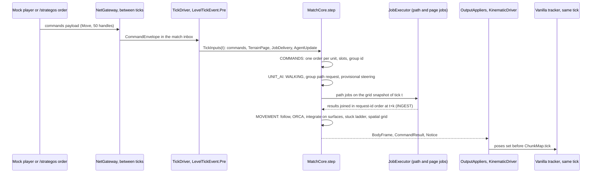
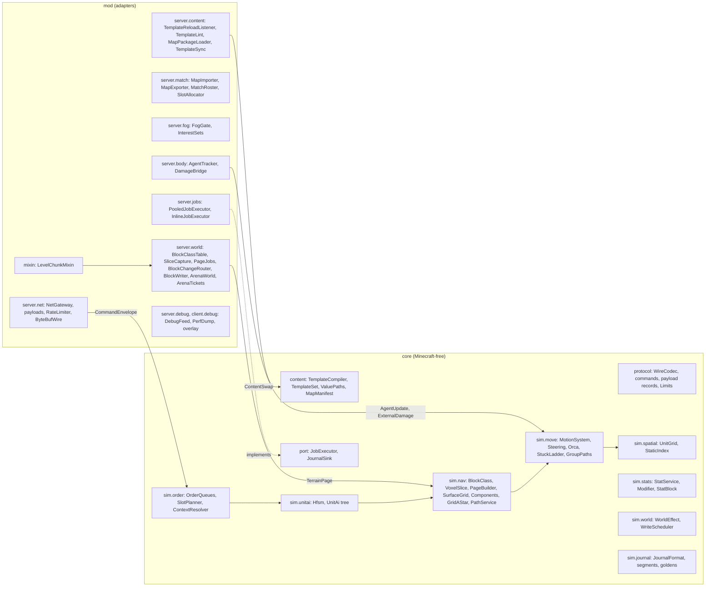
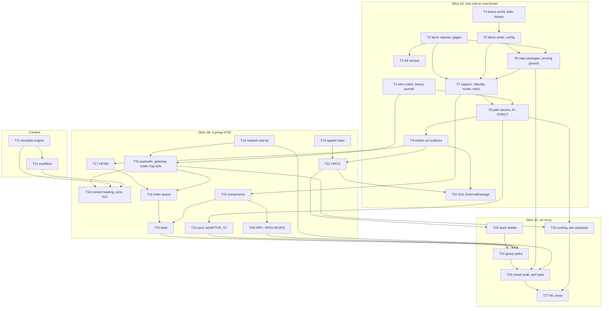

# M1 — Movement: implementation spec

*Written 2026-10-22 by the assistant after M0's acceptance, from the 28 approved M1 cards in
[roadmap/M1-movement.md](../roadmap/M1-movement.md) (26 in the milestone, PATH-08 and PATH-17 in
reserve), [04-architecture.md](../04-architecture.md) (cited as "04 §n"), the ADRs in
[adr/](../adr/README.md), M0's spec and results ([M0-foundation.md](M0-foundation.md), cited as
"M0 §n") and the M0 code at commit `b7722d9`. Status: **specified**; ROADMAP.md lists the 26 cards
as `specified` and the two reserve cards as `approved`. The decisions M1 needs, D-13 and D-17,
were taken as recommended on 2026-10-21, and S2 measured D-17's sizes. Every Minecraft and
NeoForge name in this spec was checked on 2026-10-22 in the decompiled Minecraft 1.21.1 + NeoForge
21.1.264 sources (Appendix A); FML, the event bus and MDG are not in that tree and are checked with
`javap` when a task first uses them (M0 §0.2). Clean-room: only our documents, our code and the
decompiled vanilla and NeoForge sources were read; RVO2 (Apache-2.0) is read only by the task that
ports it (T21).*

---

## 0. Read this first

### 0.1 Authority

1. 04-architecture.md and the ADRs decide *what*; this spec decides *how M1 builds it*. Where it
   defers an architecture item, §1.5 says so and why. Any other disagreement is a bug in this
   spec: follow the architecture and record the conflict in §1.6 D.
2. The M1 cards define scope and acceptance; ROADMAP.md is the source of truth for their status.
   §1.4 traces every acceptance criterion to the check that proves it. Where this spec implements a
   card differently from its wording, §1.6 says how and why.
3. M0's code is the starting point. This spec names the M0 types it changes; everything not named
   stays as M0 left it.

### 0.2 Working rules for every task

M0 §0.2 holds, with these changes:
- **Runs.** Add to the self-terminating runs: `runGameTestSlow` (the map batch), `runSpike` with
  `-Pspike=s7|s8`, `runMapgen` (T6) and `runServerSmokeArena` (T4). `runScenario` is still a
  client window: L4 items of M1 go to the Linux route on CI (`scenario.yml`, no window, no
  consent) or to M2's consent batch (§12). A static scene is repeated two or three times, never
  more (D-22, amended 2026-10-22).
- **Third-party code.** T21 ports RVO2 (Apache-2.0) and creates `NOTICE` (ADR-0005). No other
  third-party code is adapted in M1.
- **Done means** M0 §0.2's definition, with the M1 progress list (§9.3) and with new pitfalls
  written to the pet-projects knowledge base (`minecraft-mod*.md`) in the same session.

### 0.3 Code conventions

M0 §0.3 holds. Additions:

| Topic | Rule |
|---|---|
| Fixed point | Floors and heights in the nav grid are integers in 1/16 block (`Sixteenths`); positions stay `double` blocks |
| Hot paths | Navigation, motion, avoidance and spatial kernels carry `@HotPath` (B9): no streams, no boxing, scratch arrays reused per match |
| Wire format | Every client–server record and every journaled input has a core `WireCodec` with a declared maximum size; DFU codecs stay for JSON and NBT (snapshots, templates, manifests) |
| Mixins | Only in `dev.strategos.mod.mixin`, only routing calls (B10); each one listed in the engine-surface inventory |
| Config | Technical tunables in `strategos-server.toml` (`StrategosConfig`); anything that changes a match's outcome in `MatchRules` (04 §15.4) |

### 0.4 How a task is finished

1. Implement the files the task lists, nothing else.
2. `./gradlew spotlessApply`, then the task's verification command (from T1 on: `./gradlew verify`
   plus the task's extra runs). Fix until green.
3. Run the task's negative checks and record their outcome where the task says.
4. Record progress as the strategos-dev skill §5 says: tick the task in §9.3, set the card
   statuses, update the worklog and STATE.md, write new pitfalls to the knowledge base.

---

## 1. Goal, demo and scope

### 1.1 Goal

Retire the largest risk: hundreds of data-defined units cross real Minecraft terrain on group
orders, with no stuck units and inside the budgets, headless and reproducible:
- a terrain model of layered surfaces, captured from the live world and kept current
  (PATH-02, PATH-15, PATH-04), measured on vanilla terrain (S8);
- a path service with deterministic delivery on a worker pool (PATH-03, PATH-16, S7), shared group
  paths (PATH-09), kinematic motion on surfaces (PATH-05), avoidance (PATH-06) and a stuck ladder
  (PATH-07);
- orders, UnitAI and group destinations (UNIT-02, ORD-02, ORD-03), a spatial index (CORE-08);
- the arena world, the block writer, map packages and the 384² proving ground (MAP-07, BLD-15,
  MAP-01);
- data-defined content with a modifier pipeline, hot reload and client sync (DATA-01–03, S12);
- the payload layer with its single sender and the network test kit (NET-01, QA-19);
- the binary journal and cross-level replay (CORE-11);
- kinematic fidelity measured (UNIT-09, S10), a movement overlay (PATH-10), and the M1 perf gate
  (PERF-05).

### 1.2 Slices

Three vertical slices and a content track (roadmap M1). Each slice ends with a demo of its own.

| Slice | Tasks | Demo (automated) |
|---|---|---|
| 1A One unit on real terrain | T1–T10 | `maptests.unit_crosses_proving_ground`: one unit walks the imported proving ground over ramps, steps, a bridge and a ford; its journal replays in L1 to the same hash; S8 and S10 reported |
| Content | T11, T12, T16 | Templates load from data packs, hot-reload, and reach a joining player before any unit; S12 reported |
| 1B A group of 50 | T13–T15, T17–T22 | 50 units ordered through a mock player's `commands` payload settle in their slots; two groups of 50 pass head-on through a 6-block gap; identical hashes with 0, 1 and 4 path threads; S7 reported |
| 1C An army | T23–T26 | 200 units cross the proving ground; the 600-unit soak holds the budgets |



### 1.3 Demo script (L7, the owner)

In a dev client (`runClient`, started by the owner), in singleplayer with cheats on:
1. Create World → More → World Type **Strategos Arena** → Create. The world is a void with a lobby
   pad; the arena rules hold (`/gamerule doDaylightCycle` prints `false`).
2. `/strategos match create map=strategos:proving_ground` imports the proving ground into slot 0
   (about 20 s; a progress line in chat) and teleports the player above it.
3. `/strategos spawn strategos:unit/infantry 200` spawns 200 units at start slot 0.
4. Press **F8** (the movement overlay; `/strategos-client overlay` toggles it too): surfaces,
   paths, components and stuck markers appear; the panel shows queue depth and path latency.
5. `/strategos order move @units waypoint=far_side` sends all 200 across the map. They cross in
   about 1.5× the ideal time and settle in slots at the far side.
6. `/strategos order move @units waypoint=ford` while they walk: they turn at once (provisional
   steering) and refine their routes within a tick or two.
7. Fill the checklist and questionnaire of `docs/testing/playtest.md`, or tell the assistant what
   you saw. This session also confirms ADR-0022, left open by M0's waived demo.

### 1.4 Cards, tasks and checks (traceability)

The 26 cards of [roadmap/M1-movement.md](../roadmap/M1-movement.md#cards), in its order, with the
IDs, sizes and dependencies of that file: 1 S, 24 M, 1 L, at most 83 card-days, each `specified`.
Each acceptance criterion, by its number on the card, names the check that proves it and its
level; "§1.6 row n" marks a criterion implemented differently from the card's wording. Consent
items never block Done (§10). UNIT-01's criterion 5, left open by M0, closes with NET-01.8.

| Card | Title | Size | Depends on | Tasks | Acceptance criterion → check (level) |
|---|---|---|---|---|---|
| **Content** | | | | | |
| DATA-01 | Template engine | M | QA-02 | T11 | 1 `TemplateCompilerTest.chainWithTwoMixins` against `golden/spearman_flat.json` (L1) · 2 `MergeOpsTest` (L1) · 3 `TemplateProblemsTest` (L1) · 4 `TemplateFilterTest` (L1) · 5 `TemplateCompileBench.compile500` (L6) |
| DATA-02 | Modifier pipeline | M | DATA-01, CORE-04 | T12 | 1 `ModifierStagesTest` (L1) · 2 `ModifierOrderTest`, 200 seeds (L1) · 3 `TokensModifierTest` (L1) · 4 `StatInvalidationTest` (L1) · 5 `StatBreakdownTest` (L1) · 6 `StatReadBench.cachedRead` (L6) |
| DATA-03 | Content loading, client sync and spike S12 | L | DATA-01, NET-01 | T16 | 1 `BundledTemplatesTest` (L2) · 2 `TemplateLintTest`, `TemplateIdTableTest` (L1) · 3 `contenttests.reload_with_errors_keeps_set`, `contenttests.reload_removing_used_template_refused` (L3, solo) · 4 `contenttests.reload_changes_speed_next_tick` (L3, solo) · 5 `ContentSwapReplayTest` (L1) · 6 `nettests.template_set_before_pairing`, `nettests.template_hash_mismatch_resends` (L3; §1.6 row 9) · 7 `TemplateSetPayloadSizeTest` (L2) · 8 the S12 report (R) |
| **1A** | | | | | |
| PATH-02 | Surface pages: block classes and the page builder | M | QA-02, QA-03 | T2 | 1 `BlockClassTableTest` (L2) · 2 `PageBuilderTest` (L1) · 3 `PageHashTest` (L1) · 4 `PageBuilderBench.build` (L6) |
| PATH-01 | Spike S8: terrain census and surface encoding | S | PATH-02 | T3 | 1 `runSpike -Pspike=s8` (L5) · 2 the S8 report (R) |
| MAP-07 | Arena world: preset, world rules and tickets | M | CORE-01, D-13 | T4 | 1 `ArenaPresetTest` (L2) · 2 `runServerSmokeArena` runs 1 and 2 (L5) · 3 `arenatests.foreign_world_rules_untouched` (L3) · 4 `runServerSmokeArena` run 2 (L5) · 5 `SlotAllocatorTest` (L1) |
| BLD-15 | Block writer | M | CORE-02, CORE-10 | T5, T7 | 1 `writertests.budget_holds_across_two_matches` (L3) · 2 `navtests.own_writes_never_dirty` (L3, T7) · 3 `FakeWorldOrderTest` (L1) · 4 `perftests.block_writer_cost` (L6) |
| MAP-01 | Map packages, importer and the proving ground | M | BLD-15, MAP-07, PERF-03 | T6 | 1 `maptests.proving_ground_imports_within_30s` (L3, solo) · 2 `maptests.two_imports_equal_hashes`, `maptests.export_import_round_trip` (L3) · 3 `ProvingGroundTest` (L1; §1.6 row 3) · 4 the arena smoke's map step (L5) |
| PATH-15 | Live terrain capture, page rebuilds and the block-change router | M | PATH-02, BLD-15, CORE-01 | T7, T8 | 1 `navtests.block_change_rebuilds_pages` (L3), `pathtests.new_wall_blocks_path` (L3, T8) · 2 `navtests.own_writes_never_dirty` (L3) · 3 `TerrainReplayTest` (L1) · 4 `perftests.page_capture_and_publication` (L6, solo) · 5 `perftests.prewarm_512_generated` (L6, solo) · 6 the router's cost in the S8 report (R) |
| PATH-03 | Path service: A*, string pulling and STRICT delivery | M | PATH-02, CORE-05 | T8 | 1 `GridAStarTest` (L1) · 2 `PathServiceTest.supersededResultDropped` (L1) · 3 `PathServiceTest.movesAtOnceThenFollowsAtTPlusK` (L1) · 4 `GridAStarTest.capReturnsPartial` (L1) · 5 `CrossingBench` (L6; §1.6 row 2) · 6 `pathtests.unit_crosses_steps_and_ford` (L3) |
| PATH-05 | Path following: kinematic motion on surfaces | M | PATH-03, UNIT-01 | T9 | 1 `MotionSystemTest.upStepOverTwoTicks` (L1) · 2 `maptests.body_y_follows_core_floor` (L3, solo) · 3 `maptests.fifty_units_one_by_one` (L3, solo; §1.6 row 5) · 4 `MotionBench.step600` (L6) |
| UNIT-09 | Spike S10: kinematic fidelity | M | PATH-05, PATH-15 | T10, T21 | 1 `fidelitytests.pose_traces` (L3) · 2 `fidelitytests.player_melee_and_arrow_journaled` (L3) · 3 the `s10_steps` scenario on the Linux route (L4, CI; §1.6 row 1) · 4 the S10 report and ADR-0011 (R; after T21's avoidance check) |
| CORE-11 | Binary journal and cross-level replay | M | CORE-05, QA-04 | T1 | 1 `:core:replayJournals` over the binary journals (L1) · 2 `JournalSegmentTest` (L1) · 3 `GoldenJournalTest` (L1; §1.6 row 6) · 4 `journaltests.journal_save_replays` (L3) |
| **1B** | | | | | |
| CORE-08 | Spatial index | M | CORE-02 | T13 | 1 `SpatialBruteForceTest`, 1,000 seeds (L1) · 2 `SpatialOrderTest` (L1) · 3 `SpatialBench` (L6) |
| QA-19 | Network test kit | M | QA-03, QA-04 | T14 | 1 `nettests.acknowledging_viewer_tracks_view` (L3) · 2 `nettests.capture_per_player_and_type` (L3) · 3 the perf report's byte counters (L6) · 4 the JFR comparison (R, consent; M2's batch, §12) |
| NET-01 | Payload layer, NetGateway and the fog-gate stub | M | CORE-03, QA-03, QA-19 | T15 | 1 `PayloadRoundTripTest` (L2) · 2 `WireCodecSizeTest` (L1) · 3 `PayloadAudienceTest` (L2) · 4 rule B6 (L0) · 5 `nettests.other_match_gets_nothing`, `nettests.same_match_paired_and_informed` (L3) · 6 `nettests.bad_batches_dropped_and_disconnect` (L3) · 7 `FogGateTest` (L2; §1.6 row 8) · 8 `nettests.pose_same_tick_no_entity_data` (L3) · 9 `nettests.issuer_from_uuid_slot`, `nettests.unseated_player_commands_ignored` (L3) |
| UNIT-02 | UnitAI state machine framework | M | CORE-04, CORE-06 | T17 | 1 `HfsmTransitionsTest` (L1) · 2 `HfsmPersistenceTest` (L1) · 3 `HfsmExitPathTest` (L1) |
| ORD-02 | Order queue: move and stop | M | ORD-01, UNIT-02, NET-01 | T18 | 1 `OrderQueueTest` (L1) · 2 `QueuedWaypointsTest` (L1) · 3 `ordertests.commands_payload_applies_next_tick` (L3) |
| PATH-04 | Components and reachability | M | PATH-02, PATH-15 | T19 | 1 `ComponentsFloodFillTest`, 500 grids (L1) · 2 `MakeGoalReachableTest` (L1) · 3 `navtests.wall_splits_components` (L3) |
| ORD-03 | Group destination slots | M | ORD-02, PATH-04 | T20 | 1 `SlotLayoutTest`, `SlotSnapTest` (L1) · 2 `ordertests.fifty_settle_in_slots` (L3) |
| PATH-06 | Local avoidance (ORCA) | M | PATH-05, CORE-08 | T21 | 1, 2 `avoidtests.head_on_groups_through_gap` (L3) · 3 `avoidtests.walk_around_mock_player` (L3) · 4 `OrcaTest`, `NoticeFileTest` (L1) · 5 `OrcaBench.step600` (L6) |
| PATH-16 | Worker pool, ADAPTIVE delivery and spike S7 | M | PATH-03 | T22 | 1 `ThreadCountHashTest` (L1) · 2 `AdmissionTest` (L1) · 3 `pathtests.save_quiesces_and_continues` (L3) · 4 `perftests.path_budget_d` (L6) · 5 the S7 report (R) |
| **1C** | | | | | |
| PATH-07 | Stuck ladder | M | PATH-05, PATH-06 | T23 | 1, 2 `StuckLadderTest` (L1) · 3 `pathtests.boxed_in_frees_or_fails` (L3) · 4 the soak's nudge count (L6, T26) |
| PATH-09 | Shared group path | M | PATH-06, ORD-03, PATH-16 | T24 | 1 `GroupPathTest.requestsAtMostTenPercent` (L1) · 2 `maptests.two_hundred_cross` (L3, solo) · 3 `perftests.group_paths_budget_d` (L6) |
| PATH-10 | Movement debug overlay and dev payloads | M | PATH-03, NET-01, QA-10 | T25 | 1 `debugtests.unsubscribed_gets_no_dev_payload`, `debugtests.subscribed_gets_feed` (L3) · 2 rule B5 (L0), the server smoke (L5) · 3 overlay goldens (L4, consent; QA-18 in M2, §12) |
| PERF-05 | Crowd soak and the M1 perf gate | M | PATH-07, PATH-09, MAP-01, QA-07, QA-19 | T26 | 1 `perftests.crowd_soak_600` and its report (L6) · 2 the soak's failure conditions (L6) · 3 `perftests.stress_1200` (L6) · 4 `SoakSeedReplayTest` (L1) |

### 1.5 Moved out of M1, with the reason

| Item | Where it is planned | Moves to | Why |
|---|---|---|---|
| UNIT-09.3 screenshots on the owner's Mac | M2's consent batch | the Linux route on CI (§1.6 row 1); the Mac pass stays optional in M2's batch | S3 showed CI renders the same scenarios with no window |
| PATH-10.3 overlay goldens | M2's consent batch | QA-18 (M2), which brings `scenarioDiff` and the golden procedure | No golden tooling before QA-18 |
| QA-19.4, the JFR comparison on a real connection | once, with consent | M2's consent batch | Needs a real client |
| Knockback from vanilla damage | PATH-05 | the motion primitive lands in T9; its source, `ExternalDamage` applied by the core, comes with CMB-01 (M2) | M1 records `ExternalDamage` but applies no damage |
| Activity tiers beyond moving and idle | 04 §6.5 | M4 (LOD tiers) | M1 needs only the avoidance cadence |
| Mobility classes beyond infantry, gates | PATH-11, PATH-12 | M5, M9 | Card scope |
| HPA* and flow fields | PATH-08, PATH-17 (reserve) | only on their triggers (S8, the crossings, PATH-09) | Card scope |

### 1.6 Differences resolved

**B. Where this spec implements a card differently from its wording.** (Section A, the draft
cards, does not exist for M1: the M1 cards were final when this spec was written.)

| # | Card says | Implemented as |
|---|---|---|
| 1 | UNIT-09.3: screenshots at steps (L4, consent; in M2's consent batch) | The `s10_steps` scenario runs on the Linux route (`scenario.yml`, Xvfb and llvmpipe): no window, no consent. Two runs, frames compared as S3 did. The Mac pass stays optional in M2's batch |
| 2 | PATH-03.5: a crossing benchmark (L6) | A JMH benchmark over the generated proving ground (384²) and a generated 512² terrain, run in `:core:jmh`; budget D's trigger reads its expansions and p95 |
| 3 | MAP-01.3: the L1 fixture equals the package's terrain | The generator `ProvingGround` (core test fixtures) is the source of truth; the manifest stores its terrain hash; L1 checks fixture hash = manifest hash and the listed spawn points and waypoints; L3 checks the imported world's hash = manifest hash |
| 4 | MAP-01: the proving ground package | Generated by `./gradlew :mod:runMapgen` (a self-terminating server) into `mod/src/devtools/resources/data/strategos/…`, committed; dev runs load it, the jar never does. `ProvingGroundTest` fails when the committed manifest's hash drifts from the generator |
| 5 | PATH-05.3: "no ladder rung above repath" before the ladder exists | T9's `StuckMonitor` counts ticks without progress from the start; "no rung above repath" = no unit 100 ticks without progress. T23 adds the actions of the higher rungs |
| 6 | CORE-11.3: re-baselined with a written reason | `./gradlew :core:rebaselineJournals -Preason="…"` regenerates the goldens from their scenarios and appends the date, the names and the reason to `core/src/test/resources/journals/REBASELINE.md`; `GoldenJournalTest` names the command in its failure message |
| 7 | NET-01: the roster binds UUIDs to slots | M1 has no lobby (NET-02): `/strategos match join <id> <slot> [player]` (permission 2) seats a player; GameTests seat mock players through `MatchRoster` directly |
| 8 | NET-01.7: `FogGate` hides when its lookup throws (L1) | `FogGate` is an adapter class; its decision is a static function over ids, tested in plain JUnit in `:mod:test` (L2 by location, no Minecraft bootstrap needed) |
| 9 | DATA-03.6: a hash mismatch triggers a resend | The client answers every `template_set` with `strategos:template_ack(hash)`, a C2S payload the catalogue of 04 §12.2 gains (≤ 40 B, 1/s); the server resends on a mismatch |
| 10 | PERF-05: part of `verifySlow` and `verifyPerf` | `verifySlow` runs the soak's correctness checks (stuck, failed orders, nudges); `verifyPerf` adds the budget assertions; CI's nightly `perf.yml` runs both at three times the budgets |
| 11 | PATH-15.1: units stop pathing through a new wall | Proved in T8 (`pathtests.new_wall_blocks_path`), the first task with paths; T7 proves the page half |
| 12 | MAP-07.4: tickets of a disposed match dropped on restart | The arena smoke disposes a match in run 1 without letting it release its tickets (a dev hook, `strategos.smoke.leakTickets`), and run 2 checks the validation callback dropped them |

**D. Found while implementing.** Empty at specification; tasks add rows here.

| # | Spec said | Found and changed |
|---|---|---|
| 1 | §5.10: a checkpoint every 100 ticks; the header holds the core version, `MatchConfig` and `MatchRules` | Checkpoints stay at M0's 20 ticks, so a divergence is found within a second. The header holds the command catalogue's fingerprint (`id=wireId`, refused if another build's) and the checkpoint period; each segment's snapshot carries the config, the rules and its own schema `"v"`, and migrates when read, as saves do. The magic is an `int` (rule B8 bans static arrays) |
| 2 | T1 lists `JournalSink` | No sink is needed while journals live in memory and are written whole by `/strategos journal save`, the GameTest export and fault reports (now `journal.strj`); T5 adds the `journal` key to the config, and the sink and `journal = disk` arrive with `CorePorts.journal` in T8 (§1.6 D row 19) |
| 3 | §5.10: segments kept for the whole match | The writer keeps segments spanning at most M0's 72,000 ticks; with a shorter `maxTicks` (M0's re-base test, 50) segments shrink to it, so M0's re-base behaviour is the special case |
| 4 | §5.4: a page stores `int[256]` first surfaces plus an overflow array with a `byte[256]` count | A page stores 257 column offsets and one surface array: the same O(1) access, a simpler builder; a hilly page is about 2 KB. A page builds in 27 µs (`PageBuilderBench`, against 0.5 ms) and allocates its result (about 2.2 KB), so `PageBuilderBench.build` is not in the 0 B/op kernel list of §4.2 |
| 5 | §5.4: links across page edges are computed when a page is published next to its neighbours | Pages hold in-page links only; `SurfaceGrid.neighbour` applies the same rule (`PageBuilder.linkable`) across page edges at query time, so republishing a page never touches its neighbours. Cost codes count blocked neighbours inside the page; a page edge counts as open |
| 6 | §6.2: the table reads `#doors`, `#fence_gates`, `#fences`, `#walls`, `#leaves`, `#climbable` and fluid tags | Tags are not bound before a server loads its data packs (L2 has none), so vanilla's doors, gates, fences, walls, leaves and climbables are recognised by their block classes and water and lava by their fluid types; the tags still add other mods' blocks. The table is rebuilt on `TagsUpdatedEvent` (server data load) as well as `DataMapsUpdatedEvent`. The data map is not synced: clients do not need it in M1 |
| 7 | §9.2 T2: `:core:jmh -Pjmh.includes=…` | The property is `-Pjmh.include=<regex>` (M0's) |
| 8 | §5.3: mixins merge after the parent, "each parent, then the mixins left to right" | A mixin is laid over the child's inherited JSON as written, so its class edits stay edits (`+Builder` adds, it does not replace) and its `$op`s apply to what the child inherits; a mixin therefore has no parent or mixins of its own, and a template some other template lists as a mixin is an overlay that is never compiled on its own |
| 9 | §5.3: decode the flattened JSON with core DFU codecs | A field-by-field reader decodes the unit components, so every problem carries its exact JSON pointer (`/UnitMotion/walkSpeed: expected a number, got "fast"`); DFU stays for snapshots and manifests |
| 10 | §5.3: `UnitTemplate` is rewritten | It grows (name, classes, turn rate, mobility, model, skin, radius) and keeps M0's six-field constructor for code-defined sets; `TemplateSet.builtin()` compiles the bundled JSON (debug walker and infantry, mirrored in `mod/src/main/resources/data/strategos/strategos/templates/`) with the same compiler, and its version is pinned by `TemplateSetTest`. Net indices follow id order until T16's `TemplateIdTable`. The infantry walks 0.1875 blocks a tick (3/16, exact in binary). 500 templates compile in 4.15 ms (`TemplateCompileBench`, against 200 ms) |
| 11 | §5.4: the floor in bits 0–10 (0–2,047); the cost code in 3 bits, capped at 7 | The floor takes 12 bits: a full block on a 128-block band's top voxel stands at 2,048 sixteenths, which S8's first run hit. The cost code takes 2 bits, capped at 3 (it counts 0–4 blocked orthogonal neighbours). The layout S8 fixed: floor 0–11, headroom 12–18, kind 19–21, cost 22–23, links 24–31. A page also counts the columns that overflowed (`SurfacePage.overflowColumns`) |
| 12 | §8.1: one band per square, 16 blocks below its lowest terrain, against the exit of ≥ 99.9 % of columns within 4 surfaces | That band fails the exit: 98.18 % of 1.74 million distinct columns, 95.87 % in the worst square. Pits pull it down, so 95–110 blocks of caves enter it and 4 % of columns have their terrain above it. The cap itself never drops a surface within 16 blocks of the terrain. A band per page (16 blocks below the page's lowest terrain) meets the exit in every square: 99.992 %, worst square 99.977 %. **The change:** packaged maps keep the manifest's band; terrain taken from an existing world gets a band per page, with the page's base Y stored in the page, carried by PATH-13 (M13), whose card now says so. The census measures all three band rules, and its totals count overlapping squares once |
| 13 | §8.1: the census generates chunks through the spike arena's tickets and reports the router's cost per block change | The census adds region tickets of its own `TicketType` and polls `getChunkNow`, at most 128 chunks in flight: NeoForge's `forceChunk` loads synchronously (ForcedChunkManager.java:96) and hung the server once. The router arrives in T7, which measures its cost and adds it to the S8 report |
| 14 | MAP-07.1: `ArenaPresetTest` (L2); MAP-07.5: `SlotAllocatorTest` (L1) | World presets, biomes and dimension types are data-driven registries that exist only on a server with its data packs, so the preset is checked by the GameTest `arenatests.preset_decodes_in_normal`: in `#minecraft:normal`, three vanilla stems, a void flat overworld of biome `strategos:arena`, baked stable (not experimental), a biome without spawners, precipitation or features. `SlotAllocatorTest` is plain JUnit in `:mod:test` (L2 by location, no Minecraft bootstrap), as row 8; the arena smoke repeats the slot rule at L5 (slots 0, 1, then 2 after the restart) |
| 15 | §6.3: the first start of an arena world also builds a 9 × 9 stone lobby pad | Rule B7 lets only `BlockWriter` place blocks, and it arrives in T5; T4 applies and records the rules only, and T5 builds the pad through the writer with a flag of its own. `match create` in an arena world takes the next slot, with the band Y 0–127 and units at Y 64 until MAP-01's maps bring their own band. The registry blob stays at `v` 1: `arenaRulesApplied` and `nextArenaSlot` are optional, so an M0 blob loads |
| 16 | §6.3: `validate` removes the tickets of UUIDs that name no saved, undisposed match | The callback runs while the server prepares its levels, before `ServerStartedEvent` (MinecraftServer.java:522), so it reads the registry blob itself; a quarantined blob keeps every ticket, since it cannot say which matches live. The tickets are not ticking: entities tick on any region ticket (S2). The arena smoke also proves the other half: a saved match keeps its tickets across the restart, and disposing a match releases them. The inventory writes world generation entries as `<registry dir> <id>` (`worldgen/biome strategos:arena`) |
| 17 | §9 T5: `core/sim/world/{WorldEffect, WriteScheduler, WriteSite}` | `WorldEffect` lives in `core.sim` beside `OutputEvent`: core compiles outside a named module, where a sealed type permits only classes of its own package (JLS §8.1.6). `WritePriority`, `WriteSite` and the generic `WriteScheduler<W>` are in `core.sim.world`; the adapter's `OutputAppliers` hands `WorldEffect`s to the writer. `FakeWorld` logs each applied write with its tick and site; it emits `WorldChange`s when T7 brings them |
| 18 | §2.2 step 5, BLD-15: one budget of 64 across matches; the boundary shape pass when a site completes | The writer keeps one scheduler per level and writes each level's share right after that level's matches step; the 64 are shared by every level where a match runs, and a level where none runs writes under `importBudget`, outside the shared budget (MAP-01). The writer cannot know when a building is complete, so the shape pass runs whenever a site's queue empties, over the blocks it wrote since the last pass that touch something it did not write; the burst interval bounds it. Disposing a match drops its waiting writes and releases its protected blocks, so `ProtectedBlockIndex` keys each block by match and handle. The lobby pad of D row 15 is written at the first start under the import budget, synchronously, before `lobbyPadBuilt` is recorded |
| 19 | §4.4: `StrategosConfig` with its keys | Every key of §4.4 is defined now, so the file's shape is settled, and each comes into use with its feature: the writer's budgets now, `pathThreads` and `journal` in T8, the rates in T15. Values are read at `ServerAboutToStartEvent`, just after NeoForge loads server configs (ServerLifecycleHooks.java:96). The inventory's config probe reads `StrategosConfig.files()`, the list the mod registers from, since FML keeps registered configs package-private |
| 20 | §7.6: `perftests.block_writer_cost` reported against PERF-01's threshold | PERF-01 sets no per-block threshold, so the test is report-only under gate `c`: 64 blocks a tick from four sites take 20 µs per tick at the median and 65 µs at p99 (0.32 µs a block, 1.0 µs at p99), on the M4 Pro. The reference limit it prints, 1.15 ms per tick at p99 (5 % of budget C), is a proposal for the owner |
| 21 | §5.3: `MapManifest` fields; `terrainHash` over "the palette indices" | The manifest also carries `palette` (the block states the hash indexes, air included) and `tileSize` (32); each index is hashed as two bytes, X then Z then Y (`TerrainHash`). `minY` is where an arena slot puts the band's bottom; an import takes an explicit origin. The optional `rules` overrides wait for a map that needs them (MAP-02). `MatchRecord` gains the optional map id. Start slots and waypoints are recorded; M1 places no starting entities |
| 22 | §6.4: tiles store "the blocks above each column's lowest stored block, with `baseBlock` below" | A tile stores a column from its lowest block that is not the base block, or from the stone under it when that block is air (the yard gate's opening under its lintel), since the importer fills base blocks up to the lowest block a tile holds and air is never stored or written: an import goes to empty space (arenas are void). Blocks go in Y order, so sand has its support, and fluids last, so water never flows into a space a later block fills. Import writes skip the writer's shape pass: at tile edges it made leaves recount their distance and broke the hash |
| 23 | §6.4: `create` with a map imports, then enters `READY` | A match on a map stays `PREPARING` until its import ends; the terrain hash read back must equal the manifest's, or it faults with both hashes. The lifecycle has no way from `PREPARING` or `READY` to `DISPOSED`, so disposing such a match faults it first; one saved while importing comes back `FAULTED`. A match on a map holds tickets over its space in any world, as an arena match does. Exports go to `<world>/strategos/maps/` and win over data packs of the same id |
| 24 | §7.4: `two_imports_equal_hashes` against the manifest | It compares two imports outside any match with each other only; the manifest's hash is the 30 s test's. So the negative check works as written: with one tile swapped, the two imports still agree and the match faults on the manifest's hash (run 2026-10-22). The map tests run alone in batches of their own (`map_import`, `map_twice`, `map_roundtrip`), each importing in its own lane 2,048 blocks apart, since the GameTest batches' structures stand a few dozen blocks apart |
| 25 | §7.5: the smoke's map step | It runs first in run 1, before the M0 match exists, so the import has the import budget: an unsaved match on the proving ground 4,096 blocks from the spawn, imported while the server sprints (7 s), then 8 units walking with nobody online for 100 ticks. Run 2 still restores exactly the M0 match |
| 26 | §2.1: `TerrainPage(pageX, pageZ, VoxelSlice, SurfacePage)`; §2.6: page hashes in the snapshot | `TerrainPage` carries the page, its slice in encoded form and the slice's hash, and lives in `core.sim` for the sealed-type rule (row 17). Schema 2 lists the published pages as `(x, z, slice hash)`; migration 1 → 2 gives M0 snapshots an empty list. The core rebuilds a snapshot's pages from a `SliceSource`: a journal segment's slices. A server restart passes none, and the prewarm at resume publishes freshly captured pages on the next tick, so the state hash leaves the grid out: the grid follows from journaled inputs, and a resumed match keeps its saved hash. Comparing the fresh captures with the stored hashes waits for `WorldReconciler` |
| 27 | §5.10: slices "once per hash"; 'S' carries the page list | The format is version 2. Each segment writes, right after its 'S', an 'L' record for every slice it uses (its start pages' and its inputs'), so a segment replays alone; the page list stays in the snapshot, and the 'S' count stays 0. Version-1 files still read. In memory, segments share the slice arrays |
| 28 | §2.2 step 4: page jobs due at `t + pageK` on worker threads | Jobs run at their join on the server thread (`InlineJobExecutor`) until T8 brings the pool and `pageK` joins `MatchRules`; until then the delay is `PageJobs.DELAY` (4). States whose collision depends on their position are classified at capture, on the main thread, with their real position; `PathInvalidated` and the 20-tick repath limit come with paths (T8) |
| 29 | §7.3, §7.6: the nav tests and PATH-15's perf tests | `navtests.block_change_rebuilds_pages` and `navtests.own_writes_never_dirty` run in the default batch. `perftests.page_capture_and_publication` (`perf_pages`) asserts the card's 0.4 ms p95 and 4 pages a tick itself, reporting under the unlisted gate `pages`: 245 µs p95 with all 9 pages changing every 8 ticks. `perftests.prewarm_512_generated` (`perf_prewarm`): 1.1 s and 1.07 MB for a flat 512². The router costs 37 ns a change outside any match (PATH-15.6, in the S8 report). The negative check holds: without the `OwnWrite` check, 6 pages are captured after own writes |
| 30 | §8.2: `JOBS_NEVER_TOUCH_THE_LEVEL` | Minecraft is not on the ArchUnit classpath, so the rule names the types: `Level`, `ServerLevel`, `LevelChunk`, `ChunkAccess`, `ServerChunkCache`, `ChunkMap`, and the entity package; `archTest` now has core at runtime for its fixture. B10 lets a mixin package carry its `@NullMarked` annotation |
| 31 | §2.4: every walking unit asks `PathService` | A request does nothing while no page is published (grid version 0): the unit walks M0's straight line and keeps no path state, and `StateHasher` mixes a unit's path only once it has asked and the queue only once any request was made. A match without terrain, as every M0 scenario and golden, keeps M0's states and hashes bit for bit; `walking_skeleton` and `canary` were re-recorded only to journal format 2 with every checkpoint unchanged |
| 32 | §5.6: A* from the unit's surface | The start is the passable surface of the unit's column whose floor is nearest its feet (the upper on a tie); until T9 moves Y, a unit keeps M0's height, so the nearest floor stands in for the surface it walks on. A column with no passable surface decides `NO_PATH` at once |
| 33 | §5.6: `PARTIAL` after 20,000 expansions | A search whose open set runs out without the goal returns `NO_PATH` with the path to the expanded node of least h (then g, then id), empty when that node is the start; at the cap it returns `PARTIAL` to that node, and `NO_PATH` when that node is the start. The move ends at the end of a `NO_PATH` path (`Arrived`, now "the move is over"); at the end of a `PARTIAL` or truncated one the unit asks again from where it stands. PATH-04's `makeGoalReachable` (T19) will move unreachable goals first |
| 34 | §5.6: the farthest later node with line of walk becomes the next waypoint | `StringPuller` probes the nodes after an anchor at doubling distances and narrows the first miss by bisection: a few walks per waypoint instead of one per node. Every waypoint keeps line of walk from the one before (`StringPullerTest`); the last is the goal point itself, after the goal column's centre only when the waypoint before cannot see it |
| 35 | §5.7, PATH-03.2: a new order 2 ticks later drops the first result | Delivery runs in `INGEST`, before `COMMANDS`: a result due at the tick a new order applies is delivered and replaced by that order's request in the same tick, so it never steers (`aResultDueAsANewOrderAppliesNeverSteers`); a result due after the new request is dropped and counted (`supersededResultDropped`, the order a tick later) |
| 36 | §5.13: `testkit.InlineJobExecutor`; T8: `CorePorts` gains `jobs` and `journal` | `JobExecutor.inline()` in `core.port` (`ReplayDriver` in core `main` needs one), the default of `CorePorts.of` and of the two-argument constructor; the mod keeps its server-thread `InlineJobExecutor` until T22's pool, so `pathThreads` is read in T22. `JournalSink` (port): `keepTicks()` (an hour), `writes()` and `write(tick, bytes)`, the whole kept journal at each segment's end. The mod's `DiskJournal`: `off` keeps one segment, `memory` an hour, `disk` also writes `<world>/strategos/journals/match-<id>.strj` at each segment's end, at dispose and at save. `PageJobs` now takes its delay from the match's `pageK` (D row 28) |
| 37 | §2.6: the snapshot holds the path service's waiting queue and results | T8 has no admission, so no waiting queue: `MatchSnapshot.paths` holds the next request id and every request in flight with its due tick and its result, joined when the snapshot is taken (quiesce); `UnitRecord.path` holds waypoints, cursor, status, request, last request and the repath flag, each field defaulted, so M0 saves decode. A replay from any segment of a journal with requests in flight across segment starts reaches the same hashes (`aJournalWithPathsReplaysFromAnySegment`) |
| 38 | PATH-15: `PathInvalidated` and repaths at most once per 20 ticks | A page counts as changed when its slice hash differs from the one last known there; a restore whose slices are missing keeps their hashes known, so a restart's prewarm republishing the same slices changes nothing. In `UNIT_AI`, a walking unit whose remaining route's bounding boxes meet a changed page is marked, and asks again once 20 ticks have passed since its last request; the message itself comes with the HFSM (T17) |
| 39 | §5.4: `SurfaceGrid` covers the match's pages | Pages are captured whole, so a match whose size is not a multiple of 16 has columns of real terrain beyond its edge in its last pages; `SurfaceGrid` keeps the match's size and treats those columns as outside, so no path leaves the match |
| 40 | §7.4: the scenario GameTests' L1 twin | The twin is given the terrain pages the live match published, at their ticks, from its journal (`SimHarness.schedule`), so twin and world compute the same paths; L1 scenarios publish terrain through `ScenarioContext.publish` (L1 only) |
| 41 | §7.4: `pathtests.unit_crosses_steps_and_ford`, `pathtests.new_wall_blocks_path` | Both build their terrain in `arena_flat_48` at the start (GameTestHelper positions count from the structure block, a block under the floor). The ford test's match leaves out the arena's first and last rows, where stone holds the river in. `bodytests.bodies_follow_entity_ticking_chunks` lays a causeway out through the barrier wall the GameTest builds round each arena, since its unit now walks a path. Negative checks: a river shallow everywhere fails the ford test ("in the deep river"), and no repath after the wall fails the wall test ("inside the wall") |
| 42 | T8: `CrossingBench` reports; a miss of budget D goes to STATE for PATH-08 | Both crossings hit the 20,000-expansion cap and return `PARTIAL` to the west bank across from the goal: 384² p50 4.41 ms, p95 4.60 ms, p99 4.78 ms; 512² p50 4.51 ms, p95 4.70 ms, p99 4.98 ms (M4 Pro, JMH sample mode, 2 forks). Uncapped, they need 29,293 and 30,930 expansions (costs 405.2 and 550.4, about 8 ms). One crossing exceeds budget D's 2 ms a tick on the server thread: R3 fires, and PATH-08 (HPA*) leaves the reserve as T28, after T19 (PATH-04) |
| 43 | §5.5: union-find over surfaces, O(1) reachability | Links are one-way where a drop is more than a step, and joining them both ways let a three-high wall with a walkable top join the floors on its two sides (`navtests.wall_splits_components` found it). Components join only surfaces linked both ways; a one-way link is an edge between components, and drops only go down, so the edges form a DAG. What a unit reaches is its component and those downstream (`Components.reachable`, a walk over the DAG, microseconds); same component is still one comparison. PATH-04.1's flood fill runs along the links from random starts (`ComponentsFloodFillTest`, 500 grids, also after republishes) |
| 44 | §5.5: `makeGoalReachable` inspects the columns of a page by distance | Each page keeps a column mask per local component, so a page's columns are taken by distance and skipped by the mask up to the first that holds a reachable component, the one inspected column of that page; a page past the match's edge gets its local labels again from the match's own columns. The result is the nearest reachable column's centre (within 1e-3 block of a brute force, `MakeGoalReachableTest`); an island and a closed box take under 200 inspected columns |
| 45 | §5.5: the global union is rebuilt on publish | INGEST, a restore and `VoxelWorld.grid()` publish a tick's pages together (`SurfaceGrid.publishAll`), and an update recomputes local labels and border links for the changed pages and their neighbours, then joins all pages. On the 512² generated terrain: a full prewarm's components take 23 ms once; one page republished 0.11 ms p50, 0.27 ms p95 (M4 Pro), counted in INGEST, outside `perftests.page_capture_and_publication`'s capture-and-join figure |
| 46 | §9.3: T9 after T8 | T19 (PATH-04) and T28 (PATH-08) come before T9: T9's crossings (PATH-05.3, 50 units across the proving ground within 1.5× the ideal time) need long paths that flat A* at its cap cannot give (R3, D row 42), and the work loop takes a red budget's fix next |
| 47 | PATH-08: A* over portals gives a corridor of pages, and low-level A* runs inside the corridor | The chain of portals is refined step by step instead: each step inside a page is searched for in that page alone, each step across a border is that border's link, so the path costs what the chain cost. Measured on the 384² crossing: A* inside the corridor of the chain's pages found the optimum but expanded 24.5 % of flat A*'s nodes, a corridor widened by a page 54 %; the step-by-step refinement stays within 1 % and expands 9.4 %. The start and the goal join their pages' portals by a Dijkstra inside the page (the goal's backward from its reachable surfaces) |
| 48 | PATH-08: portals on page edges | Along each border, the crossings (links across it, either way) form entrances: runs whose surfaces link both ways to their neighbours in the run on both sides, per pair of layers. A portal stands at every fifth crossing of an entrance and at its end. Measured on 300 random pairs four pages apart or more: ends and middle, worst +5.06 % (384²); every 4th, +4.14 % but 11.1 % of flat's expansions on the crossing; every 5th, +4.05 % and +3.65 % (384², 512²), 9.4 % and 9.7 %. A heuristic weight above 1 at the abstract level cost more (+6.7 % at 1.1), so it stays 1 |
| 49 | PATH-08: intra-page portal costs by Dijkstra at page build; corridors cached per (from page, to page, class, grid version) | A page's portals depend on its neighbours, so the abstract graph lives with the grid's components (`Portals`) and is updated on publish: the changed pages' borders and their portals' costs, a neighbour keeping its costs when its portals are unchanged. Nothing is cached per query: a 384-block query costs about 0.3 ms. Pages store each link's target layer (`SurfacePage.target`), so the page Dijkstra and `SurfaceGrid.neighbour` need not choose it again |
| 50 | §5.7: one search per request | A goal four pages away or more (`PathJob.HIERARCHICAL_PAGES`) is searched in two levels; a nearer one flat within 4,000 expansions, and in two levels when that is not enough (a near goal behind a long detour). The abstract search stops at 4,000 expansions with a `PARTIAL` path toward the expanded portal nearest the goal; with no chain of portals at all the flat search decides. `CrossingBench`: the two-level crossing takes 0.28 ms p50, 0.31 ms p95, 0.36 ms p99 at 384² and 0.31, 0.33, 0.41 ms at 512² (2,763 and 3,004 expansions), inside budget D; flat A* 4.3 and 4.4 ms p50, `PARTIAL` at its cap |
| 51 | §2.4, PATH-15: repaths when a changed page crosses a route | A page may change while a request is in flight, so its result was searched on the grid before the change and the old route said nothing about the new one (`pathtests.hierarchical_paths_follow_a_new_wall` caught a unit walking into a wall whose last page was published a tick after the request). Each result whose request predates the last page change is walked on the current grid when it arrives; a broken one marks the unit to ask again. The last change's tick is in the snapshot and the hash |
| 52 | PATH-08.3: corridors update within one rebuild cycle after a wall is built (L3) | `pathtests.hierarchical_paths_follow_a_new_wall` on `arena_air_96`, a 96 × 96 structure with no blocks, whose floor the test lays: on the tick the wall's pages are published, a fresh request goes round the wall in under 1,500 expansions; with stale portals the refinement fails and the flat fallback takes 2,540, so the negative check fails |
| 53 | Budget G and publication costs | The grid's memory now counts each surface's local component and link layers and the components and portals: a flat page with them about 3.6 KB. Building the components and portals of a whole prewarm takes about 135 ms for 384² and 216 ms for 512² once, on the publishing tick; one republished page about 0.3 ms, in INGEST, outside `perftests.page_capture_and_publication`'s capture-and-join figure; `perftests.prewarm_512_generated` now takes 1.43 s, against 1.1 s before T19 and T28, well inside its 30 s |
| 54 | §5.8: arrival within 0.5 block of a single unit's target; slowing within a block of a final target | Within one step of its waypoint or target a unit lands on it exactly, as in M0, and does not slow down first: slowing only added ticks (the scenario GameTests, now on terrain, expect M0's arrival tick), and on flat open ground motion is M0's to the bit. The 0.5-block arrival and slowing come back with avoidance (T21), when pushes keep units off exact points |
| 55 | §5.8: `MotionStore` keeps the surface layer | It keeps the surface's floor (1/16 above the band's bottom): a page rebuilt with a block above a unit shifts the layer indices, never the floor. A floor no longer in the column drops the unit to the highest surface at most a quarter block above it, else the lowest; a unit's first contact with terrain (spawned at the flat floor Y) stands it on the surface at once. The stuck monitor also keeps its aim, so a new waypoint restarts its best distance |
| 56 | T9: `MotionSystem` replaces `MovementSystem` | Without published terrain it keeps M0's movement exactly, and a unit's terrain state (velocity, floor, step, stuck monitor, arrival latch) is hashed and saved only once it touched terrain, so every M0 golden, fixture and L1 scenario is unchanged. Idle units settle every tick (a vanished floor drops them), and a latched unit pushed more than a block away gets a move back to its point (a `MOVE` order and `OrderReceived`; any order or stop releases the latch). `MatchQueries.motion(handle)` exposes the terrain state |
| 57 | §7.6: `MotionBench.step600` | It runs `MotionSystem.run` alone (a class in `core.sim` of the JMH source set, which reaches the kernel's state) for 600 units on a 128² floor of one-block terraces, putting them back on the same paths every 200 ticks from arrays; `BodyFrame.Builder.reset` lets it reuse the frame. It joins the `@HotPath` allocation check |
| 58 | §7.4: the map tests of T9 | `maptests.unit_crosses_proving_ground` (with the journal replayed in L1 inside the test), `maptests.body_y_follows_core_floor` (body Y is the core's Y within 1/16, on every tick the unit has a body) and `maptests.fifty_units_one_by_one` run in `runGameTestSlow`'s map batches, each importing in its own lane. PATH-05.3's ideal time is the ticks a walker at the unit's speed needs along a cheapest path, at half speed in shallow water and six tenths on slow ground, plus ten ticks for the request; the 50 units are ordered ten ticks apart and walk together, without avoidance yet |
| 59 | §5.6: string pulling from the start column's centre | A request keeps the point the unit stood at (`PathRequest.fromX`, `fromZ`), and the path is pulled from it: its first waypoint is in line of walk from that point, or is the start column's centre when the point sees no other node. On delivery, a unit that provisional steering left where it cannot walk straight to the first waypoint gets the request's point first. From the centre, a unit standing at the edge of its column pressed into a corner the line from the centre cleared (`maptests.fifty_units_one_by_one`: 100 ticks without progress) |
| 60 | §9.2 T9: `Steering`, `ArrivalLatch`, `StuckMonitor` | They are `MotionSystem`'s steps (steering at the current waypoint, the latch after arrival, the progress count), on fields of `MotionStore`; none keeps state of its own or is used elsewhere, so separate classes would only pass the store around |
| 61 | §3: `StatsChanged` in `core/sim/stats/` | It is in `core.sim` beside the other bus messages: `BusMessage` is sealed, and in an unnamed module a sealed type permits only classes of its own package. `StatScope` (faction or unit) and `TokenEdit` join the stats package |
| 62 | ADR-0013: `Modifier(path, op, value, filter, stage, priority, sourceId)` | It has eight fields, `tokens` after `value`: a `TOKENS` modifier carries its edit there (`"+a -b"`, value 0) and a number modifier its value (no tokens). Path and filter are strings, compiled against the match's set when the modifier is added; a path no template has reaches nothing. A replacement wins by priority, then the lower source id, then the lower value; products and sums take their entries by source id, then priority, value, tokens, filter and scope, a total order, so the order modifiers were added in never matters |
| 63 | §5.12: "clamped to the path's declared range" | `CorePaths` declares the ranges of the paths the core reads: walk speed 0 to 1 block a tick (the integrator steps at most one column a tick) and turn rate 0 to 180 degrees; any other path is unbounded until its component declares one. The clamp ends every stage, so a value never leaves its range between stages. The core's two paths are interned in every set, and a template whose JSON leaves one out has its typed default (a turn rate of 45) |
| 64 | ADR-0013: token lists | A token list is a string leaf of space-separated tokens (`Identity/classes`, a future `Production/units`); `TemplateSet.tokenPaths()` interns them as `valuePaths()` interns numbers. `+a` appends a token the list lacks at its end and `-b` removes one, by stage and then source id; class filters read the template's own classes |
| 65 | §5.12: a stale block is one whose version is behind its faction's | A change moves its faction's version on and stamps every block and overlay it does not reach with the new one, so exactly the reached blocks are evaluated again, as DATA-02.4 asks; a change that reaches no template posts no `StatsChanged`. An overlay also carries its unit's personal version, and a unit whose last own modifier goes back to its template's block |
| 66 | Modifiers in snapshots and the state hash | Not yet: in M1 only tests add modifiers, and no input carries them. The first task that adds them in a real match (TECH-01's research, or an AI handicap) brings the input, the snapshot field and the hashing, the last only once a modifier exists, so the goldens keep their hashes |
| 67 | §6 `/strategos stats <handle> [path]` | `stats <handle>` lists every value the unit has, after modifiers, with how many modifiers make it; `stats <handle> <path>` gives the base, each modifier with its source and stage, and the result; both through `MatchQueries.stats(handle, path)`. `commandtests.stats_show_values_and_breakdowns` checks them in a server |
| 68 | §2.1: `ExternalDamage(handle, kind, amount, sourceKind)` | Kind is hack, pierce, crush or lethal, source kind player, mob or none, each with a fixed journal code; the journal's input kind is 6 (3 to 5 stay with the spec's later inputs). A tick's damage follows its pages and commands, in the order it came. `UnitEntity#hurt` returns false, as §6.7 says: the architecture's damage event broadcast and `true` come with CMB-01, when the core applies the damage |
| 69 | §8.2: "the floor error per surface type" | The error is the body's Y against where vanilla physics would rest the same body: its box, lifted 1.5 blocks and dropped onto the collision shapes (`Entity.collideBoundingBox`). It is measured where the box lies over one strip and the unit is not halfway up a step. The eight lanes are walled in, since A* goes round a strip it may avoid (a pool costs four times as much), on `arena_flat_48_high`, an arena 8 blocks high, as the drop's three-block platform and the walls need. Stairs, walked along their row, count as full blocks in the core (the shape's top), and a body there overlaps the high half, as a vanilla body would |
| 70 | §7.7: "PNGs every 2 ticks for 40 ticks" | Every 2 ticks from the order to the arrival, about 130 ticks: 40 ticks cover 10 blocks, less than the row of seven patches two blocks long with grass between. For each frame `result.json` gives the body's client-side Y and its vanilla rest Y; frames whose box lies over one patch or one stretch of grass are "settled". `tools/png_diff.py` compares two runs as S3 did |
| 71 | §7.5: "a mock player's attack" | `FakePlayerFactory`'s `FakePlayer` attacks (`GameTestHelper#makeMockServerPlayerInLevel` is deprecated for removal), and a real arrow it owns is shot at the body |

---

## 2. Design of the M1 slice

### 2.1 Components



The core gains six input types and two output types:

| `InputEvent` | From | Journaled as | Applied in |
|---|---|---|---|
| `CommandEnvelope` (M0) | gateway, server commands, GameTests | wire codec of the command | `INGEST` → `COMMANDS` |
| `TerrainPage(pageX, pageZ, VoxelSlice, SurfacePage)` | `PageJobs` at `t+4` | the slice, stored once per hash; the page is rebuilt on replay | `INGEST` |
| `JobDelivery(int[] requestIds)` | `PathService` adapter in `ADAPTIVE` | the ids | `INGEST` |
| `ContentSwap(TemplateSet)` | `TemplateReloadListener` | the set's hash, its dump stored once | `INGEST` |
| `AgentUpdate(Agent[])` | `AgentTracker`: first-person players and vanilla mobs in the space | the list | `INGEST` (ORCA reads it in `MOVEMENT`) |
| `ExternalDamage(handle, kind, amount, sourceKind)` | `DamageBridge` from `UnitEntity#hurt` | the record | `INGEST`; recorded only until CMB-01 applies it |

| `OutputEvent` | Consumer |
|---|---|
| `CommandResult` (M0), `MatchEvent` (M0) | gateway feedback, command replies |
| `Notice(faction, kind, handle, detail)` | `feedback` payload to the faction (an order failed, a unit stuck) |
| `WorldEffect` (place or remove a block, with site and priority) | `BlockWriter` (no core producer in M1; FakeWorld tests and later cards) |

### 2.2 One server tick in M1

1. **Between ticks** (main thread): C2S handlers inside `FaultBarrier` decode, rate-limit and stamp
   `CommandEnvelope`s into the match inbox; `BlockChangeRouter` records `WorldChange`s into the
   owning match's dirty set; `DamageBridge` queues `ExternalDamage`.
2. **`LevelTickEvent.Pre`**, per running match (M0's `TickDriver`):
   1. `InputCollector` builds `TickInputs(t)`: commands in canonical order; the `TerrainPage`s
      due at `t` (page jobs submitted at `t−4`, joined now); `JobDelivery` in `ADAPTIVE`;
      a pending `ContentSwap`; `AgentUpdate`; `ExternalDamage`.
   2. `core.step(inputs)`:
      - `INGEST`: journal the inputs; publish pages (copy-on-write) and update components;
        deliver path results due at `t` in request-id order (`STRICT`: join, `ADAPTIVE`: the
        listed ids, plus any due since `t−8`); swap content;
      - `COMMANDS`: validate; fan out group commands into orders with slots and a group id;
      - `UNIT_AI`: HFSM handlers and thinks; path requests; admission within W; job submission;
      - `MOVEMENT`: steering (path, provisional line, group path offset), ORCA or separation,
        integration on surfaces, stuck ladder, arrival latch; then the `UnitGrid` rebuild;
      - `COMBAT`, `ECONOMY`: empty in M1; `WORLD`: `WorldEffect`s; `FINAL`: hash, frame,
        journal checkpoint.
   3. `OutputAppliers`: `BodyFrame` → `KinematicDriver`; results and notices → `NetGateway`.
   4. `PageJobs`: dirty pages that have been quiet for 4 ticks (or dirty for 40) are captured,
      at most 4 per tick, and submitted as jobs due at `t+4`.
   5. `BlockWriter` flushes its budget (64 placements per tick across matches; the importer's
      8,192 when no match in the level runs).
3. **Vanilla**: the chunk source ticks, so `ChunkMap#tick` ships the poses set in step 2 the same
   tick (M0 §6.5); entities tick.
4. **`ServerTickEvent.Post`**: `NetGateway` flushes one coalesced send per player.

### 2.3 Terrain: from blocks to pages

- **Classification** (`BlockClassTable`, built at server start and on `DataMapsUpdatedEvent`):
  every `BlockState` id in `Block.BLOCK_STATE_REGISTRY` (Block.java:68) maps to a 16-bit
  `BlockClass` (§5.4). Collision shapes come from `getCollisionShape(EmptyBlockGetter.INSTANCE,
  BlockPos.ZERO)` (BlockBehaviour.java:729); states whose shape depends on position are flagged
  and re-classified on the main thread at capture with their real position.
- **Capture** (`SliceCapture`, main thread): the `PalettedContainer#copy()` (PalettedContainer.java:290)
  of every section a page's Y band overlaps (`LevelChunkSection#getStates`, LevelChunkSection.java:140).
- **Build** (a pure job, `k` = 4): the copies are classified into a `VoxelSlice` (16 × 16 × band
  `short`s) and `PageBuilder` turns it into a `SurfacePage`. Job and slice never touch the level.
- **Publish** (core, `INGEST`): the `TerrainPage` input replaces the page in `SurfaceGrid`
  (copy-on-write: path jobs keep the grid they captured), updates components, and posts
  `PathInvalidated` to units whose path crosses the page. The journal keeps the slice.
- **Invalidation**: `LevelChunkMixin` at the return of `LevelChunk#setBlockState`
  (LevelChunk.java:239) → `BlockChangeRouter` → `MatchRegionIndex` → a `WorldChange` only when
  the class changed and the write is not the block writer's (`OWN_WRITE`). Dirty pages coalesce;
  units keep the stale page until the new one is published; a unit repaths at most once per 20
  ticks.
- **Prepare and resume**: at `PREPARING` every page of the match space is captured and built
  (512² within 30 s, PATH-15.5) and handed to the core before its first step. The snapshot stores
  each page's hash; on resume the pages are captured again, and a page whose hash differs counts
  as changed at the first tick.

### 2.4 Paths

- **Request** (`UNIT_AI`): a unit entering WALKING asks `PathService` for its goal. A goal within
  24 blocks with line of walk needs no search: the waypoints are decided the same tick. Otherwise a
  request id is assigned in order, the unit steers on a straight line at once (provisional
  steering), and the request waits for admission.
- **Admission**: each tick admits waiting requests in id order while the sum of their expansion
  caps stays within W (a match rule, 200,000 at first); a queue beyond 2,048 answers `BUSY` and the
  unit retries after 10 ticks.
- **Job**: a pure `PathJob` over the `SurfaceGrid` captured at request time: components check,
  `makeGoalReachable`, A* (≤ 20,000 expansions, `PARTIAL` beyond), string pulling.
- **Delivery** (`INGEST` at `t+k`, `k` = 2): `STRICT` joins every job due at `t` in request-id
  order (running it on the main thread if no worker took it); `ADAPTIVE` applies the ids of the
  journaled `JobDelivery` from `t+k` and joins anything still unfinished at `t+k+8`. A result whose
  request id is not the unit's current one is dropped.
- **Groups** (PATH-09): groups of 8 or more make one request from their centroid; each member joins
  the group path by line of walk, or by a join search of at most 2,000 expansions, follows it at
  its slot's lateral offset, and switches to its own slot near the goal.

### 2.5 Threads and determinism

- Only `mod.server.jobs` creates threads (B4): `strategos-path-N` daemons, `clamp(cores / 3, 1, 4)`
  on an integrated server and `clamp(cores / 2 − 1, 1, 4)` on a dedicated one, or the
  `pathThreads` setting; 0 runs every job inline at its join.
- Jobs read only immutable inputs (grid snapshot, slice copies, the block class table) and their
  own scratch arrays, which the executor hands out per thread.
- Outcomes never depend on threads: `STRICT` results apply at a fixed tick; `ADAPTIVE` timing is a
  journaled input. `ThreadCountHashTest` runs one match with 0, 1 and 4 threads in both modes and
  compares hashes (PATH-16.1); the M0 canary is extended with the same check.
- `quiesce()` at save finishes every outstanding job; the results are stored with their due ticks
  and delivered after the reload exactly as they would have been (PATH-16.3).

### 2.6 Persistence and journal

- **Snapshot schema 2** (core `MatchSnapshotCodec`, DFU; `Migrations` 1 → 2): per unit the order
  queue, the HFSM state id and data words, motion (velocity, surface layer, step smoothing, yaw),
  the path (waypoints, request id, status, due tick), the stuck counters; per match the path
  service (next request id, the waiting queue, quiesced results with due ticks), the group id
  counter, page hashes, and the template set's hash. Migration 1 → 2 turns each M0 move order into
  a one-order queue with no path; the unit requests one on the first tick. Schema 2 grows field by
  field from T7 to T23, each field with a default, and is released at T27: a schema-2 fixture joins
  `released-fixtures.txt` then, and M0's schema-1 fixtures keep loading throughout.
- **`MatchRules` gain** `delivery` (`STRICT`), `pathK` (2), `pageK` (4), `admissionW` (200,000),
  `maxOutstanding` (2,048), `busyRetry` (10), `searchCap` (20,000), `joinCap` (2,000),
  `shortMove` (24) and `groupMin` (8), each with its default in the codec, so schema-1 rules decode.
- **Binary journal** (§5.10): segments of 1,200 ticks, each starting with a snapshot and the slices
  of every page, slices stored once per hash; dev runs and GameTests record by default.

### 2.7 Network

- Payloads register in `RegisterPayloadHandlersEvent#registrar("1")` (RegisterPayloadHandlersEvent.java:40);
  each `StreamCodec` wraps a core `WireCodec` through `ByteBufWire`.
- `NetGateway` is the only sender (B6). It queues per player during the tick and flushes once in
  `ServerTickEvent.Post` with `PacketDistributor.sendToPlayer(player, first, rest…)`
  (PacketDistributor.java:50); `TrackersOf` uses `sendToPlayersTrackingEntity` (89).
- **Roster** (`MatchRoster`): UUID → `PlayerSlot`, saved with the match. A command's issuer is the
  slot bound to the sender's UUID; an unseated sender's commands are dropped and counted.
- **`FogGate` stub** behind `UnitEntity#broadcastToPlayer` (Entity.java:3021): a member of another
  match never sees the body; a member of the same match and a player in no match do; any
  exception hides.

| Payload | Direction | Audience | Cap | Task |
|---|---|---|---|---|
| `strategos:commands` | C2S | – | 32 commands, 4 KiB, 300 handles each; 40/s, bursts 80; 3,000 handles/s | T15 |
| `strategos:template_ack` | C2S | – | 40 B; 1/s | T16 (§1.6 row 9) |
| `strategos:debug_subscribe` | C2S, optional | – | 64 B; 2/s; permission 2 | T25 |
| `strategos:template_set` | S2C | `Player` | 256 KB | T16 |
| `strategos:match_join` | S2C | `Player` | 4 KiB | T15 |
| `strategos:match_state` | S2C | `Match` | 256 B | T15 |
| `strategos:feedback` | S2C | `Player`, `Faction` | 1 KiB | T15 |
| `strategos:debug_feed` | S2C, optional | `Player` (subscribed operators) | 64 KiB | T25 |

### 2.8 Content

- `TemplateReloadListener` (a `SimplePreparableReloadListener` registered in
  `AddReloadListenerEvent#addListener`, AddReloadListenerEvent.java:44) reads
  `data/<ns>/strategos/templates/**.json` off-thread; on the main thread the core
  `TemplateCompiler` resolves parents and mixins, `TemplateLint` checks keys, tokens, paths and ids
  against `getRegistryAccess()`, and an immutable `TemplateSet` is versioned by the SHA-256 of its
  canonical JSON.
- A set with problems is not swapped in; the problems go to the log, to operators and to
  `/strategos templates errors`. A set that drops a template a running match uses is refused.
- A good set reaches running matches as a journaled `ContentSwap` at their next tick boundary and
  every client as `template_set` (`OnDatapackSyncEvent`, posted at login before the player enters
  the level and on `/reload`, PlayerList.java:208, 920). Network indices come from an append-only
  `TemplateIdTable` that survives reloads within a session.
- Unit numbers come from the modifier pipeline: `StatService` over the template's values and the
  faction's modifiers (none in M1 besides tests), cached per (template, faction) and invalidated by
  a swap.

---

## 3. File tree at the end of M1

New files only; M0 files that change are listed in their tasks (§9.2). `core/` is
`core/src/main/java/dev/strategos/core/`, `mod/` is `mod/src/main/java/dev/strategos/mod/`.

```text
core/protocol/      WireWriter, WireReader, WireCodec, WireException, Limits, WireCodecs,
                    CommandBatch, TemplateAck, MatchJoin, MatchStateMsg, Feedback, NoticeMsg,
                    DebugSubscribe, DebugFeed, TemplateSetView
core/content/       RawTemplate, TemplateCompiler, MergeOps, ClassTokens, TemplateFilter,
                    TemplateProblem, TemplateIdTable, ValuePath, ValuePaths, UnitTemplate (rewritten),
                    TemplateSet (rewritten), MapManifest, MapWaypoint, StartSlot
core/port/          JobExecutor, JobHandle, PureJob, JournalSink
core/shared/        Sixteenths, SlotLayout
core/sim/           TerrainPage, JobDelivery, ContentSwap, AgentUpdate, Agent, ExternalDamage,
                    Notice, NoticeKind
core/sim/nav/       BlockClass, VoxelSlice, SurfacePage, PageBuilder, SurfaceGrid, PageCoord,
                    NavOverlay, MobilityClass, Components, LineOfWalk, GridAStar, StringPuller,
                    PathService, PathRequest, PathResult, PathStatus, PathJob, PathStore,
                    DeliveryMode
core/sim/move/      MotionSystem (replaces MovementSystem), Steering, Orca, OrcaLine, Separation,
                    ArrivalLatch, StuckMonitor, StuckLadder, GroupPaths (MotionStore grows)
core/sim/order/     OrderQueues, OrderKind, ContextResolver, SlotPlanner
core/sim/unitai/    Hfsm, StateDef, StateId, AiMessage, UnitAi, HfsmCheck (UnitAiSystem rewritten)
core/sim/spatial/   UnitGrid, StaticIndex, SpatialQueries, UnitFilter
core/sim/stats/     Modifier, ModifierOp, ClassFilter, StatService, StatBlock, StatBreakdown,
                    StatsChanged
core/sim/world/     WorldEffect, WriteScheduler, WriteSite
core/sim/journal/   JournalFormat, JournalReader, SegmentWriter, SliceStore, GoldenJournal
core/src/testFixtures/…/testkit/
                    VoxelFixtures, ProvingGround, InlineJobExecutor, ThreadedJobExecutor,
                    FakeWorld, FakeNet, TestTemplates, GoldenJournals, Scenarios (grown)
core/src/test/resources/  templates/** (test sets), journals/*.strj, journals/REBASELINE.md,
                    golden/spearman_flat.json
core/src/jmh/…/bench/     PageBuilderBench, CrossingBench, MotionBench, OrcaBench,
                    SpatialBench, StatReadBench, TemplateCompileBench
mod/                StrategosConfig
mod/registry/       ModDataMaps, ModPayloads, ModTickets
mod/mixin/          LevelChunkMixin
mod/server/world/   BlockClassTable, SliceCapture, PageJobs, BlockChangeRouter, BlockWriter,
                    OwnWrite, ProtectedBlockIndex, ArenaWorld, ArenaPolicy, ArenaTickets
mod/server/match/   MapImporter, MapExporter, MatchRoster, SlotAllocator
mod/server/net/     NetGateway, Audience, PayloadSpec, ByteBufWire, RateLimiter, NetCounters,
                    C2sHandlers, payload/{CommandsPayload, TemplateAckPayload,
                    TemplateSetPayload, MatchJoinPayload, MatchStatePayload, FeedbackPayload,
                    DebugSubscribePayload, DebugFeedPayload}
mod/server/fog/     FogGate, InterestSets
mod/server/content/ TemplateReloadListener, TemplateLint, MapPackageLoader, TemplateSync
mod/server/jobs/    PooledJobExecutor, InlineJobExecutor, PathThreads
mod/server/body/    AgentTracker, DamageBridge
mod/server/debug/   DebugFeed, PerfDump
mod/client/debug/   DebugOverlayHost, MovementOverlay, OverlayPanel, ClientDebugState
mod/client/net/     ClientPayloads (template_set store and ack, match_join, feedback to chat)
mod/src/main/resources/
                    strategos.mixins.json; data/strategos/worldgen/world_preset/arena.json;
                    data/strategos/worldgen/biome/arena.json;
                    data/minecraft/tags/worldgen/world_preset/normal.json;
                    data/strategos/data_maps/block/nav_class.json;
                    data/strategos/strategos/templates/** (bundled M1 content);
                    assets/strategos/lang/en_us.json (preset name, key mapping)
mod/src/devtools/   MapgenDriver; resources/data/strategos/strategos/maps/proving_ground.json,
                    resources/data/strategos/structure/strategos/maps/proving_ground/x*_z*.nbt;
                    scenarios S10StepsScenario
mod/src/gametest/   suites/{NavTests, PathTests, MapTests, WriterTests, ArenaTests,
                    FidelityTests, NetTests, OrderTests, AvoidTests, ContentTests,
                    JournalTests, DebugTests}; net/{MockViewer, PacketCapture, ByteCounter};
                    spike/{S7PathLoad, S8Census}; smoke/ArenaSmokeDriver;
                    resources/census/s8-regions.json
docs/spikes/        S7-path-service-under-load.md, S8-terrain-census.md,
                    S10-kinematic-fidelity.md, S12-content-cycle.md
NOTICE              RVO2 (Apache-2.0), T21
```

---

## 4. Build changes

### 4.1 `mod/build.gradle`

| Block | Content | Task |
|---|---|---|
| Mixins | `src/main/resources/strategos.mixins.json` (`package` `dev.strategos.mod.mixin`, `compatibilityLevel` `JAVA_21`, `mixins: ["LevelChunkMixin"]`, `injectors.defaultRequire` 1); `[[mixins]] config = "strategos.mixins.json"` in the `neoforge.mods.toml` template. NeoForge 1.21.1 runs on Mojang names, so no refmap is generated; T7 checks the bundled Mixin version with `javap` before writing the config | T7 |
| Run `serverSmokeArena` | A dedicated server in `build/smoke-arena`, synced from `src/gametest/smoke-arena-gamedir` (`server.properties` with `level-type=strategos\:arena`); `strategos.smoke=arena1`, then a second run `serverSmokeArena2` with `arena2` against the same directory; guards check each run's marker file, as M0's smoke guards do | T4 |
| Run `mapgen` | A self-terminating dedicated server (devtools source set, `strategos.mapgen=proving_ground`) whose `MapgenDriver` writes the package into `src/devtools/resources/…` and stops; a guard checks the manifest exists and names the generator's hash | T6 |
| Run `spike` | `-Pspike=s8` uses `src/gametest/spike-s8-gamedir` (`level-type=minecraft\:normal`, the census seed); `-Pspike=s7` imports the proving ground | T3, T22 |
| Run `gameTestSlow` | Gains the `map` batch (solo tests on the imported proving ground) | T6 on |
| Run `scenario` | Gains `s10_steps` | T10 |
| `-Pcompat.server` | Unchanged (M0): Lithium, ModernFix and FerriteCore on the classpath of server runs; T27 runs the movement suites with it | T27 |

### 4.2 `core/build.gradle`

- `rebaselineJournals` (a `JavaExec` on the test runtime classpath running
  `testkit.GoldenJournals`) regenerates `src/test/resources/journals/*.strj` and appends
  `-Preason` to `REBASELINE.md`; it fails without a reason.
- `replayJournals` reads `*.strj` (binary) instead of M0's JSON files.
- JMH: the benchmarks of §7.6; `hotPathKernels` gains `PageBuilderBench.build`,
  `MotionBench.step600`, `OrcaBench.step600`, `SpatialBench.rebuild1000` and
  `StatReadBench.cachedRead` (0 B/op each).

### 4.3 Root `build.gradle`

- `verify` gains `:mod:runServerSmokeArena` and `:mod:runServerSmokeArena2`.
- `verifySlow` keeps `runGameTestSlow` (now with the `map` batch) and the soak's correctness pass.
- `verifyPerf` gains the M1 perf tests (§7.6).

### 4.4 Configuration

`StrategosConfig` (root package) builds a `ModConfigSpec` registered by `Strategos` as a `SERVER`
config named `strategos-server.toml` (the `ModContainer#registerConfig` signature is checked with
`javap` in T5). Keys: `pathThreads` (−1 = automatic, 0–4), `journal` (`off`, `memory`, `disk`;
`memory` by default, `disk` in dev runs), `writerBudget` (64), `importBudget` (8,192),
`commandRate` (40), `commandBurst` (80), `handleRate` (3,000), `violationsPerMinute` (100),
`maxMatches` (16), `debugPermission` (2). M0's `strategos.faults.rethrow` system property stays.

---

## 5. Core design (`dev.strategos.core`)

### 5.1 Packages

M0 §5.1's rules hold. New packages sit under `sim` (`sim.nav`, `sim.order`, `sim.spatial`,
`sim.stats`, `sim.world`), so B3 keeps them away from `core.client`. `SlotLayout` (pure geometry of
group destinations) lives in `core.shared`, because the client runs it for previews (UI-05, M2);
snapping to surfaces stays in `sim.order`. Adapters see only `@CoreApi` types (B2): the inputs and
outputs, `PathStatus`, `DeliveryMode`, `BlockClass`, `VoxelSlice`, `SurfacePage`, `PageBuilder`,
`PageCoord`, `WorldEffect`, `WriteScheduler`, the stats breakdown, and the `MatchQueries` additions
below.

`MatchQueries` gains read-only views for adapters and the overlay: `path(handle)` (waypoints and
status), `stuck(handle)`, `order(handle)`, `surface(page)`, `component(page, column, layer)`,
`pathMetrics()` (queue depth, latency histogram, admitted expansions) and `stats(handle, path)`.

### 5.2 `protocol`: the wire format

- `WireWriter`/`WireReader` over a growable `byte[]`: unsigned varints, zigzag varints, `long`,
  `double` as its raw bits, strings as a varint length plus UTF-8 with a maximum length, booleans,
  and `int[]` with a maximum count. `WireReader` throws `WireException` on any overrun, any count
  above its bound and any trailing byte; it never allocates more than the declared bound.
- `WireCodec<T>`: `void write(WireWriter, T)`, `T read(WireReader)`, `int maxSize()`.
  `WireCodecSizeTest` writes every record at its maximum and asserts the exact size.
- `CommandKind` gains a `short wireId` and a `WireCodec`: `Move` 1, `Stop` 2, `SpawnUnits` 3. A new
  command is a record plus one registration (04 §7.1).
- Records: `CommandBatch(int clientSeq, List<Command>)` with `Limits.BATCH_COMMANDS` 32,
  `Limits.BATCH_BYTES` 4,096 and `UnitSet.MAX_SIZE` 300; `TemplateAck(byte[32] sha)`;
  `MatchJoin(matchId, space, factions, slot, rules)`; `MatchStateMsg(matchId, lifecycle, tick)`;
  `Feedback(clientSeq, outcome, reason, accepted, total)` and `NoticeMsg`;
  `TemplateSetView(sha, idTable, client templates)`; `DebugSubscribe(layers, area)`;
  `DebugFeed(layer, tick, payload)`.

### 5.3 `content`: templates, value paths, maps

- **`RawTemplate`**: id (from the file path), file, and a Gson `JsonObject` (Gson is one of the
  libraries core may use, B1).
- **`TemplateCompiler.compile(List<RawTemplate>) → Result(TemplateSet, List<TemplateProblem>)`**:
  1. resolve each `parent` chain; a cycle or a missing parent is a problem naming the whole chain
     (`a → b → c → a`) and the template is skipped;
  2. merge from the root down: each parent, then the `mixins` left to right, then the template's
     own body;
  3. merge rules (04 §8.3): nested objects deep-merge, the child winning per field; scalars and
     arrays replace; `{"$op": "add"|"mul"|"replace", "value": x}` applies to the inherited number;
     `{"$disable": true}` removes the inherited component; `{"$append": [...]}` and
     `{"$remove": [...]}` edit an inherited array; `"classes": "+A -B"` edits the token set;
     `"abstract": true` marks a template that is never instantiated;
  4. decode the flattened JSON into typed components with core DFU codecs, collecting every
     error as `TemplateProblem(file, JSON pointer, severity, message)`;
  5. intern class tokens (bit indices) and value paths (`ValuePaths`, an insertion-ordered
     interner built in id order, so ids are deterministic);
  6. canonical JSON (keys sorted, numbers in Java's shortest round-trip form) and its SHA-256
     (`java.security.MessageDigest`) give the set's version.
- **`TemplateFilter`** (`FOUNDATION`, `PREVIEW`, `MIRAGE`): code-defined, each a list of kept or
  overridden component paths (04 §8.3), applied to a compiled template.
- **`UnitTemplate`** (typed view, rewritten): `id`, `netIndex`, `classes` (a `long` bitset),
  `motion` (`walkSpeed` in blocks per tick, `turnRate` in degrees per tick, default 45,
  `mobility` = `INFANTRY`), `body` (`entityType`, `model`, `skin`, `width`, `height`, `radius`,
  default 0.35). M0's code-defined `debug_walker` becomes a bundled data template with the same
  numbers; `TemplateSet.builtin()` stays for L1 tests that need no files.
- **`TemplateSet`**: immutable; `byId`, `byIndex`, `all`, `sha()` (32 bytes), `hash()` (its first
  8 bytes, for the state hash), `valuePaths()`, `tokens()`, `clientView()`.
- **`TemplateIdTable`**: append-only id → index within a server session; a reload keeps old
  indices and appends new ids.
- **`MapManifest`** (DFU codec): `id`, `sizeX`, `sizeZ`, `minY`, `height`, `baseBlock`, `tiles`
  (32 × H × 32), `startSlots` (position, facing), `waypoints` (name → position), `rules`
  (optional `MatchRules` overrides), `version`, `terrainHash` (hex SHA-256 over the palette
  indices of every voxel in x, z, y order).

### 5.4 `sim.nav`: blocks, slices and pages

**`BlockClass`** is a `short`, built by the adapter and read by pure code:

| Bits | Field |
|---|---|
| 0–4 | collision top in 1/16 (0 none, 16 a full block, 24 for fences and walls) |
| 5 | `STANDABLE`: the top can carry a unit (false for fences, walls, leaves, climbables and hazards) |
| 6 | `PASSABLE`: no collision (air, plants, torches, open trapdoors) |
| 7 | `WATER` |
| 8 | `LAVA` (also `HAZARD`) |
| 9 | `CLIMBABLE` (passable for clearance, never a floor; no climbing in M1) |
| 10 | `DOOR` (doors and fence gates: passable, cost ×1.5) |
| 11 | `HAZARD` (lava, fire, magma, cactus, sweet berry bush, powder snow) |
| 12 | `LEAVES` (an obstacle, never a floor) |
| 13 | `SLOW` (soul sand, honey, cobweb: cost ×2, speed ×0.6) |
| 14 | `POSITION_DEPENDENT` (adapter only; cleared in slices) |
| 15 | reserved |

**`VoxelSlice`**: one page's band, 16 × 16 columns × `height` (≤ 128) `short`s, x-major then z then
y. Its canonical encoding, used for hashes and the journal, is run-length per column (class,
run). A flat page encodes to a few hundred bytes.

**Surfaces.** `PageBuilder.build(VoxelSlice, NavOverlay, PageCoord) → SurfacePage`, scanning each
column top-down:
- a **floor** is a voxel with `STANDABLE` and a collision top `t` > 0, at height
  `f = y × 16 + t` sixteenths above the band's bottom (slab 8, carpet 1, snow layers 2–14, dirt
  path and farmland 15, full blocks and stairs 16);
- its **headroom** is the clear height above `f`, in sixteenths, up to the next voxel that is not
  `PASSABLE`, `DOOR`, `CLIMBABLE` or water; water above a floor is clear for one block;
- a floor with headroom ≥ 29 sixteenths (1.8125 blocks, infantry) is a **surface**; its class is
  `GROUND`, `SHALLOW_WATER` (one block of water above the floor), `DEEP_WATER` (two or more:
  impassable for infantry), `DOOR` (a door in the clearance), `SLOW` or `HAZARD` (impassable);
- at most 4 surfaces per column, topmost first; a fifth is dropped and counted
  (`SurfacePage.overflow`), which S8 measures;
- footprint cells of the `NavOverlay` (none in M1 besides tests) remove the surfaces they cover.

**Encoding** (the candidate S8 checks): one `int` per surface:

| Bits | Field |
|---|---|
| 0–10 | floor in 1/16 above the band's bottom (0–2,047) |
| 11–17 | headroom in 1/16, capped at 127 |
| 18–20 | class |
| 21–23 | cost code: the number of orthogonal neighbours without a connection, capped at 7 |
| 24–31 | connectivity: one bit per direction (N, NE, E, SE, S, SW, W, NW) |

A page stores `int[256]` for each column's first surface (0 when the column has none) plus an
overflow array for the second to fourth surfaces with a `byte[256]` count; about 1–3 KB a page.

**Connectivity** (computed by `PageBuilder` within the page, and across page edges when a page is
published next to its neighbours): surface `s` connects to the surface `n` of a neighbouring column
whose floor difference `Δ = f(n) − f(s)` lies in [−48, +16] sixteenths (drops ≤ 3 blocks, steps ≤ 1
block), whose class is passable, and where the clearance holds from the higher of the two floors
in both columns; among several candidates, the smallest `|Δ|` wins, then the lower one. A diagonal
needs both orthogonal neighbours connected. `PageBuilder` is deterministic, and equal slices give
equal pages and equal page hashes (PATH-02.3).

**`SurfaceGrid`**: the published pages of a match in a `SurfacePage[]` indexed by page, plus a
version; publishing copies the array (copy-on-write), so a path job keeps the grid it captured.
Node ids are `((page × 256 + column) × 4 + layer)`.

### 5.5 Components and reachability (`Components`, PATH-04)

- Each page build also computes the page's **local components** (union-find over its surfaces by
  in-page connections) and the list of its edge connections.
- On publish, the core rebuilds the **global union** over (page, local component) nodes from the
  edge connections of all pages: a few thousand nodes for a 512² arena, microseconds. A surface's
  component is `global(page, local(surface))`; reachability is an equality test (O(1)).
- Each page keeps the set of global components present in it. `makeGoalReachable(goal, component)`
  searches pages in rings around the goal's page for one that contains the component, then the
  columns of that page by distance to the goal; it counts every column it inspects as an
  expansion (PATH-04.2 asks for < 200).

### 5.6 Search (`LineOfWalk`, `GridAStar`, `StringPuller`)

- **`LineOfWalk(grid, from, to)`**: a supercover traversal of the columns under the segment, each
  step following the connection rule of §5.4 from the previous surface; it fails on a missing
  connection, a corner without both orthogonal neighbours, or an impassable class.
- **`GridAStar`** over surfaces: 8 neighbours along connections; step cost 1 (orthogonal) or √2
  (diagonal) × the destination class's factor (`SHALLOW_WATER` 4, `DOOR` 1.5, `SLOW` 2) + 0.5 for
  a rise of 4 sixteenths or more + 0.1 × the destination's cost code; octile heuristic × 1.0. The
  open set is a binary heap ordered by f, then h, then node id; scratch state lives in a primitive
  open-addressing map sized to the cap, so memory is O(cap), never O(grid), and the map is never
  iterated. After 20,000 expansions the result is `PARTIAL` to the expanded node with the least h
  (then g, then id).
- **`StringPuller`**: from each anchor, the farthest later node with line of walk becomes the next
  waypoint. Waypoints are (x, z, layer floor) at column centres, at most 64 per path; a longer path
  keeps its first 64 waypoints and the unit asks again when it reaches the 48th.

### 5.7 `PathService` (PATH-03, PATH-16)

```java
@CoreApi public enum PathStatus { OK, PARTIAL, NO_PATH, BUSY }
@CoreApi public enum DeliveryMode { STRICT, ADAPTIVE }
public record PathRequest(int id, int handle, long tick, int fromNode, double goalX, double goalZ,
                          int cap, int groupId, boolean join) {}
public record PathResult(int requestId, PathStatus status, PathStore.Waypoints waypoints, int expansions) {}
```

- `request(...)` returns the request id, or decides at once: a short move (≤ 24 blocks, line of
  walk) gets `OK` waypoints the same tick and costs no request id.
- **Admission** (end of `UNIT_AI`): waiting requests in id order while the summed caps fit W;
  each admitted request becomes a `PathJob` (the grid snapshot, the request) submitted to the
  `JobExecutor`. More than 2,048 outstanding requests: `BUSY` at once.
- **Delivery** (`INGEST`): `STRICT` joins every job due at this tick in id order; `ADAPTIVE` applies
  the ids in this tick's `JobDelivery` that are due, then joins any due at `t − 8` or earlier. A
  result posts `PathResult` to its unit; if the unit's current request id differs, it is dropped
  and counted.
- **`quiesce()`** joins every outstanding job; the snapshot keeps their results and due ticks.
- **Metrics**: requests by status, expansions, queue depth, latency in ticks (histogram), join
  time on the main thread (through `Clock`, `diag` only).

`port.JobExecutor`:

```java
@CoreApi public interface PureJob<R> { R run(JobScratch scratch); }
@CoreApi public interface JobHandle<R> { boolean isDone(); R join(); }
@CoreApi public interface JobExecutor { <R> JobHandle<R> submit(PureJob<R> job); int threads(); }
```

`join()` runs the job on the calling thread if no worker has claimed it, or waits for the worker
that holds it; the result is the same either way. `testkit.InlineJobExecutor` runs every job at its
`join`; `testkit.ThreadedJobExecutor(n)` is the test pool for `ThreadCountHashTest`.

### 5.8 Motion (`MotionSystem`, `Steering`, PATH-05)

`MotionStore` grows: velocity (vx, vz), heading, surface layer, the step-smoothing state, the
current waypoint index. Per walking unit, per tick:
1. **Steering** picks the target point: the current waypoint (advanced within 0.5 block), the
   straight line to the goal while a path is pending (provisional steering), or the group path at
   the member's offset (§5.11).
2. **Preferred velocity**: toward the target at the walk speed from `StatService`
   (`UnitMotion/WalkSpeed`), × 0.5 in shallow water, × 0.6 on `SLOW`; slowing within 1 block of a
   final target.
3. **Avoidance** (T21) turns the preferred velocity into a safe one.
4. **Turn rate**: the heading turns toward the velocity by at most the template's `turnRate`.
5. **Integration**: the new XZ, and the surface in the new column connected to the current one;
   if none, the move is tried along X alone, then Z alone, else the unit stays.
6. **Y**: an up-step moves Y halfway on the first tick and onto the new floor on the second, so a
   1-block step takes exactly 2 ticks (PATH-05.1); a down-step or a walkable drop lowers Y by at
   most 0.5 block per tick; a vanished surface drops the unit to the next surface below (fall
   damage arrives with health).
7. **Arrival**: within 0.5 block of a single unit's target or 1.5 blocks of a group member's slot,
   `Arrived` is posted and an arrival latch holds the unit until it is pushed more than 1.0 block
   from its target.
8. **`StuckMonitor`**: a unit makes progress when its distance to the current waypoint drops by
   0.05 block below its best; otherwise its no-progress counter grows, and the ladder (T23) acts on
   it. From T9 the counter and its rung are recorded for every unit.

`MotionSystem.impulse(handle, dx, dz)` displaces a unit along walkable surfaces by at most the
impulse's length, deterministically; T9 tests it directly, and CMB-01 feeds it from damage.

### 5.9 Orders, slots and UnitAI

- **`OrderQueues`** (ORD-02) replace M0's `OrderStore`: per unit a ring of at most 16 orders
  (kind, target x and z, group id, slot); `REPLACE` finishes the current order (its leave hook
  runs), clears the queue and starts the new one; `QUEUE` appends, starting at once if idle;
  `PUSH_FRONT` inserts before the current order; `finishOrder` pops, starts the next or goes IDLE,
  and posts `OrderFinished`. A `QUEUE` beyond 16 is rejected for that unit with `QUEUE_FULL`.
  `Stop` clears the queue.
- **Group fan-out**: a command with N units makes N orders with one new group id; `SlotPlanner`
  gives each its slot.
- **`SlotLayout`** (`core.shared`, ORD-03): N offsets in rows across the facing (the direction from
  the group's centroid to the target), spacing `max(0.8, 2 × radius + 0.1)`, a width parameter
  (columns per row, default ⌈√N⌉), centred on the target.
- **`SlotPlanner`** (`sim.order`): snaps each offset to the nearest standable surface in the
  target's component within 3 blocks (a spiral in a fixed order), skipping candidates closer than
  0.8 to an earlier slot; assignment sorts units and slots by (lateral, then depth, then handle)
  and pairs them in order, so paths do not cross in the common case.
- **`ContextResolver`**: a ground target resolves to `Move`; later cards add units, buildings and
  nodes.
- **`Hfsm`** (UNIT-02): states form a tree; each `StateDef` has `enter`, `leave`, `onTick`, typed
  handlers and the transitions it may request; an unhandled message bubbles to the parent; a
  transition requested in a handler runs after it returns. Per unit the state is a `short` id and
  two `int` data words in `AiStateStore`, saved as plain data. Each state declares its think period
  (IDLE 10 ticks, WALKING 5), staggered by handle.
- **The tree** in M1: `INDIVIDUAL { IDLE, WALKING }`, with extension points for GATHER, BUILD and
  COMBAT. Messages: `OrderReceived`, `OrderFinished`, `PathResult`, `PathInvalidated`, `Arrived`,
  `Stuck(rung)`, `StatsChanged`. `HfsmCheck` proves every state reaches IDLE through the declared
  transitions (UNIT-02.3).

### 5.10 Binary journal (`sim.journal`, CORE-11)

```text
file    := "STRJ" u16(version 1) header record*
header  := str(coreVersion) MatchConfig(json, deflated) MatchRules(json, deflated)
record  := 'T' sha(32) bytes          template set dump (canonical JSON, deflated), once per set
         | 'L' long(sliceHash) bytes  slice (run-length encoding), once per hash
         | 'S' varlong(tick) bytes(snapshot, deflated canonical JSON) varint(n) (varint px, varint pz, long sliceHash)*
         | 'K' varlong(tick) varint(n) input*      only ticks with inputs
         | 'C' varlong(tick) long(stateHash)       every 100 ticks
         | 'E' varlong(tick) long(finalHash)
input   := u8(kind) body   1 CommandEnvelope · 2 TerrainPage(px, pz, sliceHash) · 3 JobDelivery
                           · 4 ContentSwap(sha) · 5 AgentUpdate · 6 ExternalDamage
```

- A segment starts every 1,200 ticks with a snapshot and the slice hashes of every page; slices and
  template sets are written once, so a reader that reaches a segment can replay from it alone
  (CORE-11.2).
- `JournalSink` (port) receives finished records; the mod writes them to
  `<world>/strategos/journals/<match>.strj` when `journal = disk`, and GameTests export through
  QA-04's hook as in M0.
- **Goldens** (`core/src/test/resources/journals/`): `walking_skeleton`, `crossing_synthetic`,
  `group_of_50_slots`, `head_on_gap`, generated by `GoldenJournals` from `Scenarios`.
  `GoldenJournalTest` replays each and compares every checkpoint; a mismatch names the first tick
  and the `rebaselineJournals` command (§1.6 row 6).

### 5.11 Avoidance, group paths and the stuck ladder

- **`Orca`** (PATH-06): a Java port of RVO2's velocity solver (`linearProgram1–3`) on the XZ plane,
  for units on the same surface layer: neighbours from `UnitGrid`, at most 10 within 3 blocks in
  (distance, handle) order, time horizon 20 ticks, radius from the template; blocked edges within
  1.5 blocks add static half-planes (velocity toward the edge ≤ (distance − radius) / 10 ticks);
  `AgentUpdate` agents count as non-reactive (the unit takes full responsibility); the D-08
  observer avatar is never an agent. Where more than six units stand within 1.5 blocks, the unit
  uses separation steering (the sum of repulsions) instead. Latched idle units take part with a
  zero preferred velocity, step aside when pushed, and return to their target after 20 quiet
  ticks. Moving units run every tick; idle ones every 4 ticks, staggered.
- **`GroupPaths`** (PATH-09): a group of `groupMin` (8) or more requests one path from the surface
  nearest its centroid; members join by line of walk to the nearest point of the group path ahead
  of them, or by a join request capped at 2,000 expansions; they follow the path at their slot's
  lateral offset and switch to their own slot within 8 blocks of the goal. Smaller groups plan
  individually.
- **`StuckLadder`** (PATH-07), on the `StuckMonitor`'s counter: 40 ticks → repath; 100 → a short
  move to the nearest free surface within 3 blocks (standable, no unit within 0.6); 200 → follow a
  path with avoidance off for 60 ticks; 400 → a nudge of at most 4 blocks along the path to the
  first free surface ahead; 600 → `finishOrder(FAILED)` and a `Notice(STUCK)`. Candidates outside
  the match space or inside a footprint are never used. Every rung is counted per unit and match
  for the overlay and the soak.

### 5.12 Spatial index, stats, block writes

- **`UnitGrid`** (CORE-08): 8-block cells over the match space, rebuilt at the end of `MOVEMENT`
  by a counting sort of (cell, handle) into two reused `int[]`s; per cell a faction bitmask.
  `forEachInRadius(x, z, r, filter, consumer)`, `nearest(x, z, filter)` and `countWithin` visit
  cells overlapping the circle and report in handle order (cells are merged by handle with a
  reused buffer). `UnitFilter` is a faction mask plus a class bitset. Nothing allocates per query.
- **`StaticIndex`**: per page, sorted handle lists of static entities (buildings, nodes,
  dropsites); updated incrementally; empty in M1 outside its tests.
- **`StatService`** (DATA-02): `read(handle, path)` returns `StatBlock(template, faction)[path]`,
  or the unit's overlay if it has personal sources; a block whose version is behind its faction's
  modifier-set version is recomputed: per stage ascending, `replace` (highest priority, then lowest
  source id), then the product of `mul`s and the sum of `add`s in source-id order, then the clamp
  of the path's declared range; `TOKENS` edits token lists. Adding or removing a modifier bumps the
  version and posts `StatsChanged(scope, paths)`; a `ContentSwap` invalidates every block.
  `breakdown(handle, path)` lists the base, each modifier and the result.
- **`WriteScheduler`** (BLD-15), shared by `BlockWriter` and `FakeWorld`: one global budget per
  tick (64); sites served round-robin from the one after the last served; a site flushes at most
  every 4 ticks; inside a site, priorities `NODE_REMOVAL`, `CONSTRUCTION`, `DAMAGE_STAGE`,
  `COSMETIC`, `IMPORT`, first in first out within each.

### 5.13 Test kit additions (`core/src/testFixtures`)

| Type | Purpose |
|---|---|
| `VoxelFixtures` | ASCII terrain: a height map of digits with `~` water, `#` wall, `=` bridge deck, `D` door, `!` hazard, `s` slab, `L` leaves; `layers(...)` for multi-level fixtures (bridges, wall walkways, a tower) |
| `ProvingGround` | The deterministic 384² generator (§6.4) with its palette, spawn slots, waypoints and terrain hash; also `generate(512)` for the 512² benchmarks |
| `InlineJobExecutor`, `ThreadedJobExecutor` | Executors for L1 |
| `FakeWorld` | Voxels plus `WriteScheduler`, applying `WorldEffect`s and emitting `WorldChange`s |
| `FakeNet` | Collects payload records per recipient |
| `TestTemplates` | Loads JSON template sets from test resources through `TemplateCompiler` |
| `GoldenJournals` | Builds the goldens of §5.10 from `Scenarios` |
| `SimHarness` grows | `.terrain(VoxelModel)` (pages built synchronously before the first step), `.templates(set)`, `.pathThreads(n)`, `.delivery(mode)`, `.agents(...)` |

---

## 6. Mod design (`dev.strategos.mod`)

### 6.1 Registration

| Class | Registers | Task |
|---|---|---|
| `ModDataMaps` | `strategos:nav_class` on `minecraft:block`: `DataMapType.builder(id, Registries.BLOCK, NavClassOverride.CODEC).synced(…, false)` (DataMapType.java:85, 152) in `RegisterDataMapTypesEvent` (RegisterDataMapTypesEvent.java:38); `NavClassOverride` sets or clears flags and the collision top | T2 |
| `ModTickets` | `strategos:match`, a `TicketController(id, ArenaTickets::validate)` (TicketController.java:27) in `RegisterTicketControllersEvent` | T4 |
| `ModPayloads` | Every payload of §2.7 in `RegisterPayloadHandlersEvent#registrar("1")`; the dev payloads with `.optional()` (PayloadRegistrar.java:158) | T15, T16, T25 |
| `StrategosConfig` | `strategos-server.toml` | T5 |

### 6.2 World (`server.world`)

- **`BlockClassTable`**: for each id of `Block.BLOCK_STATE_REGISTRY`, the collision shape's
  `max(Direction.Axis.Y)` (VoxelShape.java:32) × 16; `STANDABLE` when the top is at least half the
  block's footprint (`isFaceSturdy(..., Direction.UP)` or a slab, stair, carpet, snow layer or
  path) and the block is not in `#fences`, `#walls`, `#leaves` or `#climbable` (BlockTags.java:53,
  46, 49, 102); doors and gates from `#doors` and `#fence_gates` (24, 111); water and lava from the
  fluid state; hazards and slow blocks from a fixed list; `strategos:nav_class` overrides last.
  States whose collision shape needs a real position are flagged `POSITION_DEPENDENT`.
- **`SliceCapture`**: for a page, the section copies of the chunks under its 16 × 16 columns
  (pages align to the match origin; a GameTest page may span four chunks) and the flagged voxels'
  real classes; main thread only.
- **`PageJobs`**: per match, the dirty set (page → first-dirty tick, last-change tick), capture of
  at most 4 quiet pages per tick, jobs due at `t + pageK` joined in page order, `TerrainPage` inputs;
  prewarm at `PREPARING` (all pages, joined before the first step).
- **`LevelChunkMixin`** (`mixin`): `@Inject(method = "setBlockState", at = @At("RETURN"))` on
  `LevelChunk#setBlockState(BlockPos, BlockState, boolean)` (LevelChunk.java:239), calling
  `BlockChangeRouter.onChanged(chunk, pos, previous, state)` when the returned previous state is
  not null; nothing else.
- **`BlockChangeRouter`**: ignores client levels; queues calls from other threads to the main
  thread; skips writes while `OwnWrite` is set; one `MatchRegionIndex` lookup; records a
  `WorldChange` in the owning match's `PageJobs` only when the old and new `BlockClass` differ.
- **`BlockWriter`**: the only caller of `Level#setBlock`, `removeBlock` and `destroyBlock`
  (Level.java:228, 311, 317; rule B7); flags `UPDATE_CLIENTS | UPDATE_KNOWN_SHAPE`
  (Block.java:78, 81); `WriteScheduler` order; `OwnWrite` set around each write (a field of the
  writer, since writes run on the main thread); fills `ProtectedBlockIndex`; after a site
  completes, one shape-update pass over its boundary.

### 6.3 Arena (`server.world`, `server.match`)

- **Data**: `worldgen/world_preset/arena.json` (a `flat` overworld with no layers,
  `"features": false`, `"lakes": false`, biome `strategos:arena`, plus the vanilla nether and end;
  T4 copies the shape of vanilla's `flat.json` from the resources jar), `worldgen/biome/arena.json`
  (no spawners, no precipitation, no features), and the `#minecraft:normal` tag entry
  (WorldPresetTags.java:8).
- **`ArenaWorld`** on `ServerStartedEvent`: the overworld's generator is a `FlatLevelSource` whose
  `settings().getBiome()` is `strategos:arena` (FlatLevelSource.java:55,
  FlatLevelGeneratorSettings.java:184). The first time, it sets `doMobSpawning`, `doFireTick`,
  `mobGriefing`, `doDaylightCycle` and `doWeatherCycle` false, the time to 6000,
  `randomTickSpeed` 0 and `spectatorsGenerateChunks` false (GameRules.java:35–101, `set` 304),
  builds a 9 × 9 stone lobby pad at the spawn, and records `arenaRulesApplied` in
  `strategos_registry`; later starts change nothing.
- **`ArenaPolicy`** carries the arena-only assumptions of 04 §3.2; `SlotAllocator` gives match `n`
  the origin `(n × 2048, 0)`, chunk-aligned, never reusing a slot.
- **`ArenaTickets`**: prepare forces every chunk of the space with the match's UUID owner
  (`forceChunk(level, uuid, x, z, true, false)`, TicketController.java:67); dispose releases them;
  `validate(level, helper)` (LoadingValidationCallback.java:18) removes the tickets of UUIDs that
  name no saved, undisposed match (`TicketHelper#removeAllTickets(UUID)`, TicketHelper.java:62).
  GameTest matches inside their structure place none (04 §3.4).

### 6.4 Maps (`server.match`, `server.content`, devtools)

- **`ProvingGround`** (core test fixtures; the source of truth): 384 × 384, band 64 blocks from
  Y 0 of the space; a seeded `DetMath` height field of rolling hills; two ramps and a staircase of
  1-block steps; a cliff band (4 blocks) with one ramp through it; a river (1–2 blocks deep) crossing
  the map with two fords and two bridges (one plank deck with fences, one stone arch); a forest of
  trees (logs and leaves); a 3-block-wide pass between cliffs; a walled yard with a gate and wall
  walkways. Palette: `minecraft:grass_block`, `dirt`, `stone`, `water`, `oak_planks`,
  `oak_fence`, `stone_bricks`, `oak_log`, `oak_leaves`, `oak_fence_gate`, `cobblestone`,
  `sand`. Start slots near the west and east edges; waypoints `west`, `east`, `far_side`, `ford`,
  `bridge`, `pass`, `yard`.
- **`MapgenDriver`** (devtools, run `mapgen`): writes the manifest and the 144 tiles (12 × 12 of
  32 × 64 × 32) as vanilla structure NBT (`size`, `palette`, `blocks`, `entities`, `DataVersion`;
  `NbtIo.writeCompressed`, NbtIo.java:74), storing only the blocks above each column's lowest
  stored block, with `baseBlock` below.
- **`MapPackageLoader`**: reads the manifest and tiles from the server's resource manager; parses
  tile palettes itself (`StructureTemplate`'s are private, StructureTemplate.java:66).
- **`MapImporter`**: places tiles through `BlockWriter` at `importBudget` blocks per tick while no
  match in the level runs, otherwise at `IMPORT` priority; fills each column below its lowest stored
  block with the base block; then waits until `LevelLightEngine#hasLightWork()` is false
  (LevelLightEngine.java:38); computes the terrain hash of what it placed and compares it with the
  manifest's.
- **`MapExporter`**: `/strategos map export <id> <from> <to>` writes tiles with
  `StructureTemplate#fillFromWorld` (StructureTemplate.java:83) and `save` (609) plus a manifest.
- `MatchOptions` gains `map` (a package id): `create` allocates a slot in an arena world (or a
  region next to the player elsewhere), forces its chunks, imports, prewarms the nav grid, places
  the start slots, then enters `READY`.

### 6.5 Network (`server.net`, `server.fog`)

- **`NetGateway`**: `send(Audience, Payload)` checks the payload's declared audiences
  (`PayloadSpec`), queues per player, and flushes once per player in `ServerTickEvent.Post`;
  `TrackersOf(handle)` goes through `PacketDistributor.sendToPlayersTrackingEntity` at once;
  counters per payload type and player (`NetCounters`), exported to perf runs.
- **`ByteBufWire`**: `WireWriter`/`WireReader` over a `RegistryFriendlyByteBuf`, enforcing the
  codec's `maxSize` before decoding.
- **`RateLimiter`**: token buckets per player and payload type; a violation (bad decode, oversize,
  over rate, unseated sender) is counted; the 101st in a minute disconnects with
  "strategos: too many invalid packets".
- **`C2sHandlers`**: every handler runs inside `FaultBarrier`; `commands` → `MatchRoster` slot →
  `MatchRuntime.submit(issuer, command, clientSeq)`; `template_ack` → resend on mismatch;
  `debug_subscribe` → `DebugFeed`.
- **`MatchRoster`**: UUID → `PlayerSlot`, saved in the match's `SavedData`; `/strategos match join`.
- **`FogGate`**: `UnitEntity#broadcastToPlayer` → `FogGate.canSee(match of the body, viewer)`:
  false for a member of another match, true for a member of the same match and for a player in no
  match; any exception → false. `FogGate.decide(...)` is a static function over ids (§1.6 row 8).
- **`InterestSets`**: per player, the handles paired with them, from `startSeenByPlayer` and
  `stopSeenByPlayer` (Entity.java:3085, 3091) overridden on `UnitEntity`.

### 6.6 Content (`server.content`)

- **`TemplateReloadListener`** (`AddReloadListenerEvent#addListener`): `prepare` lists and reads
  `data/*/strategos/templates/**/*.json`; `apply` runs `TemplateCompiler` under
  `makeConditionalOps()`, `TemplateLint`, and hands a good set to `StrategosServer`, which queues a
  `ContentSwap` for every running match and sends `template_set` to every player.
- **`TemplateLint`**: unknown keys (each component's codec lists its fields), unknown class tokens
  and value paths, unknown item, block and entity-type ids (`getRegistryAccess()`), missing models
  and skins (a fixed list in M1), dangling production references.
- **`TemplateSync`**: `OnDatapackSyncEvent` → `template_set` to `getPlayer()` or every
  `getRelevantPlayers()` (OnDatapackSyncEvent.java:43, 53); the client stores the view, checks the
  SHA-256 and answers `template_ack`.
- `/strategos templates reload|errors|dump <id>`.

### 6.7 Bodies, jobs, commands, debug

- **`AgentTracker`** (`server.body`): each tick, the non-spectator players and the vanilla `Mob`s
  inside a running match's space become an `AgentUpdate` (position, velocity, radius 0.3–0.6).
- **`DamageBridge`**: `UnitEntity#hurt` (LivingEntity.java:1142 overridden) turns a player's melee
  (`ServerPlayer#attack`, ServerPlayer.java:1767) or a projectile into an `ExternalDamage` input
  and returns false, as M0's units ignore vanilla damage.
- **`PooledJobExecutor`** (`server.jobs`): `PathThreads.count()` daemon threads named
  `strategos-path-N`; each job holds an atomic state (WAITING, CLAIMED, DONE); a worker or `join`
  claims it by compare-and-set; `join` on a job claimed by a worker parks until it is done. Scratch
  per thread. `InlineJobExecutor` for `pathThreads = 0`.
- **Commands** (permission 2):

| Command | Task |
|---|---|
| `/strategos match create [size] [map=<id>]`, `/strategos match join <id> <slot> [player]` | T6, T15 |
| `/strategos map export <id> <from> <to>`, `/strategos map import <id>`, `/strategos map list` | T6 |
| `/strategos spawn <template> [count] [slot]` (M0's `debug spawn` stays as an alias) | T11 |
| `/strategos order move <units> <x> <z> [queue]`, `/strategos order move <units> waypoint=<name>`, `/strategos order stop <units>`; `<units>` is `@units`, `@group <id>` or handles | T18 |
| `/strategos nav show <page>`, `/strategos nav path <handle>`, `/strategos nav rebuild` | T8 |
| `/strategos journal save <file>` | T1 |
| `/strategos templates reload\|errors\|dump <id>`, `/strategos stats <handle> [path]` | T16, T12 |
| `/strategos perf start\|stop\|dump` | T25 |
| `/strategos debug subscribe <layers>` and `/strategos-client overlay` | T25 |

- **`DebugFeed`** (`server.debug`): operators who subscribe (optional payload; dev builds or
  `debugPermission`) get `debug_feed` at 2–10 Hz per layer: surfaces and classes near them,
  components, paths, ladder rungs and stuck markers, activity, the path queue panel. `PerfDump`
  writes the metrics as CSV under `<world>/strategos/perf/`.
- **Overlay** (`client.debug`): `DebugOverlayHost` (moved from QA-10's plan) draws world layers in
  `RenderLevelStageEvent` and a text panel as a GUI layer (`RegisterGuiLayersEvent`); a key mapping
  (F8 by default) and `/strategos-client overlay` toggle it.

### 6.8 Engine-surface inventory additions

`engine-surface.json` gains, in their tasks: the mixin `LevelChunkMixin` (T7); the data map
`strategos:nav_class` (T2); the world preset `strategos:arena`, the biome `strategos:arena` and the
tag entry (T4); the ticket controller `strategos:match` (T4); the reload listener (T16); every
payload type with its direction and audiences (T15, T16, T25); the config file (T5); the key
mapping and the client command (T25). `EngineSurfaceInventoryTest` fails on any difference.

---

## 7. Test harnesses and tests per level

M0 §7's harnesses stay; M1 adds the network kit (QA-19), the map batch and the arena smoke.

### 7.1 L0 static

| Rule or check | Asserts | Task |
|---|---|---|
| B6 `ONLY_NET_GATEWAY_SENDS` (M0 rule, now with a real gateway) | Only `server.net.NetGateway` calls `PacketDistributor` or `Connection#send` | T15 |
| B7 `ONLY_BLOCK_WRITER_WRITES_BLOCKS` (M0 rule) | Only `server.world.BlockWriter` calls `setBlock`, `removeBlock`, `destroyBlock` | T5 |
| B10 `MIXINS_ONLY_ROUTE` (M0 rule) | `LevelChunkMixin` calls only `BlockChangeRouter` | T7 |
| New `JOBS_NEVER_TOUCH_THE_LEVEL` | Classes implementing `PureJob` in `mod` reference no `Level`, `LevelChunk`, `ServerChunkCache`, `ChunkMap` or `Entity` type; fixture `LevelTouchingJobFixture` | T7 |
| New `HOT_KERNELS_MARKED` | `GridAStar`, `PageBuilder`, `MotionSystem`, `Orca`, `UnitGrid`, `StatService` carry `@HotPath` (and so B9) | T2, T8, T9, T13, T21, T12 |
| `checkJarContents` | No `devtools` class or resource in the jar: the proving-ground package stays out | T6 |
| Spotless, ErrorProne, NullAway | as M0 | every task |

### 7.2 L1 core (`:core:test`)

| Test | Asserts | Card |
|---|---|---|
| `WireCodecSizeTest` | Every record written at its maximum has its declared size; `WireReader` rejects overruns, counts above bounds and trailing bytes | NET-01, CORE-11 |
| `JournalFormatTest`, `JournalSegmentTest` | Write and read round trip; a segment replays from its own snapshot to the recorded hashes | CORE-11 |
| `GoldenJournalTest` | Each golden replays to its checkpoints; a changed hash fails with the first tick and the re-baseline command | CORE-11 |
| `TemplateCompilerTest`, `MergeOpsTest`, `TemplateProblemsTest`, `TemplateFilterTest` | The golden flattening of a 3-level chain with two mixins; one table row per merge construct; cycles, unknown parents, and all problems collected with file and JSON pointer; derived kinds | DATA-01 |
| `TemplateLintTest`, `TemplateIdTableTest`, `ContentSwapReplayTest` | Unknown keys reported; the id table only appends across reloads; a run with a `ContentSwap` replays to the same hash | DATA-03 |
| `ModifierStagesTest`, `ModifierOrderTest`, `TokensModifierTest`, `StatInvalidationTest`, `StatBreakdownTest` | Stages, priority and clamping; 200 seeded insertion orders give one result; `+a -b`; exactly the affected blocks invalidate and `StatsChanged` is posted; the breakdown | DATA-02 |
| `PageBuilderTest`, `PageHashTest` | Surfaces, classes and connectivity of synthetic slices: slabs, stairs, carpet, snow, path, water 1 and 2 deep, lava, leaves, doors, fences, a bridge over walkable ground, a wall walkway, a tower floor; equal slices give equal hashes | PATH-02 |
| `TerrainReplayTest` | Pages rebuilt from journaled slices have the published hashes | PATH-15 |
| `ComponentsFloodFillTest`, `MakeGoalReachableTest` | Components equal a flood fill on 500 random grids, also after page republishes; an unreachable goal resolves to the nearest reachable surface with < 200 expansions | PATH-04 |
| `GridAStarTest`, `LineOfWalkTest`, `StringPullerTest` | Costs equal reference costs on synthetic terrain, every cost rule; the cap returns `PARTIAL` toward the best node; waypoints have line of walk | PATH-03 |
| `PathServiceTest` | A short move decides at once; a unit moves on the tick its order applies and follows the result from `t+k`; a new order 2 ticks later drops the first result | PATH-03 |
| `MotionSystemTest` | A 1-block up-step takes exactly 2 ticks and Y equals the current floor; drops ≤ 3; water slows; hazards are never entered; turn rate; arrival latch; `impulse` stays on walkable surfaces | PATH-05 |
| `HfsmTransitionsTest`, `HfsmPersistenceTest`, `HfsmExitPathTest` | One row per transition, bubbling and deferred transitions; state round-trips through the codecs; every state reaches IDLE | UNIT-02 |
| `OrderQueueTest`, `QueuedWaypointsTest` | `REPLACE`, `QUEUE`, `PUSH_FRONT`, `finishOrder`, the 16-order cap; three queued waypoints in order; Stop clears | ORD-02 |
| `SlotLayoutTest`, `SlotSnapTest` | Slots standable, reachable, ≥ 0.8 apart, deterministic; assignment without crossings on the reference layouts | ORD-03 |
| `SpatialBruteForceTest`, `SpatialOrderTest` | Queries equal brute force over 1,000 seeds; handle order | CORE-08 |
| `OrcaTest`, `NoticeFileTest` | Equal inputs give equal velocities; head-on pairs pass; non-reactive agents are avoided; `NOTICE` carries RVO2's notice | PATH-06 |
| `AdmissionTest`, `ThreadCountHashTest` | Admission never exceeds W; request 2,049 gets `BUSY`; one match gives identical hashes with 0, 1 and 4 threads in `STRICT` and `ADAPTIVE` (the canary of M0 runs the same check) | PATH-16 |
| `StuckLadderTest` | A boxed-in unit climbs the rungs in order and fails at tick 600 with a notice; no rung leaves the space or enters a footprint | PATH-07 |
| `GroupPathTest` | An order to 150 units issues ≤ 10 % of individual planning's searches; members settle at their slots | PATH-09 |
| `ProvingGroundTest` | The generator's hash equals the committed manifest's; spawn slots and waypoints stand on reachable surfaces | MAP-01 |
| `SoakSeedReplayTest` | A recorded soak seed replays exactly from its journal | PERF-05 |
| `SlotAllocatorTest`, `FakeWorldOrderTest` | Slots 2,048 apart; `FakeWorld` applies effects in `WriteScheduler`'s order under the budget | MAP-07, BLD-15 |

### 7.3 L2 Minecraft-bootstrapped JUnit (`:mod:test`)

| Test | Asserts | Card |
|---|---|---|
| `BlockClassTableTest` | Every registered block state classifies; the fixture blocks (slab, stairs, snow layer, carpet, fence, wall, door, water 1 and 2 deep, lava, leaves) match the expected table; a `nav_class` override wins | PATH-02 |
| `ArenaPresetTest` | The preset decodes and is in `#minecraft:normal` | MAP-07 |
| `PayloadRoundTripTest`, `PayloadAudienceTest`, `TemplateSetPayloadSizeTest` | Every payload round-trips within its cap; every payload type declares audiences and the gateway refuses others; the bundled set's payload < 256 KB | NET-01, DATA-03 |
| `FogGateTest` | The decision table, and false when the lookup throws | NET-01 |
| `BundledTemplatesTest` | All bundled templates pass the real listener with zero problems; a broken copy reports file and JSON path | DATA-03 |
| `MapTileCodecTest` | A tile written by `MapgenDriver`'s writer parses back to the same palette and blocks | MAP-01 |
| `EngineSurfaceInventoryTest` (M0) | The inventory of §6.8 | all |

### 7.4 L3 GameTests

Main batch (`runGameTestServer`, in `verify`); suites in `dev.strategos.gametest.suites`:

| Test | Asserts | Card |
|---|---|---|
| `navtests.block_change_rebuilds_pages` | Placing or removing a block updates the affected page within 40 ticks, without a full rebuild | PATH-15 |
| `navtests.own_writes_never_dirty` | `BlockWriter` writes mark no page dirty | BLD-15, PATH-15 |
| `navtests.wall_splits_components` | After a wall splits the arena, the components equal a flood fill within 40 ticks | PATH-04 |
| `pathtests.unit_crosses_steps_and_ford`, `pathtests.new_wall_blocks_path` | A unit crosses a 48-block arena of steps and a ford along its path; after a wall goes up across its route, it repaths around it | PATH-03, PATH-15 |
| `pathtests.save_quiesces_and_continues` | Save with outstanding jobs, reload: the match continues bit-identically (hash at +200 ticks equals an uninterrupted twin) | PATH-16 |
| `pathtests.boxed_in_frees_or_fails` | A unit boxed in by placed blocks frees itself or fails with the notice | PATH-07 |
| `writertests.budget_holds_across_two_matches` | Saturated queues in two matches: ≤ 64 placements per tick, each site at most every 4 ticks | BLD-15 |
| `arenatests.foreign_world_rules_untouched` | A non-arena world's gamerules never change | MAP-07 |
| `fidelitytests.pose_traces` | Body Y within 1/16 of the floor on slabs, stairs, snow layers, carpets, dirt paths, farmland, shallow water and drops | UNIT-09 |
| `fidelitytests.player_melee_and_arrow_journaled` | A mock player's attack and an arrow on a unit become journaled `ExternalDamage` inputs | UNIT-09 |
| `nettests.*` | QA-19.1–2; NET-01.5, .6, .8, .9; DATA-03.6 | QA-19, NET-01, DATA-03 |
| `ordertests.commands_payload_applies_next_tick`, `ordertests.fifty_settle_in_slots` | A mock player's `commands` payload is validated and applied at the next tick boundary; 50 units settle within 1.5 blocks of their slots (one alone within 0.5) and no two closer than 0.6 at rest | ORD-02, ORD-03 |
| `avoidtests.head_on_groups_through_gap`, `avoidtests.walk_around_mock_player` | Two groups of 50 pass head-on through a 6-block gap and both arrive, no two closer than 0.4 for more than 5 ticks; units walk around a first-person mock player | PATH-06 |
| `journaltests.journal_save_replays` | `/strategos journal save` writes a file `ReplayRunner` replays | CORE-11 |
| `debugtests.*` | An unsubscribed player gets no dev payload; a subscribed operator does | PATH-10 |
| `contenttests.*` (solo) | Reload with errors keeps the set; removing a used template is refused; a changed speed applies from the next tick boundary | DATA-03 |

Map batch (`runGameTestSlow`, solo tests that import the proving ground near their origin and
place their own tickets, in `verifySlow`):

| Test | Asserts | Card |
|---|---|---|
| `maptests.proving_ground_imports_within_30s` | Import and prepare ≤ 30 s of wall time; the terrain hash equals the manifest's | MAP-01 |
| `maptests.two_imports_equal_hashes`, `maptests.export_import_round_trip` | Equal hashes; an exported region imports back to the same hash | MAP-01 |
| `maptests.unit_crosses_proving_ground` | Slice 1A's demo: one unit over ramps, steps, a bridge and a ford; its journal replays in L1 | PATH-05 |
| `maptests.body_y_follows_core_floor` | Along that crossing, body Y equals the core floor within 1/16 block | PATH-05 |
| `maptests.fifty_units_one_by_one` | 50 units ordered one by one arrive within 1.5× the ideal time, no unit 100 ticks without progress | PATH-05 |
| `maptests.two_hundred_cross` | 200 units cross within 1.5× the ideal time with no rung above repath | PATH-09 |

### 7.5 L5 server smoke

- `runServerSmoke` (M0) gains a step: a match on the proving ground (imported in the smoke world),
  100 ticks with no player online, bodies ticking (MAP-01.4); and the server-side half of the
  overlay (no client class loaded, PATH-10.2).
- `runServerSmokeArena` and `runServerSmokeArena2` (T4): run 1 on a fresh arena world checks the
  rules were applied and recorded, changes `doFireTick` to true as an owner would, creates and
  disposes a match while leaking its tickets (`strategos.smoke.leakTickets`), and stops; run 2
  checks the rules were not re-applied (`doFireTick` still true) and the leaked tickets were dropped
  (MAP-07.2, .4).
- `runSpike -Pspike=s8` is the census's self-terminating server (PATH-01.1).

### 7.6 L6 performance

| Test | Threshold | Card |
|---|---|---|
| `PageBuilderBench.build` | ≤ 0.5 ms a page, 0 B/op | PATH-02 |
| `CrossingBench.cross384`, `cross512` | Reports expansions and time; budget D's p95 decides PATH-08's trigger | PATH-03 |
| `MotionBench.step600` | < 5 µs per unit per tick, 0 B/op | PATH-05 |
| `OrcaBench.step600` | < 5 µs per unit per tick at 600 units | PATH-06 |
| `SpatialBench.query1000`, `rebuild1000` | 1,000 radius-16 queries among 1,000 units < 1 ms; rebuild 0 B/op | CORE-08 |
| `StatReadBench.cachedRead` | < 50 ns | DATA-02 |
| `TemplateCompileBench.compile500` | < 200 ms | DATA-01 |
| `perftests.block_writer_cost` | Cost per placement reported against PERF-01's threshold | BLD-15 |
| `perftests.page_capture_and_publication` (solo) | ≤ 0.4 ms p95 and ≤ 4 pages per tick | PATH-15 |
| `perftests.prewarm_512_generated` (solo) | A 512² region of the test world prewarms in ≤ 30 s; nav memory ≤ 32 MB (budget G) | PATH-15, PERF-05 |
| `perftests.path_budget_d` | Main-thread path work ≤ 2 ms p99; a 100-unit order's results within 5 ticks p95 with 200 queued | PATH-16 |
| `perftests.group_paths_budget_d` | Group-path work within budget D at 600 units | PATH-09 |
| `perftests.crowd_soak_600`, `perftests.stress_1200` | §8.5 | PERF-05 |

New benchmarks enter `jmhCompare` once the owner approves their baseline (§12); until then they
are reported, and `jmhCompare` skips benchmarks without a baseline entry (M0's gate).

### 7.7 L4 on the Linux route

`scenario.yml` with `s10_steps` (T10): a row of slabs, stairs, snow layers, carpets, a path and a
1-deep pool; a unit walks along it; PNGs every 2 ticks for 40 ticks; two runs (D-22's amendment)
compared as in S3. No Mac window; the Mac pass is optional in M2's consent batch.

---

## 8. Spikes

### 8.1 S8: terrain census and surface encoding (T3) — confirms ADR-0015's grid

- **Command:** `./gradlew :mod:runSpike -Pspike=s8`, a self-terminating dedicated server on a
  vanilla world (`level-type=minecraft:normal`, seed from `census/s8-regions.json`).
- **Regions:** for each biome in the fixture (plains, forest, taiga, desert, savanna, swamp, jungle,
  windswept hills, badlands, river and beach), the nearest 512² square around
  `ServerLevel#findClosestBiome3d` (ServerLevel.java:1348) from a listed origin; the found
  coordinates are written back to the report, so a rerun is reproducible. Chunks are generated to
  `FULL` through the spike arena's tickets.
- **Measured:** per region, surfaces per column (histogram, overflow above 4), the Y range in use,
  bytes per page for the encoding of §5.4 with overflow, page build time (median, p95), and the
  router's cost per block change outside any match (PATH-15.6); the L1 fixtures for a bridge, a
  wall walkway and a tower added to the histogram.
- **Exit:** ≥ 99.9 % of columns ≤ 4 surfaces; page build ≤ 0.5 ms; nav ≤ 32 MB at 512². Otherwise
  the report names the change: a layer cap of 6, a narrower band per map, or another layout.
- **Output:** `docs/spikes/S8-terrain-census.md` with `data/S8-*.csv`; ADR-0015 gets the numbers.
  Long-crossing expansions come from `CrossingBench` (T8) and are added when T8 lands.

### 8.2 S10: kinematic fidelity (T10, completed in T21) — confirms ADR-0011

- Pose traces (`fidelitytests.pose_traces`): the floor error per surface type; drops; shallow
  water.
- `ExternalDamage` from a mock player's attack and an arrow.
- The `s10_steps` frames on the Linux route: no frame where a unit's feet leave the step's top by
  more than 1/16 block; the frames are attached to the report.
- With S1 (M0) and PATH-06's `avoidtests.walk_around_mock_player` (T21): ADR-0011 moves to
  Accepted, or the report names the templates that need `PHYSICS` bodies.
- **Output:** `docs/spikes/S10-kinematic-fidelity.md`.

### 8.3 S12: content cycle (T16) — confirms ADR-0012

- About 20 test templates with two levels of inheritance and mixins in
  `gametest/resources/data/strategos_s12/…`, loaded through the real listener.
- `/reload` timed end to end (`MinecraftServer#reloadResources` future) on the GameTest server,
  three runs; every planted error's message checked for its file and JSON path.
- **Exit:** `/reload` ≤ 2 s; every error names its file and path. **Output:**
  `docs/spikes/S12-content-cycle.md`.

### 8.4 S7: path service under load (T22) — confirms ADR-0015's delivery

- On the imported proving ground, 200 simultaneous requests across the map, for `k` = 1–4, 0–4
  threads, `STRICT` and `ADAPTIVE`, and W = 50,000, 100,000, 200,000 and 400,000.
- Measured: main-thread path work (admission, delivery, joins) p50, p99 and max; result latency in
  ticks p50 and p95; help-join waits; throughput. The slow-host proxy is 1 thread with the host
  under `perf.fakeForeignLoad` (M0's L6 option).
- **Exit:** main-thread ≤ 2 ms p99, and a 100-unit order's results within 5 ticks p95 with 200
  queued. The report sets `k`, the live delivery mode (`STRICT` everywhere if its join stays
  ≤ 0.5 ms p99 on the slow-host proxy) and W; with S8, ADR-0015 moves to Accepted.
- **Output:** `docs/spikes/S7-path-service-under-load.md`.

### 8.5 The crowd soak (T26) — PERF-05

- On the proving ground: 600 units (two factions of 300), seeded random `Move` orders (a group of
  1–60 units to a random reachable point every 20 ticks), 12,000 ticks; then a stress pass at 1,200
  units for 2,400 ticks. Seeds in `perf/soak-seeds.txt` (a fixture).
- Budgets: A (core step), B (the same arena with and without the match, an A/B pair of runs), C
  (MSPT plus the between-tick timers around our handlers), D (main-thread path work), E (QA-19's
  bytes per second for two seated mock viewers at the arena's centre), G (nav memory at 384² and,
  from `prewarm_512_generated`, 512²).
- Fails on: any failed order, more than 1 nudge per 1,000 orders, any unit without progress for
  more than 400 ticks, a broken budget, or the stress pass above C p95 50 ms.
- Writes `mod/build/perf/crowd-soak.json` (percentiles, the stuck histogram, nudges, bytes) and
  exports its journal; `SoakSeedReplayTest` replays one seed.

---

## 9. Task breakdown

### 9.1 Waves and order



One Gradle build at a time; the order of §9.3 is the order of work. T10 is written in slice 1A
and closed after T21 (its avoidance check). Sizes are lines of change, tests included
*(estimates)*.

### 9.2 Tasks

Each task's verification is `./gradlew verify` plus the runs it lists; a task is done when they
are green and its negative checks behave as stated.

#### T1 · Wire codec and the binary journal — CORE-11 (NET-01's codec base) · depends on – · ~1,300 lines

- **Files:** `core/protocol/{WireWriter, WireReader, WireCodec, WireException, Limits,
  WireCodecs}`; `CommandKind` (wire id and codec), `CommandKinds`, the wire codecs of `Move`,
  `Stop`, `SpawnUnits`, `CommandEnvelope`; `core/port/JournalSink`; `core/sim/journal/
  {JournalFormat, JournalReader, SegmentWriter, SliceStore, GoldenJournal}`, `JournalWriter` and
  `ReplayDriver` on the binary format; `testkit/{ReplayRunner, JournalFiles, GoldenJournals}`;
  `core/build.gradle` `replayJournals` on `*.strj` and `rebaselineJournals`; the GameTest export
  hook writing `.strj`; `/strategos journal save <file>`; tests `WireCodecSizeTest` (commands),
  `JournalFormatTest`, `JournalSegmentTest`, `GoldenJournalTest` with the `walking_skeleton` golden,
  `journaltests.journal_save_replays`.
- **Steps:** M0's JSON journal and its fixtures are replaced, not kept beside the binary one;
  `released-fixtures.txt` lists no journal, so nothing released breaks.
- **Verification:** `verify`; `./gradlew :core:rebaselineJournals` fails without `-Preason`.
- **Negative check:** flip one byte of the golden's 'K' record: `GoldenJournalTest` fails naming
  the tick and the command; restore.

#### T2 · Block classes and surface pages — PATH-02 · depends on – · ~1,300 lines

- **Files:** `core/shared/Sixteenths`; `core/sim/nav/{BlockClass, VoxelSlice, SurfacePage,
  PageBuilder, PageCoord, NavOverlay, MobilityClass, SurfaceGrid}`; `testkit/VoxelFixtures`;
  `mod/registry/ModDataMaps`, `NavClassOverride`, `data/strategos/data_maps/block/nav_class.json`
  (empty list); `mod/server/world/BlockClassTable`; `PageBuilderBench`; tests `PageBuilderTest`,
  `PageHashTest`, `BlockClassTableTest`; the inventory entry for the data map; the
  `HOT_KERNELS_MARKED` rule for `PageBuilder`.
- **Verification:** `verify`; `./gradlew :core:jmh -Pjmh.includes=PageBuilderBench` reports
  ≤ 0.5 ms and 0 B/op.
- **Negative check:** turn a slab's top from 8 to 16 in the table: `BlockClassTableTest` fails.

#### T3 · Spike S8: terrain census — PATH-01 · depends on T2 · ~700 lines

- **Files:** `gametest/spike/S8Census`, `SpikeRegistry` entry, `spike-s8-gamedir/server.properties`,
  `resources/census/s8-regions.json`; the `spike` run's S8 profile; `docs/spikes/S8-terrain-census.md`
  with `data/S8-*.csv`; ADR-0015's S8 numbers; ADR index row.
- **Verification:** `./gradlew :mod:runSpike -Pspike=s8` ends by itself with its `DONE` marker;
  the report answers §8.1.
- **Done when:** the exit holds, or the report names the change and §1.6 D records it.

#### T4 · Arena world, slots and tickets — MAP-07 · depends on – · ~1,000 lines

- **Files:** the preset, biome and tag data; `en_us.json` (`generator.strategos.arena`);
  `mod/server/world/{ArenaWorld, ArenaPolicy, ArenaTickets}`; `mod/server/match/SlotAllocator`;
  `mod/registry/ModTickets`; `RegistryData` gains `arenaRulesApplied` and the slot counter;
  `gametest/smoke/ArenaSmokeDriver`, `smoke-arena-gamedir`; runs `serverSmokeArena`,
  `serverSmokeArena2` with guards; tests `ArenaPresetTest`, `SlotAllocatorTest`,
  `arenatests.foreign_world_rules_untouched`; inventory entries.
- **Verification:** `verify` (which now runs both arena smokes).
- **Negative check:** make `ArenaWorld` apply the rules on every start: run 2 of the arena smoke
  fails (`doFireTick` reset).

#### T5 · Block writer and the config file — BLD-15 · depends on T4 · ~1,000 lines

- **Files:** `core/sim/world/{WorldEffect, WriteScheduler, WriteSite}`; `testkit/FakeWorld`;
  `mod/server/world/{BlockWriter, OwnWrite, ProtectedBlockIndex}`; `StrategosConfig` and its
  registration (`javap` on FML's `ModContainer` first); tests `FakeWorldOrderTest`,
  `writertests.budget_holds_across_two_matches`, `perftests.block_writer_cost`; inventory entry for
  the config; `ArenaWorld` builds the lobby pad through the writer, once, with a flag of its own in
  the registry blob (§1.6 D row 15).
- **Verification:** `verify`; `./gradlew verifyPerf` shows `block_writer_cost`.

#### T6 · Map packages, importer and the proving ground — MAP-01 · depends on T2, T5 · ~1,600 lines

- **Files:** `core/content/{MapManifest, MapWaypoint, StartSlot}`; `testkit/ProvingGround`;
  `devtools/MapgenDriver` and the `mapgen` run with its guard; the committed package under
  `mod/src/devtools/resources/`; `mod/server/content/MapPackageLoader`;
  `mod/server/match/{MapImporter, MapExporter}`; `MatchOptions.map`; `/strategos map …`,
  `/strategos match create … map=`; the map batch in `gameTestSlow`; tests `ProvingGroundTest`,
  `MapTileCodecTest`, `maptests.proving_ground_imports_within_30s`,
  `maptests.two_imports_equal_hashes`, `maptests.export_import_round_trip`; the smoke's map step.
- **Steps:** run `./gradlew :mod:runMapgen` once, commit its output; `checkJarContents` proves the
  package is not in the jar.
- **Verification:** `verify verifySlow`.
- **Negative check:** change one tile's block: `two_imports_equal_hashes` still passes (both imports
  agree) but `proving_ground_imports_within_30s` fails the manifest hash; restore.

#### T7 · Live capture, page rebuilds and the router — PATH-15 (BLD-15.2) · depends on T2, T5, T6 · ~1,300 lines

- **Files:** `strategos.mixins.json`, the `[[mixins]]` entry; `mod/mixin/LevelChunkMixin`;
  `mod/server/world/{SliceCapture, PageJobs, BlockChangeRouter}`; `core/sim/TerrainPage`, INGEST's
  publication, `PathInvalidated`; `core/port/{JobExecutor, JobHandle, PureJob}` (needed by page
  jobs), `mod/server/jobs/InlineJobExecutor`, `testkit/InlineJobExecutor`; prewarm in
  `MatchRuntime`'s `PREPARING`; page hashes in the snapshot (schema 2 starts here, with
  `Migrations` 1 → 2 for what exists so far); the rule `JOBS_NEVER_TOUCH_THE_LEVEL`; tests
  `TerrainReplayTest`, `navtests.block_change_rebuilds_pages`, `navtests.own_writes_never_dirty`,
  `perftests.page_capture_and_publication`, `perftests.prewarm_512_generated`; inventory entry for
  the mixin.
- **Verification:** `verify verifySlow`; `verifyPerf` shows the two perf tests within their
  thresholds.
- **Negative check:** drop the `OwnWrite` check in the router: `own_writes_never_dirty` fails.

#### T8 · Path service: A*, string pulling and STRICT delivery — PATH-03 (PATH-15.1) · depends on T1, T7 · ~1,600 lines

- **Files:** `core/sim/nav/{LineOfWalk, GridAStar, StringPuller, PathService, PathRequest,
  PathResult, PathStatus, PathJob, PathStore, DeliveryMode}`; `CorePorts` gains `jobs` and
  `journal`; `MatchRules` gains the path rules (§2.6); provisional steering in the M0
  `MovementSystem` until T9 replaces it; `/strategos nav show|path|rebuild`; `CrossingBench`; tests
  `GridAStarTest`, `LineOfWalkTest`, `StringPullerTest`, `PathServiceTest`,
  `pathtests.unit_crosses_steps_and_ford`, `pathtests.new_wall_blocks_path`; the
  `crossing_synthetic` golden.
- **Verification:** `verify`; `:core:jmh -Pjmh.includes=CrossingBench` reports 384² and 512²
  expansions and times; if budget D's p95 is missed, record it for PATH-08 in STATE.

#### T9 · Motion on surfaces — PATH-05 · depends on T8 · ~1,100 lines

- **Files:** `core/sim/move/{MotionSystem, Steering, ArrivalLatch, StuckMonitor}` replacing
  `MovementSystem`; `MotionStore` grows; `KinematicDriver` takes Y from the core; snapshot fields;
  `MotionBench`; tests `MotionSystemTest`, `maptests.unit_crosses_proving_ground`,
  `maptests.body_y_follows_core_floor`, `maptests.fifty_units_one_by_one`.
- **Verification:** `verify verifySlow`; `MotionBench.step600` < 5 µs per unit, 0 B/op.

#### T10 · Spike S10: kinematic fidelity, external damage — UNIT-09 · depends on T7, T9 · ~700 lines

- **Files:** `core/sim/ExternalDamage` (journaled, not applied); `mod/server/body/DamageBridge`,
  `UnitEntity#hurt`; `gametest/suites/FidelityTests` (`pose_traces`,
  `player_melee_and_arrow_journaled`); `devtools/S10StepsScenario`; `docs/spikes/S10-kinematic-fidelity.md`.
- **Steps:** run `gh workflow run scenario.yml -f scenario=s10_steps` twice and attach the frames.
  The report waits for T21's avoidance check before it sets ADR-0011's status (UNIT-09.4), so
  UNIT-09 stays `in_progress` until T21.
- **Verification:** `verify`; two green `scenario.yml` runs.

#### T11 · Template engine — DATA-01 · depends on – · ~1,500 lines

- **Files:** `core/content/{RawTemplate, TemplateCompiler, MergeOps, ClassTokens, TemplateFilter,
  TemplateProblem, ValuePath, ValuePaths}`, `TemplateSet` and `UnitTemplate` rewritten;
  `testkit/TestTemplates`; `core/src/test/resources/templates/**` and
  `golden/spearman_flat.json`; bundled `data/strategos/strategos/templates/unit/{debug_walker,
  infantry}.json` with their abstract parents (read by the code path of T16 later; until then
  `TemplateSet.builtin()` mirrors them); `/strategos spawn`; `TemplateCompileBench`; tests of
  §7.2 for DATA-01.
- **Verification:** `verify`; `TemplateCompileBench.compile500` < 200 ms.

#### T12 · Modifier pipeline — DATA-02 · depends on T11 · ~1,000 lines

- **Files:** `core/sim/stats/{Modifier, ModifierOp, ClassFilter, StatService, StatBlock,
  StatBreakdown, StatsChanged}`; `MotionSystem` reads speed and turn rate through `StatService`;
  `/strategos stats`; `StatReadBench`; tests of §7.2 for DATA-02.
- **Verification:** `verify`; `StatReadBench.cachedRead` < 50 ns.

#### T13 · Spatial index — CORE-08 · depends on – · ~700 lines

- **Files:** `core/sim/spatial/{UnitGrid, StaticIndex, SpatialQueries, UnitFilter}`; the rebuild at
  the end of `MOVEMENT`; `SpatialBench`; tests `SpatialBruteForceTest`, `SpatialOrderTest`.
- **Verification:** `verify`; `SpatialBench` thresholds.

#### T14 · Network test kit — QA-19 · depends on – · ~900 lines

- **Files:** `gametest/net/{MockViewer, PacketCapture, ByteCounter}`: `MockViewer` builds the
  player as `GameTestHelper#makeMockServerPlayerInLevel` does (GameTestHelper.java:291–310) but
  keeps its `EmbeddedChannel`, reads outbound packets after each tick, and answers every
  `ClientboundChunkBatchFinishedPacket` through `handleChunkBatchReceived`
  (ServerGamePacketListenerImpl.java:1904); `ByteCounter` encodes each captured packet with
  `GameProtocols.CLIENTBOUND_TEMPLATE` bound through `RegistryFriendlyByteBuf.decorator`
  (GameProtocols.java:93, RegistryFriendlyByteBuf.java:43), unbundling bundles
  (`BundlePacket#subPackets`, BundlePacket.java:12); counters per player and type exported to the
  perf report; tests `nettests.acknowledging_viewer_tracks_view`,
  `nettests.capture_per_player_and_type`.
- **Verification:** `verify`; a perf run's report shows the counters.

#### T15 · Payloads, gateway, roster and the fog-gate stub — NET-01 (UNIT-01.5) · depends on T1, T14 · ~1,900 lines

- **Files:** `core/protocol/{CommandBatch, MatchJoin, MatchStateMsg, Feedback, NoticeMsg}`;
  `core/sim/{Notice, NoticeKind}`; `mod/server/net/**` (§6.5); `mod/server/fog/{FogGate,
  InterestSets}`; `UnitEntity#broadcastToPlayer`, `startSeenByPlayer`, `stopSeenByPlayer`;
  `mod/server/match/MatchRoster` and `/strategos match join`; `mod/client/net/ClientPayloads`;
  `mod/registry/ModPayloads`; tests `PayloadRoundTripTest`, `PayloadAudienceTest`,
  `WireCodecSizeTest` (payloads), `FogGateTest`, `nettests.other_match_gets_nothing`,
  `nettests.same_match_paired_and_informed`, `nettests.bad_batches_dropped_and_disconnect`,
  `nettests.pose_same_tick_no_entity_data`, `nettests.issuer_from_uuid_slot`,
  `nettests.unseated_player_commands_ignored`; inventory entries for the payloads.
- **Verification:** `verify`. UNIT-01 becomes `done` with `pose_same_tick_no_entity_data`.

#### T16 · Content loading, client sync and spike S12 — DATA-03 · depends on T11, T12, T15 · ~1,500 lines

- **Files:** `mod/server/content/{TemplateReloadListener, TemplateLint, TemplateSync}`;
  `core/sim/ContentSwap` with INGEST's swap; `core/content/TemplateIdTable`;
  `core/protocol/{TemplateSetView, TemplateAck}` and their payloads; the client store and ack;
  `/strategos templates …`; the S12 template set; tests of §7.2–7.4 for DATA-03;
  `docs/spikes/S12-content-cycle.md`; inventory entry for the listener.
- **Verification:** `verify`; the S12 runs of §8.3.

#### T17 · UnitAI HFSM — UNIT-02 · depends on T9 · ~1,000 lines

- **Files:** `core/sim/unitai/{Hfsm, StateDef, StateId, AiMessage, UnitAi, HfsmCheck}`,
  `UnitAiSystem` and `AiStateStore` rewritten; snapshot fields; tests of §7.2 for UNIT-02. M0's
  `UnitAiTransitionsTest` and the walking skeleton keep passing.
- **Verification:** `verify` (the M0 skeleton goldens unchanged, or re-baselined with a reason).

#### T18 · Order queue: move and stop — ORD-02 · depends on T15, T17 · ~900 lines

- **Files:** `core/sim/order/{OrderQueues, OrderKind, ContextResolver}` replacing `OrderStore`;
  group fan-out and group ids; `QUEUE_FULL`; `/strategos order …`; snapshot fields and migration;
  tests `OrderQueueTest`, `QueuedWaypointsTest`, `ordertests.commands_payload_applies_next_tick`.
- **Verification:** `verify`.

#### T19 · Components and reachability — PATH-04 · depends on T7, T8 · ~900 lines

- **Files:** `core/sim/nav/Components`; local components in `PageBuilder`; `makeGoalReachable` in
  `PathJob`; tests `ComponentsFloodFillTest`, `MakeGoalReachableTest`,
  `navtests.wall_splits_components`.
- **Verification:** `verify`.

#### T20 · Group destination slots — ORD-03 · depends on T18, T19 · ~800 lines

- **Files:** `core/shared/SlotLayout`; `core/sim/order/SlotPlanner`; tests `SlotLayoutTest`,
  `SlotSnapTest`, `ordertests.fifty_settle_in_slots`; the `group_of_50_slots` golden.
- **Verification:** `verify`.

#### T21 · Local avoidance (ORCA) — PATH-06 (UNIT-09.4) · depends on T9, T13 · ~1,400 lines

- **Files:** `core/sim/move/{Orca, OrcaLine, Separation}`; `core/sim/{AgentUpdate, Agent}`;
  `mod/server/body/AgentTracker`; `NOTICE` (RVO2's Apache-2.0 notice, the port's changes listed in
  `Orca`'s header); `OrcaBench`; tests `OrcaTest`, `NoticeFileTest`,
  `avoidtests.head_on_groups_through_gap`, `avoidtests.walk_around_mock_player`; the `head_on_gap`
  golden; S10's avoidance check and ADR-0011's status (closing T10).
- **Steps:** read RVO2 2.0.3's `Agent.cpp` (`computeNewVelocity`, `linearProgram1–3`) from its
  Apache-2.0 repository; port the agent part only; obstacles become the half-planes of §5.11.
- **Verification:** `verify`; `OrcaBench.step600` < 5 µs per unit.

#### T22 · Worker pool, ADAPTIVE delivery and spike S7 — PATH-16 · depends on T8 · ~1,400 lines

- **Files:** `mod/server/jobs/{PooledJobExecutor, PathThreads}`; `core/sim/JobDelivery`, ADAPTIVE
  delivery, admission, `BUSY`, `quiesce`; `testkit/ThreadedJobExecutor`; `pathThreads` in the
  config; the M0 canary extended to 0, 1 and 4 threads; tests `AdmissionTest`,
  `ThreadCountHashTest`, `pathtests.save_quiesces_and_continues`, `perftests.path_budget_d`;
  `gametest/spike/S7PathLoad`; `docs/spikes/S7-path-service-under-load.md`; ADR-0015 to Accepted
  if S7 and S8 met their exits.
- **Verification:** `verify verifyPerf`; `./gradlew :mod:runSpike -Pspike=s7`.

#### T23 · Stuck ladder — PATH-07 · depends on T21 · ~800 lines

- **Files:** `core/sim/move/StuckLadder`; `Notice(STUCK)`; counters in `MatchQueries`; tests
  `StuckLadderTest`, `pathtests.boxed_in_frees_or_fails`.
- **Verification:** `verify`.

#### T24 · Shared group path — PATH-09 · depends on T20, T22, T23 · ~1,000 lines

- **Files:** `core/sim/move/GroupPaths`; join requests in `PathService`; tests `GroupPathTest`,
  `maptests.two_hundred_cross`, `perftests.group_paths_budget_d`.
- **Verification:** `verify verifySlow verifyPerf`.

#### T25 · Movement debug overlay and dev payloads — PATH-10 · depends on T8, T15 · ~1,200 lines

- **Files:** `core/protocol/{DebugSubscribe, DebugFeed}`; their payloads (optional);
  `mod/server/debug/{DebugFeed, PerfDump}`; `mod/client/debug/{DebugOverlayHost, MovementOverlay,
  OverlayPanel, ClientDebugState}`; the key mapping and `/strategos-client overlay`;
  `/strategos perf …`, `/strategos debug subscribe`; tests `debugtests.*`; inventory entries.
- **Verification:** `verify` (the smoke proves no client class loads on the server).

#### T26 · Crowd soak and the M1 perf gate — PERF-05 · depends on T6, T14, T24 · ~1,100 lines

- **Files:** `gametest/suites/PerfTests` gains `crowd_soak_600` and `stress_1200`; the A/B runner
  for budget B and the between-tick timers for C on QA-07's harness; `perf/soak-seeds.txt`;
  `SoakSeedReplayTest`; the report artifact; `verifySlow` (correctness) and `verifyPerf`
  (budgets) wiring.
- **Verification:** `verify verifySlow verifyPerf`.

#### T27 · M1 close · depends on all · ~400 lines

- `./gradlew :mod:runGameTestServer -Pcompat.server` with the movement suites (Lithium,
  ModernFix, FerriteCore): green (Done gate 6).
- The inventory test lists every item of §6.8.
- ADRs: 0015 Accepted with S7 and S8; 0012 confirmed by S12; 0011 per S10. ADR index.
- A schema-2 snapshot fixture (JSON and NBT) committed and listed in `released-fixtures.txt`.
- §10 walked row by row into §10.1 Results; health check (skill §7); 05-testing.md and
  02-tooling.md current; the JMH baseline additions proposed to the owner; STATE.md with the demo
  of §1.3 and the M2 consent items; feasibility §6.5 effort note.

#### T28 · Hierarchical long-range planner (HPA*) — PATH-08 · depends on T8, T19 · ~1,500 lines

- **Why:** reserve card; R3 fired in T8 (§1.6 D row 42): a 384² or 512² crossing hits the
  20,000-expansion cap and one search takes 4.4–4.7 ms, over budget D's 2 ms a tick.
- **Files:** per PATH-08's scope: portals on page edges per mobility class and surface layer,
  intra-page portal costs by Dijkstra at page build, A* over portals (at most 4,000 expansions) for a
  corridor of pages, low-level A* inside the corridor, corridors cached per (from page, to page,
  class, grid version); `CrossingBench` reports both planners; tests per PATH-08's acceptance.
- **Verification:** `verify`; `CrossingBench` within budget D; PATH-08.1–3.

### 9.3 Progress

- [x] T1 (2026-10-22) · [x] T2 (2026-10-22) · [x] T11 (2026-10-22) · [x] T3 (2026-10-22) · [x] T4 (2026-10-22) · [x] T5 (2026-10-22) · [x] T6 (2026-10-22) · [x] T7 (2026-10-22) · [x] T8 (2026-10-22) · [x] T19 (2026-10-22) · [x] T28 (2026-10-22) · [x] T9 (2026-10-22) · [x] T12 (2026-10-22) · [x] T10 (2026-10-22)
- [ ] T13 · [ ] T14 · [ ] T15 · [ ] T16 · [ ] T17 · [ ] T18 · [ ] T20 · [ ] T21 · [ ] T22
- [ ] T23 · [ ] T24 · [ ] T25 · [ ] T26 · [ ] T27

---

## 10. Acceptance checklist (M1 exit)

Rows 1–10 are the Done gate (the roadmap's six items plus this spec's), automated and never waiting
for the owner; rows 11–13 are the owner's Acceptance. Consent items never block Done.

| # | Criterion | Evidence |
|---|---|---|
| 1 | Every acceptance criterion of §1.4 passes at its level; the consent items (QA-19.4, PATH-10.3, the optional Mac pass of UNIT-09.3) are handed to M2's batch | §1.4, the evidence below |
| 2 | L3: 200 units cross the proving ground within 1.5× the ideal time with no rung above repath; two groups of 50 pass head-on through a 6-block gap; a boxed-in unit climbs the ladder and, with no exit, fails with a notice; a joining mock player receives the template set before any unit | `maptests.two_hundred_cross`, `avoidtests.head_on_groups_through_gap`, `pathtests.boxed_in_frees_or_fails`, `nettests.template_set_before_pairing` |
| 3 | L6 (PERF-05): 600 moving units on random orders for 10 minutes hold A, B, C, D, E and G; the 1,200-unit stress pass holds C p95 ≤ 50 ms; no failed order, ≤ 1 nudge per 1,000 orders, no unit stuck longer than 400 ticks | `perftests.crowd_soak_600`, `perftests.stress_1200`, the report |
| 4 | L1: identical hashes with 0, 1 and 4 path threads in `STRICT` and `ADAPTIVE`; every behaviour GameTest's journal replays to the same hash; golden journals committed | `ThreadCountHashTest`, `:core:replayJournals`, `GoldenJournalTest` |
| 5 | ADR-0015 accepted with the S7 and S8 numbers; ADR-0012 confirmed by S12; ADR-0011 updated with S10 (Accepted, or `PHYSICS` bodies named) | the reports, the ADRs, the index |
| 6 | A `-Pcompat.server` run of the movement GameTests passes; the inventory lists `LevelChunkMixin`, the ticket controller, the data map, the preset and the M1 payloads | T27's run, `EngineSurfaceInventoryTest` |
| 7 | `verify` green on a clean checkout within 5 minutes, and `verifySlow`, `verifySoak`, `verifyPerf` green; CI green | the runs, `verify.yml` |
| 8 | The static gates hold, the new rule `JOBS_NEVER_TOUCH_THE_LEVEL` bites its fixture, and the new kernels allocate nothing | `:mod:archTest`, `:core:test`, `jmhCompare` |
| 9 | Slice demos: one unit across the proving ground (1A), 50 in slots and the head-on gap (1B), 200 across (1C) | the map batch, the main batch |
| 10 | Docs: STATE.md, worklog, 05-testing.md (commands, times, batches), 02-tooling.md (config, mixins), the knowledge base, `NOTICE` | T27 |
| 11 | L7: the owner watches the crossing with the overlay in a client (§1.3), and fills the questionnaire; that session confirms ADR-0022 | owner's note in STATE.md |
| 12 | The owner approves the JMH baseline additions of §7.6 | STATE.md |
| 13 | Optional: the owner hand-finishes the proving ground; the generator stays the source of truth | STATE.md |

---

## 11. Risks and fallbacks

| # | Risk | Sign | Fallback |
|---|---|---|---|
| R1 | The proving ground imports slower than 30 s | `proving_ground_imports_within_30s` | Raise the import budget while no match runs; write sections directly with a light recompute after (an ADR amendment of the single writer, B7); or ship the proving ground as region files for tests |
| R2 | More than 4 surfaces in too many columns (S8) | the census | A cap of 6 with a wider overflow, or a narrower Y band per map |
| R3 | Flat A* misses budget D at 384² or 512² | `CrossingBench`, PERF-05 | PATH-08 (HPA*) leaves the reserve. **Fired in T8** (§1.6 D row 42): T28 |
| R4 | `STRICT` joins stall the main thread on slow hosts | S7 | `ADAPTIVE` live, `k` = 3–4, a lower W |
| R5 | ORCA jitters in dense blobs or at corners | the head-on test, the overlay | Separation in more cells, a larger arrival latch, a slower turn rate; PATH-17's flow fields are the reserve |
| R6 | Journals of map-scale tests grow too large in memory | heap in the map batch | Slices stored once per hash (planned), segments flushed to disk in tests, a shorter segment |
| R7 | `LevelChunkMixin` conflicts with Lithium or another mod | T27's compat run | Move the injection point to `Level#setBlock` plus a periodic scan of dirty chunks for direct writes; record in the inventory |
| R8 | A mock player without an encoder misses packets or chunk sends | `acknowledging_viewer_tracks_view` | Our own `MockViewer` (planned); testframework's helpers as a second option |
| R9 | The template set grows past 256 KB | `TemplateSetPayloadSizeTest` | Send the client view only (no server-only components), deflate the payload |
| R10 | Map-scale GameTests are slow or flaky | `verifySlow` time, retries | One import per batch shared by read-only tests; longer timeouts with a reason; never retries without a reason (M0 rule) |
| R11 | `verify` grows past 5 minutes | the guard's time line | Move solo tests to the slow batch; split `verify` into fast and full on CI |
| R12 | Nondeterminism leaks through an adapter (agents, damage, page timing) | `:core:replayJournals`, `ThreadCountHashTest` | Every such value is an input, journaled; the failing journal reproduces it in L1 |

---

## 12. Owner inputs

| Input | When | Blocks |
|---|---|---|
| «начинай M1» | Now: this spec is ready | The start of T1 |
| M2's consent batch gains: QA-19.4 (a real client's JFR count against QA-19's, once); PATH-10.3 (overlay goldens, with QA-18); the optional Mac pass of UNIT-09.3 | Asked with M2's batch | Nothing in M1 |
| The JMH baseline additions (§7.6) | At M1 close | Their regression gate |
| The L7 demo of §1.3 | At M1 close | M1's Acceptance |
| Optional: hand-finishing the proving ground | Any time | Nothing |

---

## Appendix A. Verified API index (M1)

Checked on 2026-10-22 in the decompiled Minecraft 1.21.1 + NeoForge 21.1.264 sources
(`build/mc-src`, unpacked from `neoforge-21.1.264-sources.jar`); paths relative to that tree. The
M0 index (M0 Appendix A) and 04 Appendix A stay valid for what they list.

| API | Location | Used for |
|---|---|---|
| `LevelChunk#setBlockState(BlockPos, BlockState, boolean)` | `net/minecraft/world/level/chunk/LevelChunk.java:239` | `LevelChunkMixin` (T7) |
| `PalettedContainer#copy()`; `LevelChunkSection#getStates()` | `world/level/chunk/PalettedContainer.java:290`; `LevelChunkSection.java:140` | `SliceCapture` |
| `Block.BLOCK_STATE_REGISTRY`; `Block.UPDATE_CLIENTS` (2), `UPDATE_KNOWN_SHAPE` (16) | `world/level/block/Block.java:68, 78, 81` | `BlockClassTable`, `BlockWriter` |
| `BlockStateBase#getCollisionShape(BlockGetter, BlockPos)`, `getFluidState()`; `EmptyBlockGetter.INSTANCE`; `VoxelShape#max(Direction.Axis)` | `world/level/block/state/BlockBehaviour.java:729, 923`; `world/level/EmptyBlockGetter.java:12`; `world/phys/shapes/VoxelShape.java:32` | Classification |
| `BlockTags.DOORS`, `WALLS`, `LEAVES`, `FENCES`, `CLIMBABLE`, `FENCE_GATES` | `net/minecraft/tags/BlockTags.java:24, 46, 49, 53, 102, 111` | Classification |
| `Level#setBlock(BlockPos, BlockState, int)`, `removeBlock`, `destroyBlock` | `world/level/Level.java:228, 311, 317` | `BlockWriter` (B7) |
| `LevelLightEngine#hasLightWork()` | `world/level/lighting/LevelLightEngine.java:38` | `MapImporter` |
| `StructureTemplate#fillFromWorld`, `save(CompoundTag)`, `load(HolderGetter, CompoundTag)`; `NbtIo.readCompressed(Path, NbtAccounter)`, `readCompressed(InputStream, NbtAccounter)`, `writeCompressed(CompoundTag, Path)` | `world/level/levelgen/structure/templatesystem/StructureTemplate.java:83, 609, 706`; `net/minecraft/nbt/NbtIo.java:30, 50, 74` | Map tiles |
| `TicketController(ResourceLocation, LoadingValidationCallback)`, `forceChunk(ServerLevel, UUID, int, int, boolean, boolean)`; `LoadingValidationCallback#validateTickets`; `TicketHelper#getEntityTickets`, `removeAllTickets(UUID)` | `net/neoforged/neoforge/common/world/chunk/TicketController.java:27, 67`; `LoadingValidationCallback.java:18`; `TicketHelper.java:44, 62` | `ArenaTickets` |
| `GameRules.RULE_DOFIRETICK`, `RULE_MOBGRIEFING`, `RULE_DOMOBSPAWNING`, `RULE_DAYLIGHT`, `RULE_RANDOMTICKING`, `RULE_SPECTATORSGENERATECHUNKS`, `RULE_WEATHER_CYCLE`; `BooleanValue#set(boolean, MinecraftServer)` | `world/level/GameRules.java:35, 38, 44, 65, 74, 89, 101, 304` | `ArenaWorld` |
| `FlatLevelGeneratorSettings.CODEC` fields `layers`, `lakes`, `features`, `biome`; `getBiome()`; `FlatLevelSource#settings()`; `WorldPresetTags.NORMAL` | `world/level/levelgen/flat/FlatLevelGeneratorSettings.java:37–45, 184`; `world/level/levelgen/FlatLevelSource.java:55`; `net/minecraft/tags/WorldPresetTags.java:8` | The arena preset |
| `level-type` resolved through the world-preset registry | `net/minecraft/server/dedicated/DedicatedServerProperties.java:115, 207–214` | `level-type=strategos:arena` |
| `ServerLevel#findClosestBiome3d` | `server/level/ServerLevel.java:1348` | S8 regions |
| `RegisterDataMapTypesEvent#register`; `DataMapType.builder(id, registry, codec)`, `Builder#synced`, `build`; `IWithData#getData`; `BaseMappedRegistry#getData` | `net/neoforged/neoforge/registries/datamaps/RegisterDataMapTypesEvent.java:38`; `DataMapType.java:85, 152, 161`; `IWithData.java:23`; `registries/BaseMappedRegistry.java:124` | `strategos:nav_class` |
| `AddReloadListenerEvent#addListener`, `getConditionContext`, `getRegistryAccess`; `OnDatapackSyncEvent#getRelevantPlayers`, `getPlayer`; posted from `PlayerList` at login and on reload | `net/neoforged/neoforge/event/AddReloadListenerEvent.java:44, 64, 74`; `OnDatapackSyncEvent.java:43, 53`; `server/players/PlayerList.java:208, 920` | Content loading and sync |
| `RegisterPayloadHandlersEvent#registrar`; `PayloadRegistrar#playToClient`, `playToServer`, `playBidirectional`, `executesOn`, `versioned`, `optional`; `PacketDistributor#sendToPlayer`, `sendToPlayersTrackingEntity` | `net/neoforged/neoforge/network/event/RegisterPayloadHandlersEvent.java:40`; `network/registration/PayloadRegistrar.java:44, 52, 62, 129, 145, 158`; `network/PacketDistributor.java:50, 89` | Payloads, `NetGateway` |
| `Entity#broadcastToPlayer`, `startSeenByPlayer`, `stopSeenByPlayer` | `world/entity/Entity.java:3021, 3085, 3091` | `FogGate`, `InterestSets` |
| `LivingEntity#hurt(DamageSource, float)`; `ServerPlayer#attack(Entity)` | `world/entity/LivingEntity.java:1142`; `server/level/ServerPlayer.java:1767` | `DamageBridge`, S10 |
| `GameTestHelper#makeMockServerPlayerInLevel` (a `Connection` on an `EmbeddedChannel`, `placeNewPlayer`), `makeMockPlayer(GameType)` | `gametest/framework/GameTestHelper.java:291–310, 269` | `MockViewer` |
| `GameProtocols.CLIENTBOUND_TEMPLATE`, `SERVERBOUND_TEMPLATE`; `RegistryFriendlyByteBuf.decorator(RegistryAccess)`; `BundlePacket#subPackets` | `network/protocol/game/GameProtocols.java:93, 32`; `network/RegistryFriendlyByteBuf.java:43`; `network/protocol/BundlePacket.java:12` | `ByteCounter` |
| `ServerboundChunkBatchReceivedPacket(float)`; `ServerGamePacketListenerImpl.chunkSender`, `handleChunkBatchReceived`; `PlayerChunkSender#sendNextChunks`, `onChunkBatchReceivedByClient`, the unacknowledged-batch counter | `network/protocol/game/ServerboundChunkBatchReceivedPacket.java:8`; `server/network/ServerGamePacketListenerImpl.java:202, 1904`; `server/network/PlayerChunkSender.java:33–34, 50, 113` | Acknowledging mock viewers |
| `Connection#send(Packet)`, `channel()` | `network/Connection.java:337, 696` | `MockViewer`, rule B6 |

Checked with `javap` when first used (not in the sources jar): FML's `ModContainer#registerConfig`
(T5), the bundled Mixin version (T7), `ModConfigSpec` (NeoForge, in the tree:
`net/neoforged/neoforge/common/ModConfigSpec.java`, T5).

---

## Appendix B. Card → task traceability

| Card | Tasks |
|---|---|
| DATA-01 | T11 |
| DATA-02 | T12 |
| DATA-03 | T16 |
| PATH-02 | T2 |
| PATH-01 | T3 |
| MAP-07 | T4 |
| BLD-15 | T5, T7 |
| MAP-01 | T6 |
| PATH-15 | T7, T8 |
| PATH-03 | T8 |
| PATH-05 | T9 |
| UNIT-09 | T10, T21 |
| CORE-11 | T1 |
| CORE-08 | T13 |
| QA-19 | T14 |
| NET-01 | T15 |
| UNIT-02 | T17 |
| ORD-02 | T18 |
| PATH-04 | T19 |
| ORD-03 | T20 |
| PATH-06 | T21 |
| PATH-16 | T22 |
| PATH-07 | T23 |
| PATH-09 | T24 |
| PATH-10 | T25 |
| PERF-05 | T26 |
| UNIT-01 (M0, criterion 5) | T15 |
| PATH-08 (reserve, triggered by R3 in T8) | T28 |
| PATH-17 (reserve) | none unless triggered |
