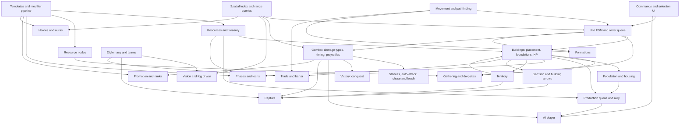

# Strategos mechanics catalog: 0 A.D. Release 28 compared with AoE2:DE and AoE4, broken into systems

**Reader:** the tech lead choosing the loader, libraries, architecture and roadmap. **Research date:** 2026-10-20. **Fact-checked:** 2026-10-20; corrections are inline, and the last section lists what was checked.

## 0. Summary

- **Current 0 A.D. release.** The current release is **Release 28 "Boiorix"**. Its git tag `v0.28.0` is a lightweight tag on a commit dated 2026-02-15, and the release was [announced on 2026-02-18](https://play0ad.com/new-release-0-a-d-release-28-boiorix/). It is the first release without the "Alpha" label. It adds a 15th faction (the Germans) and renames "female citizens" to "civilians".
  - The [Gitea tags API](https://gitea.wildfiregames.com/api/v1/repos/0ad/0ad/tags) shows no 0.28.1 or R29 tag as of 2026-10-20.
  - `main` is active: the latest commit is from 2026-10-19, with 1,601 open issues and 169 open PRs.
  - Earlier releases:
    - Alpha 27 "Agni": announced 2025-01-30, tag `a27` on a commit of 2025-01-28.
    - Patch 27.1: tagged 2025-07-14, announced 2025-07-17.
  - Every 0 A.D. number below was read from the `v0.28.0` source, not from wikis. The fact-check re-read that source and corrected these figures:
    - structure resistances;
    - the ×3 counter;
    - treasure sizes;
    - rank penalties;
    - the capture-flip rule and its worked example;
    - the R28 regen increase;
    - population limits;
    - champion train time.
- **Why 0 A.D. is the model.** It is the best model for a Minecraft RTS because it is open and data-driven:
  - entity XML templates with inheritance and mixins;
  - one modifier pipeline for techs, auras, ranks and AI difficulty handicaps;
  - a hierarchical state machine (FSM) with an order queue for unit behaviour;
  - fixed-rate simulation turns.
- **Borrow the design, not the files.** Copy the architecture and mechanics, but none of the code, data files, text or art.
  - Those are GPL-2.0-or-later and CC BY-SA 3.0.
  - The FSF regards a GPL plug-in that forms a single combined program with a nonfree host as a GPL violation, unless the copyright holder adds an exception. We cannot add one for 0 A.D. code (section 3).
- **Minecraft constraints that change the design.** I verified these in the decompiled 1.21.1 and NeoForge 21.1.262 sources; they drive several T0 decisions:
  - Only chunks near players tick.
  - Chunk and entity streaming is centred on the player entity.
  - The server re-checks entity visibility for a player in two cases:
    - when the entity crosses a 16-block section;
    - whenever it processes one of that player's movement packets, which the client sends at least every 20 ticks.
  - Vanilla pathfinding is synchronous and has a node cap.
  - Custom datapack registries do not reload on `/reload`.
- **Minimal core loop.** About 14 systems make a loop that already feels like 0 A.D. or AoE (section 4). Territory, capture, fog of war and an AI opponent are the T1 features that make it feel like *0 A.D.* rather than a generic RTS.

**Sources and confidence**

| Game | Source | Notes |
|---|---|---|
| 0 A.D. | source at [tag v0.28.0](https://gitea.wildfiregames.com/0ad/0ad/src/tag/v0.28.0/) | read directly |
| AoE2:DE | [SiegeEngineers/aoe2techtree](https://github.com/SiegeEngineers/aoe2techtree) `data/data.json` | MIT; last commit 2026-09-22 ("Add The Viking Sagas") |
| AoE4 | [aoe4world/data](https://github.com/aoe4world/data) | parsed from game files; last commit 2026-05-04 = Season 13 patch 16.1.9737, so values may lag the live game; no licence detected on GitHub |

- The AoE fan wikis (Fandom, Liquipedia) returned HTTP 402/403 to the researcher (not re-tested). AoE claims that rest only on them, on forum posts or on memory are marked *(unverified)*.
- AoE status: the [official news page](https://www.ageofempires.com/news/) lists AoE2:DE Update 185872 and the "Viking Sagas" DLC as available, and AoE4 "Raiders of the North" as a pre-order. The listing is undated.

**Conventions**

- **Tiers.** **T0** = core loop (first playable slice). **T1** = MVP (a skirmish against an AI that feels like 0 A.D./AoE). **T2** = expansion. **T3** = later.
- **Scale.** 0 A.D. works in metres and seconds, and 1 m = 1 block works for distances:
  - pathfinding cell ("navcell") = 1 m;
  - terrain tile = 4 m;
  - a Normal map is 256 tiles = 1,024 m = 64×64 chunks.
- **Speeds and ranges** are compressed for the RTS. Infantry walks at 9–9.5 m/s, while a Minecraft player walks at about 4.3 blocks/s (4.317, derived from the 1.21.1 movement code). Treat the numbers below as ratios to re-tune, not values to port.

---

## 1. Systems catalog

Each entry gives:
- 0 A.D. R28 behaviour, with numbers;
- AoE2/AoE4 contrasts;
- the tier;
- a Minecraft translation.

Template paths are under [simulation/templates](https://gitea.wildfiregames.com/0ad/0ad/src/tag/v0.28.0/binaries/data/mods/public/simulation/templates) and component paths under [simulation/components](https://gitea.wildfiregames.com/0ad/0ad/src/tag/v0.28.0/binaries/data/mods/public/simulation/components).

### 1.1 Resources (T0)

- **0 A.D.** There are four resources, each defined in [data/resources/*.json](https://gitea.wildfiregames.com/0ad/0ad/src/tag/v0.28.0/binaries/data/mods/public/simulation/data/resources):
  - food (subtypes fish, fruit, grain, meat);
  - wood (tree, ruins);
  - stone (rock, ruins);
  - metal (ore, ruins).
  - Each has a barter `truePrice` of 100. Gather rates are keyed by `type.subtype`, so adding a resource is a data change.
  - Resources form a player stockpile. The default start is "Low", 300 of each; the options are 100, 300, 500, 1,000, 3,000 and 50,000 ([starting_resources.json](https://gitea.wildfiregames.com/0ad/0ad/src/tag/v0.28.0/binaries/data/mods/public/simulation/data/settings/starting_resources.json)).
- **AoE2/AoE4.** Food, wood, gold and stone. Gold is the premium military resource and has renewable sources (trade and relics; AoE4 also has sacred sites). AoE4 adds civ-specific currencies: olive oil, silver and vizier points appear in the aoe4world cost data.
- **Minecraft.** Keep resources abstract: a per-player treasury in server state, synced to its owner, not items. Blocks are only the nodes. Keep the resource list in data so a datapack or add-on can add, for example, gold.

### 1.2 Gathering, resource nodes, dropsites (T0; fish and corrals T2)

**0 A.D. gather rates** (resource per second; the timer adds one unit every 1000/rate ms). Sources: `template_unit_support_civilian.xml`, `template_unit_infantry.xml`, `template_unit_cavalry.xml`.

| Gatherer | fruit | grain | meat | wood | stone | metal | carry |
|---|---|---|---|---|---|---|---|
| Civilian | 1.0 | 0.5 | 1.0 | 0.70 | 0.35 | 0.35 | 10 per type |
| Citizen infantry | 0.5 | 0.25 | 1.0 | 0.75 | 0.50 | 0.50 | 10 per type |
| Citizen cavalry | – | – | 5.0 | – | – | – | 20 food |

- **Carry capacity:** three +5 tiers (Baskets, Wheelbarrow, Carts) raise it to 25.
- **Rank penalty:** each rank step gathers 30% slower, and the penalties compound. Advanced units gather at ×0.7 and Elite at ×0.49, because elite units receive both the Advanced and the Elite rank tech.
- **Nodes:**
  - trees: mostly 200 wood (57 of 87 tree templates), at most 8 gatherers;
  - fruit bushes: 200–500 food, 8 gatherers, regrow 1 food per 6 s;
  - mines: 1,000 (small, 12 gatherers) or 5,000 (large, 24);
  - fish: 1,000 (4 gatherers);
  - hunt (must be killed first): deer 100, boar 150, elephant 800 (African bush; Asian 650);
  - domestic animals: chicken 40, goat 70, sheep 100, pig 150, cow 300.
- **Fields:** cost 100 wood, give *infinite* grain, take at most 5 gatherers, and have diminishing returns of 0.9. Total output = rate × (1 − 0.9ⁿ)/(1 − 0.9), so five civilians produce about 4.1× one civilian, about 2.05 food/s ([ResourceSupply.js](https://gitea.wildfiregames.com/0ad/0ad/src/tag/v0.28.0/binaries/data/mods/public/simulation/components/ResourceSupply.js)).
- **Corral:** costs 100 wood. It trains goats, sheep (50 food, 40 s, yields 100 food), pigs, or cows (150 food, 60 s, yields 300). With cavalry butchering at 5/s it is a renewable meat engine.
- **Dropsites:** Civic Centre (all resources), Storehouse (wood, stone, metal), Farmstead (food), Dock (all resources).
  - The R28 Germans' Supply Wagon is a *mobile* dropsite for all resources. It works by giving a unit the same `ResourceDropsite` component, with no special-case code.
  - Sharing dropsites with allies is a tech (Diaspora).
  - Gaia treasures (100–1,000 of a resource, most 200–300; one gives 600 food + 600 wood + 600 metal) are collected on contact in 1 s.
- **Behaviour:** the unit AI's gather states run APPROACHING → GATHERING → RETURNINGRESOURCE → FINDINGNEWTARGET. A worker returns to the nearest valid dropsite and picks a similar node nearby when its node runs out.
- **AoE2.** The economy is villager-only; soldiers never gather.
  - Rates are about 0.32–0.41/s per task. The fan wiki lists farmer 0.32, shepherd 0.33, stone 0.36, gold 0.38, lumberjack 0.39 and hunter 0.41 *(unverified)*.
  - Farms cost 60 wood (data) and run out, so they must be reseeded. Lumber camps, mining camps and the mill are the dropsites.
- **AoE4.** Farms cost 75 wood (English 37) and take one villager each (data). They are effectively infinite *(community consensus, not officially documented)*. English farms gain +20/25/30/30% by age inside a Mill's influence (data).
- **Minecraft.**
  - Use vanilla blocks as nodes with an amount per block (log columns, berry bushes, stone/ore patches) and remove blocks as they run out.
  - A field is a custom multiblock with 5 work slots.
  - Keep a per-chunk node index for "nearest node" queries.

### 1.3 Economy technologies (T0: one or two techs; T1: full set)

- **0 A.D.** ([data/technologies](https://gitea.wildfiregames.com/0ad/0ad/src/tag/v0.28.0/binaries/data/mods/public/simulation/data/technologies), 157 top-level files; 177 including `civbonuses/`). Each economic line has three tiers, one per phase, researched at the Storehouse or Farmstead:
  - wood +25% ×3: 200W/100M, then 400W/200M, then 600W/300M; 40, 50, 60 s;
  - stone +25% ×3 and metal +25% ×3;
  - grain +20% ×3;
  - fruit +50% for 100 wood;
  - carry capacity +5 ×3: 200F/200W, 400F/400W, 600F/600W;
  - houses +20% population bonus (Home Garden, 300W 100S, Town), then a second +20% (Manors, 300W 300S, City).
- **AoE2.** Same structure: axes and saws, mining, ploughs and crop rotation, Wheelbarrow and Hand Cart. Costs from the data:

  | Tech | Cost | Time |
  |---|---|---|
  | Double-Bit Axe | 100F 50W | 25 s |
  | Bow Saw | 150F 100W | 50 s |
  | Wheelbarrow | 175F 50W | 75 s |
  | Hand Cart | 300F 200W | 55 s |
  | Crop Rotation | 250F 250W | 70 s |
  | Gold Mining | 100F 75W | 30 s |
- **AoE4** (data):
  - wood +15% steps (Double Broadax 50F 100G; Crosscut Saw also adds +5 wood capacity);
  - gold and stone +15% (Specialized Pick);
  - food +10%, excluding hunting (Horticulture);
  - Wheelbarrow: +5 capacity and +15% villager speed (50W 150G, 90 s);
  - Survival Techniques: hunting +15%.
- **Minecraft.** Techs are data entries with modifiers (section 2.3) and are researched in a building's queue.

### 1.4 Population and housing (T0)

- **0 A.D.**
  - **Population cost:** most units cost 1. Siege engines, siege ships and champion elephants cost 3, and bolt shooters 2. Heroes, animals, dogs and slaves cost 0.
  - **Population cap:** the smaller of (sum of bonuses) and (max population).
  - **Bonuses:**
    - Civic Centre (CC): +20.
    - Small house: +5 (75 wood, 30 s), used by the Britons, Gauls, Iberians, Mauryas and Ptolemies.
    - Big house: +10 (150 wood, 50 s), used by the other 10 civs.
  - **Max population:** 300 per player by default (`InitGame.js`).
    - Options are 50–300 or unlimited (10,000), with pooled world caps.
    - R28 adds a pooled *team* population cap type.
    - Per-player limits exist only for scenario maps (`PlayerData.PopulationLimit`); there is no setup-screen option for them.
  - Foundations give no bonus until they are finished.
- **AoE2.** House 25 wood (data) for +5 population (not in the data file); the default cap is 200 *(unverified)*.
- **AoE4.** House 50 wood (data); its +10 population is not stated in the aoe4world data *(unverified)*. Malian houses give +5 at half cost (25 wood; data). The cap is 200 *(community)*.
- **Minecraft.** Count population per player in server state; houses carry a Population component.

### 1.5 Production: training, batches, rally points (T0: queue and rally; T1: batches)

- **0 A.D.** ([Trainer.js](https://gitea.wildfiregames.com/0ad/0ad/src/tag/v0.28.0/binaries/data/mods/public/simulation/components/Trainer.js))
  - Each building has one production queue (`ProductionQueue` plus `Trainer` and `Researcher`). The cost is paid when an item is queued; population is reserved when it starts.
  - Units spawn at a free point and walk to the rally point. The rally point can be a resource node or a building, which means auto-gather or auto-garrison.
  - **Batch time** = unit time × n^BatchTimeModifier.
    - The modifier is 0.8 for the CC, barracks, stable, range, temple, dock, fortress and embassy.
    - It is 0.7 for the corral, market, arsenal and elephant stable.
    - Example: CC civilians take 8 s each, so a batch of 5 takes 29 s instead of 40 s.
    - The City tech Conscription lowers the barracks modifier by 0.1.
  - **Train times:** civilian 8 s, infantry 10 s, cavalry 15 s, hero 50 s, ram 30 s. Champions take 20 s (infantry), 25 s (cavalry) or 36 s (elephants).
  - Trainer lists use `{civ}` and `{native}` placeholders; entries whose template does not exist are skipped, so one generic barracks template serves all 15 civs.
- **AoE2/AoE4.** Units are queued one at a time, with no batch-time discount *(unverified)*. AoE4's twist is production buffs from landmarks and influence.
- **Minecraft.** A building "core" block entity (or marker entity) owns the queue. Units spawn at a door point. The rally point is stored as a position or a target UUID.

### 1.6 Construction (T0: foundations, builders, repair; T1: towers and palisade; T2: stone walls and gates)

- **0 A.D.** ([Foundation.js](https://gitea.wildfiregames.com/0ad/0ad/src/tag/v0.28.0/binaries/data/mods/public/simulation/components/Foundation.js), [Repairable.js](https://gitea.wildfiregames.com/0ad/0ad/src/tag/v0.28.0/binaries/data/mods/public/simulation/components/Repairable.js))
  - **Foundations.** Placing a building creates a foundation, generated from the building's own template by a `foundation` filter. The cost is paid on placement and the foundation starts at 1 HP. It has no obstruction until the first builder arrives and "commits" it, which pushes units out of the way.
  - **Build speed.** Total speed grows as n^0.7 with n builders: 2 builders 1.62×, 5 builders 3.09×, 10 builders 5.01×. HP rises with progress.
  - **Repair** is free; the code says "TODO: should we have resource costs?". It takes 2× build time for structures and 4× for siege, with the same n^0.7 penalty.
  - **Builders:** civilians and citizen infantry, via the `builder` mixin.
  - **Build restrictions:**
    - territory: own territory, or own or neutral for a CC;
    - placement: land, shore or water;
    - distances: a CC must be at least 200 m from other CCs, and fortresses at least 80 m apart;
    - limits: one CC until Town phase, one wonder, one hero.
  - **Walls.** Wall sets are drawn as segments with towers and gates: palisade from Village phase, stone walls from Town. Gates open for allies. Walls and palisades cannot be captured: capture attacks exclude the Palisade and Wall classes.
  - **Towers.**
    - The sentry tower costs 100 wood, has 400 HP and at most 6 arrows.
    - The stone defence tower costs 100W 100S, has 1,000 HP, fires 4 arrows plus one per garrisoned infantry (garrison 5), and is an upgrade path from the sentry tower (50W 100S, Town).
- **AoE2.** Villagers build, and repair costs resources *(unverified)*. A stone wall segment costs 5 stone (data). Towers take a garrison.
- **AoE4** (data):
  - stone walls cost 25 stone per segment and have 3,000 HP;
  - rams deal +300 against walls;
  - buildings have 50 ranged armour, so archers barely hurt them (the minimum-damage rule is *unverified*); torches (fire damage) or siege are needed.
- **Minecraft.**
  - Use structure templates (NBT) placed block by block as progress advances.
  - Keep building HP abstract. 0 A.D.'s `DamageVariants` at 85%, 65% and 35% HP map naturally onto swapping in "damaged" block palettes. Real block destruction would break pathing and invite griefing.
  - Placement: a ghost preview plus validators for territory, slope and overlap.

### 1.7 Phases and the technology tree (T0: 2 phases; T1: 3 phases and about 30 techs)

- **0 A.D.** ([phase_town_generic.json](https://gitea.wildfiregames.com/0ad/0ad/src/tag/v0.28.0/binaries/data/mods/public/simulation/data/technologies/phase_town_generic.json), [phase_city_generic.json](https://gitea.wildfiregames.com/0ad/0ad/src/tag/v0.28.0/binaries/data/mods/public/simulation/data/technologies/phase_city_generic.json))
  - **Phases:** Village is automatic. Town costs 500 food and 500 wood, takes 30 s and requires 5 Village-class structures. City costs 750 stone and 750 metal, takes 60 s and requires 3 Town-class structures.
  - **Per-phase bonuses:** structures get +20% ranged pierce damage and +0.5 (Town) or +1 (City) garrison capture regeneration; CCs get +25% territory radius.
  - **Gating:** templates are gated with `Identity/Requirements`; siege, champions and heroes need City.
  - **Tech format.** Each tech is a JSON file with:
    - cost, research time and requirements (tech, civ, entity counts; combinable with all/any and `notciv`);
    - `supersedes` chains (tier 2 requires tier 1);
    - "pair" techs (choose one of two);
    - `autoResearch` (used for rank bonuses);
    - `modifications`. Example: `{"value":"ResourceGatherer/Rates/wood.tree","multiply":1.25}` with the tech-level filter `"affects": ["Worker"]`. Class filters such as `"Soldier !Elephant"` (melee-attack techs) work the same way.
- **AoE2.** Feudal: 500F, 130 s. Castle: 800F 200G, 160 s. Imperial: 1000F 800G, 190 s (data). The data's internal names are offset: "Middle Age" is Feudal and "Feudal Age" is Castle. Each age needs two buildings of the current age *(unverified)*. Civilisations differ by disabling parts of one shared tree.
- **AoE4.** You age up by building one of two civ-specific landmarks. English costs (data): 400F 200G (Feudal), 1,200F 600G (Castle), 2,400F 1,200G (Imperial). Landmarks grant unique effects and are the targets of landmark victory.
- **Minecraft.** Same JSON model in data; a GUI tech tree; requirements are checked on the server; modifiers apply through the cached stat pipeline (section 2.3).

### 1.8 Unit classes, counters, damage and resistance (T0: 3 damage types and the spear bonus; T1: siege; T2: ships, elephants, champions)

**0 A.D. damage model** ([helpers/Attack.js](https://gitea.wildfiregames.com/0ad/0ad/src/tag/v0.28.0/binaries/data/mods/public/simulation/helpers/Attack.js)): damage = Σ over types (hack/pierce/crush) of damage × 0.9^resistance-level, then × bonus multipliers. Fire and poison exist as status effects. Example resistances, as effective values after template inheritance:

| Target | Resistance (hack/pierce/crush) | Damage taken |
|---|---|---|
| Melee infantry | 3/3/15 | 73% / 73% / 21% |
| Ranged infantry | 1/1/10 | 90% / 90% / 35% |
| Base `template_structure` (abstract; no real building keeps it) | 1/10/1 | 90% / 35% / 90% |
| Civic structures (houses, temples) | 24/30/3 | 8% / 4.2% / 73% |
| Civic Centre (civic +5/+5) | 29/35/3 | 4.7% / 2.5% / 73% |
| Economic (storehouse, farmstead, market) | 9/20/1 | 39% / 12% / 90% |
| Military (barracks, stable, fortress) | 24/35/3 | 8% / 2.5% / 73% |
| Defensive (towers, stone walls) | 29/35/3 | 4.7% / 2.5% / 73% |
| Palisade | 9/25/2 | 39% / 7.2% / 81% |
| Field | 15/40/5 | 21% / 1.5% / 59% |
| Ram | 7/35/5 | 48% / 2.5% / 59% |

Soldiers barely hurt most buildings with hack or pierce. Buildings fall to capture (section 1.12) or to crush damage from siege.

- **Counters** come mostly from damage type against resistance, plus range and speed. Explicit multipliers are rare in R28:
  - spear and pike infantry, including champions, ×2.5 against Cavalry;
  - cavalry spearmen, including champion and hero cavalry spearmen, ×1.75;
  - the hero infantry pikeman template ×3 against Cavalry;
  - arrow and scout ships ×3 against Ship, and fire ships ×3 against Ship or Building;
  - minor ones: the pirate mixin ×2 against Trader, and Alexander ×1.2 against Hero.
- **Capture** is a separate effect type.

**Representative R28 citizen-soldier and siege stats** (costs before rank and tech modifiers):

| Unit | Cost | HP | Attack (per hit) | Range | Wind-up / period (ms) | Speed (m/s) |
|---|---|---|---|---|---|---|
| Civilian | 50F, 8 s | 25 | 2 hack | 3 | 500/1000 | 9 |
| Spearman | 50F 50W, 10 s | 100 | 4.5 hack + 4 pierce, ×2.5 vs cavalry | 4 | 500/1000 | 9.5 |
| Swordsman | 50F 40W 10M | 100 | 8 hack | 3 | 375/750 | 9.5 |
| Pikeman | 50F 50W | 100 (res 5/5/15) | 4 hack + 7.5 pierce, ×2.5 vs cavalry | 8 | 1000/2000 | 8.55 |
| Archer | 50F 50W | 50 | 7.2 pierce | 60 | 800/1250 | 10.3 |
| Slinger | 50F 20W 30S | 50 | 11.5 pierce + 1.1 crush | 45 | 400/1500 | 10.8 |
| Javelineer | 50F 50W | 50 | 16 pierce | 30 | 400/1500 | 11.4 |
| Cavalry javelineer | 100F 50W, 15 s | 100 | 18 pierce | 30 | 400/1500 | 16.2 |
| Battering ram (3 pop) | 300W 150M, 30 s | 400 | 150 crush; cannot hit Organic units or fields | 6.5 | 750/1500 | 7.2 |
| Stone thrower | 400W 250S, 25 s | 375 | 230 crush + 1.5 m splash of 120 | 26–85 | 3000/7000 | 7.2 |

Worked examples:
- A swordsman deals about 7.8 DPS to a spearman (kill in about 13 s).
- A spearman deals about 18 per second to a cavalry javelineer.
- An archer deals about 4.2 DPS to a spearman if every arrow hits.

Contrasts:
- **AoE2.** Armour is subtracted per armour class: Σ max(0, attack − armour), at least 1 (community-documented, e.g. [Steam](https://steamcommunity.com/app/813780/discussions/0/3757725080161121171)). There are many explicit bonus classes (data):
  - pikeman +15 vs cavalry, +15 vs elephants, +12 vs camels, +9 vs ships (the ships/camels/saboteurs class);
  - ram +150 vs buildings, +40 vs siege;
  - mangonel +35 vs buildings;
  - archer +3 vs the spear class.
  - Elevation gives ±25% (fan wiki) *(unverified)*.
- **AoE4.** Melee and ranged armour are subtracted, plus "+X vs class" modifiers (data). Values are for the age each unit first appears in:
  - spearman +17 vs cavalry in Age I, +20 in Age II, +23 in Age III, +28 in Age IV;
  - horseman +9 vs ranged and siege (Age II);
  - archer +5 vs light melee infantry (Age II);
  - crossbowman +10 vs heavy (Age III);
  - ram +300 vs walls;
  - buildings have 50 ranged armour.
- **Minecraft.** Compute final damage inside our own simulation and apply it once, bypassing vanilla armour and enchantments with a custom damage type. That keeps numbers deterministic and testable. NeoForge 21.1 still has `LivingIncomingDamageEvent` for interaction with vanilla attackers such as players and mobs.

### 1.9 Attack timing, projectiles, splash (T0: melee and ranged; T1: splash and minimum range; T2: elevation range bonus)

- **0 A.D.** ([Attack.js](https://gitea.wildfiregames.com/0ad/0ad/src/tag/v0.28.0/binaries/data/mods/public/simulation/components/Attack.js))
  - **Timing:** each attack has `PrepareTime` (wind-up before the first hit) and `RepeatTime` (period); see the table above.
  - **Projectiles** are ballistic (speed and gravity).
    - They aim at a predicted position: the target's last-turn velocity, extrapolated over the full flight time with no cap.
    - For short flights (under about 1 s) the game sometimes uses UnitMotion's own path estimate instead.
    - They add Gaussian spread: σ = Spread × distance/100 m (archer: 2.25 m at 100 m).
    - A hit is resolved at the landing point, so misses are real.
  - **Splash** is circular or linear with falloff 1 − d²/r², and has a friendly-fire flag.
  - **Elevation:** ranged reach grows with height (parabolic range in RangeManager). There are minimum ranges, e.g. 26 m for catapults and 10 m for towers.
- **AoE2/AoE4.** Projectiles can miss (the AoE2 archer has 80% accuracy in the data). AoE4's high ground is said to give only line of sight *(forum hearsay)*.
- **Minecraft.** Do not create one vanilla `AbstractArrow` per shot for massed archers; physics and tracking cost add up. Instead, compute flight time and landing point on the server and send a lightweight "projectile launched" packet for client-side visuals.

### 1.10 Stances, auto-attack, chasing, leashing (T0)

- **0 A.D. stances** (from the `g_Stances` table in [UnitAI.js](https://gitea.wildfiregames.com/0ad/0ad/src/tag/v0.28.0/binaries/data/mods/public/simulation/components/UnitAI.js)):
  - **violent:** always retaliates and chases beyond its own vision;
  - **aggressive** (the default): targets visible enemies and chases within vision;
  - **defensive:** abandons a chase when the target leaves attack range plus half its vision radius around the held position;
  - **standground:** never moves;
  - **passive:** flees; the default for civilians, flee distance 12 m;
  - animal-only stances (skittish, passive-defensive) and "none" for AI and trigger scripts.
- **Targeting and chasing:**
  - Auto-targeting uses range queries over vision. Each attack has preferred classes (ranged units prefer Human, rams prefer Structure).
  - A chase is always abandoned when the target is no longer visible, even under a forced order.
  - Otherwise forced (player-issued) orders are not abandoned. Automatic chases stop at vision range ("violent" excepted) or at the held-position radius ("defensive").
  - The CC, storehouse, farmstead and market have an "AlertRaiser" that sends civilians to garrison, the equivalent of AoE2's Town Bell.
- **AoE2.** Aggressive, defensive, stand ground and no attack *(unverified)*. **AoE4** is similar.
- **Minecraft.** Implement stances in our own FSM on top of a spatial index, not with vanilla Goals.

### 1.11 Formations (T1: move-only box and line; T2: special formations)

- **0 A.D. R28** ([Formation.js](https://gitea.wildfiregames.com/0ad/0ad/src/tag/v0.28.0/binaries/data/mods/public/simulation/components/Formation.js), `special/formations/*.xml`)
  - **Templates:** none, box, column and line (open and closed), flank, battle line, scatter, skirmish, wedge (cavalry, at least 6), testudo (melee infantry, at least 16), phalanx, syntagma, shield wall, anti-cavalry. There are also three ship formations: column, flank, staggered line.
  - **Mechanics:**
    - a formation is a controller entity (FORMATIONCONTROLLER state) that pathfinds as a "large" unit;
    - it assigns members to slot offsets sorted by class;
    - it moves at the slowest member's speed and switches to a columnar layout over long walks;
    - nearby twin formations merge.
  - **No combat bonuses.** None of the R28 formation templates has auras or stat changes; formations are geometry and movement only. The only multiplier is the ship column's 1.25 movement-speed factor.
  - **Defaults** ([default.cfg](https://gitea.wildfiregames.com/0ad/0ad/src/tag/v0.28.0/binaries/data/config/default.cfg)): walk orders use "box" automatically, and `formationwalkonly=true` drops the formation for gather or attack orders. `CanAttackAsFormation=false` (set in `template_formation.xml`), so members fight individually.
  - **Without formations**, R28 spreads unit destinations around the target point so groups don't line up.
- **AoE2.** Line, box, staggered and flank formations. **AoE4:** units move in formation by default *(unverified detail)*.
- **Minecraft.**
  - The formation controller should be a server-side object, not an entity; members steer to slot offsets with local avoidance.
  - Ship destination spreading in T1 and real formations later.

### 1.12 Capture (T1)

- **0 A.D.** ([Capturable.js](https://gitea.wildfiregames.com/0ad/0ad/src/tag/v0.28.0/binaries/data/mods/public/simulation/components/Capturable.js))
  - **Capture points.** A structure's points are split between players: CC 2,500, default 500, farmstead 300, fortress 4,000, wonder 2,000.
  - **Capture attack:** attackers remove enemy points every second (civilian 1.0, infantry 2.5, cavalry 1.75, champion 5, hero 10).
  - **Ownership flip:** the structure changes hands only when the *owner's* points reach zero. It then goes to the player holding the most points; holding a simple majority is not enough.
  - **Damage speeds capture:** the capture effect is divided by (0.1 + 0.9 × HP/maxHP).
  - **Regeneration** runs continuously for the owner. R28 rates and the Alpha 27 values they replaced:

    | Building | R28 (per s) | Alpha 27 |
    |---|---|---|
    | Default | 5 | 0.5 |
    | Temple | 15 | 0.5 |
    | Military buildings and towers | 10 | 0.5 |
    | CC | 30 | 5 |
    | Fortress | 45 | 10 |

    Each garrisoned unit adds its capture strength × GarrisonRegenRate (1.0, +0.5 in Town, +1 in City).
  - **Worked example:**
    - 20 infantry (50/s) against an empty, full-HP CC gain 20/s net. They must drain all 2,500 owner points, so they flip it after about 125 s.
    - Twelve infantry (30/s) make no progress until the CC is damaged. At 50% HP they deal 54.5/s, net 24.5/s, and flip it in about 102 s.
  - **Exceptions:** fields, palisades and walls cannot be captured.
  - **Territory decay:** structures lose 20 points/s to the bordering players (or to Gaia) when they stand in neutral territory, in connected enemy territory, or in own territory not connected to a root (unless next to connected allied territory).
  - **UI:** since Alpha 27, right-click attacks buildings and holding C captures.
- **AoE2.** No structure capture; monks convert units, and most buildings after Redemption *(unverified detail)*. **AoE4:** no structure capture; religious units capture sacred sites.
- **Minecraft.** Store a per-building capture-point array in the building component, sync it to nearby clients, and show a capture bar.

### 1.13 Garrisoning and buildings that shoot arrows (T1)

- **0 A.D.** ([GarrisonHolder.js](https://gitea.wildfiregames.com/0ad/0ad/src/tag/v0.28.0/binaries/data/mods/public/simulation/components/GarrisonHolder.js), [BuildingAI.js](https://gitea.wildfiregames.com/0ad/0ad/src/tag/v0.28.0/binaries/data/mods/public/simulation/components/BuildingAI.js))
  - **GarrisonHolder settings:** maximum size, allowed classes, eject below 10% HP, and a heal rate.
  - **Capacities:**
    - CC 20 (support, infantry, cavalry);
    - houses 3–6 support units;
    - towers 3–5 (support or infantry);
    - fortress 20;
    - ram 10 (support or infantry);
    - ships carry units.
  - **Building arrows** (`BuildingAI`):
    - CC: 6 arrows by default, +1 per garrisoned soldier, every 4 s, 8 pierce, 60 m;
    - towers: 2 (+2 for stone), +1 per garrisoned infantry;
    - fortress: 10;
    - arrows are spread across targets in range by preference.
  - **Other garrison effects:**
    - Garrisoned units add capture regeneration and are healed (CC 1 HP/s, temple 3, wonder 5).
    - Turrets (`TurretHolder`) let units stand on walls, gates and outposts, plus a few special structures, and shoot from there. Standard towers use garrison arrows instead.
- **AoE2.** Town Center garrison 15 (data) with extra arrows; castle 20.
- **AoE4.** Town Center garrison 8 (Abbasid 10) and keep 15; garrisoning "adds additional attacks" (data).
- **Minecraft.** Remove garrisoned units from the world and store them in the building component, which also keeps chunk entity counts down. Re-spawn them on ungarrison.

### 1.14 Healing (T1)

- **0 A.D.** Healers restore 5 HP every 2 s at 12 m range and cost 100F 30M. Garrison healing works as above, and some auras heal. Siege and structures cannot be healed; they are repaired.
- **AoE2/AoE4.** Monks heal *(unverified detail)*.
- **Minecraft.** A healer FSM state plus a garrison heal tick.

### 1.15 Promotion and experience (T1)

- **0 A.D.** ([Promotion.js](https://gitea.wildfiregames.com/0ad/0ad/src/tag/v0.28.0/binaries/data/mods/public/simulation/components/Promotion.js), [unit_advanced.json](https://gitea.wildfiregames.com/0ad/0ad/src/tag/v0.28.0/binaries/data/mods/public/simulation/data/technologies/unit_advanced.json))
  - **XP gain:** XP = the target's `Loot/xp` × damage dealt / target max HP. Healing also earns XP.
  - **XP values:** civilian 3, infantry 100, cavalry 130, ram 200, catapult 250, hero 400.
  - **Thresholds:** infantry promote at 100 XP and cavalry at 150. Since Alpha 27, Athenian elite spearmen can promote again at 250 XP into champions.
  - **Ranks:** Basic → Advanced → Elite are separate templates, swapped with `ChangeEntityTemplate`.
  - **Rank bonuses** come from auto-researched techs, per step: +25% HP, +10% melee damage, −20% ranged spread, +0.7 or +0.8 capture, +20% loot and XP value, −30% gather speed, +20% train time.
    - Elite units get both the Advanced and the Elite tech, so the bonuses compound (for example ×1.5625 HP and ×0.49 gather speed).
- **AoE2/AoE4.** No general veterancy system *(unverified for AoE4 civ variants)*.
- **Minecraft.** Rank is a field that selects a modifier set plus a cosmetic, such as an insignia or helmet trim.

### 1.16 Heroes and auras (T2)

- **0 A.D.**
  - **Heroes:** City phase; base cost 100F 250M; 0 population; one alive at a time and each hero only once per match. They have capture strength 10 and usually two auras.
  - **Aura JSON** ([data/auras](https://gitea.wildfiregames.com/0ad/0ad/src/tag/v0.28.0/binaries/data/mods/public/simulation/data/auras)): type (range, global, garrison, garrisonedUnits, turretedUnits, formation, player), radius, affected classes, and modifications in the same format as techs.
  - **Example:** Pericles affects a 60 m range: soldiers, ships, siege and structures give no loot, and structures get +50% capture points.
  - Regicide victory targets the hero.
- **AoE2.** Heroes appear only in campaigns; regicide uses a king.
- **AoE4.** A few civ-specific leaders exist; for example, the Mongol Khan appears as a garrison class in the data.
- **Minecraft.** Evaluate auras through the spatial index on a slower cadence (for example every 10 ticks) and feed the results into the modifier pipeline.

### 1.17 Territory and borders (T1: restrictions and roots; T2: decay)

- **0 A.D.** ([CCmpTerritoryManager.cpp](https://gitea.wildfiregames.com/0ad/0ad/src/tag/v0.28.0/source/simulation2/components/CCmpTerritoryManager.cpp))
  - **Grid and influence.** The map is a grid of 8 m territory tiles. Each `TerritoryInfluence` (weight, radius, "root" flag) floods outward with linear falloff (weight × 8 m / radius per tile, scaled by terrain cost). Each tile goes to the player with the highest summed weight.
  - **Connectivity.** Tiles flood-connected to a root (CC, military colony or wonder) are "connected". The others blink, and structures on them decay.
  - **Radii:**
    - CC 140 m, a root (+25% in Town and again in City, so about 219 m);
    - military colony 75 m;
    - houses 16–20 m;
    - storehouse and farmstead 20 m;
    - market and temple 40 m;
    - fortress 80 m;
    - wonder 100 m (also a root).
  - **Building rule:** you build in your own territory; a CC can also go in neutral territory.
  - **Recent change:** Alpha 27 reduced the territory gained per phase (×1.3 → ×1.25) and made new CCs cheaper (500W 500S 500M → 300W 300S 250M), to make expansion strategic.
- **AoE2/AoE4.** Neither has a territory system; AoE4 has local influence radii for some civs. Territory is 0 A.D.'s most distinctive map mechanic.
- **Minecraft.**
  - Use 8×8-block tiles (128×128 tiles on a 1,024-block map).
  - Recompute off-thread when influence changes, store it per level, and sync it as a compact owner grid.
  - Draw borders with particles or an overlay, and on the minimap.
  - The placement validator checks the tiles under a building's footprint.

### 1.18 Vision, line of sight, fog of war (T1: entity fog and explored state; T3: hiding terrain)

- **0 A.D.** ([helpers/Los.h](https://gitea.wildfiregames.com/0ad/0ad/src/tag/v0.28.0/source/simulation2/helpers/Los.h))
  - **LOS grid:** one grid of 4 m cells per player, each cell UNEXPLORED, EXPLORED or VISIBLE.
  - **Vision ranges:** civilian 32 m, infantry and cavalry 80, CC 90, catapult 120, hero 100, house 20.
  - **Mirages:** structures in fog are shown as "mirage" entities that keep their last-seen state, which hides enemy HP changes and destruction.
  - **Map options:** explored or revealed.
  - **Shared vision** with allies needs the Cartography tech (100F 100M, 40 s).
- **AoE2.** Black, fog and visible states. In DE, allies effectively share vision by default (the data lists Cartography at zero cost and 1 s).
- **AoE4.** Similar.
- **Minecraft.**
  - **Server state:** keep per-team visibility counts on a 4×4-block grid.
  - **Hiding entities.** In 1.21.1, entity sync can be gated with `Entity#broadcastToPlayer`, which `ChunkMap.TrackedEntity.updatePlayer` checks. It is public and returns `true` by default, so our own unit entity can override it without a mixin.
  - **When vanilla re-checks.**
    - On every movement packet from that player the server processes. This runs through `ChunkMap.move(ServerPlayer)`, called from `ServerGamePacketListenerImpl.handleMovePlayer`. The client sends a position packet at least every 20 ticks.
    - When the entity changes 16-block section (`ChunkMap.tick`).
    - So a fog change reaches a stationary viewer within about 1 s with no hook at all.
  - **Instant reveals.**
    - Call the public `ServerChunkCache.move(ServerPlayer)`, which re-evaluates every tracked entity for that player.
    - Or use an access transformer or mixin invoker on the package-private `ChunkMap.TrackedEntity.updatePlayer`.
    - Note: `ChunkMap.move` iterates all tracked entities on each call, so it costs O(entities) per player per movement packet.
  - **Reign of Nether's approach.** Its [TrackedEntityMixin](https://github.com/SoLegendary/reignofnether/blob/1.20.1-dev/src/main/java/com/solegendary/reignofnether/mixin/fogofwar/TrackedEntityMixin.java) cancels `ChunkMap$TrackedEntity.updatePlayer` at HEAD for fogged entities and relies on the vanilla triggers above; it adds no refresh of its own. A mixin is only needed to fog vanilla entities we cannot subclass.
  - **Terrain.** Terrain cannot be hidden cheaply, because chunks stream by view distance. Draw terrain fog on the client as a cosmetic and enforce fog only for entities. Reign of Nether 1.5.x does freeze fogged terrain server-side by filtering chunk packets (`ChunkMapMixin`, `ChunkHolderMixin`, `ChunkMapInitialSendMixin`) on RTS-sized maps. So it is possible, but mixin-heavy.
  - **Filtered sync.** NeoForge 21.1.262 data attachments accept a per-player sync predicate, `sync(BiPredicate<IAttachmentHolder, ServerPlayer>, StreamCodec)`, which suits fog-filtered unit data.

### 1.19 Diplomacy (T1: allied and enemy teams; T2: neutral, tribute, shared vision)

- **0 A.D.**
  - **Relations:** a per-player diplomacy array (ally, neutral, enemy) with mutual-ally checks; a locked-teams option; allied victory; a ceasefire timer.
  - **Tribute:** any resource, with no tax (`Player.TributeResource`).
  - **Sharing:** shared vision and shared dropsites come from techs.
  - **Trade bonus:** trade between markets of different players gives each market owner +20% (international bonus).
- **AoE2.** Tribute is taxed until Coinage and Banking *(rates unverified)*. **AoE4:** similar.
- **Minecraft.** Our own team registry. Optionally mirror it to vanilla scoreboard teams for name colours and friendly-fire rules.

### 1.20 Trade and barter (T2)

- **0 A.D. trade** ([Market.js](https://gitea.wildfiregames.com/0ad/0ad/src/tag/v0.28.0/binaries/data/mods/public/simulation/components/Market.js), [globalscripts/Trade.js](https://gitea.wildfiregames.com/0ad/0ad/src/tag/v0.28.0/binaries/data/mods/public/globalscripts/Trade.js))
  - Traders (100F 80M, land) or merchant ships walk between two markets or docks.
  - **Gain per trip** = GainMultiplier (0.75) × normalisation × d²/(1 + 0.25·d/mapSize), using straight-line distance d.
    - It is normalised so that a 100 m route on a 1,024 m map yields 0.75.
    - On a Normal map that gives about 1 at 100 m, 6 at 300 m, 17 at 500 m and 41 at 800 m.
  - Each trader garrisoned on a merchant ship adds +20%.
- **0 A.D. barter** ([Barter.js](https://gitea.wildfiregames.com/0ad/0ad/src/tag/v0.28.0/binaries/data/mods/public/simulation/components/Barter.js)): at the market you sell 100 at 90 and buy 100 at 110 (truePrice 100 ± 10%). Each 100-unit deal shifts prices by 2%, and prices recover 0.5 every 5 s.
- **AoE2.** Trade carts (100W 50G, data) between markets; gold grows faster than linearly with distance *(formula unverified)*; dynamic market prices. **AoE4:** traders run between markets and neutral trade posts *(unverified)*.
- **Minecraft.** Traders are ordinary units with a Trader FSM state. Using straight-line distance (not path length) is cheap and deterministic.

### 1.21 Loot (T1)

- **0 A.D.** The killer's owner receives the victim's loot plus anything it was carrying.
  - Examples: infantry 5 food plus a share of their cost resources; CC 60W 60S 50M.
  - XP is carried in `Loot/xp`.
  - Auras can set loot to zero (Pericles).
- **AoE2/AoE4.** Mostly none, apart from some civ bonuses.
- **Minecraft.** Handle it in the death event.

### 1.22 Victory conditions (T0: conquest; T2: wonder, regicide, relics)

- **0 A.D.** ([settings/victory_conditions](https://gitea.wildfiregames.com/0ad/0ad/src/tag/v0.28.0/binaries/data/mods/public/simulation/data/settings/victory_conditions))
  - **Conquest** (default): destroy all `ConquestCritical` units and structures. Variants: units only, structures only, civic centres only.
  - **Wonder:** build or capture one and hold it for N minutes (a slider; 0 = instant).
  - **Capture the Relic:** hold all relics for N minutes.
  - **Regicide:** kill the hero.
  - Each is a trigger script chosen at setup; Last Man Standing and allied victory are options.
- **AoE2.** Conquest, wonder (countdown), relics and regicide *(details unverified)*.
- **AoE4.** Landmark victory (destroy all landmarks), wonder, sacred sites *(timers unverified)*.
- **Minecraft.** A per-match rules object; a `ConquestCritical` tag on templates.

### 1.23 Civilisation differences (T1: 2 civs; T2: more)

- **0 A.D. R28** has 15 civs: Athenians, Britons, Carthaginians, Gauls, Germans (new), Han, Iberians, Kushites, Macedonians, Mauryas, Persians, Ptolemies, Romans, Seleucids, Spartans.
  - **Differences are data:**
    - a civ JSON with start entities, bonuses and wall sets;
    - per-civ templates that inherit shared class templates plus mixins. Example: `civ/athen|hoplite|template_unit_infantry_melee_spearman`. In R28 only the Athenians have a `civ/` mixin;
    - civ-gated techs (`civ` / `notciv`);
    - unique buildings and units;
    - `{civ}` placeholders in builder and trainer lists.
  - Most civs draw a subset of one generic roster: spear, sword, pike, javelin, sling, bow and cavalry.
- **AoE2.** 56 civs in the aoe2techtree data (2026-09-22), from one shared tree, with disabled entries, civ bonuses, and unique units and techs.
- **AoE4.** Fewer civs (23 civ codes including variants in the aoe4world data), but far more asymmetric: landmarks, unique mechanics, variant civs.
- **Minecraft.** Civ definitions live in data. T1 should ship two civs that differ in roster plus two or three bonuses, to prove the data model.

### 1.24 AI opponents: Petra (T1: simple scripted AI; T2: Petra-like)

- **0 A.D. Petra** ([ai/petra](https://gitea.wildfiregames.com/0ad/0ad/src/tag/v0.28.0/binaries/data/mods/public/simulation/ai/petra)) is about 19,200 lines of JS in ES modules (31 files).
  - **Scheduling:** it runs every 8 turns (1.6 s), offset by player ID to spread load.
  - **Commands only:** it runs single-threaded in the same JS compartment (separate realm) as the simulation. It reads sim data directly and issues ordinary player commands. The exception is its difficulty handicap, which it injects straight into the simulation's ModifiersManager.
  - **Headquarters** is the central loop:
    - it checks phase-ups, trains workers, and builds houses, farmsteads and corrals;
    - it expands, builds the market, forge and temple, builds a wonder near max population (above 90%), and adds defences and training buildings.
  - **Bases:** BasesManager/BaseManager handle per-base workers, dropsites, fields and gatherer assignment; Worker holds per-unit economic behaviour.
  - **QueueManager** keeps per-category queues with priorities and a resource "account" per queue. The code's own comments criticise how rigid those accounts are. Priorities:

  | Category | Priority |
  |---|---|
  | dropsites | 950 |
  | economic buildings | 700 |
  | major tech | 700 |
  | citizen soldier | 600 |
  | field | 480 |
  | military building | 330 |
  | villager | 300 |
  | house | 250 |

  - **Military:**
    - AttackManager and AttackPlan: types Rush, Raid, Attack, HugeAttack; states unexecuted → completing → walking or transporting → arrived.
    - DefenseManager and DefenseArmy use a defender ratio of 1.4 for allies, 1.8 neutral and 2 own.
  - **Other managers:** GarrisonManager; NavalManager with TransportPlan; TradeManager; DiplomacyManager; VictoryManager (plays wonder, relic and regicide); EmergencyManager; StartingStrategy (map analysis).
  - **Behaviour profiles:** random, balanced, aggressive, defensive.
  - **Difficulty.** Six levels, from Sandbox to Very Hard. The handicap is applied through modifiers ([config.js](https://gitea.wildfiregames.com/0ad/0ad/src/tag/v0.28.0/binaries/data/mods/public/simulation/ai/petra/config.js)):

    | Level | Gather and trade rate | Build time |
    |---|---|---|
    | Sandbox | ×0.42 | ×1.40 |
    | Very Easy | ×0.56 | ×1.25 |
    | Easy | ×0.75 | ×1.10 |
    | Medium | ×1.00 | ×1 |
    | Hard | ×1.25 | ×1 |
    | Very Hard | ×1.56 | ×1 |

    Hard and Very Hard therefore get an economic bonus over a human. Sandbox never expands, attacks or builds defences.
- **AoE2/AoE4.** Script- or rule-based AIs with several difficulty levels *(unverified detail)*.
- **Minecraft.** An AI player is a server-side controller that issues the same validated commands as a human and never writes game state directly. Tick it slowly with a per-player offset. Start with a scripted build order plus timed attack waves (T1), then grow into Petra's split into managers (T2).

### 1.25 Game setup, maps, starting conditions (T0: fixed map; T1: setup screen; T2: map generation)

- **0 A.D.**
  - **Map sizes:** Tiny 128 tiles (512 m) … Normal 256 (1,024 m) … Giant 512 (2,048 m).
  - **Map types:** random (scripted generators), skirmish, scenario.
  - **Placements:** circle, river, grouped lines, random group, stronghold.
  - **Defaults:** starting resources 300; population cap 300; game speed 0.1×–2×, plus fast-forward (5×, 10×, 20×).
  - **Options:** explored or revealed map, ceasefire, nomad (no CC), locked teams, no treasures, cheats.
  - **Athenian start:** a CC, 4 civilians, 2 spearmen, 2 slingers and 1 cavalry javelineer ([civs/athen.json](https://gitea.wildfiregames.com/0ad/0ad/src/tag/v0.28.0/binaries/data/mods/public/simulation/data/civs/athen.json)).
- **AoE2.** Standard start is a Town Center, 3 villagers and a scout *(unverified)*. **AoE4:** a Town Center, villagers and a scout *(details unverified)*.
- **Minecraft.**
  - **The whole match area must tick,** but chunk ticking depends on player proximity. Default simulation distance is 10 on a dedicated server (server.properties) and 12 in singleplayer (client option).
    - Force-load the match chunks with NeoForge `TicketController.forceChunk(..., ticking=true)` (present in 21.1; register the controller with `RegisterTicketControllersEvent`).
    - NeoForge keeps a level with forced chunks ticking entities even with no player in it.
  - **Map size.** A Normal-size 0 A.D. map would be 64×64 = 4,096 chunks. Start with 384–512-block maps (576–1,024 chunks) and measure.
  - **Maps:** hand-built template worlds first, a random map generator later.

### 1.26 UI and controls (T0: core; T1: full)

- **0 A.D. defaults** ([default.cfg](https://gitea.wildfiregames.com/0ad/0ad/src/tag/v0.28.0/binaries/data/config/default.cfg)):
  - **Selection:** click to select, box select, double-click selects all of a type. Control groups: Ctrl+N saves, N selects, Shift+N adds. Alpha 27 raised the selection limit to 300.
  - **Orders:**
    - right-click gives the context command; C forces capture and F forces attack;
    - Shift queues orders; Ctrl+click attack-moves (Ctrl+Q targets units only) or garrisons;
    - H stops, Y sends units back to work, U unloads, G guards, P patrols, J repairs.
  - **Idle units:** Period selects the next idle worker; Slash selects the next idle warrior.
  - **Training:** Shift adds a batch of 5.
  - **Communication:** K sends a flare to allies; the minimap shows pings; notifications cover attacks, tribute and phase-ups.
- **AoE2/AoE4.** Grid hotkeys (optional), an idle-villager button, a town bell, minimap alerts.
- **Minecraft.**
  - **Camera.** An RTS camera lives on the client, but chunk and entity streaming follow the player entity (`ChunkMap` uses player position and view distance). So the camera must carry an invisible flying player with it, or stay within view distance of it.
  - **Input and HUD:** selection by screen-space projection; HUD through NeoForge `RegisterGuiLayersEvent`; hotkeys through `RegisterKeyMappingsEvent`.
  - **Prior art:** [Reign of Nether](https://modrinth.com/mod/reign-of-nether-rts).
    - Forge only; current builds target 1.20.1 (older builds exist for 1.19.1/1.19.2), and there is no 1.21.x build.
    - GPL-3.0-only; version 1.5.0b of 2026-10-14, with about 421k downloads.
    - It already has an RTS camera, minimap, fog of war (including server-side terrain freezing), alliances and heroes.

---

## 2. 0 A.D. simulation architecture worth borrowing

### 2.1 Entities = components + inheritable templates
**What 0 A.D. does**
- An entity is an ID plus components. Each component implements an interface (`IID_*`) in C++ or JS.
  - A system entity holds the managers: template, range, pathfinder, obstruction, territory, projectile, command queue, AI.
  - R28 has 83 JS component files and about 30 C++ components.
- **Templates** ([TemplateLoader.cpp](https://gitea.wildfiregames.com/0ad/0ad/src/tag/v0.28.0/source/ps/TemplateLoader.cpp), [ParamNode.h](https://gitea.wildfiregames.com/0ad/0ad/src/tag/v0.28.0/source/simulation2/system/ParamNode.h)) are XML with:
  - `parent="…"` chains;
  - mixins through `parent="a|b"` (`builder|template_unit`). Each layer name is looked up in `special/filter/`, then `mixins/`, then the template root;
  - runtime **filters** from `special/filter/` (`foundation|`, `preview|`, `mirage|`, `corpse|`) that derive related entity kinds (a foundation, a placement ghost, a fog ghost) from the same template.
- **Merge semantics:**
  - children override;
  - `op="add|mul|mul_round"`, `replace=""`, `disable=""`, `merge=""`;
  - token lists add or remove entries (`-Organic`);
  - RelaxNG schemas validate each component's settings.

**What to do:** borrow it. Use JSON with `parent`, `mixins` and op fields, codecs for validation, and filters as code-defined transforms.

### 2.2 Component list and Strategos equivalents

| 0 A.D. component(s) | Role | Strategos (tier) |
|---|---|---|
| Identity, Ownership, Position, Footprint, Obstruction | classes and tags, owner, transform, footprint | core entity data (T0) |
| Health, Resistance, Attack, Loot/Looter, StatusEffectsReceiver | combat | Combat module (T0; status effects T2) |
| Cost, Trainer, Researcher, ProductionQueue, TrainingRestrictions, EntityLimits | production and limits | Production (T0) |
| ResourceGatherer, ResourceSupply, ResourceDropsite, ResourceTrickle, Treasure | economy | Economy (T0) |
| Builder, Foundation, Repairable, BuildRestrictions, Upgrade, WallSet/WallPiece, Gate | construction | Construction (T0/T1/T2) |
| Population, PopulationCapManager | housing | T0 |
| TechnologyManager, ModifiersManager, Auras | progression and modifiers | Modifier pipeline (T0), auras (T2) |
| UnitAI, UnitMotion, Formation, Guard, Pack | behaviour and movement | FSM plus motion (T0), formations (T1/T2) |
| GarrisonHolder, Garrisonable, TurretHolder, BuildingAI | garrison and arrows | T1 |
| Capturable, TerritoryInfluence, TerritoryDecay | capture and territory | T1 (decay T2) |
| Vision, Visibility, Fogging, Mirage, VisionSharing | fog of war | T1 |
| Heal, Promotion | sustain and ranks | T1 |
| Trader, Market, Barter | trade | T2 |
| Player, PlayerManager, Diplomacy, EndGameManager, StatisticsTracker | match | T0/T1 |
| AIInterface, AIProxy, AIManager | AI state access | AI controller (T1) |
| C++: RangeManager, Pathfinder, ObstructionManager, TerritoryManager, ProjectileManager, UnitMotionManager, CommandQueue | engine services | spatial index, pathing, territory, projectiles, command bus |

### 2.3 Modifier pipeline (the most important thing to copy)
**What 0 A.D. does**
- Techs and auras declare modifications by value path, for example `Attack/Melee/Damage/Hack`, with add, multiply or replace, filtered by entity classes.
- Components read stats through `ApplyValueModificationsToEntity(path, base, entity)` instead of using raw template numbers. Most do so at read time; some, like Capturable, cache the modified value and refresh it on `ValueModification` messages.
- `ModifiersManager` caches the results and broadcasts `ValueModification` messages so dependent state (timers, ranges) can refresh.
- Phase bonuses, rank bonuses, civ bonuses, hero auras, territory effects and even the AI difficulty handicap all go through this one mechanism.

**What to do:** borrow it wholesale. It turns most content into data and is very easy to unit-test.

### 2.4 Unit AI: hierarchical FSM with an order queue
**The FSM** ([FSM.js](https://gitea.wildfiregames.com/0ad/0ad/src/tag/v0.28.0/binaries/data/mods/public/globalscripts/FSM.js); 6,582-line [UnitAI.js](https://gitea.wildfiregames.com/0ad/0ad/src/tag/v0.28.0/binaries/data/mods/public/simulation/components/UnitAI.js)):
- States nest, with `enter` and `leave` hooks, and child states inherit their parents' message handlers. State lives on the component, so save data is plain data.
- Top states: INDIVIDUAL, FORMATIONCONTROLLER, FORMATIONMEMBER.
- Substates of INDIVIDUAL: IDLE, WALKING, WALKINGANDFIGHTING, PATROL, GUARD, FLEEING, COMBAT, GATHER, HEAL, RETURNRESOURCE, COLLECTTREASURE, TRADE, REPAIR, GARRISON, CHEERING, PACKING, UNPACKING, PICKUP.
  - COMBAT contains APPROACHING, ATTACKING, FINDINGNEWTARGET, CHASING.
  - GATHER contains APPROACHING, WALKING, GATHERING, FINDINGNEWTARGET, RETURNINGRESOURCE.

**The order queue:**
- Orders are `{type, data}`, with 27 handlers: Walk, WalkAndFight, Attack, Gather, Repair, Garrison, Trade, Patrol, Guard, Flee, Pack and others.
- API:
  - `ReplaceOrder` (the default);
  - `AddOrder` with queued = Shift;
  - `PushOrderFront` for interrupts such as fleeing or packing;
  - `FinishOrder`, which moves to the next order or to IDLE.

**What to do:** this is the hardest code to get right. Isolate it, keep it engine-agnostic, and give it the most tests.

### 2.5 Message passing
**What 0 A.D. does** ([SimulationDocs.h](https://gitea.wildfiregames.com/0ad/0ad/src/tag/v0.28.0/source/simulation2/docs/SimulationDocs.h), [MessageTypes.h](https://gitea.wildfiregames.com/0ad/0ad/src/tag/v0.28.0/source/simulation2/MessageTypes.h))
- `PostMessage` targets one entity and `BroadcastMessage` reaches all subscribers. Both are *synchronous*: handlers run before the call returns.
- Global subscriptions exist, for example `OnGlobalOwnershipChanged`.
- About 30 engine message types (33 in R28: Create, Destroy, OwnershipChanged, PositionChanged, RangeUpdate, PathResult, ValueModification, TerritoriesChanged, PlayerDefeated and others), plus types defined in JS.

**What to do:** use a typed, synchronous event bus per match, with ordering by entity ID. Don't route simulation-internal traffic through NeoForge's global event bus, which adds overhead and makes ordering harder to control.

### 2.6 Fixed-rate turns and update phases
**What 0 A.D. does** ([TurnManager.h](https://gitea.wildfiregames.com/0ad/0ad/src/tag/v0.28.0/source/simulation2/system/TurnManager.h), [Simulation2.cpp](https://gitea.wildfiregames.com/0ad/0ad/src/tag/v0.28.0/source/simulation2/Simulation2.cpp))
- Turns last 200 ms in both single-player and multiplayer.
- Each turn runs in this order:
  1. deliver async path results;
  2. TurnStart;
  3. apply queued player commands;
  4. Update;
  5. Update_MotionFormation;
  6. Update_MotionUnit;
  7. Update_Final;
  8. flush destroyed entities;
  9. run the AI;
  10. compute paths in the background until the next turn.

**What to do:** borrow the ideas:
- commands applied at tick boundaries;
- a fixed phase order;
- async work delivered at the next tick.

Minecraft runs at 20 TPS (50 ms). Move units every tick, and run slow systems on schedules: AI every 32 ticks with per-player offsets, territory when it changes, auras every ~10 ticks.

### 2.7 Lockstep networking, and why we don't need it
**What 0 A.D. does**
- Multiplayer is deterministic lockstep: every client simulates everything.
- Commands are scheduled for turn N+4 in multiplayer (N+1 single-player) and relayed by the host (`COMMAND_DELAY_MP = 4`).
- It relies on fixed-point maths, seeded RNG, full serialisation and out-of-sync (OOS) hashing.

**Why Minecraft doesn't need it:** Minecraft is server-authoritative. Only the server simulates and clients receive state, so we need no lockstep, fixed-point maths or desync detection. Input latency becomes one round trip instead of about four turns (~800 ms).

**What to keep anyway:** determinism as a testing tool, so GameTests and balance simulations are reproducible:
- a seeded RNG per match;
- stable iteration order by entity ID;
- no wall-clock reads in game logic.

### 2.8 Pathfinding
**0 A.D. design** ([docs/pathfinder.tex](https://gitea.wildfiregames.com/0ad/0ad/src/tag/v0.28.0/docs/pathfinder.tex); helpers [HierarchicalPathfinder.h](https://gitea.wildfiregames.com/0ad/0ad/src/tag/v0.28.0/source/simulation2/helpers/HierarchicalPathfinder.h), LongPathfinder, VertexPathfinder; [CCmpUnitMotionManager.h](https://gitea.wildfiregames.com/0ad/0ad/src/tag/v0.28.0/source/simulation2/components/CCmpUnitMotionManager.h)):
- 1 m navcells, with one passability bitmask per class (default, large, ship and so on).
- **Hierarchical layer:** 96×96-navcell chunks are split into regions, and the region graph answers reachability. It turns any goal into a reachable navcell (`MakeGoalReachable`) and builds global regions by flood fill.
- **Long-range layer:** A* with Jump Point Search on navcells, ignoring units.
- **Short-range layer:** a points-of-visibility "vertex" pathfinder around obstruction squares and nearby units, inside a bounded box.
- Path requests are computed asynchronously on worker threads.
- **Unit pushing** builds up "pressure" that slows crowded units.
- The design target is about 1,000 moving units on 256×256 tiles.

**Vanilla Minecraft:** `PathNavigation` runs synchronous A* capped at `FOLLOW_RANGE × 16` visited nodes, inside a cached region around the mob, and recomputes at most every 20 ticks. That is fine for short local hops, not for hundreds of units crossing a map.

**Recommended build:**
1. a 2.5D walkability grid per column, derived from block collision shapes;
2. hierarchical regions per 16×16 chunk (chunk-aligned rather than 96);
3. off-thread JPS/A* with results delivered at tick start;
4. flow fields for large group moves;
5. local steering plus pushing.

### 2.9 Known weak spots, with evidence
- **Late-game lag** comes from many systems, not just pathfinding: gatherer updates, range checks, JS garbage collection ([forum](https://wildfiregames.com/forum/topic/24707-any-news-about-lag-fix)). Threading the pathfinder in Alpha 25 (commit 0ebc08b13c, 2021-06-03) helped but did not solve it.
- **Stuck units** come from mismatches between the navcell and vertex pathfinders (the design doc's "Stuck units" section).
- **Overlap and pushing artefacts** ([forum, Dec 2021](https://wildfiregames.com/forum/topic/64466-why-can-units-overlap/)).
- **Formations** were demoted to walk-only.
- **Petra's queue accounts** cause it to overshoot resources before phasing up (per its own comments).
- **Balance churn** between releases:
  - Alpha 27 gave melee +50% damage and ranged −25%, per its announcement. In the templates, melee DPS rose about 45–55% and ranged DPS fell about 14–17% through longer repeat times, together with armour changes.
  - R28 raised capture regeneration between ×4.5 and ×30 by building (default 0.5→5, CC 5→30, fortress 10→45, temple 0.5→15, military and towers 0.5→10).

Lessons:
- Set a CPU budget per unit and profile from the first slice.
- Use one passability model for both long and short paths.
- Keep formations simple.
- Give the AI a central budget instead of per-queue accounts.
- Treat 0 A.D. numbers as starting ratios, not final values.

### 2.10 Testing
0 A.D. ships 59 component test files with a mock engine (`components/tests/test_*.js`). Copy the pattern:
- plain JUnit tests for a simulation core that does not import Minecraft classes;
- NeoForge GameTests (`RegisterGameTestsEvent` exists in 21.1) for in-world integration.

### 2.11 Minecraft 1.21.1 constraints to design around (verified in decompiled sources)
- **Chunk ticking:** chunks tick near players only (`DistanceManager` simulation distance; default 10 on a dedicated server, 12 in singleplayer). Use `TicketController.forceChunk(level, owner, x, z, add, ticking)` to keep a match area ticking.
- **Entity streaming** is centred on players: `ChunkMap.TrackedEntity.updatePlayer` uses player position, view distance and `broadcastToPlayer`. It is re-checked in two cases:
  - when an entity changes section (`ChunkMap.tick`);
  - for a player, on every movement packet the server processes (`ChunkMap.move(ServerPlayer)`), so at least every 20 ticks.
  - The public `ServerChunkCache.move(ServerPlayer)` forces the re-check on demand.
- **Vanilla pathfinding** is synchronous and node-capped (`PathFinder.maxVisitedNodes`, `PathNavigation`).
- **Data reloads:**
  - Custom datapack registries (`DataPackRegistryEvent.NewRegistry`) load only at server start.
  - Among registries, `/reload` reloads only loot tables, predicates and item modifiers (`ReloadableServerRegistries` iterates `LootDataType`).
  - Other reload listeners do re-run: tags, recipes, advancements, functions, NeoForge data maps (`DataMapLoader` is a reload listener) and `AddReloadListenerEvent` listeners.
  - So: registries for stable IDs, a reload listener for balance numbers you want to hot-edit.

---

## 3. Licensing and naming

**0 A.D. licences** (from [LICENSE.md](https://gitea.wildfiregames.com/0ad/0ad/src/tag/v0.28.0/LICENSE.md)):

| Path | Contents | Licence |
|---|---|---|
| `source/` | engine | GPL-2.0-or-later |
| `source/lib/` | low-level library | MIT |
| `binaries/data/` | simulation templates, JS components, tech and aura JSON, Petra, GUI scripts | GPL-2.0-or-later |
| `binaries/data/mods/*/art` and `audio` | art and sound | CC BY-SA 3.0 |
| `binaries/data/mods/*/maps` | maps | per-directory licence files |

The R28 announcement says "GNU Public Licence version 2 (GPL v2) for code and Creative Commons Attribution Share-Alike 3.0 (CC-BY-SA 3.0) for artwork".

**Why copying is a problem.**
- The [GNU GPL FAQ](https://www.gnu.org/licenses/gpl-faq.en.html#GPLPluginsInNF) says a GPL plug-in that forms a single combined program with a nonfree host "would violate the GPL".
- The fix is an exception added to the plug-in's licence, and only the copyright holders can add one. Wildfire Games and contributors have granted none for Minecraft, and 0 A.D. has no CLA, so an exception would need every contributor's consent.
- So copying 0 A.D. code or data files into a Minecraft mod is the legally weak option, even though many Minecraft mods are themselves GPL (Reign of Nether is GPL-3.0-only).

**What may be used:**
- **Freely:** game mechanics, rules, formulas and system designs are ideas or methods, not copyrightable expression.
  - Examples: n^0.7 builders, 0.9^level resistance, capture points with regeneration, influence-weighted territory.
  - Legal background, my reading and not legal advice: 17 U.S.C. §102(b) in the US; the CJEU's *SAS Institute* ruling (C-406/10, 2 May 2012) in the EU.
- **Treat as GPL, avoid:**
  - template XML, JSON and JS files, and wholesale tables of values;
  - tooltip and history text.
  - Individual numbers are facts, but copying whole data files copies their expression.
- **Treat as CC BY-SA 3.0:** icons, textures, models, sounds and music. Using them would require attribution and share-alike for adaptations. They also do not match Minecraft's style; avoid them.
- **Free:** historical names (hoplite, Athenians, testudo) are public-domain facts.

**What to do: "inspired by, not copied".**
- Re-derive every number at Minecraft scale.
- Write your own text and make your own art.
- Credit 0 A.D., Age of Empires II and Age of Empires IV as inspiration in the README.
- Keep this report's numbers as a design reference only.

**Trademarks:**
- **"Age of Empires"** belongs to Microsoft and is actively enforced. In 2021 Microsoft opposed the "Rise of Empires" marks at the TTAB, alleging actual confusion and citing the use of "AOE" ([Law Street Media, 2021-09-16](https://lawstreetmedia.com/?p=13469)).
  - Microsoft's [Game Content Usage Rules](https://www.xbox.com/en-US/developers/rules) (last updated January 2015) forbid using its trademarked logos or names except as described, and titles that give the impression Microsoft is the source or endorsed the item. They do allow referential use and "Using the Game title to tag your Item on social media".
  - [Minecraft's usage guidelines](https://www.minecraft.net/en-us/usage-guidelines) allow "Minecraft" only as a secondary, descriptive part of a name and never in a logo.
  - In practice: no "Age", "of Empires" or "AoE" in the mod's name, logo or primary tags; this is stricter than Microsoft's rules require, kept as a safe policy. A plain description such as "inspired by classic RTS games such as 0 A.D. and Age of Empires" is fine. Don't use official screenshots or logos.
- **"0 A.D."** I found no published trademark policy. In 2022 Wildfire Games objected when a third party put a build on Steam ([GamingOnLinux](https://gamingonlinux.com/2022/10/someone-released-the-foss-rts-0-ad-on-steam-without-speaking-to-the-developers)), so don't use "0 A.D." as a name.
- **"Strategos"** has no Modrinth project with that name and the `strategos` slug is free (Modrinth API, 2026-10-20). CurseForge and trademark databases were not checked.

---

## 4. Minimal core loop and dependency graph

### 4.1 Smallest set that already feels like 0 A.D./AoE (T0)
The loop is gather → build → train → fight → advance a phase → win by conquest, for one civ against a scripted AI (or a second human):

1. **Data model.** Templates with parent and mixins, plus the modifier pipeline; resources: food, wood, stone, metal.
2. **Commands and selection UI:**
   - RTS camera that drags the player;
   - box and click selection, control groups;
   - right-click context orders: move, gather, build, attack, attack-move, stop;
   - Shift to queue orders.
3. **Movement:** async hierarchical long-range planner plus local steering and pushing; spread destinations for groups.
4. **Spatial index and range queries** (nearest node, nearest dropsite, enemies in vision).
5. **Unit FSM and order queue:** IDLE, WALKING, GATHER, BUILD/REPAIR, COMBAT; stances aggressive, standground and passive (civilians flee).
6. **Resource nodes:** trees, berry bushes, stone and metal mines, infinite fields with 5 slots.
7. **Gathering:** per-unit-class rates, carry capacity, return to dropsite, auto-retarget.
8. **Buildings:** CC (dropsite, population, trains workers), house, storehouse, farmstead, field, barracks.
   - Foundations, n^0.7 builders, free repair.
   - Abstract HP with damage palettes.
   - Own-territory radius approximated by distance to a CC.
9. **Population and housing.**
10. **Production:** queue, rally point, batch training.
11. **Combat:**
    - three units: spearman with ×2.5 against cavalry, javelin or ranged infantry, cavalry javelineer that also hunts;
    - hack, pierce and crush with 0.9^level resistance;
    - wind-up and period timing; analytic projectiles with spread;
    - death, loot, building arrows from the CC.
12. **Phases:** Village → Town (500F 500W plus 5 Village buildings, scaled), unlocking one building and two techs (wood +25%, capacity +5).
13. **Conquest victory** and match end.
14. **Scripted AI:** a build order plus timed attack waves, using the same command API as a human.

**Acceptance tests for this slice:**
- JUnit, formula level: gather timing, n^0.7, n^0.8 batches, 0.9^level and bonuses, field diminishing returns, phase requirements.
- GameTests:
  - a worker gathers X wood in T seconds;
  - a foundation with k builders finishes in the expected time;
  - a batch of 5 spawns and reaches the rally point;
  - 10 spearmen beat 10 cavalry within a time bound;
  - a 200-unit move order across the map arrives without stuck units within a tick budget.

### 4.2 Dependency graph

### 4.3 Tier summary

| Tier | Systems |
|---|---|
| **T0** | data model and modifiers, resources, nodes, gathering and dropsites, a few economy techs, population, production (queue, rally, batch), construction (foundations, builders, repair), Village→Town phases, combat (3 damage types, timing, projectiles, spear bonus), stances and auto-attack, conquest, selection and commands UI, scripted AI, fixed test map |
| **T1** | City phase and about 30 techs, garrison with building arrows, sentry and defence towers, palisades, territory and build restrictions, capture, healing, promotion, loot, entity-level fog of war with explored state and minimap, move-only formations, ally/enemy teams, 2 civs, siege (ram), setup screen (map size, starting resources, population cap), full hotkeys and idle-unit buttons |
| **T2** | heroes and auras, trade and barter, wonder, regicide and relic victories, stone walls and gates, territory decay, special formations, naval and fishing, corrals, Petra-like AI with difficulty levels, neutral diplomacy and tribute, shared vision, catapults (packing, splash, minimum range), elevation range bonus, more civs, random map generation |
| **T3** | terrain-level fog hiding, campaigns and scenarios, mercenaries and civ-unique mechanics (AoE4-style landmarks and sacred sites as options), replays, public mod API |

---

## Open questions (from the research brief, adjusted after verification)

1. Exact AoE2:DE and AoE4 values I could not verify because the fan wikis were blocked (HTTP 402/403):
   - per-task gather rates;
   - wonder, relic and sacred-site timers;
   - default population caps;
   - standard starting units and resources;
   - tribute tax rates;
   - the trade gold formula;
   - repair costs.

   Also unverified: AoE4's standard house +10, which is absent from the aoe4world data. AoE4 numbers come from patch 16.1.9737 (May 2026) and may have changed since.
2. Release dates for AoE2:DE Update 185872, "The Viking Sagas" DLC and AoE4 "Raiders of the North": the official news listing is undated.
3. Performance envelope on the target machine and on a dedicated server. This needs the spike benchmark:
   - tick cost per custom unit entity;
   - the cost of force-loading 576–1,024 chunks;
   - the population cap the server can sustain at 20 TPS with 2–4 players;
   - the per-player O(entities) cost of `ChunkMap.move` while the RTS camera moves the player every tick.
4. Product decisions that change the catalog:
   - 0 A.D. citizen-soldiers (soldiers gather and build) or an AoE villager-only economy;
   - strict fog of war (hiding terrain, i.e. anti-cheat) or entity-only;
   - abstract building HP or real block destruction, including whether to keep 0 A.D.'s split where infantry captures and siege destroys;
   - whether first-person play coexists with the RTS camera.
5. Multiplayer scope: single-player vs AI only, LAN, or dedicated servers; maximum players per match. This drives the tick budget and the anti-cheat requirements.
6. Strategos licence choice (MIT, LGPL, GPL or all-rights-reserved). It determines whether any Reign of Nether code could be reused. That code is GPL-3.0-only, so it could be included only if the combined work is distributed under GPL-3.0, and only if the GPL-with-Minecraft issue is accepted.
7. Name clearance beyond Modrinth: CurseForge project names (needs an API key) and trademark registrations for "Strategos" in the games class were not checked.
8. Whether to keep 0 A.D.'s 200 ms decision cadence for heavy logic, or run everything at 20 TPS; needs profiling of FSM, range-query and pathfinding costs.

---

## Verification notes

**What was checked, and how (all on 2026-10-20):**

- **0 A.D. source.**
  - A sparse partial clone of `gitea.wildfiregames.com/0ad/0ad` at tag `v0.28.0` (lightweight tag, commit a2cae4d, 2026-02-15) covered simulation templates, components, helpers, data, Petra, globalscripts, gamesettings, gui/session, `default.cfg`, `source/simulation2`, `TemplateLoader.cpp`, docs and `LICENSE.md`.
  - Every 0 A.D. number in sections 1–2 was re-read there.
  - Building resistances were resolved through the full parent chain with a small resolver script.
  - Historical comparisons used raw files at tags `a24`, `a25`, `a26` and `a27`, plus the Gitea commits API.
- **0 A.D. project status.** Gitea API for tags, repo stats and the latest `main` commit. The play0ad.com WordPress API and pages for the R28, A27 and A25 announcements and the 27.1 date.
- **Minecraft and NeoForge.** Decompiled 1.21.1 + NeoForge 21.1.262 sources in the scratchpad (`mc-src-1.21.1`):
  - `ChunkMap`, `ServerChunkCache`, `ServerGamePacketListenerImpl`, `LocalPlayer`, `Entity`;
  - `DistanceManager`, `DedicatedServerProperties`, `Options`, `IntegratedServer`, `ServerLevel`;
  - `PathNavigation`, `PathFinder`;
  - `ReloadableServerRegistries`, `ReloadableServerResources`, `LootDataType`;
  - `TicketController`, `AttachmentType`, `DataMapLoader`, `DataPackRegistryEvent` and the named NeoForge events.

  NeoForge Maven metadata: the newest 21.1.x is 21.1.264.
- **Prior art.** Modrinth API (project, versions, `strategos` slug and search), GitHub API, and a shallow clone of SoLegendary/reignofnether `1.20.1-dev` (fog-of-war mixins).
- **AoE data.**
  - `SiegeEngineers/aoe2techtree` `data/data.json` at 3bb43b1, 2026-09-22.
  - A sparse clone of `aoe4world/data` at b2cd382, 2026-05-04, patch 16.1.9737.
  - ageofempires.com/news.
- **Legal and naming.** GNU GPL FAQ, the xbox.com Game Content Usage Rules, minecraft.net usage guidelines, Law Street Media (2021-09-16), GamingOnLinux (Oct 2022), and SAS Institute C-406/10 summaries.

**What changed (material):**
1. **Capture.** Ownership flips only when the owner's capture points reach zero, not at a majority (`Capturable.js:168-176`). The worked example roughly doubles: about 125 s instead of 63 s, and about 102 s instead of 51 s. Military buildings and towers regenerate 10/s.
2. **Structure resistances.** The report used the abstract base template (1/10/1). Real R28 buildings are 24–29 hack / 30–35 pierce / 3 crush for civic, military, defensive and CC structures (2.5–8% hack/pierce damage taken), and 9/20/1 for economic buildings. This matters for design: in 0 A.D., infantry captures buildings and siege destroys them.
3. **Minecraft entity visibility.** Vanilla re-evaluates `broadcastToPlayer` on every processed movement packet of the viewer (`ChunkMap.move(ServerPlayer)`, at least every 20 ticks), not only on section changes. A forced refresh is available through the public `ServerChunkCache.move(ServerPlayer)`, so fog of war on our own entities needs no mixin. Reign of Nether's `TrackedEntityMixin` is a HEAD-cancel gate, not a refresh; RoN 1.5.x also freezes fogged terrain server-side with chunk-packet mixins.
4. **Counters.** The ×3 vs cavalry is the hero pikeman template (champions are ×2.5); fire ships are ×3 vs ships *and* buildings; pirate ×2 vs traders and Alexander ×1.2 vs heroes exist. AoE4 spearman is +17 vs cavalry in Age I (+20 is Age II).
5. **Smaller fixes.**
   - Treasures hold 100–1,000.
   - Rank penalties compound (elite gather ×0.49).
   - R28 added a *team* pop cap (per-player limits are scenario-only).
   - R28 regen increases are ×4.5–×30, not "six-fold".
   - Champion cavalry train in 25 s and elephants in 36 s.
   - Bolt shooters cost 2 population.
   - AlertRaiser is also on the farmstead and market.
   - Chases are always dropped when the target is invisible.
   - Projectile lead time is not capped at 1 s.
   - Turrets are on walls, gates and outposts, not standard towers.
   - AoE2 has 56 civs in the data.
   - Simulation distance defaults to 12 in singleplayer.
   - Reign of Nether also had 1.19.x builds.
   - Patch 27.1 was announced 2025-07-17.
   - The tech-modification example was a hybrid.
   - `CanAttackAsFormation` lives in `template_formation.xml`.

**Confirmed without change, beyond the items above:**
- R28 status, dates and counts.
- Licences.
- GPL FAQ position.
- Microsoft and Minecraft naming rules.
- Template system and modifier pipeline.
- UnitAI size, states and 27 order handlers.
- 200 ms turns, phase order and command delays.
- Gather rates, nodes, fields and economy techs.
- Phases and limits.
- Builder, repair and batch formulas.
- Unit stat table and worked combat examples.
- Territory grid and radii.
- Formations.
- Garrison and arrows, healing, XP, heroes and auras.
- Trade and barter formulas and numbers.
- Victory conditions, setup defaults and hotkeys.
- Petra scheduling, priorities, defence ratios and difficulty multipliers.
- Pathfinder design, including Alpha 25 threading.
- Component and test counts.
- PathNavigation caps.
- `TicketController.forceChunk`.
- `/reload` behaviour for registries.
- `AttachmentType.sync(BiPredicate, StreamCodec)`.
- NeoForge event names.
- AoE2 and AoE4 data values, except the items noted.
- Modrinth slug availability.

**Still unverified:**
- AoE values marked *(unverified)*: fan-wiki gather rates, default caps, starting units, tribute tax, trade formula, repair cost, timers, AoE4 high ground and minimum damage, the AoE4 house +10.
- The researcher's HTTP 402/403 observation for the fan wikis.
- CurseForge and trademark-register checks for "Strategos".

## Recommendations (after verification)

1. 1. Adopt 'inspired by, not copied' as policy now. Copy no 0 A.D. code, template, JSON or JS files, tooltip text, icons or sounds. Re-derive every number at Minecraft scale and credit 0 A.D. and AoE in the README. This keeps the Strategos licence open and avoids the GPL-with-nonfree-host problem. A GPL exception from 0 A.D. is not realistic: the project has no CLA, so every contributor would have to consent.
2. 2. Build the data model first: JSON templates with parent, mixins and op fields (add, mul, mul_round, replace, disable, merge, token add/remove), code-defined filters (foundation, preview, fog ghost) and one cached modifier pipeline (value path, add/multiply/replace, class filters, cache invalidated on change). Techs, auras, ranks, civ bonuses and the AI handicap all depend on it. Rank modifiers should compound the way 0 A.D.'s do, or not, as an explicit decision.
3. 3. Split a pure-Java, engine-agnostic simulation core (components, FSM and order queue, command bus, fixed tick phases, seeded RNG, stable entity-ID ordering) from thin Minecraft adapters. Test formulas and the FSM with JUnit, and run world-level acceptance through NeoForge GameTests.
4. 4. Before content work, de-risk the Minecraft constraints with a 200-300 unit spike. (a) Force-load a 384-512 block match area with a TicketController registered through RegisterTicketControllersEvent (forceChunk(..., ticking=true); NeoForge also keeps a level with forced chunks ticking with no players present). (b) Build an RTS camera that carries an invisible player, because chunk and entity tracking follow the player entity; simulation distance defaults to 10 on dedicated servers and 12 in singleplayer. (c) Build an async hierarchical pathfinder on a block walkability grid, with local steering and pushing. (d) Hide fogged entities by overriding Entity#broadcastToPlayer on our own unit entity class; no mixin is needed. Vanilla re-evaluates it on every movement packet of the viewer (at least every 20 ticks) and whenever an entity changes section. For instant reveals call the public ServerChunkCache.move(ServerPlayer); reserve mixins, as Reign of Nether's HEAD-cancel TrackedEntityMixin does, for fogging vanilla entities. Measure tick time per unit, including ChunkMap.move's O(entities) cost per player per movement packet while the camera moves.
5. 5. Represent units as lightweight custom entities driven by our FSM (no vanilla Goals or Brain). Remove garrisoned units from the world. Simulate projectiles analytically on the server and render them on the client.
6. 6. Represent buildings as structure templates placed block by block, with abstract HP and damage-state palettes (0 A.D. DamageVariants at 85/65/35%); do not destroy real blocks in T0 or T1. Decide early whether to keep 0 A.D.'s split, where infantry captures buildings and siege destroys them. R28 buildings take only 2.5-8% of hack/pierce damage (civic 24/30/3, CC 29/35/3, military 24/35/3, defensive 29/35/3 resistance levels; economic 9/20/1), so T0 needs either the T1 capture system or crush/siege damage to remove buildings. The current T0 plan has neither.
7. 7. Ship the T0 core loop in section 4.1 (one civ, three combat units, CC/house/storehouse/farmstead/field/barracks, Village to Town, conquest, scripted AI) with its acceptance tests before anything else. Then make territory, capture, garrison arrows and entity-level fog of war the T1 differentiators. When porting capture, use the real rule: a structure flips only when its owner's points reach zero (20 infantry need about 125 s against an empty, full-HP CC). Tune it to Minecraft pacing and cover it with a formula-level test.
8. 8. Keep formations move-only, plus spread destinations, as in R28. Do not invest in formation stat bonuses or attacking as a formation.
9. 9. Build the AI as a commands-only player: start with a scripted build order and timed waves, then grow into Petra's split (HQ, base managers, a single budget queue manager, attack plans, defence). Apply difficulty through the modifier pipeline as a match rule; Petra injects its handicap directly with ModifiersManager.AddModifiers rather than through a command. Consider a non-cheating Hard level, since Petra's Hard and Very Hard get +25% and +56% economy.
10. 10. Define an explicit scale profile, starting at 1 m = 1 block for distances and roughly 0.4-0.5x for 0 A.D. speeds (a Minecraft player walks at about 4.3 blocks/s versus 9-9.5 m/s for 0 A.D. infantry). Start with a lower default population cap (e.g. 100-150 per player) until profiling shows the entity budget.
11. 11. Keep the codename Strategos: there is no Modrinth project or slug conflict as of 2026-10-20 (CurseForge and trademark registers unchecked). Never use 'Age', 'of Empires', 'AoE' or '0 A.D.' in the mod's name, logo or primary tags. This is stricter than Microsoft's rules, which allow referential use and tagging, so keep it as a safe policy. Mention these games only in a plain 'inspired by' description.
12. 12. Load content definitions from datapack registries for stable IDs and network sync; they load only at server start. Put balance numbers in a reload-listener data layer (AddReloadListenerEvent) or NeoForge data maps so tuning hot-reloads with /reload during development. /reload re-runs the loot registries, tags, recipes, advancements, functions and these listeners, but no other datapack registries.

## Open questions (from the original research)

- Exact AoE2:DE and AoE4 values I could not verify because the fan wikis were blocked (HTTP 402/403): per-task gather rates, wonder, relic and sacred-site timers, default population caps, standard starting units and resources, tribute tax rates, the trade gold formula, and repair costs.
- Release dates for AoE2:DE Update 185872, 'The Viking Sagas' DLC and AoE4 'Raiders of the North': the official news listing is undated.
- Performance envelope on the target machine and on a dedicated server: tick cost per custom unit entity, the cost of force-loading 576-1,024 chunks, and the population cap the server can sustain at 20 TPS with 2-4 players. This needs the spike benchmark.
- Product decisions that change the catalog: 0 A.D. citizen-soldiers (soldiers gather and build) or an AoE villager-only economy; strict fog of war (hiding terrain, i.e. anti-cheat) or entity-only; abstract building HP or real block destruction; whether first-person play coexists with the RTS camera.
- Multiplayer scope: single-player vs AI only, LAN, or dedicated servers; maximum players per match. This drives the tick budget and the anti-cheat requirements.
- Strategos licence choice (MIT, LGPL, GPL or all-rights-reserved): it determines whether any GPL-3.0 Reign of Nether code could be reused (it could only if Strategos is GPL-3.0-compatible and the GPL-with-Minecraft issue is accepted).
- Name clearance beyond Modrinth: CurseForge project names (needs an API key) and trademark registrations for 'Strategos' in the games class were not checked.
- Whether to keep 0 A.D.'s 200 ms decision cadence for heavy logic, or run everything at 20 TPS; needs profiling of FSM, range-query and pathfinding costs.

## Fact-check verdicts

confirmed: 39, corrected: 17, refuted: 1, unverifiable: 1

| Verdict | Claim | Correction | Evidence |
|---|---|---|---|
| confirmed | The current 0 A.D. release is Release 28 'Boiorix': tag v0.28.0 created 2026-02-15, announced 2026-02-18; first release without the Alpha label; adds the Germans as the 15th faction; no 0.28.1/R29 tag as of 2026-10-20; main active (latest commit 2026-10-19), 1,601 open issues, 169 open PRs. | Precision only: v0.28.0 is a lightweight tag, so 2026-02-15 is the date of the tagged commit (a2cae4d). Earlier releases: A27 was tagged on a commit of 2025-01-28 and announced 2025-01-30; patch 27.1 was tagged 2025-07-14 but announced 2025-07-17. | https://gitea.wildfiregames.com/api/v1/repos/0ad/0ad/tags (39 tags, newest v0.28.0 -> a2cae4d69f, 2026-02-15T18:46:25+01:00, id equals commit sha); /api/v1/repos/0ad/0ad (open_issues_count 1601, open_pr_counter 169); /commits?sha=main (61534d63a1, 2026-10-19); https://play0ad.com/wp-json/wp/v2/posts (R28 2026-02-18, 27.1 2025-07-17, A27 2025-01-30); R28 post: 'first release without the Alpha label', 'battle the 14 other factions', 'Previously described as a "female citizen", the basic economic unit is now called the "civilian"'. |
| confirmed | 0 A.D. source/ and binaries/data/ (templates, JS components, tech JSON, Petra) are GPL-2.0-or-later; art and audio CC BY-SA 3.0; source/lib MIT; maps per-directory. | None. The R28 announcement's wording is 'GNU Public Licence version 2 (GPL v2) for code and ... CC-BY-SA 3.0 for artwork'. | https://gitea.wildfiregames.com/0ad/0ad/src/tag/v0.28.0/LICENSE.md lines 18 (binaries/data/ GPL v2 or later), 21-22 (art, audio CC BY-SA 3.0), 27 (maps: LICENSE.txt per directory), 64 (source/ GPL v2 or later), 67 (source/lib MIT). |
| confirmed | Per the GNU GPL FAQ, a GPL plug-in that forms a combined program with a nonfree host violates the GPL unless its copyright holder adds an exception; we cannot add one for 0 A.D. code/data, so Strategos should be 'inspired by, not copied'. | It is the FSF's interpretation, and it applies when plug-in and host 'form a single combined program'. Getting an exception from 0 A.D. is impractical in any case: a 0 A.D. developer noted in 2022 that the project has no CLA, so every contributor would have to agree. | https://www.gnu.org/licenses/gpl-faq.en.html#GPLPluginsInNF ('If they form a single combined program this means that combination of the GPL-covered plug-in with the nonfree main program would violate the GPL. However, you can resolve that legal problem by adding an exception to your plug-in's license'); https://gamingonlinux.com/2022/10/someone-released-the-foss-rts-0-ad-on-steam-without-speaking-to-the-developers (developer comment: no CLA). |
| confirmed | Microsoft enforces 'Age of Empires': 2021 TTAB opposition to 'Rise of Empires' alleging actual confusion and citing 'AOE'; Game Content Usage Rules (January 2015) forbid trademarks/logos except as described and titles implying endorsement. | The confusion and 'AOE' points are Microsoft's allegations, not Board findings. The rules expressly allow referential use of titles and 'Using the Game title to tag your Item on social media', so the report's ban on these names in 'primary tags' is a self-imposed, stricter policy. | https://lawstreetmedia.com/?p=13469 (2021-09-16, 'Microsoft Opposes Rise of Empires Trademark...'); https://www.xbox.com/en-US/developers/rules ('Last Updated: January 2015'; 'You can't use any of Microsoft's trademarked logos or names except in the ways described...'; 'may not use the name of the Microsoft Game in their title to give the impression that Microsoft is the source ... or authorized or endorsed the Item'). |
| confirmed | 0 A.D. entity templates: XML with parent chains, mixins ('mixin\|parent'), runtime filters (foundation, preview, mirage) and merge ops (op=add/mul, replace, disable, token add/remove). | Add op='mul_round'. A layer name in 'a\|b' is looked up in special/filter/, then mixins/, then the template root. In R28 only the Athenians use a civ mixin (mixins/civ/athen.xml). | source/ps/TemplateLoader.cpp:61-75 ('foo\|bar' pattern; 'by default, this assumes the files reside in special/filter ... then mixins/, then from the root'); source/simulation2/system/ParamNode.cpp:97-193 (disable, replace, merge, op add/mul/mul_round, datatype tokens, '-' removal); templates/special/filter/{foundation,preview,mirage,corpse}.xml; units/athen/infantry_spearman_b.xml parent='civ/athen\|hoplite\|template_unit_infantry_melee_spearman'. |
| confirmed | Every stat goes through one modifier pipeline (value path + add/multiply/replace, class filters); techs, auras, ranks, phases, civ bonuses and the AI handicap all use it. | 'Components never cache raw template numbers' is overstated. Components read stats through ApplyValueModificationsToEntity, and some cache the modified value and refresh it on ValueModification messages (e.g. Capturable). Petra applies its handicap by calling the simulation's ModifiersManager.AddModifiers directly, not through a player command. | simulation/components/ModifiersManager.js:13-15 (lazy cache), 63/74 (MT_ValueModification Post/Broadcast); simulation/helpers/ValueModification.js; components/Capturable.js:275-302 (cached regen rates refreshed on ValueModification); ai/petra/config.js:327-338 (Cheat(): rate [0.42..1.56], time [1.40..1.00] via SimEngine.QueryInterface(Sim.SYSTEM_ENTITY, Sim.IID_ModifiersManager).AddModifiers). |
| confirmed | UnitAI is a 6,582-line hierarchical FSM (INDIVIDUAL / FORMATIONCONTROLLER / FORMATIONMEMBER) with an order queue of 27 order handlers. | None. | wc -l components/UnitAI.js = 6582; 27 'Order.*' handlers at UnitAI.js:263-684 (FormationWalk ... CollectTreasureNearPosition); states FORMATIONCONTROLLER:694, FORMATIONMEMBER:1412, INDIVIDUAL:1540 with the listed substates; ReplaceOrder:4106, AddOrder:5339, PushOrderFront:3998, FinishOrder:3911; globalscripts/FSM.js header (enter/leave, inherited handlers, plain-object state). |
| confirmed | Fixed 200 ms turns with a strict phase order; async path results arrive next turn; MP lockstep with a 4-turn command delay. | None. AI runs single-threaded in the same JS compartment as the simulation, in a different realm. | source/simulation2/system/TurnManager.h:62 (DEFAULT_TURN_LENGTH = 200), :67 (COMMAND_DELAY_SP = 1), :81 (COMMAND_DELAY_MP = 4); Simulation2.cpp:518-596 (SendRequestedPaths, TurnStart, FlushTurn, Update, Update_MotionFormation, Update_MotionUnit, Update_Final, FlushDestroyedComponents, AI StartComputation/PushCommands, StartProcessingMoves(false)); CCmpAIManager.cpp:98-101. |
| corrected | 0 A.D. damage = Σ damage × 0.9^resistance; explicit counters few (spear/pike ×2.5 vs cavalry, cavalry spear ×1.75, 'one champion spear ×3', some ships ×3). AoE2/AoE4 subtract armour and add class bonuses (AoE2 pikeman +15 vs cavalry; AoE4 spearman +20 vs cavalry). | Formula confirmed. The ×3 vs Cavalry multiplier belongs to the hero infantry pikeman template; champion spear and pike infantry use ×2.5, and champion and hero cavalry spearmen ×1.75. Fire ships are ×3 vs Ship OR Building; arrow and scout ships ×3 vs Ship. Also present: pirate mixin ×2 vs Trader, Alexander ×1.2 vs Hero. AoE4 spearman bonus vs cavalry is +17 in Age I, +20 in Age II, +23 in Age III and +28 in Age IV. AoE2 pikeman +15 vs cavalry is confirmed. | simulation/helpers/Attack.js:164-185 (Math.pow(0.9, resistance); capture / (0.1 + 0.9*HP%)); grep <Bonuses> in templates: template_unit_hero_infantry_pikeman.xml:16 (3.0), template_unit_champion_infantry_spearman.xml:16 (2.5), mixins/fireship.xml ('Ship Building' 3.0), mixins/pirate.xml (Trader 2.0), units/mace/hero_alexander_iii.xml (Hero 1.2); globalscripts/Templates.js:84-103 (space = OR); aoe4world/data units/unified/spearman.json (cavalry +17/+20/+23/+28); aoe2techtree data.json unit 93 PKEMN (class 8 +15). |
| confirmed | Construction speed n^0.7; repair free at 2× build time (4× siege); batch time = unit time × n^0.8 (0.7 for some buildings). | None. Batch modifier is 0.8 at CC, barracks, stable, range, temple, dock, fortress and embassy, and 0.7 at corral, market, arsenal and elephant stable. Conscription subtracts 0.1 at the barracks. | special/filter/foundation.xml (BuildTimeModifier 0.7, Health Initial 1, Population Bonus 0); components/Foundation.js:221-226; Repairable.js:17 (0.7), :123 ('TODO: should we have resource costs?'); template_structure.xml RepairTimeRatio 2.0; template_unit_siege.xml RepairTimeRatio 4.0; Trainer.js:586-592 (Math.pow(batchSize, BatchTimeModifier)); data/technologies/barracks_batch_training.json (add -0.1, City). |
| corrected | Capture: per-second strength (infantry 2.5, cavalry 1.75, champion 5, hero 10, civilian 1), amplified at low HP by 1/(0.1+0.9*HP%); owner regenerates (R28: 5 default, 15 temple, 30 CC, 45 fortress, plus garrison); ownership flips at a majority of points. | Strengths, HP amplification and regen rates confirmed; military buildings and towers also regenerate 10/s. Ownership does NOT flip at a majority. It flips only when the owner's capture points reach 0, and then goes to the player holding the most points. The worked example is therefore wrong. 20 infantry (net 20/s) need about 125 s against an empty, full-HP CC, not 63 s. Twelve infantry against a 50% HP CC (54.5/s, net 24.5/s) need about 102 s, not 51 s. | components/Capturable.js:168-176 ('if (owner == INVALID_PLAYER \|\| this.capturePoints[owner] > 0) return; // If all capture points have been taken from the owner, convert it to player with the most capture points.'), :183-201 (regen + garrison strength × GarrisonRegenRate), :203-247 (TimerTick, territory decay); template_structure.xml:11-12 (5, 1.0); template_structure_civic_temple.xml:7 (15); template_structure_military.xml:4 (10); template_structure_defensive_tower.xml:41 (10); template_structure_civic_civil_centre.xml:48 (30); template_structure_military_fortress.xml:42 (45). |
| confirmed | Territory: 8 m tiles, linear-falloff weighted influence summed per player, connectivity to roots (CC radius 140 m, +25% per phase); unconnected structures decay at 20 capture points/s. | Roots are the CC, the military colony (radius 75) and the wonder (radius 100, Root true). Decay (20/s, to the neighbouring players or Gaia) applies to structures in neutral territory, in connected enemy territory, or in own territory not connected to a root unless next to a connected ally. | source/simulation2/components/ICmpTerritoryManager.h:52 (NAVCELLS_PER_TERRITORY_TILE = 8) with helpers/Pathfinding.h:146 (NAVCELL_SIZE 1); CCmpTerritoryManager.cpp:500-560 (relativeFalloff = weight*8/radius, cost grid, root list); template_structure_civic_civil_centre.xml (Radius 140, Root true); phase_town_generic.json / phase_city_generic.json (TerritoryInfluence/Radius ×1.25); template_structure_wonder.xml (Root true, 100); template_structure.xml:153-154 (DecayRate 20, 'neutral enemy'); components/TerritoryDecay.js:25-80. |
| confirmed | R28 formation templates carry no auras or modifiers; walk orders use 'box' by default; formationwalkonly=true drops the formation for gather/attack orders. | There are also three ship formations, and the ship column has a SpeedMultiplier of 1.25, which is a movement property, not an aura. CanAttackAsFormation=false comes from template_formation.xml, not default.cfg. | templates/special/formations/*.xml (no Auras/Resistance/Attack stats; RequiredMemberCount wedge 6, testudo 16); special/formations/ships/column.xml:11; template_formation.xml (FormationAttack CanAttackAsFormation false, PassabilityClass large); binaries/data/config/default.cfg:476-477 (defaultformation box, formationwalkonly true); components/Formation.js:24, 897-929 (min member speed), 159 (twin formations merge). |
| confirmed | Petra runs every 8 turns (1.6 s), offset per player, and only issues commands; difficulty handicap: gather/trade ×0.42/0.56/0.75/1.00/1.25/1.56 and build time ×1.40/1.25/1.10/1/1/1 (Sandbox to Very Hard). | Petra issues commands, but its handicap is written directly into the simulation's ModifiersManager. Sandbox never attacks, never builds defences and never expands. | ai/petra/_petrabot.js:108-110 ('(this.turn + this.player) % 8 == 5'); ai/petra/config.js:327-338; config.js:50 (defenseRatio ally 1.4, neutral 1.8, own 2); config.js:115-134 (priorities); headquarters.js:2327, 2335; startingStrategy.js:40; 19,198 lines in 31 ES-module files. |
| confirmed | Phases: Town 500F+500W, 30 s, 5 Village structures; City 750S+750M, 60 s, 3 Town structures; second CC only after Town; defaults pop cap 300, starting resources 300, Normal map 256 tiles = 1,024 m. | None. | data/technologies/phase_town_generic.json, phase_city_generic.json; templates/template_player.xml EntityLimits CivilCentre 1 + LimitRemovers phase_town; helpers/InitGame.js:68 ('settings.PopulationCap \|\| 300'); data/settings/starting_resources.json (Low 300 default); data/settings/map_sizes.json (Normal 256 tiles, default); source/graphics/Terrain.h:41 (TERRAIN_TILE_SIZE = 4). |
| corrected | In 1.21.1 Entity#broadcastToPlayer gates entity sync in ChunkMap.TrackedEntity.updatePlayer, but tracking is only re-checked when the entity or player changes 16-block section, so fog of war needs a forced tracker refresh, which Reign of Nether implements with a mixin on ChunkMap$TrackedEntity.updatePlayer. | The gate is confirmed. The re-check is not limited to section changes. ChunkMap.move(ServerPlayer) calls TrackedEntity.updatePlayer(player) for every tracked entity, and it runs on every movement packet the server processes (ServerGamePacketListenerImpl.handleMovePlayer). The client sends a position packet at least every 20 ticks. ChunkMap.tick additionally re-checks when an entity changes section. So visibility reaches a stationary viewer within about 1 s without any hook. For instant updates, call the public ServerChunkCache.move(ServerPlayer), or use an access transformer or mixin invoker on the package-private TrackedEntity. Reign of Nether's TrackedEntityMixin is a HEAD-cancel gate on updatePlayer and relies on the vanilla triggers; it does not add a refresh. Our own unit entity can simply override broadcastToPlayer, which defaults to true, without a mixin. | mc-src-1.21.1/net/minecraft/server/level/ChunkMap.java:1024-1031 (move(ServerPlayer) -> updatePlayer for all entityMap values), :1151-1182 (tick: section-change re-check), :1278 (package-private class TrackedEntity), :1327-1345 (updatePlayer: distance, broadcastToPlayer, isChunkTracked); ServerChunkCache.java:464 (public move); ServerGamePacketListenerImpl.java:872/970 (handleMovePlayer -> getChunkSource().move(player)); client/player/LocalPlayer.java:284 (positionReminder >= 20); world/entity/Entity.java:3021-3023; https://github.com/SoLegendary/reignofnether/blob/1.20.1-dev/src/main/java/com/solegendary/reignofnether/mixin/fogofwar/TrackedEntityMixin.java (@Inject HEAD, ci.cancel()). |
| confirmed | Vanilla PathNavigation in 1.21.1 runs synchronous A* capped at FOLLOW_RANGE × 16 visited nodes and recomputes at most every 20 ticks; unsuitable for hundreds of RTS units. | None. | mc-src-1.21.1/net/minecraft/world/entity/ai/navigation/PathNavigation.java:30 (MAX_TIME_RECOMPUTE = 20), :65 (FOLLOW_RANGE * 16.0 -> createPathFinder), :92 (recompute only if > 20 ticks), :168-169 (PathNavigationRegion + synchronous findPath); world/level/pathfinder/PathFinder.java:70 (maxVisitedNodes × multiplier). |
| confirmed | Minecraft ticks only chunks near players (default simulation distance 10); force-load a match area with NeoForge 21.1 TicketController.forceChunk(level, owner, x, z, add, ticking=true). | The default is 10 on a dedicated server (server.properties) but 12 in singleplayer (client option, range 5-16/32). The TicketController must be registered with RegisterTicketControllersEvent. NeoForge keeps a level with forced chunks ticking entities even when it has no players. | mc-src-1.21.1/net/minecraft/server/level/DistanceManager.java:55, 256-261; server/dedicated/DedicatedServerProperties.java:84 ('simulation-distance', 10); client/Options.java:1115-1120 (default 12); client/server/IntegratedServer.java:120-123; net/neoforged/neoforge/common/world/chunk/TicketController.java:47-67; server/level/ServerLevel.java:390 (ForcedChunkManager.hasForcedChunks). |
| confirmed | Custom NeoForge datapack registries load only at server start; in 1.21.1 /reload reloads only loot tables, predicates and item modifiers; data maps and AddReloadListenerEvent listeners do reload. | Among registries, only the loot registries reload. /reload also re-runs other reload listeners: tags, recipes, advancements and functions, plus NeoForge data maps and AddReloadListenerEvent listeners. | mc-src-1.21.1/net/minecraft/server/ReloadableServerRegistries.java:51 (LootDataType.values()); world/level/storage/loot/LootDataType.java:21-27, 59; server/ReloadableServerResources.java:38-51; net/neoforged/neoforge/registries/DataMapLoader.java:43 (extends ContextAwareReloadListener); DataPackRegistryEvent.java:36 (NewRegistry); neoforge/event/AddReloadListenerEvent.java. |
| confirmed | NeoForge 21.1.262 data attachments support per-player synced attachments: sync(BiPredicate<IAttachmentHolder, ServerPlayer>, StreamCodec). | None. The newest 21.1.x on Maven is now 21.1.264; the MDK and decompiled sources use 21.1.262. | mc-src-1.21.1/net/neoforged/neoforge/attachment/AttachmentType.java:273 (public Builder<T> sync(BiPredicate<IAttachmentHolder, ServerPlayer> sendToPlayer, StreamCodec<...> streamCodec)); https://maven.neoforged.net/releases/net/neoforged/neoforge/maven-metadata.xml (21.1.262, 21.1.263, 21.1.264). |
| corrected | Reign of Nether: GPL-3.0-only, Forge 1.20.1 only (no 1.21.1 build), latest 1.5.0b on 2026-10-14, about 421k downloads; RTS camera, fog of war, minimap, factions. | Licence, latest version, date and downloads (421,295) are confirmed. 'Forge 1.20.1 only' needs a fix: the project lists Forge builds for 1.19.1, 1.19.2 and 1.20.1, with current builds 1.20.1-only and no 1.21.x build. Minimap, heroes, alliances, the orthographic RTS camera and fog of war are all in the source. Fog of war in 1.5.x also freezes fogged terrain server-side through chunk-packet mixins. | https://api.modrinth.com/v2/project/reign-of-nether-rts (license GPL-3.0-only, game_versions [1.19.1, 1.19.2, 1.20.1], loaders [forge], downloads 421295); /version (1.5.0b 2026-10-14, 1.20.1, forge); GitHub API repos/SoLegendary/reignofnether (GPL-3.0, default branch 1.20.1-dev, commit 3943983c80 '1.20.1 1.5.0b (#504)' 2026-10-14); repo tree: minimap/, ability/heroAbilities/, alliance/, orthoview/, mixin/fogofwar/{ChunkMapMixin,ChunkHolderMixin,ChunkMapInitialSendMixin,TrackedEntityMixin}.java. |
| confirmed | AoE4 (aoe4world data): English landmarks 400F/200G, 1200F/600G, 2400F/1200G; houses +10 population (Malian +5 at half cost); farms 75 wood, one villager each. | Landmark costs, house 50 wood, Malian house 25 wood with +5, and farm 75 wood for one villager are all in the data. English farms cost 37 wood. The standard house's +10 population is not stated in the data file (description only 'Increases your maximum Population') and is unverified from data. The data is for Season 13 patch 16.1.9737 (commit 2026-05-04) and may lag the live game. | aoe4world/data @ b2cd382 (2026-05-04 'Added Jin Dynasty and Season 13 patch 16.1.9737 data'): buildings/unified/{abbey-of-kings,council-hall,kings-palace,the-white-tower,berkshire-palace,wynguard-palace}.json; house.json (50 wood; ma 25 wood 'Increases your maximum Population by 5'); farm.json (75 wood, en 37; 'Only one Villager can work each Farm'; en influence +20/+25/+30/+30%). |
| confirmed | AoE2:DE: Feudal 500F (130 s), Castle 800F+200G (160 s), Imperial 1000F+800G (190 s); house 25 wood, farm 60 wood, Town Center 275W+100S. | None. The data's internal names are offset: 'Middle Age' (ID 101) is Feudal and 'Feudal Age' (ID 102) is Castle. The data gives the house cost but not its +5 population. | https://raw.githubusercontent.com/SiegeEngineers/aoe2techtree/master/data/data.json (repo MIT, last commit 3bb43b1439 2026-09-22 'Add The Viking Sagas'): Tech 101 {Food 500} 130, 102 {Food 800, Gold 200} 160, 103 {Food 1000, Gold 800} 190; Building HOUS {Wood 25}, FARM {Wood 60}, RTWC {Wood 275, Stone 100}, garrison 15; CSTL garrison 20; WALL2 {Stone 5}. |
| refuted | Resistance table: 'Structures 1/10/1 → 90%/35%/90%' and 'Civic Centre (+5/+5) 6/15/1 → 53%/21%/90%'. | 1/10/1 is only the abstract template_structure base, and every building category overrides it. Effective values in R28 are civic (houses, temples) 24/30/3 (8%/4.2%/73%); CC 29/35/3 (4.7%/2.5%/73%); economic (storehouse, farmstead, market) 9/20/1 (39%/12%/90%); military (barracks, fortress) 24/35/3 (8%/2.5%/73%); defensive (towers, stone walls) 29/35/3 (4.7%/2.5%/73%); palisade 9/25/2; field 15/40/5. Soldiers barely hurt buildings with hack or pierce; buildings fall to capture or crush. The melee, ranged and ram rows are correct. | templates/template_structure_civic.xml:11-13 (24/30/3); template_structure_civic_civil_centre.xml:114 (Hack op=add 5, Pierce op=add 5); template_structure_economic.xml (9/20/1); template_structure_military.xml (24/35/3); template_structure_defensive.xml (29/35/3); resolved per entity with a parent-chain resolver: structures/athen/civil_centre 29/35/3, athen/house 24/30/3, athen/storehouse 9/20/1, athen/barracks 24/35/3, athen/defense_tower 29/35/3, palisades_long 9/25/2. |
| corrected | Gaia treasures hold 100–200 of a resource and are collected in 1 s. | R28 treasures hold 100–1,000 of a resource (most 200–300; one gives 600 food + 600 wood + 600 metal). Collect time of 1 s is confirmed. | templates/gaia/treasure/*.xml (e.g. golden_fleece.xml and pegasus.xml metal 1000; wood 550/500/450/400/300/200; food 100-600); template_gaia_treasure.xml (CollectTime 1000). |
| corrected | Advanced and Elite ranks gather 30% slower (and get +25% HP, +0.7/+0.8 capture etc.). | unit_advanced applies to Advanced AND Elite units and unit_elite adds a second layer, so the bonuses compound. Elite units gather at ×0.49, have ×1.5625 HP, ×1.44 train time and +1.5 capture. | data/technologies/unit_advanced.json:22 ('affects': ['Advanced Unit', 'Elite Unit']); unit_elite.json:22 ('affects': ['Elite Unit']); both contain ResourceGatherer/BaseSpeed ×0.7 and Health/Max ×1.25. |
| corrected | Population options are 50–300 or unlimited, with pooled team or world caps; R28 adds per-player limits. | What R28 adds is the pooled 'team population' cap type; the world cap existed before. Per-player limits exist only in scenario maps through PlayerData.PopulationLimit, as in A27, and the setup screen has no per-player option ('TODO: Should there be a dialog allowing per-player pop limits?'). | data/settings/population_capacities.json (player [50..300, 10000] default 300; team default 400; world default 600); gamesettings/attributes/Population.js:1-4, 44-53; components/PopulationCapManager.js:3-5; Gitea commit 5741f77c6e (2024-11-12 'Add a team population gamesetting'); A27 population_capacities.json has only player caps; R28 announcement 'possible to set the population limit per team'. |
| corrected | Balance churn: R28 raised capture regeneration roughly six-fold. | Increases range from ×4.5 to ×30 by building: default 0.5→5 (×10), CC 5→30 (×6), fortress 10→45 (×4.5), temple 0.5→15 (×30), military buildings and towers 0.5→10 (×20). | a27 raw templates: template_structure.xml RegenRate 0.5, CC 5.0, fortress 10.0 (temple, military, tower inherit 0.5); v0.28.0 values as above; R28 announcement 'increased from 0.5, 5, 10, to 5, 30, and 45'. |
| confirmed | Alpha 27 gave melee +50% damage and ranged −25%. | This is the official A27 summary. In the templates, A26→A27 melee DPS rose about 45–55% (spear 3+2.5 → 4.5+4; sword 5.5 → 8), and ranged DPS fell about 14–17% through longer repeat times (archer 6.7/1.0 s → 7.2/1.25 s; javelin and sling 1.25 s → 1.5 s), together with armour changes. | https://play0ad.com/new-release-0-a-d-alpha-27-agni/ ('Melee units now deal 50% more damage but have reduced armor, while ranged units deal 25% less damage'); raw templates at tags a26 and a27. |
| confirmed | Since Alpha 27, right-click attacks buildings and holding C captures. | None. | gui/session/unit_actions.js: a26 capture specificness 9 / attack 10 (capture first); a27 and v0.28.0 attack 9 / capture 10 (attack first), sorted ascending at unit_actions.js:1417; default.cfg:366-367 (capture = C, attack = F). |
| confirmed | Since Alpha 27, Athenian elite spearmen can promote again at 250 XP into champions. | None. | templates/units/athen/infantry_spearman_e.xml (RequiredXp 250, Entity units/athen/champion_infantry) at a27 and v0.28.0; a26 has <Promotion disable=""/>. |
| confirmed | Alpha 27 reduced the territory gained per phase and made new CCs cheaper. | None. | phase_town_generic.json: a26 TerritoryInfluence/Radius ×1.3, a27 ×1.25; CC cost a26 500W/500S/500M → a27 300W/300S/250M; A27 announcement 'Territory Influence Changes'. |
| corrected | The CC and storehouses have an 'AlertRaiser'. | The CC, storehouse, farmstead and market all have AlertRaiser. | templates/template_structure_civic_civil_centre.xml, template_structure_economic_storehouse.xml:3, template_structure_economic_farmstead.xml:3, template_structure_economic_market.xml:3. |
| corrected | A chase ends when the target is no longer visible, but forced orders are never abandoned. | A chase is always abandoned when the target becomes invisible, even under a forced order. Otherwise forced orders are not abandoned, while automatic chases stop at vision range ('violent' excepted) or at half vision + attack range from the held position for 'defensive'. | components/UnitAI.js:5147-5175 (ShouldAbandonChase: CheckTargetVisible first, then 'if (force) return false', then respondHoldGround / respondChaseBeyondVision); UnitAI.js:5008-5028 (halfvision + range.max). |
| corrected | Projectiles aim at a predicted position (target velocity, at most 1 s ahead) with Gaussian spread σ = Spread × distance/100. | Spread and landing-point resolution are confirmed. Prediction extrapolates the target's last-turn velocity over the full flight time, with no 1 s cap. For flights shorter than about 1 s it sometimes uses UnitMotion's path estimate instead (probability max(0, 0.75 − t/1.333)). | components/Attack.js:676-705 (targetVelocity, PredictTimeToTarget, useUnitMotion = randBool(Math.max(0, 0.75 - timeToTarget / 1.333))), :710-716 (spread × distance/100, randomNormal2D); Attack.js:177 (Spread schema: std. dev. at 100 m). |
| corrected | Train times: civilian 8 s, infantry 10 s, cavalry 15 s, champion 20 s, hero 50 s, ram 30 s. | Champion infantry take 20 s, champion cavalry 25 s and champion elephants 36 s; all other values are confirmed. | template_unit_champion_infantry.xml:7 (20), template_unit_champion_cavalry.xml:9 (25), template_unit_champion_elephant.xml:5 (36); template_unit_support_civilian.xml (8), template_unit_infantry.xml (10), template_unit_cavalry.xml (15), template_unit_hero.xml:17 (50), template_unit_siege_ram.xml (30). |
| corrected | Population cost: most units 1; siege engines, siege ships and champion elephants 3; heroes and animals 0. | Mostly right, with these exceptions: bolt shooters cost 2, and slaves, dogs and pirate units cost 0. | template_unit_siege.xml (3), template_unit_siege_boltshooter.xml (2), template_unit_ship_warship_siege.xml (3), template_unit_champion_elephant.xml (3), template_unit_hero.xml/template_unit_fauna.xml/template_unit_dog.xml/template_unit_support_slave.xml/mixins/pirate.xml (0). |
| corrected | Turrets let units stand on walls and towers and shoot from there. | TurretHolder is on walls and gates (all civs), outposts and a few special structures (one civ's double tower, Roman siege walls). Standard sentry and defence towers use garrison arrows instead. | grep '<TurretHolder' templates: template_structure_defensive_outpost.xml; structures/*/wall_long\|wall_medium\|wall_gate.xml (15 civs each); one tower_double.xml; siege_wall_*.xml. |
| corrected | AoE2 has about 50 civs. | The aoe2techtree data (2026-09-22) lists 56 civs. | data/data.json 'civs' has 56 entries (… Teutons, Tupi, Turks, Varangians, Vietnamese, Vikings, Wei, Wu). |
| corrected | Example tech modification {"value":"ResourceGatherer/Rates/wood.tree","multiply":1.25,"affects":"Soldier !Elephant"}. | The example is a hybrid. The wood techs use {"value":"ResourceGatherer/Rates/wood.tree","multiply":1.25} with top-level "affects": ["Worker"]. 'Soldier !Elephant' is the filter of the melee-attack techs. Syntax and semantics are otherwise right. | data/technologies/gather_lumbering_ironaxes.json; soldier_attack_melee_01.json:26 ('affects': ['Soldier !Elephant']). |
| confirmed | Economy techs: wood +25% ×3 (200W/100M, 400W/200M, 600W/300M; 40/50/60 s), stone/metal +25% ×3, grain +20% ×3, fruit +50% for 100W, capacity +5 ×3 (200F/200W, 400F/400W, 600F/600W), houses +20% pop (300W 100S); 157 tech files. | There is a second +20% house tech (Manors, 300W 300S, City). The 157 count is top-level files; there are 177 including civbonuses/. | data/technologies/gather_lumbering_*.json, gather_mining_*.json, gather_farming_*.json, gather_wicker_baskets.json, gather_capacity_*.json, pop_house_01.json, pop_house_02.json; ls \| wc -l = 157, find -type f = 177. |
| confirmed | Unit stats table (civilian, spearman, swordsman, pikeman, archer, slinger, javelineer, cavalry javelineer, ram, stone thrower) and worked combat examples (7.8 DPS/13 s, ~18/s, ~4.2 DPS). | None. Speeds resolve to 9 / 9.5 / 9.5 / 8.55 / 10.3 / 10.8 / 11.4 / 16.2 / 7.2 / 7.2 m/s. Recomputed: 7.78 DPS (12.9 s), 18.1/s, 4.20 DPS. | templates/template_unit*.xml listed above (template_unit.xml WalkSpeed 9; melee 9.5; pikeman ×0.9; archer +1.3; slinger ×1.2; javelineer +2.4; cavalry ×2 then ×0.9; siege ×0.8); helpers/Attack.js:174. |
| confirmed | Gather rates table, field diminishing returns (five civilians ≈4.1×, ≈2.05 food/s), node sizes (trees mostly 200, fruit 200–500, mines 1,000/5,000 with 12/24 gatherers, fish 1,000/4, deer 100, boar 150, elephant 800, chicken 40, sheep 100, pig 150, cow 300). | Elephant 800 is the African bush elephant (Asian 650). Goats (70) also exist. 57 of 87 tree templates hold 200. | template_unit_support_civilian.xml, template_unit_infantry.xml, template_unit_cavalry.xml (Rates, Capacities); components/ResourceSupply.js:194-208 ((1-0.9^n)/(1-0.9)/n); ResourceGatherer.js:204 (1000/rate ms), :38 (GATHER_AMOUNT = 1); template_gaia_*.xml; resolved gaia/tree/*, gaia/fruit/*, gaia/fauna_*. |
| confirmed | Trade gain = GainMultiplier 0.75 × normalisation × d²/(1+0.25·d/mapSize), ≈1/6/17/41 at 100/300/500/800 m on a Normal map; +20% per garrisoned trader on merchant ships; international bonus +20%; barter 90/110, ±2 per 100, restore 0.5 per 5 s. | None. Recomputed gains: 0.75, 6.44, 17.1, 41.1. | globalscripts/Trade.js; components/Market.js:96-135; Trader.js:30-66 (GarrisonGainMultiplier 0.2); template_unit_support_trader.xml (100F 80M, GainMultiplier 0.75); template_structure_economic_market.xml (InternationalBonus 0.2); components/Barter.js:13-41, 57-58. |
| confirmed | Pathfinder threading arrived in Alpha 25. | None. | Gitea commits for source/simulation2/components/CCmpPathfinder.cpp at tag a25: 0ebc08b13c (2021-06-03) 'Thread the pathfinder computations using the task manager'; TaskManager present at a25, absent at a24. |
| confirmed | In 2022 Wildfire Games objected when a third party put a 0 A.D. build on Steam. | The objection was about impersonating Wildfire Games and build provenance, not distribution rights; Valve removed the listing. | https://gamingonlinux.com/2022/10/someone-released-the-foss-rts-0-ad-on-steam-without-speaking-to-the-developers |
| confirmed | Mechanics are not copyrightable: 17 U.S.C. §102(b); CJEU SAS Institute (C-406/10, 2012). | None. This is the researcher's reading, not legal advice. | CJEU C-406/10, judgment 2 May 2012 (functionality, programming language and data file formats not protected); https://en.wikipedia.org/wiki/SAS_Institute_Inc_v_World_Programming_Ltd; https://www.scl.org/2436-sas-v-wpl-no-copyright-says-ecj/ |
| confirmed | 'Strategos' has no Modrinth project and the 'strategos' slug is free (2026-10-20). | None. CurseForge and trademark registers were not checked. | https://api.modrinth.com/v2/project/strategos -> HTTP 404; https://api.modrinth.com/v2/search?query=strategos -> total_hits 0. |
| confirmed | Minecraft usage guidelines allow 'Minecraft' only as a secondary, descriptive part of a name and never in a logo. | None. | https://www.minecraft.net/en-us/usage-guidelines ('You may use the Minecraft name in a secondary name, secondary title, or description if you ... Ensure that the secondary title ... is not the dominant element ...'; 'Don't use any other aspect of any of our brand ... as a logo or part of a logo'). |
| confirmed | Official AoE news lists AoE2:DE Update 185872 and The Viking Sagas as available and AoE4 Raiders of the North as pre-order; the listing is undated. | None. | https://www.ageofempires.com/news/ (items 'The Viking Sagas Available Now...', 'Age of Empires II: Definitive Edition – Update 185872', 'Pre-Order Raiders of the North for Age of Empires IV'; no explicit dates). |
| confirmed | Source repos: aoe2techtree MIT, last commit 2026-09-22; aoe4world/data last commit 2026-05-04. | GitHub detects no licence on aoe4world/data. | GitHub API repos/SiegeEngineers/aoe2techtree (MIT; 3bb43b1439 2026-09-22); repos/aoe4world/data (license null; main b2cd38222d 2026-05-04). |
| confirmed | AoE4 tech/unit values: Double Broadax 50F 100G; Crosscut Saw +5 wood capacity; Specialized Pick +15% gold/stone; Horticulture +10% food (not hunting); Wheelbarrow +5 capacity, +15% speed, 50W 150G, 90 s; Survival Techniques +15% hunting; horseman +9 vs ranged and siege; archer +5 vs light melee infantry; crossbowman +10 vs heavy; ram +300 vs walls; stone wall 25 stone, 3,000 HP; buildings 50 ranged armour; TC garrison 8, keep 15. | These are the values for the age in which each unit first appears: horseman Age II (+8 for the Golden Horde Age I variant), archer Age II, crossbowman Age III. The Abbasid TC garrisons 10. | aoe4world/data technologies/unified/{double-broadax,crosscut-saw,specialized-pick,horticulture,wheelbarrow,survival-techniques}.json; units/unified/{horseman,archer,crossbowman,battering-ram}.json; buildings/unified/{stone-wall,town-center,keep}.json. |
| confirmed | AoE2 values: archer 80% accuracy, +3 vs spear class; pikeman +15 vs cavalry, +15 vs elephants, +12 vs camels, +9 vs ships; ram +150 vs buildings, +40 vs siege; mangonel +35 vs buildings; eco techs and Cartography 0 cost/1 s; trade cart 100W 50G. | None. Class 16 targeted by the pikeman +9 is 'ships/camels/saboteurs'; class 20 (siege) is confirmed by the armour lists of rams, mangonels and trebuchets. | aoe2techtree data.json: ARCHR (AccuracyPercent 80; class 27 +3), PKEMN 93 (8:+15, 5:+15, 30:+12, 16:+9), BTRAM (11:+150, 20:+40), MANGO (11:+35), TCART {Wood 100, Gold 50}; Tech 202/203/213/249/12/55/19. |
| confirmed | NeoForge 21.1 API names used: LivingIncomingDamageEvent, RegisterGameTestsEvent, RegisterGuiLayersEvent, RegisterKeyMappingsEvent, DataPackRegistryEvent.NewRegistry, AddReloadListenerEvent, TicketController. | None. | mc-src-1.21.1/net/neoforged/neoforge/event/entity/living/LivingIncomingDamageEvent.java; event/RegisterGameTestsEvent.java; client/event/RegisterGuiLayersEvent.java; client/event/RegisterKeyMappingsEvent.java; registries/DataPackRegistryEvent.java:36; event/AddReloadListenerEvent.java; common/world/chunk/TicketController.java. |
| confirmed | Counts: 83 JS components, ~30 C++ components, 59 component test files, Petra ~19,200 lines in ES modules, ~30 engine message types. | None. | ls simulation/components/*.js = 83; source/simulation2/components/CCmp*.cpp = 30; components/tests/test_*.js = 59; ai/petra/*.js = 19,198 lines, 31 files with import/export; source/simulation2/MessageTypes.h: 33 CMessage classes; docs/SimulationDocs.h:587 ('processed synchronously'). |
| confirmed | A Minecraft player walks at about 4.3 blocks/s. | None. | mc-src-1.21.1: Player.java:231 (MOVEMENT_SPEED 0.1); LivingEntity.java:2428-2429 (0.21600002/friction^3), :2806-2807 (input ×0.98); 0.098/(1−0.6×0.91) × 20 = 4.317 blocks/s. |
| unverifiable | The AoE fan wikis (Fandom, Liquipedia) returned HTTP 402/403. | This was the researcher's own access result and was not re-tested; it does not affect any decision. | n/a |
| corrected | Every 0 A.D. number in the report was read from the v0.28.0 source, not from wikis. | Most numbers match v0.28.0, but several derived figures did not. Wrong: structure and CC resistances, the ×3 counter, treasure sizes, rank-penalty compounding, the capture-flip rule and its timings, the size of the regen increase, the per-player pop-limit claim, and champion train time. All are corrected inline. | Sparse checkout of https://gitea.wildfiregames.com/0ad/0ad at v0.28.0 (a2cae4d) under the verify-mechanics scratchpad; see the individual verdicts above. |
