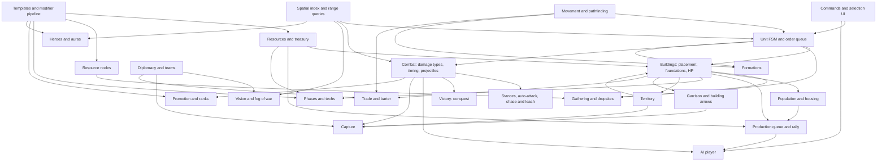

# Strategos mechanics catalog: 0 A.D. Release 28 compared with AoE2:DE and AoE4, broken into systems

**Reader:** the tech lead choosing the loader, libraries, architecture and roadmap. **Research date:** 2026-10-20. **Fact-checked:** 2026-10-20/21. Corrections are inline and marked *(corrected)*; statements that rest only on unverifiable sources are marked *(unverified)*.

## 0. Summary

- **Current 0 A.D. release.** The current release is **Release 28 "Boiorix"**. Its git tag `v0.28.0` (commit `a2cae4d`) was created on 2026-02-15, and the release was [announced on 2026-02-18](https://play0ad.com/new-release-0-a-d-release-28-boiorix/). It is the first release without the "Alpha" label. It adds a 15th faction (the Germans) and renames "female citizens" to "civilians".
  - The [Gitea tags API](https://gitea.wildfiregames.com/api/v1/repos/0ad/0ad/tags) shows no 0.28.1 or R29 tag as of 2026-10-20.
  - `main` is active: the latest commit is from 2026-10-19, and the repository has 1,601 open issues and 169 open PRs.
  - Earlier releases: Alpha 27 "Agni" was announced on 2025-01-30 (tag `a27` dated 2025-01-28). Patch 27.1 was tagged on 2025-07-14 and [announced on 2025-07-17](https://play0ad.com/2025/07/) *(corrected)*.
  - Every 0 A.D. number below was read from the `v0.28.0` source, not from wikis. The fact-check re-read them, and the few that were wrong are fixed inline (see Verification notes).
- **Why 0 A.D. is the model.** It is the best model for a Minecraft RTS because it is open and data-driven:
  - entity XML templates with inheritance and mixins;
  - one modifier pipeline for techs, auras, ranks and AI difficulty handicaps;
  - a hierarchical state machine (FSM) with an order queue for unit behaviour;
  - fixed-rate simulation turns.
- **Borrow the design, not the files.** Copy the architecture and mechanics, but none of the code, data files, text or art. Those are GPL-2.0-or-later and CC BY-SA 3.0. The FSF regards a GPL plug-in that forms a single combined program with a nonfree host as a GPL violation unless the copyright holders add a linking exception, and we cannot add one for 0 A.D. code (section 3).
- **Minecraft constraints that change the design.** I verified these in the decompiled 1.21.1 and NeoForge 21.1.262 sources, and they drive several T0 decisions:
  - only chunks near players tick;
  - chunk and entity streaming is centred on the player entity;
  - the server re-checks entity visibility in three cases: for all players when the entity crosses a 16-block section; for all entities when a player crosses a section; and for all entities whenever a player's movement packet is processed (every tick while moving, at least once a second while standing still). Nothing re-checks visibility when only fog state changes *(corrected)*;
  - vanilla pathfinding is synchronous and has a node cap;
  - custom datapack registries do not reload on `/reload`.
- **Minimal core loop.** About 14 systems make a loop that already feels like 0 A.D. or AoE (section 4). Territory, capture, fog of war and an AI opponent are the T1 features that make it feel like *0 A.D.* rather than a generic RTS.
  - One caveat *(added)*: 0 A.D. structures are almost immune to hack and pierce damage (section 1.8). A T0 roster without crush damage or capture could barely damage buildings, so conquest would be impractical.

**Sources and confidence**

| Game | Source | Notes |
|---|---|---|
| 0 A.D. | source at [tag v0.28.0](https://gitea.wildfiregames.com/0ad/0ad/src/tag/v0.28.0/) | read directly |
| AoE2:DE | [SiegeEngineers/aoe2techtree](https://github.com/SiegeEngineers/aoe2techtree) `data/data.json` | MIT; last commit 2026-09-22 ("Add The Viking Sagas") |
| AoE4 | [aoe4world/data](https://github.com/aoe4world/data) | parsed from game files; last commit on `main` 2026-05-04 (Season 13 patch 16.1.9737 data); GitHub detects no licence |

- The AoE fan wikis (Fandom, Liquipedia) returned HTTP 402/403. A re-test on 2026-10-20 got 403 from both. AoE claims that rest only on them, on forum posts or on memory are marked *(unverified)*.
- AoE status: the [official news page](https://www.ageofempires.com/news/) lists AoE2:DE Update 185872 and the "Viking Sagas" DLC as available, and AoE4 "Raiders of the North" as a pre-order. The listing is undated.

**Conventions**

- **Tiers.** **T0** = core loop (first playable slice). **T1** = MVP (a skirmish against an AI that feels like 0 A.D./AoE). **T2** = expansion. **T3** = later.
- **Scale.** 0 A.D. works in metres and seconds, and 1 m = 1 block works for distances:
  - pathfinding cell ("navcell") = 1 m;
  - terrain tile = 4 m;
  - a Normal map is 256 tiles = 1,024 m = 64×64 chunks.
- **Speeds and ranges** are compressed for the RTS. Infantry walks at 9–9.5 m/s, while a Minecraft player walks at about 4.3 blocks/s (4.317). Treat the numbers below as ratios to re-tune, not values to port.

---

## 1. Systems catalog

Each entry gives 0 A.D. R28 behaviour (with numbers), AoE2/AoE4 contrasts, the tier, and a Minecraft translation. Template paths are under [simulation/templates](https://gitea.wildfiregames.com/0ad/0ad/src/tag/v0.28.0/binaries/data/mods/public/simulation/templates) and component paths under [simulation/components](https://gitea.wildfiregames.com/0ad/0ad/src/tag/v0.28.0/binaries/data/mods/public/simulation/components).

### 1.1 Resources (T0)

- **0 A.D.** There are four resources, each defined in [data/resources/*.json](https://gitea.wildfiregames.com/0ad/0ad/src/tag/v0.28.0/binaries/data/mods/public/simulation/data/resources):
  - food (subtypes fish, fruit, grain, meat);
  - wood (tree, ruins);
  - stone (rock, ruins);
  - metal (ore, ruins).
  - Each has a barter `truePrice` of 100. Gather rates are keyed by `type.subtype`, so adding a resource is a data change.
  - Resources form a player stockpile. The default start is "Low", 300 of each. The options are 100, 300, 500, 1,000, 3,000 and 50,000 ([starting_resources.json](https://gitea.wildfiregames.com/0ad/0ad/src/tag/v0.28.0/binaries/data/mods/public/simulation/data/settings/starting_resources.json)).
- **AoE2/AoE4.** Food, wood, gold and stone. Gold is the premium military resource and has renewable sources (trade and relics; AoE4 also has sacred sites). AoE4 adds civ-specific currencies: olive oil, silver and vizier points appear in the aoe4world cost data.
- **Minecraft.** Keep resources abstract: a per-player treasury in server state, synced to its owner, not items. Blocks are only the nodes. Keep the resource list in data so a datapack or add-on can add, for example, gold.

### 1.2 Gathering, resource nodes, dropsites (T0; fish and corrals T2)

**0 A.D. gather rates** (resource per second; the timer adds one unit every 1000/rate ms). Sources: `template_unit_support_civilian.xml`, `template_unit_infantry.xml`, `template_unit_cavalry.xml`.

| Gatherer | fruit | grain | meat | wood | stone | metal | carry |
|---|---|---|---|---|---|---|---|
| Civilian | 1.0 | 0.5 | 1.0 | 0.70 | 0.35 | 0.35 | 10 per type |
| Citizen infantry | 0.5 | 0.25 | 1.0 | 0.75 | 0.50 | 0.50 | 10 per type |
| Citizen cavalry | – | – | 5.0 | – | – | – | 20 food |

- **Carry capacity:** three +5 tiers (Baskets, Wheelbarrow, Horse-drawn Carts) raise it to 25.
- **Rank penalty:** Advanced units gather 30% slower. Elite units gather 51% slower, because both rank techs apply to them (0.7 × 0.7) *(corrected)*.
- **Nodes:**
  - trees: mostly 200 wood (57 of 87 tree templates); usually 8 gatherers, though caps range from 1 to 12 *(corrected)*;
  - fruit bushes: 200–500 food, 8 gatherers, regrow 1 food per 6 s;
  - mines: 1,000 (small, 12 gatherers) or 5,000 (large, 24);
  - fish: 1,000 (4 gatherers); some fish hold 2,000 with 5 gatherers;
  - hunt (must be killed first): deer 100, boar 150, elephant 800;
  - domestic animals: chicken 40, sheep 100, pig 150, cow 300.
- **Fields:** cost 100 wood, give *infinite* grain, take at most 5 gatherers, and have diminishing returns of 0.9. Total output = rate × (1 − 0.9ⁿ)/(1 − 0.9), so five civilians produce about 4.1× one civilian, about 2.05 food/s ([ResourceSupply.js](https://gitea.wildfiregames.com/0ad/0ad/src/tag/v0.28.0/binaries/data/mods/public/simulation/components/ResourceSupply.js)).
- **Corral:** costs 100 wood and trains sheep (50 food, 40 s, yields 100 food) or cows (150 food, yields 300). With cavalry butchering at 5/s it is a renewable meat engine.
- **Dropsites:** Civic Centre (all resources), Storehouse (wood, stone, metal), Farmstead (food), Dock.
  - The R28 Germans' Supply Wagon is a *mobile* dropsite for all resources. It works by giving a unit the same `ResourceDropsite` component, with no special-case code.
  - Sharing dropsites with allies is a tech (Diaspora).
  - Gaia treasures hold 100–1,000 of a resource (most 200–500; one gives 600 food, 600 wood and 600 metal). A unit ordered to collect one takes 1 s *(corrected)*.
- **Behaviour:** the unit AI's gather states run APPROACHING → GATHERING → RETURNINGRESOURCE → FINDINGNEWTARGET. A worker returns to the nearest valid dropsite, and when its node runs out it picks a similar node nearby.
- **AoE2.** The economy is villager-only; soldiers never gather.
  - Rates are about 0.32–0.41/s per task. The fan wiki lists farmer 0.32, shepherd 0.33, stone 0.36, gold 0.38, lumberjack 0.39 and hunter 0.41 *(unverified)*.
  - Farms cost 60 wood (data) and run out, so they must be reseeded. Lumber camps, mining camps and the mill are the dropsites.
- **AoE4.** Farms cost 75 wood (English farms 37 wood) and take one villager each. They are effectively infinite *(unverified; community consensus, not officially documented)*. English farms gain +20/25/30/30% by age inside a Mill's influence (data).
- **Minecraft.**
  - Use vanilla blocks as nodes with an amount per block (log columns, berry bushes, stone/ore patches), and remove blocks as they run out.
  - A field is a custom multiblock with 5 work slots.
  - Keep a per-chunk node index for "nearest node" queries.

### 1.3 Economy technologies (T0: one or two techs; T1: full set)

- **0 A.D.** ([data/technologies](https://gitea.wildfiregames.com/0ad/0ad/src/tag/v0.28.0/binaries/data/mods/public/simulation/data/technologies): 156 JSON files, plus 21 in `civbonuses/` *(corrected)*). Each economic line has three tiers, one per phase, researched at the Storehouse or Farmstead:
  - wood +25% ×3: 200W/100M, then 400W/200M, then 600W/300M; 40, 50 and 60 s;
  - stone +25% ×3 and metal +25% ×3;
  - grain +20% ×3;
  - fruit +50% for 100 wood;
  - carry capacity +5 ×3: 200F/200W, 400F/400W, 600F/600W.
  - Houses have their own line: +20% population bonus (Home Garden, 300W 100S, Town, researched at the house), and Manors (300W 300S, City) add another +20%.
- **AoE2.** Same structure: axes and saws, mining, ploughs and crop rotation, Wheelbarrow and Hand Cart. Costs from the data: Double-Bit Axe 100F 50W 25 s, Bow Saw 150F 100W 50 s, Wheelbarrow 175F 50W 75 s, Hand Cart 300F 200W 55 s, Crop Rotation 250F 250W 70 s, Gold Mining 100F 75W 30 s.
- **AoE4** (data):
  - wood +15% steps (Double Broadax 50F 100G; Crosscut Saw also adds +5 wood capacity);
  - gold and stone +15% (Specialized Pick);
  - food +10%, excluding hunting (Horticulture);
  - Wheelbarrow: +5 capacity and +15% villager speed (50W 150G, 90 s);
  - Survival Techniques: hunting +15%.
- **Minecraft.** Techs are data entries with modifiers (section 2.3) and are researched in a building's queue.

### 1.4 Population and housing (T0)

- **0 A.D.**
  - **Population cost:** most units cost 1; elephant archers and bolt shooters cost 2. Siege engines, siege ships and champion elephants cost 3. Heroes and animals cost 0.
  - **Population cap:** the smaller of (sum of bonuses) and (max population).
  - **Bonuses:** Civic Centre (CC) +20. A small house gives +5 (75 wood, 30 s; Britons, Gauls, Iberians, Mauryas, Ptolemies). A big house gives +10 (150 wood, 50 s; the other 10 civs).
  - **Max population:** 300 per player by default (`InitGame.js`).
    - Options: a player cap of 50–300 or unlimited, or a pooled team cap (default 400) or world cap (default 600).
    - R28 added the team cap type (A27 had only player caps and a separate world cap). It also honours per-player limits set by scenario maps; per-player limits are not a game-setup option *(corrected)*.
  - Foundations give no bonus until they are finished.
- **AoE2.** House +5 for 25 wood (data: cost and the "Provides 5 population" help text). The default cap is 200 *(unverified)*.
- **AoE4.** House 50 wood (data) for +10 population *(unverified: the aoe4world data only says "Increases your maximum Population")*. Malian houses give +5 at half cost (data). The cap is 200 *(unverified; community)*.
- **Minecraft.** Count population per player in server state; houses carry a Population component.

### 1.5 Production: training, batches, rally points (T0: queue and rally; T1: batches)

- **0 A.D.** ([Trainer.js](https://gitea.wildfiregames.com/0ad/0ad/src/tag/v0.28.0/binaries/data/mods/public/simulation/components/Trainer.js))
  - Each building has one production queue (`ProductionQueue` plus `Trainer` and `Researcher`). The cost is paid when an item is queued; population is reserved when it starts.
  - Units spawn at a free point and walk to the rally point. The rally point can be a resource node or a building, which means auto-gather or auto-garrison.
  - **Batch time** = unit time × n^BatchTimeModifier.
    - The modifier is 0.8 for the CC, barracks, stable, dock, fortress and range, and 0.7 for the corral, market and arsenal.
    - Example: CC civilians take 8 s each, so a batch of 5 takes 29 s instead of 40 s.
    - The City tech Conscription lowers the barracks (and stable) modifier by 0.1.
  - **Train times:** civilian 8 s, infantry 10 s, cavalry 15 s, champion 20 s, hero 50 s, ram 30 s.
  - Trainer lists use `{civ}` placeholders, and entries whose template does not exist are skipped, so one generic barracks template serves all 15 civs.
- **AoE2/AoE4.** Units are queued one at a time, with no batch-time discount *(unverified)*. AoE4's twist is production buffs from landmarks and influence.
- **Minecraft.** A building "core" block entity (or marker entity) owns the queue. Units spawn at a door point. The rally point is stored as a position or a target UUID.

### 1.6 Construction (T0: foundations, builders, repair; T1: towers and palisade; T2: stone walls and gates)

- **0 A.D.** ([Foundation.js](https://gitea.wildfiregames.com/0ad/0ad/src/tag/v0.28.0/binaries/data/mods/public/simulation/components/Foundation.js), [Repairable.js](https://gitea.wildfiregames.com/0ad/0ad/src/tag/v0.28.0/binaries/data/mods/public/simulation/components/Repairable.js))
  - **Foundations.** Placing a building creates a foundation, generated from the building's own template by a `foundation` filter. The cost is paid on placement and the foundation starts at 1 HP. Its obstruction does not block movement or pathfinding until the first builder arrives and "commits" it, which pushes units out of the way *(corrected)*.
  - **Build speed.** Total speed grows as n^0.7 with n builders: 2 builders 1.62×, 5 builders 3.09×, 10 builders 5.01×. HP rises with progress.
  - **Repair** is free; the code says "TODO: should we have resource costs?". It takes 2× build time for structures, 4× for siege and ships and 4.5× for walls, with the same n^0.7 penalty.
  - **Builders:** civilians and citizen infantry, via the `builder` mixin.
  - **Build restrictions:**
    - territory: own territory, or own or neutral for a CC;
    - placement type: land, shore or land-shore (there is no water placement type) *(corrected)*;
    - distances: a CC must be at least 200 m from other CCs, and fortresses at least 80 m apart;
    - limits: one CC until Town phase, one wonder, one hero.
  - **Walls.** Wall sets are drawn as segments with towers and gates: palisade from Village phase, stone walls from Town. Gates open for allies. Walls and palisades cannot be captured.
  - **Towers.**
    - The sentry tower costs 100 wood, has 400 HP and at most 6 arrows.
    - The stone defence tower costs 100W 100S, has 1,000 HP and fires 4 arrows plus one per garrisoned infantry (garrison 5).
    - The defence tower is also an upgrade path from the sentry tower (50W 100S, 100 s, Town).
- **AoE2.** Villagers build, and repair costs resources *(unverified)*. A stone wall segment costs 5 stone (data). Towers take a garrison.
- **AoE4** (data):
  - stone walls cost 25 stone per segment and have 3,000 HP;
  - rams deal +300 against walls;
  - buildings have 50 ranged armour, so archers cannot hurt them; torches (fire damage) or siege are needed.
- **Minecraft.**
  - Use structure templates (NBT) placed block by block as progress advances.
  - Keep building HP abstract. 0 A.D.'s `DamageVariants` at 85%, 65% and 35% HP map naturally onto swapping in "damaged" block palettes. Real block destruction would break pathing and invite griefing.
  - Placement: a ghost preview plus validators for territory, slope and overlap.

### 1.7 Phases and the technology tree (T0: 2 phases; T1: 3 phases and about 30 techs)

- **0 A.D.** ([phase_town_generic.json](https://gitea.wildfiregames.com/0ad/0ad/src/tag/v0.28.0/binaries/data/mods/public/simulation/data/technologies/phase_town_generic.json), [phase_city_generic.json](https://gitea.wildfiregames.com/0ad/0ad/src/tag/v0.28.0/binaries/data/mods/public/simulation/data/technologies/phase_city_generic.json))
  - **Phases:** Village is automatic. Town costs 500 food and 500 wood, takes 30 s and requires 5 Village-class structures. City costs 750 stone and 750 metal, takes 60 s and requires 3 Town-class structures.
  - **Per-phase bonuses:** structures get +20% ranged (pierce) damage and +0.5 (Town) or +1 (City) garrison capture regeneration; CCs get +25% territory radius.
  - **Gating:** templates are gated with `Identity/Requirements`. Siege, champions and heroes need City in the generic templates, with civ-specific exceptions such as Spartan champion hoplites from Village.
  - **Tech format.** Each tech is a JSON file with:
    - cost, research time and requirements (tech, civ, entity counts; combinable with all/any and `notciv`);
    - `supersedes` chains (tier 2 requires tier 1);
    - "pair" techs (choose one of two);
    - `autoResearch` (used for rank bonuses);
    - `modifications`, for example `{"value":"ResourceGatherer/Rates/wood.tree","multiply":1.25,"affects":"Soldier !Elephant"}`. This is a composite illustration: per-modification `affects` exists, but the wood techs use a top-level `"affects": ["Worker"]`, and `Soldier !Elephant` comes from the melee attack techs.
- **AoE2.** Feudal: 500F, 130 s. Castle: 800F 200G, 160 s. Imperial: 1000F 800G, 190 s (data). Each age needs two buildings of the current age *(unverified)*. Civilisations differ by disabling parts of one shared tree.
- **AoE4.** You age up by building one of two civ-specific landmarks. English costs (data): 400F 200G (Feudal), 1,200F 600G (Castle), 2,400F 1,200G (Imperial). Landmarks grant unique effects and are the targets of landmark victory.
- **Minecraft.** Same JSON model in data; a GUI tech tree; requirements are checked on the server; modifiers apply through the cached stat pipeline (section 2.3).

### 1.8 Unit classes, counters, damage and resistance (T0: 3 damage types and the spear bonus; T1: siege; T2: ships, elephants, champions)

**0 A.D. damage model** ([helpers/Attack.js](https://gitea.wildfiregames.com/0ad/0ad/src/tag/v0.28.0/binaries/data/mods/public/simulation/helpers/Attack.js)): damage = Σ over types (hack/pierce/crush) of damage × 0.9^resistance-level, then × bonus multipliers. Fire and poison also exist as status effects (Burning, Poisoned), and fire is also a direct damage type, for example the Fire Ship's 15 fire *(corrected)*. Example resistances:

| Target | Resistance (hack/pierce/crush) | Damage taken |
|---|---|---|
| Melee infantry | 3/3/15 | 73% / 73% / 21% |
| Ranged infantry | 1/1/10 | 90% / 90% / 35% |
| Economic structures (storehouse, farmstead, market) | 9/20/1 | 39% / 12% / 90% |
| Civic structures (houses, temple) | 24/30/3 | 8.0% / 4.2% / 73% |
| Military structures (barracks, fortress) | 24/35/3 | 8.0% / 2.5% / 73% |
| Civic Centre (civic +5/+5), towers, stone walls | 29/35/3 | 4.7% / 2.5% / 73% |
| Ram | 7/35/5 | 48% / 2.5% / 59% |

*(Corrected.)* The original rows "Structures 1/10/1" and "Civic Centre 6/15/1" were the root `template_structure.xml` default, which every structure class overrides. Other values: palisade 9/25/2, field 15/40/5, corral 1/20/1, wonder 19/25/3.

The consequence: buildings are nearly immune to hack and pierce. Ten swordsmen need about 10 minutes to raze a 3,000 HP CC, while one ram needs about 41 s. Buildings fall to crush damage (siege, elephants) or to capture.

- **Counters** come mostly from damage type against resistance, plus range and speed. Explicit multipliers are rare in R28:
  - spear and pike infantry ×2.5 against Cavalry;
  - cavalry spearmen ×1.75;
  - one hero pikeman ×3 *(corrected; not a champion spear)*;
  - fire, arrow and scout ships ×3 against ships.
- **Capture** is a separate effect type.

**Representative R28 citizen-soldier and siege stats** (costs before rank and tech modifiers):

| Unit | Cost | HP | Attack (per hit) | Range | Wind-up / period (ms) | Speed (m/s) |
|---|---|---|---|---|---|---|
| Civilian | 50F, 8 s | 25 | 2 hack | 3 | 500/1000 | 9 |
| Spearman | 50F 50W, 10 s | 100 | 4.5 hack + 4 pierce, ×2.5 vs cavalry | 4 | 500/1000 | 9.5 |
| Swordsman | 50F 40W 10M | 100 | 8 hack | 3 | 375/750 | 9.5 |
| Pikeman | 50F 50W | 100 (res 5/5/15) | 4 hack + 7.5 pierce, ×2.5 vs cavalry | 8 | 1000/2000 | 8.55 |
| Archer | 50F 50W | 50 | 7.2 pierce | 60 | 800/1250 | 10.3 |
| Slinger | 50F 20W 30S | 50 | 11.5 pierce + 1.1 crush | 45 | 400/1500 | 10.8 |
| Javelineer | 50F 50W | 50 | 16 pierce | 30 | 400/1500 | 11.4 |
| Cavalry javelineer | 100F 50W, 15 s | 100 | 18 pierce | 30 | 400/1500 | 16.2 |
| Battering ram (3 pop) | 300W 150M, 30 s | 400 | 150 crush; cannot hit Organic units or fields | 6.5 | 750/1500 | 7.2 |
| Stone thrower | 400W 250S, 25 s | 375 | 230 crush + 1.5 m splash of 120 | 26–85 | 3000/7000 | 7.2 |

Worked examples:
- A swordsman deals about 7.8 DPS to a spearman (kill in about 13 s).
- A spearman deals about 18 per second to a cavalry javelineer.
- An archer deals about 4.2 DPS to a spearman if every arrow hits.
- A swordsman deals about 0.5 DPS to a Civic Centre *(added)*.

Contrasts:
- **AoE2.** Armour is subtracted per armour class: Σ max(0, attack − armour), at least 1. This is community-documented, for example on [Steam](https://steamcommunity.com/app/813780/discussions/0/3757725080161121171) *(unverified)*. There are many explicit bonus classes (data):
  - pikeman +15 vs cavalry, +15 vs elephants, +12 vs camels, +9 vs ships;
  - ram +150 vs buildings, +40 vs siege;
  - mangonel +35 vs buildings;
  - archer +3 vs the spear class.
  - Elevation gives ±25% *(unverified; fan wiki)*.
- **AoE4.** Melee and ranged armour are subtracted, plus "+X vs class" modifiers (data):
  - spearman +17 vs cavalry in Age I, rising to +20/+23/+28 in Ages II–IV *(corrected; +20 is the Age II value)*;
  - horseman +9 vs ranged and siege (Age II; +8 to +13 by age);
  - archer +5 vs light melee infantry (Age II; up to +8);
  - crossbowman +10 vs heavy (Age III; +12 in Age IV);
  - ram +300 vs walls;
  - buildings have 50 ranged armour.
- **Minecraft.** Compute final damage inside our own simulation and apply it once, bypassing vanilla armour and enchantments with a custom damage type (tags `minecraft:bypasses_armor`, `bypasses_enchantments`). That keeps numbers deterministic and testable. NeoForge 21.1 still has `LivingIncomingDamageEvent` for interaction with vanilla attackers such as players and mobs.

### 1.9 Attack timing, projectiles, splash (T0: melee and ranged; T1: splash and minimum range; T2: elevation range bonus)

- **0 A.D.** ([Attack.js](https://gitea.wildfiregames.com/0ad/0ad/src/tag/v0.28.0/binaries/data/mods/public/simulation/components/Attack.js))
  - **Timing:** each attack has `PrepareTime` (wind-up before the first hit) and `RepeatTime` (period); see the table above.
  - **Projectiles** are ballistic (speed and gravity).
    - They aim at a predicted position: the target's velocity extrapolated over the flight time. For flights under about 1 s the code sometimes uses UnitMotion's path estimate instead *(corrected; prediction is not capped at 1 s)*.
    - The aim has Gaussian spread: σ = Spread × distance/100 m (archer: 2.25 m at 100 m).
    - A hit is resolved at the landing point, so misses are real.
  - **Splash** is circular or linear with falloff 1 − d²/r², and has a friendly-fire flag.
  - **Elevation:** ranged reach grows with height (parabolic range in RangeManager). There are minimum ranges, for example 26 m for catapults and 10 m for towers.
- **AoE2/AoE4.** Projectiles can miss (the AoE2 archer has 80% accuracy in the data). AoE4's high ground is said to give only line of sight *(unverified; forum hearsay)*.
- **Minecraft.** Do not create one vanilla `AbstractArrow` per shot for massed archers, because physics and tracking costs add up. Instead, compute flight time and landing point on the server and send a lightweight "projectile launched" packet for client-side visuals.

### 1.10 Stances, auto-attack, chasing, leashing (T0)

- **0 A.D. stances** (from the `g_Stances` table in [UnitAI.js](https://gitea.wildfiregames.com/0ad/0ad/src/tag/v0.28.0/binaries/data/mods/public/simulation/components/UnitAI.js)):
  - **violent:** always retaliates and chases beyond its own vision;
  - **aggressive** (the default): targets visible enemies and chases within vision;
  - **defensive:** abandons a chase when the target leaves attack range plus half its vision radius around the held position;
  - **standground:** never moves;
  - **passive:** flees; the default for civilians, flee distance 12 m;
  - animal-only stances (skittish, passive-defensive) and "none" for AI and trigger scripts.
- **Targeting and chasing:**
  - Auto-targeting uses range queries over vision. Each attack has preferred classes (ranged units prefer Human, rams prefer Structure).
  - A chase ends when the target is no longer visible to its owner, and that includes forced orders. Forced orders are exempt only from the stance's hold-ground and vision-range limits *(corrected)*.
  - The CC, storehouse, farmstead and market have an "AlertRaiser" that sends civilians to garrison, the equivalent of AoE2's Town Bell *(corrected)*.
- **AoE2.** Aggressive, defensive, stand ground and no attack *(unverified)*. **AoE4** is similar *(unverified)*.
- **Minecraft.** Implement stances in our own FSM on top of a spatial index, not with vanilla Goals.

### 1.11 Formations (T1: move-only box and line; T2: special formations)

- **0 A.D. R28** ([Formation.js](https://gitea.wildfiregames.com/0ad/0ad/src/tag/v0.28.0/binaries/data/mods/public/simulation/components/Formation.js), `special/formations/*.xml`)
  - **Templates:** none, box, column and line (open and closed), flank, battle line, scatter, skirmish, wedge (cavalry, at least 6), testudo (melee infantry, at least 16), phalanx, syntagma, shield wall, anti-cavalry. Ships have line staggered, flank and column.
  - **Mechanics:**
    - a formation is a controller entity (FORMATIONCONTROLLER state) that pathfinds as a "large" unit;
    - it assigns members to slot offsets sorted by class;
    - it moves at the slowest member's speed and switches between box and column by distance (128 m);
    - nearby twin formations merge.
  - **No combat bonuses.** None of the R28 formation templates has auras or stat changes; formations are geometry and movement only.
  - **Defaults** ([default.cfg](https://gitea.wildfiregames.com/0ad/0ad/src/tag/v0.28.0/binaries/data/config/default.cfg)): walk orders use "box" automatically, and `formationwalkonly=true` drops the formation for gather or attack orders. `CanAttackAsFormation=false`, so members fight individually.
  - **Without formations**, R28 spreads unit destinations around the target point so groups don't line up.
- **AoE2.** Line, box, staggered and flank formations. **AoE4:** units move in formation by default *(unverified detail)*.
- **Minecraft.**
  - The formation controller should be a server-side object, not an entity; members steer to slot offsets with local avoidance.
  - Ship destination spreading in T1 and real formations later.

### 1.12 Capture (T1)

- **0 A.D.** ([Capturable.js](https://gitea.wildfiregames.com/0ad/0ad/src/tag/v0.28.0/binaries/data/mods/public/simulation/components/Capturable.js))
  - **Capture points.** A structure's points are split between players: CC 2,500, fortress 4,000, wonder 2,000, default 500, farmstead 300.
  - **Capture attack:** attackers remove enemy points every second (civilian 1.0, infantry 2.5, cavalry 1.75, champion 5, champion cavalry 3.5, hero 10).
    - Ownership flips only when the owner's points reach zero. The building then goes to the player holding the most points *(corrected; it is not a majority rule)*.
  - **Damage speeds capture:** the capture effect is divided by (0.1 + 0.9 × HP/maxHP).
  - **Regeneration** runs continuously for the owner.
    - R28 rates: 5/s default, 10 towers and barracks, 15 temple, 30 CC, 45 fortress. In Alpha 27 they were 0.5/5/10 (default/CC/fortress).
    - Each garrisoned unit adds its capture strength × GarrisonRegenRate (1.0, +0.5 in Town, +1 in City).
  - **Worked example** *(corrected)*:
    - 20 infantry (50/s) against an empty, full-HP CC gain 20/s net. They must take all 2,500 points, which takes about 125 s.
    - Twelve infantry (30/s) make no progress at full HP. At 50% HP their capture rises to about 54.5/s (net 24.5/s), and they take the CC in about 102 s.
  - **Exceptions:** fields, palisades and walls cannot be captured.
  - **Territory decay:** structures outside connected territory lose 20 points/s to their neighbours.
  - **UI:** since Alpha 27, right-click attacks buildings and holding C captures.
- **AoE2.** No structure capture; monks convert units, and most buildings after Redemption *(unverified detail)*. **AoE4:** no structure capture; religious units capture sacred sites.
- **Minecraft.** Store a per-building capture-point array in the building component, sync it to nearby clients, and show a capture bar.

### 1.13 Garrisoning and buildings that shoot arrows (T1)

- **0 A.D.** ([GarrisonHolder.js](https://gitea.wildfiregames.com/0ad/0ad/src/tag/v0.28.0/binaries/data/mods/public/simulation/components/GarrisonHolder.js), [BuildingAI.js](https://gitea.wildfiregames.com/0ad/0ad/src/tag/v0.28.0/binaries/data/mods/public/simulation/components/BuildingAI.js))
  - **GarrisonHolder settings:** maximum size, allowed classes, eject below 10% HP (fortress 7.5%), and a heal rate.
  - **Capacities:** CC 20 (support, infantry, cavalry); houses 3–6 support units; towers 3–5 infantry; fortress 20; ram 10 infantry; ships carry units.
  - **Building arrows** (`BuildingAI`):
    - CC: 6 arrows by default, +1 per garrisoned soldier, every 4 s, 8 pierce, 60 m;
    - towers: 2 (+2 for stone), +1 per garrisoned infantry;
    - fortress: 10;
    - arrows are spread across targets in range by preference.
  - **Other garrison effects:** garrisoned units add capture regeneration and are healed (CC 1 HP/s, temple 3, wonder 5). Turrets let units stand on walls and towers and shoot from there.
- **AoE2.** Town Center garrison 15 (data) with extra arrows; castle 20.
- **AoE4.** Town Center garrison 8 and keep 15; garrisoning "adds additional attacks" (data).
- **Minecraft.** Remove garrisoned units from the world and store them in the building component, which also keeps chunk entity counts down. Re-spawn them when they ungarrison (unload).

### 1.14 Healing (T1)

- **0 A.D.** Healers restore 5 HP every 2 s at 12 m range and cost 100F 30M. Garrison healing works as above, and some auras heal. Siege and structures cannot be healed; they are repaired.
- **AoE2/AoE4.** Monks heal *(unverified detail)*.
- **Minecraft.** A healer FSM state plus a garrison heal tick.

### 1.15 Promotion and experience (T1)

- **0 A.D.** ([Promotion.js](https://gitea.wildfiregames.com/0ad/0ad/src/tag/v0.28.0/binaries/data/mods/public/simulation/components/Promotion.js), [unit_advanced.json](https://gitea.wildfiregames.com/0ad/0ad/src/tag/v0.28.0/binaries/data/mods/public/simulation/data/technologies/unit_advanced.json))
  - **XP gain:** XP = the target's `Loot/xp` × damage dealt / target max HP. Healing also earns XP.
  - **XP values:** civilian 3, infantry 100, cavalry 130, ram 200, catapult 250, hero 400.
  - **Thresholds:** infantry promote at 100 XP and cavalry at 150. Since Alpha 27, Athenian elite spearmen can promote again at 250 XP into champions.
  - **Ranks:** Basic → Advanced → Elite are separate templates, swapped with `ChangeEntityTemplate`.
  - **Rank bonuses** come from auto-researched techs.
    - Per rank: +25% HP, +10% melee damage, −20% ranged spread, +0.7 or +0.8 capture, +20% loot and XP value, −30% gather speed, +20% train time.
    - Elite units receive both sets, for example ×0.49 gather speed and ×1.56 HP *(corrected)*.
- **AoE2/AoE4.** No general veterancy system *(unverified for AoE4 civ variants)*.
- **Minecraft.** Rank is a field that selects a modifier set plus a cosmetic, such as an insignia or helmet trim.

### 1.16 Heroes and auras (T2)

- **0 A.D.**
  - **Heroes:** City phase; base cost 100F 250M; 0 population; one alive at a time and each hero only once per match. They have capture strength 10 and usually two auras.
  - **Aura JSON** ([data/auras](https://gitea.wildfiregames.com/0ad/0ad/src/tag/v0.28.0/binaries/data/mods/public/simulation/data/auras)): type (range, global, garrison, garrisonedUnits, turretedUnits, formation, player), radius, affected classes, and modifications in the same format as techs.
  - **Example:** Pericles affects a 60 m range: soldiers, ships, siege and structures give no loot, and structures get +50% capture points.
  - Regicide victory targets the hero.
- **AoE2.** Heroes appear only in campaigns; regicide uses a king.
- **AoE4.** A few civ-specific leaders exist; for example, the Mongol Khan appears as a garrison class in the data.
- **Minecraft.** Evaluate auras through the spatial index on a slower cadence (for example every 10 ticks) and feed the results into the modifier pipeline.

### 1.17 Territory and borders (T1: restrictions and roots; T2: decay)

- **0 A.D.** ([CCmpTerritoryManager.cpp](https://gitea.wildfiregames.com/0ad/0ad/src/tag/v0.28.0/source/simulation2/components/CCmpTerritoryManager.cpp))
  - **Grid and influence.** The map is a grid of 8 m territory tiles. Each `TerritoryInfluence` (weight, radius, "root" flag) floods outward with linear falloff (weight/radius per tile, scaled by terrain cost). Each tile goes to the player with the highest summed weight.
  - **Connectivity.** Tiles flood-connected to a root (CC, military colony or wonder) are "connected" *(corrected: wonders are roots too)*. The others blink, and structures on them decay.
  - **Radii:**
    - CC 140 m, a root; +25% in Town and again in City, so about 219 m;
    - military colony 75 (root); wonder 100 (root);
    - houses 16–20 m; storehouse and farmstead 20; market and temple 40; fortress 80.
  - **Building rule:** you build in your own territory; a CC can also go in neutral territory.
  - **Recent change:** Alpha 27 reduced the territory gained per phase and made new CCs cheaper, to make expansion strategic.
- **AoE2/AoE4.** Neither has a territory system; AoE4 has local influence radii for some civs. Territory is 0 A.D.'s most distinctive map mechanic.
- **Minecraft.**
  - Use 8×8-block tiles (128×128 tiles on a 1,024-block map).
  - Recompute off-thread when influence changes, store it per level, and sync it as a compact owner grid.
  - Draw borders with particles or an overlay, and on the minimap.
  - The placement validator checks the tiles under a building's footprint.

### 1.18 Vision, line of sight, fog of war (T1: entity fog and explored state; T3: hiding terrain)

- **0 A.D.** ([helpers/Los.h](https://gitea.wildfiregames.com/0ad/0ad/src/tag/v0.28.0/source/simulation2/helpers/Los.h))
  - **LOS grid:** 4 m cells per player, each cell UNEXPLORED, EXPLORED or VISIBLE.
  - **Vision ranges:** civilian 32 m, infantry and cavalry 80, CC 90, catapult 120, hero 100, house 20.
  - **Mirages:** structures in fog are shown as "mirage" entities that keep their last-seen state, which hides enemy HP changes and destruction.
  - **Map options:** explored or revealed.
  - **Shared vision** with allies needs the Cartography tech (100F 100M, 40 s).
- **AoE2.** Black, fog and visible states. In DE, allies effectively share vision by default (the data lists Cartography at zero cost and 1 s).
- **AoE4.** Similar.
- **Minecraft.**
  - **Server state:** keep per-team visibility counts on a 4×4-block grid.
  - **Hiding entities.** In 1.21.1, entity sync can be gated with `Entity#broadcastToPlayer`, which `ChunkMap.TrackedEntity.updatePlayer` checks. The method is public and overridable on `Entity`, so our unit entities can override it without a mixin.
  - **Refresh hook needed** *(corrected)*. Vanilla re-runs the check in three cases:
    - for all players when the entity changes 16-block section (`ChunkMap.tick`);
    - for all entities when a player changes section;
    - for all tracked entities whenever a player's movement packet is processed (`ChunkMap.move(ServerPlayer)`): every tick while moving, and at least every 20 ticks while still, because the client sends a position reminder.
  - **What the hook must do.** Nothing in vanilla reacts to a fog change, and a unit moving within one section past a stationary observer can lag by up to about 1 s. Visibility changes therefore need an explicit refresh: call `updatePlayer` for the affected players, which needs an access transformer or accessor for `ChunkMap.entityMap` and the package-private `ChunkMap$TrackedEntity`.
    - Reign of Nether's [TrackedEntityMixin](https://github.com/SoLegendary/reignofnether/blob/1.20.1-dev/src/main/java/com/solegendary/reignofnether/mixin/fogofwar/TrackedEntityMixin.java) is a gate, not a refresh: it cancels `updatePlayer` at HEAD for fogged entities, which blocks new pairings but never un-pairs.
    - Keep `broadcastToPlayer` O(1), since it can run once per tracked entity per moving player per tick.
  - **Terrain.** Terrain cannot be hidden cheaply, because chunks stream by view distance. Draw terrain fog on the client as a cosmetic and enforce fog only for entities. Prior art exists: Reign of Nether 1.5 serves pre-match chunk snapshots to fogged players through a `ChunkMap.playerLoadedChunk` mixin. It works but is complex.
  - **Filtered sync.** NeoForge 21.1.262 data attachments accept a per-player sync predicate, `sync(BiPredicate<IAttachmentHolder, ServerPlayer>, StreamCodec)`, which suits fog-filtered unit data.
    - The predicate is available since 21.1.197.
    - Entity attachments sync only to players already tracking the entity. Level attachments go to all players in the level, filtered by the predicate, which suits per-team state.

### 1.19 Diplomacy (T1: allied and enemy teams; T2: neutral, tribute, shared vision)

- **0 A.D.**
  - **Relations:** a per-player diplomacy array (ally, neutral, enemy) with mutual-ally checks; a locked-teams option; allied victory; a ceasefire timer.
  - **Tribute:** any resource, with no tax (`Player.TributeResource`).
  - **Sharing:** shared vision and shared dropsites come from techs.
  - **Trade bonus:** trade between markets of different players gives each market owner an extra 20% of the trader's gain (international bonus).
- **AoE2.** Tribute is taxed until Coinage and Banking *(rates unverified)*. **AoE4:** similar *(unverified)*.
- **Minecraft.** Our own team registry. Optionally mirror it to vanilla scoreboard teams for name colours and friendly-fire rules.

### 1.20 Trade and barter (T2)

- **0 A.D. trade** ([Market.js](https://gitea.wildfiregames.com/0ad/0ad/src/tag/v0.28.0/binaries/data/mods/public/simulation/components/Market.js), [globalscripts/Trade.js](https://gitea.wildfiregames.com/0ad/0ad/src/tag/v0.28.0/binaries/data/mods/public/globalscripts/Trade.js))
  - Traders (100F 80M, land) or merchant ships walk between two markets or docks.
  - **Gain per trip** = GainMultiplier (0.75) × normalisation × d²/(1 + 0.25·d/mapSize), using straight-line distance d.
    - It is normalised so that a 100 m route on a 1,024 m map yields 0.75, which `Math.round` makes 1.
    - On a Normal map that gives about 1 at 100 m, 6 at 300 m, 17 at 500 m and 41 at 800 m.
  - Each trader garrisoned on a merchant ship adds +20%.
- **0 A.D. barter** ([Barter.js](https://gitea.wildfiregames.com/0ad/0ad/src/tag/v0.28.0/binaries/data/mods/public/simulation/components/Barter.js)): at the market you sell 100 at 90 and buy 100 at 110 (truePrice 100 ± 10%). Each 100-unit deal shifts prices by 2%, and prices recover 0.5 every 5 s.
- **AoE2.** Trade carts (100W 50G, data) between markets; gold grows faster than linearly with distance *(formula unverified)*; dynamic market prices. **AoE4:** traders run between markets and neutral trade posts *(unverified)*.
- **Minecraft.** Traders are ordinary units with a Trader FSM state. Using straight-line distance (not path length) is cheap and deterministic.

### 1.21 Loot (T1)

- **0 A.D.** The killer's owner receives the victim's loot plus anything it was carrying. Examples: infantry 5 food plus a share of their cost resources; CC 60W 60S 50M. XP is carried in `Loot/xp`. Auras can set loot to zero (Pericles).
- **AoE2/AoE4.** Mostly none, apart from some civ bonuses.
- **Minecraft.** Handle it in the death event.

### 1.22 Victory conditions (T0: conquest; T2: wonder, regicide, relics)

- **0 A.D.** ([settings/victory_conditions](https://gitea.wildfiregames.com/0ad/0ad/src/tag/v0.28.0/binaries/data/mods/public/simulation/data/settings/victory_conditions))
  - **Conquest** (default): destroy all `ConquestCritical` units and structures. Variants: units only, structures only, civic centres only.
  - **Wonder:** build or capture one and hold it for N minutes (a slider; 0 = instant).
  - **Capture the Relic:** hold all relics for N minutes.
  - **Regicide:** kill the hero.
  - Each is a trigger script chosen at setup; Last Man Standing and allied victory are options.
- **AoE2.** Conquest, wonder (countdown), relics and regicide *(details unverified)*.
- **AoE4.** Landmark victory (destroy all landmarks), wonder, sacred sites *(timers unverified)*.
- **Minecraft.** A per-match rules object; a `ConquestCritical` tag on templates.

### 1.23 Civilisation differences (T1: 2 civs; T2: more)

- **0 A.D. R28** has 15 civs: Athenians, Britons, Carthaginians, Gauls, Germans (new), Han, Iberians, Kushites, Macedonians, Mauryas, Persians, Ptolemies, Romans, Seleucids, Spartans.
  - **Differences are data:**
    - a civ JSON with start entities, bonuses and wall sets;
    - per-civ templates that inherit shared class templates, optionally through role mixins such as `hoplite`. Only the Athenians currently use a civ mixin (`civ/athen|hoplite|template_unit_infantry_melee_spearman`) *(corrected)*;
    - civ-gated techs (`civ` / `notciv`);
    - unique buildings and units;
    - `{civ}` placeholders in builder and trainer lists.
  - Most civs draw a subset of one generic roster: spear, sword, pike, javelin, sling, bow and cavalry.
- **AoE2.** About 50 civs from one shared tree, with disabled entries, civ bonuses, and unique units and techs.
- **AoE4.** Fewer civs, but far more asymmetric: landmarks, unique mechanics, variant civs.
- **Minecraft.** Civ definitions live in data. T1 should ship two civs that differ in roster plus two or three bonuses, to prove the data model.

### 1.24 AI opponents: Petra (T1: simple scripted AI; T2: Petra-like)

- **0 A.D. Petra** ([ai/petra](https://gitea.wildfiregames.com/0ad/0ad/src/tag/v0.28.0/binaries/data/mods/public/simulation/ai/petra)) is about 19,200 lines of JS in ES modules.
  - **Scheduling:** it runs every 8 turns (1.6 s), offset by player ID to spread load.
  - **Commands only:** it runs single-threaded in the same JS compartment as the simulation (in a separate realm), reads sim data directly, and issues ordinary player commands. Its one direct write is the difficulty handicap, added as "AI Bonus" modifiers to the ModifiersManager.
  - **Headquarters** is the central loop.
    - It checks phase-ups, trains workers, and builds houses, farmsteads and corrals.
    - It also expands, builds the market, forge and temple, adds defences and training buildings, and builds a wonder once population exceeds 90% of the maximum.
  - **Bases:** BasesManager/BaseManager handle per-base workers, dropsites, fields and gatherer assignment; Worker holds per-unit economic behaviour.
  - **QueueManager** keeps per-category queues with priorities and a resource "account" per queue. The code's own comments criticise how rigid those accounts are. Priorities:

  | Category | Priority |
  |---|---|
  | dropsites | 950 |
  | economic buildings | 700 |
  | major tech | 700 |
  | citizen soldier | 600 |
  | field | 480 |
  | military building | 330 |
  | villager | 300 |
  | house | 250 |

  - **Military:** AttackManager and AttackPlan (types Rush, Raid, Attack, HugeAttack; states unexecuted → completing → walking or transporting → arrived). DefenseManager and DefenseArmy use a defender ratio of 1.4 for allies, 1.8 neutral and 2 own.
  - **Other managers:** GarrisonManager; NavalManager with TransportPlan; TradeManager; DiplomacyManager; VictoryManager (plays wonder, relic and regicide); EmergencyManager; StartingStrategy (map analysis).
  - **Behaviour profiles:** random, balanced, aggressive, defensive.
  - **Difficulty.** Six levels, from Sandbox to Very Hard. The handicap is applied through modifiers ([config.js](https://gitea.wildfiregames.com/0ad/0ad/src/tag/v0.28.0/binaries/data/mods/public/simulation/ai/petra/config.js)):
    - gather and trade rates ×0.42, 0.56, 0.75, 1.00, 1.25, 1.56;
    - build time ×1.40, 1.25, 1.10, 1, 1, 1.
    - Hard and Very Hard therefore get an economic bonus over a human. Sandbox never expands or attacks.
- **AoE2/AoE4.** Script- or rule-based AIs with several difficulty levels *(unverified detail)*.
- **Minecraft.** An AI player is a server-side controller that issues the same validated commands as a human and never writes game state directly. Tick it slowly with a per-player offset. Start with a scripted build order plus timed attack waves (T1), then grow into Petra's split into managers (T2).

### 1.25 Game setup, maps, starting conditions (T0: fixed map; T1: setup screen; T2: map generation)

- **0 A.D.**
  - **Map sizes:** Tiny 128 tiles (512 m) … Normal 256 (1,024 m) … Giant 512 (2,048 m).
  - **Map types:** random (scripted generators), skirmish, scenario.
  - **Placements:** circle, river, grouped lines, random group, stronghold.
  - **Defaults:** starting resources 300; population cap 300; game speed 0.1×–2×, plus fast-forward (5×, 10×, 20×).
  - **Options:** explored or revealed map, ceasefire, nomad (no CC), locked teams, no treasures, cheats.
  - **Athenian start:** a CC, 4 civilians, 2 spearmen, 2 slingers and 1 cavalry javelineer ([civs/athen.json](https://gitea.wildfiregames.com/0ad/0ad/src/tag/v0.28.0/binaries/data/mods/public/simulation/data/civs/athen.json)).
- **AoE2.** Standard start is a Town Center, 3 villagers and a scout *(unverified)*. **AoE4:** a Town Center, villagers and a scout *(details unverified)*.
- **Minecraft.**
  - **The whole match area must tick,** but chunk ticking depends on player proximity. The default simulation distance is 10 on a dedicated server and 12 in single-player *(corrected)*.
  - Force-load the match chunks with NeoForge `TicketController.forceChunk(..., ticking=true)` (present in 21.1). The controller must be registered in `RegisterTicketControllersEvent`.
  - **Map size.** A Normal-size 0 A.D. map would be 64×64 = 4,096 chunks. Start with 384–512-block maps (576–1,024 chunks) and measure.
  - **Maps:** hand-built template worlds first, a random map generator later.

### 1.26 UI and controls (T0: core; T1: full)

- **0 A.D. defaults** ([default.cfg](https://gitea.wildfiregames.com/0ad/0ad/src/tag/v0.28.0/binaries/data/config/default.cfg)):
  - **Selection:** click to select, box select, double-click selects all of a type. Control groups: Ctrl+N saves, N selects, Shift+N adds. Alpha 27 raised the selection limit to 300.
  - **Orders:**
    - right-click gives the context command; C forces capture and F forces attack;
    - Shift queues orders; Ctrl+click attack-moves (Ctrl+Q targets units only) or garrisons;
    - H stops, Y sends units back to work, U unloads, G guards, P patrols, J repairs.
  - **Idle units:** Period selects the next idle worker; Slash selects the next idle warrior.
  - **Training:** Shift adds a batch of 5.
  - **Communication:** K sends a flare to allies; the minimap shows pings; notifications cover attacks, tribute and phase-ups.
- **AoE2/AoE4.** Grid hotkeys (optional), an idle-villager button, a town bell, minimap alerts.
- **Minecraft.**
  - **Camera.** An RTS camera lives on the client, but chunk and entity streaming follow the player entity (`ChunkMap` uses player position and view distance). So the camera must carry an invisible flying player with it, or stay within view distance of it.
  - **Input and HUD:** selection by screen-space projection; HUD through NeoForge `RegisterGuiLayersEvent`; hotkeys through `RegisterKeyMappingsEvent`.
  - **Prior art:** [Reign of Nether](https://modrinth.com/mod/reign-of-nether-rts).
    - It is Forge-only, and current builds target 1.20.1 only; older releases covered 1.19.x, and there is no 1.21 branch.
    - Licence GPL-3.0-only; version 1.5.0b of 2026-10-14; about 421k downloads.
    - It already has an RTS camera, minimap, fog of war, alliances and heroes.

---

## 2. 0 A.D. simulation architecture worth borrowing

### 2.1 Entities = components + inheritable templates
**What 0 A.D. does**
- An entity is an ID plus components. Each component implements an interface (`IID_*`) in C++ or JS.
  - A system entity holds the managers: template, range, pathfinder, obstruction, territory, projectile, command queue, AI.
  - R28 has 83 JS component files and 30 C++ components.
- **Templates** ([TemplateLoader.cpp](https://gitea.wildfiregames.com/0ad/0ad/src/tag/v0.28.0/source/ps/TemplateLoader.cpp), [ParamNode.h](https://gitea.wildfiregames.com/0ad/0ad/src/tag/v0.28.0/source/simulation2/system/ParamNode.h)) are XML with:
  - `parent="…"` chains;
  - mixins through `parent="a|b"` (`builder|template_unit`);
  - runtime **filters** from `special/filter/` (`foundation|`, `preview|`, `mirage|`, `corpse|`, `construction|`) that derive related entity kinds (a foundation, a placement ghost, a fog ghost) from the same template.
  - Filters and mixins use the same layering. Each layer name is looked up first in `special/filter/`, then in `mixins/`, then at the template root.
- **Merge semantics:**
  - children override;
  - `op="add|mul|mul_round"`, `replace=""`, `disable=""`, `merge=""`, and `filtered=""` (keep only listed children, used by filters);
  - token lists add or remove (`-Organic`).
  - RelaxNG schemas validate each component's settings.

**What to do:** borrow it. Use JSON with `parent`, `mixins` and op fields, codecs for validation, and filters as code-defined transforms.

### 2.2 Component list and Strategos equivalents

| 0 A.D. component(s) | Role | Strategos (tier) |
|---|---|---|
| Identity, Ownership, Position, Footprint, Obstruction | classes and tags, owner, transform, footprint | core entity data (T0) |
| Health, Resistance, Attack, Loot/Looter, StatusEffectsReceiver | combat | Combat module (T0; status effects T2) |
| Cost, Trainer, Researcher, ProductionQueue, TrainingRestrictions, EntityLimits | production and limits | Production (T0) |
| ResourceGatherer, ResourceSupply, ResourceDropsite, ResourceTrickle, Treasure | economy | Economy (T0) |
| Builder, Foundation, Repairable, BuildRestrictions, Upgrade, WallSet/WallPiece, Gate | construction | Construction (T0/T1/T2) |
| Population, PopulationCapManager | housing | T0 |
| TechnologyManager, ModifiersManager, Auras | progression and modifiers | Modifier pipeline (T0), auras (T2) |
| UnitAI, UnitMotion, Formation, Guard, Pack | behaviour and movement | FSM plus motion (T0), formations (T1/T2) |
| GarrisonHolder, Garrisonable, TurretHolder, BuildingAI | garrison and arrows | T1 |
| Capturable, TerritoryInfluence, TerritoryDecay | capture and territory | T1 (decay T2) |
| Vision, Visibility, Fogging, Mirage, VisionSharing | fog of war | T1 |
| Heal, Promotion | sustain and ranks | T1 |
| Trader, Market, Barter | trade | T2 |
| Player, PlayerManager, Diplomacy, EndGameManager, StatisticsTracker | match | T0/T1 |
| AIInterface, AIProxy, AIManager | AI state access | AI controller (T1) |
| C++: RangeManager, Pathfinder, ObstructionManager, TerritoryManager, ProjectileManager, UnitMotionManager, CommandQueue | engine services | spatial index, pathing, territory, projectiles, command bus |

### 2.3 Modifier pipeline (the most important thing to copy)
**What 0 A.D. does**
- Techs and auras declare modifications by value path, for example `Attack/Melee/Damage/Hack`, with add, multiply or replace, filtered by entity classes.
- Components don't hard-code template numbers. They read stats through `ApplyValueModificationsToEntity(path, base, entity)`, which `ModifiersManager` memoises.
- Components that keep derived state (19 of them, for example Capturable's regeneration rate, timers and ranges) cache modified values. They refresh when `ModifiersManager` broadcasts `ValueModification` messages *(corrected; "never cache" overstated it)*.
- Phase bonuses, rank bonuses, civ bonuses, hero auras, territory effects and even the AI difficulty handicap all go through this one mechanism.

**What to do:** borrow it wholesale. It turns most content into data and is very easy to unit-test.

### 2.4 Unit AI: hierarchical FSM with an order queue
**The FSM** ([FSM.js](https://gitea.wildfiregames.com/0ad/0ad/src/tag/v0.28.0/binaries/data/mods/public/globalscripts/FSM.js); 6,582-line [UnitAI.js](https://gitea.wildfiregames.com/0ad/0ad/src/tag/v0.28.0/binaries/data/mods/public/simulation/components/UnitAI.js)):
- States nest, with `enter` and `leave` hooks, and child states inherit their parents' message handlers. State lives on the component, so save data is plain data.
- Top states: INDIVIDUAL, FORMATIONCONTROLLER, FORMATIONMEMBER.
- Substates of INDIVIDUAL: IDLE, WALKING, WALKINGANDFIGHTING, PATROL, GUARD, FLEEING, COMBAT, GATHER, HEAL, RETURNRESOURCE, COLLECTTREASURE, TRADE, REPAIR, GARRISON, CHEERING, PACKING, UNPACKING, PICKUP.
  - COMBAT contains APPROACHING, ATTACKING, FINDINGNEWTARGET, CHASING.
  - GATHER contains APPROACHING, WALKING, GATHERING, FINDINGNEWTARGET, RETURNINGRESOURCE.

**The order queue:**
- Orders are `{type, data}`. There are 27 root-level handlers for individual units: Walk, WalkAndFight, Attack, Gather, Repair, Garrison, Trade, Patrol, Guard, Flee, Pack and others. The formation controller has its own set, and there are about 32 order types in all.
- API:
  - `AddOrder(type, data, queued, pushFront)` dispatches to `ReplaceOrder` (the default), to `PushOrder` (append, when queued = Shift), or to `PushOrderFront` (interrupts such as fleeing or packing);
  - `FinishOrder` moves to the next order or to IDLE.

**What to do:** this is the hardest code to get right. Isolate it, keep it engine-agnostic, and give it the most tests.

### 2.5 Message passing
**What 0 A.D. does** ([SimulationDocs.h](https://gitea.wildfiregames.com/0ad/0ad/src/tag/v0.28.0/source/simulation2/docs/SimulationDocs.h), [MessageTypes.h](https://gitea.wildfiregames.com/0ad/0ad/src/tag/v0.28.0/source/simulation2/MessageTypes.h))
- `PostMessage` targets one entity and `BroadcastMessage` reaches all subscribers. Both are *synchronous*: handlers run before the call returns.
- Global subscriptions exist, for example `OnGlobalOwnershipChanged`.
- There are 33 engine message types (Create, Destroy, OwnershipChanged, PositionChanged, RangeUpdate, PathResult, ValueModification, TerritoriesChanged, PlayerDefeated and others), plus types defined in JS.

**What to do:** use a typed, synchronous event bus per match, with ordering by entity ID. Don't route simulation-internal traffic through NeoForge's global event bus, which adds overhead and makes ordering harder to control.

### 2.6 Fixed-rate turns and update phases
**What 0 A.D. does** ([TurnManager.h](https://gitea.wildfiregames.com/0ad/0ad/src/tag/v0.28.0/source/simulation2/system/TurnManager.h), [Simulation2.cpp](https://gitea.wildfiregames.com/0ad/0ad/src/tag/v0.28.0/source/simulation2/Simulation2.cpp))
- Turns last 200 ms in both single-player and multiplayer.
- Each turn runs in this order:
  1. deliver async path results;
  2. TurnStart;
  3. apply queued player commands;
  4. Update;
  5. Update_MotionFormation;
  6. Update_MotionUnit;
  7. Update_Final;
  8. flush destroyed entities;
  9. run the AI;
  10. compute paths in the background until the next turn.
- After step 3 and again after step 5, a bounded number of new path requests are computed within the same turn, so the UI feels responsive.

**What to do:** borrow the ideas:
- commands applied at tick boundaries;
- a fixed phase order;
- async work delivered at the next tick.

Minecraft runs at 20 TPS (50 ms). Move units every tick, and run slow systems on schedules: AI every 32 ticks with per-player offsets, territory when it changes, auras every ~10 ticks.

### 2.7 Lockstep networking, and why we don't need it
**What 0 A.D. does**
- Multiplayer is deterministic lockstep: every client simulates everything.
- Commands are scheduled for turn N+4 in multiplayer (N+1 single-player) and relayed by the host (`COMMAND_DELAY_MP = 4`).
- It relies on fixed-point maths, seeded RNG, full serialisation and out-of-sync (OOS) hashing.

**Why Minecraft doesn't need it:** Minecraft is server-authoritative. Only the server simulates and clients receive state, so we need no lockstep, fixed-point maths or desync detection. Input latency becomes one round trip instead of about four turns (~800 ms).

**What to keep anyway:** determinism as a testing tool, so GameTests and balance simulations are reproducible:
- a seeded RNG per match;
- stable iteration order by entity ID;
- no wall-clock reads in game logic.

### 2.8 Pathfinding
**0 A.D. design** ([docs/pathfinder.tex](https://gitea.wildfiregames.com/0ad/0ad/src/tag/v0.28.0/docs/pathfinder.tex); helpers [HierarchicalPathfinder.h](https://gitea.wildfiregames.com/0ad/0ad/src/tag/v0.28.0/source/simulation2/helpers/HierarchicalPathfinder.h), LongPathfinder, VertexPathfinder; [CCmpUnitMotionManager.h](https://gitea.wildfiregames.com/0ad/0ad/src/tag/v0.28.0/source/simulation2/components/CCmpUnitMotionManager.h)):
- 1 m navcells, with one passability bitmask per class (default, large, ship and so on).
- **Hierarchical layer:** 96×96-navcell chunks are split into regions, and the region graph answers reachability. It turns any goal into a reachable navcell (`MakeGoalReachable`) and builds global regions by flood fill.
- **Long-range layer:** A* with Jump Point Search on navcells, ignoring units.
- **Short-range layer:** a points-of-visibility "vertex" pathfinder around obstruction squares and nearby units, inside a bounded box.
- Path requests are computed asynchronously on worker threads.
- **Unit pushing** builds up "pressure" that slows crowded units.
- The design target is about 1,000 moving units on 256×256 tiles.

**Vanilla Minecraft:** `PathNavigation` runs synchronous A* capped at `FOLLOW_RANGE × 16` visited nodes, inside a cached region around the mob, and recomputes at most every 20 ticks. That is fine for short local hops, not for hundreds of units crossing a map.

**Recommended build:**
1. a 2.5D walkability grid per column, derived from block collision shapes;
2. hierarchical regions per 16×16 chunk (chunk-aligned rather than 96);
3. off-thread JPS/A* with results delivered at tick start;
4. flow fields for large group moves;
5. local steering plus pushing.

### 2.9 Known weak spots, with evidence
- **Late-game lag** comes from many systems, not just pathfinding: gatherer updates, range checks, JS garbage collection ([forum](https://wildfiregames.com/forum/topic/24707-any-news-about-lag-fix); note this thread dates from 2018). Threading the pathfinder in Alpha 25 helped but did not solve it.
- **Stuck units** come from mismatches between the navcell and vertex pathfinders (the design doc's "Stuck units" section).
- **Overlap and pushing artefacts** ([forum, Dec 2021](https://wildfiregames.com/forum/topic/64466-why-can-units-overlap/)).
- **Formations** were demoted to walk-only.
- **Petra's queue accounts** cause it to overshoot resources before phasing up (per its own comments).
- **Balance churn** between releases: Alpha 27 gave melee +50% damage and ranged −25%. R28 raised capture regeneration 4.5–10× (default ×10, CC ×6, fortress ×4.5) *(corrected)*.

Lessons:
- Set a CPU budget per unit and profile from the first slice.
- Use one passability model for both long and short paths.
- Keep formations simple.
- Give the AI a central budget instead of per-queue accounts.
- Treat 0 A.D. numbers as starting ratios, not final values.

### 2.10 Testing
0 A.D. ships 59 component test files with a mock engine (`components/tests/test_*.js`). Copy the pattern:
- plain JUnit tests for a simulation core that does not import Minecraft classes;
- NeoForge GameTests (`RegisterGameTestsEvent` exists in 21.1) for in-world integration.

### 2.11 Minecraft 1.21.1 constraints to design around (verified in decompiled sources)
- **Chunk ticking:** chunks tick near players only (`DistanceManager` simulation distance: default 10 on a dedicated server, 12 in single-player). Use `TicketController.forceChunk(level, owner, x, z, add, ticking)` to keep a match area ticking; the controller must be registered in `RegisterTicketControllersEvent`.
- **Entity streaming** is centred on players: `ChunkMap.TrackedEntity.updatePlayer` uses player position, view distance and `broadcastToPlayer`. It is re-checked in three cases *(corrected)*:
  - when the entity or a player changes section (`ChunkMap.tick`);
  - for every tracked entity on each processed player movement packet (`ChunkMap.move(ServerPlayer)`);
  - on entity add.
  - It is never re-checked on fog changes.
- **Vanilla pathfinding** is synchronous and node-capped (`PathFinder.maxVisitedNodes`, `PathNavigation`).
- **Data reloads:**
  - custom datapack registries (`DataPackRegistryEvent.NewRegistry`) load only at server start, and `/reload` reloads only loot tables, predicates and item modifiers (`ReloadableServerRegistries` iterates `LootDataType`);
  - NeoForge data maps (`DataMapLoader` is a reload listener) and `AddReloadListenerEvent` listeners do reload.
  - So: registries for stable IDs, a reload listener for balance numbers you want to hot-edit.

---

## 3. Licensing and naming

**0 A.D. licences** (from [LICENSE.md](https://gitea.wildfiregames.com/0ad/0ad/src/tag/v0.28.0/LICENSE.md)):

| Path | Contents | Licence |
|---|---|---|
| `source/` | engine | GPL-2.0-or-later |
| `source/lib/` | low-level library | MIT |
| `binaries/data/` | simulation templates, JS components, tech and aura JSON, Petra, GUI scripts | GPL-2.0-or-later |
| `binaries/data/mods/*/art` and `audio` | art and sound | CC BY-SA 3.0 |
| `binaries/data/mods/*/maps` | maps | per-directory licence files |

The R28 announcement says the game is under "GNU Public Licence version 2 (GPL v2) for code and Creative Commons Attribution Share-Alike 3.0 (CC-BY-SA 3.0) for artwork".

**Why copying is a problem.** The [GNU GPL FAQ](https://www.gnu.org/licenses/gpl-faq.en.html#GPLPluginsInNF) says a GPL plug-in that forms a single combined program with a nonfree host "would violate the GPL". The fix is an exception added to the plug-in's licence, and only the copyright holders can add one ([#GPLIncompatibleLibs](https://www.gnu.org/licenses/gpl-faq.en.html#GPLIncompatibleLibs)). Wildfire Games and its contributors have granted none for Minecraft. So copying 0 A.D. code or data files into a Minecraft mod is the legally weak option, even though many Minecraft mods are themselves GPL (Reign of Nether is GPL-3.0-only).

**What may be used:**
- **Freely:** game mechanics, rules, formulas and system designs are ideas or methods, not copyrightable expression.
  - Examples: n^0.7 builders, 0.9^level resistance, capture points with regeneration, influence-weighted territory.
  - Legal background (my reading, not legal advice): 17 U.S.C. §102(b) in the US, and the CJEU's *SAS Institute* ruling (C-406/10, 2 May 2012) in the EU.
- **Treat as GPL, avoid:**
  - template XML, JSON and JS files, and wholesale tables of values;
  - tooltip and history text.
  - Individual numbers are facts, but copying whole data files copies their expression.
- **Treat as CC BY-SA 3.0:** icons, textures, models, sounds and music. Using them would require attribution and share-alike for adaptations. They also do not match Minecraft's style; avoid them.
- **Free:** historical names (hoplite, Athenians, testudo) are public-domain facts.

**What to do: "inspired by, not copied".**
- Re-derive every number at Minecraft scale.
- Write your own text and make your own art.
- Credit 0 A.D., Age of Empires II and Age of Empires IV as inspiration in the README.
- Keep this report's numbers as a design reference only.

**Trademarks:**
- **"Age of Empires"** belongs to Microsoft and is actively enforced. In 2021 Microsoft opposed the "Rise of Empires" marks at the TTAB, claiming actual confusion and citing the use of "AOE" ([Law Street Media, 2021-09-16](https://lawstreetmedia.com/?p=13469)).
  - Microsoft's [Game Content Usage Rules](https://www.xbox.com/en-US/developers/rules) (last updated January 2015) forbid using its trademarked logos or names (except as described) and titles that imply endorsement. They allow referential use, and say "Using the Game title to tag your Item on social media is fine". They govern use of Microsoft game content, which Strategos will not use.
  - [Minecraft's usage guidelines](https://www.minecraft.net/en-us/usage-guidelines) allow "Minecraft" only as a secondary, descriptive part of a name and never in a logo.
  - In practice, as a conservative policy: no "Age", "of Empires" or "AoE" in the mod's name, logo or primary tags. A plain description such as "inspired by classic RTS games such as 0 A.D. and Age of Empires" is fine. Don't use official screenshots or logos.
- **"0 A.D."** I found no published trademark policy; the play0ad.com Legal Notices page has no trademark section. In October 2022 Wildfire Games objected when a third party put a paid build on Steam under its name, and Valve removed it. So don't use "0 A.D." as a name.
- **"Strategos"** has no Modrinth project with that name, and the `strategos` slug is free (Modrinth API, 2026-10-20).
  - CurseForge is *(unverified)*: the official API needs a key, and the unofficial CFWidget index returns 404 for the slug.
  - Trademark databases were not checked.

---

## 4. Minimal core loop and dependency graph

### 4.1 Smallest set that already feels like 0 A.D./AoE (T0)
The loop is gather → build → train → fight → advance a phase → win by conquest, for one civ against a scripted AI (or a second human):

1. **Data model.** Templates with parent and mixins, plus the modifier pipeline; resources: food, wood, stone, metal.
2. **Commands and selection UI:**
   - RTS camera that drags the player;
   - box and click selection, control groups;
   - right-click context orders: move, gather, build, attack, attack-move, stop;
   - Shift to queue orders.
3. **Movement:** async hierarchical long-range planner plus local steering and pushing; spread destinations for groups.
4. **Spatial index and range queries** (nearest node, nearest dropsite, enemies in vision).
5. **Unit FSM and order queue:** IDLE, WALKING, GATHER, BUILD/REPAIR, COMBAT; stances aggressive, standground and passive (civilians flee).
6. **Resource nodes:** trees, berry bushes, stone and metal mines, infinite fields with 5 slots.
7. **Gathering:** per-unit-class rates, carry capacity, return to dropsite, auto-retarget.
8. **Buildings:**
   - CC (dropsite, population, trains workers), house, storehouse, farmstead, field, barracks;
   - foundations, n^0.7 builders, free repair, abstract HP with damage palettes;
   - own-territory radius approximated by distance to a CC.
9. **Population and housing.**
10. **Production:** queue, rally point, batch training.
11. **Combat:**
    - three units: spearman with ×2.5 against cavalry, javelin or ranged infantry, cavalry javelineer that also hunts;
    - hack, pierce and crush with 0.9^level resistance;
    - wind-up and period timing; analytic projectiles with spread;
    - death, loot, building arrows from the CC.
    - *Added:* with 0 A.D.'s structure resistances (CC 4.7% hack, 2.5% pierce), this roster cannot realistically destroy buildings. T0 needs one of three things: a crush source (for example the ram), a minimal capture mechanic, or T0-only structure resistances tuned down until capture and siege arrive in T1.
12. **Phases:** Village → Town (500F 500W plus 5 Village buildings, scaled), unlocking one building and two techs (wood +25%, capacity +5).
13. **Conquest victory** and match end.
14. **Scripted AI:** a build order plus timed attack waves, using the same command API as a human.

**Acceptance tests for this slice:**
- JUnit, formula level: gather timing, n^0.7, n^0.8 batches, 0.9^level and bonuses, field diminishing returns, phase requirements; capture flips only at zero owner points (if capture is pulled into T0).
- GameTests:
  - a worker gathers X wood in T seconds;
  - a foundation with k builders finishes in the expected time;
  - a batch of 5 spawns and reaches the rally point;
  - 10 spearmen beat 10 cavalry within a time bound;
  - a 200-unit move order across the map arrives without stuck units within a tick budget.

### 4.2 Dependency graph

### 4.3 Tier summary

| Tier | Systems |
|---|---|
| **T0** | data model and modifiers, resources, nodes, gathering and dropsites, a few economy techs, population, production (queue, rally, batch), construction (foundations, builders, repair), Village→Town phases, combat (3 damage types, timing, projectiles, spear bonus), stances and auto-attack, conquest, selection and commands UI, scripted AI, fixed test map; *(added)* a way to defeat structures (minimal capture, a ram, or tuned-down T0 structure resistances) |
| **T1** | City phase and about 30 techs, garrison with building arrows, sentry and defence towers, palisades, territory and build restrictions, capture, healing, promotion, loot, entity-level fog of war with explored state and minimap, move-only formations, ally/enemy teams, 2 civs, siege (ram), setup screen (map size, starting resources, population cap), full hotkeys and idle-unit buttons |
| **T2** | heroes and auras, trade and barter, wonder, regicide and relic victories, stone walls and gates, territory decay, special formations, naval and fishing, corrals, Petra-like AI with difficulty levels, neutral diplomacy and tribute, shared vision, catapults (packing, splash, minimum range), elevation range bonus, more civs, random map generation |
| **T3** | terrain-level fog hiding, campaigns and scenarios, mercenaries and civ-unique mechanics (AoE4-style landmarks and sacred sites as options), replays, public mod API |

---

## Verification notes

**Method.** All checks were run on 2026-10-20/21 against primary sources, not memory.

- **0 A.D.**
  - A clean partial clone of `gitea.wildfiregames.com/0ad/0ad` at tag `v0.28.0` (commit `a2cae4d`, `git status` clean).
  - Templates were resolved with a script that re-implements `CTemplateLoader::LoadTemplateFile` and `CParamNode::ApplyLayer`: parent chains, `a|b` layers, op/replace/disable/merge/filtered, and token lists.
  - A27 values were fetched from `raw/tag/a27`.
  - Fresh Gitea API calls covered tags, repo stats and commits.
- **Minecraft/NeoForge.** Decompiled Minecraft 1.21.1 + NeoForge 21.1.262 sources in the scratchpad (`mc-src-1.21.1`, MDK `neo_version=21.1.262`).
- **Other sources.**
  - NeoForge maven metadata and per-version POM dates; the GitHub branch history of `neoforged/NeoForge`.
  - The Modrinth API, a git clone of Reign of Nether (`1.20.1-dev` @ `3943983`, 1.5.0b) and `git ls-remote`.
  - A fresh download of `aoe2techtree/data/data.json` (identical to the earlier copy, sha1 `6d856dd7`) and `locales/en/strings.json`; a clean clone of `aoe4world/data` @ `b2cd382`.
  - The official pages: play0ad.com R28, A27, A25 and July 2025 posts; ageofempires.com/news; the GNU GPL FAQ; Law Street Media; the Xbox Game Content Usage Rules; the Minecraft usage guidelines; Cornell LII 17 U.S.C. §102.

**Confirmed (no change).** These stood:
- release status, licences, the GPL FAQ reading and trademark facts;
- template layering and merge operators, the modifier pipeline, the UnitAI FSM (6,582 lines, 27 root order handlers), turn length and phase order, and the lockstep delays;
- gather rates; unit stat table and DPS examples; field, corral and dropsite facts; economy techs; population and house numbers; batch and build formulas;
- phases and defaults; walls and towers; garrison and arrows; healing; promotion values; heroes and auras;
- territory algorithm and radii; LOS grid and vision; formations; trade and barter formulas; loot; victory conditions; civ list;
- Petra structure, scheduling, priorities and handicap; map and setup defaults; hotkeys; pathfinder design; message passing; component and test counts;
- PathNavigation limits; TicketController; datapack registry reload behaviour; attachment per-player sync; the existence of the NeoForge events used;
- Reign of Nether's licence, loader, version and downloads; Modrinth name check; and nearly all AoE2 and AoE4 data values.

**Corrected.**
1. **Structure resistances (decision-relevant).** "1/10/1" and "CC 6/15/1" were the root `template_structure.xml` default. Real values are civic 24/30/3, military 24/35/3, CC/towers/walls 29/35/3 and economic 9/20/1, which makes buildings nearly immune to hack and pierce. Sections 0, 1.8, 4.1 and 4.3 now note that T0 needs crush damage, capture or tuned resistances to make conquest feasible.
2. **Capture ownership rule.** It flips at zero owner points, not at a majority. The worked examples are now ~125 s and ~102 s (were 63 s and 51 s).
3. **Entity tracking re-check.** `ChunkMap.move(ServerPlayer)` re-evaluates all tracked entities on every processed player movement packet; the report said only section crossings did. Reign of Nether's mixin is a HEAD-cancel gate, not a refresh, and it never un-pairs. The refresh recommendation stands, with specifics: AT or accessor, and an O(1) `broadcastToPlayer`.
4. **AoE4 spearman.** The bonus is +17/+20/+23/+28 by age, not a flat +20. The other AoE4 bonuses are labelled as first-tier values.
5. **Smaller fixes:**
   - the ×3 multiplier belongs to the hero pikeman, not a champion spear;
   - treasures hold 100–1,000, not 100–200;
   - 156 (+21) tech files, not 157;
   - R28 added a team population cap and scenario per-player limits, not per-player limits;
   - Elite rank penalties stack (−51% gather);
   - trees typically allow 8 gatherers, not "at most 8";
   - AlertRaiser is also on the farmstead and market;
   - forced chases still end when the target becomes invisible;
   - placement types are land/shore/land-shore (no water);
   - projectile prediction is not capped at 1 s;
   - fire is also a direct damage type;
   - foundation obstruction exists but doesn't block until committed;
   - only the Athenians use a civ mixin;
   - wonders are territory roots;
   - the R28 capture regeneration rise is 4.5–10×, not six-fold;
   - patch 27.1 was announced on 2025-07-17;
   - simulation distance is 10 on a dedicated server, 12 in single-player;
   - a TicketController must be registered;
   - attachment sync needs NeoForge ≥ 21.1.197;
   - English AoE4 farms cost 37 wood;
   - the "components never cache" wording was overstated;
   - Petra's handicap is applied directly to the ModifiersManager.

**Marked (unverified).**
- All AoE2/AoE4 claims that rest on fan wikis, forums or memory.
- The AoE4 house +10 (the aoe4world data does not state the number).
- The CurseForge name availability.

**Context, not in the report's claims.** Maven shows NeoForge 21.1.263 (2026-10-18) and 21.1.264 (2026-10-19) newer than the MDK's 21.1.262 (2026-10-15). The aoe4world data reflects Season 13 patch 16.1.9737 (May 2026) and may lag the current AoE4 patch.

## Recommendations (after verification)

1. 1. Adopt 'inspired by, not copied' as policy now. Copy no 0 A.D. code, template, JSON or JS files, tooltip text, icons or sounds. Re-derive every number at Minecraft scale, and credit 0 A.D. and AoE in the README. This keeps the Strategos licence open and avoids the GPL-with-nonfree-host problem. Only the copyright holders could grant a linking exception, and none exists.
2. 2. Build the data model first: JSON templates with parent, mixins and op fields (add, mul, replace, disable, merge, token add/remove; optionally filtered and mul_round), plus code-defined filters (foundation, preview, fog ghost). Add one cached modifier pipeline (value path, add/multiply/replace, class filters) that broadcasts a value-changed event so components holding derived state can refresh. Techs, auras, ranks, civ bonuses and the AI handicap all depend on it.
3. 3. Split a pure-Java, engine-agnostic simulation core (components, FSM and order queue, command bus, fixed tick phases, seeded RNG, stable entity-ID ordering) from thin Minecraft adapters. Test formulas and the FSM with JUnit, and run world-level acceptance through NeoForge GameTests.
4. 4. Before content work, de-risk the Minecraft constraints with a 200-300 unit spike. (a) Force-load a 384-512 block match area with a TicketController registered in RegisterTicketControllersEvent (ticking=true). (b) Build an RTS camera that carries an invisible player. (c) Build an async hierarchical pathfinder on a block walkability grid with local steering and pushing. (d) Hide fogged entities by overriding Entity#broadcastToPlayer in the unit entity (no mixin needed) and keep it O(1), because vanilla calls it for every tracked entity on every movement packet from each player. On every fog change, call ChunkMap$TrackedEntity.updatePlayer for the affected players, through an access transformer or accessor on ChunkMap.entityMap and the package-private TrackedEntity. Do not copy Reign of Nether's HEAD-cancel, which never un-pairs. Measure tick time per unit, including the ChunkMap.move cost while the camera player moves constantly.
5. 5. Represent units as lightweight custom entities driven by our FSM (no vanilla Goals or Brain). Remove garrisoned units from the world. Simulate projectiles analytically on the server and render them on the client. Apply final damage once through a custom damage type tagged bypasses_armor/bypasses_enchantments.
6. 6. Represent buildings as structure templates placed block by block, with abstract HP and damage-state palettes (0 A.D. DamageVariants at 85/65/35%), and do not destroy real blocks in T0 or T1. Model structure resistances as 0 A.D. does: nearly immune to hack and pierce (CC 29/35/3), so crush damage (siege, elephants) and capture are the ways to take buildings.
7. 7. Ship the T0 core loop in section 4.1 (one civ, three combat units, CC/house/storehouse/farmstead/field/barracks, Village to Town, conquest, scripted AI) with its acceptance tests before anything else. Correction: to make conquest feasible in T0, also include a way to defeat structures: a minimal capture mechanic (points, regeneration, flip at zero owner points), or a ram, or T0-only structure resistances tuned down until T1. Then make territory, full capture, garrison arrows and entity-level fog of war the T1 differentiators.
8. 8. Keep formations move-only, plus spread destinations, as in R28. Do not invest in formation stat bonuses or attacking as a formation.
9. 9. Build the AI as a commands-only player: start with a scripted build order and timed waves, then grow into Petra's split (HQ, base managers, a single budget queue manager, attack plans, defence). Apply difficulty through the modifier pipeline, as Petra does with its 'AI Bonus' modifiers (its only direct simulation write). Consider a non-cheating Hard level, since Petra's Hard and Very Hard get +25% and +56% economy.
10. 10. Define an explicit scale profile, starting at 1 m = 1 block for distances and roughly 0.4-0.5x for 0 A.D. speeds (player walk 4.317 blocks/s vs infantry 9-9.5 m/s). Start with a lower default population cap (for example 100-150 per player) until profiling shows the entity budget.
11. 11. Keep the codename Strategos: there is no Modrinth conflict as of 2026-10-20. Before a public release, still check CurseForge (unverified: the official API needs a key) and trademark registers. Never use 'Age', 'of Empires', 'AoE' or '0 A.D.' in the mod's name or logo. Keep them out of primary tags as a conservative policy, and mention them only in a plain 'inspired by' description.
12. 12. Load content definitions from datapack registries for stable IDs and network sync, and put balance numbers in a reload-listener data layer (or NeoForge data maps) so tuning hot-reloads with /reload during development.
13. 13. (Added) Pin NeoForge at 21.1.197 or later if fog-filtered sync uses AttachmentType.Builder.sync(BiPredicate<IAttachmentHolder, ServerPlayer>, StreamCodec); the MDK's 21.1.262 qualifies. Use level attachments with the predicate for per-team state such as the treasury and fog grid, and entity attachments for per-unit data, which reach only players already tracking the unit. Note that 21.1.263 and 21.1.264 were published on 2026-10-18 and 2026-10-19.

## Fact-check verdicts

| Verdict | Claim | Correction | Evidence |
|---|---|---|---|
| confirmed | Current 0 A.D. release is R28 'Boiorix': tag v0.28.0 created 2026-02-15, announced 2026-02-18, first release without the Alpha label, adds the Germans as 15th faction; no 0.28.1/R29 tag as of 2026-10-20; main active (latest commit 2026-10-19). | None. Extra precision: tag v0.28.0 = commit a2cae4d (2026-02-15T18:46:25+01:00); repo shows 1,601 open issues and 169 open PRs; latest main commit 61534d6 on 2026-10-19. | https://gitea.wildfiregames.com/api/v1/repos/0ad/0ad/tags (fetched 2026-10-20: newest tag v0.28.0, then rc4..rc0, a27.1, a27); https://gitea.wildfiregames.com/api/v1/repos/0ad/0ad (open_issues_count 1601, open_pr_counter 169); /commits?sha=main; https://play0ad.com/new-release-0-a-d-release-28-boiorix/ ('Posted on February 18, 2026', 'our first release without the Alpha label', 'battle the 14 other factions', female citizen renamed civilian). |
| corrected | Earlier releases: Alpha 27 'Agni' on 2025-01-30 and patch 27.1 on 2025-07-14. | A27 was announced 2025-01-30 (tag a27 dated 2025-01-28). 27.1 was tagged 2025-07-14 but announced 2025-07-17. | Gitea tags API (a27 2025-01-28, a27.1 2025-07-14); https://play0ad.com/new-release-0-a-d-alpha-27-agni/ ('Posted on January 30, 2025'); https://play0ad.com/2025/07/ ('Patch Release 27.1 for 0 A.D. Posted on July 17, 2025'). |
| confirmed | 0 A.D. source/ and binaries/data/ are GPL-2.0-or-later; art and audio CC BY-SA 3.0; source/lib MIT; maps have per-directory licences. | None. The R28 announcement wording is 'GNU Public Licence version 2 (GPL v2) for code and Creative Commons Attribution Share-Alike 3.0 (CC-BY-SA 3.0) for artwork' (the report's quote was a paraphrase). | LICENSE.md at tag v0.28.0 (binaries/data/ -> GPL v2 or later; binaries/data/mods/*/art and */audio -> CC BY-SA 3.0; */maps -> LICENSE.txt in those dirs; source/ -> GPL v2 or later; source/lib/ -> MIT); R28 announcement page. |
| confirmed | GPL FAQ: a GPL plug-in forming a combined program with a nonfree host violates the GPL unless a linking exception is added; we cannot add one for 0 A.D. code/data. | None. The FAQ is conditional on the plug-in and host forming a 'single combined program' (dynamic linking with shared data structures, as a Minecraft mod does). #GPLIncompatibleLibs adds that only the copyright holders can grant such an exception. | https://www.gnu.org/licenses/gpl-faq.en.html#GPLPluginsInNF ('combination of the GPL-covered plug-in with the nonfree main program would violate the GPL... adding an exception to your plug-in's license'); #GPLPlugins; #GPLIncompatibleLibs ('if you want to use parts of other GPL-covered programs by other authors in your code, you cannot authorize the exception for them'). |
| confirmed | Microsoft enforces 'Age of Empires': 2021 TTAB opposition vs 'Rise of Empires' alleging actual confusion and citing 'AOE'; Game Content Usage Rules (January 2015) forbid trademark/logo use except as described and titles implying endorsement. | Nuance added: the Rules explicitly allow referential use and say 'Using the Game title to tag your Item on social media is fine'; avoiding AoE in primary tags is a conservative policy choice, not a requirement. The Rules govern use of Microsoft Game Content, which Strategos will not use; trademark law still applies to the name/logo. | https://lawstreetmedia.com/news/tech/microsoft-opposes-rise-of-empires-trademark-citing-confusion-with-age-of-empires/ (published 2021-09-16; 'abbreviation "AOE"', 'actual confusion has already begun'); https://www.xbox.com/en-US/developers/rules ('Last Updated: January 2015'; trademark/logo and title rules). |
| confirmed | 0 A.D. entities are components configured by XML templates with parent chains, mixins ('mixin\|parent'), runtime filters (foundation, preview, mirage) and merge operations (op=add/mul, replace, disable, token-list add/remove). | Additions: layer names in 'a\|b' are looked up first in special/filter/, then mixins/, then the template root (filters and mixins are the same layering mechanism); ParamNode also supports filtered="" (keep only listed children, used by filters), merge="" and op="mul_round". | source/ps/TemplateLoader.cpp:LoadTemplateFile (''foo\|bar' pattern: 'bar' is treated as the parent of 'foo''; lookup special/filter -> mixins -> root); source/simulation2/system/ParamNode.cpp:ApplyLayer (disable, replace, filtered, merge, op add/mul/mul_round, datatype=tokens with '-' removal); templates/special/filter/ (construction, corpse, decay, foundation, mirage, nonbuilder, preview, resource, uncapturable, undeletable, ungarrisonable). |
| confirmed | Every stat is read through one modifier pipeline (value path + add/multiply/replace, class filters); techs, auras, ranks, phases, civ bonuses and the AI handicap all use it. | Overstatement fixed: components do cache modified values (19 component files implement OnValueModification, e.g. Capturable.UpdateCachedValues) and refresh them when ModifiersManager posts ValueModification; ModifiersManager itself memoises results. The AI handicap is applied by Petra calling ModifiersManager.AddModifiers('AI Bonus') directly. | components/ModifiersManager.js (cachedValues, MT_ValueModification/MT_TemplateModification posts); components/Capturable.js UpdateCachedValues/OnValueModification; data/technologies/*.json modifications; data/auras/**/*.json; ai/petra/config.js:325-337 (AddModifiers 'AI Bonus' with ResourceGatherer/BaseSpeed, Trader/GainMultiplier, Cost/BuildTime). |
| confirmed | UnitAI is a 6,582-line hierarchical FSM (INDIVIDUAL/FORMATIONCONTROLLER/FORMATIONMEMBER) with an order queue of 27 order handlers. | Precision: 27 is the number of root-level Order.* handlers (individual units); FORMATIONCONTROLLER has its own ~21 handlers, ~32 distinct order types overall. AddOrder(type,data,queued,pushFront) dispatches to ReplaceOrder (default), PushOrder (queued/Shift) or PushOrderFront. | components/UnitAI.js: wc -l = 6582; UnitFsmSpec at line 194; root Order.* handlers lines 263-684 (27); FORMATIONCONTROLLER at 694, FORMATIONMEMBER 1412, INDIVIDUAL 1540; AddOrder at 5339; FinishOrder 3911; PushOrderFront 3998; ReplaceOrder 4106. |
| confirmed | Fixed 200 ms turns with a strict phase order; async path results arrive next turn; MP lockstep with 4-turn command delay. | Detail added: after commands and again after Update_MotionFormation the pathfinder computes a bounded number of same-turn moves (StartProcessingMoves(true)) for responsiveness; the rest run asynchronously until the next turn. | source/simulation2/system/TurnManager.h:62 (DEFAULT_TURN_LENGTH = 200), :67 (COMMAND_DELAY_SP = 1), :81 (COMMAND_DELAY_MP = 4); source/simulation2/Simulation2.cpp:519-590 (SendRequestedPaths, TurnStart, FlushTurn, Update, Update_MotionFormation, Update_MotionUnit, Update_Final, FlushDestroyedComponents, AI, StartProcessingMoves(false)); components/CCmpPathfinder.cpp:852. |
| corrected | Damage = sum over hack/pierce/crush of damage x 0.9^resistance, few explicit counters (spear/pike x2.5 vs cavalry, some ships x3); AoE2 pikeman +15 vs cavalry; AoE4 spearman +20 vs cavalry. | 0 A.D. part and AoE2 part confirmed. AoE4 spearman bonus vs cavalry is +17 (Age I), +20 (Age II/Hardened), +23 (Age III), +28 (Age IV); +20 is only the Age II value (English spearmen start at that tier). In the report text, 'one champion spear x3' is wrong: the x3 multiplier belongs to the hero infantry pikeman. | helpers/Attack.js:174-181; template bonus survey: BonusCavMelee 2.5 (infantry spearman/pikeman, champion infantry pikeman, hero infantry spearman), 1.75 (cavalry spearmen), 3.0 only in templates/template_unit_hero_infantry_pikeman.xml:14-17; ships: template_unit_ship_fire (x3 'Ship Building'), warship_arrow and warship_scout (x3 Ship); aoe2techtree data.json unit 93 PKEMN attacks (8,15),(5,15),(30,12),(16,9); aoe4world/data units/unified/spearman.json variations spearman-1..4 (17/20/23/28). |
| corrected | Report table: structures take hack/pierce/crush at resistance 1/10/1 (90%/35%/90%) and the Civic Centre at 6/15/1 (53%/21%/90%). | 1/10/1 is only the root template_structure.xml default; every structure class overrides it. Resolved values: civic (houses, temple) 24/30/3 = 8.0%/4.2%/72.9%; military (barracks, fortress) 24/35/3 = 8.0%/2.5%/72.9%; defensive (towers, stone walls) and the CC (civic +5/+5) 29/35/3 = 4.7%/2.5%/72.9%; economic (storehouse, farmstead, market) 9/20/1 = 38.7%/12.2%/90%; palisade 9/25/2; field 15/40/5; wonder 19/25/3. Consequence: 10 swordsmen need ~10 min to raze a 3,000 HP CC, one ram ~41 s, so buildings fall to crush damage or capture. | templates/template_structure.xml (Hack 1 Pierce 10 Crush 1), template_structure_civic.xml (24/30/3), template_structure_civic_civil_centre.xml (Hack op=add 5, Pierce op=add 5), template_structure_defensive.xml (29/35/3), template_structure_military.xml (24/35/3), template_structure_economic.xml (9/20/1); all 15 structures/<civ>/civil_centre resolve to 29/35/3, HP 3000 (resolver script implementing ParamNode semantics). |
| confirmed | Construction scales as n^0.7 builders; repair is free and takes 2x build time (4x siege); batch time = unit time x n^0.8 (0.7 for some buildings). | Additions: ships also repair at 4x and walls at 4.5x; batch modifier 0.8 also applies to dock, fortress and range. | special/filter/foundation.xml (BuildTimeModifier 0.7); components/Foundation.js:223-226 (pow(n, 0.7)/n); components/Repairable.js:17 (buildTimePenalty 0.7), :123 ('TODO: should we have resource costs?'); RepairTimeRatio 2.0 template_structure.xml:95, 4.0 template_unit_siege.xml:28 and template_unit_ship.xml:39, 4.5 template_structure_defensive_wall.xml:25; components/Trainer.js:589-591; BatchTimeModifier 0.8 (CC, barracks, stable, dock, fortress, range), 0.7 (corral, market, arsenal). |
| corrected | Capture: strength per second (infantry 2.5, cavalry 1.75, champion 5, hero 10, civilian 1), amplified by 1/(0.1+0.9*HP%); owners regenerate continuously (R28: 5 default, 15 temple, 30 CC, 45 fortress + garrison); ownership flips at a majority of points. | Ownership flips only when the owner's capture points reach zero; the building then goes to the player with the most points. Rates and HP formula confirmed (champion cavalry 3.5; towers and barracks regenerate 10/s). The report's worked example is therefore wrong: 20 infantry vs an empty full-HP CC (net 20/s) need ~125 s, not ~63 s; 12 infantry at 50% HP (54.5/s, net 24.5/s) need ~102 s, not ~51 s. | components/Capturable.js:168-177 (RegisterCapturePointsChanged: return if capturePoints[owner] > 0; 'If all capture points have been taken from the owner, convert it to player with the most capture points'), :183-200 GetRegenRate (garrison capture x GarrisonRegenRate), :203-240 TimerTick; helpers/Attack.js:175-181 (total /= 0.1 + 0.9*hp/maxHp); Capturable RegenRate in resolved templates: structure 5, temple 15, CC 30, fortress 45. |
| confirmed | Territory: 8 m tiles, linear-falloff weighted influence summed per player, connectivity to roots (CC radius 140 m, +25% per phase); unconnected structures decay at 20 capture points/s. | Addition: wonders (radius 100) and military colonies (radius 75) are also roots, not only CCs. | source/simulation2/components/ICmpTerritoryManager.h:52 (NAVCELLS_PER_TERRITORY_TILE = 8) and helpers/Pathfinding.h:146 (NAVCELL_SIZE 1); CCmpTerritoryManager.cpp:514-590 (relativeFalloff = weight*8/radius x cost grid; playerGrid sums; bestWeightGrid picks owner; root connectivity); template_structure_civic_civil_centre (Radius 140, Root true); phase_town_generic.json / phase_city_generic.json (TerritoryInfluence/Radius x1.25 for CivCentre); template_structure.xml TerritoryDecay DecayRate 20; template_structure_wonder.xml:90-91 (Root true, Radius 100). |
| confirmed | R28 formation templates have no stat auras or modifiers; walk orders use 'box' by default; formationwalkonly=true drops formations for gather/attack orders. | None (CanAttackAsFormation=false also confirmed; ship formations line_staggered/flank/column exist too). | grep finds no Aura/op attributes in templates/special/formations/* or template_formation.xml; no aura JSON of type 'formation' in data/auras; binaries/data/config/default.cfg:476-477 (defaultformation = special/formations/box, formationwalkonly = true); template_formation.xml:28. |
| confirmed | Petra runs every 8 turns (1.6 s) offset per player and only issues player commands; handicap rates 0.42/0.56/0.75/1.00/1.25/1.56 and build time 1.40/1.25/1.10/1/1/1. | Nuance: Petra reads simulation state directly (same compartment, different realm, via Sim/SimEngine) and its one direct write is the difficulty handicap, added as 'AI Bonus' modifiers to ModifiersManager; gameplay actions go through PostCommand. | ai/petra/_petrabot.js:108-110 ('(this.turn + this.player) % 8 == 5'); ai/petra/config.js:330-336; ai/petra/data.json description (-58%..+56%); source/simulation2/components/CCmpAIManager.cpp:98-103 ('single-thread, same-compartment, different-realm design... directly use the simulation data via the Sim & SimEngine globals'). |
| confirmed | Phases: Town 500F+500W, 30 s, 5 Village structures; City 750S+750M, 60 s, 3 Town structures; second CC only after Town; defaults pop cap 300, starting resources 300, Normal map 256 tiles = 1,024 m. | None. | data/technologies/phase_town_generic.json, phase_city_generic.json; template_player.xml EntityLimits (CivilCentre 1, LimitRemovers RequiredTechs phase_town); data/settings/starting_resources.json (Low 300 default); population_capacities.json (player default 300); helpers/InitGame.js ('settings.PopulationCap \|\| 300'); data/settings/map_sizes.json (Normal 256 default); source/graphics/Terrain.h:41 (TERRAIN_TILE_SIZE = 4). |
| corrected | Entity#broadcastToPlayer gates sync in ChunkMap.TrackedEntity.updatePlayer, but tracking is only re-checked when the entity or player changes 16-block section; Reign of Nether implements the needed forced refresh with a mixin on ChunkMap$TrackedEntity.updatePlayer. | The gate is confirmed. The re-check claim is incomplete: ChunkMap.tick re-checks an entity for all players when the entity changes section, and a player for all entities when that player changes section, but ChunkMap.move(ServerPlayer) also calls updatePlayer(player) for every tracked entity on every accepted movement packet (every tick while moving; at least every 20 ticks while still, because the client sends a position reminder). Nothing re-checks on a fog-state change, and a unit moving inside one section past a stationary observer can lag by up to ~1 s, so an explicit refresh is still needed. Reign of Nether's mixin is not a refresh: it HEAD-cancels updatePlayer for fogged entities (blocking new pairings, never un-pairing), and its code has no other updatePlayer/removePairing calls. Because broadcastToPlayer is public on Entity, custom unit entities can override it without a mixin; triggering re-evaluation needs an AT or accessor for ChunkMap.entityMap and the package-private ChunkMap$TrackedEntity. | mc-src-1.21.1/net/minecraft/server/level/ChunkMap.java:1151-1182 (tick), :1024-1031 (move(ServerPlayer) loops entityMap calling updatePlayer), :1327-1345 (updatePlayer checks distance, broadcastToPlayer, isChunkTracked), :150 (private entityMap), :1278 (package-private class TrackedEntity); ServerChunkCache.java:466; ServerGamePacketListenerImpl.java:872 (handleMovePlayer), :970 (getChunkSource().move); client/player/LocalPlayer.java:283-284 (positionReminder >= 20); Entity.java:3021; ron-src (1.20.1-dev @3943983) mixin/fogofwar/TrackedEntityMixin.java (@Inject HEAD, cancellable, ci.cancel()). |
| confirmed | Vanilla PathNavigation runs synchronous A* capped at FOLLOW_RANGE x 16 visited nodes and recomputes at most every 20 ticks; not suitable as the long-range pathfinder for hundreds of units. | None (the 20-tick limit applies to recomputePath() triggered by block changes; new moveTo calls compute immediately on the server thread). | net/minecraft/world/entity/ai/navigation/PathNavigation.java:30 (MAX_TIME_RECOMPUTE = 20), :65 (floor(FOLLOW_RANGE * 16) -> createPathFinder), :92 (> 20L), :168-169 (PathNavigationRegion around the mob, pathFinder.findPath); level/pathfinder/PathFinder.java:23,70 (maxVisitedNodes x multiplier). |
| confirmed | Only chunks near players tick (default simulation distance 10); force-load the match area with NeoForge 21.1 TicketController.forceChunk(level, owner, x, z, add, ticking=true). | Nuance: 10 is the dedicated-server default (server.properties simulation-distance) and DistanceManager's initial value; single-player uses the client option, default 12. A TicketController must be registered via RegisterTicketControllersEvent or forceChunk throws IllegalArgumentException; ticking=true gives full chunk ticks with no player nearby. | server/level/DistanceManager.java:55; server/dedicated/DedicatedServerProperties.java:84; client/Options.java:1115-1121 (simulationDistance default 12); neoforge/common/world/chunk/TicketController.java:21 (registration note), :47, :57, :67 (forceChunk overloads; 'ticking ... receive full chunk ticks even if there is no player nearby'). |
| confirmed | Custom NeoForge datapack registries load only at server start; /reload reloads only loot tables, predicates and item modifiers; data maps and AddReloadListenerEvent listeners do reload. | None. | server/ReloadableServerRegistries.java:51 (LootDataType.values()); world/level/storage/loot/LootDataType.java:21-27 (PREDICATE, MODIFIER, TABLE); MinecraftServer.reloadResources passes the existing this.registries to ReloadableServerResources.loadResources; neoforge/registries/DataMapLoader.java:43 (ContextAwareReloadListener); neoforge/common/NeoForgeEventHandler.java:156-159 (adds DataMapLoader in AddReloadListenerEvent); registries/DataPackRegistryEvent.java NewRegistry.dataPackRegistry. |
| confirmed | NeoForge 21.1.262 attachments support synced attachments with a per-player predicate: sync(BiPredicate<IAttachmentHolder, ServerPlayer>, StreamCodec). | Addition: the feature was backported to 1.21.1 on 2025-07-31 (#2544) and first shipped in 21.1.197, so 21.1.197 is the minimum version. Entity attachments sync only to players already tracking the entity; level attachments go to all players in the level, filtered by the predicate (suits per-team state). | neoforge/attachment/AttachmentType.java:273 (sync(BiPredicate<IAttachmentHolder, ServerPlayer> sendToPlayer, StreamCodec<? super RegistryFriendlyByteBuf, T>)); attachment/AttachmentSync.java:128-141 (getPlayersWatching); GitHub neoforged/NeoForge branch 1.21.1 commit 8404b06 'Backport to 1.21.1: Syncable Data Attachments (#2544)' 2025-07-31T21:28Z; maven.neoforged.net neoforge-21.1.197.pom Last-Modified 2025-07-31 21:34 GMT (21.1.196: 2025-07-29). |
| confirmed | Reign of Nether: GPL-3.0-only, Forge 1.20.1 only (no 1.21.1), latest 1.5.0b on 2026-10-14, ~421k downloads; has RTS camera, minimap, fog of war, alliances, heroes. | Precision: Forge only; current releases target 1.20.1 (older releases covered 1.19.1/1.19.2); there is no 1.21 branch. Its 1.5 fog of war also hides terrain server-side by serving pre-match chunk snapshots to fogged players. | https://api.modrinth.com/v2/project/reign-of-nether-rts (downloads 421,335; license GPL-3.0-only; loaders [forge]; game_versions 1.19.1, 1.19.2, 1.20.1); /version (1.5.0b 2026-10-14, ['1.20.1'], forge); git ls-remote heads (only 1.19.x, 1.20.x and prerelease branches); ron-src packages minimap/, hero/, alliance/, fogofwar/, orthoview/; mixin/fogofwar/ChunkMapInitialSendMixin.java. |
| corrected | AoE4: English landmarks 400F/200G, 1200F/600G, 2400F/1200G; houses +10 pop (Malian +5 at half cost); farms 75 wood, one villager each. | Landmark costs, Malian houses (+5, half cost) and generic farms (75 wood, one villager) confirmed. The standard house's +10 is not stated in the aoe4world data, which only says 'Increases your maximum Population' (house cost 50 wood): mark it (unverified). English farms cost 37 wood (half price). | aoe4world/data @b2cd382 (2026-05-04) buildings/english.json (Abbey of Kings / Council Hall 400F 200G; King's Palace / White Tower 1200F 600G; Berkshire / Wynguard Palace 2400F 1200G; House 50W; Farm 37W; Mill influence text), buildings/malians.json (House 25W 'Increases your maximum Population by 5. Malian Houses cost half as many resources as standard'; Farm 75W), buildings/french.json (Farm 75W). |
| confirmed | AoE2:DE: Feudal 500F (130 s), Castle 800F+200G (160 s), Imperial 1000F+800G (190 s); house 25 wood; farm 60 wood; Town Center 275W+100S. | None (internal names in data.json are shifted: tech 101 'Middle Age' = Feudal, 102 'Feudal Age' = Castle). House +5 confirmed by the help string 'Provides 5 population'. | https://raw.githubusercontent.com/SiegeEngineers/aoe2techtree/master/data/data.json (sha1 6d856dd7, last commit 3bb43b1 'Add The Viking Sagas' 2026-09-22): Tech 101/102/103, Building 70 HOUS 25W, 50 FARM 60W, 109 RTWC 275W 100S; data/locales/en/strings.json id 26344. |
| confirmed | Gather rates table (civilian, citizen infantry, citizen cavalry) and carry capacities. | None. | Resolved units/athen/support_civilian (fruit 1, grain 0.5, meat 1, wood 0.7, stone 0.35, metal 0.35; capacity 10 each), units/athen/infantry_spearman_b (0.5/0.25/1/0.75/0.5/0.5), units/athen/cavalry_javelineer_b (meat 5, food capacity 20); components/ResourceGatherer.js:204 (timer 1000/rate). |
| corrected | Advanced and Elite ranks gather 30% slower; rank bonuses +25% HP, +10% melee, -20% spread, +0.7/+0.8 capture, +20% loot/XP, -30% gather, +20% train time. | The bonuses are per rank and stack for Elite: unit_advanced applies to Advanced and Elite, unit_elite to Elite, so Elite units gather at 0.7 x 0.7 = 0.49 (-51%), have x1.5625 HP, x1.44 train time, +1.5 capture. | data/technologies/unit_advanced.json:22 ('affects': ['Advanced Unit', 'Elite Unit']); unit_elite.json ('affects': ['Elite Unit']); globalscripts/Templates.js:50-51 (Rank appended to identity classes). |
| corrected | Resource nodes: trees mostly 200 wood, at most 8 gatherers; fruit 200-500 (8, regrow 1/6 s); mines 1,000/12 and 5,000/24; fish 1,000/4; hunt deer 100, boar 150, elephant 800; domestic chicken 40, sheep 100, pig 150, cow 300. | Trees: 57 of 87 tree templates hold 200 wood and most allow 8 gatherers, but caps range 1-12 ('typically 8', not 'at most 8'). Fish 1,000/4 is the base; some fish hold 2,000 with 5 gatherers. The other numbers are confirmed. | Resolved all templates under templates/gaia: wood.tree Max {200:57, 100:8, 50:7, ...}, MaxGatherers {8:65, 4:12, 12:5, ...}; template_gaia_fruit.xml (Regrowth 1 / 6000 ms); template_gaia_rock(_large)/ore(_large); template_gaia_fish; gaia/fauna_deer 100, fauna_boar 150, fauna_elephant_african_bush 800, fauna_chicken 40, fauna_sheep 100, fauna_pig 150, fauna_cattle_cow_trainable 300. |
| corrected | Gaia treasures (100-200 of a resource) are collected on contact in 1 s. | Treasures hold 100-1,000 of a resource (most 200-500; one gives 600F/600W/600M). A unit ordered to collect one (COLLECTTREASURE state) takes 1 s. | Tally of Treasure/Resources across templates/gaia: food 100-600, wood 200-550, stone 200-300, metal 100-1000; Treasure/CollectTime 1000 in template_gaia_treasure.xml; UnitAI.js COLLECTTREASURE state (line 2885). |
| corrected | 0 A.D. data/technologies has 157 files. | 156 top-level JSON files, plus 21 in civbonuses/ (177 in total). 157 counts the civbonuses directory as an entry. | ls data/technologies/*.json \| wc -l = 156; ls data/technologies/civbonuses \| wc -l = 21; find -name '*.json' = 177. |
| corrected | R28 adds per-player population limits (options 50-300 or unlimited, pooled team or world caps). | R28's new option is the per-team population cap (cap types player/team/world in one settings file; A27 had only player caps plus a separate world cap). R28's InitGame also honours per-player limits set by scenario maps (PlayerData.PopulationLimit). Per-player limits are not a game-setup option; the code has a TODO for that. | R28 announcement ('It is also possible to set the population limit per team'); data/settings/population_capacities.json (player [50..300,10000] default 300; team default 400; world default 600); A27 raw/tag/a27 population_capacities.json (player list only) + world_population_capacities.json; R28 helpers/InitGame.js (SetPerPlayerPopulationCaps from PlayerData.PopulationLimit); gamesettings/attributes/Population.js TODO comment. |
| confirmed | Unit stats table (civilian, spearman, swordsman, pikeman, archer, slinger, javelineer, cavalry javelineer, ram, stone thrower) and worked DPS examples. | None. Swordsman vs spearman 7.78 DPS (~12.9 s to kill), spearman vs cavalry javelineer 18.1 per s, archer vs spearman 4.2 DPS all reproduce. | Resolved template_unit_support_civilian, template_unit_infantry_melee_spearman/swordsman/pikeman, template_unit_infantry_ranged_archer/slinger/javelineer, template_unit_cavalry_ranged_javelineer, template_unit_siege_ram, template_unit_siege_stonethrower (cost, HP, damage, MaxRange/MinRange, PrepareTime/RepeatTime, WalkSpeed, splash Circular 1.5 m 120 crush). |
| corrected | Fire and poison exist as status effects. | Both exist as status effects (data/status_effects/burning.json, poisoned.json), and fire is also a direct damage type (e.g. Fire Ship 15 fire, flamethrower siege, Iberian units). | templates/template_unit_ship_fire.xml (Damage/Fire 15 and ApplyStatus/Burning Fire 2 per 2 s); grep '<Fire>' in template_unit_siege_flamethrower.xml, units/iber/champion_cavalry.xml. |
| corrected | Projectiles aim at a predicted position (target velocity, at most 1 s ahead) with Gaussian spread sigma = Spread x distance/100; hits resolved at the landing point. | Spread and landing-point resolution confirmed. Prediction is not capped at 1 s: the target's velocity is extrapolated over the full flight time; for flights under ~1 s the code sometimes uses UnitMotion's path estimate instead ('After 1 second, always use the dumb interpolated past-motion prediction'). | components/Attack.js:679-718 (PredictTimeToTarget, useUnitMotion = randBool(max(0, 0.75 - t/1.333)), spread x horizDistance/100, randomNormal2D); components/DelayedDamage.js:73-86 (TestCollision at position, else EntitiesNearPoint). |
| corrected | Chase ends when the target is no longer visible, but forced orders are never abandoned; CC and storehouses have an AlertRaiser. | ShouldAbandonChase returns true for invisible targets before checking force, so forced chases also end when the target is invisible. Forced orders are exempt only from the hold-ground and vision-range limits. AlertRaiser is on the CC, storehouse, farmstead and market. | components/UnitAI.js:5147-5173 (line 5149 CheckTargetVisible -> abandon; 5152 'Forced orders shouldn't be interrupted' after it); grep '<AlertRaiser' -> template_structure_civic_civil_centre, economic_storehouse, economic_farmstead, economic_market. |
| corrected | Build placement types are land, shore or water. | Placement types are land, shore and land-shore; there is no water placement type. | components/BuildRestrictions.js:18-20 (<value>land</value>, shore, land-shore). |
| corrected | Foundations have no obstruction until the first builder commits them. | Foundations do have an obstruction, but it does not block movement or pathfinding until committed; committing enables blocking and moves units out of the way. | special/filter/foundation.xml (Obstruction DisableBlockMovement/DisableBlockPathfinding true); components/Foundation.js:249-297 (Commit -> SetDisableBlockMovementPathfinding(false, false, -1)). |
| corrected | Per-civ templates inherit shared class templates plus civ mixins (civ/athen\|hoplite\|template_unit_infantry_melee_spearman). | Only the Athenians use a civ mixin (mixins/civ/athen.xml, 28 unit templates). Other civs inherit class templates directly, sometimes with role mixins such as hoplite. | ls templates/mixins/civ -> athen.xml only; grep 'parent="civ/' units -> 28 x civ/athen; units/spart/infantry_spearman_b.xml parent 'hoplite\|template_unit_infantry_melee_spearman'. |
| corrected | R28 raised capture regeneration roughly six-fold (from 0.5/5/10 in A27 to 5/30/45). | Values confirmed; the factor is x10 (default), x6 (CC) and x4.5 (fortress), not a uniform six-fold. | A27 templates via https://gitea.wildfiregames.com/0ad/0ad/raw/tag/a27/.../template_structure.xml (RegenRate 0.5), template_structure_civic_civil_centre.xml (5.0), template_structure_military_fortress.xml (10.0); R28 announcement 'increased from 0.5, 5, 10, to 5, 30, and 45'. |
| confirmed | Garrison and building arrows: CC 20 (support/infantry/cavalry), houses 3-6, towers 3-5, fortress 20, ram 10; CC 6 arrows +1 per soldier every 4 s, 8 pierce, 60 m; towers 2 (+2 stone); fortress 10; garrison heal CC 1, temple 3, wonder 5. | None (sentry tower max 6 arrows; upgrade to defence tower 50W 100S, 100 s, Town). | Resolved BuildingAI/GarrisonHolder for template_structure_civic_civil_centre, civic_house(_big), defensive_tower_sentry/stone, military_fortress, civic_temple, wonder, template_unit_siege_ram. |
| confirmed | Population: most units 1, siege/siege ships/champion elephants 3, heroes and animals 0; cap = min(bonuses, max pop); CC +20; small house +5 (75W, 30 s; brit, gaul, iber, maur, ptol) and big house +10 (150W, 50 s; other 10 civs). | Elephant archers and bolt shooters cost 2 (still 'most units cost 1'). | Cost/Population over all template_unit_* files; components/Player.js:172-174 (Math.min(GetMaxPopulation(), popBonuses)); structures/<civ>/house.xml parents and resolved Population/Bonus, cost, BuildTime. |
| confirmed | Stances (violent, aggressive default, defensive with half-vision leash, standground, passive default for civilians with 12 m flee, animal-only skittish/passive-defensive, 'none'). | None. | components/UnitAI.js:80-170 (g_Stances), :5007-5028 (CheckTargetDistanceFromHeldPosition: halfvision + range.max); resolved UnitAI/DefaultStance aggressive (template_unit), passive (template_unit_support*), FleeDistance 12. |
| confirmed | Promotion: XP = target Loot/xp x damage / max HP, healing earns XP; XP values and thresholds; Athenian elite spearmen promote at 250 XP into champions (since A27); ranks swapped with ChangeEntityTemplate. | None. | components/Health.js:196-197; components/Heal.js:228-231; Loot/xp in resolved templates (3, 100, 130, 200, 250, 400); Promotion/RequiredXp 100/150; units/athen/infantry_spearman_e (RequiredXp 250, Entity units/athen/champion_infantry); components/Promotion.js:46; A27 announcement 'Athenian spearmen can promote to champions'. |
| confirmed | Trade: gain = 0.75 x normalisation x d^2/(1+0.25 d/mapSize), straight-line, ~1/6/17/41 at 100/300/500/800 m on a Normal map; +20% international bonus; +20% per trader on a merchant ship. Barter 90/110, 2% per deal, recovers 0.5 every 5 s. | Precision: the 100 m value is 0.75, rounded to 1 by Math.round; the international bonus pays each market owner 20% of the trader's gain. | globalscripts/Trade.js (TradeGainNormalization, TradeGain); components/Market.js:77-137 (Euclidean distance, Math.round, InternationalBonus); template_unit_support_trader (100F 80M, GainMultiplier 0.75); template_unit_ship_merchant (GarrisonGainMultiplier 0.2); components/Barter.js:13-41 (DEAL_AMOUNT 100, CONSTANT_DIFFERENCE 10, DIFFERENCE_PER_DEAL 2, DIFFERENCE_RESTORE 0.5, 5000 ms). |
| confirmed | Vision/LOS: 4 m LOS cells, UNEXPLORED/EXPLORED/VISIBLE; vision civilian 32, infantry/cavalry 80, CC 90, catapult 120, hero 100, house 20; Cartography 100F 100M 40 s. | None. | source/simulation2/helpers/Los.h:32-38; resolved Vision/Range values; data/technologies/unlock_shared_los.json. |
| confirmed | Map, setup and UI defaults: sizes Tiny 128 to Giant 512 tiles; placements; game speed 0.1-2x plus fast-forward; Athenian start CC + 4 civilians + 2 spearmen + 2 slingers + 1 cavalry javelineer; hotkeys; selection limit 300. | None. | data/settings/map_sizes.json, player_placements.json, game_speeds.json (5/10/20 fast-forward); data/civs/athen.json StartEntities; binaries/data/config/default.cfg:307-393 (group save/select/add, H, Y, U, C, F, Ctrl, Ctrl+Q, G, P, J, Shift, K, Period, Slash), :463 (batchtrainingsize 5); gui/session/selection.js:2 (g_MaxSelectionSize = 300). |
| confirmed | Pathfinder design: 1 m navcells, 96x96 hierarchical chunks with MakeGoalReachable and global regions, JPS long-range, vertex short-range, async, pushing pressure, target ~1,000 moving units on 256x256 tiles. | None. | source/simulation2/helpers/HierarchicalPathfinder.h:177 (CHUNK_SIZE = 96), :56-60, :145; LongPathfinder.h (JPS); CCmpUnitMotionManager.h:45-82 (pushing pressure); docs/pathfinder.tex:56-57 ('something like 1000 units (all moving at once), 256x256 terrain tiles'), :688 ('Stuck units'). |
| confirmed | Engine internals: 83 JS component files, ~30 C++ components, ~30 engine message types; PostMessage/BroadcastMessage synchronous; 59 component test files. | None (exact counts: 83 JS, 30 CCmp*.cpp, 33 MESSAGE entries in TypeList.h, 59 tests/test_*.js). | ls simulation/components/*.js; ls source/simulation2/components/CCmp*.cpp; source/simulation2/TypeList.h; source/simulation2/docs/SimulationDocs.h:587 ('Messages will be received and processed synchronously, before the PostMessage/BroadcastMessage calls return'). |
| confirmed | Petra structure: ~19,200 lines of ES-module JS; QueueManager priorities (dropsites 950 ... house 250) and criticised accounts; attack plan types/states; defence ratios 1.4/1.8/2; six difficulty levels; Sandbox never expands or attacks. | None. | wc -l ai/petra/*.js = 19,198; _petrabot.js imports; config.js:115-136 (priorities), :50 (defenseRatio); queueManager.js:8-26 (account criticism, '200/300 resources' overshoot); attackPlan.js:251-258; difficultyLevel.js; headquarters.js:2313-2315 (wonder at >0.9 x max pop), attackManager.update only if difficulty > SANDBOX; data.json description. |
| confirmed | Alpha 27 balance: melee +50% damage, ranged -25%; territory per phase reduced, new CCs cheaper; right-click attacks buildings, C captures. | None. | https://play0ad.com/new-release-0-a-d-alpha-27-agni/ ('Melee units now deal 50% more damage but have reduced armor, while ranged units deal 25% less damage'; 'territory gain with each phase is decreased, and the cost of a new Civic Center or Colony is decreased'; 'units now attack buildings by default when right-clicking them, with the "C" modifier enabling capture'). |
| confirmed | Late-game lag has many causes (forum); A25 threading of the pathfinder helped; unit overlap forum thread Dec 2021. | Note: the lag thread dates from 2018 (pre-A23), so it is old evidence. The A25 announcement only says 'Improved Pathfinding, Performance And Reduced Game Lag'; the threading detail comes from a LinuxFr write-up of it. | https://wildfiregames.com/forum/topic/24707-any-news-about-lag-fix (first post 2018-08-06); https://wildfiregames.com/forum/topic/64466-why-can-units-overlap/ (2021-12-08); https://play0ad.com/new-release-0-a-d-alpha-25-yauna/; https://linuxfr.org/news/sortie-de-0-a-d-alpha-25-yauna (parallelised path computation). |
| confirmed | NeoForge 21.1 has LivingIncomingDamageEvent, RegisterGameTestsEvent, RegisterGuiLayersEvent, RegisterKeyMappingsEvent; a custom damage type can bypass vanilla armour and enchantments. | None. | mc-src-1.21.1: neoforge/event/entity/living/LivingIncomingDamageEvent.java:28; event/RegisterGameTestsEvent.java; client/event/RegisterGuiLayersEvent.java; client/event/RegisterKeyMappingsEvent.java; net/minecraft/tags/DamageTypeTags.java:9 (bypasses_armor), :15 (bypasses_enchantments). |
| confirmed | Terrain cannot be hidden cheaply because chunks stream by view distance; enforce fog only for entities. | Note added: there is prior art for server-side terrain fog. Reign of Nether 1.5 serves pre-match chunk snapshots to fogged players through a mixin on ChunkMap.playerLoadedChunk and resends chunks on reveal. It works but is complex, so leaving it for T3 stands. | ron-src mixin/fogofwar/ChunkMapInitialSendMixin.java (HEAD-cancel of playerLoadedChunk, sends FogChunkSnapshot); fogofwar/FogOfWarServerEvents.java (live/edge chunk sets, queueResend). |
| confirmed | Mechanics are not copyrightable (17 U.S.C. 102(b); CJEU SAS Institute C-406/10, 2012). | None (the report flags this as the author's reading, not legal advice). SAS also holds that manuals can be protected for the choice, sequence and combination of keywords, which supports 'don't copy whole data files'. | https://www.law.cornell.edu/uscode/text/17/102 ('(b) In no case does copyright protection ... extend to any idea, procedure, process, system, method of operation...'); CJEU C-406/10 of 2 May 2012 as summarised at https://en.wikipedia.org/wiki/SAS_Institute_Inc_v_World_Programming_Ltd and https://www.scl.org/2436-sas-v-wpl-no-copyright-says-ecj/ (EUR-Lex fetch returned empty). |
| confirmed | Minecraft usage guidelines allow 'Minecraft' only as a secondary, descriptive part of a name, never in a logo; Wildfire Games objected to a 2022 third-party Steam build; no published 0 A.D. trademark policy. | Precision: the Steam incident was October 2022; the developers objected (identity misuse, 8 EUR price, malware risk) and Valve removed the listing. The 'no policy' finding rests on absence: the play0ad.com Legal Notices page has no trademark text, and the Official Logos page invites use of the logos to spread the word. | https://www.minecraft.net/en-us/usage-guidelines (secondary title, not dominant, not part of a logo); https://www.gamingonlinux.com/2022/10/someone-released-the-foss-rts-0-ad-on-steam-without-speaking-to-the-developers; https://play0ad.com/about/legal-notices/ ; https://play0ad.com/about/official-logos/. |
| confirmed | 'Strategos' has no Modrinth project and the slug is free; CurseForge and trademark databases not checked. | CurseForge remains (unverified): the official API needs a key and the site returns 403. The unofficial CFWidget index returns 404 for slug 'strategos' (weak evidence), and a web search found no CurseForge mod by that name. | https://api.modrinth.com/v2/project/strategos -> 404; /v2/project/strategos/check -> 404; /v2/search?query=strategos total_hits 0 (2026-10-20); https://api.cfwidget.com/minecraft/mc-mods/strategos -> 404 (jei resolves); curseforge.com search -> 403. |
| confirmed | AoE status: official news lists AoE2:DE Update 185872 and 'The Viking Sagas' as available, AoE4 'Raiders of the North' as pre-order; listing undated. Fan wikis return 402/403. | None. | https://www.ageofempires.com/news/ (fetched 2026-10-20: 'Age of Empires II: Definitive Edition - Update 185872', 'The Viking Sagas Available Now', 'Pre-Order Raiders of the North for Age of Empires IV'; no dates in listing); ageofempires.fandom.com and liquipedia.net both HTTP 403 on re-test. |
| confirmed | Data sources: aoe2techtree MIT, last commit 2026-09-22; aoe4world/data last commit 2026-05-04. | Addition: GitHub detects no licence for aoe4world/data. The data reflects Season 13 patch 16.1.9737 and may be older than the current AoE4 patch. | https://api.github.com/repos/SiegeEngineers/aoe2techtree (license MIT; commit 3bb43b1 2026-09-22); https://api.github.com/repos/aoe4world/data (license null; main commit b2cd382 2026-05-04 'Added Jin Dynasty and Season 13 patch 16.1.9737 data'). |
| confirmed | AoE4 economy techs (Double Broadax 50F 100G; Crosscut Saw +5 wood capacity; Specialized Pick +15% gold/stone; Horticulture +10% food excluding hunting; Wheelbarrow +5 capacity +15% speed 50W 150G 90 s; Survival Techniques +15% hunting); TC garrison 8, keep 15; stone walls 25 stone, 3,000 HP; ram +300 vs walls; buildings 50 ranged armour; horseman +9 vs ranged/siege; archer +5 vs light melee; crossbow +10 vs heavy. | Precision: the horseman, archer and crossbowman bonuses are the first-tier values and grow by age (horseman +8..+13, archer +5..+8, crossbow +10..+12). | aoe4world/data technologies/english.json; buildings/english.json (Town Center garrison capacity 8, Keep 15, Stone Wall 25 stone 3000 HP, armor ranged 50); units/unified/horseman.json, archer.json, crossbowman.json, battering-ram.json. |
| confirmed | AoE2 contrast values: pikeman +15 cav/+15 elephants/+12 camels/+9 ships; ram +150 buildings/+40 siege; mangonel +35 buildings; archer +3 vs spear class and 80% accuracy; stone wall 5 stone; TC garrison 15, castle 20; trade cart 100W 50G; Cartography 0 cost 1 s; economy tech costs. | None. | aoe2techtree data.json Unit 93 PKEMN, 1258 BTRAM (class 11 = 150, class 20 = 40), 280 MANGO (class 11 = 35), 4 ARCHR (class 27 = 3, AccuracyPercent 80), 128 TCART; Building 117 WALL2 (5 stone), 109 RTWC (garrison 15), 82 CSTL (garrison 20); Tech 19, 202, 203, 213, 249, 12, 55. |
| unverifiable | AoE2 armour formula (sum of max(0, attack - armour) per class, minimum 1) and the other AoE claims marked as fan-wiki/forum/community. | These are not in primary data and stay marked (unverified). The cited Steam thread exists and states 'never less than 1 damage'. | https://steamcommunity.com/app/813780/discussions/0/3757725080161121171 (post of 2023-01-22); fan wikis HTTP 403. |
| confirmed | Minecraft player walks ~4.3 blocks/s versus 0 A.D. infantry 9-9.5 m/s. | None (4.317 blocks/s). | https://minecraft.wiki/w/Walking ('The default walking speed is 4.317 blocks/second'); resolved WalkSpeed 9 (civilian), 9.5 (spearman). |
