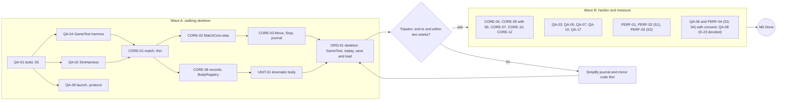

# M0 · Foundation

Feature cards of milestone M0. [ROADMAP.md](../ROADMAP.md) holds the overview, the conventions
every card follows and the status of every card; it is the source of truth for status, and the
statuses below mirror it. M0 is infrastructure the owner asked to start, so its cards were
pre-approved (`approved-foundation`); they are `specified` since the implementation spec was written. The implementation spec is [milestones/M0-foundation.md](../milestones/M0-foundation.md).

This file also holds the **plan-wide engineering baseline** (budgets, the budget matrix, the
decisions the cards rely on, the spikes and the test aggregates), because PERF-01 and the spikes
that confirm it live in M0.

## Milestone

**Goal.** The build and toolchain, every automated test harness, the deterministic kernel with
persistence and fault containment, the thinnest adapters that put a core unit into a real world,
and the walking skeleton, so every later feature can be proven and every budget rests on a
measurement.

**The owner plays.** Nothing yet: one debug command moves units through the core on a dedicated
server, seen from two clients, saved, reloaded and replayed to the same hash. The spike reports
say how many units the server can afford.

**Order: skeleton first, then measure on it.** Wave A builds thin cuts of the kernel and one
adapter path end to end. The tripwire (architecture §1.5, risk A-R11): if the skeleton is not end
to end after two weeks of M0 work, the journal and mirror code are simplified before anything
else is built. Wave B hardens and measures on the real skeleton.

**Done gate** (automated; plus the cumulative rule of ROADMAP.md):
1. Every acceptance criterion of the M0 cards passes at its level. Consent items (QA-06, PERF-04,
   CORE-01 AC5) and CI items (QA-08) never block Done.
2. `verify` is green on a clean checkout on the M4 Pro. `verifyHarness` proves the guards: an
   empty GameTest filter, a broken mod load, a missing smoke marker, each ArchUnit rule on its
   violating fixture and a deliberate JMH slowdown all fail.
3. The skeleton (ORD-01) passes as 20 seeded GameTests in one batch; each journal replays in L1 to
   the same hash; the match saves and loads with an equal hash; the L5 restart round trip leaves
   exactly one body per unit.
4. Kernel suites: 200-seed determinism runs and S6 (CORE-05), command validation (CORE-03),
   lifecycle and 50 parallel matches in one batch (CORE-01), fault injection in a two-match run
   (CORE-10), both quarantine paths on corrupted fixtures (CORE-12), the engine-surface inventory
   test (QA-17).
5. The L3 wall time is reported against 3 minutes (QA-04).
6. Spike reports in `docs/spikes/` for S1, S2, S5 and S6. S5 sets ADR-0007's status; S1 adds its
   numbers to ADR-0011; S1 and S2 feed PERF-01's confirmation of the revised ADR-0019. S3 and S4
   report if the owner consented, otherwise their ADRs say "pending consent".
7. The tripwire outcome is recorded in STATE.md.

**Acceptance** (owner):
1. The owner runs the skeleton demo on a dedicated server with two clients by QA-09's protocol
   (L7).
2. The owner approves ADR-0019's revised budget table with the M0 numbers, which moves the ADR to
   Accepted (PERF-01), and has the S1 numbers for D-01.
3. D-22 and D-23 are decided, or knowingly left open.

**Retires.** F-R5 (if S3 runs), F-R9, F-R15/A-R3 (in part), F-R19/A-R10 (arena cost), A-R11
(tripwire); measures F-R1/A-R2, F-R2/A-R8 (with consent) and F-R12 (build storm in S1).

**Size and critical path.** 26 cards (6 S, 20 M, 0 L), at most 66 card-days. Critical path to
Done: QA-01 → QA-04 → CORE-01 → CORE-02 → CORE-03 → ORD-01 → QA-05 → PERF-03 (22 card-days). Its
first six cards are the skeleton the tripwire watches (16 card-days), with CORE-06 → UNIT-01
beside them. QA-08 (CI, D-23 decided 2026-10-21) starts right after T3 and never blocks Done.

---

## Plan-wide engineering baseline

### Performance budgets (ADR-0019)

Definitions are ADR-0019's and do not change here. ADR-0019 was revised on 2026-10-21 to follow
this baseline; PERF-01 confirms the revised targets with the S1, S2 and S4 numbers and moves the
ADR to Accepted, with the owner's approval. All for the owner's M4 Pro, at the design scale of
600 units unless a gate says otherwise.

| ID | Budget | Measures | Target |
|---|---|---|---|
| A | Core | `MatchCore.step` plus our adapter appliers (`PhaseTimers`) | p50 ≤ 5 ms, p99 ≤ 10 ms |
| B | Strategos-attributable | A + vanilla work on our bodies + server-thread job work + replication + our between-tick handlers; measured A/B: the same arena with and without the match | p95 ≤ 17 ms |
| C | Whole tick | MSPT from `getTickTimesNanos` plus between-tick task time (packet handlers, `ChunkMap#move` of panning commanders) | p95 ≤ 23 ms |
| D | Pathfinding, main thread | Admission, delivery, joins; latency counted as path-result latency, not motion start (provisional steering moves units at once) | ≤ 2 ms p99; a 100-unit order's path results within 5 ticks p95 with 200 queued |
| E | Network per client | Every byte, ours and vanilla's (QA-19 counts vanilla bytes headless) | ≤ 100 KB/s with 600 visible moving units, over the gate's window |
| F | Client frame | 200 units on screen, render distance 16, Sodium on and off | p50 ≤ 16.7 ms, p99 ≤ 25 ms; our drawing ≤ 3 ms; units ≤ 6 ms; client tick ≤ 1 ms |
| G | Memory and saves | Core state, nav, autosave | ≤ 64 MB core state per 384² match; nav ≤ 32 MB at 512²; serialisation ≤ 100 ms |

Rules for every gate:
- **Target scale and stress.** A gate asserts the budgets at its milestone's target scale. A
  stress pass at twice that scale asserts only C p95 ≤ 50 ms, after 200 warm-up ticks.
- **Below 600 units** the unit-driven buckets are normalised per unit, and a gate fails when p95
  per unit grows more than 15 % over the previous milestone's committed baseline.
- **Validity.** One perf test per batch; a minimum window per gate; a run with more than 25 %
  foreign CPU load is invalid, neither pass nor fail; a gate is enabled only after 5 runs of one
  commit show a p95 coefficient of variation ≤ 5 % (QA-07).
- **F needs a real GPU.** CI with llvmpipe cannot check absolute frame times, so F runs only with
  the owner's consent (PERF-04, PERF-14); L1 benches of view-model building and frame extraction
  guard it in between.
- **Thresholds and baselines** change only with the owner's approval and an ADR.

### Budget matrix per milestone (delivered and kept by PERF-01)

| Milestone | Gate | Scale | Window | Headless budgets | Client F (consent) |
|---|---|---|---|---|---|
| M0 | PERF-01 self-test; S1, S2 | spike scales | – | A, G; harness self-test | S4 (PERF-04) |
| M1 | PERF-05 | 600 moving; stress 1,200 | 10 min | A, B, C, D, E, G (nav 384² and 512²) | – |
| M2 | CAM-03, CMB-02 checks | 1 panning commander; 2 × 100 melee | 5 min | C with `ChunkMap#move` ≤ 0.5 ms; A–C | PERF-14 |
| M3 | PERF-06 | 2 × 100, 20 buildings, 3 under construction | 15 min | A–E; G when an autosave falls in the window | PERF-14 re-run; S4's layered pass (ART-01) |
| M4 | PERF-07 | 300, 60 buildings, 5 under construction, 2 under repair | 15 min | A–E, G | – |
| M5 | PERF-08 | 300 fighting | 5 min | A–E | PERF-14 battle scene |
| M6 | PERF-09 | 2 × 150, 60 buildings, AI | 30 min | A–E, G; C ≤ 23 ms ÷ fastest game speed | PERF-14 |
| M7 | PERF-10 | 4 × 150, 120 buildings, 4 mock players | 20 min | A–E per client | S11 real clients (NET-04) |
| M8 | PERF-15 | 4 × 150 with fog, fog-edge skirmish | 20 min | A–E | PERF-14 fog scene |
| M9 | PERF-16 | 4 × 150, territory churn, 40 garrisoned | 15 min | A–C, E | PERF-14 border scene |
| M10 | PERF-17 | 2 civilisations, formations of 40, fauna | 15 min | A–E | PERF-14 |
| M11 | PERF-11 | 3 AIs at full population | 15 min | AI ≤ 1 ms p95, no AI think > 5 ms | – |
| M12 | PERF-12 | 512², 4 × 150 | 20 min | A–E, G | PERF-14 |
| M13 | PERF-13 | 1 area, 2 survival mock players | 15 min | A–C, chunk policy | – |
| M14 | PERF-18 | catapult splash, ships, traders | 15 min | A–E | – |

### Engineering decisions the cards rely on

Every research contradiction is settled by an ADR. Cards implement or confirm a decision; no card
settles or picks one again. A spike confirms its ADR against the exit criterion, or triggers the
fallback the ADR fixed in advance.

| Question | Settled by | Confirmed by |
|---|---|---|
| 1 Authority: who owns position, HP, orders | ADR-0008 | – (CORE-06 implements) |
| 2 Stats: modifier pipeline or attributes | ADR-0013 | – (DATA-02 implements) |
| 3 Content: registries or a reload listener | ADR-0012 | S12 (DATA-03) |
| 4 Determinism boundary, async delivery | ADR-0009, ADR-0015 | S6 (CORE-05), CORE-11, S7 (PATH-16) |
| 5 Navigation representation | ADR-0015 | S8 (PATH-01), S7 (PATH-16) |
| 6 Fog cadence and leaks | ADR-0016 | FOW-07, FOW-02, FOW-05 |
| 7 Camera, cursor, projection | ADR-0017 | S9 (CAM-01) |
| 8 Budgets | ADR-0019 | S1, S2, S4 (PERF-02 to PERF-04); PERF-01 confirms the revised ADR and moves it to Accepted |
| 9 GameTest wiring | ADR-0007 | S5 (QA-01) |
| 10 Licensing of prior art | ADR-0005 | provenance notes (DATA-04), QA-13; D-07 for our own licence |
| Unit body | ADR-0011 | S1 (PERF-02), S10 (UNIT-09) |
| Match model and arena sizes | ADR-0010 | S2 (PERF-03) |
| Persistence, quarantine | ADR-0018 | CORE-07, CORE-12, MATCH-04 |
| Orders and UnitAI | ADR-0014 | – |
| Economy and construction | ADR-0021 (leaf rule superseded by ECO-03's ADR) | – |
| Engine surface | ADR-0020 | QA-17 |

### Spikes

| Spike | Card | When | Consent | Exit criterion | Confirms |
|---|---|---|---|---|---|
| S1 server cost per body | PERF-02 | M0 wave B | no | kinematic ≤ 4 µs beyond the core at 500 moving; best body ≤ 15 µs, or cap 100 | ADR-0011, D-01, B |
| S2 force-loaded arena | PERF-03 | M0 wave B | no | ≤ 4 ms MSPT idle at 576 chunks; autosave ≤ 100 ms (import ≤ 30 s in MAP-01) | ADR-0010 sizes, D-17 |
| S3 client harness on macOS | QA-06 | M0 | yes | no focus theft, or a working container route | D-22 |
| S4 client frame time | PERF-04; the layered pass in ART-01 | M0, else with CAM-01; layers in M3 | yes | ≤ 6 ms for 200 units with Sodium, bare in M0 and armoured with ART-01; client tick ≤ 1 ms | ADR-0019 F, D-01 |
| S5 build wiring | QA-01 | M0 first | no | every AC of QA-01, QA-04, QA-05 | ADR-0003, ADR-0007 |
| S6 determinism canary | CORE-05 | M0; Linux once CI runs (D-23) | no | identical hashes at every checkpoint | ADR-0009 |
| S7 path service under load | PATH-16 | M1 slice 1B | no | main-thread path work ≤ 2 ms p99; path results within 5 ticks p95 | ADR-0015 (`k`, mode, W) |
| S8 terrain census and encoding | PATH-01 | M1 slice 1A | no | ≥ 99.9 % of columns ≤ 4 surfaces; nav ≤ 32 MB at 512² (page build ≤ 0.5 ms in PATH-02) | ADR-0015 encoding |
| S9 commander camera | CAM-01 | right after M0, client track | yes | zero snap-backs panning, ≤ 1 echo warning per jump; fill ≤ 3 s; picks within 1 block; `ChunkMap#move` ≤ 0.5 ms | ADR-0017 |
| S10 kinematic fidelity | UNIT-09 | M1 slice 1A | screenshots only | floor error ≤ 1/16 block; no visible pops at steps | ADR-0011 |
| S11 bandwidth | NET-04 | M7 start | real clients only | ≤ 100 KB/s per client | tier-4 reserve |
| S12 content cycle | DATA-03 | M1 content track | no | every error names file and JSON path; `/reload` ≤ 2 s | ADR-0012 |
| World creation from code | MATCH-14 | M6, before MATCH-02 | yes | an arena world created programmatically | MATCH-02's design |

### Test aggregates and wall-time budgets

| Aggregate | Contents | When | Budget |
|---|---|---|---|
| `verifyFast` | L0, fast L1 | every edit batch | ≤ 1 min |
| `verify` | L0–L3 default batch, L5, `verifyHarness`, the L1 soak `:core:soak` | before every commit | ≤ 5 min, of which L3 ≤ 3 min |
| `verifyHarness` | the guards fed their broken inputs: an empty GameTest filter, a broken mod load, a smoke run without its marker, every ArchUnit rule on its violating fixture, the fixture and JMH self-tests (part of `verify`) | inside `verify` | counted in `verify`'s 5 min |
| `verifySlow` | from M0 the GameTest batch `slow` (UNIT-01's 6,000-tick body test); from M1 map-scale GameTests, L1 `@Tag("slow")`, the crowd soak; QA-11's L3 sample from M3 | per session that touched the area; CI | reported per run |
| `verifyPerf` | JMH, perf GameTests in solo batches | hot-path changes; milestone exit; CI at 3× | reported per run |
| `verifySoak` | from M0 `:core:soak` (also inside `verify`); QA-12's (M6) and QA-16's (M10) L3 samples join it | milestone exit; CI | reported per run |
| `verifyClient` | L4 scenarios and diffs, PERF-14 | consent batch, or CI for goldens | ≤ 3 min per scenario |

---

## Decisions this milestone needs

### D-01 · Population cap per player

**Question.** The default population cap per player and the range offered in setup.

| Option | For | Against | Card delta |
|---|---|---|---|
| 100 | Safest for server and client; quick matches | Battles feel small to RTS players | none (data) |
| 150 | 2 × 150 = 300 units fits the provisional budgets; a tested default in prior art | Unmeasured on our stack until S1 and S4 | none |
| 200 | The AoE standard | 4 × 200 = 800 units likely breaks budget F | a stretch perf gate first |
| 300 | 0 A.D.'s default | Far beyond anything measured in Minecraft | not offered |

**Recommendation.** 150 by default, 50–200 in setup in steps of 25; siege costs 3 population,
every other unit 1. The default drops to 100 if S1 shows the best body above 15 µs at 500 moving
units, or S4 shows 200 armoured humanoids above 6 ms per frame. Above 200 only after a perf gate
at that scale passes.

**Needed by:** M0 exit (confirmed with S1), used from M3 (ECO-06). **Affects:** ECO-06, PERF-01,
AI-05, MATCH-08.

**Decided (2026-10-21):** as recommended, by the owner.

### D-22 · Client-run (L4) consent policy

**Question.** How client windows on the owner's Mac are allowed to run: 43 cards use L4, and a
window can take keyboard focus.

| Option | For | Against | Card delta |
|---|---|---|---|
| (a) Consent per run | Full control | A bottleneck mid-card | none |
| (b) Consent batched per card or milestone, plus an optional standing window (for example "announced in chat, evenings") | One request per batch; "pending consent" blocks only Accepted | The owner must keep a window free | none |
| (c) A Linux container under Xvfb on the Mac | No window opens | The owner installs a container runtime; per-platform goldens | container route in QA-18 |
| (d) CI only (needs D-23) | No window, no owner time | Goldens only; no absolute frame times (llvmpipe) | QA-08, QA-18 |

**Recommendation.** (b) for frame budgets and feel, plus (d) for goldens once CI exists. Budget F
always needs consent on the M4 Pro.

**Needed by:** M0 (QA-06). **Affects:** every L4 criterion, QA-06, QA-18, PERF-04, PERF-14.

**Decided (2026-10-21):** as recommended, by the owner.

### D-23 · CI and the private GitHub repository

**Question.** Does the project get a private GitHub repository with CI?

| Option | For | Against | Card delta |
|---|---|---|---|
| (a) No CI; everything local | Nothing to set up | Goldens need consent; S6 never runs on Linux; no production-jar client check without a window; no slow-host calibration | QA-08 dropped (−3 days) |
| (b) Private repository, one GitHub Actions Linux job | L4 goldens without consent, mc-runtime-test on the production jar, the Linux half of S6, the CI-to-M4 Pro speed ratio as the slow host for budget C | Free-tier minutes; the repository must exist | QA-08 (M), the golden job in QA-18 |
| (c) Another host | Same as (b) | More setup | as (b) |

**Recommendation.** (b), private by default (the owner's convention); publishing stays a separate
decision (D-21).

**Needed by:** M0 (QA-08, S6 on Linux). **Affects:** QA-08, QA-18, CORE-05, QA-13.

**Decided (2026-10-21):** as recommended, by the owner.

---

## Cards

### Wave A: walking skeleton

#### QA-01 · Build skeleton, pins, core merge and spike S5
- **Value:** The mod loads cleanly on clients and dedicated servers, and every later change lands
  on a build that rejects whole classes of bugs by itself.
- **In scope:** the Gradle multi-project (`build-logic`; `core` with `testFixtures` and `jmh`;
  `mod` with `test`, `gametest`, `devtools`, `archTest`) with the pins of
  [02-tooling.md](../02-tooling.md) in a version catalog; `core` merged into the mod for dev runs
  and the jar; the daemon JVM pinned; Spotless with palantir-java-format; ErrorProne with NullAway
  in JSpecify mode (rule B13); `core` compiled only against the JDK and the libraries Minecraft
  ships (B1); the aggregates of the baseline table, with `verifyFast`, `verify` and
  `verifyHarness` working in M0; spike S5.
- **Out of scope:** the ArchUnit rule set and the inventory test (QA-17); CI (QA-08); publishing.
- **Acceptance:**
  1. On a clean checkout `verifyFast` passes within 1 minute, and a catalog check fails on any
     dynamic version or range (L0).
  2. A jar check finds every `core` class exactly once in the built jar (L0).
  3. The dedicated server loads the mod (L5).
  4. The GameTest server loads the mod; the client load is QA-06's, with consent, or CI's (L3).
  5. A `net.minecraft` import in `core` fails compilation, and a null-unsafe dereference fails
     NullAway (L0).
  6. The second `verifyFast` reuses the configuration cache, or the S5 report states why not (R).
  7. S5 confirms ADR-0007 (the `gametest` source set inside the `strategos` mod group, registered
     by our generator) or switches to its fallback, a separate test mod (R).
- **Tests:** L0, L3, L5 · **Depends on:** — · **Size:** M · **Tier:** T0
- **Status:** in_progress

#### QA-02 · Core test kit: SimHarness, fakes and shared scenarios
- **Value:** Game rules, whole matches and replays are checked in seconds, and one scenario runs
  against fakes and in a real world.
- **In scope:** JUnit 5.14.4 and AssertJ 3.27.7 in `core`; `core/testFixtures` with `SimHarness`,
  the fakes for every port M0 has (`FakeBodies`, a fixed `Clock`; each later port brings its fake:
  `FakeWorld` and `VoxelFixtures` with PATH-02 and BLD-15, `FakeNet` with NET-01, the inline
  `JobExecutor` with PATH-03), per-tick invariant checkers and the scenario definitions that
  QA-04's generator also runs; a seeded invariant runner on `@ParameterizedTest` over 200 seeds
  that prints the seed and reruns one with `-Dstrategos.seed=<n>`; `@Tag("soak")` for M0's one
  long L1 run, the 200-seed soak, which `:core:soak` runs inside `verify` (`@Tag("slow")` arrives with
  the first map-scale L1 test, in M1; `verifySlow` exists from M0 for the GameTest batch `slow`); a Gradle check that keeps
  `core/testFixtures` free of JUnit and AssertJ.
- **Out of scope:** property-testing libraries (jqwik ≥ 1.10 is banned); game rules.
- **Acceptance:**
  1. `:core:test` finishes in under 10 s for the kernel suites (L1).
  2. A failing seeded test prints its seed, and `-Dstrategos.seed=<n>` reproduces it (L1).
  3. The invariants run after every tick of every harness run: units inside the match space,
     order queues ≤ 16, no unit stuck longer than 400 ticks; later cards add theirs (L1).
  4. The build fails when `core/testFixtures` depends on JUnit or AssertJ (L0).
- **Tests:** L0, L1 · **Fixtures:** scenario definitions, test template set · **Depends on:**
  QA-01 · **Size:** M · **Tier:** T0
- **Status:** specified

#### QA-04 · GameTest harness (L3)
- **Value:** Every in-world behaviour is proven in a real server world, fast and isolated, and a
  broken run can never pass as green.
- **In scope:** one generator with our own test annotation, registered through
  `RegisterGameTestsEvent`; `core/testFixtures` scenarios registered as GameTests; arenas as SNBT
  files with an explicit floor, at most 48 blocks per axis; `-Pgametest.filter`; our JUnit XML
  report (`GlobalTestReporter.replaceWith`) and the non-empty-report guard; the swapped
  `attempts` and `requiredSuccesses` of 1.21.1 fixed by the generator; one attempt per test unless
  the annotation carries an owner-approved reason, and the report lists every retried test;
  batches `default`, `slow`, `perf` and solo: perf tests and tests that change server-wide state
  (tick rate, `/reload`, gamerules, time) run alone, and the generator rejects them in a shared
  batch; per-test timeouts and a 10-minute task timeout; the L3 wall time reported against
  3 minutes on every run; map-scale tests place and release their own `TicketController`
  tickets, and a batch-end check fails if any Strategos ticket, match, body or writer job
  remains; a per-test artifact hook (CORE-11 exports journals through it); a README listing the
  GameTest server's defaults (mob spawning, weather and fire tick off, random ticks 0) and the
  rule that a test of a guard against a vanilla mechanism first enables that mechanism and shows
  it working on a control case outside the match.
- **Out of scope:** match fixtures (CORE-01); map import (MAP-01).
- **Acceptance:**
  1. A filter that matches no test fails the build (L3).
  2. A mod-loading error fails the build although the server process exits 0 (L3).
  3. The JUnit XML lists every test with its duration, plus the run's L3 wall time (L3).
  4. A test with two attempts and no reason is rejected; one with a reason retries as declared
     and appears in the retry list (L3).
  5. A perf test or a server-state test placed in a shared batch is rejected (L3).
  6. A map-scale test that leaks a ticket fails the batch-end check (L3).
  7. A scenario from `core/testFixtures` runs as a GameTest with the same outcome as in L1 (L3).
- **Tests:** L0, L3, L5 · **Fixtures:** SNBT arenas · **Depends on:** QA-01 · **Size:** M ·
  **Tier:** T0
- **Status:** in_progress

#### CORE-01 · Match container, lifecycle and region index
- **Value:** Every match is self-contained, so nothing leaks between matches or worlds, and fifty
  GameTests in one level are fifty independent matches.
- **In scope:** ADR-0010's lifecycle CREATED → PREPARING → READY → RUNNING ⇄ PAUSED → ENDED →
  DISPOSED, with FAULTED; `MatchSpace` in match-local coordinates; `MatchRegionIndex`, routing
  chunks to matches in O(1) and rejecting boxes that overlap within 2 blocks; the faction count;
  `MatchRules` copied in at creation; tick counter and seed; `MatchRegistry` with no static
  state; the `StrategosServer` holder, created on
  `ServerAboutToStartEvent` and dropped on `ServerStoppedEvent`; the `strategos_registry` blob
  (with CORE-07); GameTest fixtures binding a match to `GameTestHelper#getBounds()`;
  `/strategos match create` over a region of the current level. Wave A takes a thin cut
  (CREATED to RUNNING, one match per test).
- **Out of scope:** the roster of players and factions keyed by UUID (NET-01, whose gateway first
  binds a sender to a match slot; M0 seats no player, every M0 command is the admin's); Gaia
  (ECO-16, the first neutral units); setup screens (MATCH-02); teams (MATCH-06); the arena world
  (MAP-07); journaled rule changes (MATCH-01).
- **Acceptance:**
  1. Fifty matches in one GameTest batch run 1,000 ticks side by side with no shared mutable
     state (L3).
  2. Illegal lifecycle transitions are rejected (L1).
  3. Boxes overlapping within 2 blocks are rejected, and chunk routing returns exactly the
     touching matches (L2; `MatchSpace` and `MatchRegionIndex` are `mod` types).
  4. `StrategosServer` is bound to the running server, and a match is listed while it runs and
     leaves no runtime, record or body after `dispose` (L3).
  5. Closing one singleplayer world and opening another leaves no match behind (L4, consent;
     also step 7 of the QA-09 demo).
  6. On a dedicated server, `StrategosServer` exists from `ServerAboutToStartEvent` and is
     cleared on `ServerStoppedEvent` (L5, in QA-05's server smoke).
  7. No static mutable state exists besides the holders rule B8 allows (L0).
- **Tests:** L0, L1, L2, L3, L4 (consent), L5 · **Depends on:** QA-02, QA-04 · **Size:** M ·
  **Tier:** T0
- **Status:** specified

#### CORE-02 · Driving port and the nine-phase tick pipeline
- **Value:** Game logic runs in a fixed order every tick, so orders feel immediate, systems never
  fight over state, and a slow host never changes an outcome.
- **In scope:** `MatchCore.step(TickInputs) → TickOutputs` with sealed `InputEvent` and
  `OutputEvent` lists (`@CoreApi`); ADR-0009's nine fixed phases P0–P8: M0 implements `INGEST`,
  `COMMANDS`, `UNIT_AI` (IDLE, WALKING), `MOVEMENT` (straight-line kinematic motion on flat
  ground) and `FINAL`, the rest are empty slots; `TickDriver` stepping in `LevelTickEvent.Pre` in
  `MatchId` order, only while `runsNormally()`; cadences with offsets, the scheduler rejecting two
  heavy systems on one offset; work caps counted in work units; `PhaseTimers` read through the
  `Clock` port (budget A).
- **Out of scope:** activity tiers (UNIT-05); the match bus (CORE-04).
- **Acceptance:**
  1. A recorded trace shows the phase order of a test match (L1).
  2. Every input type has exactly one `INGEST` handler (L1).
  3. Every output type has exactly one adapter applier (L2).
  4. A fake clock reporting 10× slower phases gives the same state hash (L1).
  5. A system with cadence 10 over 1,000 entities processes 100 per tick (L1).
  6. The match steps only while `runsNormally()` (L2, against `TickRateManager`).
  7. `/tick freeze` and `/tick step 5` freeze and step the match on a dedicated server (L7, step 6
     of the demo); a frozen GameTest server stalls its own tests, so this cannot be an L3 test.
  8. Timer overhead stays below 1 % of the measured phase time (L6).
- **Tests:** L0, L1, L2, L6 · **Depends on:** CORE-01 · **Size:** M · **Tier:** T0
- **Status:** specified

#### CORE-03 · Command pipeline and in-memory journal
- **Value:** Every player and AI action is a server-validated command, so no client can move
  another player's units, and any match can be replayed exactly.
- **In scope:** typed command records in a core `CommandRegistry` (sealed types, one validator
  and one handler each; `Move`, `Stop` and a debug spawn in M0); `CommandEnvelope` with issuer
  slot, client sequence and received tick; semantic validation at the tick boundary (handles
  exist, are alive and owned; positions inside the match space); at most 300 handles per command
  and 256 commands per match per tick, the rest first in first out; one feedback record per
  command; the same `UNKNOWN_TARGET` for hidden and missing targets; the in-memory input journal
  of every `InputEvent` in canonical order (received tick, player slot, client sequence).
- **Out of scope:** bounded decoding and token buckets at the gateway (NET-01); prediction.
- **Acceptance:**
  1. Commands issued during tick t apply at the start of t+1 in canonical order (L1).
  2. A command on another faction's unit is rejected with a reason and changes nothing (L1).
  3. A command with 301 handles is rejected; the 257th command of a tick waits for the next (L1).
  4. Every command gets exactly one feedback record, and a missing and a dead (stale-generation)
     handle get the same `UNKNOWN_TARGET` (L1). M0 has no fog, so the hidden case is tested with
     the vision grid (FOW-01 AC5).
  5. The journal holds every input of a seeded run in canonical order (L1).
  6. A server command enqueues through the same path as every other source (L3).
- **Tests:** L0, L1, L3 · **Depends on:** CORE-02 · **Size:** M · **Tier:** T0
- **Status:** specified

#### CORE-06 · Unit records, handles and the body registry
- **Value:** Units never duplicate or vanish when chunks reload, worlds are saved or another mod
  removes an entity.
- **In scope:** ADR-0008: the authoritative unit record in the core `EntityStore` (identity,
  owner, template, motion, health, order queue, state) with 20-bit index plus 12-bit generation
  handles; the body seam (`BodyMode` `KINEMATIC`, with `PHYSICS` and `NONE` reserved; `BodyPose`,
  `BodyReport`); `BodyRegistry` as the only creator of bodies, at most 64 spawns per tick;
  `noSave` bodies re-created from core state on start; `EntityLeaveLevelEvent` by removal reason:
  unloaded to chunk leaves the unit bodiless, any other removal re-materialises it next tick and
  logs it. M0 has no health: `hurt` returns false, so `/kill` and vanilla damage leave units
  untouched until CMB-01 routes them into the core.
- **Out of scope:** abstract travel (CORE-09); a `PHYSICS` body (only if UNIT-09 asks).
- **Acceptance:**
  1. The record lifecycle runs without Minecraft, and freed handles come back with a new
     generation (L1).
  2. A body discarded by another cause is re-materialised next tick with the same handle and its
     pose within 1/16 block (L3).
  3. A body removed with `UNLOADED_TO_CHUNK` leaves the unit bodiless and alive (L3); a real chunk
     unload is checked by the L5 restart round trip (QA-05) and the L7 demo.
  4. `/tp` on a body is overwritten by the next pose; `/kill` leaves the unit and its body intact
     (L3).
  5. ArchUnit proves `core` never references the body implementation (L0).
- **Tests:** L0, L1, L3, L5 · **Depends on:** CORE-01 · **Size:** M · **Tier:** T0
- **Status:** in_progress

#### UNIT-01 · Unit body v0: a kinematic LivingEntity view
- **Value:** Units appear in the world as real Minecraft entities that every client sees, at
  almost no server cost.
- **In scope:** ADR-0011: `UnitEntity extends LivingEntity implements IEntityWithComplexSpawn`,
  registered as `strategos:unit_humanoid` with `MobCategory.MISC`, `noSave`, `noSummon`,
  `fireImmune`, `setShouldReceiveVelocityUpdates(false)`, tracking range 10 and update interval
  3; attributes from `LivingEntity.createLivingAttributes()`; the `KINEMATIC` tick skips
  `super.tick()`; `isPushable` false and `pushEntities` a no-op; `getMovementEmission` returns
  `NONE`; no loot, riding or portals; `onGround` held constant; handle, template and faction in
  the spawn data; poses applied in `LevelTickEvent.Pre`, before the tracker; a placeholder
  humanoid through `LivingEntityRenderer` and `HumanoidModel`. The two synced bytes arrive with
  their first users (ECO-05, CMB-01).
- **Out of scope:** steps and slopes (PATH-05, UNIT-09); outlines and render distance (UNIT-03);
  level of detail (UNIT-05).
- **Acceptance:**
  1. The type's settings match ADR-0011: `noSave` (so `getEncodeId` is null), `MISC`, `noSummon`,
     `fireImmune`, tracking range 10, interval 3, velocity updates off (L2).
  2. An idle body is never pushed by a neighbour, and a walking body never triggers a sculk sensor
     beside its path (L3).
  3. The spawn data round-trips (L2).
  4. A dedicated server starts with the type registered (L5).
  5. Same-tick pose shipping and packet discipline (no `SetEntityData` while walking, no teleport
     packets from `onGround` flips) are checked with captured packets once QA-19 exists (L3, in
     NET-01).
- **Tests:** L0, L2, L3, L5 · **Depends on:** CORE-06 · **Size:** M · **Tier:** T0
- **Status:** specified

#### QA-09 · Launch scripts, playtest protocol and the Done ADR
- **Value:** The owner tries every milestone under real multiplayer conditions with one command,
  and playtest verdicts become comparable scores.
- **In scope:** launch scripts for a dedicated server and two clients with separate game
  directories and fixed usernames (Quick Play); a playtest checklist and report template in
  `docs/`; a fixed questionnaire scored 1–5 (control feel, readability at the default camera
  height, waiting, decisions that mattered, the opponent's fairness and threat, Minecraft feel)
  plus "would I play another?" with a reason; the severity scale P0–P3; the desync proxy. The
  Definition-of-Done ADR is ADR-0022, accepted with the roadmap on 2026-10-21: it amends
  ADR-0006's rows for networking (L3 mock players and L5 before merge, L7 at the milestone exit)
  and for build and tooling changes (L4 only once QA-06 exists, with consent or on CI). QA-09
  confirms it in the first use of its scripts and protocol.
- **Out of scope:** automated multiplayer tests (QA-15).
- **Acceptance:**
  1. One documented command starts a server and two clients that connect (L7).
  2. The checklist, questionnaire and template exist (D).
  3. They are used at the M0 acceptance (L7).
  4. P0–P3 and the desync proxy are defined with examples (D).
  5. The first use of the scripts and the protocol, at the M0 acceptance, confirms ADR-0022 (D).
- **Tests:** D, L7 · **Depends on:** QA-01 · **Size:** S · **Tier:** T0
- **Status:** in_progress

#### ORD-01 · Walking skeleton: a debug move order end to end
- **Value:** The first end-to-end proof: an order goes through the server and the core, units
  walk in the world, every client sees them, and the match saves, loads and replays to the same
  hash.
- **In scope:** thin `/strategos debug spawn` and `/strategos debug move` → a `Move` command → a
  core order → straight-line motion on flat ground → arrival → IDLE; `/strategos hash`; a
  one-blob save and load (thin CORE-07); an L1 replay of every run's journal. Wave A ends here,
  and the tripwire checks it.
- **Out of scope:** pathfinding (PATH cards); orders from the UI (UI-05).
- **Acceptance:**
  1. 20 seeded instances in one batch each spawn units and order a move 20 blocks away; they
     arrive exactly on the target in at most distance ÷ speed + 1 ticks (L3).
  2. A target outside the match space is rejected with a reason, and the units stay (L3).
  3. A unit goes IDLE → WALKING → IDLE with a recorded event trace (L1).
  4. Each GameTest's journal replays in L1 to the same state hash (L1).
  5. Save, dispose and load in the same level keep the state hash (L3).
  6. The owner sees the move on two clients of a dedicated server (L7, acceptance).
- **Tests:** L1, L3, L5, L7 · **Depends on:** CORE-03, UNIT-01 · **Size:** S · **Tier:** T0
- **Status:** specified

### Wave B: harden and measure

#### QA-03 · Minecraft-bootstrapped unit tests (L2)
- **Value:** Saves, payloads and shipped data are checked against the real game classes, so they
  don't break silently between versions.
- **In scope:** ModDevGradle's unit-test integration with `testframework` 21.1.264; codec
  round-trip and encoded-size helpers; NBT fixture loading; one test fork;
  `EphemeralTestServerProvider` only for registry-backed decoding.
- **Out of scope:** anything that needs a world (QA-04).
- **Acceptance:**
  1. A codec round trip and a payload-size test run in `:mod:test` (L2).
  2. A payload over its cap fails the helper with the actual and the allowed size (L2).
  3. `:mod:test` finishes within 60 s on the M4 Pro (L2).
- **Tests:** L0, L2 · **Depends on:** QA-01 · **Size:** S · **Tier:** T0
- **Status:** in_progress

#### QA-05 · Server smoke (L5): boot, a headless match, a restart round trip
- **Value:** The mod never crashes a dedicated server, and real save files survive a restart bit
  for bit.
- **In scope:** `runServerSmoke` on port 25599, never colliding with the owner's dev server: boot,
  a headless match (M0: the skeleton on the `generated` map source; MAP-01 adds the proving-ground
  package, QA-11 600 ticks of AI versus AI), then halt with a marker; failure without the marker
  or on a new crash report; a restart round trip in which run 1 saves on stop and run 2 loads; a
  self-terminating dedicated-server mode for liveness checks that hold only our tickets (PERF-03,
  MAP-01).
- **Out of scope:** gameplay assertions beyond hashes (GameTests).
- **Acceptance:**
  1. Green on a clean build in under 60 s (L5).
  2. A deliberate client-class reference in common code makes it fail (L5).
  3. A deliberate crash during start makes it fail although the process exits 0 (L5).
  4. After the restart round trip exactly one body exists per unit, and the hash at a later tick
     equals that of an uninterrupted L1 replay (L5).
- **Tests:** L0, L5 · **Depends on:** QA-01, ORD-01, CORE-07 · **Size:** M · **Tier:** T0
- **Status:** in_progress

#### QA-06 · Client scenario runner and spike S3 (consent)
- **Value:** Camera, HUD and rendering can be checked by machine with screenshots, without
  disturbing the owner's work.
- **In scope:** a dev-only `devtools` source set; a minimal scenario runner: a fresh seeded world,
  fixed options, scripted steps through our own APIs, the framebuffer captured as PNG plus JSON
  on `RenderFrameEvent.Post` with `Screenshot.takeScreenshot`, and a watchdog; the production-jar
  check, by hand with consent until CI exists (the runner starts from the source sets, never from
  the jar); spike S3: focus stealing, typing capture, rendering while unfocused, covered or on
  another Space, the Retina framebuffer size, PNG repeatability, and a verdict on a Linux
  container route (installing a container runtime is the owner's decision; container runs open
  no window).
- **Out of scope:** `scenarioDiff`, masks and goldens (QA-18); two-client runs (CAM-01 builds
  them on this runner).
- **Acceptance:**
  1. The smoke scenario writes 3 PNGs and `result.json` and exits 0 within 3 minutes; a stalled
     scenario exits non-zero through the watchdog (L4, consent).
  2. Started by hand in a separate NeoForge 21.1.264 client profile, the production jar reaches
     the title screen with Strategos in the mod list (L4, consent; QA-08's release job automates
     it once CI exists).
  3. The S3 report answers each question, including the container verdict, and feeds D-22 (R).
- **Tests:** L0, L4 (consent) · **Depends on:** QA-01, D-22 · **Size:** M · **Tier:** T0
- **Status:** specified

#### QA-07 · Performance harness (L6)
- **Value:** Tick and frame rates stay stable as features grow, because every hot path has a
  trusted, measured baseline.
- **In scope:** a JMH source set in `core` run through `JavaExec` (no plugin), with `-prof gc` and
  0 B/op asserted for `@HotPath` kernels; the perf GameTest batch with percentiles after a
  200-tick warm-up and a minimum window per gate; one perf test per batch; validity rules: foreign
  CPU load recorded and a run above 25 % marked invalid (the verdict `invalid` in its perf JSON
  and a message starting with `INVALID`, distinct from a budget failure, because Gradle has one
  failure exit code), a gate enabled only after 5 runs of one commit show a p95 coefficient of
  variation ≤ 5 %, heap and GC flags pinned, baselines keyed by machine id; committed baselines;
  `verifyPerf` failing on a regression above 15 %. The A/B runner for budget B and the
  between-tick timers for C arrive with their first gate (PERF-05).
- **Out of scope:** the budgets themselves (PERF-01).
- **Acceptance:**
  1. A sample benchmark writes JSON, and `verifyPerf` fails when a deliberate slowdown exceeds
     15 %; the slowdown check stays in `verifyHarness` (L6).
  2. A perf GameTest records p50, p95 and p99 after warm-up and fails against a configured budget
     (L6).
  3. A run under more than 25 % foreign CPU load ends as invalid, with an `INVALID` message, not
     as a budget failure (L6).
  4. A `@HotPath` kernel that allocates fails its JMH check (L6).
- **Tests:** L0, L6 · **Depends on:** QA-02, QA-04 · **Size:** M · **Tier:** T0
- **Status:** specified

#### QA-08 · Continuous integration
- **Value:** Every change is verified the same way on a clean Linux machine, and three
  owner-dependent checks run without the owner.
- **In scope:** if D-23 says so: one GitHub Actions Linux job with `verify`, a datagen diff,
  GameTests, the server smoke test, JUnit reports, artifacts kept 7 days and the basic cache
  provider; the Linux half of S6; perf at 3× budget on shared runners, and the measured
  CI-to-M4 Pro speed ratio, so CI doubles as the slow host for budget C; a release job that runs
  the production jar on a client with mc-runtime-test. QA-18 adds the golden step.
- **Out of scope:** release publishing.
- **Acceptance:**
  1. A pull request shows per-test results from L1, L2, L3 and L5 (R).
  2. The job finishes in under 20 minutes (R).
  3. S6 gives the same hashes on Linux as on macOS (L1, on CI).
  4. The release job starts the production jar on a client (R).
- **Tests:** L0, L1, L2, L3, L5 · **Depends on:** QA-04, QA-05, D-23 · **Size:** M · **Tier:** T0
- **Status:** specified

#### QA-10 · Developer commands and log tagging
- **Value:** Problems are visible and reproducible in the game, which shortens every debugging
  session.
- **In scope:** the `/strategos` command tree with permission level 2, hidden from players
  without it; every log line from match code tagged with match id and tick. The host for dev
  overlays moves to PATH-10, which builds it with its first overlay (in M0 it would draw
  nothing); the dev payload channel and the config files arrive in M1 with NET-01 and the first
  tunable.
- **Out of scope:** the overlay host and its content (PATH-10).
- **Acceptance:**
  1. Debug commands need permission level 2 and are hidden from players without it (L3).
  2. Every log line from match code carries the match id and tick (L3).
- **Tests:** L0, L3 · **Depends on:** QA-04 · **Size:** S · **Tier:** T0
- **Status:** specified

#### QA-17 · Static gates, engine-surface inventory and fixture catalogue
- **Value:** The architecture's boundaries hold by construction, every hook into Minecraft is
  reviewed, and no test data goes missing.
- **In scope:** every ArchUnit rule of architecture §2.4 that can be written before the code
  exists: B2 (the `@CoreApi` hexagon), B3, B5 (client isolation), B6 (one sender), B7 (one block
  writer), B8 (no static mutable state), B9 (`@HotPath`), B10 (mixins only route), B11 (dev code
  never ships, with the jar check); B4 is CORE-05's; each rule with a violating fixture class
  that must fail, kept in `verifyHarness`; the engine-surface inventory test (B12, ADR-0020),
  starting with entity types, `SavedData` names, commands and the absence of mixins and access
  transformers; payloads and data registrations join with their first instance (NET-01, PATH-02);
  the fixture catalogue: a section of [05-testing.md](../05-testing.md) listing every fixture
  kind with location, generator and change rule, a build check for missing fixtures and deleted
  released-schema fixtures, and a lint that tests draw seeds only from committed seed sets.
- **Out of scope:** the determinism rules (CORE-05).
- **Acceptance:**
  1. Each rule fails on its violating fixture class and passes on the code base (L0).
  2. The shipped jar contains no `gametest`, `devtools` or `testFixtures` class (L0).
  3. The inventory test passes on the M0 inventory and fails on an unlisted entity type, mixin or
     access-transformer line (L2).
  4. The catalogue names every fixture kind with its change rule (D).
  5. A missing referenced fixture, a deleted released-schema fixture and a seed drawn outside the
     committed sets each fail the build (L0).
- **Tests:** L0, L2 · **Fixtures:** the catalogue itself · **Depends on:** QA-01 · **Size:** M ·
  **Tier:** T0
- **Status:** in_progress

#### PERF-01 · Budget matrix and enforcement
- **Value:** The game holds 20 TPS and smooth frames at the promised army sizes, because every
  milestone is gated on the same defined budgets.
- **In scope:** ADR-0019's budgets A–G as defined in the baseline above; the budget matrix per
  milestone (scale, window and budgets per gate); M0 asserts A and G; B, C, D and E join with
  their first gates (PERF-05, PATH-16, QA-19); F runs through PERF-04 and PERF-14 with consent;
  per-unit normalisation below 600 units; JFR allocation profiling on; confirming the revised
  ADR-0019 with the M0 measurements (the S1, S2 and S4 numbers) and moving it to Accepted, with
  the owner's approval.
- **Out of scope:** the measurements (PERF-02 to PERF-04).
- **Acceptance:**
  1. Perf GameTests assert A and G, and a synthetic overload fails as expected (L6).
  2. The matrix names scale, window and budgets per gate (D).
  3. The owner approves ADR-0019's table with the M0 numbers, and the ADR moves to Accepted; any
     later change needs the owner's approval and an ADR (D).
- **Tests:** L6, D · **Depends on:** QA-07 · **Size:** S · **Tier:** T0
- **Status:** specified

#### PERF-02 · Spike S1: server cost per body
- **Value:** The population cap and the unit body rest on measured numbers, not guesses.
- **In scope:** architecture §19.2: the production kinematic body (UNIT-01) against throwaway
  stripped `PathfinderMob` and physics `LivingEntity` bodies at 200, 500 and 1,000, idle, moving
  and fighting; a 300-body physics melee blob; a build storm at 64 placements per tick; `MISC`
  against other categories; time inside and outside MSPT; with and without Lithium; JFR hot
  methods.
- **Out of scope:** production code beyond UNIT-01 (spike code is never promoted).
- **Acceptance:**
  1. A reproducible perf batch produces the table body × count × state (L6).
  2. Exit: the kinematic body costs ≤ 4 µs per tick beyond the core at 500 moving bodies and the
     best body ≤ 15 µs, or the default cap drops to 100 (D-01); the report adds its numbers to
     ADR-0011 and feeds PERF-01 (R).
- **Tests:** L6, R · **Depends on:** UNIT-01, QA-07 · **Size:** M · **Tier:** T0
- **Status:** specified

#### PERF-03 · Spike S2: force-loaded arena cost
- **Value:** A match keeps simulating the whole arena without lag, wherever the camera is.
- **In scope:** 256, 576 and 1,024 chunks (the 256², 384² and 512² arenas of ADR-0010) with
  `TicketController` tickets at `ticking=false` (`true` only for the record); no player online;
  MSPT, heap and autosave time; `tickChunks` and `NaturalSpawner.createState` time with 600
  bodies; on a self-terminating dedicated server holding only our tickets. The 384² import time
  is MAP-01's.
- **Out of scope:** the importer (MAP-01).
- **Acceptance:**
  1. A results table per arena size and ticket mode (L6).
  2. Bodies keep ticking for 10 minutes with no player online (L5, self-terminating server).
  3. Exit: ≤ 4 ms MSPT idle at 576 chunks and autosave ≤ 100 ms; the report confirms
     `ticking=false` and the sizes for D-17 (R).
- **Tests:** L5, L6, R · **Depends on:** QA-05, QA-07 · **Size:** M · **Tier:** T0
- **Status:** specified

#### PERF-04 · Spike S4: client frame time with many units (consent)
- **Value:** The screen stays smooth with whole armies in view.
- **In scope:** 200, 500 and 1,000 bare humanoids drawn by the shipping renderer under a fixed
  elevated camera (no equipment layers exist before ART-01, which runs the armour and held-item
  pass in M3); render distance 16 and 24; Sodium on and off (`-Pcompat`). If the owner has not
  consented by M0 exit, it runs together with CAM-01. CI with llvmpipe cannot replace this run.
- **Out of scope:** the unit look and the layered pass (ART-01).
- **Acceptance:**
  1. A results table with frame p50 and p99, client tick time and the entity share of the frame
     (L4, consent).
  2. Exit: ≤ 6 ms for 200 bare humanoids with Sodium and client tick ≤ 1 ms, or the report names
     the level of detail needed; the numbers feed D-01, D-04 and ADR-0019, and the armoured
     threshold waits for ART-01 (R).
- **Tests:** L4 (consent), R · **Depends on:** QA-06, UNIT-01 · **Size:** M · **Tier:** T0
- **Status:** specified

#### CORE-04 · Match event bus
- **Value:** Systems react to each other (a unit dies, a building completes) at once and in the
  same order every time.
- **In scope:** a typed, synchronous per-match bus with handlers in registration order; a message
  published while dispatching is queued and delivered after the current handler returns; match
  traffic never uses NeoForge's global bus.
- **Out of scope:** network events (NET-01).
- **Acceptance:**
  1. Dispatch order is identical across runs (L1).
  2. Nested publishes are queued, never recursive (L1).
  3. A JMH baseline for dispatch is committed (L6).
- **Tests:** L0, L1, L6 · **Depends on:** CORE-02 · **Size:** S · **Tier:** T0
- **Status:** specified

#### CORE-05 · Determinism kit and spike S6
- **Value:** Any bug seen in a match or a test can be replayed exactly, which makes fixes fast
  and balance tests trustworthy.
- **In scope:** ADR-0009: the stateless counter-based `Rng.u64(seed, stream, tick, key, salt)`;
  `DetMath` over `StrictMath`; the state hash; `ReplayRunner` over the journal of CORE-03,
  naming the first divergent tick; rule B4 in full, with a self-test per banned API (wall clocks;
  `Math.random`, `java.util.Random`, `ThreadLocalRandom`, `SplittableRandom`; transcendental
  `Math` methods; `HashMap`, `HashSet`, `IdentityHashMap`, `Set.of`, `Map.of`, `Map.ofEntries`,
  the `toSet`, `toMap` and `groupingBy` collectors, object-keyed fastutil hash collections;
  threads, executors and parallel streams); S6: the same match twice per run with identical
  hashes at every checkpoint, on macOS, and on Linux once D-23 allows. The 0, 1 and 4 thread
  check arrives with the worker pool (PATH-16).
- **Out of scope:** the binary journal (CORE-11); player replays (MATCH-13).
- **Acceptance:**
  1. The same seed and journal give an identical state hash after 10,000 ticks, over 200 seeds
     (L1).
  2. Every banned API fails the build on its violating fixture (L0).
  3. `ReplayRunner` names the first divergent tick of a deliberately perturbed journal (L1).
  4. S6: two runs of one match give identical hashes at every checkpoint (L1).
  5. The S6 report is in `docs/spikes/` (R).
- **Tests:** L0, L1, R · **Fixtures:** seed sets for the 200-seed runs · **Depends on:** CORE-03,
  CORE-04 · **Size:** M · **Tier:** T0
- **Status:** specified

#### CORE-07 · Persistence kernel: one blob per match
- **Value:** Saves never lose units, resources or progress, and old saves keep loading after
  updates.
- **In scope:** ADR-0018: one self-contained `strategos_match_<id>` `SavedData` blob per match plus
  `strategos_registry`, with a save epoch; codecs defined in core, converted with `NbtOps` in the
  mod and `JsonOps` in L1; a `"v"` field and migrations on a DFU `Dynamic` before decoding;
  templates saved by string id; saving at autosave and on `ServerStoppingEvent`; the nav grid
  never saved; one save fixture per released schema, never deleted. Quarantine is CORE-12;
  quiescing path jobs at save is PATH-16.
- **Out of scope:** the player-facing save and resume (MATCH-04).
- **Acceptance:**
  1. Encoding and decoding a 500-unit fixture through `JsonOps` keeps the state hash (L1).
  2. The same round trip through `NbtOps` keeps it (L2).
  3. A version-1 JSON fixture migrates to version 2 through a sample migration (L1).
  4. The same migration runs on an NBT fixture file (L2).
  5. Save, dispose and load in the same level keep the state hash (L3).
  6. Serialising a 500-unit match stays within budget G, ≤ 100 ms (L6).
- **Tests:** L0, L1, L2, L3, L6 · **Fixtures:** save fixtures per released schema (JSON, NBT) ·
  **Depends on:** CORE-06 · **Size:** M · **Tier:** T0
- **Status:** specified

#### CORE-10 · Fault containment
- **Value:** One match's bug never takes down a server, another match or a four-player session,
  and every fault leaves a reproducible record.
- **In scope:** ADR-0009 and architecture §4.8: `FaultBarrier` around the per-match work in
  `LevelTickEvent`, the output appliers and `UnitEntity`'s server overrides; payload handlers
  (NET-01) and protection handlers (BLD-07) join it when they land, with their own test; a fault
  moves the match to `FAULTED`: it stops stepping, its bodies freeze, its players get a notice,
  and the snapshot, journal and a report go to `strategos/faults/<match>-<tick>/`; dev and
  GameTest runs rethrow after recording (`faults.rethrow`).
- **Out of scope:** save quarantine (CORE-12).
- **Acceptance:**
  1. An exception injected into one match of a two-match GameTest moves it to `FAULTED` with its
     snapshot, journal and report written, while the other match keeps stepping (L3, rethrow off).
  2. An exception in a `UnitEntity` override and one in an output applier are contained the same
     way (L3).
  3. With rethrow on, the test fails after the record is written (L3).
- **Tests:** L0, L1, L3 · **Depends on:** CORE-02, QA-04 · **Size:** M · **Tier:** T0
- **Status:** specified

#### CORE-12 · Save quarantine
- **Value:** A damaged save never silently resets a match: it is kept untouched for inspection.
- **In scope:** ADR-0018's two guards: our deserializer never throws (a blob that fails to decode
  is kept byte for byte, written back unchanged, and the match is `FAULTED` with the error); and an
  unreadable file never reaches it (when vanilla returns null for an existing file, it is copied
  to `<name>.dat.corrupt-<epoch>`, the match is `FAULTED`, and nothing is registered under that
  name).
- **Out of scope:** reconciling world and core after a crash (MATCH-04).
- **Acceptance:**
  1. A blob with invalid content is kept and written back unchanged, and the match is `FAULTED`
     (L3, corrupted fixture).
  2. A file vanilla cannot read is copied to `<name>.dat.corrupt-<epoch>` with identical bytes,
     the match is `FAULTED`, and nothing is registered under the name (L3, corrupted fixture).
  3. The deserializer never throws on the corrupted-fixture corpus (L2).
- **Tests:** L0, L2, L3 · **Fixtures:** corrupted saves for both paths (append-only) ·
  **Depends on:** CORE-07, CORE-10 · **Size:** M · **Tier:** T0
- **Status:** specified
