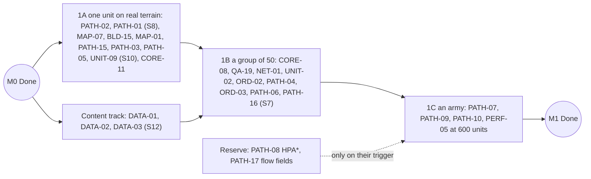

# M1 · Movement

Feature cards of milestone M1. [ROADMAP.md](../ROADMAP.md) holds the overview, the conventions
and the status of every card (the source of truth); the statuses below mirror it. Budgets,
spikes and the decisions the cards rely on are in the
[engineering baseline](M0-foundation.md#plan-wide-engineering-baseline).

## Milestone

**Goal.** Retire the largest risk: hundreds of data-defined units cross real Minecraft terrain on
group orders, with no stuck units and inside the budgets. M1 is the assistant's headless track;
it runs beside the owner-facing M2 client track (see ROADMAP.md, "Two tracks").

**The owner plays.** With the movement overlay on, the owner watches 200 units cross the proving
ground. On the client track, the owner tries the S9 camera prototype (CAM-01) over the same map.

**Order: three vertical slices and a content track.** Each slice ends with something to watch and
its own checks; nothing waits for one big integration at the end.

| Slice | Demo | Checks |
|---|---|---|
| 1A One unit on real terrain | A GameTest walks one unit across the imported proving ground over ramps, steps, a bridge and a ford | No ladder rung above repath; its journal replays in L1 to the same hash; S8 and S10 reports |
| 1B A group of 50 | 50 units ordered through a mock player's payload settle in their slots; two groups of 50 pass head-on through a 6-block gap | Identical hashes with 0, 1 and 4 path threads; the template set reaches a joining player before any unit; S7 and S12 reports |
| 1C An army | 200 units cross the proving ground; the owner watches the overlay | The 600-unit soak holds budgets A–E and G |

**Done gate** (automated; plus the cumulative rule):
1. Every acceptance criterion of the M1 cards passes. Consent items (UNIT-09 screenshots, PATH-10
   goldens) join M2's consent batch and never block M1 Done.
2. L3: 200 units ordered across the proving ground arrive within 1.5× the ideal time with no
   ladder rung above repath; two groups of 50 pass head-on through a 6-block gap; a boxed-in unit
   climbs the ladder and, with no exit, fails its order with a notice; a joining mock player
   receives the template set before any unit.
3. L6 (PERF-05): 600 moving units on random orders for 10 minutes hold A, B, C, D, E and G; the
   1,200-unit stress pass holds C p95 ≤ 50 ms; no failed order, at most 1 nudge per 1,000 orders,
   no unit stuck longer than 400 ticks.
4. L1: identical hashes with 0, 1 and 4 path threads, in `STRICT` and `ADAPTIVE`; every behaviour
   GameTest's journal replays to the same hash; golden journals committed.
5. ADR-0015 accepted with the S7 and S8 numbers; ADR-0012 confirmed by S12; ADR-0011 updated with
   S10 (with S1: accepted, or `PHYSICS` bodies named for the failing templates).
6. A `-Pcompat` server run (Lithium) of the movement GameTests passes, and the inventory lists
   `LevelChunkMixin`, the ticket controller, the data map, the preset and the M1 payloads.

**Acceptance** (owner): the owner watches the crossing with the overlay in a client (L7). Optional
owner task: hand-finish the generated proving ground; the generator stays the source of truth.

**Retires.** F-R3 and A-R4, A-R5 (pathfinding); A-R1 (S10); F-R15/A-R3 (cross-level replay,
thread counts); F-R16/A-R12 (S12); A-R10 (import time).

**Size and critical path.** 26 cards (1 S, 24 M, 1 L), at most 83 card-days. Critical path: PATH-02
→ PATH-03 → PATH-05 → PATH-06 → PATH-07 → PERF-05 (18 card-days). QA-19 → NET-01 → ORD-02 → ORD-03 →
PATH-09 → PERF-05 is as long. The reserve (PATH-08 L, PATH-17 M) is outside these numbers.

---

## Decisions this milestone needs

D-13 and D-17 are presented together, as the world-rules bundle: the arena world (MAP-07) applies
D-13's rules on first load, and D-17 sizes the arenas it hosts.

### D-13 · Which Minecraft systems run, and which become mechanics

**Question.** Which vanilla systems run inside a match arena, and which of them should later turn
into signature mechanics instead of interference?

| Option | For | Against | Card delta |
|---|---|---|---|
| (a) Vanilla as is | Minecraft feel | Hostile mobs, weather, fire spread, crop growth and leaf decay interfere with play and tests | protection work grows |
| (b) A controlled arena: no mob spawning, weather, fire tick or mob griefing; random ticks 0; fixed noon; `spectatorsGenerateChunks` off | Fair and deterministic; crops and leaves change only through our rules | Less "Minecraft" | none: MAP-07 applies it |
| (c) Controlled now, plus twists as match rules later | Signature mechanics no other RTS has | Each twist is a card to build and test | MATCH-16 (M, M10) for the first twist |

Twists that could become mechanics, with their cost:
- **Day and night** (M): night shrinks vision, and torches and campfires on buildings become
  vision sources. Needs fog: solo fog in M6 (D-24 (c), decided 2026-10-21), team fog in M8.
- **Hostile mobs at night as Gaia raiders** (L): a Gaia AI and controlled spawning in the arena.
- **Weather that shortens archer range** (S–M): a modifier while it rains.

Constraint: world time belongs to a level and is synchronised to every player in it
(`MinecraftServer#synchronizeTime`), and daylight is a world-wide gamerule set once in arena
worlds. A visible night is therefore world-wide, which is fine with one match per world (D-20),
unless it is drawn as a client-side tint.

**Recommendation.** (b) now; then (c) with day and night as the first twist (MATCH-16, M10).

**Needed by:** M1 (MAP-07). **Affects:** MAP-07, MATCH-01, ECO-03, ECO-09, BLD-07, MATCH-16.

**Decided (2026-10-21):** as recommended, by the owner.

### D-17 · Arena size

**Question.** How big the arenas are.

| Option | For | Against | Card delta |
|---|---|---|---|
| 256² (256 chunks) | Cheapest to keep loaded; quick fights | About 60 s to cross; cramped for a 1 v 1 economy | – |
| 384² (576 chunks) | About 95 s to cross on foot, close to a small 1 v 1 map in the classics | Must pass S2 | – |
| 512² (1,024 chunks) | Room for four players | S2 and memory must allow it | PERF-12 before it is offered |

**Recommendation.** 384² for the 1 v 1 MVP and the proving ground; 512² for four players once the
large-map gate (PERF-12) passes; 256² for small tests. S2 sets the final numbers.

**Needed by:** M6 (MAP-02); MAP-01 already uses 384². **Affects:** MAP-01, MAP-02, MAP-04,
PERF-12.

**Decided (2026-10-21):** as recommended, by the owner.

**S2 measured (2026-10-22):** with nobody online and `ticking=false` tickets, 256², 384² and 512²
idle at 0.07, 0.06 and 0.10 ms MSPT, and stay under 0.35 ms p99 with 600 walking bodies; autosave
medians 5–8 ms. Server cost limits no size; 512² still waits for PERF-12
([S2](../spikes/S2-force-loaded-arena.md)).

---

## Cards

### Content track

#### DATA-01 · Template engine
- **Value:** Every unit, building and technology is defined in data with inheritance, so content
  and balance change without code.
- **In scope:** architecture §8.3: JSON templates with `parent` chains and mixins; deep merge,
  `$op` add, mul and replace, `$disable`, `$append` and `$remove`, class tokens with `+` and `-`,
  `abstract`; cycle and missing-parent detection that names the chain; the derived kinds
  `FOUNDATION`, `PREVIEW` and `MIRAGE`; typed decoding with core codecs;
  `TemplateProblem(file, JSON pointer, severity, message)`, collecting every problem; an immutable
  `TemplateSet` versioned by the SHA-256 of its canonical JSON. The design is borrowed from 0 A.D.
  as behaviour only; no 0 A.D. file is read.
- **Out of scope:** loading from data packs (DATA-03).
- **Acceptance:**
  1. A three-level chain with two mixins resolves to the expected flattened template (L1, golden
     JSON).
  2. Each merge construct behaves as its table-driven test says, token removal included (L1).
  3. Cycles and unknown parents fail with file, path and reason, and every problem is reported,
     not only the first (L1).
  4. Derived kinds drop or override exactly the specified parts (L1).
  5. Resolving 500 templates takes under 200 ms (L6).
- **Tests:** L0, L1, L6 · **Fixtures:** test template sets · **Depends on:** QA-02 · **Size:** M ·
  **Tier:** T0
- **Status:** specified

#### DATA-02 · Modifier pipeline
- **Value:** Technologies, ranks, civilisation bonuses, high ground and AI handicaps stack
  predictably, and tooltips always show the true numbers.
- **In scope:** ADR-0013: value paths interned to ids;
  `Modifier(path, op, value, filter, stage, priority, sourceId)` with `REPLACE`, `MUL`, `ADD` and
  `TOKENS`; evaluation per stage (replace, then product, then sum, clamped to the path's range),
  with products and sums in canonical source-id order; class filters compiled to bitsets;
  `StatBlock` caches per template and faction plus per-unit overlays; invalidation by version,
  posting `StatsChanged` on the match bus; `StatBreakdown` for tooltips and `/strategos stats`.
  Vanilla attributes are never a source and are not mirrored for `KINEMATIC` bodies.
- **Out of scope:** technologies (TECH-01).
- **Acceptance:**
  1. Table-driven tests fix stages, priority, the order of replace, multiply and add, and clamping
     (L1).
  2. The result never depends on the order modifiers were added in, over 200 seeded permutations
     (L1).
  3. `TOKENS` edits a production list (`+a -b`) as specified (L1).
  4. Adding or removing one modifier invalidates exactly the affected entries and posts
     `StatsChanged` (L1).
  5. The breakdown returns the base value, each modifier with source and stage, and the result
     (L1).
  6. A cached read costs under 50 ns (L6).
- **Tests:** L0, L1, L6 · **Depends on:** DATA-01, CORE-04 · **Size:** M · **Tier:** T0
- **Status:** specified

#### DATA-03 · Content loading, client sync and spike S12
- **Value:** Content and balance load from data packs, reload during development without a
  restart, and every client sees exactly the server's definitions.
- **In scope:** ADR-0012: `TemplateReloadListener` (registered in `AddReloadListenerEvent`;
  prepare off the main thread, apply on it under NeoForge's conditional ops); `TemplateLint`
  (unknown keys, class tokens and value paths, missing blueprints and models, unknown item and
  block ids, dangling production references); the SHA-256 set version; the append-only
  `TemplateIdTable` with a hash check and resend; `template_set` sync on `OnDatapackSyncEvent`
  (login, before any pairing, and `/reload`); `ContentSwap` as a journaled input at the next tick
  boundary; a reload with errors keeps the previous set; a reload that removes a template in use
  is refused with a named error; `/strategos templates reload|errors|dump`; spike S12.
- **Out of scope:** the public authoring guide (DATA-05).
- **Acceptance:**
  1. All bundled templates decode through the real listener with zero problems, and a broken one
     is reported with file and JSON path (L2).
  2. Unknown keys are reported, and the id table is append-only across reloads (L1).
  3. A reload with errors keeps the previous set, and removing a template in use is refused (L3,
     solo batch).
  4. After `/reload` with a changed unit speed, existing units move at the new speed from the next
     tick boundary (L3, solo batch).
  5. The `ContentSwap` is journaled, and the run replays in L1 to the same hash (L1).
  6. A joining mock player receives the template set with a matching hash before any unit is
     paired to it, and a hash mismatch triggers a resend (L3).
  7. The sync payload for the MVP content stays under 256 KB (L2).
  8. S12, with about 20 templates and two levels of inheritance: `/reload` ≤ 2 s, and every error
     names its file and JSON path; the report confirms ADR-0012 (R).
- **Tests:** L0, L1, L2, L3, L5, R · **Depends on:** DATA-01, NET-01 · **Size:** L · **Tier:** T0
- **Status:** specified

### Slice 1A · One unit on real terrain

#### PATH-02 · Surface pages: block classes and the page builder
- **Value:** Units understand Minecraft terrain: steps, slabs, water, fences, walls, bridges and
  overhangs.
- **In scope:** ADR-0015 and architecture §9.1–9.2: `BlockClassTable` over every registered block
  state (collision top in 1/16 from `getCollisionShape(EmptyBlockGetter.INSTANCE, BlockPos.ZERO)`,
  fences and walls as 1.5; sturdy floor, passable, water, lava, climbable, door, hazard, leaves,
  slow), with overrides from the `strategos:nav_class` data map; position-dependent states flagged
  for main-thread classification; the pure core `VoxelSlice` and `PageBuilder`: up to 4 standable
  surfaces per column with floor height in 1/16, headroom and class, the candidate one-`int`
  encoding, 8-neighbour and page-edge connectivity, footprint masks from the core overlay;
  `VoxelFixtures` (ASCII terrain) in `core/testFixtures`; the data map's inventory entry.
- **Out of scope:** live capture and rebuilds (PATH-15); mobility classes beyond infantry
  (PATH-11); gates (PATH-12).
- **Acceptance:**
  1. Every registered block state classifies, and the fixture blocks (slab, stairs, snow layer,
     carpet, fence, wall, door, water 1 and 2 deep, lava, leaves) match the expected table (L2).
  2. Pages built from synthetic slices give the expected surfaces and connectivity, bridges over
     walkable ground and wall tops included (L1).
  3. Equal slices give equal page hashes (L1).
  4. A page builds in ≤ 0.5 ms (L6; S8's third exit number).
- **Tests:** L0, L1, L2, L6 · **Fixtures:** `VoxelFixtures` · **Depends on:** QA-02, QA-03 ·
  **Size:** M · **Tier:** T0
- **Status:** specified

#### PATH-01 · Spike S8: terrain census and surface encoding
- **Value:** The terrain model is proven against real Minecraft maps before armies depend on it.
- **In scope:** confirms ADR-0015's layered grid. A reproducible census (seeds and regions listed,
  one command, a self-terminating server) of surfaces per column and the Y range in use, on
  vanilla 512² samples from several biomes plus generated bridge, wall and tower fixtures; bytes
  per page for the candidate encoding; the surface bit layout fixed; PATH-02's page-build time.
  Long-crossing A* expansions come from PATH-03's crossing benchmark and decide whether PATH-08
  leaves the reserve.
- **Out of scope:** the production capture (PATH-15).
- **Acceptance:**
  1. The census runs from one command on a self-terminating server and lists its seeds and regions
     (L5).
  2. Exit: ≥ 99.9 % of columns need ≤ 4 surfaces, and the nav grid fits 32 MB at 512²; with
     PATH-02's page-build number the report moves ADR-0015 toward Accepted (S7 completes it), or
     names the change needed (R).
- **Tests:** L5, R · **Fixtures:** census seeds and regions (versioned) · **Depends on:** PATH-02 ·
  **Size:** S · **Tier:** T0
- **Status:** specified

#### MAP-07 · Arena world: preset, world rules and tickets
- **Value:** Players get a dedicated Strategos arena world in one click, and their own worlds'
  rules are never touched.
- **In scope:** ADR-0010 and architecture §3.2: the `strategos:arena` world preset in
  `#minecraft:normal` (a void flat overworld with dimension type `minecraft:overworld` and biome
  `strategos:arena`, without spawners, precipitation or features, plus the vanilla nether and end,
  so the world stays stable, not experimental); `ArenaWorld`, which recognises the preset on
  `ServerStartedEvent` and applies the D-13 rules once (`doMobSpawning`, `doFireTick`,
  `mobGriefing`, `doDaylightCycle` at noon and `doWeatherCycle` off; `randomTickSpeed` 0;
  `spectatorsGenerateChunks` off; a lobby pad), recording that it did in `strategos_registry`;
  `level-type=strategos:arena` for dedicated servers; slots 2,048 blocks apart and `ArenaPolicy`;
  the `strategos:match` ticket controller with a `LoadingValidationCallback` that drops tickets of
  dead matches; the inventory entries.
- **Out of scope:** the importer (MAP-01); the open-world policy (MAP-06).
- **Acceptance:**
  1. The preset decodes and is in `#minecraft:normal` (L2).
  2. A dedicated server with `level-type=strategos:arena` applies the arena rules once, records
     it, and keeps an owner's later change across a restart (L5).
  3. The gamerules of a world that is not an arena are never changed (L3).
  4. Tickets of a disposed match are dropped on restart (L5).
  5. New matches take slots 2,048 blocks apart (L1).
- **Tests:** L0, L1, L2, L3, L5 · **Depends on:** CORE-01, D-13 · **Size:** M · **Tier:** T0
- **Status:** specified

#### BLD-15 · Block writer
- **Value:** Every block Strategos places or removes goes through one budgeted writer, so
  construction never spikes the tick, and a lagging picture never changes the game.
- **In scope:** ADR-0021 and rule B7: the only caller of `Level#setBlock`, `removeBlock` and
  `destroyBlock`; flags `UPDATE_CLIENTS | UPDATE_KNOWN_SHAPE`; one global budget of 64 placements
  per tick across matches; sites served round-robin, each flushing in bursts at most every 4
  ticks; priorities: node removals, construction, damage stages, cosmetics, then import; a
  thread-confined `OWN_WRITE` flag that navigation ignores; `ProtectedBlockIndex` filling; the
  boundary shape pass on completion; `FakeWorld` in `core/testFixtures`, applying `WorldEffect`s
  under the same budget.
- **Out of scope:** what is written (MAP-01, ECO-03, BLD-03, BLD-05).
- **Acceptance:**
  1. With saturated queues in two matches, the budget is never exceeded, and each site flushes at
     most every 4 ticks (L3).
  2. Our own writes trigger zero page rebuilds (L3).
  3. `FakeWorld` applies effects in the same order under the same budget as the adapter (L1).
  4. The cost per placement is measured against PERF-01's threshold (L6).
- **Tests:** L0, L1, L3, L6 · **Depends on:** CORE-02, CORE-10 · **Size:** M · **Tier:** T0
- **Status:** specified

#### MAP-01 · Map packages, importer and the proving ground
- **Value:** A standard battlefield exercises every movement case, so pathing quality is measured,
  not guessed.
- **In scope:** the map-package format of architecture §3.3 (a `MapManifest` plus 32 × H × 32
  tiles in vanilla structure NBT; size, Y band, start slots, deposits, rule overrides, version and
  terrain hash); `MapImporter` writing through BLD-15 at 8,192 blocks per tick while no match in
  the level runs (otherwise at the writer's lowest priority), filling each column below its lowest
  stored block, then waiting until `hasLightWork()` is false; `/strategos map export|import|list`;
  the 384² proving ground generated by a deterministic devtools script that emits both the L1
  `VoxelFixture` and the L3 map package (hills, ramps, 1-block steps, cliffs, a river with fords
  and two bridges, forest, a narrow pass, a walled yard); the L5 smoke runs a match on it.
- **Out of scope:** the skirmish map (MAP-02); generated maps (MAP-03).
- **Acceptance:**
  1. The proving ground imports and prepares in ≤ 30 s of wall time (L3, solo batch; S2's import
     number).
  2. Two imports give equal terrain hashes, and export then import of a region round-trips (L3).
  3. The manifest lists the spawn points and waypoints tests use, and the L1 fixture equals the
     package's terrain (L1).
  4. Bodies in the imported arena keep ticking with no player online, on a self-terminating server
     that holds only our tickets (L5).
- **Tests:** L0, L1, L3, L5 · **Fixtures:** proving-ground package and fixture with a terrain
  hash · **Depends on:** BLD-15, MAP-07, PERF-03 · **Size:** M · **Tier:** T0
- **Status:** specified

#### PATH-15 · Live terrain capture, page rebuilds and the block-change router
- **Value:** The nav grid follows the live world (players, explosions, other mods) without ever
  stalling a tick, and our own construction costs no navigation work.
- **In scope:** architecture §9.2 and §9.7: main-thread capture of the sections overlapping a page
  (`PalettedContainer#copy`); page builds as pure jobs delivered with `k` = 4; slices journaled as
  `TerrainPage` inputs; `LevelChunkMixin` at the return of `LevelChunk#setBlockState` →
  `BlockChangeRouter` → `MatchRegionIndex` lookup, recording a `WorldChange` only when the block
  class changed and ignoring `OWN_WRITE`; dirty pages coalesced and rebuilt after 4 quiet ticks,
  within 40 ticks, at most 4 pages per tick, with units keeping the stale walkable page;
  `PathInvalidated` and repaths at most once per 20 ticks; every page prewarmed at prepare; page
  hashes stored for resume; the mixin's inventory entry.
- **Out of scope:** the pure page model (PATH-02).
- **Acceptance:**
  1. Placing or removing a block updates the affected pages within 40 ticks without a full
     rebuild, and units stop pathing through a new wall (L3).
  2. Writes flagged `OWN_WRITE` never dirty a page (L3).
  3. Rebuilding from journaled slices gives the same page hashes (L1).
  4. Page capture and publication stay ≤ 0.4 ms p95 and ≤ 4 pages per tick (L6, solo batch).
  5. Prewarming a generated 512² arena finishes in ≤ 30 s (L6, solo batch).
  6. The router's cost per block change outside any match is reported for PERF-01's threshold (R).
- **Tests:** L0, L1, L3, L5, L6, R · **Depends on:** PATH-02, BLD-15, CORE-01 · **Size:** M ·
  **Tier:** T0
- **Status:** specified

#### PATH-03 · Path service: A*, string pulling and STRICT delivery
- **Value:** Units find sensible routes over real terrain and respond on the tick an order arrives.
- **In scope:** ADR-0015, stage 1: the `PathService` API; short moves of ≤ 24 blocks with line of
  walk need no search; A* over surfaces (8 neighbours, costs 1 and √2, water ×4, own doors and
  gates ×1.5, +0.5 per up-step, hazards impassable, octile heuristic with weight 1.0); a
  20,000-expansion cap with a `PARTIAL` path to the best node; string pulling; request ids that
  drop superseded results; provisional steering on the tick an order applies; `STRICT` delivery at
  `t+k` (`k` = 2) with `pathThreads = 0`; the inline `JobExecutor` in `core/testFixtures`; a
  crossing benchmark on 384² and 512² terrain for budget D and PATH-08's trigger.
- **Out of scope:** the worker pool, `ADAPTIVE` delivery and admission (PATH-16); hierarchical
  search (PATH-08); group paths (PATH-09).
- **Acceptance:**
  1. Paths on synthetic terrain equal reference costs and respect every cost rule (L1).
  2. A new order 2 ticks after the first drops the first result (L1).
  3. Every ordered unit moves on the tick its order applies and follows its path result from
     `t+k` (L1).
  4. A search that reaches 20,000 expansions returns `PARTIAL` toward the best node (L1).
  5. The crossing benchmark reports expansions and time for 384² and 512² crossings; a miss of
     budget D triggers PATH-08 (L6).
  6. A unit crosses a GameTest arena of steps and a ford along its path (L3).
- **Tests:** L0, L1, L3, L6 · **Depends on:** PATH-02, CORE-05 · **Size:** M · **Tier:** T0
- **Status:** specified

#### PATH-05 · Path following: kinematic motion on surfaces
- **Value:** Units walk their routes smoothly over steps, slopes, bridges and shallow water, and
  stop cleanly.
- **In scope:** architecture §6.6: the core `MotionSystem` integrating each unit along its steering
  velocity over connected surfaces: up-steps ≤ 1.0 smoothed over 2 ticks, drops ≤ 3 blocks, a
  turn-rate limit per template, shallow water slows, hazards impassable, falls to the next surface
  (fall damage once health exists), knockback impulses as short deterministic displacements;
  arrival with a latch (single units within 0.5 block); the body only mirrors poses.
- **Out of scope:** avoidance (PATH-06); stuck recovery (PATH-07).
- **Acceptance:**
  1. A 1-block up-step is climbed over exactly 2 ticks, and Y equals the floor of the current
     surface (L1).
  2. A unit follows a path over ramps, steps and a bridge on the proving ground with its body Y
     equal to the core floor within 1/16 block (L3).
  3. 50 units ordered one by one across the proving ground arrive within 1.5× the ideal time with
     no ladder rung above repath (L3, solo batch).
  4. Motion costs under 5 µs per unit per tick (L6).
- **Tests:** L0, L1, L3, L6 · **Depends on:** PATH-03, UNIT-01 · **Size:** M · **Tier:** T0
- **Status:** specified

#### UNIT-09 · Spike S10: kinematic fidelity
- **Value:** Units look right on the ground (on slabs, stairs, snow, paths and in shallow water),
  which is the first thing the owner sees in M2 and in first person.
- **In scope:** architecture §19.2: pose traces over slabs, stairs, snow layers, carpets, dirt
  paths, farmland, shallow water and drops; player melee and arrows on a unit arrive in the core as
  journaled `ExternalDamage` inputs (the core applies them from CMB-01 on); screenshots at steps
  with consent. Units walking around players is checked by PATH-06.
- **Out of scope:** a `PHYSICS` body, unless this spike asks for one.
- **Acceptance:**
  1. Pose traces show a floor error ≤ 1/16 block on every listed surface (L3).
  2. Player melee and an arrow on a unit arrive as journaled `ExternalDamage` inputs (L3).
  3. Screenshots at steps show no visible pops (L4, consent; in M2's consent batch).
  4. With S1 and PATH-06's avoidance check, the report sets ADR-0011 to Accepted, or names the
     templates that get `PHYSICS` bodies (R).
- **Tests:** L3, L4 (consent), R · **Depends on:** PATH-05, PATH-15 · **Size:** M · **Tier:** T0
- **Status:** specified

#### CORE-11 · Binary journal and cross-level replay
- **Value:** Nondeterminism leaking through an adapter is caught the day it appears, and any bug
  seen in the game becomes a JUnit reproduction.
- **In scope:** ADR-0009 and architecture §5.5: the binary journal (a header with the core
  version, the template set or its hash and dump, `MatchConfig`, `MatchRules` and the initial
  snapshot with terrain pages; per-tick `InputEvent`s in the core wire codecs; segments of 1,200
  ticks, each starting with a snapshot); recording in every harness run and GameTest and by
  default in dev runs; every behaviour GameTest exports its journal through QA-04's hook, and an
  L1 task replays them to the same hash; `/strategos journal save <file>`; golden journals with
  checkpoint hashes under `core/src/test/resources/journals/`.
- **Out of scope:** the production ring buffer (MATCH-04); player replays (MATCH-13).
- **Acceptance:**
  1. Every behaviour GameTest's journal replays in L1 to the same hash (L1).
  2. A segment replays from its own snapshot (L1).
  3. A golden journal whose hash changes fails until it is re-baselined with a written reason
     (L1).
  4. `/strategos journal save` writes a file that `ReplayRunner` replays (L3).
- **Tests:** L0, L1, L3 · **Fixtures:** golden journals · **Depends on:** CORE-05, QA-04 ·
  **Size:** M · **Tier:** T0
- **Status:** specified

### Slice 1B · A group of 50

#### CORE-08 · Spatial index
- **Value:** Units find nearby enemies, resources and dropsites instantly, even in large battles.
- **In scope:** architecture §10.1: `UnitGrid` of 8-block cells rebuilt every tick by a counting
  sort, with a faction bitmask per cell; `StaticIndex` of buildings, nodes and dropsites per page;
  allocation-free queries (`forEachInRadius`, `nearest`, `nearestNode`, `nearestDropsite`) with
  faction and class filters; results in handle order.
- **Out of scope:** the resource node index (ECO-02).
- **Acceptance:**
  1. Query results equal brute force over 1,000 random seeds (L1).
  2. Results come in handle order (L1).
  3. 1,000 radius-16 queries among 1,000 units take under 1 ms per tick, and the rebuild allocates
     nothing (L6).
- **Tests:** L0, L1, L6 · **Depends on:** CORE-02 · **Size:** M · **Tier:** T0
- **Status:** specified

#### QA-19 · Network test kit: byte counts and acknowledging mock players
- **Value:** Bandwidth and fog are tested headless, because mock players count every byte and see
  what a real client would.
- **In scope:** bytes counted by encoding captured clientbound packets with
  `GameProtocols.CLIENTBOUND_TEMPLATE`, bound through `RegistryFriendlyByteBuf.decorator`, with
  bundles unbundled first; mock viewers that acknowledge chunk batches
  (`ServerboundChunkBatchReceivedPacket`), through our own helper if testframework's mock player
  does not; byte counters per player and per packet type, ours and vanilla's, exported to perf
  runs; helpers that capture packets per player and type; one validation against JFR
  `minecraft.PacketSent` from a real client. Mock players have no packet encoder, so JFR alone
  cannot measure budget E headless.
- **Out of scope:** multiplayer scenarios (QA-15 builds on this kit).
- **Acceptance:**
  1. An acknowledging mock viewer gets every chunk in its view distance tracked (L3).
  2. Captured packets can be asserted per player and type (L3).
  3. Byte counters per player and type, ours and vanilla's, reach perf runs (L6).
  4. The encoder count matches a real connection's JFR `PacketSent` total within 5 % on one
     scripted scene (R, once, consent).
- **Tests:** L0, L3, L6, R · **Depends on:** QA-03, QA-04 · **Size:** M · **Tier:** T0
- **Status:** specified

#### NET-01 · Payload layer, NetGateway and the fog-gate stub
- **Value:** The multiplayer foundation: every message is compact, validated and sent only to the
  players allowed to see it, so fog of war needs no rewiring later.
- **In scope:** ADR-0016: payloads registered through `RegisterPayloadHandlersEvent` with a
  protocol version; the match roster of players keyed by UUID and bound to faction slots, moved
  from CORE-01 because M0 seats no player: the gateway takes a command's issuer from the slot
  bound to the sender's UUID, never from a name or a payload field; `WireCodec` records in
  `core.protocol`, adapted by `ByteBufWire`; `NetGateway.send(Audience, payload)` with the
  audiences `Player`, `Faction`, `TrackersOf`, `SeesCell` and `Match`, each payload declaring the
  ones it may use; coalescing per player per tick; bounded decoding (≤ 32 commands and 4 KiB per
  batch, ≤ 300 handles per command) and token buckets (40 commands/s with bursts of 80, 3,000
  handles/s), violations counted and a disconnect above 100 a minute; payload handlers inside
  `FaultBarrier`; the `FogGate` stub behind `UnitEntity#broadcastToPlayer` (another match: false;
  the same match: true), failing closed; interest sets from `startSeenByPlayer` and
  `stopSeenByPlayer`; `FakeNet` in `core/testFixtures`; the M1 payloads `commands`,
  `template_set`, `match_join`, `match_state` and `feedback`; byte counters per payload; inventory
  entries; "faction", never "team", in names.
- **Out of scope:** the lobby (NET-02); per-player state rules (NET-03); replication tiers
  (NET-08).
- **Acceptance:**
  1. Every payload round-trips and stays within its cap (L2).
  2. `WireCodec` sizes are exact (L1).
  3. Every payload type declares its audiences, and the gateway refuses any other (L2).
  4. Only `NetGateway` sends packets (L0, rule B6).
  5. A mock player of another match receives no payload and is never paired with this match's
     bodies, while a mock player of the same match in range is paired and receives `match_state`
     (L3).
  6. Oversized or malformed batches are dropped and counted, and the 101st violation in a minute
     disconnects (L3).
  7. `FogGate` hides when its lookup throws (L1).
  8. A pose set in `LevelTickEvent.Pre` reaches a mock player in the same tick, and a walking unit
     causes no `SetEntityData` and no `onGround` teleport packet (L3).
  9. A mock player's commands carry the slot bound to its UUID as issuer, and a mock player with
     no slot in the match gets no command applied (L3).
- **Tests:** L0, L1, L2, L3, L5 · **Depends on:** CORE-03, QA-03, QA-19 · **Size:** M ·
  **Tier:** T0
- **Status:** specified

#### UNIT-02 · UnitAI state machine framework
- **Value:** Units behave predictably: they finish tasks, react to new orders at once and never
  stall doing nothing.
- **In scope:** ADR-0014 and architecture §7.5: the core `Hfsm` (a tree of states with `enter`,
  `leave`, `onTick` and typed message handlers; unhandled messages bubble to the parent;
  transitions run after the handler returns); the current state as an id plus a small data record,
  saved as plain data; a think period per state; the messages of §7.5; IDLE and WALKING now, with
  extension points for GATHER, BUILD and COMBAT.
- **Out of scope:** the later states (ECO-05, BLD-03, CMB-02).
- **Acceptance:**
  1. Nested transitions and inherited handlers pass table-driven tests, one per transition (L1).
  2. Machine state round-trips through the persistence codecs (L1).
  3. A static check proves every state has an exit path (L1).
- **Tests:** L0, L1 · **Depends on:** CORE-04, CORE-06 · **Size:** M · **Tier:** T0
- **Status:** specified

#### ORD-02 · Order queue: move and stop
- **Value:** Orders behave as in every classic RTS: a new order replaces the old one, Shift queues
  waypoints, Stop cancels.
- **In scope:** ADR-0014 and architecture §7.4: an `OrderQueue` of at most 16 orders; `REPLACE`
  (default), `QUEUE` (Shift), `PUSH_FRONT` (interrupts) and `finishOrder`; `Move` and `Stop`;
  group commands fan out into one order per unit with a shared group id; a right-click context
  resolver that later cards extend; orders arrive through CORE-03 from server commands and the
  `commands` payload.
- **Out of scope:** previews and markers (UI-05).
- **Acceptance:**
  1. Queue semantics pass table-driven tests, the 16-order cap included (L1).
  2. Three queued waypoints are visited in order, and Stop clears the queue (L1).
  3. An order sent as a mock player's `commands` payload is validated and applied at the next tick
     boundary (L3).
- **Tests:** L0, L1, L3 · **Depends on:** ORD-01, UNIT-02, NET-01 · **Size:** M · **Tier:** T0
- **Status:** specified

#### PATH-04 · Components and reachability
- **Value:** Units never try to walk where they cannot reach; an order on unreachable ground goes
  to the nearest reachable spot.
- **In scope:** architecture §9.3: union-find components over surfaces per mobility class,
  maintained per page; O(1) reachability; `makeGoalReachable` to the nearest surface in the unit's
  component; incremental updates when pages are republished.
- **Out of scope:** reachability per mobility class beyond infantry (PATH-11) and per faction
  through gates (PATH-12).
- **Acceptance:**
  1. Reachability equals a flood fill on 500 random grids (L1).
  2. An unreachable goal resolves to the nearest reachable surface while expanding under 1 % of
     the A* cap (L1).
  3. After a wall splits a region, the components equal a flood fill within 40 ticks (L3).
- **Tests:** L0, L1, L3 · **Depends on:** PATH-02, PATH-15 · **Size:** M · **Tier:** T0
- **Status:** specified

#### ORD-03 · Group destination slots
- **Value:** A group spreads out sensibly at its destination instead of piling onto one block, and
  the player can preview where each unit will stand.
- **In scope:** architecture §9.4: a slot layout around the target scaled to group size and body
  radii, snapped to standable surfaces in the target's component; facing and width parameters;
  assignment that minimises crossing paths; shared core code that the client runs for previews
  (UI-05).
- **Out of scope:** the preview on screen (UI-05); formations (ORD-06).
- **Acceptance:**
  1. Slots are standable, reachable, at least 0.8 block apart and deterministic (L1).
  2. 50 units settle within 1.5 blocks of their slots (a single unit within 0.5), and no two stand
     closer than 0.6 block at rest (L3).
- **Tests:** L0, L1, L3 · **Depends on:** ORD-02, PATH-04 · **Size:** M · **Tier:** T0
- **Status:** specified

#### PATH-06 · Local avoidance (ORCA)
- **Value:** Armies flow around each other and around players without overlapping or jittering.
- **In scope:** architecture §9.5: a Java port of RVO2 (Apache-2.0; licence and `NOTICE` kept,
  changes marked) on the XZ plane per surface layer; at most 10 neighbours within 3 blocks from the
  spatial index and a 1 s horizon; blocked surface edges as static half-planes; first-person
  players and vanilla mobs as `AgentUpdate` inputs counted as non-reactive agents (an observer
  avatar is excluded, see D-08); separation steering in cells with more than six units; moving
  units yield to fighting ones and idle units step aside; cadence by activity tier.
- **Out of scope:** formations (ORD-06).
- **Acceptance:**
  1. Two groups of 50 pass head-on through a 6-block gap and both arrive (L3).
  2. In that test no two units stay closer than 0.4 block for more than 5 ticks (L3).
  3. Units walk around a first-person mock player (L3; S10's avoidance check).
  4. Avoidance is deterministic for equal inputs, and `NOTICE` carries the RVO2 notice (L1).
  5. Avoidance costs under 5 µs per unit per tick at 600 units (L6).
- **Tests:** L0, L1, L3, L6 · **Depends on:** PATH-05, CORE-08 · **Size:** M · **Tier:** T0
- **Status:** specified

#### PATH-16 · Worker pool, ADAPTIVE delivery and spike S7
- **Value:** Big group orders never freeze the game, and a slow host changes only how fast paths
  arrive, never where units go.
- **In scope:** ADR-0015 and architecture §9.6: the pooled `JobExecutor` (`strategos-path-N`
  daemon threads created only in `mod.server.jobs`; `clamp(cores / 3, 1, 4)` on an integrated
  server, `clamp(cores / 2 − 1, 1, 4)` on a dedicated one); `STRICT` help-join, and `ADAPTIVE`
  delivery from `t+k` with a journaled `JobDelivery` input and a help-join at `t+k+8`; admission by
  summed expansion caps within W (a match rule, 200,000 to start); `BUSY` beyond 2,048 outstanding
  requests, deterministic and distinct from `NO_PATH`, with a retry after 10 ticks; quiescing at
  save; the path-thread setting in `strategos-server.toml`, the first config file; spike S7 on the
  384² proving ground (200 simultaneous requests, `k` = 1–4, 0–4 threads, `STRICT` against
  `ADAPTIVE`, W).
- **Out of scope:** the search (PATH-03).
- **Acceptance:**
  1. One match gives identical hashes with 0, 1 and 4 path threads, in `STRICT` and in `ADAPTIVE`
     with journaled delivery (L1).
  2. Admission never exceeds W per tick, and request 2,049 gets `BUSY`, not `NO_PATH` (L1).
  3. A save quiesces outstanding jobs, and the reloaded match continues bit-identically (L3).
  4. Main-thread path work stays ≤ 2 ms p99, and a 100-unit order's path results arrive within 5
     ticks p95 with 200 requests queued (L6).
  5. The S7 report sets `k`, the live delivery mode and W, and with S8 moves ADR-0015 to Accepted
     (R).
- **Tests:** L0, L1, L3, L6, R · **Depends on:** PATH-03 · **Size:** M · **Tier:** T0
- **Status:** specified

### Slice 1C · An army

#### PATH-07 · Stuck ladder
- **Value:** No unit stays stuck: a blocked unit finds its way or gives up with a notice, and the
  player never has to babysit it.
- **In scope:** architecture §9.5: no progress toward the current waypoint for 40 ticks → repath;
  100 → step to the nearest free surface; 200 → a partial path that ignores units; 400 → a
  deterministic nudge of at most 4 blocks along the path to a free surface; 600 → the order fails
  with a notice. There is no teleport. Every rung is logged and counted for the overlay; no rung
  leaves the match space or enters a footprint, and nothing depends on who watches.
- **Out of scope:** units inside committed footprints (BLD-03 moves them out first).
- **Acceptance:**
  1. A boxed-in unit climbs the rungs in order and, with no exit, its order fails at tick 600 with
     a notice (L1).
  2. No rung moves a unit outside the match space or into a footprint (L1).
  3. A unit boxed in by placed blocks in a GameTest frees itself or fails with the notice (L3).
  4. In the crowd soak, nudges stay under 1 per 1,000 orders (L6, in PERF-05).
- **Tests:** L0, L1, L3, L6 · **Depends on:** PATH-05, PATH-06 · **Size:** M · **Tier:** T0
- **Status:** specified

#### PATH-09 · Shared group path
- **Value:** An order to 150 units is as responsive as an order to one.
- **In scope:** architecture §9.4: one search per group from its centroid; join paths of at most
  2,000 expansions to the nearest point of the group path; slot offsets along it, switching to own
  slots near the goal; individual paths for small groups. Flow fields stay in reserve (PATH-17).
- **Out of scope:** formations (ORD-06).
- **Acceptance:**
  1. An order to 150 units issues at most 10 % of the path requests of individual planning (L1).
  2. 200 units cross the proving ground within 1.5× the ideal time with no ladder rung above
     repath (L3, solo batch).
  3. Group-path work stays within budget D at 600 units (L6).
- **Tests:** L0, L1, L3, L6 · **Depends on:** PATH-06, ORD-03, PATH-16 · **Size:** M ·
  **Tier:** T0
- **Status:** specified

#### PATH-10 · Movement debug overlay and dev payloads
- **Value:** Movement problems become visible on screen, so they are fixed before players meet
  them.
- **In scope:** the dev payloads `debug_subscribe` and `debug_feed` (optional, operators only, dev
  builds) through `NetGateway`; the client-side host for dev overlays, moved from QA-10 (M0 has
  no overlay to draw); the overlay in it: surface classes and layers, components, paths, ladder
  rungs and stuck markers, activity tiers; a text panel with queue depth, latency p95 and compute
  time; a toggle; `/strategos perf dump` as CSV.
- **Out of scope:** player-facing order markers (UI-05).
- **Acceptance:**
  1. A client that has not subscribed receives no dev payload, while a subscribed one does (L3).
  2. Overlay code is client-only (rule B5, L0), and the server smoke passes (L5).
  3. Overlay goldens on the proving ground (L4, consent; in M2's consent batch).
- **Tests:** L0, L3, L4 (consent), L5 · **Depends on:** PATH-03, NET-01, QA-10 · **Size:** M ·
  **Tier:** T0
- **Status:** specified

#### PERF-05 · Crowd soak and the M1 perf gate
- **Value:** Large armies keep moving smoothly in every build, because a long crowd test guards
  against regressions.
- **In scope:** the M1 row of the budget matrix: 600 units on seeded random orders for 10 minutes
  on the proving ground, and a stress pass at 1,200; the A/B runner for budget B and the
  between-tick timers for C, built here on QA-07's harness; assertions for A, B, C, D, E (QA-19's
  counters) and G (nav at 384² and 512²); a stuck histogram; a report artifact; part of
  `verifySlow` and `verifyPerf`.
- **Out of scope:** combat load (PERF-08).
- **Acceptance:**
  1. The soak runs from one command and writes percentiles and the stuck histogram (L6).
  2. It fails on any failed order, more than 1 nudge per 1,000 orders, a unit stuck longer than
     400 ticks, or a broken budget (L6).
  3. The 1,200-unit stress pass holds C p95 ≤ 50 ms (L6).
  4. A failing seed reproduces exactly from its journal (L1).
- **Tests:** L1, L6 · **Fixtures:** soak seed set · **Depends on:** PATH-07, PATH-09, MAP-01,
  QA-07, QA-19 · **Size:** M · **Tier:** T0
- **Status:** specified

### Reserve (outside the milestone's totals and critical path)

#### PATH-08 · Hierarchical long-range planner (HPA*)
- **Value:** Long orders across large maps are planned quickly and take sensible routes.
- **Reserve:** starts only when S8 or the 384² and 512² crossings (PATH-03, PERF-05) miss budget D;
  needed at the latest by open-world navigation (PATH-13).
- **In scope:** architecture §9.3, stage 2: portals on page edges per mobility class and surface
  layer; intra-page portal costs by Dijkstra at page build; A* over portals (at most 4,000
  expansions) gives a corridor of pages; low-level A* inside the corridor; corridors cached per
  (from page, to page, class, grid version).
- **Out of scope:** a second hierarchy level (open world, PATH-13).
- **Acceptance:**
  1. Path cost stays within 5 % of full A* on the test maps (L1).
  2. A 384-block query expands at most 10 % of flat A*'s nodes (L6).
  3. Corridors update within one rebuild cycle after a wall is built (L3).
- **Tests:** L0, L1, L3, L6 · **Depends on:** PATH-03, PATH-04 · **Size:** L · **Tier:** T0
- **Status:** approved

#### PATH-17 · Flow fields for large groups
- **Value:** Very large groups move as one without a path per unit.
- **Reserve:** starts only when PATH-09 shows the shared group path is not enough.
- **In scope:** architecture §9.4: groups of eight or more share a flow field over the corridor
  pages: Dijkstra from the goal with deterministic tie breaking, a direction per surface, cached
  per (goal cell, class, grid version) with eviction by simulation tick.
- **Out of scope:** formations (ORD-06).
- **Acceptance:**
  1. Fields are deterministic and equal a reference implementation (L1).
  2. A 150-unit group crosses the proving ground with fewer path computations than PATH-09 and no
     ladder rung above repath (L3).
  3. Field builds stay within budget D (L6).
- **Tests:** L0, L1, L3, L6 · **Depends on:** PATH-09 · **Size:** M · **Tier:** T0
- **Status:** approved
