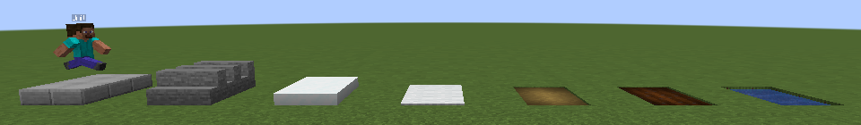
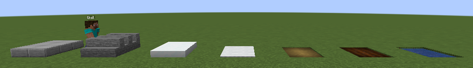
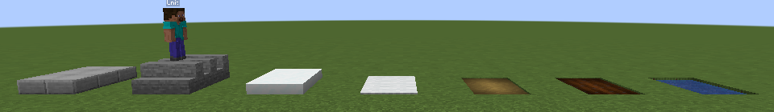
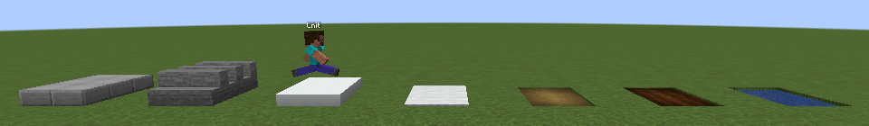
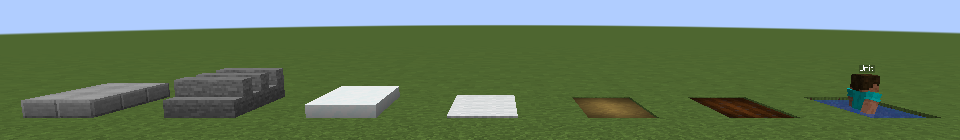

# S10: kinematic fidelity

*Written with M1 T10 on 2026-10-22; completed with T21's avoidance check on 2026-10-23. Spec:
[M1 §8.2](../milestones/M1-movement.md#82-s10-kinematic-fidelity-t10-completed-in-t21--confirms-adr-0011);
card UNIT-09.*

## Question and exit criterion

Do kinematic unit bodies ([ADR-0011](../adr/0011-unit-entity-and-body-seam.md)) look right on the
ground, and does vanilla damage reach the core?
- Pose traces: the floor error on slabs, stairs, snow layers, carpets, dirt paths, farmland,
  shallow water and drops (UNIT-09.1).
- A player's blow and an arrow on a unit arrive in the core as journaled `ExternalDamage` inputs
  (UNIT-09.2).
- The `s10_steps` frames on the Linux route: no frame where a unit's feet leave the step's top by
  more than 1/16 block; the frames attached (spec §8.2; the owner's visual check, UNIT-09.3, is the
  optional Mac pass in M2's consent batch).
- With S1 and PATH-06's avoidance check (T21): ADR-0011 moves to Accepted, or the report names the
  templates that need `PHYSICS` bodies (UNIT-09.4).

Exit: a floor error ≤ 1/16 block on every listed surface.

## Setup

- **GameTests:** Apple M4 Pro, Temurin 21.0.12.1, NeoForge 21.1.264, the GameTest server of
  `./gradlew :mod:runGameTestServer`; tree at commit `745a75c`.
- **Client frames:** the Linux route ([scenario.yml](../../.github/workflows/scenario.yml)):
  `ubuntu-24.04`, Xvfb at 1920 × 1080, Mesa's llvmpipe, a 1280 × 720 framebuffer; runs
  [39840845891](https://github.com/o-e-lytvynskyi/strategos/actions/runs/39840845891) and
  [39841394131](https://github.com/o-e-lytvynskyi/strategos/actions/runs/39841394131) at `745a75c`.
- **Bodies:** the debug walker, 0.25 blocks a tick, a 0.6 × 1.8 box; update interval 3.

## Method

1. **The floor error** is a body's Y against where vanilla physics would rest the same body: its
   box, lifted 1.5 blocks, dropped onto the collision shapes (`Entity.collideBoundingBox`). A
   vanilla body stands on the highest shape under its whole box, as a physics body would.
2. **`fidelitytests.pose_traces`:** eight lanes on a stone bed, walled in so that no path goes
   round a strip, one walker each over a 20-block strip: bottom slabs, stairs walked along their row,
   three layers of snow, white carpet, a dirt path, moist farmland, a pool one block deep, and a
   platform three blocks high to drop from. Every tick on which a body's box lies over its strip
   alone and the unit is not halfway up a step counts (spec §1.6 D row 69).
3. **`fidelitytests.player_melee_and_arrow_journaled`:** a `FakePlayer` strikes a unit, and an
   arrow it owns is shot at the unit from four blocks; the test reads the match's journal.
4. **`s10_steps`:** a row of seven patches on the flat world's grass, each two blocks long and three
   wide with two blocks of grass between: bottom slabs, stairs walked along their row, three layers
   of snow, carpet, a dirt path, farmland and a pool a block deep. A fixed camera looks from 14
   blocks to the south. From the order to the arrival a PNG every 2 ticks, and for each the body's
   client-side Y and its vanilla rest Y in `result.json` (D row 70). Two runs; their frames compared
   pixel by pixel with [tools/png_diff.py](../../tools/png_diff.py), as S3 did.

## Results

**Pose traces** (server bodies, the floor error at most):

| Surface | Error | Ticks measured |
|---|---|---|
| Bottom slab | 0 | 73 |
| Stairs, along the row | 0 | 73 |
| Snow, three layers | 0 | 73 |
| Carpet | 0 | 73 |
| Dirt path | 0 | 73 |
| Farmland | 0 | 73 |
| Shallow water, 1 deep | 0 | 145 |
| After a three-block drop | 0 | 25 |

The drop fell half a block a tick, never faster. Every surface's top is a multiple of 1/16 block
(snow's collision is two sixteenths a layer below the top layer, so three layers rest at 4/16), and
the core's floors are in sixteenths, so the error is exactly 0.

**External damage:** the blow arrived as `ExternalDamage(hack, 0.208, player)` (a fist with a fresh
attack timer), the arrow as `ExternalDamage(pierce, 5.0, player)` (2.5 blocks a tick); both in the
journal, the body's health untouched.

**Client frames:** both runs arrived after 76 frames (152 ticks). The body's client-side Y against
its rest Y, by its distance from the nearest edge of a patch, over both runs
([data/S10-frames.csv](data/S10-frames.csv)):

| Distance from an edge | Frames | Error at most |
|---|---|---|
| 1 block or more | 58 | 0 |
| 0.5 to 1 block | 60 | 0.17 |
| Under 0.5 block | 34 | 1.0 (leaving the pool), 0.67 (onto the stairs) |

The frames of the two runs agree outside a box round the unit: there, the unit stands up to one
tick's walk apart, and in 11 frames the pool's water animation differs too. At most 3,038 pixels
of 921,600 differ, 2,583 of them by more than 8 levels
([data/S10-png-diff.csv](data/S10-png-diff.csv)). Frames of the first run, cropped to the row:

| | |
|---|---|
| On the slabs |  |
| Halfway onto the stairs |  |
| On the stairs |  |
| On the snow |  |
| In the pool |  |

## Analysis

- **On a surface, kinematic bodies sit exactly.** The server's poses never leave the floor, and the
  client shows them on it wherever the unit is a block or more from an edge.
- **At an edge, the step is a ramp a block long.** The core changes floors when the unit's centre
  crosses into the next column, and takes a rise over two ticks and a fall at half a block a tick
  (PATH-05). The client interpolates its pose updates, three ticks apart, so the step spreads over
  about 0.75 block of walk. Within half a block of an edge the feet are therefore off a top by up to
  a sixth of a block, and on the edge itself they are between two tops.
- **No pops, but the feet cut into a step's edge.** No frame shows a jump: the body moves on smooth
  ramps. But a vanilla body would stand on a step as soon as its box reaches it, 0.3 block before
  its centre does, and stay on a ledge until its box has left it; ours steps at its centre, so for
  about two frames per step up its front foot is inside the step (the "halfway onto the stairs"
  frame), and on the way down it hangs over the edge. This is the main visual difference from a
  physics body.
- **Stairs are full blocks.** The core takes a shape's highest top, so a stair block is a one-block
  step; a body walking along a stair row overlaps its high half and rests there, as a vanilla body
  would. Climbing a staircase is a one-block step per stair, not two half steps.

## What it decides

- **`PHYSICS` bodies are not needed for fidelity.** Kinematic bodies are exact on every listed
  surface; together with S1's cost (0.12 µs a body against about 5 µs for a physics body), nothing
  argues for physics bodies.
- **Units walk round players (T21, 2026-10-23).** In `avoidtests.walk_around_mock_player` a
  first-person mock player in no match stands on a walker's straight line: the agent tracker
  journals it as the tick's agent and the walker goes round it, never nearer than their two radii
  (0.35 + 0.3), and arrives. A member of the match is its observer and is passed through
  (`avoidtests.member_avatar_passed_through`, D-08). So kinematic bodies need no physics to make way
  for players either. **ADR-0011 is Accepted**; no template gets a `PHYSICS` body (UNIT-09.4).
- **A proposal for the owner:** stand a unit on the highest surface under its whole footprint, as a
  vanilla body does, instead of the one under its centre. The feet would then never cut into a
  step's edge or hang over a ledge; it is a change to PATH-05's motion, best made before the Mac
  pass of M2's consent batch ("For the owner" in [STATE.md](../STATE.md)).

## Raw data

- [data/S10-frames.csv](data/S10-frames.csv): per frame of both runs, the body's row position, Y
  and rest Y (blocks above the grass), and what its box was over.
- [data/S10-png-diff.csv](data/S10-png-diff.csv): per frame, the pixels that differ between the two
  runs.
- The pose traces' line is logged by `fidelitytests.pose_traces` in every `verify`.

## Deviations and follow-ups

- The error is measured against vanilla's rest height (D row 69); the frames cover the whole walk,
  not 40 ticks (D row 70); the mock player is a `FakePlayer` (D row 71).
- UNIT-09 is done with T21's avoidance check (2026-10-23); its screenshots (UNIT-09.3) remain the
  optional Mac pass of M2's consent batch.
